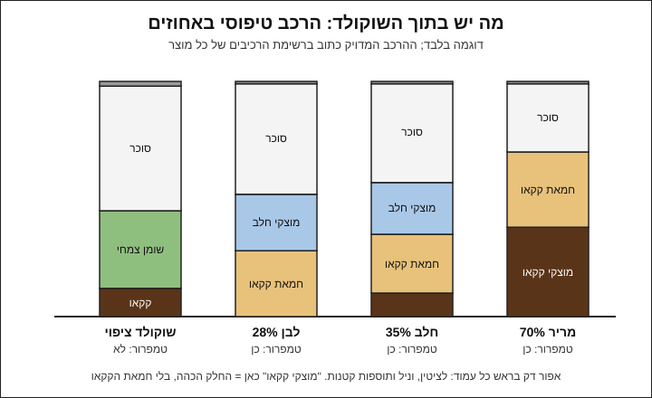

# 01.1 · מה זה שוקולד: קוברטורה, ציפוי, אחוזי קקאו ושוקולד רובי

על המדף בחנות האפייה יש שקיות של "קוברטורה", "צימקאו", "מטבעות מריר 55%" ו"שוקולד לבן", וכולן נראות כמעט אותו דבר. בשיעור הזה לומדים לקרוא את רשימת הרכיבים ולהבין מה ההבדל בפועל: איזה שומן יש בפנים, מה אומר האחוז, ולמה זה קובע אם צריך לטמפר. בסוף השיעור ממיסים 30 גרם משני סוגים ורואים את ההבדל בעיניים.

## מה צריך

| פריט | כמות לתרגול | כמות מלאה | הערה |
|---|---|---|---|
| שוקולד ציפוי ("צימקאו", "תחליף שוקולד") מריר או חום | 30 גרם | שקית 500 גרם-1 ק"ג לפרויקט המודול | את השאר שומרים לפרויקט |
| טבלת שוקולד מריר רגיל מהסופר, 50-70% | 30 גרם | טבלה של 100 גרם | שברשימת הרכיבים שלה יש חמאת קקאו ואין שומן צמחי אחר |
| שתי קערות קטנות שמתאימות למיקרוגל, יבשות לגמרי | 2 | | זכוכית או קרמיקה |
| מרית סיליקון או כפית | 1 | | |
| נייר אפייה | 2 פיסות של 15×15 ס"מ | | |
| מדחום דיגיטלי עם דקר | 1 | | אם עוד אין, השיעור הבא מסביר מה לקנות |
| עט ויומן תרגול | | | |

**אלרגנים:** שוקולד מריר ושוקולד ציפוי מכילים בדרך כלל לציטין סויה. בשוקולד חלב ולבן יש חלב. הרבה מוצרים מסומנים "עלול להכיל" חלב, אגוזים, בוטנים או שומשום. קוראים את האריזה של המוצר שבידיים.

**למה כמות כל כך קטנה:** 30 גרם מספיקים כדי לראות את ההבדל, והם לא הולכים לפח: השאריות נכנסות לטבלה של פרויקט המודול.

### לפני שמתחילים את המודול

צפייה בשיעור היא לא תרגול. שוקולד לומדים בידיים: ממיסים, מודדים, טועמים ורושמים. האקדמיה לא יכולה לבדוק צילומים, ולכן בכל שיעור יש בדיקות ברורות (זמן התקשות, ברק, סנאפ, טמפרטורה, מה כתוב על האריזה) שמשווים אליהן את התוצאה שלכם. פותחים [יומן תרגול](../../templates/practice-log.md) כבר היום, ורושמים בו כל ניסיון, גם כשהוא לא הצליח. במודול הזה עוד לא מטמפרים: עובדים עם שוקולד ציפוי, שלא צריך טמפרור, ולומדים את המטבח, הכלים, הכשרות והבטיחות. הטמפרור מחכה ב[מודול 3](../module-03/lesson-01.md).

## למה זה עובד

### ממה עשוי שוקולד

פולי קקאו מותססים, מיובשים, קלויים וטחונים לעיסה נוזלית: עיסת קקאו (cocoa mass או cocoa liquor). כמחצית ממנה היא שומן, חמאת קקאו (cocoa butter), והשאר מוצקי קקאו יבשים שנותנים את הצבע והטעם. כשסוחטים את העיסה מקבלים שני מוצרים נפרדים: חמאת קקאו, ואבקת קקאו. כל שוקולד הוא שילוב של שלושת אלה (עיסה, חמאה, אבקה) עם סוכר, ולפעמים אבקת חלב, לציטין (מתחלב) ווניל.

המספרים בתרשים הם דוגמה טיפוסית ולא מתכון. ההרכב המדויק של כל מוצר כתוב ברשימת הרכיבים שלו.

### מה החוק מגדיר כשוקולד

רוב הקוברטורה שנמכרת בישראל מיוצרת באירופה, ולכן ההגדרה השימושית היא האירופית (Directive 2000/36/EC). לפי נספח I שלה:

| סוג | מה נדרש לפחות |
|---|---|
| שוקולד (מריר) | 35% מוצקי קקאו יבשים, מהם 18% חמאת קקאו לפחות |
| שוקולד קוברטורה | 35% מוצקי קקאו יבשים, מהם **31% חמאת קקאו** לפחות |
| שוקולד חלב | 25% מוצקי קקאו, 14% מוצקי חלב, 25% שומן בסך הכול (חמאת קקאו ושומן חלב) |
| שוקולד לבן | **20% חמאת קקאו** ו־14% מוצקי חלב, בלי מוצקי קקאו כהים |

לפי סעיף 2 של אותה הנחיה, מותר להוסיף לשוקולד עד 5% שומן צמחי אחר (מרשימה סגורה של שומנים), ואז חובה לכתוב על האריזה, ליד רשימת הרכיבים, שהמוצר "מכיל שומנים צמחיים בנוסף לחמאת קקאו".

### קוברטורה (couverture)

המילה באה מצרפתית ("כיסוי"). קוברטורה היא שוקולד עם הרבה חמאת קקאו, 31% לפחות לפי ההגדרה האירופית, ובפועל לרוב יותר. יותר חמאת קקאו פירושו שוקולד נוזלי יותר כשהוא מותך: הוא נמרח בשכבה דקה בתבנית ועל בונבון. זה השוקולד המקצועי, שנמכר במטבעות או "קאלטס" (callets) בשקיות של 1-5 ק"ג. הוא צריך טמפרור כדי לצאת מבריק ופריך ([מודול 3](../module-03/lesson-01.md)).

### שוקולד רגיל מהסופר

טבלת מריר רגילה היא שוקולד אמיתי עם חמאת קקאו, אבל לרוב עם פחות חמאת קקאו מקוברטורה. היא טובה לטעימה, לאפייה ולניסויים, ופחות נוזלית בהמסה. גם היא נמכרת מטומפרת מהמפעל, ואחרי המסה צריך לטמפר אותה מחדש כדי שתתקשה יפה (ניסוי ב[שיעור 03.1](../module-03/lesson-01.md)).

### שוקולד ציפוי (compound)

בשוקולד ציפוי, שבישראל נמכר לרוב בשם "צימקאו", "שוקולד ציפוי" או "תחליף שוקולד", רוב חמאת הקקאו הוחלפה בשומן צמחי אחר. לפי ספר הלימוד הקנדי של LibreTexts, שוקולד ציפוי מכיל 35-40% שומן, בעיקר שומן גרעיני דקל (palm kernel), ורק 8-18% קקאו (בדרך כלל אבקה), והשאר בעיקר סוכר. השומן הזה לא מתגבש בשש הצורות של חמאת קקאו ([שיעור 03.1](../module-03/lesson-01.md)), ולכן:

- **לא צריך טמפרור.** ממיסים, טובלים או יוצקים, והוא מתקשה ומבריק לבד.
- **נמס ומתקשה בטווח צר.** לפי LibreTexts הוא נמס בערך ב־35-37°C, עובדים איתו בכ־40°C, וחימום ל־50°C ומעלה מקלקל את המרקם. ההוראות על השקית קובעות.
- **הטעם חלש יותר והמרקם שעוותי יותר** משוקולד אמיתי, כי יש בו פחות קקאו, והשומן הצמחי לא נמס בפה כמו חמאת קקאו.

לכן שוקולד ציפוי מתאים לתרגול ולמתחילים, לקישוטים, ולטבלה הראשונה שתכינו בפרויקט המודול. מי שרוצה טעם וברק של חנות שוקולד עובר לקוברטורה ולומד לטמפר.

> [!IMPORTANT]
> לא מערבבים שוקולד ציפוי עם קוברטורה באותה קערה. השומנים לא מתגבשים יחד: הקוברטורה כבר לא תתטמפר כמו שצריך, והתוצאה רכה ועמומה.

### מה אומר אחוז הקקאו

האחוז על האריזה (למשל "70%") הוא החלק במשקל שמגיע מפולי הקקאו: עיסת קקאו, חמאת קקאו ואבקת קקאו יחד. באירופה הוא מופיע כ"מוצקי קקאו: לפחות X%". השאר הוא בעיקר סוכר, ובשוקולד חלב גם חלב.

מה אפשר להסיק מהאחוז:

- **מריר 70% מכיל בערך 30% סוכר, מריר 55% בערך 45%.** אחוז גבוה יותר = פחות סוכר ויותר מרירות.
- **בשוקולד חלב האחוז נמוך יותר (בדרך כלל 30-40%)** כי חלק מהמשקל הוא חלב.
- **בשוקולד לבן האחוז הוא כמעט רק חמאת קקאו** (בקוברטורה לבנה לרוב 26-34%), כי אין בו מוצקי קקאו כהים.

מה האחוז **לא** אומר: כמה מתוכו חמאת קקאו וכמה מוצקים (שני מרירים של 70% יכולים להיות שונים מאוד בנוזליות), מה איכות הפולים, ואם יש שומן צמחי. את זה רואים ברשימת הרכיבים ובדף המוצר של היצרן.

### שוקולד רובי (ruby)

רובי הוא שוקולד ורוד שהציגה Barry Callebaut (היצרנית של Callebaut ו־Cacao Barry) בספטמבר 2017 בשנגחאי, כ"סוג רביעי" אחרי מריר, חלב ולבן. לפי הדיווח ב־Bakers Journal הוא עשוי מפולי קקאו מסוג "רובי", והצבע והטעם הפירותי מגיעים מהפולים עצמם, בלי פירות, טעמי פירות או צבע מוסף. הטעם: חמצמץ־פירותי, פחות מתוק מלבן. לפי Callebaut, אור, אוויר, לחות וחום עלולים לשנות את הצבע שלו, ולכן שומרים אותו סגור הרמטית, בחושך, ב־12-20°C ובלחות של עד 70%. רובי הוא קוברטורה לכל דבר: צריך טמפרור, והוא יקר יותר. בקורס הוא מופיע כאפשרות לצבע טבעי במארזים, לא כחומר לתרגול.

### איך מזהים מה יש בשקית

| כתוב על האריזה | מה זה כנראה | צריך טמפרור? |
|---|---|---|
| "קוברטורה", אחוז קקאו, ברכיבים רק חמאת קקאו כשומן | קוברטורה | כן |
| טבלה מהסופר, ברכיבים חמאת קקאו ואין שומן צמחי אחר | שוקולד רגיל | כן, אחרי המסה |
| "צימקאו", "שוקולד ציפוי", "תחליף שוקולד", ברכיבים "שומן צמחי", "שומן דקל" או "שומן קוקוס" | שוקולד ציפוי | לא |
| "מכיל שומנים צמחיים בנוסף לחמאת קקאו" | שוקולד עם עד 5% שומן צמחי (במוצר אירופי) | כן, אבל לפעמים מתנהג קצת אחרת; עובדים לפי היצרן |
| "Ruby" / "רובי" | קוברטורה רובי | כן |

## שלב אחר שלב

> [!WARNING]
> במיקרוגל השוקולד מתחמם לא אחיד: נקודה אחת נשרפת ונקודה אחרת עדיין קשה, והקערה עצמה יכולה להיות חמה מאוד. עובדים בפולסים קצרים, מערבבים בין פולס לפולס, ומחזיקים את הקערה עם מגבת.

1. **קוראים לפני שממיסים.** מניחים את שתי האריזות זו ליד זו. רושמים ביומן לכל אחת: השם על האריזה, אחוז הקקאו (אם כתוב), ואיזה שומן מופיע ברשימת הרכיבים (חמאת קקאו בלבד, או גם שומן צמחי). רושמים גם את האלרגנים ואת ההכשר, ל[שיעור 01.3](lesson-03.md).
2. **שוקלים.** 30 גרם שוקולד ציפוי לקערה אחת ו־30 גרם מריר רגיל (קצוץ) לקערה השנייה.
3. **ממיסים את שוקולד הציפוי.** פולסים של 15 שניות, ערבוב אחרי כל פולס, עד שהכול נוזלי. מודדים: מכוונים ל־40-45°C, לא יותר מ־50°C. אם על השקית כתובה טמפרטורה אחרת, הולכים לפיה.
4. **ממיסים את המריר הרגיל** באותה שיטה עד 45°C בערך. הוא יהיה סמיך יותר משוקולד הציפוי, וזה בסדר.
5. **יוצקים.** כל שוקולד על פיסת נייר אפייה משלו, ומורחים לריבוע דק בעובי 2-3 מ"מ. מסמנים על הנייר בעט: "ציפוי" ו"מריר".
6. **מחכים בטמפרטורת החדר.** לא במקרר. רושמים את השעה ואת טמפרטורת החדר.
7. **בודקים כל 5 דקות** עד שאחד מהם מתקשה: נוגעים בקצה בגב הכפית. רושמים מתי כל אחד הפסיק להידבק.
8. **אחרי שעה משווים:** ברק, צבע, מה קורה כששוברים (סנאפ או כיפוף), ומה קורה כשמחזיקים חתיכה 10 שניות בין האצבעות.
9. **טועמים חתיכה קטנה מכל אחד** ורושמים: איזה נמס מהר יותר בפה, באיזה הטעם חזק יותר, ואיזה מרגיש שעוותי.

## בדיקה: איך יודעים שהצליח

בשיעור הזה "הצלחה" היא לראות את ההבדל ולהסביר אותו, לא לקבל שוקולד מושלם. הצלחתם אם:

- שוקולד הציפוי התקשה תוך 10-20 דקות בחדר של 20-24°C, ויצא אחיד ומבריק למדי.
- המריר הרגיל התקשה לאט יותר (לרוב יותר מחצי שעה), ואחרי שעה הוא עמום יותר, לפעמים עם פסים או כתמים אפורים, ונמרח באצבעות מהר יותר. זה לא כישלון: זה בדיוק מה שקורה לשוקולד אמיתי בלי טמפרור.
- רשמתם לכל מוצר את סוג השומן מרשימת הרכיבים, ואתם יודעים להסביר במשפט אחד למה אחד צריך טמפרור והשני לא.
- רשמתם שלושה הבדלים לפחות (זמן התקשות, ברק, סנאפ, נמס ביד, טעם).

## כשזה משתבש

| מה רואים | למה זה קורה | מה עושים עכשיו | איך מונעים בפעם הבאה |
|---|---|---|---|
| שוקולד הציפוי סמיך, גושי או מרגיש חרוך | התחמם מעל 50°C, או נקודה חמה במיקרוגל | מוסיפים 10 גרם שוקולד ציפוי מוצק ומערבבים; אם הוא חרוך בטעם, הוא הולך לשוקו חם | פולסים של 15 שניות, ערבוב, מדחום |
| השוקולד "נתפס": הפך לגוש יבש ומחוספס | נכנסה טיפת מים או אדים מהקערה או מהכפית | לא מנסים להציל לעבודה; הופכים לשוקו חם או לרוטב | קערה ומרית יבשות לגמרי, בלי מכסה שמטפטף |
| שוקולד הציפוי לא מתקשה גם אחרי חצי שעה | חדר חם (מעל 26°C) או שכבה עבה | 10 דקות במקרר, ואחר כך מוציאים לחדר | עובדים בחדר ממוזג, ומורחים דק |
| אין הבדל בין שתי הדגימות | שני המוצרים הם בעצם שוקולד ציפוי, או שהמריר לא חומם מספיק | קוראים שוב את רשימת הרכיבים; אם שניהם עם שומן צמחי, מחליפים את המריר | בודקים את הרכיבים לפני הקנייה |
| המריר התקשה מבריק ופריך כמו טבלה | הוא לא התחמם מעל 34°C, ונשארו בו גבישים יציבים | רושמים את הטמפרטורה; זה הבסיס של שיטת ההזרעה ([03.2](../module-03/lesson-02.md)) | אם רוצים לראות את ההבדל, מחממים ל־45°C |

### מה עושים עם מה שלא הצליח

שום דבר לא הולך לפח. שוקולד שלא התקשה יפה טעים בדיוק כמו קודם, רק פחות יפה. את דגימת שוקולד הציפוי שוברים לשקית "להמסה" ומשתמשים בה בטבלה של פרויקט המודול. את דגימת המריר הרגיל שומרים לניסוי ב[שיעור 03.1](../module-03/lesson-01.md), או קוצצים לעוגיות ולבראוניז. שוקולד שנתפס ממים או נחרך הופך לשוקו חם (ממיסים בכוס חלב או משקה צמחי חם ומקציפים) או לרוטב לגלידה עם מעט שמנת.

## חלופות

### טבעוני / פרווה

שוקולד מריר אמיתי לרוב לא מכיל חלב ברכיבים, ולכן הוא הבסיס של שוקולד טבעוני. רוב שוקולד הציפוי המריר עשוי משומן צמחי, קקאו וסוכר, אבל יש גם שוקולד ציפוי "חלבי" עם אבקת חלב. טבעונים ואלרגיים לחלב קוראים שני דברים: את רשימת הרכיבים, ואת שורת "עלול להכיל". "פרווה" היא הגדרה הלכתית ולא טבעונית (פירוט ב[מדריך הכשרות](../../references/kashrut-guide.md#לא-טבעוני-גם-כשכתוב-פרווה)). שוקולד "חלב" טבעוני (על בסיס אורז, שיבולת שועל או קוקוס) הוא קוברטורה לכל דבר ונלמד ב[מודול 12](../module-12/lesson-01.md).

### בריא יותר

האחוז הוא הכלי הכי פשוט להפחית סוכר: מריר 70% מכיל בערך 30% סוכר, ושוקולד ציפוי חום יכול להכיל יותר מ־50%. מנה קטנה של שוקולד עם אחוז גבוה נותנת יותר טעם עם פחות סוכר. שוקולד ציפוי מבוסס בדרך כלל על שומן דקל רווי; מי שרוצה להימנע ממנו עובר לקוברטורה אחרי [מודול 3](../module-03/lesson-01.md). אין כאן הבטחה בריאותית, רק מה שכתוב בטבלה התזונתית על האריזה.

### כשרות

שוקולד ציפוי, קוברטורה וטבלאות מהסופר מגיעים בכל סוגי הכשרות: פרווה, חלבי, חלב ישראל, "לאוכלי אבקת חלב נכרי". גם שוקולד מריר בלי חלב ברכיבים מסומן לפעמים "חלבי", בגלל קו הייצור. לשיעור הזה מתאים כל שוקולד שההכשר שלו מתאים לכם; רושמים מה כתוב על האריזה. איך קוראים את זה לעומק: [שיעור 01.3](lesson-03.md) ו[מדריך הכשרות](../../references/kashrut-guide.md#מונחים). אם יש ספק, שואלים את הרב.

## איפה קונים

לשיעור הזה צריך שני דברים: שקית קטנה של שוקולד ציפוי מריר או חום (500 גרם-1 ק"ג, שתספיק גם לפרויקט), וטבלת מריר רגילה של 100 גרם, 50-70% קקאו, שברשימת הרכיבים שלה חמאת קקאו ואין שומן צמחי אחר. שוקולד ציפוי נמכר בחנויות אפייה ובחלק מהסופרמרקטים, וטבלאות מריר בכל סופר. חנויות ומלאי: [שוקולד ציפוי](../../references/where-to-buy.md#שוקולד-ציפוי), [שוקולד מסופרמרקט](../../references/where-to-buy.md#שוקולד-מסופרמרקט), ול[מודול 3](../module-03/lesson-01.md) [קוברטורה](../../references/where-to-buy.md#קוברטורה). כשרות לפי מוצר: [שוקולד ציפוי במדריך הכשרות](../../references/kashrut-guide.md#שוקולד-ציפוי) ו[שוקולד מסופרמרקט](../../references/kashrut-guide.md#שוקולד-מסופרמרקט).

## תרגול

### משימה

עורכים את ההשוואה שבשלב אחר שלב: 30 גרם שוקולד ציפוי מול 30 גרם מריר רגיל, אחרי קריאת שתי האריזות. אם יש בבית עוד מוצר (שוקולד חלב, לבן, קוברטורה), מוסיפים אותו לשלב הקריאה בלבד, בלי להמיס: ממלאים לו שורה בטבלה של שלב 1.

### זמן

כ־10 דקות קריאה ושקילה, 10 דקות המסה ויציקה, ובדיקות קצרות במשך שעה. סך הכול כ־30 דקות עבודה.

### יומן

ממלאים [יומן תרגול](../../templates/practice-log.md): שם המוצר, אחוז הקקאו, סוג השומן, טמפרטורת ההמסה, טמפרטורת החדר, זמן ההתקשות של כל דגימה, ושלושה הבדלים. מצלמים את שתי הדגימות זו ליד זו באותה תאורה.

### בדיקה עצמית

- [ ] קראתי את רשימת הרכיבים של שני המוצרים וזיהיתי בכל אחד את סוג השומן.
- [ ] לא חיממתי את שוקולד הציפוי מעל 50°C, ובדקתי במדחום.
- [ ] רשמתי זמן התקשות לשתי הדגימות ואת טמפרטורת החדר.
- [ ] אני יכול להסביר מה אומר "70%" על טבלה, ומה הוא לא אומר.
- [ ] השאריות בשקית "להמסה" לפרויקט, לא בפח.

## סיכום

- כל שוקולד בנוי מעיסת קקאו, חמאת קקאו ואבקת קקאו עם סוכר, ולפעמים חלב. ההבדל בין הסוגים הוא בעיקר כמה חמאת קקאו יש, והאם יש שומן אחר.
- קוברטורה עשירה בחמאת קקאו (31% לפחות לפי ההגדרה האירופית), נוזלית ומבריקה, וצריכה טמפרור. שוקולד ציפוי מבוסס על שומן צמחי ולא צריך טמפרור, אבל הטעם והמרקם חלשים יותר.
- אחוז הקקאו הוא כל מה שבא מהפולים; השאר בעיקר סוכר. הוא לא אומר כמה חמאת קקאו יש ולא מה האיכות.
- רובי הוא קוברטורה ורודה עם טעם חמצמץ, צבע טבעי מהפולים, ורגישות לאור ולחום.
- פרויקט המודול: [הטבלה הראשונה](../../projects/m01-first-bark.md), טבלת שוקולד ציפוי עם תוספות, בלי טמפרור, עם כרטיס אלרגנים וכשרות ודף טעימה.
