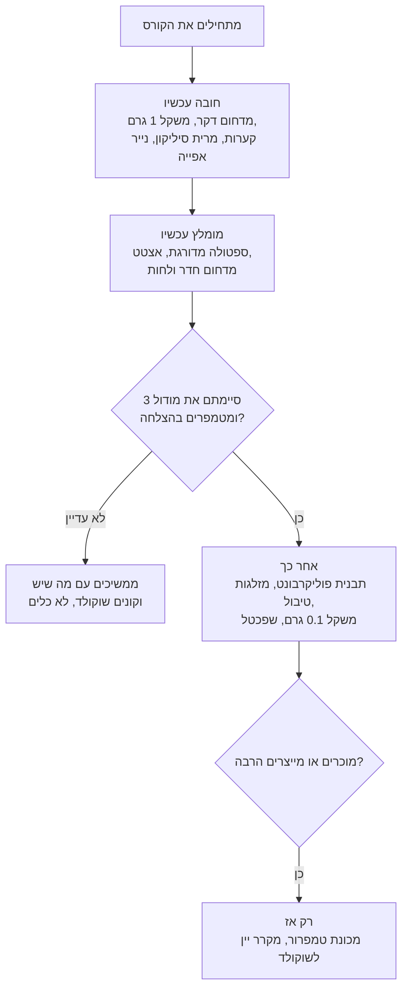

# 01.2 · ערכת ציוד ראשונה ואיפה קונים בישראל

אפשר להוציא אלפי שקלים על ציוד שוקולד, ואפשר להתחיל עם מה שיש במטבח ועוד שלושה־ארבעה כלים זולים. בשיעור הזה מחליטים מה קונים עכשיו ומה מחכה, לומדים לקנות בחנויות הישראליות בלי להיתקע עם הזמנה ש"אזלה", ובודקים שהמדחום והמשקל אומרים את האמת. בסוף השיעור יש לכם רשימת קנייה מוכנה, ומדחום שאתם יודעים בכמה הוא טועה.

## מה צריך

ערכת ההתחלה של הקורס, לפי מה שצריך למודולים 1-3:

| פריט | כמות לתרגול | כמות מלאה | הערה |
|---|---|---|---|
| מדחום דיגיטלי עם דקר (probe) | 1 | 1 | **חובה.** טווח 0-200°C לפחות, דיוק 1°C. מהזולים ביותר בערכה |
| משקל מטבח דיגיטלי, דיוק 1 גרם | 1 | 1 | **חובה.** רוב המשקלים הביתיים מתאימים |
| קערות זכוכית או פלסטיק קשיח שמתאימות למיקרוגל | 2-3 | 3-4 | **חובה.** יבשות לגמרי; בלי סדקים |
| מרית סיליקון (ספטולה גומי) | 1-2 | 2 | **חובה.** לא כף עץ, שסופגת מים וריחות |
| נייר אפייה | גליל | גליל | **חובה** |
| תבנית אפייה שטוחה או מגש | 1 | 1 | יש ברוב המטבחים |
| ספטולה מדורגת קטנה (offset spatula) | 1 | 1 | **מומלץ.** למריחת טבלה דקה ואחידה |
| דפי אצטט ("דפי גיטרה") | 5-10 | חבילה | **מומלץ.** נותנים לטבלה צד מבריק |
| מדחום חדר עם מד לחות | 1 | 1 | **מומלץ.** זול, ומסביר הרבה כישלונות |
| שקיות זילוף חד־פעמיות | 5 | חבילה | **אחר כך** (קישוט, מודולים 2 ו־4) |
| תבנית פוליקרבונט אחת (טבלה או פרלינים) | — | 1-2 | **אחר כך** (מודול 4) |
| מזלגות טיבול, משקל 0.1 גרם, שפכטל, משטח שיש | — | לפי הצורך | **אחר כך** (מודולים 2-5) |
| מים וקרח לבדיקת המדחום | כוס גבוהה | | |

**אלרגנים:** אין בשיעור הזה אוכל. אבל אם במטבח מכינים גם מאפים עם אגוזים, בוטנים, שומשום או חיטה, שווה להחליט כבר עכשיו אילו כלים יהיו "רק לשוקולד" (שיעור 01.4).

## למה זה עובד

### המדחום הוא הכלי החשוב ביותר

בשוקולד ההבדל בין הצלחה לכישלון הוא שתיים־שלוש מעלות. טווח העבודה של שוקולד מריר מטומפר הוא 31-32°C, וב־34°C הטמפר כבר נשבר (שיעור 03.1). גם שוקולד ציפוי, שלא צריך טמפרור, מתקלקל אם מחממים אותו מעל 50°C בערך (שיעור 01.1). לכן צריך מדחום שמראה ספרה אחת אחרי הנקודה, מגיב מהר, ונכנס לתוך השוקולד.

**מדחום דקר מול מדחום אינפרא אדום.** מדחום אינפרא אדום (לייזר) מודד רק את פני השטח, ובקערה של שוקולד הפנים והשוליים יכולים להיות בטמפרטורות שונות. הוא נוח לבדיקה מהירה, אבל לא מחליף דקר. ויש מלכודת: בחלק מהדגמים הטווח מתחיל ב־50°C, ואז הם לא מודדים בכלל את טווח העבודה של שוקולד (28-32°C). בודקים את הטווח לפני קנייה, כמו שכתוב ב[מדריך הקנייה](../../references/where-to-buy.md#מדחום-אינפרא-אדום).

**למה בודקים את המדחום.** גם מדחום חדש יכול לטעות. לפי מדריך ההרחבה של Texas A&M, בודקים מדחום מזון במי קרח: ממלאים כלי בקרח, מוסיפים מים, מערבבים, טובלים את הדקר לעומק 5 ס"מ לפחות, מחכים, והמדחום צריך להראות 0°C. המדריך מקבל סטייה של עד 2°F (בערך 1°C) למדחום מזון כללי. בשוקולד רוצים לדעת את הסטייה במדויק: מדחום שמראה 1°C במי קרח יראה 32°C כשהשוקולד באמת 31°C. מדחום דיגיטלי שלא אפשר לכוון רושמים עליו את התיקון (מדבקה "‎-1") ומחשבים בראש.

### משקל של 1 גרם

כמעט כל מתכון בקורס בגרמים, כי כמויות התרגול קטנות: 30 גרם שוקולד, 100 גרם גנאש, 3 גרם חמאת קקאו באבקה. בכוסות ובכפות אי אפשר למדוד את זה. משקל מטבח רגיל בדיוק 1 גרם מספיק עד מודול 3. רק בחמאת קקאו באבקה (שיעור 03.4) ובצבעים צריך דיוק של 0.1 גרם: 1% מ־250 גרם הוא 2.5 גרם, ומשקל של 1 גרם יעגל ל־2 או ל־3, שזה 20% טעות. בודקים משקל עם מים: 100 מ"ל מים בטמפרטורת החדר שוקלים 100 גרם.

### קערות ומרית: יבש לגמרי

לפי King Arthur, אפילו כמה טיפות מים בשוקולד מותך גורמות לו "להיתפס" (seize): הסוכר והקקאו נדבקים לגושים קשים, ואת השוקולד כבר אי אפשר לטמפר או להשתמש בו כשוקולד. לכן הכלים צריכים להיות יבשים לגמרי, כולל האדים שנשארים בקערה שיצאה עכשיו מהמדיח. מכאן גם:

- **מרית סיליקון ולא כף עץ:** עץ סופג מים וריחות ומשחרר אותם לשוקולד.
- **קערה שמתאימה למיקרוגל:** Shona Sutherland, שמלמדת שוקולד לעסקים קטנים, עובדת במיקרוגל בקערת פלסטיק יבשה דווקא כדי לא להכניס אדים מבן־מארי. זכוכית שומרת חום יותר זמן, וזה יתרון בהמסה וחיסרון כשרוצים לקרר מהר. שתיהן עובדות.

### תבניות: למה לא קונים עכשיו

תבנית פוליקרבונט קשיחה ושקופה נותנת את הברק של חנות שוקולד: לפי Sutherland, תבניות סיליקון לא נותנות ברק כזה, הן מבודדות ושומרות חום, ומתאימות בעיקר לצורות רדודות ומלאות. אבל תבנית בלי טמפרור לא שווה הרבה: שוקולד לא מטומפר נדבק אליה ולא משתחרר. לכן קונים תבנית במודול 4, אחרי שלמדתם לטמפר. במודול הזה טבלה על נייר אפייה או אצטט עושה את העבודה.

### החדר הוא חלק מהציוד

Sutherland ממליצה לעבוד בחדר של 18-20°C ובלחות של 50-65%, ולהחזיק בחדר מד טמפרטורה ולחות. מטבח ישראלי בקיץ חם בהרבה. מדחום חדר עם מד לחות עולה עשרות שקלים ומסביר הרבה כישלונות: "התקשה לאט" בחדר של 28°C, "יצא אפור" אחרי יום לח. מכאן הכלל של הקורס: עובדים בשעה הכי קרירה, עם מזגן, ורושמים את תנאי החדר ביומן.

### מה קונים עכשיו ומה מחכה

### כמה זה עולה

לפי ההערכה של הקורס, ערכת התחלה עולה בערך 300-600 ₪, כולל קילו או שניים של שוקולד. ברוב הבתים יש כבר קערות, מרית ותבנית, ואז הקנייה האמיתית היא מדחום, אולי משקל, ספטולה מדורגת ושוקולד. מחירי הכלים בחנויות שנבדקו (2026-11-10) נעים מעשרות שקלים למדחום "עט" פשוט ועד מאות שקלים למדחום מקצועי עם חוט; מדחום פשוט שעובר את בדיקת מי הקרח מספיק לקורס. הטווחים לפי חנות ב[מדריך הקנייה](../../references/where-to-buy.md#מדחום).

### איך קונים בחנויות ישראליות בלי להיתקע

רוב הציוד נמכר בחנויות אפייה וקונדיטוריה עם אתר ומשלוח, ובחלקן איסוף עצמי. שלושה דברים שכדאי לדעת, מתוך הבדיקה שנעשתה לקורס:

1. **"במלאי" לא תמיד אומר במלאי.** הרבה אתרים מציגים כפתור "הוסף לסל" גם כשהפריט אזל, ומתברר רק בקופה או בטלפון. לכן במדריך הקנייה יש 3-4 חנויות לכל קטגוריה, ועמודת "מלאי בבדיקה" שמראה מה האתר הציג ביום הבדיקה.
2. **מקשרים לקטגוריה, לא למוצר.** מוצר בודד נעלם מהאתר, קטגוריה נשארת. מחפשים לפי תיאור כללי (למשל "מדחום דיגיטלי עם דקר 0-200°C") ולא לפי שם דגם.
3. **לפני חג מתקשרים.** לפני חנוכה, פסח ושבועות חנויות האפייה עמוסות והמלאי זז מהר. הזמנה גדולה? וואטסאפ או טלפון לחנות לפני התשלום.

הקורס נכתב לישראל, אבל כל פריט מתואר כך שאפשר למצוא אותו בכל מקום: סוג, חומר, טווח, גודל.

## שלב אחר שלב

> [!WARNING]
> בבדיקת מים רותחים (שלב 4, רשות) המים והאדים מגיעים ל־100°C. מחזיקים את המדחום בקצה, לא מתכופפים מעל הסיר, ומרחיקים ילדים.

1. **מצאי בבית.** עוברים על טבלת "מה צריך" ומסמנים ליד כל פריט: יש / אין / יש אבל לא מתאים (למשל קערה סדוקה, מרית עץ).
2. **בדיקת מדחום במי קרח.** ממלאים כוס גבוהה בקרח עד למעלה ומוסיפים מים קרים. מערבבים 30 שניות. טובלים את הדקר באמצע הכוס, לעומק 5 ס"מ לפחות, בלי לגעת בדפנות ובתחתית. מחכים עד שהמספר מפסיק לזוז (15-30 שניות).
3. **רושמים את הסטייה.** המדחום הראה 0°C? מצוין. הראה 0.8°C או ‎-1°C? רושמים ביומן ועל מדבקה על המדחום: "תיקון ‎-1" (כלומר מורידים 1 ממה שהוא מראה). סטייה של יותר מ־2°C: מחליפים סוללה ובודקים שוב; אם עדיין, מחליפים מדחום.
4. **(רשות) בדיקה במים רותחים.** לפי Texas A&M, דקר במים רותחים צריך להראות 100°C בגובה פני הים. בירושלים ובמקומות גבוהים המים רותחים בפחות, ולכן בדיקת מי הקרח עדיפה.
5. **בדיקת משקל.** מניחים כוס על המשקל, מאפסים, ושופכים 100 מ"ל מים מכלי מדידה. המשקל צריך להראות 99-101 גרם. מוסיפים עוד 100 מ"ל ובודקים שוב.
6. **רשימת קנייה.** לכל פריט שחסר: מה לחפש (בתיאור כללי), ושתי חנויות לפחות מ[מדריך הקנייה](../../references/where-to-buy.md#חנויות-מרכזיות). מתחילים מחנות שיש בה גם שוקולד ציפוי לפרויקט, כדי לחסוך משלוח.
7. **תקציב.** סוכמים את הרשימה. אם עוברים 600 ₪, מוחקים קודם את כל מה שמסומן "אחר כך".
8. **פינת עבודה.** בוחרים משטח בבית, רחוק מהכיריים, מהכיור ומהשמש, ומניחים שם את מדחום החדר. רושמים את הטמפרטורה והלחות בבוקר ובערב של אותו יום.

## בדיקה: איך יודעים שהצליח

- המדחום נבדק במי קרח, והסטייה שלו רשומה ביומן ועל המדחום. היא לא יותר מ־1°C, או שיש תוכנית להחליף אותו.
- המשקל הראה 99-101 גרם על 100 מ"ל מים.
- יש רשימת קנייה שבה לכל פריט "חובה" שתי חנויות לפחות, ותיאור כללי שאפשר לחפש גם בחנות אחרת.
- הסכום הכולל עד 600 ₪, או שהבנתם מה מעלה אותו ומה אפשר לדחות.
- יש פינת עבודה, ואתם יודעים מה הטמפרטורה והלחות בה בבוקר ובערב.

## כשזה משתבש

| מה רואים | למה זה קורה | מה עושים עכשיו | איך מונעים בפעם הבאה |
|---|---|---|---|
| המדחום מראה 2-3°C במי קרח | יותר מדי מים ומעט קרח, או שהדקר נוגע בתחתית | מוסיפים קרח עד שהכוס מלאה, מערבבים, מודדים באמצע | כוס מלאה קרח, ערבוב, דקר במרכז |
| המספר קופץ ולא מתייצב | סוללה חלשה, או מדחום איטי | מחליפים סוללה ומחכים 30 שניות | בודקים סוללה לפני כל מודול |
| המשקל מראה 96 גרם על 100 מ"ל | המשטח לא ישר, או המשקל לא אופס | מניחים על משטח ישר וקשה, מאפסים עם הכוס | שוקלים תמיד על אותו משטח |
| הזמנתם אונליין והפריט "אזל" אחרי התשלום | המלאי באתר לא מעודכן | מבקשים החזר או תחליף, ועוברים לחנות השנייה ברשימה | תמיד שתי חנויות לכל פריט; לפני חג מתקשרים |
| מדחום אינפרא אדום לא מראה כלום על שוקולד | הטווח שלו מתחיל ב־50°C | משתמשים בו רק לבדיקות חמות, ועובדים עם דקר | בודקים את הטווח בדף המוצר לפני קנייה |
| קניתם מארז כלים יקר, וחצי ממנו לא בשימוש | קנייה לפני שיודעים מה צריך | שומרים לשלב שבו יידרש | קונים לפי "עכשיו / אחר כך" |

### מה עושים עם מה שלא הצליח

בשיעור הזה לא מבזבזים אוכל, אבל אפשר לבזבז כסף. כלי שלא התאים לא נזרק: מדחום אינפרא אדום עם טווח גבוה מתאים לבדיקת שמן או קרמל, תבנית סיליקון מתאימה לצורות שטוחות ולשוקולד ציפוי, קערה כבדה מדי משמשת להמסה איטית. מים מהבדיקה הולכים לעציץ. ואם בשיעורים הבאים שוקולד ייתפס או לא יתקשה, הוא יהפוך לשוקו חם, לרוטב או לבראוניז, כמו בכל הקורס.

## חלופות

### טבעוני / פרווה

הכלים עצמם לא טבעוניים או לא טבעוניים, אבל שאריות כן: מרית שערבבה גנאש עם שמנת ונשטפה רק במים משאירה שומן חלב. מי שמכין גם לטבעונים או לאלרגיים לחלב שוטף במים חמים וסבון ומייבש היטב, ואם אפשר מחזיק סט קטן (קערה ומרית) רק לשוקולד בלי חלב. פירוט בשיעור 01.4.

### בריא יותר

משקל של 1 גרם הוא הכלי שמאפשר מנות קטנות: טבלה של 150 גרם שחותכים ל־10 חתיכות של 15 גרם, במקום לשבור "בעין". זה גם הבסיס לתמחור ולטבלה התזונתית בהמשך. אין כאן טענה בריאותית, רק שליטה בכמות.

### כשרות

מי ששומר כשרות מחליט על הכלים של השוקולד: חלביים, פרווה, או נפרדים. אם הקערה והמרית משמשות גם לבישול בשרי או חלבי, השוקולד שמוכן בהן עלול לקבל את הדין שלהן; איך נוהגים במטבח שלכם, שואלים את הרב. ההמלצה המעשית לקורס: סט קטן של כלים פרווה רק לשוקולד (קערה, מרית, ספטולה), שנשאר פרווה גם כשתעבדו עם שוקולד חלב ותרצו לדעת מה מותר אחר כך. כלי אחסון וחומרי הגלם עצמם: [מדריך הכשרות](../../references/kashrut-guide.md#מונחים) ושיעור 01.3.

## איפה קונים

כל החנויות, המחירים והמלאי מרוכזים בעמוד אחד, כדי שעדכון מלאי לא ידרוש לשנות את השיעורים. מתחילים מ[החנויות המרכזיות](../../references/where-to-buy.md#חנויות-מרכזיות) (עיר, איסוף עצמי, משלוח), ומשם לפי פריט:

- [מדחום](../../references/where-to-buy.md#מדחום): דיגיטלי עם דקר, טווח 0-200°C לפחות, דיוק 1°C, ספרה אחת אחרי הנקודה.
- [מדחום אינפרא אדום](../../references/where-to-buy.md#מדחום-אינפרא-אדום): לא חובה; אם קונים, טווח שמתחיל מתחת ל־0°C.
- [משקל](../../references/where-to-buy.md#משקל): דיגיטלי, דיוק 1 גרם, עד 3-5 ק"ג; משקל 0.1 גרם רק אחר כך ("משקל תכשיטים" בכל חנות אלקטרוניקה).
- [שפכטל וקלף](../../references/where-to-buy.md#שפכטל-וקלף): ספטולה מדורגת קטנה (20-25 ס"מ).
- [אצטט ודפי גיטרה](../../references/where-to-buy.md#אצטט-ודפי-גיטרה): דפי אצטט שקופים.
- [שקיות זילוף](../../references/where-to-buy.md#שקיות-זילוף): חד־פעמיות, שקופות.
- אחר כך: [תבניות פוליקרבונט](../../references/where-to-buy.md#תבניות-פוליקרבונט), [תבניות סיליקון](../../references/where-to-buy.md#תבניות-סיליקון), [מזלגות טיבול](../../references/where-to-buy.md#מזלגות-טיבול), [מכונת טמפרור](../../references/where-to-buy.md#מכונת-טמפרור) (הקורס לא דורש).
- חומר הגלם לפרויקט המודול: [שוקולד ציפוי](../../references/where-to-buy.md#שוקולד-ציפוי).

מה שחסר במדריך (למשל משטח שיש או מדחום חדר) מחפשים לפי התיאור בטבלת "מה צריך", בכל חנות כלי בית.

## תרגול

### משימה

בודקים את המדחום במי קרח ואת המשקל במים, וממלאים רשימת קנייה: כל פריט "חובה" שחסר, עם תיאור כללי, שתי חנויות לפחות, מחיר משוער וסכום כולל. מגדירים פינת עבודה ומודדים בה טמפרטורה ולחות פעמיים ביום.

### זמן

כ־15 דקות לבדיקות, 20 דקות לרשימת הקנייה, ושתי מדידות חדר קצרות. סך הכול כ־40 דקות.

### יומן

רושמים ב[יומן תרגול](../../templates/practice-log.md): הסטייה של המדחום, תוצאת בדיקת המשקל, טמפרטורה ולחות בפינת העבודה בבוקר ובערב, ואת רשימת הקנייה עם הסכום.

דוגמה פתורה

מצאי: יש קערות זכוכית, מרית סיליקון אחת, נייר אפייה, תבנית. אין מדחום, אין ספטולה מדורגת. המשקל הביתי עבר את בדיקת המים (100 ו־200 גרם בדיוק).

| פריט | מה מחפשים | חנות א | חנות ב | מחיר משוער ₪ |
|---|---|---|---|---|
| מדחום | דיגיטלי עם דקר, 0-200°C, ספרה אחרי הנקודה | חנות אפייה עם משלוח | חנות כלי בית קרובה | 35-120 |
| ספטולה מדורגת | מתכת, להב 20-25 ס"מ | אותה חנות אפייה | חנות אחרת מהמדריך | 25-60 |
| מרית סיליקון נוספת | עמידה לחום | אותה חנות אפייה | סופר | 15-30 |
| דפי אצטט | חבילה קטנה | אותה חנות אפייה | חנות אחרת מהמדריך | 10-40 |
| מדחום חדר ולחות | דיגיטלי | חנות אלקטרוניקה | חנות כלי בית | 30-60 |
| שוקולד ציפוי לפרויקט | מריר או חום, 1 ק"ג | אותה חנות אפייה | חנות אחרת מהמדריך | 30-60 |

סך הכול: 145-370 ₪, בתוך התקציב. בדיקת המדחום אחרי שהגיע: 0.6°C במי קרח, נרשם "תיקון ‎-0.5". פינת עבודה: שולחן בסלון עם מזגן, 23°C ו־55% בבוקר, 26°C ו־62% בערב, ולכן עובדים בבוקר.

### בדיקה עצמית

- [ ] בדקתי את המדחום במי קרח ורשמתי את הסטייה עליו וביומן.
- [ ] בדקתי את המשקל עם 100 ו־200 מ"ל מים.
- [ ] לכל פריט "חובה" שחסר יש תיאור כללי ושתי חנויות לפחות.
- [ ] הרשימה בתקציב, ו"אחר כך" באמת מחכה לאחר כך.
- [ ] יש לי פינת עבודה, ואני יודע מתי ביום היא הכי קרירה.

## סיכום

- הכלים שקובעים הצלחה הם זולים: מדחום דקר שבדקתם במי קרח, משקל של 1 גרם, קערות ומרית יבשים לגמרי.
- מדחום אינפרא אדום מודד רק פני שטח, ובחלק מהדגמים לא מתחת ל־50°C; הוא תוספת, לא תחליף.
- תבניות פוליקרבונט, מזלגות טיבול ומכונות מחכים לאחרי שלומדים לטמפר.
- החדר הוא חלק מהציוד: 18-20°C ולחות בינונית הם האידיאל; מודדים ורושמים.
- קונים לפי תיאור כללי ומשתי חנויות לפחות, ולפני חג מתקשרים לחנות.
