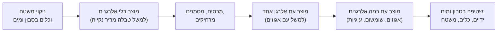

# 01.4 · בטיחות מזון והיגיינה במטבח הביתי

שוקולד מוצק הוא אחד המזונות הבטוחים ביותר שאפשר להכין בבית, אבל מה שמכינים איתו לא תמיד: אגוזים ושומשום שעוברים מקערה לקערה, תותים מטובלים שנשארים על השיש ביום שרבי, שמנת רותחת, ואבקת ברק שבכלל לא נועדה לאכילה. בשיעור הזה מסדרים את המטבח לעבודה עם שוקולד: איך מנקים, איך מפרידים אלרגנים, איך מאחסנים, ומה מסוכן באמת. בסוף השיעור יש לכם פינת עבודה מסודרת, מקרר שנבדק במדחום, וכרטיס אלרגנים לטבלה של פרויקט המודול.

## מה צריך

| פריט | כמות לתרגול | כמות מלאה | הערה |
|---|---|---|---|
| מדחום דיגיטלי שנבדק במי קרח ([01.2](lesson-02.md)) | 1 | | |
| כוס מים | 1 | | למדידת המקרר |
| סבון כלים, ספוג נקי, מגבות נייר | | | |
| קופסה אטומה קטנה | 1 | | לאחסון שוקולד |
| שתי חתיכות שוקולד מהשיעורים הקודמים | 2 × 10 גרם | | לניסוי העיבוי |
| מדבקות או נייר דבק וטוש | | | לסימון כלים וקופסאות |
| דף לכרטיס אלרגנים, או [כרטיס מתכון](../../templates/recipe-card.md) | 1 | | |

**אלרגנים:** השיעור עוסק בהם. במטבח שוקולד הנפוצים הם חלב, סויה (לציטין), אגוזים, בוטנים, שומשום (טחינה וחלבה), גלוטן (עוגיות, ופלים, פירורים) וביצים (מרנגים, חלק מהקישוטים).

## למה זה עובד

### למה שוקולד מוצק בטוח, ומה לא

חיידקים, שמרים ועובשים צריכים מים זמינים כדי לגדול. לפי Shona Sutherland, שמלמדת ייצור שוקולד בקנה מידה קטן, המדד הוא "פעילות מים" (water activity): לא כמה מים יש במזון, אלא כמה מהם חופשיים. בשוקולד מוצק כמעט אין מים, ולכן לפי Sutherland אפשר לשמור שוקולד יצוק חודשים ואף שנה. ככל שמכניסים מים, הסיכון עולה:

| מוצר | מים | כמה זמן מחזיק (סדר גודל) | איפה בקורס |
|---|---|---|---|
| טבלה, מטבעות, צורות יצוקות | כמעט אין | חודשים, אם מאחסנים נכון | מודולים 1, 3, 4, 8 |
| טבלה עם אגוזים ופירות יבשים | מעט | שבועות; האגוזים מתעפשים לפני השוקולד | מודולים 1, 2 |
| בונבונים וטראפלס עם גנאש | יש (שמנת) | לפי Sutherland, 3-4 שבועות בגנאש שתוכנן לכך; פחות בגנאש פשוט | מודולים 5, 6 |
| פירות טריים מטובלים | הרבה | יום, במקרר | [מודול 2](../module-02/lesson-01.md) |

### ארבעת הצעדים, בגרסת שוקולד

ה־FDA מסכם בטיחות מזון בבית בארבעה צעדים. במטבח שוקולד הם נראים כך:

1. **ניקיון (clean).** לפי ה־FDA, שוטפים ידיים במים חמימים וסבון 20 שניות לפחות לפני ואחרי עבודה עם מזון, ושוטפים קרשים, כלים ומשטחים במים חמים וסבון אחרי כל מוצר. לשוקולד מוסיפים: **מייבשים לגמרי**, כי מים הורסים שוקולד מותך ([01.2](lesson-02.md)).
2. **הפרדה (separate).** אצל ה־FDA הכוונה לבשר נא. אצלנו ההפרדה החשובה היא של אלרגנים: אגוזים, בוטנים ושומשום לא נוגעים בכלים ובמשטח של מוצר שאמור להיות בלעדיהם.
3. **בישול (cook).** ה־FDA ממליץ להשתמש במדחום, כי צבע ומרקם לא מראים אם מזון בטוח. בשוקולד המדחום משמש בעיקר לאיכות, אבל גם לבטיחות: שמנת לגנאש מרתיחים, וקרמל עובר את 170°C.
4. **קירור (chill).** לפי ה־FDA, מקרר ב־4°C (40°F) או פחות, ומזון מתכלה מכניסים למקרר תוך שעתיים, או **תוך שעה אחת אם בחוץ יותר מ־32°C** (90°F). זה הכלל לפירות מטובלים ולגנאש, ובקיץ הישראלי השעה הזו נגמרת מהר.

### אלרגנים: הסיכון הגדול באמת

לפי ה־FDA, יש בארה"ב תשעה אלרגנים עיקריים: חלב, ביצים, דגים, סרטנים, אגוזים, בוטנים, חיטה, סויה, ושומשום שנוסף ב־2021. בישראל השומשום נפוץ במיוחד בשוקולד (טחינה, חלבה), וחובות הסימון בישראל נלמדות במסלול העסקי. לפי ה־FDA, תגובה יכולה להופיע תוך דקות ועד כמה שעות: פריחה, נפיחות בשפתיים ובגרון, הקאות, שיעול, סחרחורת, קושי לנשום. תגובה חמורה (אנפילקסיס, anaphylaxis) מסכנת חיים, ותגובה קלה בעבר לא אומרת שהאלרגיה קלה.

> [!CAUTION]
> מי שאוכל מהשוקולד שלכם ומפתח נפיחות בפה או בגרון, קושי לנשום או סחרחורת: מפסיקים לאכול ומתקשרים מיד למד"א (101). אם יש לו מזרק אפינפרין, משתמשים בו לפי ההוראות.

### מגע צולב (cross-contact) הוא לא זיהום רגיל

לפי ארגון FARE, מגע צולב קורה כשחלבון של מזון אחד עובר למזון אחר, בכמות כל כך קטנה שלא רואים אותה, ועדיין גורם לתגובה. ההבדל מזיהום בחיידקים: חימום מקטין את הסיכון מחיידקים, אבל **חימום לא מוריד אלרגן**. מה שכן עובד, לפי FARE:

- **סבון ומים** (או מגבונים) מורידים אלרגן מהידיים. **ג'ל לחיטוי או מים בלבד לא מורידים.**
- כלים, קרשים ותבניות שוטפים היטב במים וסבון, ואפשר להחזיק כלים נפרדים (למשל בצבע אחר) למוצר הבטוח.
- **מכינים קודם את המוצר בלי האלרגן**, מכסים אותו, ורק אחר כך את המוצר עם האלרגן.
- טעות לא מתקנים בהוצאת האלרגן: אגוז שנפל על טבלה "בלי אגוזים" והוצא, השאיר אחריו חלבון.

במטבח שוקולד זה מתרגם לסדר עבודה קבוע:

### מה לא נכנס לשוקולד אכיל

לפי ה־FDA, אבקות ברק ונצנצים מותר לשים על אוכל רק אם הם יוצרו כאכילים. במוצר אכיל יש רשימת רכיבים (למשל סוכר, עמילן, מלטודקסטרין) ולרוב המילה "אכיל". אם על האריזה כתוב רק "לא רעיל" (non-toxic) או "לקישוט בלבד" (for decorative purposes only) בלי רשימת רכיבים, **לא שמים את זה ישירות על אוכל**, ואם בכל זאת קישטתם בזה, מורידים לפני ההגשה. הנושא חוזר בשיעורי הצבע והקישוט.

### אחסון: חום, לחות וריחות

שוקולד לא מתקלקל מהר, אבל הוא מאבד מראה וטעם. לפי Sutherland:

- **שוקולד מוצק שומרים ב־14-20°C.** מקרר רגיל קר מדי לאחסון ממושך. מקרר יין ב־14°C בערך הוא פתרון טוב; אחריו, מקום קריר בבית.
- **מקרר רגיל רק לקירור קצר**, עד 15 דקות ב־3-5°C, ועדיף שההבדל בין החדר למקום הקירור יהיה פחות מ־10°C.
- **לחות יוצרת פריחת סוכר**: אדים מתעבים על שוקולד קר, ממיסים את הסוכר שעל פני השטח, והוא מתגבש מחדש כשכבה אפורה. זה קורה כשמוציאים שוקולד קר מהמקרר לחדר חם ולח. לכן מוציאים אותו בתוך קופסה סגורה ופותחים רק כשהגיע לטמפרטורת החדר.
- **ריחות**: שוקולד סופג ריחות. מאחסנים סגור, הרחק מתבלינים, בצל וגבינות.

בקיץ ישראלי, כשהדירה ב־28-30°C, שוקולד שעומד על השיש מתרכך ומאבד טמפר (צורה V נמסה ב־33.8°C, [שיעור 03.1](../module-03/lesson-01.md)). לכן מקום קריר עם מזגן עדיף, ואם אין, קופסה סגורה במקרר, עם יציאה הדרגתית.

## שלב אחר שלב

> [!WARNING]
> בשלב 5 מוציאים שוקולד קר מהמקרר. אל תאכלו אותו אם הוא כבר שכב ליד מזון לא ארוז (בשר נא, דגים); הניסוי הוא על איכות, לא על בטיחות. ובכל עבודה עם שמנת רותחת או קרמל בהמשך הקורס, יש אזהרה נפרדת בשלב עצמו.

1. **בודקים את המקרר.** מניחים כוס מים על המדף האמצעי ומשאירים אותה שעתיים לפחות (או לילה). מודדים את המים במדחום שבדקתם ב־[01.2](lesson-02.md), עם התיקון שרשמתם. היעד, לפי ה־FDA: 4°C או פחות. רושמים.
2. **מסדרים פינת עבודה.** משטח פנוי, רחוק מהכיריים ומהכיור. מנקים במים וסבון ומייבשים במגבת נייר. על המשטח רק מה שצריך לשוקולד.
3. **מפה של אלרגנים.** עוברים על המזווה ורושמים: איפה יש אגוזים, בוטנים, שומשום (טחינה, חלבה), עוגיות ופירורים, אבקת חלב. מסמנים במדבקה כל קופסה שמכילה אלרגן.
4. **סט כלים לשוקולד.** מסמנים קערה ומרית (מדבקה או צבע) כ"שוקולד בלי אלרגנים". הם לא נוגעים באגוזים ובממרחים.
5. **ניסוי עיבוי.** שתי חתיכות שוקולד, 10 גרם כל אחת: אחת בקופסה סגורה, אחת חשופה על צלחת. שתיהן 30 דקות במקרר. מוציאים לחדר: את הקופסה לא פותחים 30 דקות; את החשופה בודקים מיד ואחרי 30 דקות. רושמים מה רואים: טיפות? כתמים? אחרי יום, משווים שוב.
6. **שגרת ניקיון.** כותבים על פתק שתלוי ליד פינת העבודה: "ידיים 20 שניות בסבון; משטח וכלים במים וסבון ומייבשים; בלי ג'ל במקום סבון; קודם בלי אלרגנים, אחר כך עם".
7. **כרטיס אלרגנים לפרויקט.** פותחים [כרטיס מתכון](../../templates/recipe-card.md) לטבלה של פרויקט המודול. רושמים את שוקולד הציפוי והתוספות שאתם מתכננים, ולכל אחד: אלרגנים מרשימת הרכיבים, ושורת "עלול להכיל". בסוף מסכמים: "מכיל: …", "עלול להכיל: …".
8. **תוכנית אחסון.** רושמים איפה תשמרו את הטבלה של הפרויקט: מקום, טמפרטורה (אם מדדתם), קופסה. אם הבית חם מ־22°C, מתכננים קופסה סגורה במקרר ויציאה הדרגתית.

## בדיקה: איך יודעים שהצליח

- המקרר נמדד ב־4°C או פחות. אם הוא חם יותר, הורדתם את הכיוון ומדדתם שוב.
- פינת העבודה נקייה ויבשה, ואין עליה מזון שלא קשור לשוקולד.
- כל קופסה עם אלרגן במזווה מסומנת, ויש לכם קערה ומרית מסומנות.
- בניסוי העיבוי: החתיכה מהקופסה הסגורה נשארה יבשה, ועל החשופה ראיתם טיפות או אדים מיד, ולפעמים כתמים לבנבנים מחוספסים למחרת.
- כרטיס האלרגנים כולל כל רכיב של הטבלה, עם "מכיל" ו"עלול להכיל" נפרדים.

## כשזה משתבש

| מה רואים | למה זה קורה | מה עושים עכשיו | איך מונעים בפעם הבאה |
|---|---|---|---|
| המקרר מראה 7-8°C | כיוון חם מדי, דלת שנפתחת הרבה, מקרר עמוס | מכוונים קר יותר ומודדים שוב אחרי כמה שעות | מודדים פעם בעונה, בקיץ במיוחד |
| כתמים לבנים מחוספסים על שוקולד שיצא מהמקרר | פריחת סוכר מעיבוי | השוקולד בטוח לאכילה; ממיסים מחדש לתרגול | מוציאים מהמקרר בקופסה סגורה ופותחים אחרי חצי שעה |
| שוקולד קיבל ריח של מקרר או תבלינים | שוקולד סופג ריחות | משתמשים בו לאפייה, שבה הריח נבלע | קופסה אטומה, הרחק מריחות חזקים |
| טבלה "בלי אגוזים" נגעה בכף של ממרח אגוזים | מגע צולב | לא מגישים אותה לאלרגיים; מסמנים "מכיל אגוזים" | סדר עבודה: בלי אלרגנים קודם; כלים מסומנים |
| ניקיתם ידיים בג'ל אחרי חלבה ועברתם לטבלה נקייה | ג'ל לא מוריד אלרגן | מסמנים את הטבלה "עלול להכיל שומשום" | אחרי אלרגן תמיד סבון ומים |
| פירות מטובלים עמדו על השולחן כל הערב בקיץ | חום ומים: מזון מתכלה מחוץ למקרר יותר מדי זמן | לא מגישים; זורקים רק את מה שכבר לא בטוח | למקרר תוך שעה ביום חם; מגישים בכמויות קטנות |
| אבקת ברק "לקישוט בלבד" כבר על הבונבונים | לא נבדקה התווית | מגרדים או מסירים את הקישוט, ולא מגישים כמו שזה | קונים רק מוצר עם רשימת רכיבים ו"אכיל" |

### מה עושים עם מה שלא הצליח

כמעט כלום לא הולך לפח. שוקולד עם פריחת סוכר או ריח קל נמס מחדש לתרגול, לבראוניז או לשוקו חם. שוקולד שנגע באלרגן לא נזרק: הוא מקבל תווית "מכיל אגוזים" ונאכל אצל מי שאין לו אלרגיה. החריג היחיד בקורס: מזון מתכלה (פירות מטובלים, גנאש, שמנת) שעמד בחום יותר מהזמן הבטוח, וקישוט שאינו אכיל. את אלה לא מגישים, כי שם הבעיה היא בטיחות ולא מראה.

## חלופות

### טבעוני / פרווה

כשמכינים לטבעונים או לאלרגיים לחלב, החלב הוא האלרגן שמפרידים: שוקולד מריר וטבעוני מכינים קודם, בכלים מסומנים, ורק אחר כך שוקולד חלב ולבן. "פרווה" על אריזה לא מבטיח שאין חלב (ריקולים ב[שיעור 01.3](lesson-03.md)), ולכן לאלרגיים בודקים את רשימת הרכיבים ואת "עלול להכיל". שוקולד טבעוני על בסיס חלב צמחי ([מודול 12](../module-12/lesson-01.md)) יכול להכיל אגוזים, שיבולת שועל או קוקוס, ולכן הוא מחליף אלרגן אחד באחר.

### בריא יותר

מוצר עם פחות סוכר או בלי סוכר הוא לא בהכרח בטוח יותר לאחסון: סוכר קושר מים, ולכן מילוי עם פחות סוכר מחזיק לפעמים פחות זמן. גם אגוזים ופירות יבשים, שמוסיפים "בשביל הבריאות", הם אלרגנים שצריך לסמן. אין כאן טענה בריאותית.

> [!CAUTION]
> מלטיטול, הממתיק הנפוץ בשוקולד "ללא סוכר", עלול לגרום לגזים ולשלשול בכמות גדולה, ולא מתאים לילדים בכמות גדולה. אם מגישים שוקולד כזה, אומרים לאורחים.

### כשרות

ההפרדה של אלרגנים דומה להפרדה של בשרי, חלבי ופרווה, אבל היא לא אותו דבר: כלי שנשטף היטב בסבון יכול להיות נקי מאלרגן ועדיין לא מתאים מבחינת כשרות, ולהפך. מי ששומר כשרות מחזיק את הסט המסומן לשוקולד גם כסט פרווה ([01.2](lesson-02.md)), ובודק את ההכשר של כל חומר גלם לפי [מדריך הכשרות](../../references/kashrut-guide.md#שלושה-כללים). אם יש ספק, שואלים את הרב.

## איפה קונים

לשיעור הזה כמעט לא צריך לקנות: סבון, מגבות נייר, מדבקות וקופסה אטומה יש ברוב הבתים. מה שכדאי:

- [קופסאות מבודדות וקרחונים](../../references/where-to-buy.md#קופסאות-מבודדות-וקרחונים): לקיץ, כשמעבירים שוקולד מהבית לאירוח.
- [מדבקות ותוויות](../../references/where-to-buy.md#מדבקות-ותוויות): לסימון קופסאות, כלים וכרטיסי אלרגנים.
- [מדחום](../../references/where-to-buy.md#מדחום): אם עוד אין, גם למקרר.
- אבקות ברק וקישוטים: קונים רק מוצר שכתוב עליו "אכיל" ויש לו רשימת רכיבים. פרטים ב[אבקות ברק](../../references/where-to-buy.md#אבקות-ברק) ובכשרות ב[אבקות ברק ועלי זהב](../../references/kashrut-guide.md#אבקות-ברק-ועלי-זהב).

## תרגול

### משימה

מודדים את המקרר, מסדרים פינת עבודה, מסמנים אלרגנים במזווה ואת סט הכלים לשוקולד, עורכים את ניסוי העיבוי על שתי חתיכות של 10 גרם, וכותבים כרטיס אלרגנים לטבלה של פרויקט המודול.

### זמן

כ־25 דקות עבודה (מפה, סימון, כרטיס), ועוד 15 דקות למדידות ולניסוי העיבוי, שנפרסות על כמה שעות. סך הכול כ־40 דקות.

### יומן

רושמים ב[יומן תרגול](../../templates/practice-log.md): טמפרטורת המקרר, מה ראיתם בניסוי העיבוי (מיד, אחרי 30 דקות, למחרת), ואיפה תאחסנו את הטבלה. את כרטיס האלרגנים שומרים ב[כרטיס מתכון](../../templates/recipe-card.md).

### בדיקה עצמית

- [ ] המקרר ב־4°C או פחות, נמדד במדחום שנבדק.
- [ ] יש לי פינת עבודה, סט כלים מסומן ושגרת ניקיון כתובה.
- [ ] כל קופסה עם אלרגן במזווה מסומנת.
- [ ] ראיתי בעיניים את ההבדל בין שוקולד שיצא מהמקרר בקופסה סגורה לשוקולד חשוף.
- [ ] כתבתי כרטיס אלרגנים לטבלה, עם "מכיל" ו"עלול להכיל" נפרדים.
- [ ] שתי חתיכות הניסוי בשקית "להמסה".

## סיכום

- שוקולד מוצק בטוח וארוך חיים כי אין בו כמעט מים; הסיכון עולה עם שמנת, פירות טריים ומילויים.
- ארבעה צעדים: ניקיון בסבון ומים וייבוש, הפרדת אלרגנים, מדחום, וקירור (מקרר 4°C, מזון מתכלה למקרר תוך שעתיים, ותוך שעה מעל 32°C).
- מגע צולב לא נעלם בחימום ולא בג'ל: סבון ומים, כלים מסומנים, ובלי אלרגנים קודם.
- מקשטים רק במה שכתוב עליו "אכיל" ויש לו רשימת רכיבים.
- שוקולד שומרים ב־14-20°C, סגור, הרחק מריחות; מהמקרר מוציאים בקופסה סגורה כדי למנוע עיבוי ופריחת סוכר.
