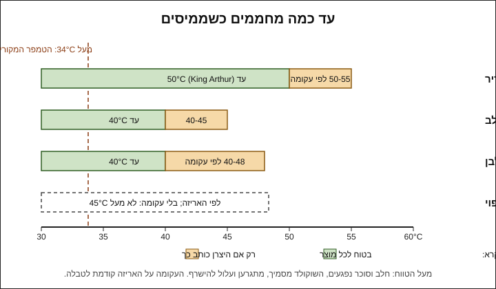
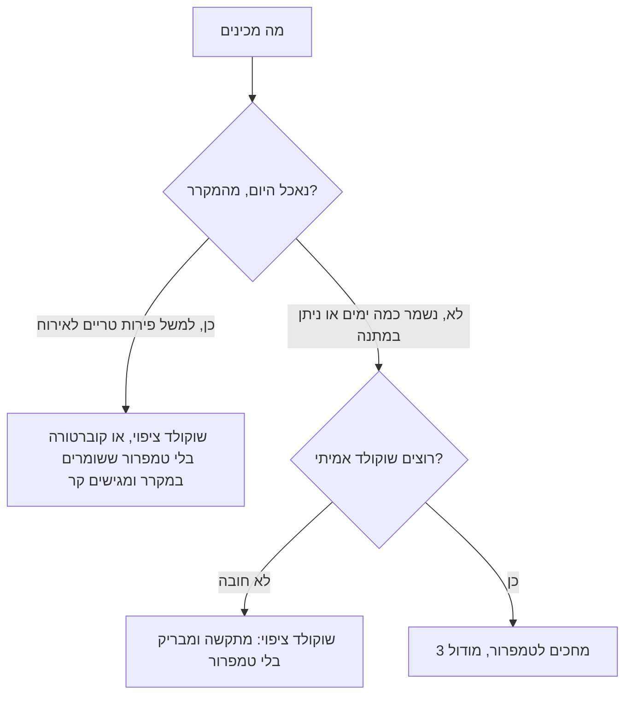

# 02.1 · להמיס נכון: מיקרוגל, בן־מארי ולמה שוקולד נתפס

כל מה שמכינים במודול הזה מתחיל בקערה של שוקולד מומס, וכמעט כל כישלון של מתחילים קורה כבר כאן: שוקולד שנשרף במיקרוגל, או שנתפס לגוש בגלל טיפת מים. בשיעור הזה ממיסים שוקולד ציפוי בשתי שיטות, מחזיקים מדחום ביד, ובכוונה "הורסים" כפית אחת של שוקולד במים כדי לראות איך זה נראה. בסוף יש קערה של שוקולד מומס וחלק, שמשמשת לשיעור הבא.

## מה צריך

| פריט | כמות לתרגול | כמות מלאה | הערה |
|---|---|---|---|
| שוקולד ציפוי (קומפאונד, "צימקאו") מריר או חלב | 300 גרם | 1 ק"ג | 150 גרם לכל שיטה. זה השוקולד של כל המודול |
| קוברטורה או טבלת שוקולד מריר מהסופר | 50 גרם | | לניסוי ההשוואה בלבד |
| שוקולד לניסוי "נתפס" (כל סוג) | 20 גרם | | מתוך השאריות |
| שתי קערות יבשות, זכוכית או פלסטיק עבה שמתאים למיקרוגל | 2 | | יבשות לגמרי, כמו ב־[01.4](../module-01/lesson-04.md) |
| סיר קטן לבן־מארי, שהקערה יושבת עליו בלי לגעת במים | 1 | | |
| מרית סיליקון | 1 | | |
| מדחום דיגיטלי עם דקר | 1 | | מכאן והלאה בכל שיעור |
| משקל מטבח | 1 | | |
| מגבת יבשה | 1 | | לנגב את תחתית הקערה |
| נייר אפייה | 3 פיסות של 15×15 ס"מ | | |
| חלב או משקה צמחי חם | 60 מ"ל | | להציל את השוקולד שנתפס |

**אלרגנים:** שוקולד ציפוי וקוברטורה מכילים בדרך כלל לציטין סויה. בשוקולד חלב יש חלב, ורבים מהמרירים מכילים או "עלולים להכיל" חלב, אגוזים ובוטנים. בודקים על האריזה. אם מצילים את הניסוי בחלב, יש בו חלב.

**למה שוקולד ציפוי:** במודול הזה עוד לא מטמפרים (זה [מודול 3](../module-03/lesson-01.md)). שוקולד ציפוי מתקשה יפה בלי טמפרור, ולכן איתו עובדים כאן. ההבדל בינו לבין קוברטורה הוסבר ב[שיעור 01.1](../module-01/lesson-01.md), ובקצרה גם בהמשך.

### לפני שמתחילים את המודול

צפייה בשיעור היא לא תרגול. להמיס, לטבול ולסדר מגש לומדים בידיים, עם מדחום ומרית. האקדמיה לא יכולה לבדוק צילומים, ולכן בכל שיעור יש בדיקות ברורות (טמפרטורה, מרקם, ברק, איך השוקולד מחזיק על הפרי) שמשווים אליהן את התוצאה. מנהלים [יומן תרגול](../../templates/practice-log.md) מהיום הראשון: עד כמה חיממתם, כמה זמן לקח להתקשות, ומה הייתם משנים. אותו שוקולד עובר משיעור לשיעור, כך שכל המודול עולה מעט.

## למה זה עובד

### שוקולד הוא שומן עם אבקות, בלי מים

בשוקולד אין כמעט מים. יש בו שומן (חמאת קקאו, או בשוקולד ציפוי שומן צמחי אחר) ובתוכו חלקיקים יבשים: סוכר, מוצקי קקאו, ובחלב ולבן גם אבקת חלב. כשהשומן נמס, החלקיקים צפים בו והשוקולד זורם. כל מה שמשבש את המצב הזה הופך שוקולד חלק לגוש.

### למה טיפת מים הורסת, והרבה מים מצילים

King Arthur מסבירים שהמים מושכים אליהם את הסוכר ואת מוצקי הקקאו, שמתחילים להיצמד זה לזה ויוצאים מהשומן. התוצאה גוש סמיך, מגורען ומשחתי. זה מה שנקרא "שוקולד שנתפס" (seized). במטבח הניסויים שלהם, 57 גרם שוקולד הסמיכו אחרי כל טיפה של מים, ונתפסו כבר בכחצי כפית (בערך 2.5 מ"ל).

הפרדוקס: כשמוסיפים **הרבה** נוזל, השוקולד שוב חלק. יש מספיק מים כדי שהסוכר והמוצקים יתפזרו בהם, וזה כבר רוטב ולא שוקולד מוצק. King Arthur מביאים את חוקרת המזון Shirley Corriher: כשממיסים שוקולד עם נוזל, צריך לפחות כף (15 מ"ל) לכל 57 גרם במריר 55-60%, ויותר באחוז קקאו גבוה. פחות מזה, השוקולד צפוי להיתפס. לכן:

- טיפה, אדים, כף רטובה, מכסה שהזיע: השוקולד נתפס ולא מתאים יותר לטיבול.
- הרבה חלב חם או שמנת: השוקולד הופך לרוטב או לשוקו. כך מצילים.

לכן בבן־מארי צריך זהירות: לפי King Arthur, אפילו התזה קטנה של מים גורמת לשוקולד להיתפס, וגם נוזלים אחרים כמו תמצית וניל. אדים שעולים מהסיר, או מכסה שהאדים מתעבים עליו ומטפטפים פנימה, עושים את אותו הדבר.

### חום: איפה הגבול

לחום יש שני גבולות. הראשון הוא חום יתר: הסוכר ואבקת החלב נפגעים, השוקולד מסמיך ומתגרען, ובקצה הוא נשרף ומריח שרוף. השני חשוב רק לקוברטורה: מעל 34°C הגבישים היציבים של חמאת הקקאו נמסים, והטמפר שהיצרן עשה נשבר ([מודול 3](../module-03/lesson-01.md)).

שוקולד חלב ולבן רגישים יותר. ב־Serious Eats המיסו מריר, חלב ולבן בשלוש שיטות, ורק הלבן נשרף: על אש ישירה הוא נהיה יבש וגושי, עם סימני חריכה בשולי הסיר. הסיבה שהם נותנים היא מוצקי החלב והסוכר. אלה הגבולות שהיצרנים והמקורות נותנים:

| סוג | עד כמה ממיסים | מה אומרים המקורות |
|---|---|---|
| מריר | עד 50°C | King Arthur: מריר נשאר מתחת ל־50°C. Callebaut: המסה בכ־40-45°C. יש מרירים שהיצרן כותב להם עד 55°C (למשל Valrhona Guanaja, [שיעור 03.2](../module-03/lesson-02.md)) |
| חלב | עד 40-45°C | King Arthur: חלב ולבן עד 40°C. Callebaut: המסה 40-45°C |
| לבן | עד 40-45°C | King Arthur: עד 40°C. Callebaut: 40-45°C. יש לבנים שהיצרן כותב להם עד 48°C (למשל Valrhona Ivoire, [שיעור 03.2](../module-03/lesson-02.md)) |
| ציפוי (קומפאונד) | לפי האריזה | אין טווח אחיד; בלי הוראות, לא עוברים 45°C (כלל זהירות שלנו, לא של יצרן) |

העקומה שעל האריזה קודמת לטבלה. בשביל טיבול בלי טמפרור לא צריך להגיע לקצה: מספיק שהשוקולד נוזלי וחלק, ובדרך כלל זה קורה הרבה לפני התקרה.

### מיקרוגל מול בן־מארי

| | מיקרוגל | בן־מארי |
|---|---|---|
| איך זה עובד | מחמם את השוקולד מבפנים, לא אחיד: שוליים ופינות מתחממים מהר | אדים ומים חמים מחממים את הקערה בעדינות |
| סיכון עיקרי | נקודות חמות ושריפה, בעיקר בחלב ולבן | מים ואדים שנכנסים לשוקולד |
| מה המקורות מצאו | King Arthur: 85 גרם מריר נמסו ב־90 שניות בפולסים של 30 שניות, וזו השיטה המומלצת שלהם. Serious Eats: לבן ב־50% עוצמה, חלב ומריר ב־70% | King Arthur: הקערה לא נוגעת במים; שוקולד בשולי הקערה יכול להישרף אם האש חזקה |
| מתי לבחור | כמויות קטנות, מהר, בלי מים במטבח | כמות גדולה, או כשרוצים להחזיק את השוקולד חם זמן ארוך |

בשתי השיטות השוקולד ממשיך להימס מהחום שכבר יש בו. לכן מפסיקים לחמם כשנשארו כמה חתיכות קטנות, ומערבבים עד שהן נעלמות.

### ומה עם קוברטורה בלי טמפרור

אם ממיסים קוברטורה ונותנים לה להתקשות בלי טמפרור, היא מתגבשת בצורות הלא יציבות של חמאת הקקאו. King Arthur מתארים את זה: היא מתקשה לאט, יוצאת עמומה או מפוספסת, ואפשר להשאיר בה טביעת אצבע. במקרר היא מתקשה מהר יותר ונראית סבירה, אבל בחדר חם (במטבח ישראלי בקיץ בקלות 27°C ומעלה) היא מתרככת, נמרחת באצבעות, ותוך שעות או ימים מקבלת פסים אפורים. זו לא בעיה בטיחותית; זו בעיה של מראה ומרקם.

לכן יש במודול הזה שתי דרכים כנות לעבוד:

## שלב אחר שלב

> [!WARNING]
> שוקולד במיקרוגל מתחמם לא אחיד: הקערה יכולה להיות פושרת והשוקולד בפנים חם מאוד, ושוליים יכולים להישרף. פולסים קצרים, ערבוב אחרי כל פולס, וכפפה או מגבת כשמוציאים קערת זכוכית. בבן־מארי מים ואדים חמים: מרימים את הקערה עם מגבת, ומטים אותה הרחק מהגוף.

### א. במיקרוגל (150 גרם שוקולד ציפוי)

1. **מכינים**: קערה ומרית יבשות לגמרי. אם השוקולד בגוש, קוצצים לחתיכות של 1-2 ס"מ, כדי שיימס אחיד.
2. **פולס ראשון**: 30 שניות ב־50% עוצמה (בחלב ולבן) או 70% (במריר). אם אין שליטה בעוצמה, 15-20 שניות בעוצמה מלאה.
3. **ערבוב**: מערבבים גם אם נראה שלא קרה כלום. חתיכות יכולות להיראות שלמות כשהן כבר רכות מבפנים.
4. **ממשיכים**: פולסים של 15-20 שניות, ערבוב אחרי כל אחד. כשנשארו רק כמה חתיכות קטנות, מפסיקים לחמם.
5. **מסיימים בערבוב**: מערבבים 30-60 שניות עד שהכול חלק. מודדים במרכז הקערה, אחרי ערבוב. היעד: 40-45°C לכל היותר, או מה שכתוב על האריזה.

### ב. בבן־מארי (150 גרם שוקולד ציפוי)

1. **מכינים את הסיר**: 2-3 ס"מ מים בסיר. מחממים עד שעולות בועות קטנות בשוליים, ומכבים או מנמיכים לאש הכי קטנה. המים לא רותחים.
2. **מניחים את הקערה**: הקערה יושבת על הסיר, בלי לגעת במים, ומכסה את כל הפתח כך שאדים לא עולים לצדדים. לא מכסים את הקערה.
3. **ממיסים**: מערבבים לאט כל 30 שניות, ומגרדים את הדפנות. שוקולד בשולי הקערה מתחמם ראשון.
4. **מורידים מוקדם**: כשנשארו כמה חתיכות, מרימים את הקערה, מנגבים את התחתית במגבת יבשה, ומערבבים עד שהכול חלק. בודקים במדחום.
5. **לשמור חם**: אם השוקולד מסמיך תוך כדי עבודה, מחזירים את הקערה לכמה שניות על הסיר (אחרי שבדקתם שהמים לא רותחים), ומנגבים שוב.

### ג. ניסוי "נתפס" (20 גרם)

1. מעבירים 20 גרם מהשוקולד המומס לכוס קטנה.
2. מוסיפים 2-3 טיפות מים ומערבבים. רואים איך השוקולד מסמיך, מאבד ברק ונהיה מגורען.
3. מוסיפים 60 מ"ל חלב חם (או משקה צמחי) בשלוש מנות, ומערבבים. רואים איך הוא חוזר להיות חלק, כרוטב. שותים או שומרים לגלידה.

### ד. ניסוי השוואה (50 גרם קוברטורה)

1. ממיסים 50 גרם קוברטורה או מריר מהסופר עד 45°C, בפולסים קצרים.
2. מורחים ריבוע דק על נייר אפייה, ולידו ריבוע דק משוקולד הציפוי.
3. שני הריבועים 15 דקות במקרר, ואז שעה על השיש. מסמנים על הנייר מה זה מה.
4. משווים: ברק, צבע, סנאפ, ומה קורה כשמחזיקים חתיכה 10 שניות בין האצבעות.

## בדיקה: איך יודעים שהצליח

- **מרקם**: השוקולד בקערה חלק, מבריק ונוזלי, ונופל מהמרית בסרט רציף ולא בגושים.
- **טמפרטורה**: המדחום לא עבר 45°C בשוקולד הציפוי (או את מה שכתוב על האריזה), ו־50°C במריר.
- **בלי ריח שרוף** ובלי נקודות כהות או גרגרים בתחתית הקערה.
- **ניסוי "נתפס"**: ראיתם את השוקולד מתגבש מטיפות, וחוזר להיות חלק עם הרבה חלב.
- **ניסוי ההשוואה**: אחרי שעה על השיש, ריבוע הציפוי קשה ונשבר, וריבוע הקוברטורה רך יותר, עמום יותר או מתחיל להראות פסים. רשמתם ביומן לפחות שלושה הבדלים.

אם ריבוע הקוברטורה יצא דווקא יפה, זה קורה כשלא חיממתם מעל 34°C ונשארו בו גבישים מקוריים. רשמו עד כמה חיממתם.

## כשזה משתבש

| מה רואים | למה זה קורה | מה עושים עכשיו | איך מונעים בפעם הבאה |
|---|---|---|---|
| השוקולד נהיה פתאום סמיך, מט ומגורען, כמו משחה | נכנסו מים: טיפה מהמרית, אדים מהסיר, או טיפות מתחתית הקערה | לא מטבלים בו. מוסיפים חלב חם או שמנת בכמות גדולה ומקבלים רוטב או שוקו | כלים יבשים, אש קטנה, ניגוב תחתית הקערה, בלי מכסה |
| יש ריח שרוף, נקודות חומות וגרגרים, בעיקר בשוליים | חום יתר: פולס ארוך מדי במיקרוגל או אש חזקה | מעבירים מיד לקערה קרה את מה שעוד חלק, בלי לגרד את התחתית | פולסים קצרים, עוצמה 50-70%, ערבוב אחרי כל פולס |
| שוקולד לבן או חלב נהיה עבה ובצקי בלי שנכנסו מים | התחמם מעל 45°C, והסוכר ואבקת החלב נפגעו | לא מטבלים בו. מתאים לשוקו, לרוטב או לאפייה | חלב ולבן: עד 40°C ובעוצמה 50% |
| חתיכות לא נמסות בכלל, השוקולד כבר חמים | חתיכות גדולות מדי | קוצצים את מה שנשאר, ממשיכים לערבב, ורק אם צריך עוד פולס של 10 שניות | קוצצים לפני ההמסה לחתיכות של 1-2 ס"מ |
| השוקולד מסמיך תוך כדי עבודה | מתקרר בקערה | פולס של 10 שניות או כמה שניות על הסיר, וערבוב | עובדים בחדר לא קר מדי, ובקערה עבה |
| המדחום מראה מספרים קופצים | הדקר נוגע בתחתית החמה | מערבבים ומודדים באמצע המסה | מודדים תמיד במרכז, אחרי ערבוב |

### מה עושים עם מה שלא הצליח

שום דבר לא הולך לפח. שוקולד שנתפס ממים לא חוזר להיות שוקולד לטיבול, אבל עם הרבה חלב חם או שמנת הוא שוקו, רוטב לגלידה או בסיס לגנאש פשוט. King Arthur מציעים גם לתת לו להתקשות, לקצוץ ולהכניס לבצק עוגיות. שוקולד שהתחמם יותר מדי והסמיך מתאים לבראוניז ולשוקו. ריבועי הניסוי נכנסים לשקית "להמסה" ונמסים בשיעור הבא. רק שוקולד שבאמת נשרף, עם ריח וטעם שרוף, הוא כמעט חסר שימוש: הטעם עובר לכל מה שמכניסים אותו אליו. בגלל זה עובדים בפולסים קצרים.

## חלופות

### טבעוני / פרווה

שוקולד ציפוי מריר רבים מסומנים פרווה, אבל פרווה לא תמיד טבעוני (סוכריות, צבעים ותוספות). ברכיבים מחפשים שאין חלב, אבקת חלב או מי גבינה. ההמסה זהה. כשמצילים שוקולד שנתפס, משקה שיבולת שועל, סויה או שקדים חם עובד כמו חלב, ושוקו מריר ומשקה צמחי הוא גם פרווה וגם טבעוני (אם הרכיבים מתאימים). שוקולד "חלב" טבעוני על בסיס אורז או שיבולת שועל רגיש לחום כמו שוקולד חלב: ממיסים עד 40°C.

### בריא יותר

שוקולד ציפוי מכיל בדרך כלל שומן צמחי במקום חלק מחמאת הקקאו. מי שמעדיף שוקולד אמיתי עם אחוז קקאו גבוה (70% ומעלה) יכול להשתמש בקוברטורה מריר ולהגיש אותה מהמקרר, כמו בשיעור הבא. אין כאן טענה בריאותית: רק פחות סוכר ופחות שומן מוסף במנה. מנות קטנות עוזרות יותר מכל החלפה: 300 גרם מספיקים לכל המודול.

### כשרות

שוקולד ציפוי נמכר בכמה כשרויות, ולפעמים אותו מותג חלבי בגרסה אחת ופרווה באחרת. קוראים על האריזה: פרווה, חלבי, "אבקת חלב נכרי", ומי נותן את ההכשר. מי שמכין מגש פרווה לארוחה בשרית בודק שגם השוקולד וגם מה שמצילים בו (חלב או משקה צמחי) מתאימים. מה כתוב על מוצרים נפוצים: [שוקולד ציפוי במדריך הכשרות](../../references/kashrut-guide.md#שוקולד-ציפוי), ו[שלושה כללים](../../references/kashrut-guide.md#שלושה-כללים) לקריאת התווית. אם יש ספק, שואלים את הרב.

## איפה קונים

מה מחפשים: שוקולד ציפוי (בחנויות: "צימקאו", "שוקולד ציפוי", "תחליף שוקולד", compound coating), מריר או חלב, בשקית של 500 גרם עד 1 ק"ג. ברכיבים יופיע שומן צמחי. לניסוי ההשוואה מספיקה טבלת מריר מהסופר עם חמאת קקאו ברכיבים ובלי שומן צמחי אחר. מדחום דיגיטלי עם דקר (0-100°C לפחות) ישמש אתכם בכל הקורס. חנויות ומלאי: [שוקולד ציפוי](../../references/where-to-buy.md#שוקולד-ציפוי), [שוקולד מסופרמרקט](../../references/where-to-buy.md#שוקולד-מסופרמרקט), [קוברטורה](../../references/where-to-buy.md#קוברטורה), [מדחום](../../references/where-to-buy.md#מדחום). כשרות לפי מוצר: [שוקולד ציפוי](../../references/kashrut-guide.md#שוקולד-ציפוי), [שוקולד מסופרמרקט](../../references/kashrut-guide.md#שוקולד-מסופרמרקט).

## תרגול

### משימה

ממיסים 150 גרם שוקולד ציפוי במיקרוגל ו־150 גרם בבן־מארי, עם מדחום, בלי לעבור 45°C. עושים את ניסוי "נתפס" עם 20 גרם ומצילים אותו לשוקו. עורכים את ניסוי ההשוואה: 50 גרם קוברטורה מול שוקולד ציפוי, שעה על השיש. את שאר השוקולד המומס יוצקים לשכבה דקה על נייר אפייה ושומרים לשיעור הבא.

### זמן

כ־30 דקות עבודה, ועוד 15 דקות במקרר ושעה על השיש לניסוי ההשוואה (בזמן הזה אפשר לעשות דברים אחרים). סך הכול כ־45 דקות עבודה.

### יומן

ממלאים [יומן תרגול](../../templates/practice-log.md): סוג השוקולד והמותג, שיטה, כמה פולסים ובאיזו עוצמה, הטמפרטורה הכי גבוהה שהמדחום הראה, טמפרטורת החדר, ומה ראיתם בניסוי ההשוואה. מצלמים את שני הריבועים זה לצד זה באותה תאורה.

### בדיקה עצמית

- [ ] המסתי בשתי השיטות, ולא עברתי 45°C באף אחת.
- [ ] כשהפסקתי לחמם נשארו כמה חתיכות, וסיימתי בערבוב.
- [ ] ראיתי שוקולד נתפס, והצלתי אותו לשוקו או לרוטב.
- [ ] רשמתי שלושה הבדלים לפחות בין קוברטורה בלי טמפרור לשוקולד ציפוי.
- [ ] שמרתי את השאריות לשיעור הבא ולא זרקתי.

## סיכום

- שוקולד הוא שומן עם אבקות יבשות. טיפת מים או אדים גורמים לו להיתפס; הרבה נוזל הופך אותו לרוטב.
- תקרת חום: מריר עד 50°C, חלב ולבן עד 40-45°C, שוקולד ציפוי לפי האריזה. העקומה שעל האריזה קודמת.
- מיקרוגל: פולסים קצרים, עוצמה מופחתת וערבוב. בן־מארי: מים לא רותחים, קערה שלא נוגעת בהם, וניגוב התחתית.
- קוברטורה בלי טמפרור יוצאת עמומה ורכה ומקבלת פסים; היא מתאימה רק למה שנשמר במקרר ונאכל מהר. לשאר: שוקולד ציפוי, או טמפרור ב[מודול 3](../module-03/lesson-01.md).
- פרויקט המודול: [מגש מטובלים לאירוח](../../projects/m02-dipped-platter.md), פירות מטובלים, מנדיאנטים, כפיות ומקלות שוקו למגש אחד, עם תוכנית זמנים ופתק אלרגנים.
