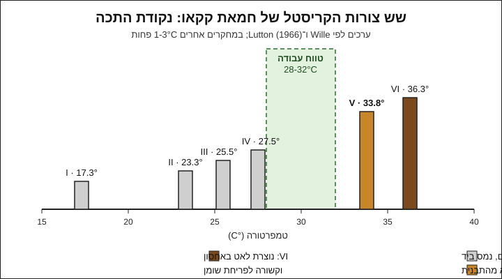

# 03.1 · למה מטמפרים: ששת צורות הקריסטל

שוקולד שנמס והתקשה לבד יוצא אפור, רך ונמס באצבעות. אותו שוקולד אחרי טמפרור מבריק, נשבר בסנאפ ויוצא מהתבנית בקלות. בשיעור הזה מבינים מה קורה בתוך חמאת הקקאו, ובסופו עורכים ניסוי קטן: 50 גרם שוקולד בלי טמפרור מול חתיכה מטבלה מטומפרת.

## מה צריך

| פריט | כמות לתרגול | הערה |
|---|---|---|
| טבלת שוקולד מריר אמיתי (לא "שוקולד ציפוי") | 100 גרם | חצי לניסוי, חצי לביקורת |
| קערה קטנה שמתאימה למיקרוגל, יבשה לגמרי | 1 | |
| מרית סיליקון | 1 | |
| מדחום דיגיטלי עם דקר | 1 | מכאן והלאה בכל שיעור במודול |
| נייר אפייה | 2 פיסות של 15×15 ס"מ | |
| כפית | 1 | |

אלרגנים: שוקולד מכיל בדרך כלל לציטין סויה, ולפעמים חלב, ולעתים מסומן "עלול להכיל" אגוזים או בוטנים. בודקים על האריזה.

### לפני שמתחילים את המודול

צפייה בשיעור היא לא תרגול. טמפרור לומדים בידיים: מדחום, מרית ושוקולד שמתקשה או לא מתקשה. האקדמיה לא יכולה לבדוק צילומים, ולכן בכל שיעור יש בדיקות ברורות (ברק, סנאפ, זמן התקשות, טמפרטורה) שמשווים אליהן את התוצאה. מנהלים [יומן תרגול](../../templates/practice-log.md) ו[יומן טמפרור](../../templates/tempering-log.md) מהיום הראשון: אחרי שלושה־ארבעה ניסיונות רואים בהם מה חוזר על עצמו.

## למה זה עובד

### שומן אחד, שש צורות

חמאת קקאו היא השומן שבשוקולד, ובקוברטורה (couverture) היא שליש או יותר מהמשקל. כשהיא מתקשה, המולקולות שלה מסתדרות בגבישים (קריסטלים). אותו שומן יכול להתגבש בשש צורות שונות, וזו תופעה שנקראת פולימורפיזם (polymorphism). כל צורה ארוזה בצפיפות אחרת ונמסה בטמפרטורה אחרת. המדענים Wille ו־Lutton מיינו אותן ב־1966 לצורות I עד VI, ומחקר עדכני יותר עם קרני רנטגן אישר שיש שש צורות.

| צורה | נקודת התכה (Wille ו־Lutton) | מה מקבלים |
|---|---|---|
| I | 17.3°C | נוצרת רק בקירור חזק מאוד ונעלמת מהר |
| II | 23.3°C | רכה, נמסה בחדר חם |
| III | 25.5°C | רכה ועמומה |
| IV | 27.5°C | רכה, עמומה, נמסה ביד |
| **V** | **33.8°C** | **ברק, סנאפ, התכווצות ושחרור מהתבנית, נמסה בפה ולא ביד** |
| VI | 36.3°C | הכי יציבה, אבל נוצרת לאט מאוד מצורה V באחסון ממושך |

מחקרים אחרים מדדו ערכים נמוכים ב־1-3°C, כי לחמאת קקאו ממקורות שונים יש הרכב שונה. את המספרים המדויקים לא צריך לזכור. צריך לזכור את הסדר: I-IV נמסות מתחת ל־28°C, V נמסה קצת מתחת ל־34°C.

### למה דווקא V

צורה V היא הצורה היציבה ביותר שאפשר לקבל ישירות משוקולד מותך. הגבישים שלה קטנים, צפופים ואחידים, ולכן:

- **ברק**: משטח של גבישים קטנים ואחידים מחזיר אור באופן אחיד.
- **סנאפ**: מבנה צפוף נשבר בקו נקי ולא מתכופף.
- **שחרור מהתבנית**: שוקולד שהתגבש בצורה V מתכווץ קצת כשהוא מתקשה, ומשתחרר מהתבנית לבד.
- **נמס בפה ולא ביד**: 33.8°C נמוך מחום הפה ודומה לחום כף היד, ולכן חתיכה מטומפרת לא נמרחת מיד באצבעות.

### הבעיה: V לא נוצרת לבד

אם משאירים שוקולד מותך להתקרר על השיש, חמאת הקקאו מתגבשת קודם בצורות הלא יציבות, כי הן נוצרות מהר יותר. עם הזמן הן הופכות לצורות יציבות יותר, אבל בצורה לא אחידה: גבישים גדולים, כתמים אפורים ופסים. לפי Kevin Smith, שוקולד שמחזיקים ב־32°C אמנם יתגבש בסוף בצורה V, אבל זה ייקח חודשים. בפועל זה בדיוק מה שתראו בניסוי שבסוף השיעור.

### מה הטמפרור עושה

טמפרור (tempering) הוא דרך לייצר מספיק "זרעים" קטנים של צורה V בתוך השוקולד המותך, כך שכל השאר מתגבש סביבם באותה צורה. שלושה שלבים:

1. **המסה מלאה** (במריר 45-55°C): מוחקים כל גביש קודם, טוב או רע.
2. **יצירת גבישי V**: או שמקררים ומערבבים עד שנוצרים גבישים (שיטת המשטח, 03.3), או שמוסיפים גבישי V מוכנים (שוקולד מטומפר בשיטת ההזרעה, 03.2, או חמאת קקאו באבקה, 03.4).
3. **עבודה בטמפרטורה הנכונה** (במריר 31-32°C): חם מספיק כדי שצורות I-IV יימסו, וקר מספיק כדי שגבישי V (שנמסים ב־33.8°C) יישארו.

לכן טווח העבודה צר כל כך. ב־34°C ומעלה גם גבישי V נמסים והטמפר "נשבר". מתחת ל־29°C השוקולד ממשיך להתגבש בקערה, מסמיך ונהיה קשה לעבודה.

### חלב ושוקולד לבן

שומן חלב מתערבב עם חמאת הקקאו ומרכך אותה, ולכן שוקולד חלב ושוקולד לבן מתגבשים בטמפרטורה נמוכה יותר. טווח העבודה שלהם הוא בדרך כלל 29-30°C בחלב ו־28-29°C בלבן. הטבלה המלאה, עם מקורות מהיצרנים, בשיעור 03.2.

### ומה לגבי שוקולד ציפוי

בשוקולד ציפוי (compound) חלק מחמאת הקקאו הוחלף בשומן צמחי אחר, שלא מתנהג כך. לכן לא מטמפרים אותו, וזו הסיבה שעבדנו איתו במודולים 1 ו־2. מהמודול הזה והלאה עובדים עם קוברטורה.

## שלב אחר שלב

> [!WARNING]
> במיקרוגל השוקולד מתחמם לא אחיד ויכול להישרף בנקודה אחת ולהיות קר בשנייה. עובדים בפולסים קצרים ומערבבים בין פולס לפולס.

1. שוברים את טבלת ה־100 גרם לשניים. 50 גרם עוטפים ומניחים בצד: זו "הביקורת", שוקולד שהיצרן כבר טמפר.
2. קוצצים את 50 הגרם האחרים לקערה יבשה.
3. ממיסים במיקרוגל בפולסים של 15-20 שניות, מערבבים אחרי כל פולס, עד שהכול נוזלי ומגיע ל־45-50°C במדחום. כך כל הגבישים נמסים.
4. יוצקים חצי מהשוקולד המותך על נייר אפייה ומורחים לריבוע דק בעובי 2-3 מ"מ. זו "דוגמה A".
5. את החצי השני משאירים בקערה עד שהוא מתקרר לכ־35°C, ואז מורחים על הנייר השני. זו "דוגמה B".
6. משאירים את שתי הדוגמאות בטמפרטורת החדר, לא במקרר. רושמים את השעה ואת טמפרטורת החדר.
7. בודקים אחרי 10 דקות, אחרי שעה ולמחרת. בכל בדיקה משווים את A ו־B לחתיכת הביקורת: ברק, צבע, סנאפ (כשמתקשה), ומה קורה כשמחזיקים חתיכה 10 שניות בין האצבעות.

## בדיקה: איך יודעים שהצליח

בשיעור הזה "הצלחה" היא לראות את ההבדל, לא לקבל שוקולד יפה. הניסוי הצליח אם:

- הביקורת מבריקה, נשברת בסנאפ נקי ולא נמרחת מיד באצבעות.
- דוגמאות A ו־B התקשו לאט יותר מהביקורת (לרוב עשרות דקות ולא דקות), ואחרי יום הן עמומות, עם פסים או כתמים אפורים־לבנים.
- הדוגמאות מתכופפות או נשברות בלי סנאפ, ונמרחות באצבעות מהר יותר מהביקורת.
- רשמתם ביומן לפחות ארבעה הבדלים, ואת טמפרטורת החדר.

אם דוגמה יצאה דווקא מבריקה, זה לא כישלון. לפעמים נשארים מספיק גבישי V אם השוקולד לא חומם מעל 34°C. בדקו כמה חיממתם, ורשמו.

## כשזה משתבש

| מה רואים | למה זה קורה | מה עושים עכשיו | איך מונעים בפעם הבאה |
|---|---|---|---|
| השוקולד במיקרוגל הסמיך לגוש מחוספס ויבש | התחמם יותר מדי בנקודה אחת, או נכנסה טיפת מים ("נתפס") | לא מטמפרים אותו. מעבירים לשוקו חם או לרוטב (ראו בהמשך) | פולסים קצרים, ערבוב, קערה ומרית יבשות לגמרי |
| הדוגמה לא מתקשה גם אחרי שעה | החדר חם (מעל 25°C) או שהדוגמה עבה | מחכים, או מעבירים ל־15 דקות למקרר ורושמים שהועבר | עורכים את הניסוי בחדר ממוזג, ומורחים דק |
| אין הבדל בין A, B והביקורת | השוקולד לא חומם מספיק כדי למחוק את הגבישים, או שזה שוקולד ציפוי | בודקים ברכיבים אם יש שומן צמחי מלבד חמאת קקאו | מחממים עד 45-50°C במדחום, ומשתמשים בשוקולד אמיתי |
| המדחום מראה מספרים קופצים | הדקר נוגע בתחתית הקערה החמה | מערבבים ומודדים באמצע המסה | מודדים תמיד במרכז, אחרי ערבוב |

### מה עושים עם מה שלא הצליח

שום דבר לא הולך לפח. שוקולד שלא טומפר טעים בדיוק כמו שוקולד מטומפר, רק פחות יפה. את דוגמאות A ו־B שומרים לשיעור 03.2 וממיסים אותן יחד עם השוקולד הבא, או קוצצים לעוגיות ולבראוניז. שוקולד שנתפס ממים או מחום הופך לשוקו חם (ממיסים בחלב חם או במשקה צמחי) או לרוטב שוקולד לגלידה.

## חלופות

### טבעוני / פרווה

אותם עקרונות בדיוק: גם בשוקולד מריר טבעוני השומן הוא חמאת קקאו. לניסוי מתאימה טבלת מריר שאין ברכיבים שלה חלב. שימו לב שהכיתוב "עלול להכיל חלב" אומר שאין לסמוך עליה למי שאלרגי לחלב. שוקולד "חלב" טבעוני (על בסיס אורז, שיבולת שועל או קוקוס) מתגבש בטמפרטורות שונות מעט, ושם עובדים לפי היצרן (מודול 12).

### בריא יותר

אחוז קקאו גבוה יותר (70% ומעלה) לא משנה את העיקרון: הטמפרטורות של מריר. אפשר לערוך את הניסוי עם 50 גרם בלבד, ולאכול בסוף חתיכת ביקורת אחת קטנה ולא את כל הטבלה. אין כאן טענה בריאותית; רק פחות סוכר במנה.

### כשרות

לניסוי מספיקה טבלה מהסופר. מי שמקפיד על פרווה בודק שעל האריזה כתוב "פרווה" עם ההכשר שלו. הרבה טבלאות מריר מסומנות "חלבי" או "ציוד חלבי" גם כשאין חלב ברכיבים. במודול הזה עוברים לקוברטורה, ושם הכשרות משתנה לפי המק"ט והאריזה, גם באותו מותג. איך קוראים את זה: [שלושה כללים במדריך הכשרות](../../references/kashrut-guide.md#שלושה-כללים) ושיעור 01.3. אם יש ספק, שואלים את הרב.

## איפה קונים

לשיעור הזה צריך טבלת שוקולד מריר רגילה מהסופר, 50-70% קקאו, שברשימת הרכיבים שלה מופיעה חמאת קקאו ואין שומן צמחי אחר. את המדחום הדיגיטלי עם הדקר (טווח של לפחות 0-100°C, דיוק של 1°C) תצטרכו לאורך כל המודול. חנויות ומלאי: [טבלאות שוקולד מהסופר](../../references/where-to-buy.md#שוקולד-מסופרמרקט), [מדחום](../../references/where-to-buy.md#מדחום), ולשיעורים הבאים [קוברטורה](../../references/where-to-buy.md#קוברטורה). כשרות של טבלאות מהסופר: [מדריך הכשרות](../../references/kashrut-guide.md#שוקולד-מסופרמרקט).

## תרגול

### משימה

עורכים את הניסוי שבשלב אחר שלב: 50 גרם מריר, שתי דוגמאות בלי טמפרור (A ו־B) מול 50 גרם ביקורת מטומפרת. בודקים אחרי 10 דקות, אחרי שעה ולמחרת.

### זמן

כ־15 דקות עבודה, ועוד שתי בדיקות קצרות של 5 דקות (אחרי שעה ולמחרת). סך הכול כ־30 דקות.

### יומן

ממלאים [יומן תרגול](../../templates/practice-log.md): טמפרטורת החדר, עד כמה חיממתם, זמן ההתקשות של כל דוגמה, ומה ראיתם בכל בדיקה. מצלמים את שלוש החתיכות זו ליד זו באותה תאורה.

### בדיקה עצמית

- [ ] חיממתי את השוקולד ל־45-50°C ובדקתי במדחום.
- [ ] רשמתי זמן התקשות לדוגמאות A ו־B.
- [ ] רשמתי לפחות ארבעה הבדלים בין הדוגמאות לביקורת (ברק, צבע, סנאפ, נמס ביד).
- [ ] אני יכול להסביר במשפט אחד למה 31-32°C הוא טווח העבודה של מריר.
- [ ] שמרתי את הדוגמאות לשיעור הבא ולא זרקתי אותן.

## סיכום

- לחמאת קקאו יש שש צורות קריסטל (I-VI). רק צורה V, שנמסה ב־33.8°C, נותנת ברק, סנאפ ושחרור מהתבנית.
- שוקולד שמתקשה לבד מתגבש קודם בצורות הלא יציבות, ולכן יוצא רך, עמום ומפוספס.
- טמפרור: המסה מלאה, יצירה או הוספה של גבישי V, ועבודה בטמפרטורה שבה רק V שורדת (במריר 31-32°C).
- שוקולד חלב ולבן עובדים בטמפרטורות נמוכות יותר; שוקולד ציפוי לא צריך טמפרור.
- פרויקט המודול: [שלוש שיטות טמפרור](../../projects/m03-three-methods.md), אותו שוקולד בשלוש שיטות, עם צילום ויומן טמפרור והשוואה ביניהן.
