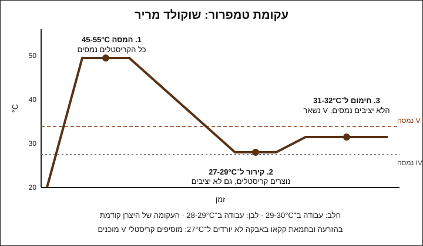

# 03.2 · טמפרור בשיטת ההזרעה

שיטת ההזרעה היא הדרך הכי פשוטה לטמפר בבית: ממיסים חלק מהשוקולד ומערבבים לתוכו שוקולד מוצק שכבר מטומפר, שמביא איתו את גבישי צורה V ובאותה הזדמנות גם מקרר. בשיעור הזה מטמפרים 300 גרם מריר, בודקים את הטמפר ויוצקים טבלה אחת או 8 דיסקיות.

## מה צריך

| פריט | כמות לתרגול | כמות מלאה | הערה |
|---|---|---|---|
| קוברטורה מריר 50-70%, בטבליות (callets) או מטבעות | 300 גרם | 1 ק"ג | 200 גרם להמסה, 100 גרם "זרעים" |
| קערה יבשה (פלסטיק עבה או זכוכית) | 1 | | מתאימה למיקרוגל |
| מרית סיליקון | 1 | | |
| מדחום דיגיטלי עם דקר | 1 | | |
| משקל מטבח | 1 | | |
| מזלג | 1 | | להוציא זרעים שלא נמסו |
| תבנית טבלה (פוליקרבונט או סיליקון) או דף אצטט/נייר אפייה | 1 | | |
| סכין או רצועת נייר אפייה | 1 | | לבדיקת הטמפר |
| מייבש שיער (לא חובה) | 1 | | לחימום עדין של מעלה אחת |

**למה 300 גרם ולא פחות:** כמות קטנה מאבדת חום מהר מאוד, והטמפרטורה קופצת בין "חם מדי" ל"קר מדי" תוך שניות. שוקולטיירית שמלמדת ייצור קטן ממליצה לעבוד עם יותר מ־300 גרם. 300 גרם הם המינימום שעוד מחזיק חום מספיק זמן לעבודה, ומה שנשאר נשמר לפעם הבאה.

**הזרעים:** הטבליות או המטבעות בשקית מקורית מהיצרן כבר מטומפרים. כך גם טבלת שוקולד טובה קצוצה דק. שוקולד שנמס בעבר והתקשה בלי טמפרור לא מתאים כזרעים.

**אלרגנים:** קוברטורה מכילה בדרך כלל לציטין סויה. מריר רבים מכילים או "עלולים להכיל" חלב, ורבים "עלולים להכיל" אגוזים. בודקים על האריזה.

## למה זה עובד

### שתי משימות בפעולה אחת

בטמפרור צריך לעשות שני דברים: להוריד את השוקולד מטמפרטורת ההמסה לטמפרטורת העבודה, ולתת לו מספיק גבישי צורה V. בשיטת ההזרעה הזרעים עושים את שניהם. הם קרים (בטמפרטורת החדר), ולכן מקררים את המסה. וכשהם נמסים בהדרגה, נשארים בשוקולד שברים זעירים של גבישי V, שכל השאר מתגבש סביבם.

אם השוקולד המותך חם מדי (מעל כ־34°C במריר), הזרעים נמסים לגמרי ולא תורמים כלום. לכן הזרעים צריכים להימס **לאט**. לפי Callebaut, אם הטבליות נעלמות מהר, השוקולד עדיין חם מדי: מוסיפים עוד ומערבבים.

### כמה זרעים

Callebaut מוסיפים רק 5% טבליות, אבל הם עובדים במכונת המסה שמחזיקה את השוקולד בטמפרטורת העבודה, כך שהזרעים לא צריכים לקרר. בקערה בבית הזרעים צריכים גם לקרר, ולכן משתמשים בהרבה יותר: King Arthur משתמשים ברבע מהכמות הכוללת, ואנחנו משאירים שליש (100 מתוך 300 גרם) ומשתמשים במה שצריך. מה שלא נכנס נשאר בשקית לפעם הבאה.

### טבלת טמפרטורות

לכל שוקולד יש עקומת טמפרור (tempering curve) משלו, והיצרן מדפיס אותה על השק או באתר. היא קודמת לכל טבלה. אלה טווחים מקובלים להתחלה, עם מקור לכל מספר:

| סוג | המסה | קירור (בשיטת משטח) | עבודה | מה אומרים היצרנים |
|---|---|---|---|---|
| מריר 50-70% | 45-55°C | 27-29°C | **31-32°C** | Callebaut: המסה ב־45°C, עבודה בכ־31°C. Valrhona Guanaja 70%: המסה 50-55°C, קירור 28-29°C, עבודה 31-32°C |
| חלב | 40-50°C | 26-28°C | **29-30°C** | Callebaut: עבודה בכ־29°C. Cacao Barry: עבודה 29-30°C |
| לבן | 40-45°C | 25-27°C | **28-29°C** | Callebaut: עבודה בכ־29°C. Valrhona Ivoire 35%: המסה 45-48°C, קירור 26-27°C, עבודה 28-29°C |

שוקולד חלב ולבן מחממים פחות ממריר: יש בהם אבקת חלב וסוכר שמסמיכים ונפגעים מחום גבוה. King Arthur ממיסים אותם עד 40°C בלבד. שילוב של חלב ומריר עובד לפי הטמפרטורות של חלב (המלצת Callebaut).

עמודת הקירור שייכת לשיטת המשטח (03.3). בהזרעה לא יורדים ל־27°C: הולכים ישר מההמסה לטמפרטורת העבודה. Callebaut כותבים במפורש שבהזרעה אין צורך לרדת קודם ל־27°C.

### למה החדר חשוב

ההנחיות המקצועיות מניחות חדר של 18-21°C. במטבח ישראלי בקיץ יש בקלות 27-30°C. בחדר חם השוקולד מתקשה לאט, הבדיקה מטעה, והמוצר המוגמר יכול להתרכך. מטמפרים בחדר ממוזג, ולא ליד תנור או כיריים דולקים.

## שלב אחר שלב

> [!WARNING]
> מים הם האויב: טיפה אחת, או אדים מסיר של בן־מארי, הופכים שוקולד לגוש סמיך ("נתפס"). קערה ומרית יבשות לגמרי. בבן־מארי המים לא רותחים והקערה לא נוגעת בהם. במיקרוגל: פולסים קצרים וערבוב, כי נוצרות נקודות חמות שעלולות לשרוף את השוקולד.

1. **מכינים את החדר**: מזגן על 20-22°C אם אפשר. מכינים תבנית נקייה ויבשה, ומשפשפים את החללים בצמר גפן אם היא מפוליקרבונט.
2. **שוקלים**: 200 גרם לקערה, 100 גרם זרעים בצד. אם הזרעים בגוש, קוצצים לחתיכות של 5 מ"מ לכל היותר.
3. **ממיסים**: במיקרוגל בפולסים של 30 שניות בהתחלה ו־10-15 שניות לקראת הסוף, עם ערבוב אחרי כל פולס. ממיסים עד 45-50°C (חלב ולבן: 40-45°C). מודדים במרכז המסה, אחרי ערבוב.
4. **מזריעים**: מוסיפים כ־70 גרם מהזרעים בבת אחת ומערבבים כל הזמן, בתנועות רחבות שמגרדות גם את הדפנות.
5. **עוקבים**: מודדים כל 30-60 שניות. הזרעים צריכים להימס לאט. אם במריר הם נעלמים לגמרי כשהשוקולד עדיין מעל 34°C, מוסיפים עוד 10-20 גרם.
6. **מגיעים ליעד**: במריר 31-32°C, בחלב 29-30°C, בלבן 28-29°C. השוקולד מסמיך מעט ומבריק. בדרך כלל זה לוקח 10-20 דקות של ערבוב, לפי החדר.
7. **זרעים שלא נמסו**: אם הגעתם ליעד ועדיין יש חתיכות, מוציאים אותן במזלג (הן עדיין מטומפרות ונשמרות לפעם הבאה). אפשר גם לחמם עם מייבש שיער 5 שניות תוך כדי ערבוב, ולבדוק שהמדחום לא עבר את 32°C.
8. **בודקים**: טובלים קצה סכין או רצועת נייר אפייה ומניחים על השיש. ראו "בדיקה" בהמשך. לא יוצקים לפני שהבדיקה עברה.
9. **יוצקים**: ממלאים תבנית טבלה, או מזלפים 8 דיסקיות בקוטר 4-5 ס"מ על אצטט. מקישים בעדינות כדי להוציא בועות אוויר.
10. **שומרים על הטמפרטורה**: אם השוקולד בקערה מסמיך תוך כדי עבודה, מחממים בפולס של 5 שניות במיקרוגל או במייבש שיער ומערבבים. לא עוברים את טמפרטורת העבודה העליונה (במריר 32°C).
11. **מקררים**: משאירים 10-15 דקות בחדר עד שהשוקולד מתחיל להתקשות, ואז אפשר עד 15 דקות במקרר רגיל. מוציאים מהתבנית כשהשוקולד מתנתק מהדפנות.

## בדיקה: איך יודעים שהצליח

- **בדיקת סכין או נייר (לפני יציקה)**: בחדר של 18-22°C השכבה מתקשה תוך 3-5 דקות, מבריקה, אחידה ובלי פסים. אם אחרי 5 דקות היא עדיין רכה ודביקה, השוקולד לא מטומפר. בחדר חם יותר זה ייקח יותר זמן, אז השוו לחדר ממוזג.
- **טמפרטורה**: במריר המדחום הראה 31-32°C כשיצקתם, ולא עבר את 32°C אחרי ההזרעה.
- **שחרור מהתבנית**: הטבלה מתנתקת מהדפנות ויוצאת כשהופכים את התבנית, בלי לדפוק חזק.
- **ברק**: הצד שנגע בתבנית או באצטט מבריק כמו מראה.
- **סנאפ**: חתיכה בעובי 5 מ"מ נשברת בקול "קליק" ברור, וקו השבר נקי.
- **ביד**: מחזיקים חתיכה 10 שניות. היא לא נמרחת מיד ולא משאירה טביעת אצבע עמוקה.

## כשזה משתבש

| מה רואים | למה זה קורה | מה עושים עכשיו | איך מונעים בפעם הבאה |
|---|---|---|---|
| בדיקת הסכין רכה גם אחרי 5 דקות | השוקולד חם מדי (עבר את 32-34°C) והזרעים נמסו, או שלא היו מספיק זרעים | מוסיפים עוד 20-30 גרם זרעים, מערבבים עד היעד ובודקים שוב | מוסיפים זרעים כשהשוקולד ב־45-50°C ולא עולים מעל 32°C אחר כך |
| השוקולד בקערה מסמיך מאוד ונהיה בצקי | התקרר מתחת לטווח וממשיך להתגבש | מחממים במייבש שיער או בפולס של 5 שניות, ומערבבים עד 31-32°C | עובדים מהר, ומחממים במעלה אחת כל כמה דקות |
| הטבלה יצאה עם פסים אפורים | טמפר חלקי: מעט מדי זרעים, או שהשוקולד התחמם אחרי הבדיקה | ממיסים מחדש ומטמפרים שוב | בדיקת סכין לפני יציקה, ומדחום אחרי כל חימום |
| הטבלה לא יוצאת מהתבנית | לא מטומפר, או שלא התקרר מספיק זמן | עוד 10 דקות במקרר. אם עדיין לא יוצאת, השוקולד לא מטומפר | מחכים שהטבלה תתנתק מהדפנות, ובודקים טמפר לפני יציקה |
| הזרעים לא נמסים בכלל והשוקולד כבר ב־31°C | חיממתם מעט מדי בהתחלה, או שהזרעים גדולים מדי | מוציאים במזלג את מה שלא נמס | ממיסים לפחות ל־45°C וקוצצים זרעים לחתיכות קטנות |
| השוקולד נתפס לגוש יבש | מים או אדים נכנסו, או חימום חזק מדי | לא מטמפרים. מעבירים לשוקו חם או לרוטב | כלים יבשים, לא לכסות קערה חמה, ופולסים קצרים |

### מה עושים עם מה שלא הצליח

שום דבר לא הולך לפח. שוקולד שלא התטמפר נמס מחדש ומטמפרים אותו שוב: מחממים ל־45-50°C ומתחילים מההתחלה. אפשר לחזור על זה כמה פעמים. טבלה מפוספסת היא חומר גלם מצוין לשוקו חם, לבראוניז, לרוטב שוקולד או לטבלת bark עם אגוזים, שם המראה פחות חשוב. שוקולד שנתפס ממים לא חוזר לטמפרור, אבל עם חלב חם או שמנת הוא רוטב או שוקו מצוין.

## חלופות

### טבעוני / פרווה

שוקולד מריר בלי חלב ברכיבים מטמפרים בדיוק כמו בשיעור. שוקולד "חלב" טבעוני (על בסיס אורז, שיבולת שועל או קוקוס) מטמפרים לפי עקומת היצרן: אין לו טווח אחיד, ולא כדאי להניח שהוא כמו שוקולד חלב רגיל. חשוב לדעת שהזרעים חייבים להיות מאותו סוג, אחרת השוקולד כבר לא טבעוני או פרווה. חיי המדף והמרקם של מריר טבעוני זהים לשוקולד מריר רגיל.

### בריא יותר

מריר 70% ומעלה מטמפרים באותן טמפרטורות של מריר, והוא פחות מתוק. אפשר לחלק את 300 הגרם ל־8 דיסקיות קטנות (כ־20 גרם כל אחת) במקום טבלה אחת גדולה. שוקולד ללא תוספת סוכר עם מלטיטול, למשל MALCHOC של Callebaut, מטמפרים לפי היצרן בדיוק כמו שוקולד רגיל.

> [!CAUTION]
> מלטיטול גורם לגזים ולשלשול כשאוכלים ממנו כמות, והוא לא מתאים לילדים בכמויות. מי שמגיש שוקולד כזה אומר לאורחים מה יש בו.

### כשרות

קוברטורה מריר יכולה להיות מסומנת פרווה, חלבי, או חלבי "לאוכלי אבקת חלב נכרי", ולפעמים באותו מותג ובאותו מספר מוצר יש כשרות שונה לפי גודל האריזה ומי ארז אותה. מי שרוצה מוצר פרווה בודק שגם השוקולד וגם הזרעים מסומנים פרווה בהכשר שהוא סומך עליו. מה כתוב על כל מוצר נפוץ בישראל: [קוברטורה מרירה במדריך הכשרות](../../references/kashrut-guide.md#קוברטורה-מרירה), ו[שלושה כללים](../../references/kashrut-guide.md#שלושה-כללים) לקריאת התווית. אם יש ספק, שואלים את הרב.

## איפה קונים

מה מחפשים: קוברטורה מריר 50-70% (בחנויות קונדיטוריה: "שוקולד בלגי מריר", "callets", "מטבעות שוקולד"). ברשימת הרכיבים צריכה להיות חמאת קקאו ולא שומן צמחי אחר. שק של 1-2.5 ק"ג זול יותר לקילו, ואפשר להתחיל משקית של 400-500 גרם. צריך גם מדחום דיגיטלי עם דקר, ותבנית טבלה אחת (פוליקרבונט נותנת ברק טוב יותר מסיליקון, מודול 4). חנויות, מחירים ומלאי: [קוברטורה](../../references/where-to-buy.md#קוברטורה), [מדחום](../../references/where-to-buy.md#מדחום), [תבניות פוליקרבונט](../../references/where-to-buy.md#תבניות-פוליקרבונט), [תבניות סיליקון](../../references/where-to-buy.md#תבניות-סיליקון). כשרות לפי מוצר: [קוברטורה מרירה](../../references/kashrut-guide.md#קוברטורה-מרירה), [קוברטורה חלב](../../references/kashrut-guide.md#קוברטורה-חלב), [קוברטורה לבנה](../../references/kashrut-guide.md#קוברטורה-לבנה).

## תרגול

### משימה

מטמפרים 300 גרם מריר בשיטת ההזרעה: 200 גרם מומסים ל־45-50°C, ועד 100 גרם זרעים. מגיעים ל־31-32°C, עושים בדיקת סכין, ויוצקים טבלה אחת או 8 דיסקיות. מי שמרגיש בטוח חוזר על התרגיל ביום אחר עם 300 גרם שוקולד חלב (עבודה ב־29-30°C).

### זמן

כ־35 דקות עבודה, ועוד 25 דקות התקשות וקירור. סך הכול כשעה.

### יומן

ממלאים שורה ב[יומן הטמפרור](../../templates/tempering-log.md): סוג השוקולד, המסה עד, טמפרטורת עבודה, טמפרטורת החדר, כמה זרעים נכנסו בפועל, זמן ההתקשות בבדיקת הסכין, ותוצאה (ברק, סנאפ, פסים). מצלמים את הטבלה מלמעלה ואת קו השבר מקרוב. הערות כלליות נכנסות ל[יומן התרגול](../../templates/practice-log.md).

### בדיקה עצמית

- [ ] המסתי ל־45-50°C ומדדתי במרכז המסה.
- [ ] הגעתי ל־31-32°C ולא עברתי את 32°C אחרי ההזרעה.
- [ ] בדיקת הסכין התקשתה תוך 5 דקות, מבריקה ובלי פסים.
- [ ] הטבלה יצאה מהתבנית לבד, מבריקה, ונשברת בסנאפ.
- [ ] רשמתי כמה זרעים נכנסו בפועל, וזרעים שנשארו חזרו לשקית.

## סיכום

- בשיטת ההזרעה הזרעים, שוקולד מוצק ומטומפר, מקררים את המסה ומביאים איתם גבישי V.
- זרעים שנמסים מהר אומרים שהשוקולד עדיין חם מדי: מוסיפים עוד ומערבבים.
- טמפרטורות עבודה מקובלות: מריר 31-32°C, חלב 29-30°C, לבן 28-29°C. עקומת היצרן קודמת.
- לא יוצקים לפני שבדיקת הסכין מתקשה תוך 3-5 דקות ומבריקה.
- 300 גרם הם הכמות הקטנה ביותר שעוד נוח לטמפר. מה שלא הצליח נמס ומטמפרים שוב.
