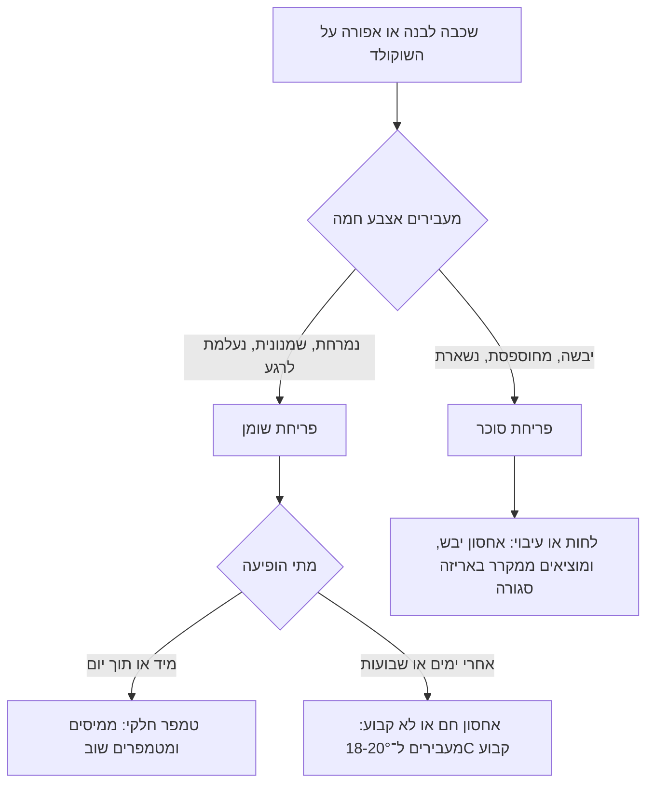

# 03.5 · בדיקת טמפר ותיקון תקלות: פריחה, פסים וכתמים

בשלושת השיעורים הקודמים הכנתם שלוש טבלאות. בשיעור הזה בודקים אותן כמו מקצוענים, לומדים לקרוא מה משתבש לפי מה שרואים על השוקולד, ומבינים איך אחסון לא נכון מקלקל גם שוקולד שטומפר היטב. בסופו יש לכם טבלת תקלות מלאה לכל המשך הקורס.

## מה צריך

| פריט | כמות לתרגול | הערה |
|---|---|---|
| שלוש הטבלאות מ־03.2, 03.3 ו־03.4 | חתיכה של כ־30 גרם מכל אחת | |
| דוגמאות A ו־B מ־03.1 (בלי טמפרור) | מה שנשאר | להשוואה |
| שתי חתיכות נוספות מטבלה מטומפרת | 10 גרם כל אחת | לניסוי האחסון |
| קופסה אטומה קטנה | 1 | |
| מדחום חדר (לא חובה, אבל מומלץ) | 1 | מדחום־מד לחות דיגיטלי זול מספיק |
| מדחום דיגיטלי עם דקר, סכין, נייר אפייה | | לבדיקות |

**אלרגנים:** כמו בשוקולד שבו השתמשתם: בדרך כלל לציטין סויה, ולעתים חלב, או "עלול להכיל" חלב ואגוזים. בודקים על האריזה.

## למה זה עובד

### שש בדיקות, כל אחת מודדת משהו אחר

| בדיקה | מה מודדת | מטומפר | לא מטומפר |
|---|---|---|---|
| סכין או נייר | קצב ההתגבשות | מתקשה תוך 3-5 דקות ב־18-22°C, מבריק | רך ודביק אחרי 5 דקות, או מתקשה מפוספס |
| טמפרטורה | אם נשארו גבישי V | מריר 31-32°C, חלב 29-30°C, לבן 28-29°C | מעל 34°C במריר: הגבישים נמסו |
| שחרור מהתבנית | התכווצות | יוצא לבד כשהופכים | נדבק, יוצא שבור או עם כתמים |
| ברק | גבישים קטנים ואחידים | מבריק כמו מראה בצד התבנית | עמום, אפור או מנומר |
| סנאפ | מבנה צפוף | נשבר בקליק, קו שבר נקי | מתכופף, נשבר רך ומתפורר |
| יד | נקודת התכה של 33.8°C | לא נמרח בעשר שניות | נמרח מהר ומשאיר טביעת אצבע |

אף בדיקה אחת לא מספיקה לבד. טבלה שעברה ארבע או חמש בדיקות מתוך שש מטומפרת כמעט בוודאות. טבלה שנכשלה בשחרור ובברק כנראה לא מטומפרת, גם אם בדיקת הסכין נראתה טובה.

### שני סוגי פריחה

"פריחה" (bloom) היא שכבה לבנה־אפורה על פני השוקולד. שני סוגים, עם סיבות הפוכות:

**פריחת שומן** (fat bloom): לפי Callebaut, מראה של שכבה עמומה ואפורה־לבנה, שמנונית למגע, שנעלמת כשנוגעים בה. היא נוצרת כשהשוקולד לא טומפר היטב, וחמאת הקקאו נמסה והתגבשה מחדש בצורה לא נכונה, או כשהאחסון חם מדי והחום דוחף חמאת קקאו אל פני השטח. שוקולד שלא טומפר היטב נוטה לפריחת שומן גם באחסון מושלם. מילויים שומניים (פרלינה, אגוזים) מאיצים אותה. במחקר היא קשורה גם למעבר האיטי מצורה V לצורה VI, היציבה ביותר.

**פריחת סוכר** (sugar bloom): לפי Callebaut, מראה לבן, מחוספס וגרגרי. היא נוצרת מלחות: אחסון לח, או מעבר ממקום קר למקום חם שגורם לעיבוי. טיפות המים ממיסות את הסוכר שבשכבה החיצונית, וכשהן מתאדות הסוכר מתגבש על פני השטח.

**איך מבדילים**: מעבירים אצבע חמה על הכתם. פריחת שומן נמרחת ונעלמת לרגע, ומרגישה שמנונית. פריחת סוכר נשארת, ומרגישה יבשה ומחוספסת.

שתי הפריחות בטוחות לאכילה. הן פוגעות במראה ובמרקם, לא בבטיחות. King Arthur מציינים את זה במפורש.

### אחסון: טמפרטורה קבועה, יבש, סגור

- Callebaut ממליצים לאחסן מוצרי שוקולד מוגמרים בטמפרטורה **קבועה** של 18-20°C. המילה החשובה היא "קבועה": קפיצות של חום וקור מאיצות פריחה.
- לפי שוקולטיירית שמלמדת ייצור קטן: חדר עבודה של 18-20°C, לחות של 50-65% בחדר העבודה, ומקרר רגיל (3-5°C) רק לזמן קצר, עד 15 דקות, לקירור אחרי יציקה. עדיף שההפרש בין חדר העבודה למקום הקירור יהיה פחות מ־10°C.
- **מקרר לאחסון ארוך**: לא עדיף. אם אין ברירה (קיץ בלי מזגן), מכניסים בקופסה אטומה, ומוציאים אותה **סגורה** לחדר לשעה־שעתיים, עד שהשוקולד מגיע לטמפרטורת החדר. כך העיבוי נוצר על הקופסה ולא על השוקולד. גם Callebaut ממליצים לתת למוצרים להסתגל בתוך האריזה.
- שוקולד סופג ריחות. מאחסנים סגור, הרחק מתבלינים, בצל וגבינות.

### שוקולד שהתגבש יותר מדי

התקלה ההפוכה לטמפר חלקי: השוקולד בקערה ממשיך להתגבש, מסמיך מאוד ונהיה קשה לעבודה. לפי Callebaut, שוקולד שהתקרר יותר מדי סמיך מכדי למלא פרטים קטנים בתבנית ונותן קליפות עבות מדי. הוא עדיין מטומפר. מחממים במעלה־שתיים ומערבבים, ולא עוברים את טמפרטורת העבודה העליונה.

## שלב אחר שלב

1. **מסדרים** על נייר אפייה, באור יום: שלוש החתיכות מהטבלאות (מסומנות "הזרעה", "משטח", "אבקה") ודוגמאות A ו־B מ־03.1.
2. **ברק**: מסתכלים על הצד שנגע בתבנית, בזווית מול חלון. רושמים לכל חתיכה: מבריק / חצי / עמום, ופסים או כתמים.
3. **סנאפ**: שוברים כל חתיכה ליד האוזן. רושמים: קליק ברור / רך / מתכופף. מסתכלים על קו השבר: חלק או מתפורר.
4. **יד**: מחזיקים כל חתיכה 10 שניות בין האגודל לאצבע. רושמים אם נמרחה ואם נשארה טביעה.
5. **כתמים**: אם יש שכבה לבנה, עושים את בדיקת האצבע מהתרשים ורושמים: שומן או סוכר.
6. **ניסוי אחסון, חתיכה 1 (חום)**: מניחים חתיכה של 10 גרם במקום חם בבית, 28-30°C (למשל ליד חלון, לא בשמש ישירה ולא ברכב), לשעה. מחזירים לחדר רגיל ובודקים למחרת.
7. **ניסוי אחסון, חתיכה 2 (עיבוי)**: מכניסים חתיכה של 10 גרם למקרר **בלי עטיפה** לשעה. מוציאים לחדר חם ומסתכלים מיד: נוצרות טיפות? בודקים שוב למחרת, אחרי שהתייבשה.
8. **רושמים** ביומן לכל חתיכה: מטומפרת או לא, איזו תקלה, ומה הסיבה הסבירה לפי הטבלה בהמשך.
9. **אוספים** את כל החתיכות, כולל אלה שנפגעו, לשקית "להמסה". הן חוזרות לפרויקט המודול.

## בדיקה: איך יודעים שהצליח

- לכל חתיכה רשומות שש בדיקות, והחלטה "מטומפר" או "לא מטומפר" עם נימוק.
- דוגמאות A ו־B סומנו "לא מטומפר", ולפחות שתיים מתוך שלוש הטבלאות סומנו "מטומפר". אם לא, יודעים איזה שלב לחזור עליו.
- בניסוי האחסון זיהיתם נכון את סוג הפריחה (אם הופיעה) לפי מגע.
- אתם יודעים לומר איפה בבית תאחסנו שוקולד מוגמר בקיץ, ואיך תוציאו אותו מהמקרר.

## כשזה משתבש

זו טבלת התקלות של הקורס. היא נכונה לטבלאות, לבונבונים, לסביבונים ולכל שוקולד מטומפר.

| מה רואים | למה זה קורה | מה עושים עכשיו | איך מונעים בפעם הבאה |
|---|---|---|---|
| פסים אפורים או לבנים כבר ביום היציקה | טמפר חלקי: מעט זרעים, או חימום מעל 32°C אחרי הבדיקה | ממיסים ומטמפרים שוב | בדיקת סכין לפני כל יציקה, ומדחום אחרי כל חימום |
| שכבה אפורה שמנונית שהופיעה אחרי ימים | פריחת שומן מאחסון חם או לא קבוע | אוכלים או ממיסים מחדש (המראה לא חוזר) | אחסון קבוע ב־18-20°C, לא ליד תנור או חלון |
| שכבה לבנה, יבשה ומחוספסת | פריחת סוכר: לחות או עיבוי | ממיסים מחדש. הטעם והבטיחות בסדר | קופסה אטומה, ומוציאים ממקרר סגור עד שמגיע לטמפרטורת החדר |
| טבלה עמומה בלי פסים, רכה, לא יוצאת מהתבנית | לא טומפר בכלל (חם מדי בזמן היציקה) | ממיסים ומטמפרים שוב | מדחום: מריר לא מעל 32°C ביציקה |
| כתמים עגולים קטנים בצד התבנית | טיפות מים או שמן בתבנית, או תבנית לא נקייה | ממיסים מחדש | תבנית יבשה לגמרי, משופשפת בצמר גפן |
| חורים ובועות על פני הטבלה | אוויר שנכלא ביציקה | אוכלים כמו שזה, או ממיסים מחדש | מקישים את התבנית על השיש אחרי היציקה |
| סדקים בטבלה | קירור חזק ומהיר מדי (מקפיא, או מקרר לזמן ארוך) | אוכלים, או ממיסים מחדש | עד 15 דקות במקרר רגיל, אחרי 10-15 דקות בחדר |
| השוקולד בקערה מסמיך מאוד, קליפות עבות | התגבש יותר מדי: התקרר מתחת לטווח | מחממים במעלה־שתיים ומערבבים | מחממים קצת כל כמה דקות, ועובדים מהר |
| טביעות אצבע מבריקות על טבלה מטומפרת | חום היד ממיס את השכבה החיצונית | אין צורך לתקן | נוגעים עם כפפות ניטריל, או בקצוות |
| "סנאפ" רך בטבלה מבריקה | הטבלה עבה מאוד, או חדר חם | בודקים שוב אחרי שעה בחדר של 20°C | יוצקים בעובי 5-8 מ"מ ובודקים בחדר קריר |

### מה עושים עם מה שלא הצליח

שום דבר לא הולך לפח. כל טבלה עם פריחה, פסים או סדקים נמסה מחדש ומטמפרים אותה שוב: הפריחה נעלמת בהמסה, כי היא חלק מהשוקולד עצמו. טבלה עם פריחת סוכר מתאימה במיוחד לשוקו חם, לרוטב או לגנאש, כי הסוכר נמס שוב בנוזל. כל מה שנאסף בשיעור הזה נכנס לשקית "להמסה" ומשמש לפרויקט המודול.

## חלופות

### טבעוני / פרווה

אותן בדיקות ואותה טבלת תקלות. בשוקולד "חלב" טבעוני הטמפרטורות לבדיקה לפי היצרן. שוקולד על בסיס קוקוס יכול להיות רך יותר, וסנאפ חלש לא תמיד אומר שהטמפר נכשל. שם משווים לחתיכה מהאריזה המקורית של אותו מוצר.

### בריא יותר

מנות קטנות קל יותר לאחסן נכון: 8 דיסקיות בקופסה אטומה קטנה מגיעות לטמפרטורת החדר מהר יותר מטבלה גדולה. שוקולד ללא תוספת סוכר עם מלטיטול יכול לפרוח כמו כל שוקולד, כי הפריחה תלויה בחמאת הקקאו ובלחות. מלטיטול גורם לגזים ולשלשול בכמות, ואינו מתאים לילדים בכמויות.

### כשרות

הבדיקות לא משנות דבר בכשרות. אם מערבבים בשקית "להמסה" שאריות חלביות ופרווה, כבר אי אפשר לדעת מה הכשרות של מה שבתוכה. שומרים שקית נפרדת לכל סוג כשרות, ומסמנים עליה את המוצר וההכשר. מה כתוב על כל מוצר: [מדריך הכשרות](../../references/kashrut-guide.md). אם יש ספק, שואלים את הרב.

## איפה קונים

לשיעור הזה לא צריך לקנות כמעט כלום. מומלץ מדחום־מד לחות דיגיטלי לחדר (מוצר זול שנמכר בחנויות לבית ולאלקטרוניקה), כדי לדעת מה הטמפרטורה והלחות כשאתם מטמפרים ומאחסנים. קופסאות אטומות קטנות לאחסון ושקיות לשוקולד "להמסה". כפפות ניטריל לעבודה עם טבלאות מוגמרות. חנויות: [איפה קונים](../../references/where-to-buy.md).

## תרגול

### משימה

בודקים את שלוש הטבלאות של המודול ואת שתי הדוגמאות הלא מטומפרות בשש הבדיקות, ועורכים את שני ניסויי האחסון (חום ועיבוי) על חתיכות של 10 גרם. אחר כך עוברים ל[פרויקט המודול: שלוש שיטות טמפרור](../../projects/m03-three-methods.md), שבו מטמפרים שוב את אותו שוקולד בשלוש השיטות, עם צילום ויומן.

### זמן

כ־25 דקות של בדיקות ורישום, ועוד 20 דקות לניסויי האחסון ולבדיקה למחרת. סך הכול כ־45 דקות.

### יומן

ב[יומן התרגול](../../templates/practice-log.md) רושמים טבלה קטנה: חתיכה, שש בדיקות, החלטה, סיבה. ב[יומן הטמפרור](../../templates/tempering-log.md) מוסיפים לשורה של כל שיטה את התוצאה הסופית. מצלמים את כל החתיכות יחד, ואת חתיכות ניסוי האחסון לפני ואחרי.

### בדיקה עצמית

- [ ] ביצעתי שש בדיקות על כל חתיכה ורשמתי החלטה.
- [ ] אני יודע להבדיל בין פריחת שומן לפריחת סוכר במגע.
- [ ] ראיתי מה קורה לשוקולד שיוצא ממקרר בלי אריזה.
- [ ] בחרתי מקום אחסון בבית שנשאר בטמפרטורה קבועה, ומדדתי אותו.
- [ ] כל החתיכות נאספו לשקית "להמסה", מופרדות לפי סוג כשרות.

## סיכום

- שש בדיקות: סכין, טמפרטורה, שחרור, ברק, סנאפ ויד. אחת לא מספיקה. מחליטים לפי רובן.
- פריחת שומן שמנונית ונעלמת במגע; היא באה מטמפר חלקי או מחום. פריחת סוכר יבשה ומחוספסת; היא באה מלחות ועיבוי.
- מאחסנים בטמפרטורה קבועה של 18-20°C, יבש וסגור. מקרר רק לזמן קצר, ומוציאים ממנו באריזה סגורה.
- שוקולד שהסמיך בקערה עדיין מטומפר: מחממים במעלה־שתיים.
- כל תקלה נפתרת בהמסה ובטמפרור מחדש. שום דבר לא נזרק.
