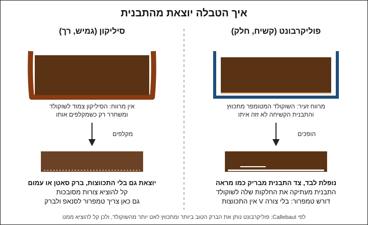

# 04.1 · תבניות פוליקרבונט מול סיליקון

עד עכשיו יצקתם טבלה אחת בכל שיעור, וראיתם שהיא יוצאת מבריקה רק כשהטמפר הצליח. בשיעור הזה מבינים מה התבנית עצמה תורמת: למה תבנית פוליקרבונט קשיחה נותנת ברק כמו מראה ומשחררת את הטבלה לבד, ולמה תבנית סיליקון זולה וגמישה נותנת טבלה פחות מבריקה. בסוף השיעור יש לכם שתי טבלאות מאותו שוקולד, אחת מכל סוג, והחלטה איזו תבנית לקנות להמשך.

## מה צריך

| פריט | כמות לתרגול | כמות מלאה | הערה |
|---|---|---|---|
| קוברטורה מריר 50-70%, כולל שאריות מ[מודול 3](../module-03/lesson-01.md) מאותו מוצר | 300 גרם | 1 ק"ג | 200 גרם להמסה, עד 100 גרם זרעים |
| תבנית טבלה מפוליקרבונט | 1 | | שקע אחד או שניים מספיקים לתרגול |
| תבנית סיליקון לטבלה או לצורה דומה בגודלה | 1 | | אם אין: דף אצטט במקומה, להשוואה |
| צמר גפן (כדורים או פדים) | 3-4 | | לליטוש התבנית |
| מדחום דיגיטלי עם דקר, משקל, מרית סיליקון, קערה יבשה | 1 מכל | | כמו ב־[03.2](../module-03/lesson-02.md) |
| שפכטל מתכת רחב או סכין פלטה | 1 | | לגרד עודפים מעל התבנית |
| מגבת נקייה ונייר אפייה | | | להניח את התבנית ולהוציא עליו |
| מייבש שיער | 1 | | לא חובה: לחמם את התבנית כמה שניות |

**כמה שוקולד נכנס לתבנית:** שוקלים את התבנית ריקה, ממלאים במים עד השפה, שוקלים שוב ומחסירים. משקל המים בגרמים כפול 1.2 הוא בערך משקל השוקולד שנכנס לשקע, כי שוקולד כבד ממים בכ־20%. עושים את זה **לפני** השיעור ומייבשים את התבנית לגמרי. שקע של טבלה רגילה לוקח 50-100 גרם, ולכן 300 גרם מספיקים לשני שקעים ועוד כמה דיסקיות, ומה שנשאר בקערה נשמר להמסה הבאה.

**אלרגנים:** קוברטורה מכילה בדרך כלל לציטין סויה. מריר רבים מכילים או "עלולים להכיל" חלב, ורבים "עלולים להכיל" אגוזים. בודקים על האריזה.

### לפני שמתחילים את המודול

במודול הזה כל שיעור נשען על טמפרור טוב: בלי שוקולד מטומפר, אף תבנית לא תיתן ברק. מי שעוד לא עבר את [פרויקט מודול 3](../../projects/m03-three-methods.md) בהצלחה, כדאי שיחזור אליו קודם. צפייה בשיעור היא לא תרגול. האקדמיה לא יכולה לבדוק צילומים, ולכן בכל שיעור יש בדיקות ברורות (שחרור מהתבנית, ברק, סנאפ, טמפרטורה) שמשווים אליהן את התוצאה. ממשיכים לנהל את [יומן התרגול](../../templates/practice-log.md) ואת [יומן הטמפרור](../../templates/tempering-log.md) מהמודול הקודם.

## למה זה עובד

### התבנית היא "מראה" שהשוקולד מעתיק

כשהשוקולד המטומפר מתגבש, הצד שנוגע בתבנית מקבל את פני השטח שלה. תבנית חלקה ומבריקה נותנת שוקולד חלק ומבריק. תבנית עם שריטה, טביעת אצבע או כתם מים מעבירה אותם בדיוק לשוקולד. לכן Callebaut ממליצים במפורש על תבניות פוליקרבונט (polycarbonate): לדבריהם הן נותנות את הברק הטוב ביותר, והן "מתכווצות לאט יותר מהשוקולד", ולכן קל הרבה יותר להוציא מהן.

### התכווצות: למה טבלה מטומפרת נופלת לבד

ב[שיעור 03.1](../module-03/lesson-01.md) ראיתם שגבישי צורה V ארוזים בצפיפות. כשהשוקולד מתגבש בצורה הזו, הוא תופס פחות נפח ומתכווץ מעט. בתבנית קשיחה, שלא זזה איתו, נוצר מרווח זעיר בין השוקולד לדופן. כשהופכים את התבנית, הטבלה פשוט נופלת. בתבנית פוליקרבונט שקופה אפשר לפעמים לראות את זה מלמטה: אזורים שבהם השוקולד כבר התנתק נראים בגוון אחר מאזורים שעוד צמודים.

זו גם הסיבה שבדיקת השחרור ב־[03.5](../module-03/lesson-05.md) היא בדיקת טמפר. בטבלת התקלות של Callebaut לתבניות, "השוקולד לא יוצא מהתבנית בכלל" מופיע עם שלוש סיבות: השוקולד לא טומפר, טומפר חלקית (מעט מדי גבישים), או שזמן הקירור היה קצר מדי. גם "התקשה לאט מאוד בתבנית" מסומן אצלם כטמפר חלקי.

### סיליקון: יוצא, אבל לא בגלל התכווצות

תבנית סיליקון (silicone) גמישה ורכה. היא נצמדת לשוקולד גם אחרי שהוא מתכווץ, והשוקולד יוצא רק כשמקלפים אותה ממנו. זה היתרון שלה: גם צורה מסובכת יוצאת בקלות, והיא זולה ולא נשברת. זה גם החיסרון: פני הסיליקון פחות חלקים מפוליקרבונט מלוטש, והתוצאה בדרך כלל ברק סאטן או מראה עמום. מדריך של חנות לשוקולטיירים (Hill Country Chocolate, יוני 2026) מתאר את הגימור מסיליקון כ"מט" ומציע אותו כשקלות ההוצאה חשובה יותר מהמראה.

מכאן מלכודת: בסיליקון אפשר להוציא גם שוקולד שלא טומפר, כי מקלפים אותו. לכן בסיליקון בדיקת השחרור לא אומרת הרבה, ובודקים את הטמפר בבדיקת הסכין ובסנאפ.

### שלושה סוגי תבניות בחנויות

| סוג | איך מזהים | ברק | עמידות (לפי המדריך של Hill Country) | טווח מחיר בישראל (נבדק 2026-11-10) |
|---|---|---|---|---|
| פוליקרבונט | קשיח, עבה, שקוף כמו זכוכית, לא מתכופף | הכי גבוה | אלפי יציקות כשמטפלים נכון | כ־50-350 ₪ |
| פלסטיק דק (תבנית "יציקה") | שקוף, דק (1-2 מ"מ), מתכופף ביד | טוב כשהיא חדשה | נשחקת ומתעקמת אחרי כמה מאות שימושים | כ־15-80 ₪ |
| סיליקון | רך, צבעוני או אפור, מתקפל | סאטן או עמום | עמיד, לא נשבר | כ־10-100 ₪ |

בחנויות חלק מהקטגוריות "פוליקרבונט" כוללות גם פלסטיק דק, כי הן נראות דומה בתמונה. בודקים בתיאור המוצר את החומר ואת העובי.

### טמפרטורת התבנית

לפי Callebaut, שוקולטיירים מחממים את התבנית לפני יציקה ל־26-27°C, ולא מעל טמפרטורת השוקולד המטומפר. הסיבה: תבנית קרה מדי גורמת ל"הלם טמפרטורה" (temperature shock), והשוקולד יוצא אפור או עם כתמים עמומים. תבנית חמה מדי ממיסה את גבישי ה־V שבשכבה שנוגעת בה. בבית מספיק כלל פשוט: תבנית בטמפרטורת החדר (20-24°C), אף פעם לא ישר מהמקרר, ואם החדר קר, 3-5 שניות של מייבש שיער מרחוק.

### קירור

Callebaut מקררים תבניות במקרר של 14-16°C, שהוא חם בהרבה ממקרר ביתי. בבית עושים כמו ב־[03.2](../module-03/lesson-02.md): מחכים בחדר עד שהשוקולד מתחיל להתקשות, ורק אז עד 15 דקות במקרר רגיל. בטבלת התקלות של Callebaut "הלם טמפרטורה בזמן הקירור" (קירור קר מדי) הוא אחת הסיבות לכתמים עמומים, ו"הוצאה מוקדמת מדי" היא סיבה אחרת. כלומר: לא מקפיא, ולא ממהרים להוציא.

### ניקוי ששומר על הברק

Chocolate World, יצרנית תבניות בלגית, כותבת למפעלים: לגרד שאריות בסכין פלטה, לשטוף במים של כ־60°C לכל היותר עם חומר ניקוי שמתאים לפוליקרבונט, להימנע מחומרים קאוסטיים, ולייבש גם את גב התבנית כדי שלא יישארו כתמים כשמערמים תבניות. הם גם ממליצים, אחרי ניקוי, ליצוק ולהוציא כמה פעמים "סתם", כי זה משפר את הברק של המוצרים הבאים. בבית זה אומר: מים חמימים, מעט סבון כלים עדין, ספוג רך (לא הצד המחוספס), שטיפה טובה וייבוש. ובין יציקה ליציקה, אם הטבלה יצאה נקייה, מספיק לשפשף את השקעים בצמר גפן יבש.

## שלב אחר שלב

> [!WARNING]
> מים הם האויב: טיפה אחת בתבנית או בקערה משאירה כתם עגול על הטבלה, ובקערה גורמת לשוקולד להיתפס. תבנית יבשה לגמרי. במיקרוגל: פולסים קצרים וערבוב, כי נקודות חמות שורפות את השוקולד.

1. **יום לפני, או שעה לפני**: שוטפים את שתי התבניות במים חמימים ובמעט סבון עדין, עם צד רך של ספוג. שוטפים היטב ומייבשים במגבת נקייה שלא משירה סיבים, ואחר כך משאירים עוד חצי שעה באוויר. כתמי אבנית ממים קשים מורידים בשטיפה אחרונה במים מסוננים.
2. **מלטשים**: משפשפים כל שקע בתבנית הפוליקרבונט בכדור צמר גפן יבש, בתנועות סיבוביות, עד שאין עליו טביעות אצבע או כתמים. נוגעים בתבנית רק מבחוץ, בשפה. לסיליקון אין צורך בליטוש, רק לוודא שהוא יבש ונקי מאבק.
3. **מכינים את החדר**: 20-22°C אם אפשר. מניחים את התבניות על מגבת, לא על שיש קר, כדי שיישארו בטמפרטורת החדר.
4. **מטמפרים**: 300 גרם מריר בשיטת ההזרעה ([03.2 · טמפרור בשיטת ההזרעה](../module-03/lesson-02.md)): ממיסים 200 גרם ל־45-50°C, מוסיפים זרעים ומגיעים ל־31-32°C.
5. **בודקים**: בדיקת סכין או נייר. לא יוצקים לפני שהיא מתקשה תוך 3-5 דקות ומבריקה.
6. **ממלאים פוליקרבונט**: יוצקים לשקע עד מעט מעל השפה. מקישים את התבנית על השיש 10-15 פעמים בעדינות, כדי שבועות אוויר יעלו. מגרדים את העודף עם שפכטל: מחזיקים אותו בזווית ומעבירים פעם אחת לאורך התבנית, כך שהשפה בין השקעים נקייה.
7. **ממלאים סיליקון**: אותו דבר בתבנית הסיליקון, מאותה קערה, תוך דקה מהפוליקרבונט. מניחים את תבנית הסיליקון על מגש קטן או קרש לפני היציקה, כי היא מתקפלת כשמרימים אותה מלאה.
8. **מה שנשאר**: מזלפים דיסקיות על אצטט או נייר אפייה, או מחזירים לשקית "להמסה" אחרי שהתקשה.
9. **מקררים**: 15-20 דקות בחדר, עד שהשוקולד בשפה מתחיל להתקשות ולהיות עמום. אחר כך עד 15 דקות במקרר רגיל.
10. **מוציאים מפוליקרבונט**: מניחים נייר אפייה על השיש, הופכים את התבנית מעליו בגובה של כמה ס"מ ומחכים. אם הטבלה לא יורדת, מקישים קלות פעם אחת. אם עדיין לא, מחזירים ל־10 דקות במקרר. לא מכופפים ולא דוחפים בסכין.
11. **מוציאים מסיליקון**: מקלפים את הסיליקון מהשוליים פנימה, וכשהקצוות השתחררו, דוחפים בעדינות מלמטה. נוגעים בטבלה בכפפות או בקצוות בלבד.
12. **מנקים**: מגרדים שאריות מהשפה, ואם השקעים נקיים, משפשפים בצמר גפן ומאחסנים את התבנית עם השקעים כלפי מטה, בקופסה או בשקית שמונעת אבק.

## בדיקה: איך יודעים שהצליח

- **שחרור מפוליקרבונט**: הטבלה יצאה כשהפכתם את התבנית, או אחרי הקשה קלה אחת. לא היה צריך לכופף או לדפוק חזק.
- **ברק**: צד התבנית של טבלת הפוליקרבונט מבריק כמו מראה, ואפשר לראות בו השתקפות של מנורה. טבלת הסיליקון מבריקה פחות. זה צפוי ולא כישלון.
- **בלי כתמים**: אין כתמים עגולים (מים), טביעות אצבע או שריטות על צד התבנית.
- **סנאפ**: שתי הטבלאות נשברות בקליק ברור. אם טבלת הסיליקון נשברת רך וטבלת הפוליקרבונט בסנאפ, בדקו את העובי: הן אמורות להיות דומות.
- **הבדיקות של 03.5**: לפי [03.5 · בדיקת טמפר ותיקון תקלות](../module-03/lesson-05.md), שתי הטבלאות עוברות לפחות ארבע משש הבדיקות. בטבלת הסיליקון שקלו את השחרור פחות, כי מקלפים אותה בכל מקרה.

## כשזה משתבש

| מה רואים | למה זה קורה | מה עושים עכשיו | איך מונעים בפעם הבאה |
|---|---|---|---|
| הטבלה לא יוצאת מהפוליקרבונט | לא טומפר, טומפר חלקית, או שלא התקרר מספיק זמן | עוד 10 דקות במקרר. אם עדיין לא יוצאת, השוקולד לא מטומפר: ממיסים את הטבלה (אפשר בתוך התבנית, במייבש שיער) ומטמפרים שוב | בדיקת סכין לפני יציקה, ומחכים שהשוקולד יתחיל להתקשות בחדר לפני המקרר |
| כתמים עמומים על צד התבנית | תבנית לא נקייה או לא מלוטשת, תבנית קרה מדי, קירור קר מדי, או הוצאה מוקדמת | אוכלים או ממיסים מחדש | ליטוש בצמר גפן, תבנית בטמפרטורת החדר, לא מקפיא, ומחכים לשחרור |
| כתמים עגולים קטנים | טיפות מים או אבנית מהשטיפה | ממיסים מחדש | ייבוש מלא, ושטיפה אחרונה במים מסוננים |
| טביעות אצבע על הטבלה בצד התבנית | נגעתם בשקעים בזמן הליטוש או ההכנה | אין צורך לתקן; רק מראה | נוגעים רק בשפה החיצונית של התבנית |
| חורים ובועות על פני הטבלה | אוויר שנכלא; או שוקולד סמיך מדי (התגבש יותר מדי) | אוכלים כמו שזה, או ממיסים | מקישים את התבנית אחרי המילוי, ומחממים את הקערה במעלה אם השוקולד הסמיך |
| נשארות פיסות שוקולד בתבנית | טמפר חלקי | מגרדים, ממיסים את הכול ומטמפרים שוב | בדיקת סכין, ומדחום אחרי כל חימום |
| טבלת הסיליקון יצאה עם פסים אפורים | הטמפר נכשל, והסיליקון "הסתיר" את זה כי מקלפים אותו | ממיסים ומטמפרים שוב | בסיליקון סומכים על בדיקת הסכין, לא על השחרור |
| השוליים של טבלת הסיליקון עקומים | התבנית התקפלה כשהרמתם אותה מלאה | אוכלים, או ממיסים | מניחים את הסיליקון על מגש לפני המילוי |
| שריטות דקות קבועות בפוליקרבונט | ספוג מחוספס, סכין בתוך השקע, או מדיח חם | אין תיקון ביתי; התבנית עדיין שמישה | ספוג רך, צמר גפן, ושפכטל רק על השפה העליונה |

### מה עושים עם מה שלא הצליח

שום דבר לא הולך לפח. טבלה שלא יצאה מהתבנית ממיסים בתוך התבנית במייבש שיער, שופכים בחזרה לקערה ומטמפרים שוב. טבלה עם כתמים או פסים טעימה בדיוק כמו טבלה מושלמת: שוברים אותה לשקית "להמסה" לשיעור הבא, או קוצצים לבראוניז, לעוגיות, לשוקו חם או לרוטב. טבלה יפה אבל לא מבריקה מסיליקון מתאימה לקצוץ ל־bark עם אגוזים ([02.3](../module-02/lesson-03.md)).

## חלופות

### טבעוני / פרווה

התבנית לא משנה דבר בטבעוני או בפרווה, רק השוקולד. מריר בלי חלב ברכיבים מתנהג בתבנית בדיוק כמו בשיעור. שוקולד "חלב" טבעוני, למשל על בסיס אורז או שיבולת שועל, מטמפרים לפי עקומת היצרן. אם הוא רך יותר, הוא יכול להתכווץ פחות ולצאת מפוליקרבונט לאט יותר: מחכים עוד, ובסיליקון קל יותר להוציא אותו. ניקוי בין שוקולד חלבי לטבעוני: שטיפה מלאה ולא רק ליטוש, כדי שלא יישארו שאריות חלב למי שאלרגי.

### בריא יותר

התבנית קובעת את גודל המנה. תבנית של טבלאות קטנות (25-50 גרם) או של קוביות מאפשרת לאכול פחות בפעם אחת בלי לשבור טבלה גדולה. מריר 70% ומעלה מתנהג בתבנית כמו כל מריר. שוקולד ללא תוספת סוכר עם מלטיטול יוצק ומשחרר כמו שוקולד רגיל, אם טומפר לפי היצרן.

> [!CAUTION]
> מלטיטול גורם לגזים ולשלשול כשאוכלים ממנו כמות, והוא לא מתאים לילדים בכמויות. מי שמגיש שוקולד כזה אומר לאורחים מה יש בו.

### כשרות

תבנית היא כלי. מי שמקפיד מחזיק תבניות נפרדות לחלבי ולפרווה, או שואל את הרב אם ואיך אפשר להשתמש באותה תבנית לשניהם. זה חשוב במיוחד בסיליקון ובפלסטיק, שקשה לנקות אותם מכל שארית. כשקונים תבנית יד שנייה, לא יודעים מה נוצק בה קודם. כשרות השוקולד עצמו: [קוברטורה מרירה במדריך הכשרות](../../references/kashrut-guide.md#קוברטורה-מרירה), ו[שלושה כללים](../../references/kashrut-guide.md#שלושה-כללים) לקריאת התווית. אם יש ספק, שואלים את הרב.

## איפה קונים

מה מחפשים: תבנית טבלה מפוליקרבונט (polycarbonate chocolate bar mould), קשיחה ועבה, עם שקעים של 50-100 גרם. בתיאור המוצר צריך להיות כתוב "פוליקרבונט" ולא רק "פלסטיק". שווה להתחיל מתבנית טבלה אחת טובה ולא מכמה תבניות זולות. תבנית סיליקון לשוקולד בגודל דומה זולה ומתאימה להשוואה ולצורות מסובכות. חנויות, מחירים ומלאי: [תבניות פוליקרבונט](../../references/where-to-buy.md#תבניות-פוליקרבונט), [תבניות סיליקון](../../references/where-to-buy.md#תבניות-סיליקון), [שפכטל וקלף](../../references/where-to-buy.md#שפכטל-וקלף), [קוברטורה](../../references/where-to-buy.md#קוברטורה). צמר גפן קונים בכל בית מרקחת או סופרמרקט.

## תרגול

### משימה

מכינים ומלטשים תבנית פוליקרבונט ותבנית סיליקון. מטמפרים 300 גרם מריר בשיטת ההזרעה (אפשר את השוקולד מפרויקט [מודול 3](../module-03/lesson-01.md)), ויוצקים טבלה אחת בכל תבנית מאותה קערה, תוך דקה. מה שנשאר הופך לדיסקיות. מוציאים, בודקים ומשווים את שתי הטבלאות. אין תבנית סיליקון? יוצקים את הטבלה השנייה כמלבן על אצטט ומשווים אליו.

### זמן

כ־15 דקות הכנה וליטוש, 30 דקות טמפרור ויציקה, ועוד 15-30 דקות התקשות וקירור. סך הכול כשעה.

### יומן

ב[יומן התרגול](../../templates/practice-log.md) רושמים: סוג כל תבנית, טמפרטורת החדר, טמפרטורת היציקה, כמה דקות בחדר וכמה במקרר, ואיך יצאה כל טבלה (נפלה לבד / הקשה אחת / לא יצאה / קילוף). מצלמים את שתי הטבלאות זו ליד זו, צד התבנית למעלה, מול חלון. השורה של הטמפרור נכנסת ל[יומן הטמפרור](../../templates/tempering-log.md).

### בדיקה עצמית

- [ ] ליטשתי את תבנית הפוליקרבונט בצמר גפן, ונגעתי בה רק בשפה.
- [ ] בדיקת הסכין עברה לפני שיצקתי.
- [ ] טבלת הפוליקרבונט יצאה כשהפכתי את התבנית, בלי לכופף.
- [ ] ראיתי וצילמתי את ההבדל בברק בין שתי הטבלאות.
- [ ] כתבתי משפט אחד: איזו תבנית אקנה לטבלאות הבאות, ולמה.

## סיכום

- התבנית היא מראה: פוליקרבונט חלק ונקי נותן שוקולד מבריק, וכל כתם או שריטה עוברים לשוקולד.
- שוקולד מטומפר מתכווץ ומשתחרר לבד מתבנית קשיחה. אם הוא לא יוצא, הסיבה הראשונה היא הטמפר.
- סיליקון משחרר בקילוף, ולכן הוא סלחני וזול, אבל פחות מבריק ומסתיר טמפר שנכשל.
- תבנית בטמפרטורת החדר, יבשה ומלוטשת; קירור בחדר ואחר כך עד 15 דקות במקרר, לא מקפיא.
- פרויקט המודול הוא מארז של שלוש טבלאות: חלקה עם עיטור, ממולאת, ועם דף טרנספר. ההוראות: [פרויקט: טבלאות ממולאות ומעוטרות](../../projects/m04-filled-bars.md).
