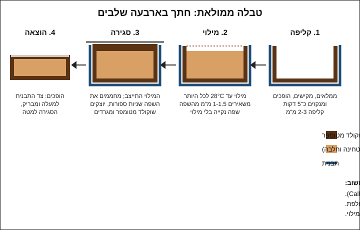

# 04.2 · טבלאות ממולאות ומעוטרות

טבלת שוקולד חלקה היא התחלה. בשיעור הזה הופכים אותה למתנה: טבלה אחת עם עיטור של אגוזים ופירות בצד האחורי, וטבלה אחת ממולאת, עם קליפה דקה של שוקולד ומילוי פרלינה או טחינה וחלבה בפנים. זו אותה טכניקה של בונבונים ([מודול 5](../module-05/lesson-01.md)), רק בגדול ובשקע אחד, ולכן קלה יותר להתחלה.

## מה צריך

| פריט | כמות לתרגול | כמות מלאה | הערה |
|---|---|---|---|
| קוברטורה מריר 50-70% (או חלב), מטומפרת | 300 גרם | 1 ק"ג | לשתי טבלאות; רוב מה שמתנקז מהקליפה חוזר לקערה |
| תבנית טבלה מפוליקרבונט | 2 שקעים | כל התבנית | מ־[04.1](lesson-01.md) |
| **מילוי א: פרלינה קראנצ'י** | | | לטבלה ממולאת אחת |
| פרלינה (ממרח אגוזי לוז 50% או יותר) | 50 גרם | 200 גרם | |
| שוקולד חלב או מריר מומס | 15 גרם | 60 גרם | מקשה את המילוי |
| קורנפלקס מרוסק או פיילטין (feuilletine) | 8 גרם | 30 גרם | לא חובה; גלוטן |
| **מילוי ב: טחינה וחלבה** (חלופה) | | | |
| טחינה גולמית סמיכה | 30 גרם | 120 גרם | |
| חלבה מפוררת | 25 גרם | 100 גרם | |
| שוקולד מריר מומס | 15 גרם | 60 גרם | |
| **עיטור לטבלה השנייה** | | | |
| אגוזים קלויים וקרים (פיסטוק, שקדים, לוז) | 15 גרם | 60 גרם | שלמים או קצוצים גס |
| פירות מיובשים בהקפאה (פטל, תות) או פתיתי מלח ים | 3-5 גרם | 15 גרם | יבשים לגמרי |
| שקית זילוף, שפכטל מתכת, מדחום, מייבש שיער | 1 מכל | | |
| דף אצטט (דף גיטרה) | 1 | | לסגירה חלקה, לא חובה |

**אלרגנים:** שוקולד: לציטין סויה, חלב (בחלב, ולעתים "עלול להכיל" במריר), "עלול להכיל" אגוזים ובוטנים. מילוי א: אגוזי לוז, לעתים חלב בפרלינה, וגלוטן בקורנפלקס או בפיילטין (ופיילטין רבים מכילים גם חלב). מילוי ב: שומשום (טחינה וחלבה), ולעתים אגוזים או פיסטוק בחלבה. עיטור: אגוזים, ולעתים סולפיטים בפירות מיובשים. כל טבלה מקבלת רשימת אלרגנים משלה ביומן ובתווית.

**למה מילוי בלי מים:** מילויים על בסיס שמנת, חמאה או פירות טריים (גנאש, קרמל) מכילים מים, ולכן מתקלקלים מהר יותר ודורשים ידע של מודולים 6 ו־7. פרלינה, טחינה וחלבה הם שומן, סוכר ומוצקים יבשים בלבד, ולכן הם המילוי הנוח ביותר להתחלה.

## למה זה עובד

### טבלה ממולאת היא בונבון גדול

Callebaut מתארים את אותו תהליך לכל מוצר יצוק ממולא: קליפה, מילוי, סגירה.

- **קליפה** (shell): ממלאים את השקע בשוקולד מטומפר, מקישים להוצאת בועות, הופכים את התבנית ומחזירים את רוב השוקולד לקערה. לפי Callebaut, מנקזים את התבנית הפוכה על נייר כחמש דקות, עד שהשוקולד שטפטף "מתחיל להתקשות", ואז מגרדים שוב את השפה.
- **מילוי**: המילוי צריך להיות חלק ונוזלי מספיק לזילוף, ו**לא חם מ־28°C**. לפי Callebaut מילוי חם יותר ממיס את הקליפה. ממלאים עד 1.5 מ"מ מתחת לשפה, ובטבלת התקלות שלהם: "לא למלא עד השפה, להשאיר 1-1.5 מ"מ", אחרת אי אפשר לסגור.
- **סגירה**: לפי Callebaut מחממים את פני התבנית לרגע עם מפזר חום (בבית: מייבש שיער), יוצקים שוקולד מטומפר, מיישרים ומגרדים את העודף, מקישים להוצאת בועות ומקררים.

### למה הקליפה לא יכולה להיות דקה מדי או עבה מדי

בטבלת התקלות של Callebaut לתבניות יש שני צדדים לאותה בעיה:

- **קליפה דקה מדי**: לא מתכווצת מספיק, קשה להוציא אותה, ופיסות קליפה נשארות בתבנית. הפתרון שלהם: שוקולד פחות נוזלי, או שתיים־שלוש שכבות לפני ההוצאה.
- **קליפה עבה מדי**: נוצרת משוקולד שהתגבש יותר מדי (הסמיך בקערה, [03.5](../module-03/lesson-05.md)) או שאינו נוזלי מספיק. בטבלה התוצאה היא הרבה שוקולד ומעט מילוי, והיא עלולה גם להאפיר כי עבה מדי.

בטבלה ביתית מכוונים לקליפה של 2-3 מ"מ: עבה מבונבון, כי טבלה גדולה ונשברת ביד. אם אחרי הניקוז רואים אור דרך הקליפה כשמחזיקים את התבנית מול חלון, יוצקים שכבה שנייה.

### מילוי שומני ופריחת שומן

לפי Callebaut, "מילויים על בסיס שומן (כמו פרלינה או מילויי אגוזים) גורמים לפריחת שומן להופיע מהר יותר". השמן הנוזלי מהאגוזים נודד לאט לתוך הקליפה ודוחף חמאת קקאו אל פני השטח. שלוש דרכים להאט את זה:

1. **להקשות את המילוי בשוקולד**: לכן במילויים כאן יש 15 גרם שוקולד. Callebaut ממליצים על גרסה מקצועית של אותו רעיון: להוסיף 5-6% חמאת קקאו למילוי ולטמפר (pre-crystallise) אותו לפני הזילוף.
2. **קליפה שלמה, בלי חורים**: מילוי שנגע בשפה פוגע בסגירה ופותח דרך לשמן ולאוויר.
3. **אחסון קבוע ב־18-20°C** ([03.5](../module-03/lesson-05.md)), כי חום מאיץ את הנדידה.

### עיטור בצד האחורי: תזמון

הצד שנוגע בתבנית יוצא מבריק, והצד הפתוח (שיהיה הגב של הטבלה) הוא המקום לעיטור. התוספות צריכות לשקוע מעט בשוקולד לפני שהוא מתקשה, בדיוק כמו במנדיאנטים של [02.3](../module-02/lesson-03.md). שוקולד מטומפר מתקשה מהר: King Arthur כותבים שהוא מתקשה תוך 3-5 דקות, ושכבה עבה תוך 5-10 דקות. לכן מפזרים את התוספות מיד אחרי הגירוד וההקשה, לפני שהשוקולד מתחיל להיות עמום. תוספות קרות מהמקרר גורמות לעיבוי; תוספות חמות מהתנור ממיסות את הגבישים מסביבן. לכן קולים אגוזים ומקררים לטמפרטורת החדר.

## שלב אחר שלב

> [!WARNING]
> מים הם האויב: תבנית, קערה, שקית זילוף ותוספות יבשות לגמרי. מייבש השיער מחמם מהר: מחזיקים אותו במרחק 15-20 ס"מ ומפעילים שניות ספורות, אחרת השוקולד נמס והטמפר נשבר. אלרגנים: מכינים את הטבלה עם האגוזים אחרי הטבלה בלי אגוזים, וכלים נפרדים לכל מילוי.

**הכנה (לפני הטמפרור)**

1. **מכינים את המילוי**: ממיסים 15 גרם שוקולד, מערבבים לתוכו את הפרלינה (או את הטחינה והחלבה), ואם יש, את הקורנפלקס. מודדים: המילוי צריך להיות 26-28°C, לא יותר. אם חם, מחכים. מעבירים לשקית זילוף ומשאירים בחדר.
2. **מכינים את התבנית** כמו ב־[04.1](lesson-01.md): נקייה, יבשה, מלוטשת בצמר גפן, בטמפרטורת החדר.
3. **מכינים את התוספות**: אגוזים קלויים וקרים בקערה קטנה, פירות מיובשים בהקפאה שבורים לחתיכות של 5-10 מ"מ.

**טבלה מעוטרת**

4. **מטמפרים** 300 גרם בשיטת ההזרעה ([03.2](../module-03/lesson-02.md)) ובודקים בבדיקת סכין.
5. **יוצקים** לשקע אחד עד השפה, מקישים 10-15 פעמים ומגרדים את העודף.
6. **מעטרים מיד**: מפזרים את האגוזים והפירות על הגב, ולוחצים כל חתיכה גדולה בעדינות באצבע כדי שתשקע מעט. לא לוחצים עד הקרקעית, כדי שלא תיראה מצד התבנית. אם רוצים, פתיתי מלח בודדים מעל.

**טבלה ממולאת**

7. **קליפה**: ממלאים את השקע השני עד השפה, מקישים, ומיד הופכים את התבנית מעל הקערה ומקישים בצד התבנית בידית של המרית כדי שהעודף יטפטף. מגרדים את השפה כשהתבנית עדיין הפוכה.
8. **מנקזים**: מניחים את התבנית הפוכה על נייר אפייה כ־5 דקות, עד שהשוקולד שטפטף מתחיל להתקשות. מרימים, מגרדים שוב את השפה כדי שתהיה חדה ונקייה.
9. **בודקים את הקליפה**: מחזיקים מול חלון. אם רואים אור דרך הקליפה, יוצקים שכבה שנייה ומנקזים שוב.
10. **מחכים** 5-10 דקות עד שהקליפה קשה למגע. בינתיים שומרים על השוקולד בקערה ב־31-32°C (חימום של 5 שניות כשהוא מסמיך).
11. **ממלאים**: מזלפים את המילוי לתוך הקליפה, מהאמצע לצדדים, עד 1-1.5 מ"מ מתחת לשפה. לא נוגעים בשפה. מקישים קלות כדי ליישר. אם נשאר מילוי, הוא נשמר בצנצנת למריחה.
12. **נותנים למילוי להתייצב**: 20-30 דקות בחדר של 18-22°C, עד שהמילוי לא נדבק כשנוגעים בו קלות.
13. **סוגרים**: מטמפרים שוב את השוקולד שבקערה אם הוא התקרר (מחממים ל־31-32°C ובודקים בבדיקת סכין). מחממים את פני התבנית 2-3 שניות במייבש שיער, יוצקים שוקולד מעל המילוי, ומגרדים בתנועה אחת. אפשר להניח דף אצטט על השוקולד הנוזלי ולהעביר עליו את השפכטל: הגב יוצא חלק ומבריק.
14. **מקררים את שתי הטבלאות**: 15-20 דקות בחדר, ואז עד 15-20 דקות במקרר. הטבלה הממולאת עבה יותר וצריכה קצת יותר זמן. מוציאים כמו ב־[04.1](lesson-01.md): הופכים מעל נייר אפייה ומחכים שהטבלה תיפול.
15. **מאחסנים**: כל טבלה בשקית צלופן או בקופסה, ב־18-20°C. מסמנים תאריך, מילוי ואלרגנים.

## בדיקה: איך יודעים שהצליח

- **שחרור**: שתי הטבלאות יצאו כשהפכתם את התבנית, שלמות.
- **עיטור**: הופכים את הטבלה המעוטרת ומנערים קלות מעל צלחת. לא נפלו תוספות. התוספות לא נראות מצד התבנית.
- **קליפה וסגירה**: בטבלה הממולאת אין חורים, סדקים או אזור שבו המילוי נראה מבחוץ. הגב שטוח וסגור.
- **חתך**: למחרת חותכים את הטבלה הממולאת בסכין חמה. רואים קליפה אחידה של 2-3 מ"מ מכל הצדדים ובסגירה, ומילוי שממלא את כל החלל.
- **לא דולפת**: אחרי 24 שעות בחדר של 18-22°C אין כתם שמנוני על הנייר שמתחת לטבלה.
- **ברק וסנאפ**: צד התבנית מבריק בשתי הטבלאות, והקליפה נשברת בקליק (גם אם המילוי רך).

## כשזה משתבש

| מה רואים | למה זה קורה | מה עושים עכשיו | איך מונעים בפעם הבאה |
|---|---|---|---|
| הקליפה נמסה או נהייתה רכה כשמילאתם | המילוי חם מ־28°C | מוציאים את המילוי בכפית, ממיסים את הטבלה ומתחילים מחדש | מודדים את המילוי, ומחכים שיירד ל־26-28°C |
| הטבלה דולפת שמן או מילוי בגב | מילוי עד השפה, או מילוי שנמרח על השפה, ולכן הסגירה לא נדבקה | אוכלים בבית; לא נותנים במתנה | 1-1.5 מ"מ מתחת לשפה, וזילוף מהאמצע |
| הקליפה נשברה בהוצאה ופיסות נשארו בתבנית | קליפה דקה מדי, או טמפר חלקי | אוספים ל"להמסה" | שכבה שנייה כשרואים אור, ובדיקת סכין לפני יציקה |
| קליפה עבה מאוד ומעט מילוי | השוקולד הסמיך בקערה (התגבש יותר מדי), או ניקוז קצר מדי | אוכלים; טעים רק פחות מאוזן | מחממים את הקערה במעלה כשמסמיך, ומנקזים 5 דקות |
| הסגירה לא נדבקה לקליפה ונשאר סדק | שפה קרה מדי, או שפה מלוכלכת במילוי | מזלפים פס שוקולד מטומפר על הסדק לפני ההוצאה | 2-3 שניות של מייבש שיער על השפה לפני הסגירה |
| בועות ושקעים בגב הסגור | אוויר מתחת לשכבת הסגירה | אין צורך לתקן; זה הגב | מקישים אחרי הסגירה, או סוגרים עם דף אצטט |
| תוספות נופלות כשהופכים את הטבלה | פוזרו אחרי שהשוקולד התחיל להתקשות | מדביקים בנקודה של שוקולד מומס | מפזרים מיד אחרי הגירוד, ולוחצים קלות |
| נקודות לבנות סביב פירות מיובשים בהקפאה | הפירות ספגו לחות מהאוויר | אוכלים בקרוב | פותחים את שקית הפירות רק כשצריך, וסוגרים מיד |
| אחרי שבוע הטבלה הממולאת אפורה ושמנונית | פריחת שומן מהמילוי, מחום או מאחסון לא קבוע | אוכלים, או ממיסים לשוקו חם | מילוי מוקשה בשוקולד, קליפה שלמה ואחסון ב־18-20°C |

### מה עושים עם מה שלא הצליח

שום דבר לא הולך לפח. טבלה ממולאת שדלפה או נשברה טעימה כמו טבלה מושלמת: חותכים לקוביות ואוכלים, או קוצצים לבראוניז ולעוגיות. שוקולד עם פרלינה בפנים הופך לשוקו חם מצוין (ממיסים בחלב חם או במשקה צמחי). קליפות שבורות בלי מילוי חוזרות לשקית "להמסה" ולטמפרור מחדש. מילוי שנשאר בשקית הוא ממרח לפרוסה או רוטב לגלידה. טבלה מעוטרת שהתוספות נפלו ממנה נשברת ל־bark ([02.3](../module-02/lesson-03.md)).

## חלופות

### טבעוני / פרווה

מילוי הטחינה והחלבה טבעוני כשהשוקולד מריר בלי חלב והחלבה בלי חלב ברכיבים (בודקים על האריזה). פרלינה רבה היא פרווה וטבעונית, אבל יש פרלינות עם אבקת חלב: קוראים את הרכיבים. פיילטין רבים מכילים חמאה; קורנפלקס בדרך כלל לא, אבל בודקים. עקומת הטמפרור ופריחת השומן לא משתנות. שוקולד "חלב" טבעוני מטמפרים לפי היצרן.

### בריא יותר

טבלה ממולאת מחליפה חלק מהשוקולד במילוי, ולכן לא בהכרח פחות מתוקה: פרלינה היא כחצי סוכר. דרכים לפחות סוכר במנה: מריר 70% ומעלה לקליפה, מילוי טחינה גולמית עם מעט חלבה ובלי שוקולד חלב, ותבנית של טבלאות קטנות (25-50 גרם). אגוזים ופירות מיובשים בהקפאה בעיטור נותנים טעם חזק עם מעט חומר. שוקולד עם מלטיטול מתאים לקליפה אם מטמפרים לפי היצרן.

> [!CAUTION]
> מלטיטול גורם לגזים ולשלשול כשאוכלים ממנו כמות, והוא לא מתאים לילדים בכמויות. מי שמגיש שוקולד כזה אומר לאורחים מה יש בו.

### כשרות

בטבלה ממולאת יש כמה חומרי גלם, וכל אחד מהם קובע: שוקולד, פרלינה או טחינה וחלבה, קורנפלקס, אגוזים ופירות. אם אחד מהם חלבי, הטבלה כולה חלבית. מי שרוצה טבלה פרווה בודק שכל רכיב מסומן פרווה בהכשר שהוא סומך עליו, וגם שהשוקולד שהוסף למילוי מאותו סוג. בפרלינה, באותו מותג יש לפעמים כשרות שונה לפי אריזה. מה כתוב על מוצרים נפוצים: [פרלינה ומחיות אגוזים](../../references/kashrut-guide.md#פרלינה-ומחיות-אגוזים), [פירות מיובשים בהקפאה](../../references/kashrut-guide.md#פירות-מיובשים-בהקפאה), [אגוזים](../../references/kashrut-guide.md#אגוזים), [קוברטורה מרירה](../../references/kashrut-guide.md#קוברטורה-מרירה). אם יש ספק, שואלים את הרב.

## איפה קונים

מה מחפשים: פרלינה או ממרח אגוזי לוז עם 50% אגוזים ומעלה (hazelnut praline paste), טחינה גולמית ממלאה (100% שומשום) וחלבה רגילה, פירות מיובשים בהקפאה (freeze-dried) בשקית סגורה, ואגוזים טבעיים לא מומלחים. קורנפלקס בלי ציפוי סוכר או פיילטין (פתיתי וופל דקים) מחנות אפייה. חנויות, מחירים ומלאי: [פרלינה ומחיות אגוזים](../../references/where-to-buy.md#פרלינה-ומחיות-אגוזים), [טחינה וחלבה](../../references/where-to-buy.md#טחינה-וחלבה), [פירות מיובשים בהקפאה](../../references/where-to-buy.md#פירות-מיובשים-בהקפאה), [שקיות זילוף](../../references/where-to-buy.md#שקיות-זילוף), [אצטט ודפי גיטרה](../../references/where-to-buy.md#אצטט-ודפי-גיטרה), [קוברטורה](../../references/where-to-buy.md#קוברטורה).

## תרגול

### משימה

מטמפרים 300 גרם שוקולד (אפשר את הטבלאות מ־[04.1](lesson-01.md) אחרי שנבדקו). יוצקים טבלה מעוטרת אחת וטבלה ממולאת אחת, באחד משני המילויים. למחרת חותכים חצי מהטבלה הממולאת ובודקים את החתך. מה שנשאר מהשוקולד חוזר לשקית "להמסה" ל[שיעור 04.3](lesson-03.md).

### זמן

כ־10 דקות הכנת מילוי ותוספות, 30 דקות טמפרור ויציקה, 30 דקות התייצבות של המילוי וסגירה, ועוד 30-40 דקות קירור והוצאה. סך הכול כשעה וחצי, ועוד 5 דקות למחרת.

### יומן

ב[יומן התרגול](../../templates/practice-log.md) רושמים לכל טבלה: שוקולד, מילוי ותוספות בגרמים, טמפרטורת המילוי לפני זילוף, כמה דקות ניקוז, עובי הקליפה בחתך, ואלרגנים. ממלאים [כרטיס מתכון](../../templates/recipe-card.md) לטבלה הממולאת, עם גרסת תרגול (טבלה אחת) וגרסה מלאה (תבנית שלמה). מצלמים: צד התבנית, הגב המעוטר, והחתך.

### בדיקה עצמית

- [ ] מדדתי את המילוי ולא זילפתי אותו מעל 28°C.
- [ ] השארתי 1-1.5 מ"מ בין המילוי לשפה, והשפה נשארה נקייה.
- [ ] שתי הטבלאות יצאו מהתבנית שלמות.
- [ ] התוספות לא נפלו כשהפכתי את הטבלה המעוטרת.
- [ ] בחתך יש קליפה אחידה סביב המילוי, ואחרי 24 שעות אין דליפה.

## סיכום

- טבלה ממולאת היא בונבון גדול: קליפה, מילוי, סגירה.
- מילוי עד 28°C, ועד 1-1.5 מ"מ מתחת לשפה. שפה נקייה היא מה שמונע דליפה.
- קליפה של 2-3 מ"מ: דקה מדי נשברת בהוצאה, עבה מדי משאירה מעט מקום למילוי.
- מילויים שומניים כמו פרלינה מאיצים פריחת שומן. מקשים אותם בשוקולד, סוגרים היטב ומאחסנים ב־18-20°C.
- עיטור בגב מפזרים מיד אחרי הגירוד, עם תוספות יבשות בטמפרטורת החדר.
