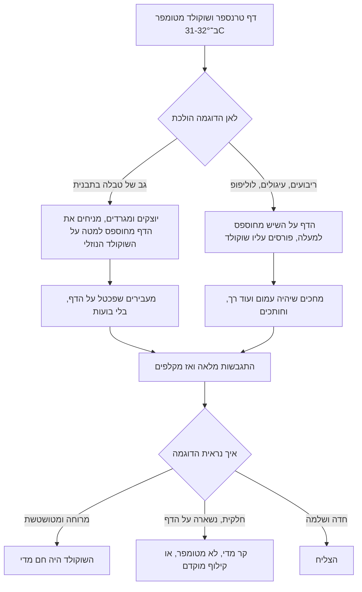

# 04.3 · דפי טרנספר ודפי גיטרה

דף טרנספר הוא הדרך הכי מהירה להוסיף לשוקולד דוגמה צבעונית בלי מכחול ובלי ניסיון בציור: מניחים אותו על שוקולד מטומפר, מחכים, מקלפים, והדוגמה נשארת על השוקולד. דף גיטרה (אצטט שקוף) עושה אותו דבר בלי צבע: נותן משטח מבריק כמו תבנית. בשיעור הזה מכינים טבלה עם דוגמה בגב, 8-10 ריבועים או עיגולים מעוטרים, ופסים דקים לקישוט עוגה.

## מה צריך

| פריט | כמות לתרגול | כמות מלאה | הערה |
|---|---|---|---|
| קוברטורה מריר, חלב או לבן, מטומפרת | 300 גרם | 1 ק"ג | השוקולד מ־[04.2](lesson-02.md) אחרי שנבדק; דוגמאות בהירות בולטות על מריר |
| דף טרנספר לשוקולד | 1 דף | 3-5 דפים | דף אחד מספיק לגב של טבלה ולכ־10 ריבועים |
| דפי גיטרה (אצטט) | 2 | | אחד לפסים, אחד כמכסה לשטח |
| תבנית טבלה מפוליקרבונט | שקע אחד | | מ־[04.1](lesson-01.md) |
| ספטולה מדורגת (offset spatula) או גב סכין רחבה | 1 | | לפרוס שוקולד דק |
| שפכטל מתכת | 1 | | |
| סכין קטנה וחדה, סרגל, או חותכן עגול 3-4 ס"מ | 1 | | חותכן מתכת עדיף |
| נייר אפייה ומגש שטוח או קרש חיתוך | 1 | | משקולת שטוחה כדי שהשוקולד לא יתעקם |
| מספריים נקיים | 1 | | לחתוך את הדף לגודל |
| כפפות ניטריל | 1 זוג | | לא לגעת בצד המודפס |

**אלרגנים:** שוקולד: לציטין סויה, חלב (בחלב ובלבן, ולעתים "עלול להכיל" במריר), "עלול להכיל" אגוזים. דף הטרנספר עצמו: הדפס של חמאת קקאו, צבעים ולעתים סוכר. רשימת הרכיבים והאלרגנים כתובה על האריזה, ומעתיקים אותה לתווית.

**איזה צד מודפס:** מעבירים אצבע עם כפפה על שני הצדדים. הצד המודפס מחוספס מעט ומרגיש כמו שכבה דקה, והצד השני חלק כמו פלסטיק. הצד המחוספס הוא זה שנוגע בשוקולד.

## למה זה עובד

### דוגמה מחמאת קקאו, שמתגבשת יחד עם השוקולד

דף טרנספר (transfer sheet) הוא דף אצטט שעליו מודפסת דוגמה בחמאת קקאו צבעונית. כששופכים עליו שוקולד מטומפר, חמאת הקקאו של ההדפס נמסה מעט בחום השוקולד, מתערבבת בשכבה החיצונית שלו, ומתגבשת יחד איתו. כשהשוקולד מתגבש בצורה V, הוא מתכווץ ומשתחרר מהאצטט החלק, ולוקח איתו את הדוגמה. זה אותו עיקרון של שחרור מתבנית פוליקרבונט ([04.1](lesson-01.md)), רק שהתבנית היא דף.

מכאן שלושה כללים:

1. **השוקולד חייב להיות מטומפר.** שוקולד שלא טומפר לא מתכווץ ולא משתחרר, והדוגמה נשארת חלקית על הדף.
2. **לא חם מדי.** לפי מדריך של Hill Country Chocolate (יוני 2026), שוקולד חם מדי ממיס את חמאת הקקאו של ההדפס, והצבעים נמרחים ומטשטשים. השוקולד צריך להיות בטמפרטורת העבודה: במריר 31-32°C.
3. **לא קר מדי, ולא לקלף מוקדם.** לפי אותו מדריך, שוקולד קר מדי לא נדבק להדפס, והדוגמה יוצאת חלקית. מורידים את הדף רק אחרי התגבשות מלאה. דף שכבר נגע בשוקולד לא עובד פעם שנייה.

### איזה צד לאן

Keylink, מפיצת Callebaut בבריטניה, נותנת שתי הוראות לפי השימוש:

- **טבלאות ובונבונים בתבנית**: מניחים את הדף **הצד המחוספס כלפי מטה** על השוקולד הנוזלי בגב התבנית, בשלב הסגירה, ומעבירים עליו שפכטל לאורך התבנית. כשהשוקולד התקשה, מקלפים את הדף ומוציאים מהתבנית.
- **ריבועים, עיגולים, שברים ולוליפופ**: מניחים את הדף על השיש **הצד המחוספס כלפי מעלה**, ויוצקים או מזלפים עליו שוקולד מטומפר. כשהתקשה, מקלפים.

### דף גיטרה: ברק בלי תבנית

דף גיטרה הוא אצטט שקוף וחלק, בלי הדפס. ב־[04.1](lesson-01.md) ראיתם שהשוקולד מעתיק את פני המשטח שהוא מתגבש עליו, ושלפי Callebaut תבנית פוליקרבונט חלקה נותנת את הברק הטוב ביותר. דף אצטט הוא משטח חלק כזה, ולכן שוקולד מטומפר שנמרח עליו יוצא מבריק בצד שנגע בדף. כך מכינים קישוטים שטוחים ומבריקים: פסים, משולשים, ריבועים ועיגולים, בלי תבנית בכלל.

### מתי חותכים

America's Test Kitchen כותבים לחתוך שוקולד שנפרס דק "כשהוא בדיוק נהיה עמום אבל עוד לא התקשה לגמרי", כי שוקולד שהתקשה לגמרי שביר ונסדק כשחותכים אותו. King Arthur כותבים שמטומפר מתקשה תוך 3-5 דקות, ולכן חלון החיתוך הוא כמה דקות בלבד בחדר של 18-22°C: מוכנים עם הסכין לפני שפורסים.

### למה שמים משקולת

שוקולד דק שמתגבש על אצטט מתכווץ בעיקר בצד אחד, ולכן נוטה להתעקם ולהתקפל בקצוות. מקובל להניח מעליו נייר אפייה ומגש שטוח או קרש קל עד שהתקשה, כדי שהריבועים יישארו ישרים.

## שלב אחר שלב

> [!WARNING]
> סכין חדה וחותכן מתכת: חותכים לכיוון הרחק מהגוף, על משטח יציב, ולא מחזיקים את הדף ביד שמול הלהב. מים הם האויב: דפים, כלים ומשטח יבשים לגמרי.

**הכנה**

1. **חותכים את דף הטרנספר** במספריים, עם כפפות: מלבן בגודל גב השקע בתבנית (מעט גדול מהפתח, כדי לכסות את כולו), ומלבן נוסף של כ־12×15 ס"מ לריבועים. מסמנים בעט על הצד החלק איזה צד מודפס, אם קשה לראות.
2. **מכינים את המשטח**: נייר אפייה על השיש, ועליו מלבן הטרנספר הגדול **הצד המחוספס למעלה**. לידו דף גיטרה. מכינים מגש שטוח ונייר אפייה נוסף כ"מכסה".
3. **מכינים את התבנית** כמו ב־[04.1](lesson-01.md): נקייה, יבשה, מלוטשת.

**טבלה עם דוגמה בגב**

4. **מטמפרים** 300 גרם ובודקים בבדיקת סכין. מריר 31-32°C, חלב 29-30°C, לבן 28-29°C.
5. **יוצקים** לשקע עד מעט מעל השפה, מקישים 10-15 פעמים כדי להוציא בועות. **לא מגרדים** עדיין.
6. **מניחים את הדף**: מניחים את מלבן הטרנספר הקטן **הצד המחוספס למטה** על השוקולד הנוזלי, מקצה אחד לקצה השני כדי לא לכלוא אוויר.
7. **מגרדים דרך הדף**: מעבירים שפכטל בתנועה אחת לאורך התבנית, מעל הדף. השוקולד העודף יוצא מהצדדים, והדף נצמד לשוקולד. לא מזיזים את הדף אחרי שנגע.
8. **מקררים**: 20 דקות בחדר, ואז 15 דקות במקרר. לא מקלפים את הדף לפני זה.

**ריבועים או עיגולים על טרנספר**

9. **פורסים**: יוצקים כ־80 גרם שוקולד מטומפר על מלבן הטרנספר הגדול, ופורסים בספטולה מדורגת לשכבה אחידה של 2-3 מ"מ, בתנועות מעטות. חורגים מעט מעבר לדף, אל הנייר.
10. **מרימים ומעבירים**: מרימים את הדף בפינות ומעבירים לנייר נקי, כדי שהשוליים יהיו חדים.
11. **מחכים לעמימות**: 2-5 דקות. הברק הרטוב נעלם והשוקולד נראה עמום, אבל כשנוגעים בקצה עם סכין הוא עוד רך ולא נשבר.
12. **חותכים**: ריבועים של 4×4 ס"מ עם סכין וסרגל, או עיגולים בחותכן. חותכים עד הדף, בלי להרים את החתיכות.
13. **שמים משקולת**: נייר אפייה מעל, ועליו מגש שטוח. 20 דקות בחדר, ואז 10 דקות במקרר.

**פסים לקישוט על דף גיטרה**

14. **פורסים** את מה שנשאר (40-50 גרם) על דף גיטרה, בשכבה של 1-2 מ"מ.
15. **חותכים** כשהשוקולד עמום ועוד רך: פסים של 1×10 ס"מ, או משולשים ארוכים. אפשר לגלגל את הדף עם השוקולד לגליל ולהכניס לכוס, כדי לקבל פסים מסולסלים.
16. **מקלפים הכול**: אחרי שהשוקולד קשה לגמרי, מקלפים את הדף לאט, בזווית חדה, כמו מדבקה. את הריבועים מפרידים בעדינות לאורך קווי החיתוך. הטבלה יוצאת מהתבנית כרגיל, עם הדוגמה בגב.
17. **מאחסנים** בקופסה סגורה, בשכבות עם נייר אפייה ביניהן, ב־18-20°C.

## בדיקה: איך יודעים שהצליח

- **דוגמה שלמה**: אחרי הקילוף, הדף כמעט שקוף ונקי, וכל הדוגמה עברה לשוקולד. לא נשארו "חורים" בהדפס.
- **דוגמה חדה**: הקווים והצבעים חדים כמו על הדף, בלי מריחות.
- **ברק**: הצד שנגע בטרנספר או באצטט מבריק. הצד העליון של הריבועים (שלא נגע בכלום) עמום, וזה בסדר.
- **שוליים**: הריבועים או העיגולים חתוכים נקי, בלי סדקים בפינות, ושטוחים (לא מתעקמים כשמניחים אותם על השולחן).
- **פסים**: פס של 1 מ"מ מתכופף מעט לפני שהוא נשבר, ונשבר בקליק.
- **טבלה**: יצאה מהתבנית לבד, עם דוגמה על כל הגב.

## כשזה משתבש

| מה רואים | למה זה קורה | מה עושים עכשיו | איך מונעים בפעם הבאה |
|---|---|---|---|
| הדוגמה מרוחה, הצבעים מטושטשים | השוקולד היה חם מדי והמיס את ההדפס | אוכלים, או ממיסים מחדש (הצבע נעלם בשוקולד) | מדחום: מריר לא מעל 32°C, חלב 30°C, לבן 29°C |
| הדוגמה עברה רק בחלקה, השאר נשאר על הדף | שוקולד קר מדי, לא מטומפר, או קילוף מוקדם | מקלפים את הכול; הדף לא שמיש שוב. ממיסים את השוקולד | בדיקת סכין, ומחכים להתגבשות מלאה לפני קילוף |
| אין דוגמה בכלל, והשוקולד חלק | הדף הונח הפוך: הצד החלק נגע בשוקולד | הדף עדיין שמיש מהצד השני אם לא נפגע | בודקים באצבע איזה צד מחוספס ומסמנים |
| בועות אוויר ו"איים" בלי דוגמה | אוויר נכלא מתחת לדף | אוכלים, או ממיסים | מניחים את הדף מקצה לקצה, ומעבירים שפכטל |
| הריבועים נסדקו כשחתכתם | השוקולד כבר התקשה | חותכים מה שאפשר; השברים הם קישוט "שברים" | מוכנים עם הסכין לפני הפריסה, וחותכים בשלב העמום |
| הריבועים מתעקמים ומתקפלים | אין משקולת, או שכבה דקה מאוד | מחממים מעט בידיים עם כפפות ומיישרים, או משתמשים כשברים | נייר אפייה ומגש שטוח מעל עד שהתקשה |
| הריבועים לא נפרדים בקווי החיתוך | חיתוך לא עמוק מספיק | שוברים לאורך הקווים בעדינות, או חותכים בסכין חמה | חותכים עד הדף |
| הדפים בשקית נדבקו זה לזה ונראים מרוחים | נשמרו במקום חם | הדפים שנפגעו מתאימים לקישוט "שיש" או לא שמישים | שומרים שטוחים, סגורים, במקום קריר ומוצל |

### מה עושים עם מה שלא הצליח

שום דבר לא הולך לפח. שוקולד עם דוגמה מרוחה נמס מחדש, והצבע מתערבב בתוכו בכמות זניחה. בשוקולד לבן הוא עלול לשנות מעט את הגוון, ולכן מעבירים אותו לשקית "להמסה" נפרדת לשוקו או לאפייה. ריבועים שנסדקו הם "שברים" מצוינים לקישוט עוגה, גלידה או קינוח בכוס. שוליים שנחתכו מסביב לריבועים נכנסים לשקית "להמסה" או לשוקו חם.

## חלופות

### טבעוני / פרווה

ההדפס על דף טרנספר עשוי בדרך כלל מחמאת קקאו וצבעים, אבל לא תמיד כתוב מה הצבעים: צבע אדום או ורוד יכול להיות קרמין (E120), שמופק מחרקים ואינו טבעוני. בודקים את רשימת הרכיבים על האריזה; אם היא לא כתובה, שואלים את החנות או בוחרים דף אחר. דף גיטרה שקוף הוא פלסטיק בלבד ולא משנה כלום. מה עוד לבדוק: [לא טבעוני גם כשכתוב פרווה](../../references/kashrut-guide.md#לא-טבעוני-גם-כשכתוב-פרווה).

### בריא יותר

דף טרנספר מוסיף מראה, לא קלוריות: שכבת ההדפס דקה מאוד. ריבועים של 4×4 ס"מ ובעובי 2-3 מ"מ שוקלים כ־5-6 גרם, והם מנה קטנה ויפה לצד קפה, במקום טבלה שלמה. מריר 70% ומעלה מתאים לכל הטכניקות כאן. מי שעובד עם שוקולד עם מלטיטול מטמפר אותו לפי היצרן, וההדפס עובר אליו כמו לכל שוקולד מטומפר.

> [!CAUTION]
> מלטיטול גורם לגזים ולשלשול כשאוכלים ממנו כמות, והוא לא מתאים לילדים בכמויות. מי שמגיש שוקולד כזה אומר לאורחים מה יש בו.

### כשרות

דף טרנספר הוא חומר מאכל: ההדפס נשאר על השוקולד ונאכל. לכן בודקים על האריזה אם יש עליו הכשר, ומאיזה סוג (פרווה או חלבי). דפים רבים נמכרים בחנויות בלי כיתוב כשרות בדף המוצר, ומדריך הכשרות של הקורס לא בדק עדיין דפי טרנספר. הצבעים שבהם הם אותם צבעים שמופיעים ב[צבעים במדריך הכשרות](../../references/kashrut-guide.md#צבעים). דף גיטרה שקוף אינו מאכל ולא נשאר על השוקולד. כשרות השוקולד: [שלושה כללים](../../references/kashrut-guide.md#שלושה-כללים). אם יש ספק, שואלים את הרב.

## איפה קונים

מה מחפשים: דפי טרנספר לשוקולד (chocolate transfer sheets), כלומר הדפס של חמאת קקאו צבעונית על אצטט. לא לבלבל עם "דף סוכר" או "דף אכיל" לעוגות, שמודפס בדיו על בסיס סוכר ולא עובד על שוקולד. גודל נפוץ: כ־30×40 ס"מ. דפי גיטרה: דפי אצטט שקופים, חלקים, בגודל דומה, או גליל שקף לעוגה. ספטולה מדורגת ושפכטל נמכרים בכל חנות אפייה. חנויות, מחירים ומלאי: [דפי טרנספר](../../references/where-to-buy.md#דפי-טרנספר), [אצטט ודפי גיטרה](../../references/where-to-buy.md#אצטט-ודפי-גיטרה), [שפכטל וקלף](../../references/where-to-buy.md#שפכטל-וקלף), [תבניות פוליקרבונט](../../references/where-to-buy.md#תבניות-פוליקרבונט).

## תרגול

### משימה

מטמפרים 300 גרם (השוקולד מ־[04.2](lesson-02.md) אחרי שנבדק, או שקית "להמסה" מאותו מוצר). מכינים: טבלה אחת עם דוגמת טרנספר בגב, 8-10 ריבועים או עיגולים על דף טרנספר, ופסים מדף גיטרה. שומרים את הריבועים ל[שיעור 04.4](lesson-04.md) או למארז של פרויקט המודול.

### זמן

כ־10 דקות הכנת דפים ותבנית, 30 דקות טמפרור, יציקה, פריסה וחיתוך, ועוד 30-35 דקות התקשות, קילוף והוצאה. סך הכול כ־75 דקות.

### יומן

ב[יומן התרגול](../../templates/practice-log.md) רושמים: סוג השוקולד, הטמפרטורה ברגע שהשוקולד נגע בדף, כמה דקות עד שהשוקולד נהיה עמום, כמה דקות עד הקילוף, ואיך יצאה הדוגמה (שלמה / חלקית / מרוחה). מצלמים את הדף אחרי הקילוף ליד השוקולד: הדף מראה מה לא עבר. שורת הטמפרור נכנסת ל[יומן הטמפרור](../../templates/tempering-log.md).

### בדיקה עצמית

- [ ] זיהיתי את הצד המודפס לפני שהתחלתי.
- [ ] השוקולד היה בטמפרטורת העבודה ולא מעליה כשנגע בדף.
- [ ] קילפתי רק אחרי התגבשות מלאה, והדוגמה עברה שלמה.
- [ ] חתכתי את הריבועים בשלב העמום, והם יצאו שטוחים ובלי סדקים.
- [ ] כל השוליים והשברים נכנסו לשקית "להמסה" או לקישוט.

## סיכום

- דף טרנספר הוא הדפס של חמאת קקאו על אצטט; הוא עובר לשוקולד כשהשוקולד מתגבש ומתכווץ ממנו.
- הצד המחוספס נוגע בשוקולד. בתבנית: מחוספס למטה על הגב. על השיש: מחוספס למעלה ושופכים עליו.
- חם מדי: דוגמה מרוחה. קר מדי או לא מטומפר: דוגמה חלקית. מקלפים רק אחרי התגבשות מלאה; דף משמש פעם אחת.
- דף גיטרה נותן ברק בלי תבנית. חותכים כשהשוקולד עמום ועוד רך, ומניחים משקולת עד שהתקשה.
