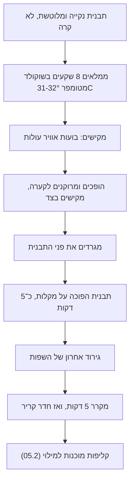

# 05.1 · יציקת קליפה: יציקה, ריקון וניקוי

בונבון (bonbon, ובישראל קוראים לו גם "פרלין") הוא קליפה דקה של שוקולד מטומפר, מילוי, ומכסה שסוגר אותו. בשיעור הזה מכינים את החלק הראשון והחשוב ביותר: הקליפה. יוצקים 8 קליפות בתבנית פוליקרבונט, מרוקנים אותן כך שתישאר שכבה דקה ואחידה, ומנקים את פני התבנית. הקליפות נשמרות בתבנית לשיעור הבא, שבו ממלאים וסוגרים אותן.

## מה צריך

| פריט | כמות לתרגול | כמות מלאה | הערה |
|---|---|---|---|
| קוברטורה מריר 50-70%, כולל שאריות ממודולים 3-4 מאותו מוצר | 300 גרם | 500 גרם לתבנית שלמה | בקליפות נשארים רק כ־40-50 גרם; כל השאר חוזר לקערה |
| תבנית פוליקרבונט לבונבונים (חצי כדור, כיפה או ריבוע) | 1 | | ממלאים רק 8 שקעים |
| שקית זילוף חד־פעמית | 1 | | למלא 8 שקעים בלי ללכלך את כל התבנית |
| שפכטל מתכת רחב (או קלף פלסטיק קשיח) | 1 | | לגרד את פני התבנית |
| סכין פלטה קטנה או מרית ישרה | 1 | | |
| נייר אפייה | 2 דפים | | להניח עליו את התבנית הפוכה |
| שני מקלות או ספרים דקים | 2 | | להרים את התבנית ההפוכה מעל הנייר |
| צמר גפן | 3-4 כדורים | | ליטוש השקעים |
| מדחום דיגיטלי עם דקר, משקל, קערה יבשה, מרית סיליקון | 1 מכל | | כמו ב־[03.2](../module-03/lesson-02.md) |
| מייבש שיער | 1 | | לחמם את התבנית מעט |

**למה 300 גרם ל־8 קליפות:** כל קליפה שוקלת רק 5-6 גרם, אבל צריך מספיק שוקולד מטומפר כדי שיחזיק חום ויהיה לאן לרוקן את העודף. שוקולטיירית שמלמדת ייצור קטן (CakeFlix) ממליצה לעבוד עם יותר מ־300 גרם, ועם 500 גרם כשיוצקים תבנית שלמה. מה שחוזר לקערה ממשיך לטבלה, לשיעור הבא או לשקית "להמסה".

**אלרגנים:** קוברטורה מכילה בדרך כלל לציטין סויה. מריר רבים מכילים או "עלולים להכיל" חלב, ורבים "עלולים להכיל" אגוזים ובוטנים. בודקים על האריזה.

### לפני שמתחילים את המודול

צפייה בשיעור היא לא תרגול. בונבונים לומדים בידיים: תבנית, שפכטל ושוקולד שמשתחרר או נתקע. האקדמיה לא יכולה לבדוק צילומים, ולכן בכל שיעור יש בדיקות ברורות (עובי, שפה נקייה, שחרור, ברק, אטימה) שמשווים אליהן את התוצאה. מנהלים [יומן תרגול](../../templates/practice-log.md) ו[יומן טמפרור](../../templates/tempering-log.md) לאורך כל המודול. המודול מניח שאתם כבר מטמפרים בהצלחה ([מודול 3](../module-03/lesson-01.md)) ומכירים תבנית פוליקרבונט (שיעור [04.1](../module-04/lesson-01.md)).

## למה זה עובד

### קליפה היא טבלה דקה מאוד

כל מה שלמדתם על טמפרור עובד כאן, רק בעובי של מילימטר או שניים. קליפה מטומפרת מתכווצת בקירור, משתחררת מהתבנית ומקבלת את הברק שלה. קליפה לא מטומפרת נדבקת, נשברת ומשאירה חתיכות בתבנית. לכן אין קיצורי דרך: בודקים טמפר בבדיקת סכין לפני היציקה, כמו ב־[03.2](../module-03/lesson-02.md), ושומרים על טמפרטורת העבודה (מריר 31-32°C) לאורך כל העבודה.

### מה קובע את עובי הקליפה

לפי Callebaut, עובי הקליפה נקבע בעיקר מהנזילות של השוקולד. שוקולד נוזלי נותן קליפה דקה ופריכה, ושוקולד סמיך נותן קליפה עבה. Callebaut מדרגים את הנזילות ב"טיפות" (drops): ליציקת קליפות מתאים שוקולד של 3 או 4 טיפות, ושוקולד של 1-2 טיפות מתאים רק לדמויות חלולות גדולות. שוקולד בעל 2%-4% יותר חמאת קקאו נותן קליפה דקה יותר.

שלושה דברים מסמיכים את השוקולד בזמן העבודה, וכולם נותנים קליפה עבה:

1. **התגבשות יתר**: שוקולד מטומפר שעומד ומתקרר ממשיך לבנות גבישים ומסמיך. זה הסימן ש־[03.5](../module-03/lesson-05.md#שוקולד-שהתגבש-יותר-מדי) מתאר: Callebaut כותבים שקליפה עבה מדי נובעת משוקולד שהתגבש יותר מדי או שאינו נוזלי מספיק. מחממים במעלה אחת (מייבש שיער, פולס של 5 שניות) ולא עוברים את 32°C במריר.
2. **חדר קר**: לפי CakeFlix, בחדר קר מדי השוקולד מתקשה מהר מדי והקליפות יוצאות עבות. חדר עבודה מומלץ: 18-20°C.
3. **תבנית קרה**: שוקולד שפוגש תבנית קרה מתגבש עליה מיד, לפני שהספקתם לרוקן.

אם השוקולד שלכם סמיך מטבעו (בשקית כתוב 2 טיפות, או שאין סימון והוא מרגיש סמיך), CakeFlix מציעים להוסיף לשוקולד חמאת קקאו, כ־5% מהמשקל, לפני הטמפרור.

### טמפרטורת התבנית: בין "לא קרה" ל"לא חמה מהשוקולד"

| מקור | טמפרטורת תבנית | הערה |
|---|---|---|
| Callebaut | 26-27°C, בחימום קצר עם מפוח חום | התבנית לא חמה מהשוקולד המטומפר |
| Cacao Barry | 20-22°C (טמפרטורת החדר) | |
| CakeFlix | 17-20°C, חימום "קל מאוד" אם התבנית קרה | |

המספרים שונים, אבל הכלל זהה: תבנית קרה גורמת להלם טמפרטורה (Callebaut: הקליפה יוצאת אפורה) ולקליפה עבה, ותבנית חמה מהשוקולד ממיסה את גבישי V שבשכבה שנוגעת בה, והקליפה לא תשתחרר. בבית: תבנית בטמפרטורת החדר הממוזג, ו־5-10 שניות של מייבש שיער על חום נמוך אם היא עמדה במקום קר. מודדים בגב היד או במדחום אינפרא אדום אם יש: התבנית צריכה להרגיש "לא קרה", לא חמה.

### למה ממתינים לפני הקירור

אחרי הריקון השכבה בשקעים עדיין נוזלית. אם מכניסים מיד למקרר, העודף נקרש בתחתית השקע (ושם הקליפה עבה) ולא מתנקז. Callebaut מניחים את התבנית הפוכה על נייר כ־5 דקות, עד שהשוקולד שנטף מתחיל להתקשות, ורק אז מגרדים ומקררים. CakeFlix מניחים אותה על הצד הצר כדי שאוויר יזרום. אחרי זה קירור קצר מתחיל את ההתכווצות: Callebaut מקררים ב־14-16°C כמה דקות, Cacao Barry במקרר של 10°C כמה דקות, ו־CakeFlix מכניסים למקרר ביתי (3-5°C) ל־5 דקות בלבד, עם הכלל שההפרש בין חדר העבודה לבין הקירור יהיה קטן מ־10°C ככל האפשר. בבית: מקרר רגיל ל־5 דקות, לא יותר. קליפה דקה מדי או עבה מדי, ואיך מתקנים: [04.2](../module-04/lesson-02.md).

### הקליפה יכולה לחכות

הקליפות לא חייבות להתמלא מיד. לפי CakeFlix, תבנית יצוקה עטופה בניילון נצמד נשמרת כמה שבועות בחדר קריר, רחוק מריחות חזקים ומלחות. זה עוזר בבית: יוצקים ביום אחד, ממלאים ביום אחר.

## שלב אחר שלב

> [!WARNING]
> מייבש שיער או מפוח חום (heat gun) מחממים מהר מאוד: חימום ארוך מעוות תבנית פוליקרבונט וממיס את גבישי V. מחממים רק בתנועה, כמה שניות, מרחק 20-30 ס"מ. ושוב: מים ואדים הם האויב, וכל הכלים יבשים לגמרי.

1. **מכינים את התבנית**: שוטפים במים חמים וסבון עדין עם ספוג רך (לא צד מחוספס), מייבשים לגמרי, ומלטשים כל שקע בצמר גפן עד שהוא מבריק (כמו ב־[04.1](../module-04/lesson-01.md)). מהרגע הזה לא נוגעים בפנים השקעים: Callebaut מציינים שטביעות אצבע עוברות לקליפה.
2. **מכינים את החדר ואת עמדת העבודה**: מזגן על 20-22°C. נייר אפייה על השיש, שני מקלות עליו במרחק שמתאים לרוחב התבנית, ועוד דף נייר אפייה מתחת לקערה.
3. **מטמפרים** 300 גרם מריר בשיטה שבחרתם בפרויקט של [מודול 3](../module-03/lesson-01.md), עד 31-32°C. בדיקת סכין עוברת לפני שממשיכים.
4. **מחממים את התבנית** רק אם היא קרה: 5-10 שניות במייבש שיער, בתנועה. היא לא צריכה להיות חמה למגע.
5. **ממלאים**: מעבירים כשליש מהשוקולד לשקית זילוף, גוזרים פתח של 5 מ"מ, וממלאים 8 שקעים צמודים עד השפה. אם התבנית קטנה, אפשר לצקת על כל התבנית עם מצקת (כמו Callebaut ו־Cacao Barry), ואז תקבלו יותר קליפות.
6. **מקישים**: מקישים את התבנית על השיש 10-15 פעמים, או בתנועת נדנוד חזקה. בועות אוויר עולות לפני השטח. דפנות התבנית צריכות להיות מלאות, בלי חורים.
7. **מרוקנים**: הופכים את התבנית מעל הקערה (או מעל נייר אפייה), ומקישים בצד התבנית בידית השפכטל, כדי שכמה שיותר שוקולד ייצא. ממשיכים 20-30 שניות, עד שהזרם הופך לטיפות.
8. **מגרדים**: כשהתבנית עדיין הפוכה, מעבירים את השפכטל על פני התבנית ומנקים אותו בשפת הקערה. הופכים, ובודקים מול האור שכל שקע מצופה בשכבה אחידה.
9. **מנקזים**: מניחים את התבנית הפוכה על המקלות, מעל נייר האפייה, כ־5 דקות, עד שהשוקולד שנטף על הנייר מתחיל להתקשות.
10. **גירוד אחרון**: מגרדים שוב את פני התבנית בתנועה אחת נקייה, כך שהשפה של כל שקע חדה ונקייה. שפה נקייה היא מה שיאפשר לסגור את הבונבון היטב בשיעור הבא.
11. **מקררים**: 5 דקות במקרר הביתי, ואז מחזירים לחדר הקריר. אם ממלאים מחר, עוטפים בניילון נצמד.
12. **מה שנשאר**: השוקולד בקערה עדיין מטומפר. יוצקים ממנו טבלה, או מניחים אותו להתקשות על נייר אפייה ושומרים בשקית "להמסה".

## בדיקה: איך יודעים שהצליח

- **מול האור**: מחזיקים את התבנית מול חלון. אם התבנית שקופה, רואים קליפה בצבע אחיד בכל השקע, בלי אזורים בהירים (דקים מדי) ובלי שלולית בתחתית (עבה מדי).
- **שפה**: לכל שקע שפה חדה ונקייה, בלי "אוזניים" של שוקולד מעבר לה ובלי שוקולד על פני התבנית בין השקעים.
- **בלי חורים**: אין נקודות שקופות או חורים זעירים בדפנות או בתחתית (Callebaut: חורים נובעים מבועות אוויר או משוקולד סמיך מדי).
- **התכווצות**: אחרי 10-20 דקות בחדר, בתבנית שקופה רואים כתמים "יבשים" מתחת לקליפה, סימן שהיא מתנתקת מהתבנית. זה סימן לטמפר טוב.
- **ניסיון אחד**: מקריבים קליפה אחת. הופכים את התבנית ומקישים: אם קליפה אחת יוצאת (לפעמים כולן יוצאות), בודקים אותה ביד. עובי של כ־1-2 מ"מ, אחיד בין הדופן לתחתית, צד מבריק, נשברת בסנאפ דק. מחזירים את מה שלא נפל לתבנית לשיעור הבא, וקליפה שנפלה נאכלת או נמסה.

## כשזה משתבש

| מה רואים | למה זה קורה | מה עושים עכשיו | איך מונעים בפעם הבאה |
|---|---|---|---|
| קליפה עבה, בעיקר בתחתית השקע | השוקולד התגבש יותר מדי והסמיך, החדר או התבנית קרים, או שלא ריקנתם מספיק זמן | אם הקליפה עוד לא קרשה: הופכים שוב ומקישים. אחרת ממשיכים, ומשתמשים בקליפות למילוי שמן יותר | מחממים את השוקולד במעלה אחת לפני היציקה, תבנית לא קרה, ריקון של 20-30 שניות עם הקשות |
| קליפה דקה מאוד ושקופה בדפנות | שוקולד חם מדי (קרוב ל־32°C ומעלה) או נוזלי מאוד | ממיסים ויוצקים שוב באותה תבנית | עובדים ב־31°C, ואם השוקולד נוזלי מאוד יוצקים שכבה שנייה אחרי שהראשונה התקשתה |
| חורים זעירים בדפנות | בועות אוויר, או שוקולד סמיך שלא זרם לפינות | ממיסים את הקליפות (מחממים את התבנית ומרוקנים) ויוצקים מחדש | מקישים יותר לפני הריקון, ובתבניות עם פינות חדות משתמשים בשוקולד נוזלי יותר (Callebaut) |
| שוקולד הצטבר על השפות ועל פני התבנית | גירוד מאוחר מדי, או שפכטל מלוכלך | מגרדים בעדינות כשהשוקולד עוד רך. אם התקשה, מגרדים אחרי הקירור בשפכטל נקי | גירוד מיד אחרי הריקון וגירוד אחרון אחרי 5 דקות. מנגבים את השפכטל בכל מעבר |
| קליפה אפורה או עמומה כבר בתבנית | טמפר לא תקין, הלם טמפרטורה מתבנית קרה, או שהשוקולד חומם מעל 32°C אחרי בדיקת הסכין | ממיסים ומטמפרים שוב | בדיקת סכין, מדחום אחרי כל חימום, תבנית בטמפרטורת החדר |
| טביעות אצבע בקליפה | נגעתם בתוך השקעים | ממשיכים; זה עניין של מראה בלבד | לא נוגעים בפנים השקעים אחרי הליטוש, מחזיקים את התבנית בשוליים |

### מה עושים עם מה שלא הצליח

שום דבר לא הולך לפח. קליפות עבות מתמלאות כרגיל בשיעור הבא, והן פשוט פחות עדינות. קליפות שבורות או עם חורים נמסות מחדש: מחממים את התבנית במייבש שיער, מרוקנים לקערה, ומטמפרים שוב יחד עם שאר השוקולד. שוקולד שנטף על נייר האפייה נאסף לשקית "להמסה". שוקולד שאיבד טמפר מתאים לשוקו חם, לבראוניז או לטבלת bark עם אגוזים.

## חלופות

### טבעוני / פרווה

קליפה ממריר בלי חלב ברכיבים היא טבעונית ופרווה (אם ההכשר אומר פרווה), והיא מתנהגת בדיוק כמו בשיעור. שוקולד "חלב" טבעוני מטמפרים לפי עקומת היצרן, כמו שמוסבר ב־[03.2](../module-03/lesson-02.md). הוא בדרך כלל סמיך יותר ויכול לתת קליפה עבה יותר: בודקים נזילות לפני שיוצקים תבנית שלמה. שימו לב שגם הזרעים וגם השוקולד שמוסיפים מאותו סוג.

### בריא יותר

בונבון הוא מנה קטנה מטבעו (10-15 גרם). תבניות של חצי כדור קטן או "מיני" נותנות בונבון של 7-8 גרם. קליפה ממריר 70% ומעלה פחות מתוקה ומטמפרים אותה באותן טמפרטורות. שוקולד ללא תוספת סוכר עם מלטיטול מטמפרים לפי היצרן, אבל בדקו את הנזילות שלו לפני יציקה.

> [!CAUTION]
> מלטיטול גורם לגזים ולשלשול כשאוכלים ממנו כמות, והוא לא מתאים לילדים בכמויות. מי שמגיש בונבונים כאלה אומר לאורחים מה יש בהם.

### כשרות

הקליפה היא רוב השוקולד בבונבון, ולכן הכשרות שלה קובעת. מי שרוצה בונבון פרווה בודק שהקוברטורה מסומנת פרווה בהכשר שהוא סומך עליו, ושלא נכתב "חלבי" או "ציוד חלבי". שימו לב שגם אותו מותג יכול להופיע בכשרות שונה לפי אריזה: [שלושה כללים](../../references/kashrut-guide.md#שלושה-כללים), [קוברטורה מרירה](../../references/kashrut-guide.md#קוברטורה-מרירה), [קוברטורה חלב](../../references/kashrut-guide.md#קוברטורה-חלב). תבנית שכבר שימשה לשוקולד חלבי: את השאלה אם ואיך משתמשים בה לפרווה שואלים את הרב. אם יש ספק, שואלים את הרב.

## איפה קונים

מה מחפשים: תבנית בונבונים מפוליקרבונט קשיח ושקוף (polycarbonate bonbon mould), עם שקעים של 8-15 גרם בצורה פשוטה (חצי כדור, כיפה, ריבוע). צורות עם פינות חדות ופרטים קטנים קשות יותר בהתחלה. תבנית אחת מספיקה לכל המודול. צריך גם שפכטל מתכת רחב ושקיות זילוף חד־פעמיות. חנויות, מחירים ומלאי: [תבניות פוליקרבונט](../../references/where-to-buy.md#תבניות-פוליקרבונט), [שפכטל וקלף](../../references/where-to-buy.md#שפכטל-וקלף), [שקיות זילוף](../../references/where-to-buy.md#שקיות-זילוף), [קוברטורה](../../references/where-to-buy.md#קוברטורה), [מדחום](../../references/where-to-buy.md#מדחום), [מדחום אינפרא אדום](../../references/where-to-buy.md#מדחום-אינפרא-אדום) (לא חובה). כשרות לפי מוצר: [קוברטורה מרירה](../../references/kashrut-guide.md#קוברטורה-מרירה).

## תרגול

### משימה

יוצקים 8 קליפות מריר בתבנית פוליקרבונט, לפי השלבים. מקריבים קליפה אחת לבדיקה (עובי, ברק, סנאפ) ורושמים מה מצאתם. את 7 הקליפות שנשארו בתבנית עוטפים ושומרים ל[שיעור 05.2](lesson-02.md). מי שהקליפות שלו יצאו עבות או עם חורים חוזר על התרגיל עם אותו שוקולד, ומשנה דבר אחד בלבד (טמפרטורת השוקולד, זמן הריקון או טמפרטורת התבנית).

### זמן

כ־40 דקות עבודה כולל טמפרור, ועוד 20 דקות ניקוז, קירור ובדיקה. סך הכול כשעה.

### יומן

ממלאים שורה ב[יומן הטמפרור](../../templates/tempering-log.md) (שיטה, טמפרטורות, בדיקת סכין), ושורה ב[יומן התרגול](../../templates/practice-log.md): טמפרטורת החדר והתבנית, כמה זמן ריקנתם, עובי הקליפה שנבדקה, איך נראו השפות, ומה תשנו בפעם הבאה. מצלמים את התבנית מול האור.

### בדיקה עצמית

- [ ] התבנית נוקתה, יובשה ולוטשה, ולא נגעתי בתוך השקעים.
- [ ] יצקתי בשוקולד מטומפר ב־31-32°C, אחרי בדיקת סכין שעברה.
- [ ] ריקנתי לפחות 20 שניות עם הקשות, וניקזתי את התבנית הפוכה כ־5 דקות.
- [ ] לכל שקע שפה חדה ונקייה, ופני התבנית נקיים בין השקעים.
- [ ] הקליפה שבדקתי בעובי של כ־1-2 מ"מ, אחידה, מבריקה ובלי חורים.
- [ ] כל השוקולד שנשאר חזר לקערה, לטבלה או לשקית "להמסה".

## סיכום

- קליפת בונבון היא טבלה דקה מאוד: בלי טמפר טוב היא לא משתחררת ונשברת.
- עובי הקליפה נקבע מנזילות השוקולד: שוקולד שהתגבש יותר מדי, חדר קר או תבנית קרה נותנים קליפה עבה.
- התבנית בטמפרטורת החדר, לא קרה ולא חמה מהשוקולד. ממלאים, מקישים, מרוקנים, מגרדים, מנקזים 5 דקות, מגרדים שוב ומקררים 5 דקות.
- שפה נקייה היום היא בונבון אטום מחר.
- פרויקט המודול: [8 בונבונים ראשונים](../../projects/m05-first-bonbons.md), מארז קטן של בונבונים צבועים וממולאים, עם בדיקה עצמית ויומן.
