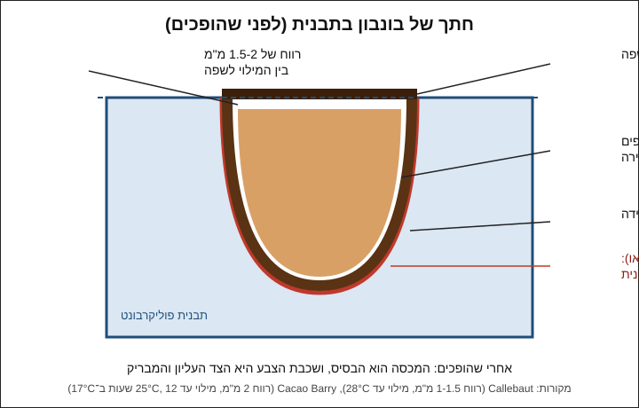
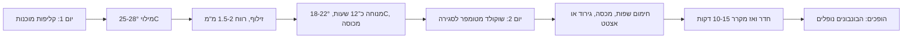

# 05.2 · מילוי וסגירה

הקליפות מ־[05.1](lesson-01.md) מחכות בתבנית. בשיעור הזה ממלאים אותן במילוי פשוט, נותנים לו לנוח לילה, וסוגרים במכסה של שוקולד מטומפר. המילוי כאן בכוונה פשוט: פרלינה מוכנה מהחנות עם מעט שוקולד, או גנאש בסיסי של שוקולד ושמנת. מודולים 6 ו־7 מלמדים גנאש ומילויים לעומק. בסוף השיעור יש לכם 7-8 בונבונים סגורים, עם בסיס שטוח ומבריק.

## מה צריך

| פריט | כמות לתרגול | כמות מלאה | הערה |
|---|---|---|---|
| קליפות מ־[05.1](lesson-01.md), בתבנית | 7-8 | 24 (תבנית שלמה) | |
| **מילוי א (מומלץ להתחלה): פרלינה לוז 50%** | 60 גרם | 180 גרם | מחית מוכנה מהחנות |
| שוקולד חלב או מריר לפרלינה | 25 גרם | 75 גרם | מאותו שוקולד של הקליפות, אם רוצים |
| **מילוי ב: גנאש בסיסי.** שוקולד מריר 55-60% | 60 גרם | 180 גרם | |
| שמנת מתוקה 32%-38% (או שמנת צמחית/קרם קוקוס, ראו חלופות) | 50 גרם | 150 גרם | |
| קוברטורה מטומפרת לסגירה | 300 גרם (רובה חוזרת לקערה) | 300 גרם | אותו שוקולד מ־[05.1](lesson-01.md) |
| שקית זילוף חד־פעמית | 1-2 | | אחת לכל מילוי |
| דף אצטט (גיטרה) בגודל התבנית | 1 | | לסגירה חלקה; לא חובה |
| שפכטל מתכת רחב, מדחום, מייבש שיער | 1 מכל | | |
| קופסה אטומה או ניילון נצמד | 1 | | למנוחת הלילה |

**כמה מילוי:** בקליפה של 10-12 גרם נכנסים כ־6-8 גרם מילוי. 85 גרם פרלינה מספיקים ל־8 בונבונים עם עודף קטן. מה שנשאר ממרחים על לחם, או מגלגלים לכדורים ומטבלים ([מודול 6](../module-06/lesson-01.md)). מילויים נוספים (קרמל, פרלינה ביתית, ג'לי פירות): [מודול 7](../module-07/lesson-01.md).

**אלרגנים:** פרלינה לוז מכילה **אגוזי לוז**, ולעתים גם **שקדים**, ובדרך כלל "עלולה להכיל" אגוזים אחרים ובוטנים. גנאש מכיל **חלב** (שמנת). שוקולד מכיל בדרך כלל **סויה** (לציטין), ולעתים **חלב**. בודקים על כל אריזה, ואומרים לכל מי שמקבל בונבון מה יש בו.

## למה זה עובד

### למה המילוי חייב להיות קריר

הקליפה מטומפרת ודקה, וגבישי צורה V שבה נמסים מעל כ־34°C. מילוי חם ממיס את הקליפה מבפנים, מוציא אותה מטמפר, וגורם לפריחה ולבונבון שלא משתחרר. היצרנים נותנים תקרה:

| מקור | טמפרטורת מילוי מקסימלית |
|---|---|
| Callebaut | 28°C, והמילוי חלק מספיק כדי לזלף בקלות |
| Cacao Barry | 25°C |
| CakeFlix | 28°C לגנאש שמזלפים לקליפות |

הכלל בבית: מודדים את המילוי, ומזלפים רק כשהוא ב־25-28°C. מילוי סמיך מדי בטמפרטורה הזו לא מתיישר בשקע ומשאיר כיסי אוויר, ולכן מילוי נוזלי־סמיך (כמו משחת שיניים רכה) הוא המטרה.

### למה משאירים רווח מתחת לשפה

המכסה צריך מקום. אם המילוי מגיע עד השפה, אין למה שהמכסה ייצמד, והוא נשאר שכבה דקה שנסדקת ודולפת. Callebaut כותבים במפורש לא למלא עד השפה, ולהשאיר 1-1.5 מ"מ. Cacao Barry משאירים 2 מ"מ. בבית: 1.5-2 מ"מ, כלומר המילוי נעצר כשנשאר "פס" דק של קליפה גלוי מעליו.

### למה מחכים לילה לפני הסגירה

המילוי צריך להתייצב ולהיווצר עליו "עור" לפני שיוצקים עליו שוקולד. מילוי רך שוקע תחת המכסה ודוחף אותו, ומילוי שעוד חם מוציא את המכסה מטמפר. Cacao Barry נותנים לבונבונים להתקשות לפחות 12 שעות ב־17°C. בבית בישראל: לילה בחדר ממוזג (18-22°C), בקופסה סגורה, ולא במקרר. מקרר מעבה לחות על התבנית כשמוציאים אותה, ולחות על המילוי היא בדיוק מה שלא רוצים מתחת למכסה.

### שני מילויים, שני סוגי מדף

- **פרלינה עם שוקולד**: זו מחית אגוזים וסוכר עם שוקולד, כמעט בלי מים. אין בה במה לגדל חיידקים או עובש, ולכן היא מחזיקה בערך כמו השוקולד עצמו, כמה שבועות, ומה שמשתנה קודם הוא הטעם (האגוזים מתחמצנים). זה גם המילוי של Callebaut במתכון הפרלינה לבונבונים: מחית פרלינה שמערבבים לתוך שוקולד מומס.
- **גנאש**: אמולסיה של שוקולד ושמנת, ויש בה מים. השוקולד והסוכר "קושרים" חלק מהמים, ולכן גנאש מחזיק יותר מהשמנת עצמה, אבל פחות מפרלינה. הכמות של מים "זמינים" נקראת פעילות מים (water activity, ‏Aw). שוקולטיירית שמלמדת ב־CakeFlix נותנת לבונבונים שלה 3-4 שבועות "מומלץ עד", אבל במתכונים שלה יש גלוקוזה וחמאה שמורידות את פעילות המים, והיא עובדת במטבח מבוקר. Callebaut מדגישים שאף מדידה אחת לא חוזה חיי מדף, ושרק ניסוי לאורך כל התקופה קובע. לגנאש הפשוט שלנו, בלי הגלוקוזה והחמאה: גנאש ביתי עם שמנת נמדד ב־aw של כ־0.85-0.88, ובטווח הזה עובשים עוד יכולים לגדול. לכן בונבוני גנאש נשמרים במקרר (עד 4°C) בקופסה סגורה, ונאכלים תוך כשבועיים. הקליפה מגינה מאוויר, אבל לא משנה את ה־aw של המילוי. [שיעור 06.4](../module-06/lesson-04.md) (חיי מדף ופעילות מים) מסביר את זה לעומק, והוא הבסיס למכירה.

### המכסה: שוקולד מטומפר על שפה נקייה

המכסה הוא שכבת שוקולד מטומפר שנמרחת על פני התבנית, מתמזגת עם שפת הקליפה, ואוטמת. כדי שזה יקרה צריך שלושה דברים: שפה נקייה (מ־[05.1](lesson-01.md)), שפה שאינה קרה מדי, ושוקולד מטומפר בטמפרטורת העבודה. Cacao Barry מחממים את פני התבנית לרגע במפוח חום לפני שמורחים את השוקולד, כדי שהשפה תתמזג עם המכסה. האוויר שנשאר בתוך בונבון לא אטום מביא איתו לחות ומיקרואורגניזמים, ו־CakeFlix מדגישים שזו אחת הסיבות לקיצור חיי המדף.

## שלב אחר שלב

> [!WARNING]
> שמנת רותחת גורמת לכוויות. מחממים בסיר קטן, לא ממלאים יותר מחצי, ושופכים לאט על השוקולד. במיקרוגל השמנת יכולה "להתפוצץ" ולגלוש: פולסים קצרים וכלי גבוה. מייבש השיער על התבנית: כמה שניות בתנועה בלבד.

**יום 1: מכינים מילוי וממלאים**

1. **בודקים את הקליפות**: מוציאים את התבנית מהניילון. השפות נקיות? אם יש שוקולד על פני התבנית, מגרדים אותו עכשיו בשפכטל נקי.
2. **מילוי א, פרלינה**: ממיסים 25 גרם שוקולד ל־40-45°C (חלב) או 45-50°C (מריר). מוסיפים 60 גרם פרלינה בטמפרטורת החדר ומערבבים עד שהמחית חלקה. מודדים: ממתינים ומערבבים מדי פעם עד 25-27°C. התערובת מסמיכה מעט אבל עדיין זורמת.
3. **מילוי ב, גנאש** (במקום פרלינה):
   > [!CAUTION]
   > שמנת חמה: מחזיקים את הסיר בידית, ושופכים הרחק מהגוף.

   קוצצים 60 גרם מריר לחתיכות קטנות בקערה. מחממים 50 גרם שמנת עד רתיחה ראשונה ושופכים מיד על השוקולד (בכמות קטנה השמנת מתקררת מהר, ו־CakeFlix ממליצים לשפוך מיד). ממתינים 30 שניות, ומערבבים ממרכז הקערה במעגלים קטנים עד שהגנאש מבריק וחלק. אם נשארו חתיכות, פולס של 5 שניות במיקרוגל. מכסים את פני הגנאש בניילון נצמד ומשאירים עד 26-28°C. איך מתקנים גנאש שנפרד, ולמה: [שיעור 06.1](../module-06/lesson-01.md).
4. **ממלאים**: מעבירים את המילוי לשקית זילוף, גוזרים פתח קטן של 2-3 מ"מ, וממלאים כל קליפה מהתחתית כלפי מעלה, כשקצה השקית בתוך המילוי (כך לא נכלא אוויר). עוצרים 1.5-2 מ"מ מתחת לשפה, כמו בטבלאות הממולאות של [04.2](../module-04/lesson-02.md).
5. **מיישרים**: מקישים בעדינות את התבנית על השיש, כדי שהמילוי יתיישר ובועות יעלו. מילוי שנגע בשפה מנגבים בקצה מגבת נייר מגולגלת.
6. **מנוחה**: מכסים את התבנית בקופסה או בניילון נצמד (בלי לגעת במילוי), ומשאירים כ־12 שעות בחדר ממוזג, 18-22°C. לא במקרר. בקיץ בלי מזגן בלילה: מעבירים למקום הכי קריר בבית, ומאריכים את המנוחה עד שהמילוי יציב למגע.

**יום 2: סוגרים ומוציאים**

7. **בודקים את המילוי**: נוגעים בעדינות בקצה אצבע נקייה במילוי של בונבון אחד. הוא יציב, לא דביק ולא נוזלי. אם הוא עדיין רך, ממתינים עוד כמה שעות.
8. **מטמפרים** את שוקולד הסגירה (אפשר 300 גרם, כי רוב השוקולד חוזר לקערה). בדיקת סכין עוברת.
9. **מחממים את השפות**: 3-5 שניות של מייבש שיער מעל פני התבנית, בתנועה. המטרה היא שהשפות יפסיקו להיות קרות, לא שיימסו.
10. **סוגרים**: יוצקים מעט שוקולד מטומפר לאורך קצה אחד של השקעים, ומושכים אותו בשפכטל בתנועה אחת על כל השקעים. גוררים את העודף החוצה ומנגבים את השפכטל.
11. **גירוד נקי**: מעבירים את השפכטל פעם נוספת, בזווית חדה, כדי שפני התבנית יהיו נקיים לגמרי והמכסה יהיה בגובה השפה. **שיטת האצטט** (לבסיס חלק ומבריק): מיד אחרי שיוצקים את השוקולד, מניחים עליו דף אצטט, מחליקים בשפכטל מעל הדף, ומשאירים את הדף עד שהשוקולד מתקשה.
12. **מקררים**: 5-10 דקות בחדר עד שהמכסה מתחיל להתקשות, ואז 10-15 דקות במקרר הביתי, כדי שהבונבונים יתכווצו.
13. **מוציאים**: מסירים את האצטט, הופכים את התבנית מעל נייר אפייה או מגבת נקייה, ומקישים פעם אחת בעדינות. בונבונים מטומפרים נופלים לבד. אם רק חלק נפלו, מחזירים ל־5 דקות נוספות במקרר ומנסים שוב.
14. **מאחסנים**: בונבוני גנאש עם שמנת: במקרר (עד 4°C) בקופסה סגורה, עד כשבועיים ([06.4](../module-06/lesson-04.md)). מוציאים את הקופסה הסגורה 1-2 שעות לפני הפתיחה, כדי שלא תיווצר לחות על השוקולד, כמו ב־[03.5](../module-03/lesson-05.md). בונבוני פרלינה: בקופסה סגורה, במקום קבוע של 14-18°C (בקיץ: גם הם במקרר באותה שיטה), כמה שבועות.

## בדיקה: איך יודעים שהצליח

- **שחרור**: רוב הבונבונים נופלים מהתבנית כשהופכים ומקישים פעם אחת.
- **בסיס**: הבסיס שטוח, בגובה שפת הקליפה, בלי פס של מילוי שנראה בין הקליפה למכסה. עם אצטט הוא מבריק כמו הצד העליון. Callebaut: הבסיס צריך להיות חלק ומבריק כמו הצד העליון.
- **אטימה**: לוחצים בעדינות על בונבון אחד בין שתי אצבעות. שום דבר לא נוזל מהבסיס, והמכסה לא זז.
- **חתך**: חוצים בונבון אחד בסכין חמה: קליפה אחידה של כ־1-2 מ"מ, מילוי שממלא את כל החלל בלי כיס אוויר, ומכסה דק שצמוד לקליפה.
- **טעם ומרקם**: הקליפה נשברת בסנאפ דק, והמילוי רך וחלק. בגנאש אין גרגירים ואין שמן על הלשון.

## כשזה משתבש

| מה רואים | למה זה קורה | מה עושים עכשיו | איך מונעים בפעם הבאה |
|---|---|---|---|
| המילוי ממיס את הקליפה, הבונבון יוצא עם כתמים אפורים או לא משתחרר | המילוי היה חם מ־28°C כשזילפתם | ממשיכים ומוציאים בעדינות. בונבונים פגומים נאכלים או נמסים לשוקו | מודדים את המילוי ומזלפים רק ב־25-28°C |
| מילוי נוזל מהבסיס אחרי הסגירה | מילוי עד השפה, מילוי על השפה, או מילוי שלא התייצב | אוכלים מיד את הדולפים. את השאר בודקים בלחיצה | רווח 1.5-2 מ"מ, ניגוב שפות, ולילה של מנוחה |
| המכסה נסדק או מתקלף מהבונבון | שפות קרות או מלוכלכות, או מכסה דק מדי | אפשר לסגור שוב: מחממים את הבסיס לרגע ומורחים שכבה דקה נוספת | שפות נקיות, חימום קצר של השפות, ושוקולד מטומפר בטמפרטורת העבודה |
| כיס אוויר בתוך הבונבון | זילפתם מלמעלה ולא מהתחתית, או שהמילוי היה סמיך מדי | אוכלים בבית; לא למתנה ארוכה | קצה השקית בתוך המילוי, מילוי זורם, הקשה אחרי המילוי |
| הגנאש נפרד: שמן צף, מרקם גרגרי | שמנת קרה מדי, חימום יתר, או ערבוב חזק מדי | מוסיפים כפית שמנת חמה ומערבבים במרכז במעגלים קטנים עד שמתאחד | מערבבים ממרכז הקערה, לא מחממים יותר מדי. הפרטים ב־[06.1](../module-06/lesson-01.md) |
| הפרלינה נשארה נוזלית גם אחרי לילה | מעט מדי שוקולד בתערובת, או חדר חם | מחכים עוד, או מעבירים ל־20 דקות למקרר לפני הסגירה ומחזירים לחדר שעה | יחס של בערך 2.5 חלקים פרלינה לחלק שוקולד, ומנוחה בחדר ממוזג |

### מה עושים עם מה שלא הצליח

שום דבר לא הולך לפח. בונבון שדלף או נשבר נאכל באותו יום, או נכנס לשוקו חם (הוא נמס יפה בחלב חם). שאריות פרלינה הן ממרח. שאריות גנאש מתקררות במקרר ומגולגלות לטראפלס עם אבקת קקאו, או מתחממות לרוטב שוקולד. שוקולד הסגירה שגרדתם חוזר לקערה או לשקית "להמסה".

## חלופות

### טבעוני / פרווה

פרלינה לוז היא בדרך כלל מאגוזים וסוכר בלבד, ולכן מילוי פרלינה עם מריר יכול להיות טבעוני ופרווה. בודקים את רשימת הרכיבים ואת ההכשר של כל אחד. לגנאש: מחליפים את השמנת בקרם קוקוס (מ־20%-25% שומן) או בשמנת צמחית פרווה באותה כמות. התוצאה רכה מעט יותר וטעם הקוקוס מורגש. שמנת צמחית מכילה לרוב סוכר ומייצבים, והיא משנה את המרקם. חיי המדף של גנאש צמחי קצרים כמו של גנאש רגיל. [מודול 12](../module-12/lesson-01.md) (גנאש בלי שמנת) מפרט.

### בריא יותר

מילוי פרלינה עם מריר 70% במקום חלב פחות מתוק. אפשר להחליף חצי מהפרלינה במחית אגוזי לוז או שקדים טהורה (100% אגוזים, בלי סוכר): המילוי פחות מתוק ורך יותר. בונבון אחד קטן הוא מנה, ולא צריך יותר. גנאש עם שוקולד ללא תוספת סוכר: לפי היצרן.

> [!CAUTION]
> מלטיטול (בשוקולד "ללא סוכר") גורם לגזים ולשלשול כשאוכלים ממנו כמות, והוא לא מתאים לילדים בכמויות. מי שמגיש בונבונים כאלה אומר לאורחים מה יש בהם.

### כשרות

בונבון גנאש עם שמנת חלב הוא חלבי, ולכן מי שרוצה לתת אותו לאורחים אחרי ארוחה בשרית צריך להחליף לשמנת צמחית פרווה ולשוקולד פרווה. בפרלינה בודקים את ההכשר ואם כתוב "חלבי" או "פרווה": [פרלינה ומחיות אגוזים](../../references/kashrut-guide.md#פרלינה-ומחיות-אגוזים) במדריך הכשרות מראה מה כתוב על מוצרים נפוצים בישראל. לשמנת צמחית: [שמנת צמחית וקרם קוקוס](../../references/kashrut-guide.md#שמנת-צמחית-וקרם-קוקוס). אגוזים: [אגוזים](../../references/kashrut-guide.md#אגוזים). אם יש ספק, שואלים את הרב.

## איפה קונים

מה מחפשים: מחית פרלינה לוז 50% (hazelnut praline paste) באריזה של 200-500 גרם, שמנת מתוקה 32%-38% מהסופר, או קרם קוקוס/שמנת צמחית פרווה, ודפי אצטט. חנויות, מחירים ומלאי: [פרלינה ומחיות אגוזים](../../references/where-to-buy.md#פרלינה-ומחיות-אגוזים), [שמנת צמחית וקרם קוקוס](../../references/where-to-buy.md#שמנת-צמחית-וקרם-קוקוס), [אצטט ודפי גיטרה](../../references/where-to-buy.md#אצטט-ודפי-גיטרה), [שקיות זילוף](../../references/where-to-buy.md#שקיות-זילוף), [קוברטורה](../../references/where-to-buy.md#קוברטורה). כשרות: [פרלינה ומחיות אגוזים](../../references/kashrut-guide.md#פרלינה-ומחיות-אגוזים).

## תרגול

### משימה

ממלאים את 7 הקליפות מ־[05.1](lesson-01.md) (או 8 קליפות חדשות) במילוי פרלינה, ומי שרוצה ממלא חלק בפרלינה וחלק בגנאש. נותנים לילה של מנוחה, סוגרים, ומוציאים. חוצים בונבון אחד מכל מילוי ובודקים לפי "בדיקה". את השאר שומרים בקופסה לפרויקט, או אוכלים.

### זמן

יום 1: כ־30 דקות (מילוי וזילוף), ועוד לילה של מנוחה. יום 2: כ־45 דקות (טמפרור, סגירה, קירור והוצאה). סך הכול כ־75 דקות עבודה על פני יומיים.

### יומן

ב[יומן התרגול](../../templates/practice-log.md): איזה מילוי, טמפרטורת המילוי בזמן הזילוף, כמה שעות מנוחה ובאיזו טמפרטורת חדר, איך סגרתם (שפכטל או אצטט), כמה בונבונים נפלו בהיפוך הראשון, ומה מצאתם בחתך. את המתכון שמצליח לכם רושמים ב[כרטיס מתכון](../../templates/recipe-card.md), עם האלרגנים.

### בדיקה עצמית

- [ ] מדדתי את המילוי וזילפתי רק ב־25-28°C.
- [ ] השארתי רווח של 1.5-2 מ"מ, והשפות נשארו נקיות.
- [ ] המילוי נח כ־12 שעות בחדר ממוזג, מכוסה, לא במקרר.
- [ ] רוב הבונבונים נפלו מהתבנית בהיפוך, עם בסיס שטוח ונקי.
- [ ] בחתך אין כיס אוויר, והמכסה צמוד לקליפה.
- [ ] רשמתי אלרגנים ותאריך על הקופסה.

## סיכום

- מילוי חם ממיס את הקליפה: מזלפים רק ב־25-28°C.
- משאירים 1.5-2 מ"מ מתחת לשפה, כדי שלמכסה יהיה מקום להיצמד ולאטום.
- המילוי נח כ־12 שעות בחדר קריר לפני הסגירה, לא במקרר.
- סוגרים בשוקולד מטומפר על שפות נקיות שחוממו לרגע, ומגרדים נקי או מחליקים מעל אצטט.
- פרלינה כמעט בלי מים מחזיקה שבועות במקום קריר; גנאש עם שמנת נשמר במקרר עד כשבועיים. גנאש לעומק: [מודול 6](../module-06/lesson-01.md).
