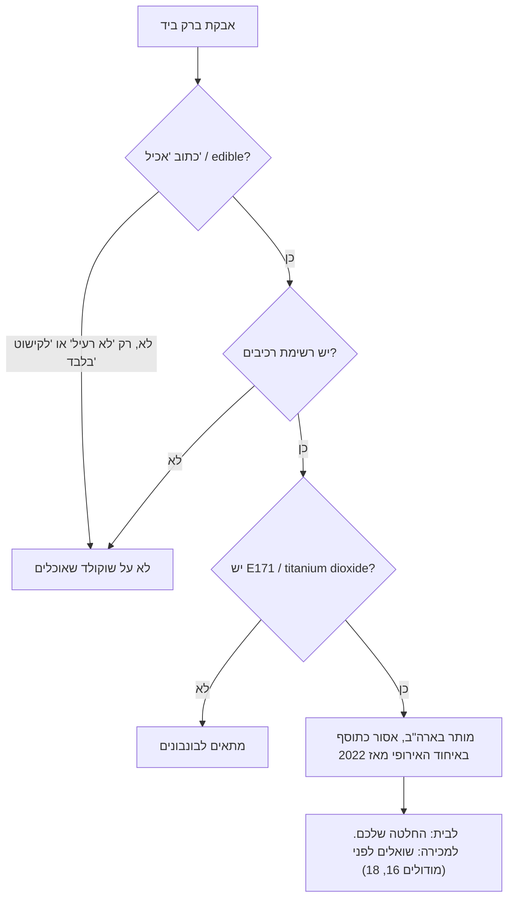

# 05.4 · אבקות ברק: מה מאכיל ומה לקישוט בלבד

אבקת ברק (luster dust, ובחנויות בישראל "אבקת איבוק") נותנת לבונבון ברק מתכתי או פנינה. הבעיה היא שבאותו מדף בחנות, לפעמים באותו מותג, יש אבקות שהן מאכל ואבקות שנועדו לקישוט בלבד, למשל לפרחי סוכר שמסירים לפני ההגשה. בשיעור הזה לומדים לקרוא את התווית, מבינים מה זה E171 ולמה הוא אסור באירופה, ובסוף מעטרים 8 בונבונים באבקה אכילה בשתי שיטות.

## מה צריך

| פריט | כמות לתרגול | כמות מלאה | הערה |
|---|---|---|---|
| אבקת ברק **שכתוב עליה "אכיל" / "edible" ויש עליה רשימת רכיבים** | צנצנת אחת, 2-5 גרם | | זהב, כסף או פנינה |
| חמאת קקאו טבעית | 15 גרם | | לשיטה השנייה |
| מכחול רך ויבש, רחב (2-3 ס"מ), ומכחול קטן | 1 מכל | | חדשים, רק לשוקולד |
| כוס קטנה, דף אצטט | 1 מכל | | כמו ב־05.3 |
| תבנית פוליקרבונט, קוברטורה לקליפות (300 גרם, אותו שוקולד), שפכטל, מדחום | | | כמו ב־05.1 |
| מילוי ושוקולד לסגירה (לא חובה) | כמו ב־05.2 | | אם ממשיכים לבונבון שלם |
| טלפון או מחברת | | | לתרגיל קריאת התוויות |

**כמה אבקה:** לשמונה שקעים צריך פחות מחצי גרם. צנצנת קטנה מספיקה לחודשים.

**אלרגנים:** אבקות ברק אכילות בנויות בדרך כלל מסוכר, עמילן, מלטודקסטרין או מינרלים וצבעים, אבל ההרכב משתנה מאוד: קוראים את רשימת הרכיבים. הקוברטורה מכילה בדרך כלל סויה, ולעתים חלב, אגוזים ובוטנים ("עלול להכיל").

## למה זה עובד

### ממה עשויה אבקת ברק

רוב אבקות הברק הן פיגמנט פנינה (pearlescent pigment): פתיתים דקים של מינרל בשם מיקה (mica, ‏E555 באירופה) שמצופים בשכבה דקה של טיטניום דיאוקסיד (E171). האור מוחזר מהשכבות ונותן ברק. לפי התקנה האמריקאית לצבעים (21 CFR 73.350), פיגמנט כזה מותר בארה"ב במזון: הוא מיוצר מטיטניום דיאוקסיד על מיקה, ומותר עד 1.25% ממשקל המזון בממתקים, בציפויים, בסוכריות ובמסטיק. דוגמה אמיתית: בגיליון המפרט של Roxy & Rich לחמאת קקאו "Gold Green Lustre" (עדכון 2023) כתוב "Mica based pearlescent pigment (E555, E171)", לצד צבעים סינתטיים.

לפי ה־FDA, אבקה שאינה מאכל לא נועדה לשימוש ישיר במזון ועלולה להכיל חומרים שאסור לאכול. בעין רואים אותו דבר.

### מה ה־FDA אומרים על התווית

ה־FDA פרסמו אזהרה לאופים ביתיים ומסחריים לא להשתמש בנצנצים ובאבקות על עוגות ומזון, אלא אם הם יוצרו במיוחד כדי להיאכל. לפי ה־FDA:

- מוצרים לא אכילים נמכרים באינטרנט, בחנויות יצירה ובחנויות אפייה, בשמות כמו luster dust, disco dust, sparkle dust, shimmer powder, pearl dust ו־petal dust. כלומר, השם "luster dust" לבדו לא אומר כלום.
- נצנצים ואבקות אכילים עשויים מרכיבים שמותרים במזון, **וחייבים לציין רשימת רכיבים**. רובם כותבים על התווית "edible" (אכיל).
- אם על התווית כתוב רק "non-toxic" (לא רעיל) או "for decorative purposes only" (לקישוט בלבד), ואין רשימת רכיבים, **לא שמים את המוצר ישירות על מזון**.
- רכיבים נפוצים באבקות אכילות: סוכר, שרף עץ השיטה (גומי ערבי), מלטודקסטרין, עמילן תירס, וצבעים שמותרים במזון, כולל פיגמנטי פנינה על בסיס מיקה.
- מי שבכל זאת משתמש בקישוט לא אכיל מסיר אותו לפני ההגשה. בבונבון אי אפשר להסיר, ולכן בבונבון רק אבקה אכילה.

"לא רעיל" אינו "אכיל": "לא רעיל" אומר שמגע או בליעה מקרית לא צפויים להזיק, לא שהחומר מותר כמזון.

### E171: מותר בארה"ב, אסור באיחוד האירופי

ב־6 במאי 2021 פרסמה רשות בטיחות המזון האירופית (EFSA) הערכה מעודכנת: טיטניום דיאוקסיד (E171) "כבר לא יכול להיחשב בטוח כתוסף מזון". הסיבה המרכזית: אי אפשר היה לשלול שהחלקיקים פוגעים ב־DNA (גנוטוקסיות), ולכן לא נקבעה כמות יומית מותרת. EFSA הדגישו שזו חוות דעת מדעית ולא איסור.

האיסור עצמו הגיע בתקנה (EU) 2022/63. לפי רשות בטיחות המזון של אירלנד (FSAI), התקנה נכנסה לתוקף ב־7 בפברואר 2022, ותקופת המעבר נגמרה ב־7 באוגוסט 2022: מזון שיוצר או הוצע למכירה אחרי התאריך הזה לא יכול להכיל טיטניום דיאוקסיד. מזון שכבר היה בשוק לפני כן יכול היה להימכר עד תאריך התפוגה שלו.

המשמעות למדף: אבקה או חמאה צבעונית "אכילה" מארה"ב או מקנדה יכולה להכיל E171 כחוק במדינה שלה, ולא להיות מותרת כתוסף במזון באיחוד האירופי. בתווית זה כתוב "E171", "titanium dioxide" או "טיטניום דיאוקסיד".

**ובישראל?** לא מצאנו, נכון ל־2026-11-10, הודעה רשמית של משרד הבריאות בעניין E171. תקנות בריאות הציבור (מזון) (תוספי מזון), התשס"א-2001, מחייבות לציין ברשימת הרכיבים את שם התוסף או את מספר ה־E שלו, והרשימה של התוספים המותרים מתפרסמת בנפרד במשרד הבריאות (לא בדקנו בה את E171). מי שרוצה להימנע מ־E171 קורא את רשימת הרכיבים ובוחר אבקה בלי "E171" או "titanium dioxide". מי שמוכר בונבונים שואל את הספק ואת משרד הבריאות לפני שמשתמש באבקה (מודולים 16 ו־18).

### איך האבקה נדבקת לשוקולד

אבקה יבשה נדבקת לשומן. יש שתי דרכים פשוטות להכניס אותה לבונבון:

1. **אבקה יבשה בתבנית**: מברישים אבקה לתוך שקע נקי ומלוטש, לפני הצבע והקליפה. השוקולד או חמאת הקקאו שנוצקים מאחור "אוספים" את האבקה, והיא יוצאת על פני הבונבון. CakeFlix מזכירים אבקות מתכתיות אכילות כאחת הדרכים לעטר תבנית.
2. **אבקה בחמאת קקאו**: מערבבים אבקה לתוך חמאת קקאו מטומפרת (כמו ב־05.3), ומקבלים "צבע פנינה" שעובדים איתו בכל הטכניקות. זה בדיוק מה שהחמאה הצבעונית של Roxy & Rich: חמאת קקאו עם פיגמנט פנינה.

לא מערבבים אבקה במים: מים על שוקולד משאירים כתמים ופריחת סוכר.

## שלב אחר שלב

> [!CAUTION]
> אבקות "לקישוט בלבד", "non-toxic" או בלי רשימת רכיבים לא נכנסות לשוקולד שאוכלים, גם לא בכמות קטנה, גם לא "רק בבית". מברישים בעדינות ולא נושפים על האבקה: היא דקה מאוד ועפה לאוויר.

**חלק א: תרגיל תוויות (15 דקות)**

1. בוחרים 3 אבקות ברק: מה שיש בבית, במדף בחנות, או בדפי מוצר באתרי החנויות שב[אבקות ברק](../../references/where-to-buy.md#אבקות-ברק).
2. לכל אחת רושמים: האם כתוב "אכיל" או "edible", האם יש רשימת רכיבים, האם כתוב "לקישוט בלבד", "לא רעיל" או "non-toxic", האם ברכיבים יש E171 או titanium dioxide, והכשר (אם כתוב).
3. מחליטים לכל אחת, לפי התרשים: מתאימה לבונבונים או לא.

**חלק ב: אבקה יבשה בתבנית (4 שקעים)**

4. מנקים ומלטשים 4 שקעים, כמו ב־05.1. התבנית בטמפרטורת החדר ויבשה לגמרי.
5. טובלים מכחול רחב ויבש באבקה **אכילה**, מנערים את העודף מעל נייר, ומברישים את השקע בתנועות סיבוביות עדינות. מתחילים מעט: אפשר להוסיף.
6. הופכים את התבנית ומקישים קלות מעל נייר, כדי שאבקה חופשית תיפול. אבקה על השפות מנגבים בצמר גפן יבש.
7. אם רוצים, מוסיפים צבע (05.3) בהתזה או במשיכת אצבע. האבקה שמתחת תבריק דרכו.

**חלק ג: אבקה בחמאת קקאו (4 שקעים)**

8. ממיסים 15 גרם חמאת קקאו ל־40°C, מוסיפים קורט אבקה אכילה ומערבבים היטב. מטמפרים כמו ב־05.3: מורידים ל־28°C תוך ערבוב, ומחממים מעט לעבודה, לא מעל 31-32°C. בודקים טיפה על אצטט.
9. מעטרים 4 שקעים במשיכת אצבע עם כפפה או במכחול. ממתינים 3-5 דקות ומגרדים את פני התבנית.

**חלק ד: קליפה (וממשיכים, אם רוצים)**

10. מטמפרים ויוצקים קליפות כמו ב־05.1, **בלי לחמם את התבנית**. מקישים, מרוקנים, מגרדים, מנקזים ומקררים.
11. ממלאים וסוגרים כמו ב־05.2, או מוציאים קליפות ריקות כדי לבדוק את הברק.
12. אבקה שנשארה בנייר חוזרת לצנצנת רק אם הנייר נקי לגמרי. אחרת היא נזרקת עם הנייר (זו כמות זעירה; זה לא אוכל שהולך לפח).

## בדיקה: איך יודעים שהצליח

- **תוויות**: לכל אחת משלוש האבקות יש החלטה מנומקת, ואף אבקה בלי רשימת רכיבים לא סומנה "מתאימה".
- **הברק על הבונבון**: האבקה נמצאת על פני הבונבון ונראית ברורה גם מרחוק, לא רק "אבק".
- **לא נמרחת**: נוגעים בבונבון באצבע יבשה. בשיטת חמאת הקקאו כמעט שום דבר לא עובר לאצבע. בשיטה היבשה מעט אבקה יכולה לעבור; אם עובר הרבה, השתמשתם ביותר מדי.
- **בסיס ושפות נקיים**: אין אבקה על הבסיס או על פני התבנית בין השקעים.
- **שחרור**: הבונבונים יוצאים מהתבנית כרגיל.

## כשזה משתבש

| מה רואים | למה זה קורה | מה עושים עכשיו | איך מונעים בפעם הבאה |
|---|---|---|---|
| באמצע העבודה מגלים שעל הצנצנת כתוב "לקישוט בלבד" | לא קראתם את התווית לפני השימוש | הבונבונים האלה לא נאכלים: מפרידים אותם, והשוקולד לא חוזר לקערה. שוטפים היטב את התבנית ואת המכחול | בודקים תווית לפני שפותחים, ושומרים אבקות לא אכילות בקופסה נפרדת עם מדבקה |
| האבקה נמרחת על האצבעות ועל הקופסה | יותר מדי אבקה יבשה, או אבקה שהוברשה על בונבון מוכן מבחוץ | מנערים את הבונבונים בעדינות במסננת יבשה | מעט אבקה בתבנית, או אבקה בתוך חמאת קקאו |
| ברק חלש ועמום | אבקה דלילה מדי, או שהצבע שמעליה אטום | מוסיפים בפעם הבאה שכבה מלאה יותר | אבקה לפני צבע שקוף, או ערבוב באחוז גבוה יותר בחמאת הקקאו |
| כתמים לבנים ומחוספסים | אבקה שעורבבה במים, או מכחול רטוב | אוכלים; בונבון לבית | מכחולים יבשים, ואבקה רק בשומן |
| אבקה על השפות, המכסה לא נצמד | לא ניגבתם את השפות | מגרדים את הבסיס בסכין חדה | ניגוב בצמר גפן ושפכטל אחרי כל שכבה |
| חמאת הקקאו עם האבקה נדבקה לתבנית | החמאה לא הייתה מטומפרת | שוטפים את התבנית ומתחילים שוב | טמפרור ב־28°C ובדיקת אצטט, כמו ב־05.3 |

### מה עושים עם מה שלא הצליח

כמעט כלום לא הולך לפח. בונבונים עם אבקה אכילה שנמרחה או יצאה חלשה נשארים לבית ונאכלים כרגיל, או נמסים לשוקו חם. שוקולד שגורד מהתבנית חוזר לשקית "להמסה", אבל לא לקערת השוקולד הנקי אם יש עליו הרבה אבקה, כדי שהוא לא יקבל גוון. היוצא מן הכלל היחיד בכל הקורס: שוקולד שנגע באבקה "לקישוט בלבד" לא נאכל ולא נמס מחדש למאכל. הוא יכול לשמש לתצוגה, לצילום או לעיצוב שלא נאכל.

## חלופות

### טבעוני / פרווה

אבקות ברק מבוססות מינרלים וצבעים, ובדרך כלל אין בהן רכיבים מן החי. בודקים ברשימת הרכיבים שאין קרמין (E120), צבע אדום־ורוד מחרקים, ושלאק (E904), ציפוי מבריק מהפרשה של חרק, שנפוצים בקישוטים מבריקים: [לא טבעוני גם כשכתוב פרווה](../../references/kashrut-guide.md#לא-טבעוני-גם-כשכתוב-פרווה). הקליפה מריר בלי חלב ברכיבים.

### בריא יותר

אבקת ברק לא מוסיפה ערך תזונתי, והכמות בבונבון זעירה. מי שמעדיף לוותר על E171 בוחר אבקה שאין ברשימת הרכיבים שלה "E171" או "titanium dioxide" (אבקות שמיועדות לשוק האירופי). בונבון ממריר 70% עם ברק זהב נראה חגיגי גם בלי צבעים סינתטיים. אין כאן הבטחה בריאותית, רק בחירה לפי התווית.

### כשרות

"לקישוט בלבד" / "לא אכיל" אינו מאכל, ולכן הוא גם לא שאלה של כשרות: פשוט לא שמים אותו על שוקולד שאוכלים. באבקה אכילה בודקים הכשר על האריזה. בחנויות בישראל יש אבקות איבוק אכילות שהכשר כתוב בשם המוצר, ויש כאלה בלי שום ציון: [אבקות ברק ועלי זהב](../../references/kashrut-guide.md#אבקות-ברק-ועלי-זהב), [צבעים](../../references/kashrut-guide.md#צבעים). אם יש ספק, שואלים את הרב.

## איפה קונים

מה מחפשים: אבקת איבוק / אבקת ברק (luster dust) **שכתוב עליה "אכיל" או "edible", עם רשימת רכיבים**. בחנויות אינטרנט קוראים את דף המוצר ואת התמונה של התווית. אם הדף לא מציג רשימת רכיבים, שואלים את החנות לפני הקנייה. עלי זהב ופתיתי זהב: רק כאלה שמסומנים אכילים. חנויות, מחירים ומלאי: [אבקות ברק](../../references/where-to-buy.md#אבקות-ברק), [עלי זהב](../../references/where-to-buy.md#עלי-זהב), [חמאת קקאו](../../references/where-to-buy.md#חמאת-קקאו), [חמאת קקאו צבעונית](../../references/where-to-buy.md#חמאת-קקאו-צבעונית). כשרות: [אבקות ברק ועלי זהב](../../references/kashrut-guide.md#אבקות-ברק-ועלי-זהב).

## תרגול

### משימה

עושים את תרגיל התוויות על 3 אבקות ורושמים החלטה לכל אחת. אחר כך מעטרים 8 שקעים: 4 באבקה יבשה בתבנית ו־4 באבקה מעורבבת בחמאת קקאו, יוצקים קליפות מאותו שוקולד, וממלאים וסוגרים אם רוצים. משווים את שתי השיטות במגע ובמראה.

### זמן

15 דקות לתוויות, 15 דקות לעיטור, 30 דקות לקליפות ולקירור. סך הכול כשעה, ועוד מילוי וסגירה אם ממשיכים.

### יומן

ב[יומן התרגול](../../templates/practice-log.md): טבלת שלוש האבקות (אכיל, רשימת רכיבים, "לקישוט בלבד", E171, הכשר, החלטה), ואיזו שיטה נתנה ברק יפה יותר ומה נמרח. מצלמים את התווית של האבקה שבחרתם, כדי שתדעו מה קניתם בפעם הבאה.

### בדיקה עצמית

- [ ] לכל אחת משלוש האבקות יש החלטה לפי שלושת הסימנים: "אכיל", רשימת רכיבים, ואין "לקישוט בלבד" או "לא רעיל" בלבד.
- [ ] בדקתי אם יש E171 באבקה שבה השתמשתי, ורשמתי.
- [ ] השתמשתי רק באבקה אכילה, ושמרתי אבקות לא אכילות בנפרד.
- [ ] עיטרתי בשתי השיטות, וניגבתי את השפות.
- [ ] לא חיממתי את התבנית אחרי העיטור.

## סיכום

- "Luster dust" הוא שם של מוצרים אכילים ולא אכילים כאחד. מה שקובע הוא התווית.
- לפי ה־FDA: אבקה אכילה כותבת "אכיל" ויש עליה רשימת רכיבים; "לא רעיל" או "לקישוט בלבד" בלי רשימת רכיבים לא הולכים על מזון.
- רוב אבקות הברק הן מיקה מצופה בטיטניום דיאוקסיד (E171). E171 מותר בארה"ב, ואסור כתוסף מזון באיחוד האירופי מ־7 באוגוסט 2022 (תקנה 2022/63, אחרי חוות הדעת של EFSA מ־2021).
- מכניסים אבקה לבונבון יבשה בתבנית או מעורבבת בחמאת קקאו מטומפרת, ולעולם לא במים.
- שוקולד שנגע באבקה "לקישוט בלבד" לא נאכל.
