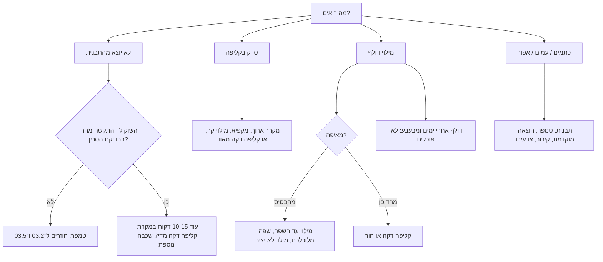

# 05.5 · תקלות בבונבונים: לא יוצא, סדקים ודליפות

כמעט כל מי שמכין בונבונים בפעם הראשונה מקבל לפחות אחד מאלה: בונבונים שנשארים בתבנית, קליפה שנסדקת, מילוי שדולף מהבסיס, או כתמים אפורים. החדשות הטובות הן שכמעט לכל תקלה יש סימן ברור שמוביל לסיבה אחת או שתיים. בשיעור הזה עוברים על הבונבונים שהכנתם במודול, מאבחנים מה השתבש, ומכינים סבב מתוקן של 8 בונבונים שבו משנים דבר אחד בלבד.

## מה צריך

| פריט | כמות לתרגול | כמות מלאה | הערה |
|---|---|---|---|
| הבונבונים מ־[05.2](lesson-02.md) עד [05.4](lesson-04.md), כולל אלה שלא יצאו טוב | כל מה שנשאר | | הם חומר הלימוד של השיעור |
| יומן התרגול של המודול | 1 | | עם הטמפרטורות שרשמתם |
| קוברטורה (אותו שוקולד, כולל שאריות) | 300 גרם | | לסבב המתוקן |
| מילוי פרלינה (או גנאש) כמו ב־[05.2](lesson-02.md) | 85 גרם | | |
| תבנית פוליקרבונט, שפכטל, שקית זילוף, אצטט, מדחום, מייבש שיער | | | כמו בשיעורים הקודמים |
| מדחום חדר (לא חובה, מומלץ) | 1 | | חום ולחות בחדר מסבירים הרבה תקלות |
| סכין חדה, מגבת נייר | | | לחתוך בונבונים לבדיקה |

**אלרגנים:** כמו ב־[05.2](lesson-02.md): פרלינה מכילה **אגוזי לוז** ולעתים **שקדים**; גנאש מכיל **חלב**; שוקולד מכיל בדרך כלל **סויה**, ולעתים חלב, ו"עלול להכיל" אגוזים ובוטנים.

## למה זה עובד

### ארבע משפחות של תקלות

כמעט כל תקלה בבונבון שייכת לאחת מארבע משפחות. כל אחת קשורה לשלב אחר בתהליך:

1. **לא יוצא מהתבנית** (טמפר וקירור, [05.1](lesson-01.md)): לפי Callebaut, בונבונים שלא משתחררים נובעים מטמפר לא תקין, משוקולד בהתגבשות חסרה, או מזמן קירור קצר מדי. בונבון שקשה להוציא יכול לנבוע גם מקליפה דקה מדי, שאין בה מספיק שוקולד כדי להתכווץ.
2. **סדקים** (הפרשי טמפרטורה): שוקולד מתכווץ בקירור. כשמשהו בבונבון קר בהרבה מהשאר, או כשמקררים מהר מדי, השוקולד מתכווץ בבת אחת ונסדק. CakeFlix מתארים את זה על טראפלס: מילוי קר מדי גורם לציפוי להתכווץ מהר ולהיסדק, ומילוי רך יכול להידחק החוצה דרך נקודות חלשות. לכן ההמלצה שלהם: מקרר ביתי (3-5°C) לזמן קצר בלבד, עד 15 דקות, והפרש של פחות מ־10°C בין חדר העבודה לבין מקום הקירור, כשאפשר.
3. **דליפות** (מילוי וסגירה, [05.2](lesson-02.md)): לפי Callebaut, בונבונים שלא נסגרים נובעים ממילוי יתר: לא ממלאים עד השפה, ומשאירים 1-1.5 מ"מ. גם מילוי על השפה, מילוי נוזלי שלא התייצב, או קליפה דקה מדי שנשברת בהוצאה גורמים לדליפה.
4. **מראה: כתמים, עמימות, אפור** (טמפר, תבנית ואחסון): Callebaut מונים כתמים לבנים ועמימות מתבנית לא נקייה, משוקולד בהתגבשות חסרה או יתר, מהוצאה מוקדמת מדי, ומהלם קירור. בונבונים שהאפירו לגמרי נובעים לפיהם מקירור איטי מדי, מקליפה עבה, מכניסה מאוחרת מדי למקרר (או בכלל לא), או מפריחת סוכר מעיבוי. איך מבדילים בין פריחת שומן לפריחת סוכר: [03.5](../module-03/lesson-05.md).

### שינוי אחד בכל פעם

כשמשנים שלושה דברים בבת אחת (טמפרטורה, זמן קירור וכמות מילוי), אי אפשר לדעת מה עזר. לכן הסבב המתוקן בשיעור הזה משנה משתנה אחד בלבד, וכל השאר נשאר כמו ביומן. זה גם מה שהופך את היומן לכלי: אחרי שלושה סבבים רואים מה חוזר על עצמו.

### מתי בונבון כבר לא אוכל

רוב התקלות הן עניין של מראה ומרקם, והבונבון טעים ובטוח. יוצא מן הכלל: בונבון עם מילוי מים (גנאש, פירות) שנשאר בו כיס אוויר או חור, או שהמכסה לא אטם. CakeFlix מסבירים שאוויר מביא איתו לחות ומיקרואורגניזמים, ולכן אטימה טובה ומילוי בלי כיסי אוויר הם חלק מחיי המדף. Callebaut מזכירים שמילוי עם שמנת טרייה או מחית פרי טרייה יכול להחזיק שעות עד יום בלבד. אם בונבון מבעבע, דולף נוזל חדש אחרי כמה ימים, מריח חמוץ או אלכוהולי, או שיש עליו עובש, לא אוכלים אותו, וגם לא את הבונבונים מאותו סבב. זה המקרה היחיד שבו זורקים.

## שלב אחר שלב

> [!WARNING]
> לפני שטועמים בונבון ישן עם מילוי גנאש או פירות, מסתכלים ומריחים: בועות, נוזל שנוזל, ריח חמוץ או אלכוהולי, או עובש, אומרים לא לאכול. מייבש השיער והשמנת החמה: כמו בשיעורים הקודמים, כמה שניות בתנועה, ושופכים הרחק מהגוף.

**חלק א: אבחון (30 דקות)**

1. **מסדרים**: מניחים על נייר אפייה את כל הבונבונים מהמודול, לפי סבב. לידם היומן.
2. **מסתכלים מלמעלה**: ברק, כתמים, צבע שנמרח, סדקים. רושמים ליד כל סבב מה רואים.
3. **מסתכלים על הבסיס**: בסיס שטוח ונקי? טבעת של צבע או של אבקה? מילוי שנראה בין הקליפה למכסה?
4. **לוחצים**: לוחצים בעדינות בין שתי אצבעות על בונבון אחד מכל סבב. נוזל מילוי? המכסה זז?
5. **חותכים**: חוצים בונבון אחד מכל סבב בסכין חמה (טובלים במים חמים ומנגבים היטב). מסתכלים על עובי הקליפה בדופן ובתחתית, על כיסי אוויר, ועל המכסה.
6. **מאבחנים**: לכל סבב בוחרים את התקלה העיקרית מהטבלה ב"כשזה משתבש", ומשווים לטמפרטורות ביומן. כותבים משפט אחד: "בסבב X הבעיה העיקרית היא Y, כנראה כי Z."
7. **בוחרים תיקון אחד**: לתקלה העיקרית, בוחרים את השינוי האחד שהכי סביר שיפתור אותה (העמודה "איך מונעים").

**חלק ב: סבב מתוקן (כשעה, ועוד לילה)**

8. **מכינים 8 בונבונים** בדיוק כמו בסבב שבחרתם, עם אותו שוקולד, אותה תבנית, אותו מילוי, ומשנים רק את הדבר שבחרתם. אם הבונבונים שלכם יצאו טוב, בוחרים את התקלה הקטנה ביותר (למשל בסיס לא שטוח) ומתקנים אותה.
9. **רושמים** ביומן את כל הטמפרטורות והזמנים, כולל טמפרטורת החדר.
10. **מוציאים ובודקים** אחרי הסגירה, כמו בשלבים 2-5.
11. **משווים**: טבלה של שתי שורות, הסבב הקודם והמתוקן: מה שיניתם, ומה השתנה בתוצאה. אם התקלה נשארה, בפעם הבאה בוחרים את הסיבה השנייה ברשימה.

## בדיקה: איך יודעים שהצליח

- **אבחון**: לכל סבב יש משפט אבחון אחד, שמתאים לסימנים בטבלה ולטמפרטורות ביומן.
- **שינוי אחד**: בסבב המתוקן השתנה רק משתנה אחד, וכל השאר זהה ומתועד.
- **שחרור**: לפחות 7 מתוך 8 בונבונים יצאו מהתבנית בהיפוך, בלי לדפוק חזק.
- **אטימה**: אף בונבון לא דולף בלחיצה עדינה.
- **בלי סדקים**: אין סדקים אחרי ההוצאה וגם לא אחרי 24 שעות בקופסה.
- **השוואה**: התקלה שבחרתם קטנה או נעלמה. אם לא, יש לכם השערה הבאה.

## כשזה משתבש

| מה רואים | למה זה קורה | מה עושים עכשיו | איך מונעים בפעם הבאה |
|---|---|---|---|
| הבונבונים לא יוצאים בכלל | טמפר לא תקין או התגבשות חסרה (Callebaut) | עוד 10-15 דקות במקרר והיפוך. אם לא יוצאים: מחממים את התבנית, ממיסים ומטמפרים שוב | בדיקת סכין לפני יציקה, מדחום אחרי כל חימום |
| חלק יוצאים וחלק נשארים | קירור קצר מדי, או קליפות דקות מדי שלא התכווצו | 5-10 דקות נוספות במקרר והיפוך נוסף | זמן קירור מלא; בשוקולד נוזלי מאוד, שכבה שנייה בקליפה (Callebaut: 2-3 שכבות) |
| חתיכות קליפה נשארות דבוקות בתבנית | שוקולד נוזלי מדי או קליפה דקה מדי שנשברת בהוצאה (Callebaut) | מנקים את התבנית במים חמים | שוקולד פחות נוזלי, או שכבה נוספת לפני המילוי |
| סדקים בקליפה מיד אחרי ההוצאה | קירור חזק או ארוך מדי (מקפיא, מקרר ארוך) | הסדוקים נאכלים בבית | מקרר ביתי 10-15 דקות לכל היותר, לא מקפיא; הפרש קטן בין החדר למקום הקירור (CakeFlix) |
| סדק שמופיע אחרי יום או יומיים, ולפעמים מילוי שמבצבץ | מילוי שהיה קר מהקליפה והתרחב, או קליפה דקה מדי | אוכלים מהר | מילוי בטמפרטורת החדר (עד 25-28°C) ומנוחה בחדר, לא במקרר |
| מילוי דולף מהבסיס | מילוי עד השפה או על השפה; מילוי שלא התייצב; מכסה שלא נצמד | אוכלים את הדולפים באותו יום | רווח 1-1.5 מ"מ (Callebaut) עד 2 מ"מ (Cacao Barry), ניגוב שפות, 12 שעות מנוחה, חימום קצר של השפות |
| נקודות לבנות או עמומות על פני הבונבון | תבנית לא נקייה או לא מלוטשת, התגבשות חסרה או יתר, הוצאה מוקדמת, או הלם קירור (Callebaut) | אוכלים; בונבון לבית | ליטוש בצמר גפן, טמפר נכון, תבנית בטמפרטורת החדר, קירור מלא לפני ההוצאה |
| בונבון אפור לגמרי | קירור איטי מדי, קליפה עבה, לא נכנס למקרר, או פריחת סוכר מעיבוי (Callebaut) | אוכלים, או ממיסים לשוקו | 5 דקות במקרר מיד אחרי הקליפה; אחסון סגור ויציב ([03.5](../module-03/lesson-05.md)) |
| קליפה עבה מאוד וטעם "רק שוקולד" | שוקולד שהתגבש יותר מדי או לא נוזלי מספיק (Callebaut) | נאכל; מתאים למילוי חזק בטעם | חימום במעלה אחת לפני היציקה, ריקון ארוך יותר ([05.1](lesson-01.md)) |
| חור קטן בדופן ומילוי שמבצבץ | בועת אוויר בקליפה | אוכלים מיד; לא במתנה | הקשה חזקה יותר לפני ריקון הקליפה |
| בונבון גנאש מבעבע או מריח חמוץ אחרי כמה ימים | קלקול: אוויר, לחות או חום, עם מילוי שיש בו מים | **לא אוכלים**, גם לא את שאר הסבב | אטימה מלאה, בלי כיסי אוויר, אחסון קריר, ואכילה בתוך זמן קצר (חיי מדף: [06.4](../module-06/lesson-04.md)) |

### מה עושים עם מה שלא הצליח

כמעט שום דבר לא הולך לפח. בונבונים סדוקים, דולפים, עמומים או עבים הם עדיין שוקולד ומילוי טובים: אוכלים אותם בבית באותו יום, מגישים אותם קצוצים מעל גלידה, או ממיסים אותם בחלב חם לשוקו עשיר. בונבונים עם מילוי פרלינה שנמסים לשוקו נותנים טעם של אגוזים. שוקולד שגורד מהתבנית או חתיכות קליפה חוזרים לשקית "להמסה". שני היוצאים מן הכלל: בונבון שנראה או מריח מקולקל, ושוקולד שנגע באבקה "לקישוט בלבד" ([05.4](lesson-04.md)). אותם לא אוכלים.

## חלופות

### טבעוני / פרווה

התקלות זהות בבונבונים טבעוניים, עם שני הבדלים. שוקולד "חלב" טבעוני סמיך לעתים קרובות, ולכן קליפות עבות שכיחות בו יותר: מחממים במעלה אחת ומרוקנים יותר זמן, ומטמפרים לפי עקומת היצרן. גנאש בקרם קוקוס רך יותר, ולכן צריך מנוחה ארוכה יותר לפני הסגירה, אחרת הוא נדחק החוצה ודולף.

### בריא יותר

שוקולד ללא תוספת סוכר עם מלטיטול סמיך לעתים יותר, וזה נותן קליפות עבות: בודקים נזילות ומחממים במעלה אחת. בונבונים קטנים (תבנית "מיני") רגישים יותר לקליפה עבה ביחס למילוי. מנות קטנות הן עדיין הבחירה הכי פשוטה.

> [!CAUTION]
> מלטיטול גורם לגזים ולשלשול כשאוכלים ממנו כמות, והוא לא מתאים לילדים בכמויות. מי שמגיש בונבונים כאלה אומר לאורחים מה יש בהם.

### כשרות

תיקון תקלות לא משנה את הכשרות, אבל שימו לב לשאריות: אם בסבב אחד השתמשתם בגנאש חלבי ובאחר בפרלינה פרווה, שוקולד שגורד מהתבנית ושוקולד שנמס לשוקו מבונבוני גנאש הם חלביים. שומרים שאריות בשקיות נפרדות עם מדבקה "חלבי" או "פרווה", ובודקים את ההכשר של כל רכיב: [שלושה כללים](../../references/kashrut-guide.md#שלושה-כללים), [פרלינה ומחיות אגוזים](../../references/kashrut-guide.md#פרלינה-ומחיות-אגוזים). אם יש ספק, שואלים את הרב.

## איפה קונים

לשיעור הזה לא צריך לקנות כלום מעבר למה שכבר יש. מי שמגלה שהבעיה בציוד: מדחום מדויק יותר או מדחום אינפרא אדום לבדיקת התבנית, שפכטל רחב ונוקשה יותר לגירוד נקי, ודפי אצטט לסגירה שטוחה. חנויות, מחירים ומלאי: [מדחום](../../references/where-to-buy.md#מדחום), [מדחום אינפרא אדום](../../references/where-to-buy.md#מדחום-אינפרא-אדום), [שפכטל וקלף](../../references/where-to-buy.md#שפכטל-וקלף), [אצטט ודפי גיטרה](../../references/where-to-buy.md#אצטט-ודפי-גיטרה), [תבניות פוליקרבונט](../../references/where-to-buy.md#תבניות-פוליקרבונט), [קופסאות פרלינים](../../references/where-to-buy.md#קופסאות-פרלינים) (לאחסון ולמתנה).

## תרגול

### משימה

מאבחנים כל סבב מהמודול לפי הטבלה, כותבים משפט אבחון לכל סבב, ומכינים סבב מתוקן של 8 בונבונים שבו משנים משתנה אחד בלבד. הסבב המתוקן הוא הבסיס ל[פרויקט המודול: 8 בונבונים ראשונים](../../projects/m05-first-bonbons.md), ואפשר להכין אותו כבר עם הצבעים והאבקה שבחרתם לפרויקט.

### זמן

30 דקות אבחון, כשעה לסבב המתוקן (קליפה, מילוי) ועוד לילה, ו־30 דקות לסגירה, להוצאה ולהשוואה. סך הכול כשעה וחצי של עבודה, ועוד כ־30 דקות ביום השני.

### יומן

ב[יומן התרגול](../../templates/practice-log.md): טבלת אבחון (סבב, מה רואים, סיבה סבירה, שינוי שבחרתם), וטבלת השוואה של שתי שורות (לפני ואחרי). אם השינוי היה בטמפרור, ממלאים גם שורה ב[יומן הטמפרור](../../templates/tempering-log.md).

### בדיקה עצמית

- [ ] חתכתי בונבון אחד מכל סבב ובדקתי קליפה, מילוי ומכסה.
- [ ] לכל סבב יש משפט אבחון אחד שמתאים לסימנים וליומן.
- [ ] בסבב המתוקן שיניתי משתנה אחד בלבד, ותיעדתי את כל השאר.
- [ ] לפחות 7 מתוך 8 בונבונים יצאו מהתבנית, ואף אחד לא דולף.
- [ ] בונבונים פגומים נאכלו או נמסו לשוקו, ורק מה שמקולקל נזרק.

## סיכום

- ארבע משפחות של תקלות: לא יוצא (טמפר וקירור), סדקים (הפרשי טמפרטורה), דליפות (מילוי וסגירה), ומראה (תבנית, טמפר וקירור).
- הסימן מוביל לסיבה: חותכים, לוחצים, ומשווים ליומן.
- משנים משתנה אחד בכל סבב, אחרת לא יודעים מה עזר.
- מקרר קצר, לא מקפיא; מילוי בטמפרטורת החדר; רווח מתחת לשפה; שפות נקיות.
- בונבון פגום נאכל בבית; בונבון שמבעבע, מריח חמוץ או עם עובש לא נאכל.
