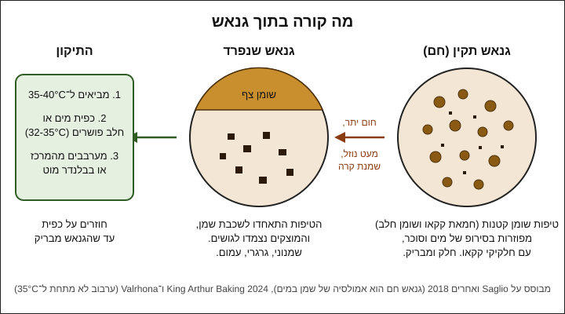

# 06.1 · גנאש: אמולסיה, יחסים ולמה הוא נפרד

גנאש (ganache) הוא שוקולד ושמנת, ועם שני הרכיבים האלה מכינים רוטב, מילוי לבונבונים וטראפלס. ההבדל ביניהם הוא היחס בין השוקולד לשמנת, וההבדל בין גנאש חלק לגנאש שמנוני וגרגרי הוא טמפרטורה וערבוב. בשיעור הזה מכינים גנאש מריר ביחס 2:1 לטראפלס של השיעור הבא, גנאש רך ביחס 1:1 להשוואה, ומפרידים בכוונה כפית גנאש כדי לתקן אותה בידיים.

## מה צריך

| פריט | כמות לתרגול | כמות מלאה | הערה |
|---|---|---|---|
| שוקולד מריר 55-70% (קוברטורה או טבלה טובה), קצוץ דק | 160 גרם | 400 גרם | 100 גרם לגנאש 2:1, 30 גרם לגנאש 1:1, 30 גרם לניסוי ההפרדה (עדיף 70%) |
| שמנת מתוקה 32% או 38% שומן | 90 גרם | 200 גרם | 50 + 30 + 8 גרם. לא "שמנת לבישול" 10-15% |
| מים או חלב | 2-3 כפיות | | לתיקון |
| קערות קטנות עמידות לחום | 3 | | זכוכית או פלסטיק עבה |
| סיר קטן או כוס מדידה למיקרוגל | 1 | | לחימום השמנת |
| מרית סיליקון ומטרפה קטנה | 1 מכל | | |
| בלנדר מוט (לא חובה) | 1 | | עוזר, בעיקר בכמות מלאה |
| מדחום דיגיטלי עם דקר, משקל | 1 מכל | | |
| ניילון נצמד, קופסה סגורה | | | לשמור את הגנאש לשיעור הבא |

**שמנת בישראל:** בסופר יש שמנת מתוקה 32% ו־38%. שתיהן מתאימות. ב־38% יש קצת פחות מים, ולכן הגנאש יוצא מעט מוצק יותר. מה שנשאר מהקרטון: שוקו, רוטב, או הגנאש של [06.3](lesson-03.md).

**אלרגנים:** חלב (שמנת). רוב השוקולדים מכילים לציטין סויה, ורבים מכילים או "עלולים להכיל" חלב, אגוזים ובוטנים. בודקים על האריזה.

### לפני שמתחילים את המודול

צפייה בשיעור היא לא תרגול. גנאש לומדים בידיים: איך הוא נראה כשהוא מתחבר, איך הוא מרגיש כשהוא נפרד, ומתי הוא מוכן לגלגול. האקדמיה לא יכולה לבדוק צילומים, ולכן בכל שיעור יש בדיקות ברורות (טמפרטורה, ברק, מרקם, כמה זמן עד שמתייצב) שמשווים אליהן את התוצאה. ממשיכים את [יומן התרגול](../../templates/practice-log.md): יחס, סוג שמנת, טמפרטורות, ומה הייתם משנים. הגנאש של השיעור הזה הופך לטראפלס בשיעור הבא, והשוקולד המטומפר מהמודולים הקודמים משמש לציפוי, כך שהמודול כולו עולה מעט.

## למה זה עובד

### גנאש הוא אמולסיה

שוקולד לבד הוא שומן עם אבקות, בלי מים ([02.1](../module-02/lesson-01.md)). שמנת היא בעיקר מים: לפי USDA יש בשמנת להקצפה כ־58% מים וכ־36% שומן. כששופכים שמנת חמה על שוקולד, נוצרת אמולסיה (emulsion), כלומר תערובת של שני דברים שבדרך כלל לא מתערבבים: טיפות שומן זעירות מפוזרות בתוך נוזל מימי.

חוקרים של Valrhona ושל מרכז המחקר Paul Pascal מתארים את זה כך, על סמך מחקר של Saglio ועמיתיו (2018): גנאש חם הוא אמולסיה של שמן במים (oil-in-water). השומן, חמאת קקאו ושומן החלב, נמצא בטיפות קטנות בתוך "סירופ" של מים מהשמנת וסוכר מהשוקולד. כשהגנאש מתקרר, המבנה משתנה, וחמאת הקקאו מתחילה להתגבש. בגלל זה גנאש חם נשפך, וגנאש קר אפשר לגלגל.

### למה הוא נפרד

גנאש "נפרד" (split, broken) כשהטיפות מתאחדות לשכבת שמן, והמוצקים נצמדים לגושים. רואים שמן צף בשוליים, מרקם גרגרי ועמום, ולפעמים "חול" על הלשון. לפי King Arthur, יש לזה שלוש סיבות עיקריות:

1. **מעט מדי נוזל**: אם השמנת היא פחות מ־33% מהשוקולד במשקל (פחות מחלק אחד שמנת לשני חלקי שוקולד), או שהשוקולד מעל 70% קקאו, אין מספיק מים כדי להחזיק את כל המוצקים והשומן. בשוקולד של 70% ומעלה יש פחות סוכר שנמס במים, ויותר מוצקי קקאו שסופחים אותם.
2. **חום יתר**: גנאש שהגיע לרתיחה על האש או חומם חזק במיקרוגל. "שוקולד שונא חום יתר", הם כותבים.
3. **נוזל קר לגנאש חם**: שמנת קרה מקשה את השומן בבת אחת, והקקאו מתגבש לגושים.

יש גם סיבה רביעית, הפוכה: גנאש שהתקרר יותר מדי בזמן הערבוב. מתחת לכ־34°C חמאת קקאו כבר יכולה להתחיל להתגבש ([03.1](../module-03/lesson-01.md)), ואז השומן לא מתפזר יפה לטיפות. לכן ב־Valrhona מסיימים את האמולסיה בבלנדר ומוסיפים חמאה כשהגנאש עדיין ב־35-40°C.

### למה כפית מים מתקנת

אם הבעיה היא חוסר במים, הפתרון הוא מים, ולא עוד שומן. King Arthur מוסיפים מי ברז פושרים (32-35°C), כפית אחת בכל פעם, ומקציפים חזק בין כפית לכפית עד שהגנאש חוזר להיות חלק. הם מעדיפים מים על שמנת, כי מים לא מוסיפים שומן, והשומן הוא בדיוק מה שכבר יש יותר מדי. כפית חלב עובדת באותה דרך. אם הבעיה היא קור, קודם מחממים בעדינות את הגנאש ל־35-40°C, ואז מערבבים או מפעילים בלנדר.

זה מתחבר למה שראיתם בשיעור 02.1: טיפת מים גורמת לשוקולד להיתפס, אבל הרבה נוזל מחזיר אותו לחלק. גנאש נמצא בצד ה"הרבה נוזל". [02.1 · להמיס נכון](../module-02/lesson-01.md) מסביר את הגבול: לפי Shirley Corriher, לפחות כף נוזל לכל 57 גרם שוקולד.

### יחסים: כמה שמנת לכל שוקולד

היחס במשקל (שוקולד : שמנת) קובע את המרקם. ככל שיש יותר שוקולד, הגנאש מוצק יותר. בשוקולד חלב ולבן צריך יותר שוקולד כדי להגיע לאותו מרקם. McGill ו־Hartel (אוניברסיטת ויסקונסין, 2018) מצאו למה: מוצקי קקאו, שכמעט לא נמסים, מחזקים את המבנה ומקשים את הגנאש, ואילו סוכר ואבקת חלב נמסים בחלק המימי של השמנת ומרככים אותו. במריר יש הרבה מוצקי קקאו, בחלב פחות, ובלבן אין בכלל.

| שימוש | מריר 55-70% | חלב | לבן | מקור |
|---|---|---|---|---|
| גנאש רך לקינוחים (לא מגובש) | כ־0.8:1 | 1.5:1 | כ־1.9:1 | Valrhona, "גנאש קינוחים קלאסי": 600 גרם שמנת 36% ו־100 גרם סוכר אינוורטי על 500 גרם Guanaja 70%, 900 גרם Jivara חלב, או 1,150 גרם Ivoire לבן |
| רוטב או ציפוי נשפך | 1:1 | 1.5:1 | 2:1 | נקודת התחלה מקובלת (שלנו) |
| טראפלס לגלגול | **2:1** | **2.5:1** | **3:1** | מריר: King Arthur (33% שמנת = עבה, לטראפלס ולמילוי). חלב ולבן: נקודת התחלה שלנו, באותו כיוון כמו Valrhona |

באותה טבלה של Valrhona רואים גם את השפעת אחוז הקקאו: על אותם 600 גרם שמנת שמים 420 גרם מריר 85% (Abinao), אבל 600 גרם ממרירים מתוקים יותר. ככל שיש יותר מוצקי קקאו, צריך פחות שוקולד.

מה עוד משנה את המרקם:

- **אחוז השומן בשמנת**: 38% נותנת גנאש מעט מוצק יותר מ־32%. Valrhona עובדים עם 36%.
- **אחוז הקקאו**: מריר 70% קושר יותר מים ממריר 55%. מעל 70% שומרים על 2:1 לכל היותר, לפי ההנחיה של King Arthur.
- **שוקולד ציפוי (קומפאונד)**: עובד, אבל השומן הצמחי בו מתנהג אחרת. כל היחסים בשיעור הם לקוברטורה או לשוקולד אמיתי.

### טמפרטורות

| שלב | מריר | חלב ולבן | מקור |
|---|---|---|---|
| חימום השמנת | 75-80°C, בלי רתיחה מתמשכת | 60-65°C | Valrhona (מריר 75-80°C, חלב ולבן 60-65°C). King Arthur: כ־82°C, ממש לפני רתיחה |
| השוקולד | קצוץ דק, או נמס בחלקו | נמס בחלקו | Valrhona: בחלב ולבן ממיסים חלקית, כדי שהאמולסיה תיווצר בקלות |
| סוף הערבוב | 35-40°C | 35-40°C | Valrhona מוסיפים חמאה ומערבבים שוב בבלנדר בטווח הזה |
| יציקה למסגרת | 34-36°C | חלב 32-34°C, לבן 30-32°C | Valrhona (גנאש שיוצקים למסגרת וחותכים לקוביות) |

שוקולד לבן וחלב רגישים יותר לחום ([02.1](../module-02/lesson-01.md)), ולכן השמנת שלהם חמה פחות.

### למה מערבבים מהמרכז

אמולסיה נוצרת כשטיפות השומן נשברות לקטנות ומתפזרות במים. הדרך הביתית: מתחילים במרכז הקערה, במעגלים קטנים, ושם נוצר "גרעין" חלק ומבריק. מרחיבים את המעגל בהדרגה, וכך כל השאר מצטרף לגרעין. ב־Valrhona שופכים חצי מהשמנת, מערבבים במרית, מוסיפים את השאר, ומסיימים בבלנדר מוט. הבלנדר יוצר טיפות קטנות מאוד, ולכן הגנאש יציב יותר. בכמות של 150 גרם קשה להשתמש בבלנדר, ומרית או מטרפה קטנה מספיקות. מטרפה מכניסה אוויר, ולכן לא מקציפים חזק, אלא רק בזמן תיקון.

## שלב אחר שלב

> [!WARNING]
> שמנת חמה עולה ונשפכת מהר, וכוויה משמנת חמה עמוקה יותר ממים. מחממים בסיר קטן על אש נמוכה או במיקרוגל בפולסים של 20 שניות, בכלי גבוה, ומרימים עם מגבת. מפסיקים כשמופיעות בועות בשוליים, לפני רתיחה.

### א. גנאש מריר 2:1 לטראפלס (100 גרם שוקולד, 50 גרם שמנת)

1. **שוקלים וקוצצים**: 100 גרם מריר לחתיכות של 3-5 מ"מ. בטבליות (callets) אין צורך לקצוץ. מניחים בקערה.
2. **ממיסים חלקית (לא חובה)**: פולס של 15-20 שניות במיקרוגל, עד שהשוליים מבריקים. בכמות קטנה השמנת מתקררת מהר, וזה עוזר לשוקולד להימס עד הסוף.
3. **מחממים את השמנת**: 50 גרם עד 75-80°C (בועות קטנות בשוליים). מכיוון שחלק מהנוזל מתאדה, שוקלים שוב אחרי החימום ומשלימים במעט שמנת אם ירדו יותר מ־3 גרם.
4. **שופכים חצי**: כ־25 גרם על השוקולד, ממתינים 30 שניות, ומערבבים במרית במעגלים קטנים במרכז הקערה. בהתחלה זה ייראה סמיך ואפילו מתפרק. זה תקין.
5. **מוסיפים את השאר**: את יתרת השמנת, וממשיכים מהמרכז החוצה עד שכל הקערה חלקה ומבריקה.
6. **בודקים חום**: הגנאש צריך להיות 35-40°C. אם נשארו חתיכות והגנאש מתחת ל־35°C, פולס של 5 שניות וערבוב.
7. **מכסים ומאחסנים**: ניילון נצמד צמוד לפני הגנאש (שלא תיווצר קרום ולא יטפטפו עליו טיפות). משאירים בטמפרטורת החדר עד שהגנאש מתקרר לכ־25°C, ואז לקופסה סגורה במקרר עד השיעור הבא.

### ב. גנאש רך 1:1 להשוואה (30 גרם שוקולד, 30 גרם שמנת)

1. אותו תהליך, בקערה קטנה, ב־30 גרם שוקולד ו־30 גרם שמנת חמה.
2. אחרי שעה בטמפרטורת החדר, משווים בכפית את שני הגנאשים: מה נשפך, מה נמרח, מה מחזיק צורה.
3. את הגנאש הרך מגישים כרוטב על גלידה או פרי, או מחממים עם 100 מ"ל חלב לשוקו.

### ג. ניסוי הפרדה ותיקון (30 גרם מריר 70%, 8 גרם שמנת)

1. ממיסים 30 גרם מריר 70% ל־45°C.
2. מוסיפים 8 גרם שמנת חמה (כ־27% מהשוקולד, מתחת לגבול של 33% של King Arthur) ומערבבים. בדרך כלל רואים מרקם עבה, שמנוני וגרגרי, עם ברק של שמן בשוליים.
3. מוסיפים כפית מים פושרים (32-35°C) ומקציפים חזק במטרפה קטנה במשך 20-30 שניות.
4. אם הגנאש עדיין לא חלק, עוד כפית. ברוב המקרים אחת או שתיים מספיקות.
5. רושמים ביומן: כמה כפיות, ואיך נראה הגנאש לפני ואחרי.

## בדיקה: איך יודעים שהצליח

- **מראה**: הגנאש מבריק, אחיד בצבע, ובלי שמן בשוליים ובלי נקודות של שוקולד לא נמס.
- **מרקם בכפית**: חלק על הלשון, בלי גרגרים. כפית שנגררת בגנאש החם משאירה תעלה שנסגרת לאט.
- **טמפרטורה**: השמנת לא עברה 80°C (בחלב ולבן 65°C), והגנאש היה 35-40°C בסוף הערבוב.
- **ההבדל בין היחסים**: אחרי שעה ב־22-25°C, ה־1:1 נשפך לאט מהכפית, וה־2:1 כבר מחזיק צורה כמו משחה רכה. אחרי לילה במקרר אפשר לחתוך את ה־2:1 בכפית לגוש שמחזיק צורה.
- **ניסוי התיקון**: ראיתם גנאש שנפרד, ואחרי כפית או שתיים של מים הוא חזר להיות חלק ומבריק.

## כשזה משתבש

| מה רואים | למה זה קורה | מה עושים עכשיו | איך מונעים בפעם הבאה |
|---|---|---|---|
| שמן צף בשוליים, גנאש גרגרי ועמום | מעט מדי נוזל, או שוקולד מעל 70% ביחס 2:1 | כפית מים או חלב פושרים (32-35°C), הקצפה חזקה, ושוב כפית אם צריך | לפחות 33% שמנת מהשוקולד; במריר 70%+ לא עוברים את 2:1 |
| גנאש נפרד אחרי שחיממתם אותו במיקרוגל | חום יתר | מקררים בערבוב ל־35-40°C, ואז כפית מים פושרים והקצפה | מחממים בפולסים של 5 שניות, ומודדים |
| גנאש סמיך, גושי, עם גרגרים קשים, והמדחום מתחת ל־30°C | התקרר באמצע הערבוב, או ששפכתם שמנת קרה | מחממים בעדינות (פולסים של 5 שניות או מעל בן־מארי) ל־35-40°C, ומערבבים מהמרכז או בבלנדר | שמנת חמה, ולא מתחילים לערבב לפני שהשוקולד ספג את החום 30 שניות |
| נשארו חתיכות שוקולד שלא נמסו | השמנת התקררה לפני שהמיסה הכול; שוקולד קצוץ גס | פולס של 5 שניות וערבוב, בלי לעבור 40°C | קוצצים דק, וממיסים חלקית מראש |
| הגנאש לא מתייצב גם אחרי לילה | יחס עם יותר מדי שמנת, או שוקולד ציפוי | משתמשים בו כרוטב, או ממיסים ומוסיפים שוקולד עד 2:1 | שוקלים, ובודקים שהשוקולד הוא קוברטורה ולא קומפאונד |
| קרום יבש על פני הגנאש | הגנאש לא היה מכוסה | מגרדים את הקרום (אפשר לאכול) וממשיכים | ניילון נצמד צמוד לפני הגנאש |
| הגנאש התגבש למסה מגורענת אחרי כמה ימים במקרר | גבישי חמאת קקאו גדלו, או שהגנאש היה על הגבול מלכתחילה | מחממים ל־35°C ומערבבים, ואם צריך כפית מים | מגלגלים או משתמשים תוך 2-3 ימים |

### מה עושים עם מה שלא הצליח

שום דבר לא הולך לפח. גנאש שנפרד ולא התאחד אחרי שלוש כפיות מים עדיין טעים: מחממים אותו עם 100-150 מ"ל חלב לשוקו חם, או עם מעט שמנת לרוטב לגלידה. גנאש רך מדי הוא רוטב, ציפוי לעוגה או מילוי לסנדוויץ' עוגיות. גנאש קשה מדי מתאים לטראפלס, ואפשר גם לרכך אותו בכפית שמנת חמה. גנאש עם קרום מגרדים ואוכלים. שאריות מקערות ומרית מגרדים לצנצנת אחת במקרר, ומשתמשים בהן בשוקו.

## חלופות

### טבעוני / פרווה

במקום שמנת עובדים עם קרם קוקוס 19-24% שומן (לא "חלב קוקוס" דליל), או עם שמנת צמחית. קרם קוקוס נותן טעם קוקוס ומעט יותר שומן ממים, ולכן הגנאש עלול להיות רך ושמנוני יותר: מתחילים ביחס 2:1 ומוסיפים כפית מים אם הוא נפרד. שמנת צמחית מכילה מייצבים ולפעמים סוכר, ויש לה טעם משלה. השוקולד חייב להיות מריר בלי חלב ברכיבים, והוא קובע אם התוצאה פרווה. גנאש בלי שמנת לגמרי (משקה שיבולת שועל, אקוופאבה, מחית אגוזים) מגיע לעומק ב[מודול 12](../module-12/lesson-01.md).

### בריא יותר

גנאש מריר 70% פחות מתוק מגנאש חלב או לבן, אבל זכרו את הכלל של King Arthur: מעל 70% לא עוברים 2:1, אחרת הוא נפרד. אפשר להכין טראפלס קטנים, 8-10 גרם במקום 15. שמנת 32% במקום 38% מורידה מעט שומן, וזה הכול. אין כאן טענה בריאותית: גנאש הוא ממתק.

### כשרות

גנאש עם שמנת הוא **חלבי**, גם כשהשוקולד פרווה. מי שמקפיד על חלב ישראל צריך גם שמנת חלב ישראל (לבדוק על האריזה) וגם שוקולד שמתאים לו. בקוברטורות המוכרות חלב ולבן מסומנים בדרך כלל חלב נכרי, ו[שלושה כללים](../../references/kashrut-guide.md#שלושה-כללים) מסבירים מה בודקים. גנאש פרווה דורש גם שוקולד פרווה וגם תחליף שמנת פרווה: [שמנת צמחית וקרם קוקוס במדריך הכשרות](../../references/kashrut-guide.md#שמנת-צמחית-וקרם-קוקוס). אם יש ספק, שואלים את הרב.

## איפה קונים

מה מחפשים: קוברטורה מריר 55-70% בטבליות או מטבעות (חמאת קקאו ברכיבים, לא שומן צמחי אחר), ושמנת מתוקה 32% או 38% מהסופר. גלוקוזה לא צריך בשיעור הזה ([06.4](lesson-04.md)). בלנדר מוט ביתי מספיק. חנויות ומלאי: [קוברטורה](../../references/where-to-buy.md#קוברטורה), [שוקולד מסופרמרקט](../../references/where-to-buy.md#שוקולד-מסופרמרקט), [מדחום](../../references/where-to-buy.md#מדחום), [משקל](../../references/where-to-buy.md#משקל). לגרסה טבעונית: [שמנת צמחית וקרם קוקוס](../../references/where-to-buy.md#שמנת-צמחית-וקרם-קוקוס). כשרות לפי מוצר: [קוברטורה מרירה](../../references/kashrut-guide.md#קוברטורה-מרירה), [שמנת צמחית וקרם קוקוס](../../references/kashrut-guide.md#שמנת-צמחית-וקרם-קוקוס).

## תרגול

### משימה

מכינים שלושה גנאשים קטנים: 2:1 (100 גרם מריר, 50 גרם שמנת) שנשמר לטראפלס של [06.2](lesson-02.md), 1:1 (30 + 30 גרם) להשוואה ולרוטב, וניסוי הפרדה (30 גרם מריר 70%, 8 גרם שמנת) שמתקנים בכפיות מים. מי שכבר מרגיש בטוח מכין ביום אחר גנאש חלב 2.5:1 (100 גרם חלב, 40 גרם שמנת ב־60-65°C) ומשווה למריר.

### זמן

כ־35 דקות עבודה, ועוד שעה של המתנה להשוואה (אפשר לעשות דברים אחרים). הגנאש 2:1 נשאר לילה במקרר.

### יומן

ממלאים [יומן תרגול](../../templates/practice-log.md): סוג השוקולד ואחוז הקקאו, אחוז השומן בשמנת, יחס, טמפרטורת השמנת, טמפרטורת הגנאש בסוף הערבוב, ומרקם אחרי שעה. בניסוי ההפרדה: כמה כפיות מים היו צריך. מצלמים את שלושת הגנאשים בכפית, זה לצד זה.

### בדיקה עצמית

- [ ] שקלתי שוקולד ושמנת, וחישבתי את היחס לפני שהתחלתי.
- [ ] השמנת לא עברה 80°C, והגנאש היה 35-40°C בסוף הערבוב.
- [ ] הגנאש 2:1 חלק ומבריק, מכוסה בניילון צמוד ושמור במקרר לשיעור הבא.
- [ ] ראיתי גנאש נפרד, ותיקנתי אותו בכפית או שתיים של מים פושרים.
- [ ] אני יכול/ה להסביר למה גנאש לבן צריך יותר שוקולד מגנאש מריר.

## סיכום

- גנאש הוא אמולסיה: טיפות שומן קטנות בתוך סירופ של מים מהשמנת וסוכר מהשוקולד. כשהוא מתקרר, חמאת הקקאו מתגבשת והוא מתמצק.
- היחס קובע את המרקם. לטראפלס: מריר 2:1, חלב 2.5:1, לבן 3:1. בחלב ולבן צריך יותר שוקולד, כי סוכר ואבקת חלב מרככים ומוצקי קקאו מקשים.
- גנאש נפרד ממעט נוזל, מחום יתר או מקור. מתקנים בכפית מים פושרים והקצפה, או בחימום עדין ל־35-40°C ובערבוב מהמרכז.
- שמנת למריר 75-80°C, לחלב ולבן 60-65°C. לא מערבבים מתחת ל־35°C. למילוי בונבונים: עד 25-28°C ([05.2](../module-05/lesson-02.md)).
- פרויקט המודול: [מארז טראפלס בשלושה טעמים](../../projects/m06-truffle-box.md), 9 טראפלס, כרטיס יחסים, תוכנית אחסון ותווית עם תאריך.
