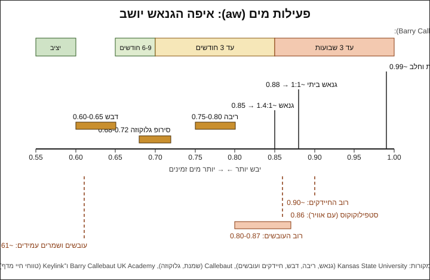

# 06.4 · חיי מדף ופעילות מים

שוקולד מוצק מחזיק חודשים, וטראפלס עם שמנת מחזיק שבועיים במקרר. ההבדל הוא המים, ובעיקר כמה מהם "זמינים" לחיידקים ולעובשים. בשיעור הזה מחשבים כמה מים יש בגנאש שלכם, מבינים מה זה פעילות מים (water activity, aw) ואיך גלוקוזה, סוכר אינוורטי, חמאה ואלכוהול משנים אותה, ומכינים גרסה "לשמירה ארוכה" של הטראפלס לצד הרגילה. זה הבסיס לכל שאלה עסקית על תאריך, אחסון ומשלוח במודולים 16-20.

## מה צריך

| פריט | כמות לתרגול | כמות מלאה | הערה |
|---|---|---|---|
| שוקולד מריר 55-70% | 100 גרם | 400 גרם | לגרסת "שמירה ארוכה" |
| שמנת מתוקה 32% או 38% | 40 גרם | 160 גרם | |
| סירופ גלוקוזה | 10 גרם | 40 גרם | אם אין: 8 גרם דבש או סוכר אינוורטי (טרימולין) |
| חמאה רכה (לא מלוחה) | 10 גרם | 40 גרם | בטמפרטורת החדר |
| טראפלס מ־06.2 ו־06.3 | 4-6 | | לניסוי ההשוואה |
| אבקת קקאו לציפוי | 10 גרם | | |
| מחשבון, ו[כרטיס מתכון](../../templates/recipe-card.md) | | | לחישוב אחוז המים |
| 2 קופסאות קטנות סגורות, מדבקות ועט | | | |
| מדחום ומשקל | 1 מכל | | |

**אלרגנים:** חלב (שמנת וחמאה), לציטין סויה, ואלרגנים מהטראפלס של 06.3 (שומשום, אגוזים). דבש לא מתאים לתינוקות מתחת לגיל שנה.

## למה זה עובד

### כמות מים מול פעילות מים

יש שני מספרים שונים. **תכולת מים** היא כמה מים יש במזון, באחוזים. **פעילות מים** (aw) היא כמה מהמים האלה חופשיים, כלומר לא קשורים לסוכר, למלח או לחלבונים. Kansas State University מגדירים אותה כיחס בין לחץ האדים של המים במזון ללחץ האדים של מים נקיים. הסולם הוא בין 0 (יבש לגמרי) ל־1 (מים נקיים). סוכר ומלח מורידים את פעילות המים, וזו הדרך הוותיקה לשמר מזון: ריבה, דבש, בשר מלוח.

Callebaut מביאים דוגמה: שני גנאשים עם **אותה** תכולת מים, אחד ב־aw של 0.750 והשני ב־0.900. בשני יש הרבה יותר מים חופשיים, והוא יכול לתמוך בהרבה יותר פעילות של מיקרואורגניזמים. לכן לא מספיק לדעת כמה מים יש. צריך לדעת כמה מהם קשורים.

### מתחת לאיזה מספר מה לא גדל

לפי טבלה של Kansas State University (על בסיס Fontana, 2000):

| aw | מה מפסיק לגדול מתחת לטווח | מזונות בטווח הזה |
|---|---|---|
| 0.95-1.00 | חיידקים רבים (פסאודומונס, אי־קולי ועוד) | שמנת וחלב (Callebaut: חלב 0.993-0.995), מזון טרי |
| 0.91-0.95 | סלמונלה, בוטוליזם, חלק מהעובשים והשמרים | גבינות, נקניקים |
| 0.87-0.91 | שמרים רבים | עוגות ספוג, מרגרינה, **גנאש ביתי 1:1 (0.88)** |
| 0.80-0.87 | רוב העובשים, סטפילוקוקוס זהוב | **גנאש ביתי מוצק יותר (0.85)**, חלב מרוכז ממותק |
| 0.75-0.80 | מרבית החיידקים שאוהבים מלח, עובשים מסוימים | ריבה |
| 0.65-0.75 | עובשים שאוהבים יובש | פאדג', מרשמלו, אגוזים, סירופ גלוקוזה (Callebaut: 0.68-0.72) |
| 0.60-0.65 | שמרים שאוהבים סוכר, מעט עובשים | דבש, פירות יבשים |
| מתחת ל־0.60 | אין התרבות של מיקרואורגניזמים | פסטה יבשה, עוגיות, אבקת חלב |

לפי אותו מקור, רוב חיידקי הקלקול צריכים aw של 0.90 לפחות, סטפילוקוקוס זהוב גדל עד 0.86 כשיש אוויר, ועובשים ושמרים מסוימים עד 0.61. ה־FDA משתמשים ב־0.85 כקו רגולטורי (לפי Kansas State): מזון שה־aw שלו 0.85 ומטה לא נחשב שימור בעל חומציות נמוכה.

### איפה הגנאש שלכם

ב־Kansas State מדדו גנאשים ביתיים במעבדה: גנאש של כ־113 גרם שוקולד חצי־מריר וחצי כוס שמנת (בערך 1:1) הגיע ל־aw של 0.88, וגנאש של 340 גרם שוקולד וכוס שמנת (בערך 1.4:1) הגיע ל־0.85. שניהם בטווח שבו רוב העובשים וסטפילוקוקוס עוד יכולים לגדול. החוקרות כותבות שגנאש כזה, שנשאר בטמפרטורת החדר, דורש קירור או בדיקת מוצר.

אפשר לחשב בערך כמה מים יש בגנאש שלכם. לפי USDA, בשמנת להקצפה כ־58% מים, ובשוקולד מריר כ־1%:

| גנאש | מים מהשמנת | מים מהשוקולד | סך הכול | אחוז מים |
|---|---|---|---|---|
| 1:1 (100 + 100 גרם) | 58 גרם | 1 גרם | 59 מתוך 200 גרם | **כ־29%** |
| 2:1 (100 + 50 גרם) | 29 גרם | 1 גרם | 30 מתוך 150 גרם | **כ־20%** |
| 2:1 עם גלוקוזה וחמאה (100 שוקולד, 40 שמנת, 10 גלוקוזה, 10 חמאה) | 23 גרם | 1 גרם, ועוד 2 מהגלוקוזה ו־1.6 מהחמאה | כ־28 מתוך 160 גרם | **כ־17%** |

(בגלוקוזה כ־20% מים ובחמאה כ־16%, לפי Callebaut.) אחוז המים לא אומר מה ה־aw, אבל הוא אומר לאיזה כיוון אתם הולכים. ה־2:1 שלכם יבש יותר מה־1:1 שנמדד ב־0.88, אבל בלי מדידה אי אפשר לדעת אם הוא מתחת ל־0.85.

### איך מורידים את פעילות המים

| דרך | מה היא עושה | המחיר |
|---|---|---|
| **פחות שמנת, יותר שוקולד** | פחות מים בכלל | גנאש מוצק יותר, ומתחת ל־33% שמנת הוא נפרד (06.1) |
| **סירופ גלוקוזה** | הסוכרים קושרים מים. Kansas State מונים גלוקוזה, דקסטרוז, סורביטול וגליצרול כ"קושרי לחות" | מתוק פחות מסוכר: לפי Barry Callebaut, גלוקוזה DE 40-60 מתוקה ב־74% מסוכר לבן |
| **סוכר אינוורטי** (טרימולין) או דבש | גלוקוזה ופרוקטוז נפרדים. מולקולות קטנות יותר, ולכן באותו משקל יש יותר מהן לקשור מים | מתוק יותר מסוכר: 125% לפי Barry Callebaut. משאיר את הגנאש רך |
| **חמאה במקום חלק מהשמנת** | בחמאה כ־16% מים, בשמנת כ־58% | טעם חמאתי, ומרקם חלק יותר |
| **אלכוהול** | Barry Callebaut מונים אותו עם סוכרים, שומנים ו־pH כאחת מארבע הדרכים להאריך חיי מדף | טעם, כשרות (06.3), ולא לכולם |
| **ניקיון וקירור** | פחות חיידקים בהתחלה, וגדילה איטית יותר | — |

כך נבנים המתכונים המקצועיים. בטראפלס של Callebaut מ־06.2 יש גלוקוזה, טרימולין, סורביטול, חמאה וחמאת קקאו, והם מחזיקים 2-3 שבועות ב־16-18°C. ב־Barry Callebaut ובחברת Keylink הציגו טראפלס עם ליקר תפוזים ב־aw של 0.75, וגנאש "ארוך חיים" עם סוכר אינוורטי, גלוקוזה וסורביטול ב־aw של 0.71.

### מה ה־aw אומר על הזמן

באותו מסמך של Barry Callebaut ו־Keylink יש טבלה גסה לבונבונים:

| aw | חיי מדף משוערים |
|---|---|
| מעל 0.85 | עד 3 שבועות |
| 0.70-0.85 | עד 3 חודשים |
| 0.65-0.70 | 6-9 חודשים |
| מתחת ל־0.60 | יציב מבחינה מיקרוביולוגית |

הטבלה הזו מניחה ייצור מקצועי: מטבח מבוקר, טמפרור, בונבון סגור בקליפה, אריזה ואחסון ב־16-18°C. Callebaut מדגישים שמודדים aw ב־20°C, וש־aw הוא רק חלק מהתמונה. אין דרך להעתיק ממנה תאריך לטראפלס ביתי.

### לא רק חיידקים

גנאש מתקלקל גם בדרכים אחרות, גם כשאין בו שום עובש:

- **מתייבש**: טראפלס בקקאו בלי קליפה מאבד לחות וקשה בשוליים.
- **סופג ריחות**: שומן סופג ריחות מהמקרר. קופסה סגורה.
- **פריחת שומן**: מילויים שומניים (פרלינה, טחינה) מאיצים אותה, לפי Callebaut. [04.2](../module-04/lesson-02.md) מסביר איך מאטים.
- **טעם מעופש**: שומן מאגוזים ושומשום מתחמצן עם הזמן, בעיקר בחום ובאור.
- **גרגרים**: הסוכר והשומן מתגבשים לאט, והמרקם הופך חולי.

### מה זה אומר בבית

| מה | איפה | כמה זמן | למה |
|---|---|---|---|
| טראפלס שוקולד ושמנת (06.2, 06.3) | מקרר, עד 4°C, קופסה סגורה | עד כשבועיים | aw כ־0.85-0.88 (Kansas State). Keylink: גנאש מריר וחלב עד שבועיים במקרר בקופסה אטומה |
| אותם טראפלס במקפיא | מקפיא, קופסה סגורה | עד 3 חודשים | Keylink. מפשירים במקרר בקופסה סגורה, ואז 20-30 דקות בחדר |
| בונבון עם גנאש בקליפה סגורה (05.2) | מקום קריר 14-18°C, או מקרר בקיץ | כפי שכתוב ב־[05.2](../module-05/lesson-02.md) | הקליפה מגינה מאוויר ומיובש, אבל לא משנה את ה־aw של הגנאש |
| טראפלס עם גלוקוזה וחמאה (התרגול) | מקרר | כמו טראפלס רגילים, עד כשבועיים | פעילות מים נמוכה יותר, אבל לא נמדדה. היתרון: מרקם ולחות נשמרים טוב יותר |
| טראפלס עם פרי טרי או מחית פרי | מקרר | 2-3 ימים | יותר מים חופשיים |

ומחוץ למקרר, הכלל המשותף לקורס (02.2): לא יותר משעתיים, ושעה אחת מעל 32°C. במשלוח מתנה בקיץ הישראלי: קופסה מבודדת וקרחון (מודול 11.3 ומודול 20).

### הגשר לעסק

ביום שתמכרו, תצטרכו לכתוב על התווית תאריך ותנאי אחסון, ולעמוד מאחוריהם. הדרך לשם עוברת דרך שלושה צעדים, שמודולים 16 ו־18 מלמדים: מתכון קבוע שנשקל בדיוק בכל פעם, מדידה של aw במעבדה או במכשיר מדידה, וניסוי חיי מדף שבו שומרים מוצרים בתנאי האחסון ובודקים אותם עד התאריך. Callebaut כותבים במפורש שאף מדידה אחת, לא תכולת מים ולא aw, לא חוזה את העתיד, ושמבטיחים חיי מדף רק אחרי ניסוי באורך המלא. עד אז, הכלל בבית פשוט: שמנת = מקרר.

## שלב אחר שלב

> [!WARNING]
> אם רואים על טראפלס עובש (נקודות צמר לבנות, ירוקות או כחולות), ריח חמוץ או טעם מוזר, זורקים את כל הקופסה ולא רק את הטראפלס הזה. זה המקרה היחיד בקורס שבו זורקים אוכל. שמנת חמה: כלי גבוה, חימום עדין.

### א. מחשבים (10 דקות)

1. לוקחים את המתכונים של 06.1 ו־06.3.
2. לכל גנאש מחשבים: (משקל השמנת × 0.58) + (משקל השוקולד × 0.01) + מים מרכיבים אחרים (גלוקוזה × 0.20, חמאה × 0.16, תמר × 0.21, אלכוהול: כל המשקל). מחלקים במשקל הכולל ומכפילים ב־100.
3. רושמים את התוצאה בכרטיס המתכון, ליד המתכון.

### ב. מכינים גנאש "שמירה ארוכה" (100 גרם מריר)

1. **מחממים** 40 גרם שמנת עם 10 גרם גלוקוזה ל־75-80°C. הגלוקוזה דביקה: שוקלים אותה ישר לתוך השמנת.
2. **שופכים חצי** על 100 גרם מריר קצוץ, מערבבים מהמרכז, מוסיפים את השאר וממשיכים עד שהגנאש חלק (06.1).
3. **מקררים בערבוב** ל־35-40°C.
4. **מוסיפים חמאה**: 10 גרם חמאה רכה, בחתיכות קטנות, ומערבבים עד שהיא נעלמת. זו אותה טמפרטורה שבה Valrhona מוסיפים חמאה לגנאש.
5. **מכסים** בניילון צמוד ומקררים 2-3 שעות או לילה.
6. **מגלגלים** 6 טראפלס של 11-12 גרם ומצפים בקקאו (06.2).

### ג. ניסוי השוואה (14 יום)

1. **שתי קופסאות**: בראשונה 3 טראפלס רגילים מ־06.2 (קקאו), בשנייה 3 טראפלס "שמירה ארוכה" (קקאו). מדביקים על כל קופסה: מה בפנים ותאריך הכנה.
2. **מקרר**: שתי הקופסאות סגורות, באותו מדף.
3. **בודקים ביום 1, 7 ו־14**: מוציאים טראפלס אחד מכל קופסה, 20-30 דקות בקופסה סגורה בחדר, ואז מסתכלים, מריחים, חותכים וטועמים. רושמים: שוליים יבשים? ריח? מרקם בחתך? טעם?
4. **השאר**: את שאר הטראפלס מהשיעורים הקודמים אוכלים בתוך שבועיים, או מעבירים למקפיא.

### ד. תוכנית אחסון לפרויקט (10 דקות)

1. ממלאים [תווית מוצר](../../templates/product-label.md) לטראפלס שתכניסו למארז של פרויקט המודול: שם, רכיבים לפי סדר משקל, אלרגנים, כשרות של כל רכיב לפי האריזה, "לשמור במקרר עד 4°C", "מכיל אלכוהול" אם יש, ו"מומלץ לאכול עד" (תאריך ההכנה + 14 יום לכל היותר).
2. כותבים משפט אחד: מה הייתם צריכים לעשות כדי לכתוב 3 שבועות בטמפרטורת החדר.

## בדיקה: איך יודעים שהצליח

- **חישוב**: יש לכם אחוז מים לכל גנאש, והתוצאות בכיוון הנכון: 1:1 כ־29%, 2:1 כ־20%, "שמירה ארוכה" כ־17%.
- **גנאש "שמירה ארוכה"**: חלק ומבריק, החמאה נעלמה בלי שמן בשוליים, ואחרי 2-3 שעות במקרר הוא מחזיק צורה.
- **ניסוי ההשוואה**: יש לכם שלוש בדיקות מתועדות (יום 1, 7, 14) לשתי הקופסאות. ציפוי עובש לא הופיע; אם הופיע, זרקתם את כל הקופסה ורשמתם באיזה יום.
- **תווית**: מופיעים בה אחסון במקרר ותאריך שלא עולה על 14 יום מההכנה, וכל האלרגנים.
- **הסבר**: אתם יכולים להסביר במשפט למה מתכון של Callebaut מחזיק 2-3 שבועות ב־16-18°C, והטראפלס שלכם צריך מקרר.

## כשזה משתבש

| מה רואים | למה זה קורה | מה עושים עכשיו | איך מונעים בפעם הבאה |
|---|---|---|---|
| נקודות צמר על טראפלס, או ריח חמוץ | עובש או שמרים: aw גבוה, זיהום מהידיים, או זמן ארוך מדי | זורקים את כל הקופסה. לא מגרדים ולא טועמים | כפפות, קופסה נקייה, מקרר, ותאריך שלא עובר שבועיים |
| הטראפלס קשים ויבשים בשוליים אחרי שבוע | ציפוי קקאו לא אוטם, והגנאש מתייבש במקרר | אוכלים; אפשר לטבול בשוקולד מטומפר | קופסה סגורה היטב, או טבילה בשוקולד (06.2) |
| הטראפלס סופגים ריח של מקרר | שומן סופג ריחות | אוכלים מהר; בפעם הבאה קופסה אטומה | קופסה עם מכסה הדוק, רחוק ממזון חריף |
| טראפלס טחינה מקבלים טעם מעופש | השומן בשומשום מתחמצן | זורקים אם הטעם ממש לא נעים; אחרת לשוקו | טחינה טרייה, וטעמים עם אגוזים ושומשום אוכלים ראשונים |
| גנאש "שמירה ארוכה" נפרד אחרי החמאה | החמאה הייתה קרה, או שהגנאש היה חם מעל 40°C | כפית מים פושרים והקצפה (06.1) | חמאה רכה, גנאש 35-40°C |
| גנאש "שמירה ארוכה" מתוק מדי | השתמשתם בדבש או בטרימולין, שמתוקים יותר מסוכר | מערבבים עם גנאש מריר בסיסי | גלוקוזה, שמתוקה פחות מסוכר |
| החישוב יצא 50% מים | ספרתם את השמנת כמים בלבד, או הכפלתם פעמיים | בודקים שוב: שמנת × 0.58 | טבלה מסודרת בכרטיס המתכון |

### מה עושים עם מה שלא הצליח

רוב מה שמשתבש בשיעור הזה לא מסוכן: טראפלס יבשים, קשים, מתוקים מדי או עם ריח מקרר אוכלים, ממיסים עם חלב לשוקו חם, או טובלים בשוקולד מטומפר כדי לחדש אותם. גנאש שנפרד מתקנים בכפית מים, ואם לא, הופכים לרוטב. היוצא מן הכלל היחיד בקורס: מוצר עם שמנת שיש עליו עובש, ריח חמוץ, או שעבר את התאריך שקבעתם. אותו זורקים, וכל הקופסה הולכת איתו.

## חלופות

### טבעוני / פרווה

גנאש על קרם קוקוס (06.1) מתנהג בערך כמו גנאש שמנת: בקרם קוקוס יש הרבה מים, ולכן גם הוא צריך מקרר. החמאה בגרסת "שמירה ארוכה" מוחלפת בשמן קוקוס או בחמאת קקאו (5-10 גרם), והדבש בגלוקוזה או בסירופ אגבה. גנאש של מריר עם טחינה או מחית אגוזים בלי שמנת בכלל (מודול 12) מכיל מעט מאוד מים ומחזיק יותר, אבל השומן בו מתחמצן עם הזמן.

### בריא יותר

גלוקוזה ודבש הם סוכר, גם כשהמטרה היא לשמור. מי שמעדיף פחות סוכר שומר על גנאש 2:1 בלי תוספות, מכין כמות קטנה, ואוכל אותה תוך שבוע. ממתיקים ללא סוכר משנים את פעילות המים אחרת, ומודול 13 מסביר. אין כאן טענה בריאותית.

### כשרות

גלוקוזה, סוכר אינוורטי וחמאה צריכים כשרות כמו כל רכיב. חמאה היא חלבית, ומי שמקפיד על חלב ישראל בודק גם אותה. מה כתוב על מוצרים נפוצים: [סירופ גלוקוזה](../../references/kashrut-guide.md#סירופ-גלוקוזה), [סוכר אינוורטי](../../references/kashrut-guide.md#סוכר-אינוורטי) (נמצאה רק חנות אחת עם כשרות על הדף), ו[שלושה כללים](../../references/kashrut-guide.md#שלושה-כללים). אם יש ספק, שואלים את הרב.

## איפה קונים

מה מחפשים: סירופ גלוקוזה (glucose syrup) בצנצנת או דלי של 1 ק"ג בחנויות קונדיטוריה, וסוכר אינוורטי (טרימולין, invert sugar) בחנויות מקצועיות. דבש וחמאה מהסופר. מכשיר למדידת aw לא צריך בבית: במסלול העסקי שולחים דגימה למעבדה (מודול 18). חנויות ומלאי: [גלוקוזה וסוכר אינוורטי](../../references/where-to-buy.md#גלוקוזה-וסוכר-אינוורטי), [קופסאות פרלינים](../../references/where-to-buy.md#קופסאות-פרלינים), [מדבקות ותוויות](../../references/where-to-buy.md#מדבקות-ותוויות), [קופסאות מבודדות וקרחונים](../../references/where-to-buy.md#קופסאות-מבודדות-וקרחונים). כשרות: [סירופ גלוקוזה](../../references/kashrut-guide.md#סירופ-גלוקוזה), [סוכר אינוורטי](../../references/kashrut-guide.md#סוכר-אינוורטי).

## תרגול

### משימה

מחשבים את אחוז המים בכל הגנאשים של המודול. מכינים גנאש "שמירה ארוכה" (100 גרם מריר, 40 גרם שמנת, 10 גרם גלוקוזה, 10 גרם חמאה), מגלגלים 6 טראפלס, ומשווים 14 יום במקרר מול טראפלס רגילים. ממלאים תווית עם אחסון ותאריך לטראפלס של הפרויקט. ואז מרכיבים את המארז: [פרויקט המודול: מארז טראפלס בשלושה טעמים](../../projects/m06-truffle-box.md).

דוגמה פתורה: אחוז המים בגנאש ההל של 06.3

גנאש הל: 50 גרם שוקולד חלב ו־20 גרם שמנת (אחרי הסינון).

- מים מהשמנת: 20 × 0.58 = 11.6 גרם.
- מים מהשוקולד: 50 × 0.01 = 0.5 גרם.
- סך הכול: 12.1 גרם מים מתוך 70 גרם.
- אחוז מים: 12.1 ÷ 70 × 100 = **כ־17%**.

גנאש עם אלכוהול: 50 גרם שוקולד חלב, 15 גרם שמנת, 5 גרם ערק. מים מהשמנת 8.7 גרם, מהשוקולד 0.5, והערק כולו נוזל: 5 גרם. סך הכול 14.2 מתוך 70 גרם, **כ־20%**. חלק מהנוזל הזה הוא אלכוהול ולא מים, וזה מה שעוזר לשמור, אבל בלי מדידה לא יודעים כמה.

מסקנה: שני הגנאשים קרובים ל־2:1 מריר (20%), ולכן גם הם במקרר, עם תאריך של עד שבועיים. תווית לדוגמה: "טראפלס הל בשוקולד חלב. רכיבים: שוקולד חלב (סוכר, חמאת קקאו, אבקת חלב, מוצקי קקאו, לציטין סויה), שמנת, אבקת קקאו, הל. מכיל: חלב, סויה. עלול להכיל: אגוזים. לשמור במקרר עד 4°C. מומלץ לאכול עד: [תאריך + 14 יום]."

### זמן

כ־20 דקות חישוב ותווית, כ־25 דקות הכנה וגלגול, 2-3 שעות קירור, ו־3 בדיקות של 5 דקות במהלך שבועיים.

### יומן

ממלאים [יומן תרגול](../../templates/practice-log.md): המתכון של "שמירה ארוכה", אחוז המים המחושב לכל גנאש, ותוצאות הבדיקה ביום 1, 7 ו־14 לשתי הקופסאות (מראה, ריח, מרקם בחתך, טעם). מצלמים חתך של טראפלס מכל קופסה ביום 14.

### בדיקה עצמית

- [ ] חישבתי אחוז מים לכל גנאש במודול, ורשמתי אותו בכרטיס המתכון.
- [ ] הכנתי גנאש "שמירה ארוכה" חלק, והוספתי את החמאה ב־35-40°C.
- [ ] בדקתי את שתי הקופסאות ביום 1, 7 ו־14 ורשמתי מה השתנה.
- [ ] יש לי תווית עם "לשמור במקרר עד 4°C", אלרגנים ותאריך של עד 14 יום.
- [ ] אני יכול/ה להסביר למה תאריך של מתכון מקצועי לא עובר אוטומטית למתכון שלי.

## סיכום

- פעילות מים (aw) מודדת כמה מהמים במזון חופשיים. סוכרים ומלח קושרים מים ומורידים אותה, גם כשכמות המים לא משתנה.
- גנאש ביתי נמדד ב־0.85-0.88: בטווח שבו רוב העובשים וסטפילוקוקוס עוד גדלים. לכן טראפלס עם שמנת נשמרים במקרר, עד כשבועיים.
- מורידים aw בפחות שמנת, בגלוקוזה או בסוכר אינוורטי, בחמאה במקום חלק מהשמנת, ובאלכוהול. מתכונים מקצועיים משלבים כמה דרכים, ומודדים.
- חיי מדף של מתכון מקצועי (2-3 שבועות ב־16-18°C) מבוססים על פורמולה, ייצור מבוקר ומדידה. לא מעתיקים אותם לתווית של מוצר ביתי.
- בעסק: מתכון קבוע, מדידת aw וניסוי חיי מדף, לפני שכותבים תאריך (מודולים 16 ו־18).
