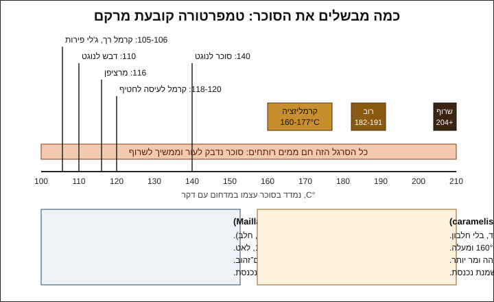
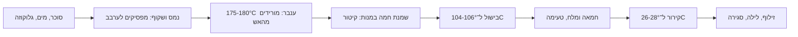

# 07.1 · קרמל מלוח

קרמל מלוח הוא המילוי שהכי הרבה אנשים מבקשים, והוא גם הראשון במודול שדורש סוכר חם מאוד. בשיעור הזה מבשלים 100 גרם סוכר עד צבע ענבר, מוסיפים שמנת וחמאה, ומקבלים מילוי רך שאפשר לזלף לקליפות. מבינים מה קורה בסיר בכל מעלה, למה הקרמל לפעמים "מתגבש" לחול, ולמה מילוי קרמל מחזיק פחות זמן מסוכריית טופי. בסוף השיעור יש לכם 8 בונבונים ממולאים בקרמל מלוח, ועוד צנצנת קרמל לחטיף של 07.4.

## מה צריך

| פריט | כמות לתרגול | כמות מלאה | הערה |
|---|---|---|---|
| סוכר לבן | 100 גרם | 300 גרם | סוכר רגיל מהסופר |
| מים | 30 גרם | 90 גרם | |
| סירופ גלוקוזה | 30 גרם | 90 גרם | מונע התגבשות; אפשר סוכר אינוורטי |
| שמנת מתוקה 32%-38% | 100 גרם | 300 גרם | מחממים ל־60-70°C, לא קרה |
| חמאה (רצוי לא מלוחה) | 25 גרם | 75 גרם | בטמפרטורת החדר, בקוביות |
| מלח ים בפתיתים | 1.5-2 גרם | 5 גרם | מתחילים ב־1.5 גרם וטועמים |
| קליפות בונבון (כמו ב־05.1) | 8 | 24 | או תבנית ריקה ו־300 גרם קוברטורה |
| קוברטורה מטומפרת לסגירה | 300 גרם (רובה חוזרת לקערה) | 300 גרם | אותו שוקולד מהמודולים הקודמים |
| סיר קטן עם תחתית עבה, 14-16 ס"מ | 1 | סיר 18-20 ס"מ | בסיר רחב מדי הסוכר שכבה דקה, והמדחום לא מגיע |
| מדחום דיגיטלי עם דקר שמודד עד 200°C לפחות | 1 | | מדחום שוקולד שנעצר ב־100°C לא מתאים |
| מרית סיליקון עמידה בחום, מכחול, כוס מים | 1 מכל | | מכחול רטוב לדפנות הסיר |
| קערה עם מים קרים וקרח בהישג יד | 1 | | לעצור בישול, ולא לכוויות (ראו אזהרה) |
| שקית זילוף, ניילון נצמד, צנצנת נקייה | 1 מכל | | |

**כמה יוצא:** כ־230 גרם קרמל. בכל קליפה נכנסים 6-8 גרם, כלומר כ־60 גרם ל־8 בונבונים. השאר נשמר בצנצנת במקרר לחטיף ב־[07.4](lesson-04.md), או הופך לרוטב.

**אלרגנים:** **חלב** (שמנת וחמאה). קוברטורה מכילה בדרך כלל **סויה** (לציטין), ולעתים **חלב**, ו"עלולה להכיל" **אגוזים** ו**בוטנים**. בודקים על כל אריזה.

### לפני שמתחילים את המודול

צפייה בשיעור היא לא תרגול. מילויים לומדים בסיר, עם מדחום ביד: צבע הקרמל, הריח, והמרקם שהמילוי מקבל כשהוא מתקרר. האקדמיה לא יכולה לבדוק צילומים, ולכן בכל שיעור יש בדיקות ברורות (טמפרטורה, צבע, טעם, חתך) שמשווים אליהן את מה שיצא לכם. מנהלים [יומן תרגול](../../templates/practice-log.md) לכל מילוי, ורושמים כל מתכון שמצליח ב[כרטיס מתכון](../../templates/recipe-card.md). המודול מניח שאתם יוצקים, ממלאים וסוגרים בונבונים (מודול 5, ובמיוחד [05.2](../module-05/lesson-02.md)), ושאתם מכירים גנאש ([06.1](../module-06/lesson-01.md)). כל המילויים של המודול נכנסים לאותן קליפות, ולכן השוקולד חוזר שוב ושוב לקערה.

## למה זה עובד

### קרמליזציה ומייאר: שתי תגובות, שני טעמים

**קרמליזציה** (caramelisation) היא פירוק של סוכר לבד בחום, בלי שום חלבון. הסוכרוז נשבר לגלוקוזה ופרוקטוזה, ואלה ממשיכים להתפרק למאות תרכובות של צבע, ריח ומרירות. Fontana (מדען מזון ב־Decagon, במסמך שמופיע באתר Ecole Chocolat) מגדיר אותה כתגובה "סוכר־סוכר" בטמפרטורה גבוהה. כמה גבוה:

| מקור | מתי מתחילה קרמליזציה | איפה רוב המתכונים עוצרים |
|---|---|---|
| Pastry Arts Magazine | 160-177°C (320-350°F); מעל זה מר | מעל 204°C (400°F) הקרמל שרוף ולא שמיש |
| America's Test Kitchen | כ־171°C (340°F), טעם עדין וחמאתי | 182-191°C (360-375°F) |

ההבדל בין המקורות הוא איפה "מתחיל" צבע, ולא סתירה: קרמל הוא רצף. כל כמה מעלות הוא כהה יותר, מתוק פחות ומר יותר. למילוי בונבון בוחרים בדרך כלל ענבר בינוני, 175-180°C: מספיק כהה כדי שהמלח והשוקולד לא יבלעו אותו, ולא מר.

**תגובת מייאר** (Maillard) היא משהו אחר: סוכר מחזר (גלוקוזה, פרוקטוזה, לקטוז) מגיב עם חלבון או חומצת אמינו. לפי Fontana, סוכרוז עצמו לא מגיב כך עד שהוא מתפרק, ותוצרי הטעם של שתי התגובות דומים. בקרמל מלוח מייאר קורית אחרי שהשמנת נכנסת: חלבוני החלב והלקטוז מגיבים עם הסוכר בזמן שמבשלים את המילוי ל־104-106°C. זה הטעם של טופי וחמאה, וזו הסיבה שקרמל עם שמנת לא טועם כמו סוכר שרוף עם מים. Fontana גם כותב שמייאר מהירה במיוחד כשפעילות המים בין 0.60 ל־0.80, כלומר קרמל רך ממשיך להשחים לאט גם על המדף.

### למה קרמל "מתגבש" לחול

סירופ סוכר שמבשלים הוא תמיסה רוויה־על (supersaturated): יש בו יותר סוכר ממה שהמים יכולים להחזיק בטמפרטורת החדר. גביש אחד שנוצר, למשל מטיפה שהתייבשה על דופן הסיר, או מערבוב חזק, מושך אליו את שאר הסוכר, וכל הסיר הופך לגוש לבן. שלוש הגנות:

1. **גלוקוזה** (glucose syrup): לפי America's Test Kitchen, מולקולות הגלוקוזה "מדללות" את הסוכרוז ומפריעות לגבישים להיבנות. זו השיטה המועדפת עליהם, ולכן יש במתכון 30 גרם גלוקוזה על 100 גרם סוכר. Fontana כותב את אותו דבר על סוכר אינוורטי (invert sugar, תערובת של גלוקוזה ופרוקטוזה): הוא שולט בהתגבשות ומאריך חיי מדף.
2. **חומצה**: מעט מיץ לימון מפרק חלק מהסוכרוז לגלוקוזה ופרוקטוזה, וזה אותו רעיון (America's Test Kitchen).
3. **לא לערבב אחרי שהסירופ רותח**: מערבבים רק עד שהסוכר נמס. אחר כך מסובבים את הסיר. גבישים על הדפנות מורידים במכחול רטוב (Pastry Arts).

**קרמל רטוב** (wet caramel, סוכר עם מים) איטי יותר מקרמל יבש, אבל אחיד יותר ופחות נשרף, ולכן America's Test Kitchen ממליצים עליו. בכמות קטנה בבית זה ההבדל בין הצלחה לסיר שחור.

### למה מוסיפים שמנת חמה, ולמה יש קיטור

הקרמל ב־175-180°C, והשמנת היא בעיקר מים. כשהמים פוגשים סוכר חם מ־100°C הם הופכים לקיטור בבת אחת, והתערובת מבעבעת ועולה. America's Test Kitchen כותבים שזה צפוי. שמנת קרה מגבירה את ההלם, והקרמל נתפס לגוש קשה שצריך להמיס מחדש. שמנת חמה (60-70°C) ובמנות קטנות מקטינה את שניהם.

### הטמפרטורה השנייה קובעת את המרקם

אחרי השמנת המילוי מכיל שוב הרבה מים. ממשיכים לבשל, והטמפרטורה עולה ככל שהמים מתאדים: כל מעלה מעל 100°C אומרת פחות מים. לכן המדחום הוא "מד מרקם":

| טמפרטורה סופית | מה מקבלים | שימוש בקורס |
|---|---|---|
| 104-106°C | זורם לאט בטמפרטורת החדר | מילוי לבונבון (השיעור הזה) |
| 118-120°C | נמתח ונלעס, נחתך בסכין | שכבת קרמל בחטיף ([07.4](lesson-04.md)) |

הטווחים בטבלה הם נוהג מקובל, לא מספר של יצרן. כל מטבח וכל מדחום קצת שונים, ולכן בודקים גם בצלחת קרה (ראו "בדיקה").

### פעילות מים: למה קרמל רך מחזיק פחות מטופי

פעילות מים (water activity, ‏aw) מודדת כמה מהמים "זמינים" לחיידקים ולעובש, בסולם 0-1 ([06.4](../module-06/lesson-04.md) מסביר לעומק). המספרים מ־Fontana ומ־Callebaut:

| מוצר | מים | aw | מקור |
|---|---|---|---|
| קרמלים, טופי, פאדג' | 6%-10% | 0.45-0.60 | Fontana |
| חלב מרוכז ממותק | 27% | 0.77-0.85 | Callebaut |
| חמאה מלוחה | 14% | 0.91-0.94 | Callebaut |
| סירופ גלוקוזה | 20% | 0.68-0.72 | Callebaut |

לפי Fontana, רוב העובשים שמקלקלים מזון לא גדלים מתחת ל־0.70 בערך, ושום מיקרואורגניזם לא גדל מתחת ל־0.60. מילוי קרמל ב־105°C רך הרבה יותר מטופי, ולכן יש בו יותר מים ו־aw גבוה יותר. לא מצאנו מדידה מפורסמת של מילוי כזה, ולכן לא נותנים מספר. מה שבטוח: הוא לא "יציב לנצח" כמו סוכרייה, והוא כנראה קרוב יותר לחלב מרוכז מאשר לטופי. גלוקוזה ומלח מורידים מעט את ה־aw; בישול לטמפרטורה גבוהה יותר מוריד אותו הרבה יותר, אבל גם מקשה את המילוי. בבית: בונבוני קרמל עד כשבועיים בקופסה סגורה במקום קריר, כמו בונבוני הגנאש מ־05.2. Callebaut מזכירים שאי אפשר לדעת aw בלי מדידה, ולכן מי שרוצה למכור צריך מדידה ומבחן חיי מדף (מודולים 16 ו־18).

## שלב אחר שלב

> [!WARNING]
> סוכר מבושל מגיע ל־175-180°C, כמעט פי שניים ממים רותחים, והוא נדבק לעור וממשיך לשרוף. עובדים עם שרוולים ארוכים, בלי ילדים וחיות במטבח, עם ידית הסיר פונה פנימה, ולא טועמים מהכף. בכוויה: מים זורמים קרירים 20 דקות, בלי קרח, חמאה או משחות; כוויה גדולה, בפנים או אצל ילד: לפנות לטיפול רפואי (NHS).

1. **הכנה** (5 דקות): שוקלים הכול לפני שמדליקים אש. החמאה בקוביות, המלח בכלי קטן, השמנת בסיר קטן או בכלי למיקרוגל. מניחים קערה עם מים קרים ליד הכיריים, וכוס מים עם מכחול.
2. **מחממים את השמנת** ל־60-70°C (אדים, בלי רתיחה). משאירים אותה חמה בצד.
3. **ממיסים**: בסיר הקטן שמים מים, ואז סוכר וגלוקוזה. מחממים על אש בינונית ומערבבים בעדינות רק עד שהסוכר נמס והנוזל שקוף.
4. **מבשלים בלי לערבב**: מכאן לא מערבבים. אם יש גבישים על הדפנות, מעבירים מכחול רטוב לאורך הדופן. מכניסים את המדחום כך שהדקר בתוך הסירופ ולא נוגע בתחתית. ב־150-160°C הסירופ מתחיל לקבל צבע קש בשוליים: מסובבים את הסיר בעדינות כדי שהצבע יהיה אחיד.
5. **עוצרים בענבר**:
   > [!CAUTION]
   > מכאן הכול קורה תוך שניות. לא מתרחקים מהסיר, ומחזיקים את המרית ביד.

   כשהמדחום מראה 175-180°C והצבע ענבר־נחושת, מורידים מהאש. מריחים: ריח של קרמל, לא של עשן. אם הקרמל כהה מדי, אפשר לטבול את תחתית הסיר לרגע בקערת המים כדי לעצור את הבישול.
6. **מוסיפים שמנת**:
   > [!WARNING]
   > בשלב הזה עולה ענן קיטור והתערובת מבעבעת ועולה בסיר. מחזיקים את הפנים והידיים מעל לסיר הרחק, ושופכים לאט ובמרחק מהגוף.

   שופכים כרבע מהשמנת החמה, מחכים שהבעבוע יירגע, ומערבבים. מוסיפים את השאר בעוד שתיים־שלוש מנות.
7. **מבשלים שוב ל־104-106°C**: מחזירים לאש בינונית־נמוכה ומערבבים לאט כל הזמן. אם נוצר גוש קשה (הקרמל "נתפס"), ממשיכים לערבב על אש נמוכה עד שהוא נמס. כשהמדחום מראה 104-106°C, מורידים מהאש.
8. **חמאה ומלח**: מוסיפים את קוביות החמאה ומערבבים עד שהקרמל מבריק וחלק. מוסיפים 1.5 גרם מלח. ממתינים דקה, טובלים כפית נקייה, מצננים אותה באוויר עד שהיא פושרת, וטועמים. רוצים עוד מלח? עוד חצי גרם.
9. **מצננים**: מעבירים לקערה, מכסים בניילון נצמד שנוגע בפני הקרמל, ומשאירים עד 26-28°C (שעה עד שעתיים בחדר). לא במקרר: מילוי קר מדי סמיך מדי לזילוף.
10. **ממלאים** כמו ב־[05.2](../module-05/lesson-02.md): שקית זילוף עם פתח של 2-3 מ"מ, מזלפים מהתחתית כלפי מעלה, ועוצרים 1.5-2 מ"מ מתחת לשפה. קרמל לא יוצר "עור" כמו גנאש, ולכן חשוב במיוחד לא למלא יותר מדי.
11. **מנוחה וסגירה**: מכסים ומשאירים לילה בחדר ממוזג, 18-22°C. למחרת מחממים את השפות לרגע וסוגרים בשוקולד מטומפר, כמו ב־05.2. בקרמל רך כדאי לסגור עם אצטט, כי לחץ לא אחיד של השפכטל דוחף את המילוי החוצה.
12. **את השאר** מעבירים לצנצנת נקייה, סוגרים, ומכניסים למקרר. רושמים תאריך. הצנצנת הולכת ל־07.4.

## בדיקה: איך יודעים שהצליח

- **טמפרטורות**: ביומן רשומות שתי טמפרטורות: הקרמל לפני השמנת (175-180°C) והמילוי הסופי (104-106°C).
- **צבע**: בצלחת לבנה המילוי בצבע טופי בינוני, אחיד, בלי נקודות שחורות ובלי פסים בהירים.
- **בדיקת צלחת**: טיפה על צלחת קרה מהמקפיא, אחרי דקה: היא שומרת על צורה עגולה ומתפשטת לאט כשמטים את הצלחת. אם היא בורחת כמו מים, המילוי נוזלי מדי; אם אפשר להרים אותה כגוש, הוא קשה מדי.
- **מרקם**: בכף, הקרמל חלק לגמרי. אין גרגירים על הלשון, ואין שכבת שומן צהובה מעליו.
- **טעם**: מתוק עם קצה מריר, טעם חמאה, ומלח שמורגש אחרי רגע ולא "צורב".
- **בונבון**: בחתך, הקרמל זורם לאט מהבונבון החצוי אבל לא דולף מבונבון שלם. המכסה צמוד והבסיס יבש.

## כשזה משתבש

| מה רואים | למה זה קורה | מה עושים עכשיו | איך מונעים בפעם הבאה |
|---|---|---|---|
| הסירופ הפך לחול לבן לפני שקיבל צבע | התגבשות: ערבוב אחרי הרתיחה, גביש מהדופן, או בלי גלוקוזה | מוסיפים 2-3 כפות מים, ממיסים שוב על אש נמוכה עד שקוף, ומתחילים שוב | גלוקוזה במתכון, לא לערבב אחרי שנמס, מכחול רטוב לדפנות |
| הקרמל מר, ריח עשן, נקודות שחורות | עבר את ה־185-190°C, או נשרף בתחתית | קרמל שרוף לא מתקנים. מתחילים מחדש עם 100 גרם סוכר (זו העלות כולה) | סיר עם תחתית עבה, אש בינונית, להוריד מהאש ב־175-180°C |
| כשהשמנת נכנסה נוצר גוש קשה | שמנת קרה, או שנשפכה בבת אחת | מערבבים על אש נמוכה עד שהגוש נמס לגמרי | שמנת ב־60-70°C, במנות |
| המילוי נוזלי ודולף מהבונבונים | לא הגיע ל־104°C, או זולף חם | את המילוי שנשאר מחזירים לסיר ומבשלים עוד 1-2 מעלות. בונבונים דולפים נאכלים היום | מדחום מכויל ובדיקת צלחת; מזלפים רק ב־26-28°C |
| המילוי קשה, נלעס ולא זורם | בושל מעל 108°C | מחממים עם 1-2 כפות שמנת חמה עד שמתרכך. קרמל קשה מתאים לחטיף של 07.4 | עוצרים ב־104-106°C ובודקים בצלחת |
| שכבת שומן צהובה מעל הקרמל | החמאה נפרדה: הקרמל היה חם מדי, או קר מדי כשהחמאה נכנסה | מוסיפים כפית שמנת חמה ומערבבים במרכז, או מוט בלנדר לכמה שניות | מוסיפים חמאה מיד כשמורידים מהאש, ומערבבים עד שמבריק |
| אחרי כמה ימים: ריח חמוץ, בועות או דליפה חדשה | קלקול: מים זמינים, חום או בונבון לא אטום | זורקים את הבונבונים האלה. לא טועמים | סגירה אטומה, אחסון קריר, ולא לשמור יותר משבועיים |

### מה עושים עם מה שלא הצליח

שום דבר לא הולך לפח, חוץ ממה שמקולקל. קרמל שהתגבש מומס שוב עם מים ומבושל מחדש. קרמל נוזלי מדי הוא רוטב מצוין לגלידה ולפנקייק, או מבושל עוד מעלה־שתיים. קרמל קשה מדי הופך לשכבה בחטיף של 07.4, או לרוטב עם עוד שמנת. בונבונים דולפים נאכלים היום, או נמסים לשוקו חם עם קרמל. קרמל שרוף לגמרי באמת לא שמיש, אבל העלות שלו היא 100 גרם סוכר: מתחילים מחדש ורושמים ביומן איפה עצרתם. השוקולד שגרדתם בסגירה חוזר לשקית "להמסה".

## חלופות

### טבעוני / פרווה

מחליפים את השמנת בקרם קוקוס (19%-24% שומן) באותה כמות, ואת החמאה בשמן קוקוס או בחמאה צמחית. השינוי העיקרי הוא בטעם: בלי חלבוני חלב ולקטוז יש הרבה פחות מייאר, ולכן הטעם הוא יותר קרמל וקוקוס ופחות טופי. קרמל ענבר מעט כהה יותר (180°C) מפצה חלקית. שמנת צמחית להקצפה עובדת, אבל היא מכילה מייצבים וסוכר, ולפעמים נפרדת בבישול: מוט בלנדר מחבר אותה. שמן קוקוס מתקשה מתחת לכ־24°C, ולכן המילוי סמיך יותר בחדר קר. חיי המדף דומים לקרמל רגיל, כי הבעיה היא המים ולא החלב. מודול 12 (מילויים טבעוניים) חוזר לקרמל קוקוס. הקליפה: מריר בלי חלב ברכיבים.

### בריא יותר

בקרמל אי אפשר "להוריד סוכר": הסוכר הוא המבנה, ובלעדיו אין קרמל. מה שכן אפשר: בונבון קטן יותר (תבנית של 8-10 גרם במקום 12-15), קליפה ממריר 70%, וחצי מילוי קרמל וחצי גנאש מריר ([06.1](../module-06/lesson-01.md)) באותו בונבון. קרמל ענבר כהה (180°C) נתפס פחות מתוק לרוב האנשים, וזו העדפת טעם ולא שינוי תזונתי. מלח: מספיק 1.5 גרם, ולא צריך יותר כדי להרגיש אותו. תחליפי סוכר לא מתקרמלים כמו סוכר (מודול 13).

> [!CAUTION]
> מלטיטול (בשוקולד "ללא סוכר") גורם לגזים ולשלשול כשאוכלים ממנו כמות, והוא לא מתאים לילדים בכמויות. מי שמכין קליפות משוקולד כזה אומר לאורחים מה יש בבונבון.

### כשרות

קרמל עם שמנת וחמאה הוא **חלבי**, ולכן גם הבונבון כולו, גם כשהקליפה פרווה. מי שצריך קרמל פרווה משתמש בקרם קוקוס או בשמנת צמחית שמסומנים "פרווה" בהכשר שהוא סומך עליו, ובשמן או חמאה צמחית פרווה, ובודק שגם הקוברטורה פרווה. מי שמקפיד על חלב ישראל בודק זאת על השמנת והחמאה (רוב השמנת והחמאה בסופר בישראל מתוצרת מקומית, אבל קוראים את האריזה). סירופ גלוקוזה וסוכר אינוורטי: מה כתוב על מוצרים נפוצים ב[סירופ גלוקוזה](../../references/kashrut-guide.md#סירופ-גלוקוזה), [סוכר אינוורטי](../../references/kashrut-guide.md#סוכר-אינוורטי) ו[שמנת צמחית וקרם קוקוס](../../references/kashrut-guide.md#שמנת-צמחית-וקרם-קוקוס). אם יש ספק, שואלים את הרב.

## איפה קונים

מה מחפשים: סירופ גלוקוזה (glucose syrup) באריזה של 0.5-1 ק"ג, או סוכר אינוורטי (טרימולין); שמנת מתוקה 32%-38% וחמאה מהסופר; מלח ים בפתיתים (flaky sea salt); מדחום דיגיטלי עם דקר שמודד עד 200°C ומעלה; וסיר קטן עם תחתית עבה. חנויות, מחירים ומלאי: [גלוקוזה וסוכר אינוורטי](../../references/where-to-buy.md#גלוקוזה-וסוכר-אינוורטי), [שמנת צמחית וקרם קוקוס](../../references/where-to-buy.md#שמנת-צמחית-וקרם-קוקוס), [מדחום](../../references/where-to-buy.md#מדחום), [שקיות זילוף](../../references/where-to-buy.md#שקיות-זילוף), [אצטט ודפי גיטרה](../../references/where-to-buy.md#אצטט-ודפי-גיטרה), [קוברטורה](../../references/where-to-buy.md#קוברטורה). כשרות: [סירופ גלוקוזה](../../references/kashrut-guide.md#סירופ-גלוקוזה).

## תרגול

### משימה

מבשלים 100 גרם סוכר לקרמל מלוח, ממלאים 8 קליפות, ומשאירים לילה. למחרת סוגרים, מוציאים, וחוצים בונבון אחד. את שאר הקרמל שומרים בצנצנת במקרר לשיעור 07.4. מי שרוצה ללמוד יותר מהר: עוצרים 2 כפות של המילוי בכל אחת משלוש טמפרטורות (103, 105, 107°C) בכוסות קטנות, ומשווים אותן למחרת בבדיקת צלחת.

### זמן

יום 1: כ־45 דקות (שקילה, קרמל, שמנת, קירור, זילוף), ועוד לילה. יום 2: כ־45 דקות (טמפרור, סגירה, הוצאה, חתך). סך הכול כשעה וחצי של עבודה.

### יומן

ב[יומן התרגול](../../templates/practice-log.md): טמפרטורת הקרמל לפני השמנת, הטמפרטורה הסופית, כמה דקות לקח כל שלב, צבע (מתארים במילים או בצילום על צלחת לבנה), כמות המלח, תוצאת בדיקת הצלחת, ומה מצאתם בחתך. את המתכון רושמים ב[כרטיס מתכון](../../templates/recipe-card.md) עם האלרגנים (חלב), ועם "חלבי" או "פרווה" לפי מה שכתוב על הרכיבים.

### בדיקה עצמית

- [ ] רשמתי שתי טמפרטורות: 175-180°C לפני השמנת ו־104-106°C בסוף.
- [ ] לא ערבבתי אחרי שהסוכר נמס, והקרמל לא התגבש (או שתיקנתי וכתבתי איך).
- [ ] הוספתי שמנת חמה במנות, ועבדתי לפי האזהרה: שרוולים, בלי ילדים, בלי טעימה מהכף.
- [ ] בדיקת הצלחת עברה: הטיפה שומרת על צורה ומתפשטת לאט.
- [ ] זילפתי ב־26-28°C, השארתי 1.5-2 מ"מ, והבונבונים לא דולפים.
- [ ] הצנצנת עם שאר הקרמל במקרר, עם תאריך.

## סיכום

- קרמליזציה היא פירוק של סוכר לבד, מכ־160°C ומעלה; מייאר היא תגובה של סוכר עם חלבון, ובקרמל מלוח היא קורית אחרי שהשמנת נכנסת.
- גלוקוזה, חומצה, ו"לא לערבב אחרי שנמס" מונעים מהסירופ להתגבש לחול.
- שתי טמפרטורות: 175-180°C לצבע, ו־104-106°C למרקם של מילוי רך. 118-120°C נותן קרמל לעיסה.
- קרמל רך מכיל יותר מים מטופי, ולכן מחזיק פחות: עד כשבועיים בקופסה סגורה במקום קריר.
- פרויקט המודול: [מארז ממולאים: 9 בונבונים בשלושה מילויים](../../projects/m07-filled-selection.md), שבו קרמל, פרלינה ומילוי פירות נכנסים לאותו מארז, עם כרטיסי מתכון ופתק אלרגנים.
