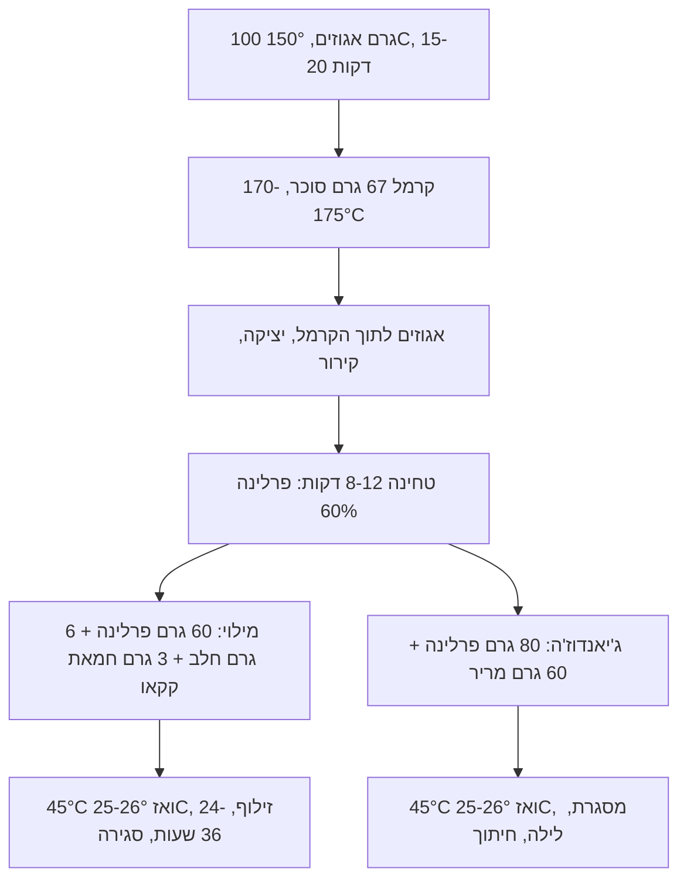

# 07.2 · פרלינה וג'יאנדוז'ה ביתיים

פרלינה (praliné) היא אגוזים קלויים וסוכר מקורמל שנטחנו יחד למחית. ב־[05.2](../module-05/lesson-02.md) קניתם אותה מוכנה; בשיעור הזה מכינים אותה בעצמכם, מ־100 גרם אגוזי לוז או שקדים, ומשם הופכים אותה לשני מילויים: מילוי פרלינה רך לבונבונים, וג'יאנדוז'ה (gianduja), תערובת של פרלינה ושוקולד שמתקשה ונחתכת לקוביות. בסוף השיעור יש לכם 8 בונבוני פרלינה וכ־12 קוביות ג'יאנדוז'ה.

## מה צריך

| פריט | כמות לתרגול | כמות מלאה | הערה |
|---|---|---|---|
| **פרלינה ביתית 60%** | | | |
| אגוזי לוז קלופים או שקדים לבנים, טבעיים | 100 גרם | 300 גרם | לא מומלחים ולא קלויים מראש |
| סוכר לבן | 67 גרם | 200 גרם | יחס 60:40, כמו פרלינה מקצועית 60% |
| מים | 20 גרם | 60 גרם | לקרמל רטוב |
| **מילוי פרלינה לבונבונים** | | | |
| פרלינה (הביתית או קנויה 50%-60%) | 60 גרם | 180 גרם | |
| קוברטורה חלב | 6 גרם | 18 גרם | יחס 10:1, לפי Valrhona |
| חמאת קקאו | 3 גרם | 9 גרם | כ־5%, לפי Callebaut |
| **ג'יאנדוז'ה** | | | |
| פרלינה | 80 גרם | 240 גרם | מה שנשאר מהפרלינה הביתית |
| קוברטורה מריר 55%-60% (או חלב) | 60 גרם | 180 גרם | |
| קליפות בונבון ו־300 גרם קוברטורה לסגירה | 8 | 24 | כמו ב־[05.1](../module-05/lesson-01.md) ו־[05.2](../module-05/lesson-02.md) |
| מעבד מזון עם מנוע חזק וסכין S | 1 | | בלנדר רגיל לרוב לא מצליח |
| תבנית קטנה 10x10 ס"מ (קופסת פלסטיק או תבנית אפייה) מרופדת בנייר אפייה | 1 | מסגרת 20x20 ס"מ | לג'יאנדוז'ה |
| מגש עם נייר אפייה, סיר קטן, מדחום עד 200°C, מרית סיליקון | 1 מכל | | |

**כמה יוצא:** כ־160 גרם פרלינה: 60-70 גרם למילוי הבונבונים, וכ־80 גרם לג'יאנדוז'ה (כ־140 גרם, 12 קוביות של 2x2 ס"מ). אין לכם מעבד מזון? קונים פרלינה 50%-60% מוכנה ומדלגים לשלב 9.

**אלרגנים:** **אגוזי לוז** או **שקדים** (אגוזים). קוברטורה: בדרך כלל **סויה**, **חלב** בשוקולד חלב ולעתים במריר, ו"עלולה להכיל" **בוטנים** ואגוזים אחרים. מי שמחליף חלק מהפרלינה בטחינה (ראו "חלופות") מוסיף **שומשום**. כל אחד מהם נכתב על הקופסה.

## למה זה עובד

### מה זה פרלינה, במספרים

Valrhona מתארים שתי שיטות להכנת פרלינה: "קרמל אמיתי" שמבשלים בסיר ואז מוסיפים לו את האגוזים הקלויים (טעם קרמל חזק), ושיטה שבה אגוזים חיים וסוכר מתבשלים יחד מההתחלה (טעם אגוזי יותר). בשיעור הזה משתמשים בראשונה, כי היא מבוססת על הקרמל מ־[07.1](lesson-01.md). המספר על האריזה הוא אחוז האגוזים:

| מוצר (Valrhona) | הרכב | שומן | חיי מדף במפעל, סגור |
|---|---|---|---|
| פרלינה לוז 60% | 60% אגוזי לוז, 40% סוכר | 38% | 12 חודשים |
| פרלינה שקדים ולוז 50% | 25% שקדים, 25% לוז, 50% סוכר | לא ברור בטבלה | 12 חודשים |
| ג'יאנדוז'ה מריר | 34% אגוזי לוז, 34% סוכר, 28% קקאו, 3% חלב | 40% | 9 חודשים |
| ג'יאנדוז'ה חלב | 35% אגוזי לוז, 35% סוכר, 16% קקאו, 13% חלב | 39% | 9 חודשים |

שימו לב לשורה הראשונה: 60 גרם אגוזי לוז נותנים 38 גרם שומן, כלומר כשני שלישים מאגוז הלוז הוא שומן. כשטוחנים, תאי האגוז נקרעים והשמן יוצא. לכן אבקה יבשה הופכת אחרי כמה דקות במעבד למחית נוזלית בלי שהוספתם שום נוזל. השמן הזה נוזלי בטמפרטורת החדר, ולכן פרלינה לבד היא ממרח רך שלא מתקשה.

### פרלינה לבונבון: מקשים את השמן

כדי שפרלינה תחזיק צורה בתוך בונבון ולא תדחוף את המכסה, מוסיפים לה שומן שמתגבש: חמאת קקאו, מהשוקולד ומחמאת קקאו טהורה. ב־Valrhona Essentials המתכון למילוי פרלינה הוא 1,000 גרם פרלינה ו־100 גרם קוברטורה חלב, יחד עם חמאת קקאו: ממיסים את השוקולד וחמאת הקקאו ב־45-50°C, מחממים את התערובת ל־45°C, מייצבים אותה ב־25-26°C, ומזלפים. אחרי הזילוף מחכים 24-36 שעות לפני הסגירה. Callebaut נותנים את הכמות של חמאת הקקאו: 5%-6% ממשקל המילוי, ואז מגבשים מראש (pre-crystallise, כלומר מטמפרים) את המילוי.

### פריחת שומן: למה דווקא פרלינה

Callebaut כותבים במפורש שמילויים על בסיס שומן, כמו פרלינה או מילויי אגוזים, גורמים לפריחת שומן להופיע מהר יותר. השמן הנוזלי מהאגוזים נודד לאט לתוך הקליפה ודוחף חמאת קקאו אל פני השטח, וזה בדיוק מה שראיתם בטבלה הממולאת של [04.2](../module-04/lesson-02.md#מילוי-שומני-ופריחת-שומן). שלוש הגנות, כולן מ־Callebaut: חמאת קקאו במילוי (5%-6%), מילוי מטומפר, ואחסון בטמפרטורה קבועה של 18-20°C. קליפה שלמה ואטומה ([05.2](../module-05/lesson-02.md)) עוזרת גם היא.

### ג'יאנדוז'ה: פרלינה שמתקשה

לפי Valrhona, ג'יאנדוז'ה היא אגוזי לוז קלויים, פולי קקאו וסוכר שנטחנים דק מאוד. בבית מגיעים להרכב דומה מפרלינה ושוקולד: 80 גרם פרלינה 60% (48 גרם אגוזים ו־32 גרם סוכר) ו־60 גרם מריר 55% נותנים בערך 34% אגוזים, 42% סוכר ו־24% קקאו. זה קרוב לג'יאנדוז'ה המרירה של Valrhona (34/34/28), רק מעט מתוקה יותר. הג'יאנדוז'ה מתקשה כי חמאת הקקאו שבשוקולד מתגבשת, ולכן צריך לגבש אותה נכון: לפי Valrhona Essentials ממיסים ב־45-50°C ומקררים ל־25-26°C לפני היציקה למסגרת. השמן מהאגוזים מרכך אותה, ולכן ג'יאנדוז'ה נמסה בפה מהר יותר משוקולד ונחתכת בסכין בלי להישבר.

### פעילות מים: פרלינה לא מתעפשת, היא מתחמצנת

בפרלינה כמעט אין מים: אגוזים, סוכר ושומן. לכן הבעיה שלה איננה עובש. Fontana מסביר שחמצון שומנים (lipid oxidation) מהיר דווקא בפעילות מים נמוכה מאוד ובגבוהה מאוד, ואיטי באמצע. מה שקורה לפרלינה עם הזמן הוא טעם "ישן" ומריר של אגוזים מתחמצנים, לא קלקול שרואים. Valrhona נותנים לפרלינה 12 חודשים ולג'יאנדוז'ה 9 חודשים, אבל זה במפעל ובאריזה סגורה. פרלינה ביתית שנפתחה ונטחנה במעבד חשופה לאוויר ולחום: מחזיקים אותה בצנצנת סגורה, בחושך ובמקום קריר, ומשתמשים תוך כמה שבועות. בונבוני פרלינה: עד כ־3-4 שבועות בקופסה סגורה ב־14-18°C, וטועמים לפני שנותנים.

## שלב אחר שלב

> [!WARNING]
> קרמל ב־170-175°C נדבק לעור וממשיך לשרוף, והאגוזים יוצאים מהתנור ב־150°C. שרוולים ארוכים, בלי ילדים במטבח, ולא נוגעים בפרלינה עד שהתקררה לגמרי. בכוויה: מים זורמים קרירים 20 דקות (NHS, ראו [07.1](lesson-01.md)).

**יום 1: פרלינה**

1. **קולים את האגוזים**: מחממים תנור ל־150°C. מפזרים את האגוזים בשכבה אחת על מגש וקולים 15-20 דקות, מערבבים באמצע. מוכנים כשהם זהובים מבפנים (חוצים אחד) ויש ריח קלוי. אגוזי לוז עם קליפה חומה: משפשפים אותם חמים במגבת ומסירים את רוב הקליפה.
2. **מכינים מגש**: נייר אפייה על מגש, ולידו המרית. משאירים את האגוזים חמים בתנור כבוי.
3. **קרמל**:
   > [!CAUTION]
   > כאן הסוכר מגיע ל־170-175°C. לא מתרחקים מהסיר.

   בסיר הקטן: מים ואז סוכר. ממיסים עם ערבוב עדין, ומפסיקים לערבב כשהנוזל שקוף, בדיוק כמו ב־[07.1](lesson-01.md). מבשלים עד 170-175°C, ענבר בהיר עד בינוני (פחות כהה מבקרמל מלוח, כדי שהאגוזים יהיו הטעם המוביל).
4. **מוסיפים אגוזים**: מורידים מהאש, מוסיפים את האגוזים החמים בבת אחת ומערבבים מהר עד שכולם מצופים.
5. **יוצקים**: שופכים על נייר האפייה ומשטחים לשכבה אחת במרית. משאירים 20-30 דקות עד שהכול קר וקשה לגמרי, כמו זכוכית.
6. **שוברים**: שוברים לחתיכות של 2-3 ס"מ (בתוך שקית, עם מערוך).
7. **טוחנים**: מעבירים למעבד המזון. 1-2 דקות: אבקה. 3-5 דקות: גוש שמנוני. 8-12 דקות: מחית חלקה ונוזלית. מפסיקים כל 2 דקות, מגרדים את הדפנות, ונותנים למנוע לנוח דקה. אם הקערה חמה מאוד, מחכים 5 דקות. מחית שמתחממת יותר מדי מאבדת ארומה.
8. **שוקלים**: רושמים כמה פרלינה יצאה. מעבירים לצנצנת נקייה ויבשה. מכאן היא בטמפרטורת החדר.

**יום 1, המשך: מילוי לבונבונים**

9. **ממיסים** 6 גרם שוקולד חלב ו־3 גרם חמאת קקאו יחד, ל־45-50°C (במיקרוגל בפולסים של 10 שניות).
10. **מערבבים** עם 60 גרם פרלינה, ומביאים את כל התערובת ל־45°C (פולס קצר אם צריך).
11. **מגבשים**: מערבבים ומחכים עד 25-26°C. התערובת מסמיכה מעט אבל עדיין זורמת. בבדיקת סכין קטנה (כמו בטמפרור) היא מתקשה תוך 5-10 דקות.
12. **ממלאים** 8 קליפות כמו ב־[05.2](../module-05/lesson-02.md): מהתחתית כלפי מעלה, ועוצרים 1.5-2 מ"מ מתחת לשפה. מכסים ומשאירים 24-36 שעות בחדר ממוזג (18-22°C), לפי Valrhona. אחר כך סוגרים בשוקולד מטומפר.

**יום 1, המשך: ג'יאנדוז'ה**

13. **ממיסים** 60 גרם מריר ל־45-50°C, ומערבבים עם 80 גרם פרלינה. מביאים ל־45°C.
14. **מגבשים**: מערבבים ומחכים עד 25-26°C. בחדר חם אפשר לשפוך שני שלישים על משטח שיש נקי ולשפשף במרית עד שמסמיך (כמו ב־[03.3](../module-03/lesson-03.md)), ולהחזיר לקערה.
15. **יוצקים** לתבנית המרופדת, משטחים לעובי של כ־1.2 ס"מ, מקישים, ומכסים. משאירים לילה ב־16-20°C, לא במקרר.
16. **חותכים** למחרת: הופכים על נייר, מסירים את נייר האפייה, וחותכים בסכין חמה (טבולה במים חמים ומנוגבת) לקוביות 2x2 ס"מ. את הקוביות אפשר לטבול בשוקולד מטומפר עם מזלג טיבול, או לשמור לפרויקט.

## בדיקה: איך יודעים שהצליח

- **פרלינה**: חלקה, נוזלית־סמיכה כמו טחינה, בצבע חום־זהוב. על הלשון יש מעט גרגיריות עדינה (מעבד ביתי לא טוחן דק כמו מכונה), אבל אין חתיכות אגוז או סוכר. טעם של אגוז קלוי וקרמל, לא שרוף.
- **מילוי בבונבון**: אחרי 24-36 שעות הוא יציב למגע ולא דביק. בחתך: מילוי שמנתי שמחזיק צורה ולא זורם.
- **ג'יאנדוז'ה**: נחתכת בקווים ישרים בלי להתפורר ובלי להימרח. משטח עמום־חלק, בלי פסים אפורים. נמסה בפה מהר יותר משוקולד.
- **אחרי שבוע**: הבונבונים והקוביות עדיין מבריקים, בלי שכבה אפורה. אם הופיעה, ראו "כשזה משתבש".
- **יומן**: רשומים זמן קלייה, טמפרטורת הקרמל, דקות טחינה ומשקל הפרלינה שיצאה.

## כשזה משתבש

| מה רואים | למה זה קורה | מה עושים עכשיו | איך מונעים בפעם הבאה |
|---|---|---|---|
| הקרמל התגבש לגושים לבנים כשהאגוזים נכנסו | אגוזים קרים, או ערבוב לפני שהקרמל היה מוכן | ממשיכים לחמם על אש נמוכה ולערבב עד שהסוכר נמס שוב ומצפה את האגוזים | אגוזים חמים מהתנור; מוסיפים רק אחרי שהסיר ירד מהאש בצבע הנכון |
| הפרלינה נשארה אבקה או גוש יבש | מעבד חלש, או שלא טחנתם מספיק זמן | ממשיכים בהפסקות; אם אין ברירה, כפית שמן ניטרלי או חמאת אגוזים 100% | מעבד מזון חזק, סבלנות: 8-12 דקות |
| טעם מר ושרוף | אגוזים קלויים יותר מדי או קרמל כהה מדי | מערבבים עם פרלינה קנויה בהירה כדי לרכך, או משתמשים בבראוניז | 150°C ובדיקת אגוז חצוי; קרמל ב־170-175°C ולא יותר |
| מילוי הפרלינה לא מתקשה בקליפה | לא גובש ל־25-26°C, או בלי חמאת קקאו | מחכים עוד יום בחדר קריר; אם עדיין רך, מקררים 20 דקות לפני הסגירה | 5% חמאת קקאו, גיבוש ל־25-26°C, ו־24-36 שעות מנוחה |
| ג'יאנדוז'ה רכה, נמרחת בחיתוך, או מפוספסת אפור | לא גובשה (יצקתם חמה), או חדר חם | ממיסים שוב ל־45°C, מגבשים ל־25-26°C ויוצקים שוב | מדחום, גיבוש על שיש, לילה ב־16-20°C |
| אחרי שבוע־שבועיים שכבה אפורה ושמנונית על הבונבונים | פריחת שומן מהשמן של האגוזים | אוכלים (הטעם בסדר), או ממיסים לשוקו חם | 5%-6% חמאת קקאו, מילוי מגובש, 18-20°C קבוע (Callebaut) |
| ריח וטעם "ישן", מריר, כמו שמן ישן | חמצון: פרלינה ישנה, חום, אוויר או אור | לא מגישים לאחרים; פרלינה שמריחה מקולקלת נזרקת | צנצנת סגורה, קריר וחשוך, ומשתמשים תוך כמה שבועות |

### מה עושים עם מה שלא הצליח

פרלינה שלא נטחנה עד הסוף היא "פרלינה קראנצ'י": מערבבים אותה עם שוקולד מומס ויוצקים טבלה ([04.2](../module-04/lesson-02.md)), או מפזרים על גלידה. פרלינה מרה מעט נכנסת לבראוניז ולעוגיות, שם השוקולד מאזן אותה. ג'יאנדוז'ה שלא התקשתה נמסה שוב ומגובשת מחדש, או נמרחת על לחם כממרח. בונבונים עם פריחת שומן נאכלים או נמסים לשוקו. שאריות קרמל עם אגוזים שנדבקו לנייר נשברות ומפוזרות על עוגה. רק פרלינה מתחמצנת, עם ריח של שמן ישן, הולכת לפח.

## חלופות

### טבעוני / פרווה

פרלינה היא אגוזים וסוכר בלבד, ולכן הפרלינה הביתית טבעונית. במילוי לבונבונים מחליפים את שוקולד החלב במריר בלי חלב ברכיבים, ומשאירים את חמאת הקקאו. הג'יאנדוז'ה כבר עם מריר. המרקם כמעט לא משתנה, ועקומת הגיבוש (45°C ואז 25-26°C) נשארת. זו דרך מצוינת לבונבון טבעוני שמחזיק שבועות, בלי שמנת. בפרלינה קנויה בודקים שאין אבקת חלב ברכיבים. [מודול 12](../module-12/lesson-01.md) ([12.4](../module-12/lesson-04.md)) חוזר לפרלינה ולטחינה כמילויים טבעוניים.

### בריא יותר

אפשר לשנות את היחס: פרלינה 70:30 (70 גרם אגוזים ל־30 גרם סוכר) פחות מתוקה ויותר אגוזית, אבל רכה יותר, ולכן צריך מעט יותר שוקולד במילוי. אפשר להחליף עד חצי מהפרלינה בחמאת אגוזים 100% (בלי סוכר) או בטחינה גולמית. הטחינה נותנת טעם ישראלי מוכר ומוסיפה שומשום לרשימת האלרגנים. ג'יאנדוז'ה עם מריר 70% פחות מתוקה. קובייה של 2x2 ס"מ היא מנה. אגוזים הם עדיין שומן וסוכר, ולכן לא כותבים "בריא" על שום דבר מזה ([13.5](../module-13/lesson-05.md)).

> [!CAUTION]
> מלטיטול (בשוקולד "ללא סוכר") גורם לגזים ולשלשול כשאוכלים ממנו כמות, והוא לא מתאים לילדים בכמויות. ג'יאנדוז'ה משוקולד כזה מכילה הרבה ממנו בכל קובייה.

### כשרות

פרלינה ביתית כשרה כמו הרכיבים שלה. אגוזים קלופים, שקדים ואגוזים קלויים קונים עם הכשר, ובודקים שאין סימני חרקים: [אגוזים](../../references/kashrut-guide.md#אגוזים) במדריך הכשרות מסכם מה כתוב בנושא. ג'יאנדוז'ה עם מריר פרווה היא פרווה; עם שוקולד חלב היא חלבית. בפרלינה קנויה, אותו מותג יכול להופיע בכשרויות שונות לפי אריזה: [פרלינה ומחיות אגוזים](../../references/kashrut-guide.md#פרלינה-ומחיות-אגוזים), [חמאת קקאו](../../references/kashrut-guide.md#חמאת-קקאו), [קוברטורה מרירה](../../references/kashrut-guide.md#קוברטורה-מרירה). אם יש ספק, שואלים את הרב.

## איפה קונים

מה מחפשים: אגוזי לוז קלופים או שקדים לבנים טבעיים (לא קלויים ולא מומלחים) בשקית סגורה עם תאריך; חמאת קקאו בכפתורים; קוברטורה מריר 55%-60% וחלב; ומי שלא מכין לבד, מחית פרלינה לוז 50%-60%. מעבד מזון: כל מעבד עם מנוע של 600 ואט ומעלה וסכין S. חנויות, מחירים ומלאי: [פרלינה ומחיות אגוזים](../../references/where-to-buy.md#פרלינה-ומחיות-אגוזים), [חמאת קקאו](../../references/where-to-buy.md#חמאת-קקאו), [טחינה וחלבה](../../references/where-to-buy.md#טחינה-וחלבה), [קוברטורה](../../references/where-to-buy.md#קוברטורה), [מזלגות טיבול](../../references/where-to-buy.md#מזלגות-טיבול). כשרות: [פרלינה ומחיות אגוזים](../../references/kashrut-guide.md#פרלינה-ומחיות-אגוזים), [אגוזים](../../references/kashrut-guide.md#אגוזים).

## תרגול

### משימה

מכינים פרלינה ביתית מ־100 גרם אגוזים. ממנה ממלאים 8 קליפות במילוי פרלינה, ויוצקים ג'יאנדוז'ה לתבנית קטנה. אחרי 24-36 שעות סוגרים את הבונבונים, וחותכים את הג'יאנדוז'ה לקוביות. טועמים כפית פרלינה ביתית מול כפית פרלינה קנויה (אם יש), ורושמים את ההבדל. קובייה אחת וגם בונבון אחד נשארים בקופסה שבוע, כדי לבדוק פריחת שומן.

### זמן

יום 1: כשעה (קלייה, קרמל, קירור, טחינה), ועוד כ־30 דקות למילוי ולג'יאנדוז'ה. יום 2 או 3: כ־40 דקות (טמפרור, סגירה, חיתוך וטיבול). סך הכול כשעה וחצי עד שעתיים של עבודה.

### יומן

ב[יומן התרגול](../../templates/practice-log.md): סוג האגוזים, זמן וטמפרטורת קלייה, טמפרטורת הקרמל, דקות טחינה ומשקל, טמפרטורת הגיבוש של המילוי ושל הג'יאנדוז'ה, שעות מנוחה, ומה ראיתם אחרי שבוע. את שני המתכונים רושמים ב[כרטיס מתכון](../../templates/recipe-card.md), עם האלרגנים (אגוזים, חלב אם יש, סויה).

### בדיקה עצמית

- [ ] קליתי את האגוזים ב־150°C ובדקתי אגוז חצוי.
- [ ] הקרמל הגיע ל־170-175°C, ועבדתי לפי האזהרה.
- [ ] הפרלינה חלקה, ושקלתי כמה יצאה.
- [ ] המילוי והג'יאנדוז'ה גובשו ל־25-26°C לפני היציקה.
- [ ] הבונבונים נחו 24-36 שעות לפני הסגירה, והג'יאנדוז'ה נחתכת נקי.
- [ ] כתבתי על הקופסה: אגוזים, ותאריך הכנה.

## סיכום

- פרלינה היא אגוזים קלויים וקרמל שנטחנו למחית; 60% על האריזה אומר 60% אגוזים ו־40% סוכר.
- שני שלישים מאגוז הלוז הם שומן נוזלי, ולכן פרלינה לבד רכה; חמאת קקאו ושוקולד מקשים אותה.
- מילוי פרלינה: 10:1 עם שוקולד ו־5%-6% חמאת קקאו, גיבוש ל־25-26°C, ו־24-36 שעות לפני הסגירה.
- ג'יאנדוז'ה היא פרלינה עם שוקולד (בבית בערך 4:3) שמתקשה כי חמאת הקקאו מתגבשת.
- הבעיה של פרלינה היא חמצון ופריחת שומן, לא עובש: צנצנת סגורה, קריר, וטמפרטורה קבועה.
