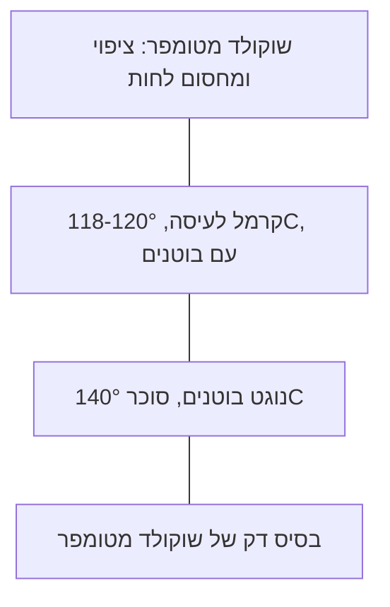

# 07.4 · נוגט, מרציפן וחטיף בוטנים וקרמל

שלושה ממתקים קלאסיים שכולם נבנים מסוכר מבושל לטמפרטורה מדויקת: מרציפן (שקדים וסירופ של 116°C), נוגט (חלבון מוקצף וסירופ של 140°C), וחטיף בוטנים וקרמל, שמחבר נוגט בוטנים, קרמל לעיסה ושוקולד מטומפר לחטיף אחד. בשיעור הזה מכינים 12 חתיכות מרציפן מצופות שוקולד ו־8 חטיפים, ומשתמשים בקרמל ששמרתם מ־07.1. זה השיעור האחרון במודול, והוא מסכם את כל מה שלמדתם על סוכר, שכבות ופעילות מים.

## מה צריך

| פריט | כמות לתרגול | כמות מלאה | הערה |
|---|---|---|---|
| **מרציפן** | | | |
| סוכר לבן | 50 גרם | 200 גרם | |
| מים | 20 גרם | 76 גרם | |
| קרם טרטר או 2-3 טיפות מיץ לימון | קורט | קורט | מונע התגבשות |
| קמח שקדים דק (שקדים לבנים טחונים) | 66 גרם | 264 גרם | |
| חלבון ביצה (רצוי מפוסטר) | 8 גרם (כרבע חלבון) | חלבון אחד | |
| אבקת סוכר | 15 גרם ועוד לאבק | 57 גרם | |
| **נוגט בוטנים** | | | |
| חלבון ביצה | 1 (כ־30 גרם) | 2 | |
| דבש | 40 גרם | 120 גרם | או סירופ גלוקוזה, ראו "טבעוני" |
| סוכר לבן | 100 גרם | 250 גרם | |
| סירופ גלוקוזה | 20 גרם | 60 גרם | |
| מים | 30 גרם | 75 גרם | |
| בוטנים קלויים לא מומלחים (או מעט מלוחים) | 80 גרם ועוד 40 גרם לקרמל | 360 גרם | |
| **חטיף** | | | |
| קרמל מ־[07.1](lesson-01.md) (מהצנצנת) | כ־150 גרם | 450 גרם | יבושל שוב ל־118-120°C |
| קוברטורה מטומפרת (חלב או מריר) | 300 גרם (רובה חוזרת לקערה) | 600 גרם | לבסיס, לטיבול ולמרציפן |
| מיקסר ידני או מיקסר עם מטרפה, שני סירים קטנים, מדחום עד 200°C | 1 מכל | | נוגט בלי מיקסר קשה מאוד |
| קופסה או תבנית 10x15 ס"מ מרופדת בנייר אפייה, סכין גדולה משומנת, מזלג טיבול | 1 מכל | מסגרת 20x30 | |

**כמה יוצא:** כ־140 גרם מרציפן (12 חתיכות של כ־10 גרם), וכ־8 חטיפים של 2.5x7 ס"מ.

**אלרגנים:** **בוטנים**, **שקדים** (אגוזים), **ביצים** (חלבון), **חלב** (בקרמל ובשוקולד חלב), **סויה** (לציטין בשוקולד). בוטנים ושקדים בצורה הזו הם בדיוק מה שאנשים עם אלרגיה חמורה צריכים לדעת: כותבים על הקופסה, ומפרידים מכל מה שמוגש למי שאלרגי. NHS: לא נותנים אגוזים או בוטנים שלמים לילדים מתחת לגיל 5 (סכנת חנק), ולא נותנים דבש לתינוקות מתחת לגיל שנה.

## למה זה עובד

### טמפרטורת הסירופ היא המתכון

שלושת הממתקים הם אותו סיפור כמו ב־07.1: ככל שהסירופ חם יותר, יש בו פחות מים, והמוצר קשה יותר. ראו את הסרגל ב־[07.1](lesson-01.md#למה-זה-עובד):

| ממתק | טמפרטורת הסירופ | מקור | מה זה נותן |
|---|---|---|---|
| מרציפן | 116°C (240°F) | King Arthur | סירופ שמתגבש לקרם לבן עדין סביב השקדים |
| קרמל לעיסה לחטיף | 118-120°C | נוהג מקובל | קרמל שנחתך ולא זורם |
| נוגט: דבש | 110°C | Great British Chefs | |
| נוגט: סוכר | 140°C | Great British Chefs | נוגט לעיס ויציב |

**במרציפן** עושים משהו הפוך מקרמל: רוצים שהסוכר יתגבש, אבל לגבישים זעירים. King Arthur מקררים את הסיר בקערת מים קרים ומערבבים עד שהסירופ נהיה "אטום ושמנתי", כלומר מלא גבישי סוכר קטנים מאוד, ורק אז מוסיפים את השקדים ואת החלבון. גבישים קטנים מרגישים חלק בפה. הם גם מסבירים למה בתוך המרציפן מחממים שוב: החלבון צריך להגיע לפחות ל־161°F, כלומר כ־72°C, כדי להיות מפוסטר.

**בנוגט** הסירופ החם נשפך לתוך חלבון מוקצף. החלבון הוא קצף של חלבונים ואוויר, והסירופ החם גם מבשל אותו וגם "מקבע" אותו בסוכר. Great British Chefs מחממים את הדבש ל־110°C בסיר אחד ואת הסוכר ל־140°C בסיר שני, ושופכים קודם את הדבש ואז את הסוכר, בזמן שהמיקסר עובד. הם כותבים במפורש לא להכניס את הנוגט למקרר: הוא מושך לחות.

### פעילות מים של כל ממתק

| ממתק | aw | מקור | מה זה אומר |
|---|---|---|---|
| נוגט | 0.40-0.65 | Fontana, טבלה 1 | מתחת לגבול של רוב העובשים (0.70) |
| קרמלים וטופי | 0.45-0.60 | Fontana | יציב; קרמל רך מ־07.1 גבוה יותר |
| דבש | 0.60-0.65 | Fontana, טבלה 2 | רק שמרים "אוהבי סוכר" גדלים כאן |
| מרציפן | 0.75-0.80 | Fontana, טבלה 2 | מעל גבול העובשים: מחזיק פחות |

מרציפן הוא בעיקר שקדים, ולכן יש בו יחסית מעט סוכר שקושר את המים. גם Valrhona נותנים לפסטת שקדים 70% חיי מדף של 5 חודשים, ולפסטת שקדים 55% (יותר סוכר) 12 חודשים. King Arthur: מרציפן עטוף היטב במקרר מחזיק עד חודשיים, וחתיכות מעוצבות מכוסות בטמפרטורת החדר מחזיקות לפחות שבוע. ציפוי שוקולד מטומפר מגן על המרציפן מהאוויר ומאריך את הזמן הזה, אבל לא הופך אותו לנוגט.

### חטיף: שכבות שלא "מדברות" זו עם זו

Fontana מסביר את הכלל החשוב ביותר לחטיף: מים נודדים מהשכבה שפעילות המים בה גבוהה לשכבה שבה היא נמוכה, וכששתי שכבות נמצאות באותו aw, לא עוברים ביניהן מים גם אם כמות המים בהן שונה. לכן:

- **קרמל רך מ־07.1 (105°C) לא מתאים לחטיף**: יש בו יותר מים מהנוגט. הוא היה מרכך את הנוגט, הנוגט היה נעשה דביק, והקרמל היה מתייבש. מבשלים אותו שוב ל־118-120°C, וכך הוא קרוב לנוגט.
- **שוקולד הוא מחסום**: Fontana כותב שציפוי שוקולד משמש לעצור ספיגת לחות מהסביבה. טיבול מלא של החטיף מגן עליו מהאוויר הישראלי הלח.
- **בוטנים קלויים** הם יבשים מאוד. בתוך נוגט הם נשארים פריכים כמה ימים, ואחר כך מתרככים מעט: זה הסימן שמים עברו אליהם.

## שלב אחר שלב

> [!WARNING]
> בשיעור הזה שלושה סירופים חמים: 116°C, 140°C ו־120°C. סוכר חם נדבק לעור, והמיקסר יכול להתיז סירופ. שופכים את הסירופ לאורך דופן הקערה ולא על המטרפות, עם שרוולים ארוכים ובלי ילדים ליד. בכוויה: מים זורמים קרירים 20 דקות (NHS, ראו [07.1](lesson-01.md)).

**חלק א: מרציפן (יום 1, כ־30 דקות)**

1. **הכנה**: מאבקים משטח (שיש, נירוסטה או משטח סיליקון) באבקת סוכר. ממלאים קערה גדולה במים קרים עד חצייה, לקירור הסיר.
2. **סירופ**: בסיר קטן מערבבים סוכר, מים וקרם טרטר, ומביאים לרתיחה תוך ערבוב עדין עד שהסוכר נמס. ממשיכים לבשל בלי לערבב עד 116°C.
3. **מקררים ומגבשים**: מורידים מהאש, מעמידים את תחתית הסיר בקערת המים, ומערבבים במרית חזקה דקה־שתיים, עד שהסירופ מתקרר מעט, נעשה אטום ושמנתי.
4. **שקדים וחלבון**: מוסיפים את קמח השקדים ואת החלבון, ומחזירים לאש נמוכה. מערבבים כל הזמן עד שהתערובת סמיכה ואחידה, ועד שהיא מגיעה לפחות ל־72°C (כדי לפסטר את החלבון, לפי King Arthur).
5. **לישה**:
   > [!CAUTION]
   > התערובת חמה מאוד. לשים עם מרית או בכפפות עד שאפשר לגעת בה בנוחות.

   מעבירים למשטח, ולשים עם 15 גרם אבקת סוכר עד שהמרציפן חלק וגמיש. עוטפים בניילון נצמד ומשאירים שעה בחדר.
6. **צורות**: מגלגלים לגליל בעובי 2 ס"מ וחותכים 12 חתיכות, או מעצבים כדורים קטנים. משאירים על נייר אפייה, מכוסים, עד שעובדים עם שוקולד מטומפר (חלק ג).

**חלק ב: נוגט בוטנים ובסיס (יום 1, כ־40 דקות)**

7. **בסיס**: מטמפרים את השוקולד (03.2). מורחים כ־40 גרם בשכבה דקה על נייר האפייה שבתבנית 10x15 ס"מ ומשאירים להתקשות. את שאר השוקולד שומרים חם ומטומפר, או ממיסים שוב אחר כך.
8. **הכנה לנוגט**: שמים את החלבון בקערת המיקסר. הבוטנים בכלי ליד, חמימים (5 דקות בתנור של 100°C), כדי שלא יקררו את הנוגט בבת אחת.
9. **שני סירופים**: בסיר אחד מחממים את הדבש עד 110°C. בסיר השני מבשלים סוכר, גלוקוזה ומים, בלי לערבב אחרי שהסוכר נמס. כשהסוכר מגיע ל־120°C, מתחילים להקציף את החלבון לקצף בינוני־יציב.
10. **דבש לחלבון**:
    > [!CAUTION]
    > מכאן שופכים סירופ חם לתוך מיקסר שעובד. זרם דק, לאורך הדופן, והפנים רחוק מהקערה.

    כשהדבש ב־110°C, שופכים אותו בזרם דק לתוך החלבון, במהירות בינונית.
11. **סוכר לחלבון**: ממשיכים לבשל את הסוכר עד 140°C, ושופכים אותו באותו אופן, בזמן שהמיקסר עובד. ממשיכים להקציף במהירות בינונית 3-5 דקות, עד שהנוגט סמיך, מבריק, ומתחיל להיתפס במטרפות.
12. **בוטנים**: מוסיפים את 80 הגרם בוטנים ומערבבים במרית משומנת (או במהירות הכי נמוכה) רק עד שהם מפוזרים.
13. **מיישרים**: מעבירים את הנוגט על הבסיס המוקשה, ולוחצים לשכבה אחידה של כ־1 ס"מ עם נייר אפייה משומן מעליו. משאירים שעה בחדר. לא במקרר.

**חלק ג: קרמל, חיתוך וטיבול (יום 1 ויום 2)**

14. **קרמל לעיסה**:
    > [!CAUTION]
    > הקרמל עם החמאה והשמנת מבעבע ונדבק. מערבבים כל הזמן ולא מתרחקים מהסיר.

    מעבירים כ־150 גרם קרמל מהצנצנת לסיר נקי, ומבשלים על אש בינונית־נמוכה תוך ערבוב עד 118-120°C. מורידים מהאש, ממתינים 3-4 דקות, ויוצקים על הנוגט. מפזרים מעל את 40 הגרם בוטנים ולוחצים קלות.
15. **מנוחה**: משאירים לילה בחדר ממוזג, מכוסה. (מי שממהר: שעתיים בחדר.)
16. **חיתוך**: מרימים את הבלוק בעזרת נייר האפייה, וחותכים בסכין גדולה משומנת ל־8 חטיפים של 2.5x7 ס"מ. מנגבים ומשמנים את הסכין בין חיתוך לחיתוך.
17. **טיבול**: מטמפרים שוב את השוקולד (בדיקת סכין עוברת). טובלים כל חטיף עם מזלג טיבול, הבסיס כלפי מטה, מקישים להסרת עודף, ומניחים על נייר אפייה. טובלים באותו שוקולד גם את 12 חתיכות המרציפן (או רק את החצי התחתון).
18. **התקשות**: 10-15 דקות בחדר, ואז 10 דקות במקרר להתכווצות, ושוב לחדר. אחסון: קופסה סגורה, 14-18°C, ותווית אלרגנים.

## בדיקה: איך יודעים שהצליח

- **מרציפן**: חלק, גמיש ולא סדוק כשמגלגלים אותו; לא דביק לאצבעות; טעם שקדים, מתוק במידה, בלי גרגרי סוכר גסים.
- **נוגט**: לבן־שמנת, לעיס, נחתך בסכין משומנת בלי להימרח, ולא נשבר כמו סוכרייה. הבוטנים מפוזרים בכל השכבה.
- **קרמל**: אחרי לילה הוא נשאר במקומו כשחותכים, נמתח מעט ולא זורם מהצדדים.
- **חטיף**: בחתך רואים שלוש שכבות ברורות (בסיס, נוגט, קרמל), ציפוי שוקולד מבריק שלם בלי חורים, וסנאפ דק בביס הראשון.
- **טמפרטורות ביומן**: 116°C למרציפן, 72°C לחלבון במרציפן, 110°C ו־140°C לנוגט, 118-120°C לקרמל.

## כשזה משתבש

| מה רואים | למה זה קורה | מה עושים עכשיו | איך מונעים בפעם הבאה |
|---|---|---|---|
| מרציפן גרגרי ושביר | הסירופ התגבש לגבישים גדולים: ערבוב לפני הקירור, או בלי קרם טרטר | לשים עם כפית סירופ גלוקוזה או מעט מים עד שמתאחד; טעים גם כך | קורט קרם טרטר, לא לערבב מעל 100°C, לקרר ורק אז לערבב |
| מרציפן דביק ורך מדי | הסירופ לא הגיע ל־116°C | לשים עם עוד אבקת סוכר ועוד קמח שקדים, במעט בכל פעם | מדחום בתוך הסירופ; להטות את הסיר בכמות קטנה |
| הנוגט נוזלי ולא מחזיק צורה | הסוכר לא הגיע ל־140°C, או החלבון לא הוקצף מספיק | יוצקים לתבנית ומשתמשים בו כקרם נוגט; לחטיף הבא מבשלים עד 140°C | מדחום, ושני סירים כדי שהדבש והסוכר מוכנים בזמן |
| הסירופ התקשה לחוטים על המטרפות והדפנות | נשפך על המטרפות, או מהר מדי | ממשיכים; את החוטים מסירים, והם נמסים במים חמים בניקוי | זרם דק לאורך הדופן, מהירות בינונית |
| הקרמל זורם מהחטיף אחרי החיתוך | לא בושל שוב ל־118-120°C | אוכלים או מקררים 20 דקות לפני החיתוך; הקרמל הבא מבושל יותר | בישול חוזר עם מדחום ובדיקת צלחת |
| אחרי כמה ימים הנוגט דביק והבוטנים רכים | נדידת לחות: קרמל רך מדי, חטיף לא מצופה, או לחות מהאוויר | אוכלים בקרוב; הטעם בסדר | קרמל 118-120°C, ציפוי מלא, קופסה סגורה ולא במקרר |
| בוטנים מרים או טעם "ישן" | בוטנים ישנים או קלויים יותר מדי, שמן מתחמצן | לא מגישים לאחרים; בוטנים שמריחים ישן נזרקים | בוטנים טריים עם תאריך, קלייה קצרה בלבד |

### מה עושים עם מה שלא הצליח

נוגט רך מדי הוא קרם נוגט: מערבבים אותו לגנאש, או מזלפים על עוגה. נוגט שהתקשה יותר מדי נשבר לחתיכות קטנות ומפוזר ב־bark (02.3). מרציפן שנסדק מקבל כפית גלוקוזה ונלוש שוב, או נכנס לעוגה. חטיפים שהקרמל ברח מהם נחתכים לקוביות קטנות, מטובלים, ונאכלים כביס אחד. קצוות החיתוך הם "פירורי חטיף" לגלידה. השוקולד מהטיבול חוזר לשקית "להמסה". רק בוטנים ושקדים עם ריח ישן הולכים לפח.

## חלופות

### טבעוני / פרווה

במרציפן מוותרים על החלבון: בגרסאות רבות לשים את השקדים עם הסירופ בלבד, או עם כפית סירופ גלוקוזה. בבדיקה שלנו לא מצאנו מתכון מקצועי מפורסם שמחליף את החלבון במספרים, ולכן מתחילים בכמות קטנה ובודקים מרקם. בנוגט, החלבון הוא המבנה: הגרסה הטבעונית משתמשת באקוופאבה (מי חומוס) ונלמדת במודול 12. דבש לא נחשב טבעוני אצל רוב הטבעונים: מחליפים בסירופ גלוקוזה (Great British Chefs משתמשים ממילא גם בסירופ זהוב לצד הדבש), והטעם פחות פרחוני. הקרמל: גרסת הקוקוס מ־07.1, מבושלת שוב ל־118-120°C. הציפוי: מריר בלי חלב ברכיבים.

### בריא יותר

החטיף הוא ממתק, ולא כדאי להעמיד פנים שהוא משהו אחר. מה שאפשר: חטיפים קטנים יותר (2x4 ס"מ במקום 2.5x7), יותר בוטנים בנוגט ופחות קרמל, ציפוי מריר 70% במקום חלב, וטיבול רק של התחתית. מרציפן מכיל הרבה שקדים, אבל גם סוכר: חתיכה של 10 גרם עם חצי ציפוי מריר היא מנה.

> [!CAUTION]
> מלטיטול (בשוקולד "ללא סוכר") גורם לגזים ולשלשול כשאוכלים ממנו כמות, והוא לא מתאים לילדים בכמויות. חטיף מצופה כולו בשוקולד כזה מכיל ממנו הרבה.

### כשרות

הקרמל עם שמנת וחמאה הופך את החטיף ל**חלבי**. מרציפן ונוגט עצמם פרווה (חלבון ביצה הוא פרווה), כל עוד השוקולד והרכיבים פרווה. בביצים בודקים שאין בהן דם, כרגיל. בוטנים ושקדים קלויים קונים עם הכשר ובודקים שאין סימני חרקים: [אגוזים](../../references/kashrut-guide.md#אגוזים). בפסח: בוטנים נחשבים קטניות אצל חלק מהנוהגים, ומי שנוהג כך שואל את הרב לגבי מוצרים עם בוטנים ושמן בוטנים (מודול 10.4). דבש וגלוקוזה: בודקים את ההכשר שעל האריזה ([סירופ גלוקוזה](../../references/kashrut-guide.md#סירופ-גלוקוזה)). אם יש ספק, שואלים את הרב.

## איפה קונים

מה מחפשים: קמח שקדים דק משקדים לבנים (blanched almond flour), לא "שקדים טחונים עם קליפה"; בוטנים קלויים לא מומלחים בשקית סגורה עם תאריך; חלבון ביצה מפוסטר בקרטון (בסופר) או ביצים טריות; דבש; קרם טרטר מחנות אפייה; סירופ גלוקוזה; מיקסר ידני. חנויות, מחירים ומלאי: [גלוקוזה וסוכר אינוורטי](../../references/where-to-buy.md#גלוקוזה-וסוכר-אינוורטי), [פרלינה ומחיות אגוזים](../../references/where-to-buy.md#פרלינה-ומחיות-אגוזים) (חנויות שמוכרות גם מחיות שקדים), [קוברטורה](../../references/where-to-buy.md#קוברטורה), [מזלגות טיבול](../../references/where-to-buy.md#מזלגות-טיבול), [מדחום](../../references/where-to-buy.md#מדחום), [קופסאות פרלינים](../../references/where-to-buy.md#קופסאות-פרלינים). כשרות: [אגוזים](../../references/kashrut-guide.md#אגוזים).

## תרגול

### משימה

מכינים מרציפן מ־50 גרם סוכר ו־66 גרם קמח שקדים, ו־12 חתיכות מצופות שוקולד. מכינים נוגט בוטנים, בונים עליו קרמל מהצנצנת של 07.1, וחותכים ומטבלים 8 חטיפים. חוצים חטיף אחד ומרציפן אחד, ובודקים. חטיף אחד ומרציפן אחד נשארים בקופסה שבוע, וטועמים אותם שוב. זה גם השיעור האחרון במודול: מכאן עוברים ל[פרויקט המודול: מארז ממולאים](../../projects/m07-filled-selection.md), שבו החטיף או המרציפן יכולים להצטרף לבונבונים כתוספת.

### זמן

יום 1: כ־30 דקות למרציפן, כ־40 דקות לבסיס ולנוגט, וכ־15 דקות לקרמל, ועוד לילה. יום 2: כ־35 דקות (טמפרור, חיתוך, טיבול). סך הכול כשעתיים.

### יומן

ב[יומן התרגול](../../templates/practice-log.md): כל טמפרטורות הסירופ (116, 72, 110, 140, 118-120°C), זמן ההקצפה, עובי כל שכבה, איך נחתך החטיף, ומה השתנה אחרי שבוע. שני מתכונים ב[כרטיס מתכון](../../templates/recipe-card.md), עם אלרגנים מלאים: בוטנים, שקדים, ביצים, חלב, סויה.

### בדיקה עצמית

- [ ] מדדתי את כל חמש הטמפרטורות ורשמתי אותן.
- [ ] החלבון במרציפן הגיע ל־72°C לפחות.
- [ ] שפכתי את הסירופים לאורך הדופן, ועבדתי לפי האזהרות.
- [ ] הקרמל בושל שוב ל־118-120°C ולא זורם מהחטיף.
- [ ] החטיפים מצופים לגמרי ומבריקים, ובחתך יש שלוש שכבות.
- [ ] על הקופסה כתוב: בוטנים, שקדים, ביצים, חלב, סויה ותאריך.

## סיכום

- מרציפן (116°C), קרמל לעיסה (118-120°C) ונוגט (140°C) נבדלים בעיקר בטמפרטורת הסירופ, כלומר בכמות המים.
- במרציפן רוצים גבישי סוכר זעירים: מקררים את הסירופ ורק אז מערבבים; החלבון מגיע ל־72°C.
- נוגט (0.40-0.65) יציב יותר ממרציפן (0.75-0.80), כי במרציפן יש פחות סוכר שקושר מים.
- בחטיף, שכבות עם aw דומה לא מחליפות מים: לכן הקרמל מבושל שוב, והשוקולד עוטף הכול.
- בוטנים, שקדים וביצים: כותבים על כל קופסה, ולא נותנים אגוזים שלמים לילדים מתחת לגיל 5 ודבש לתינוקות.
