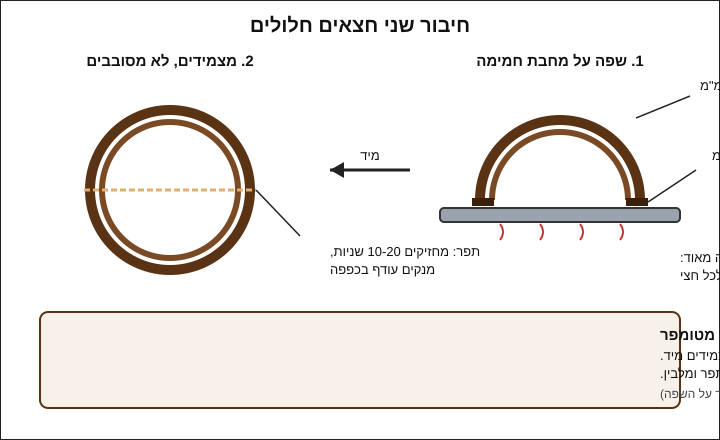
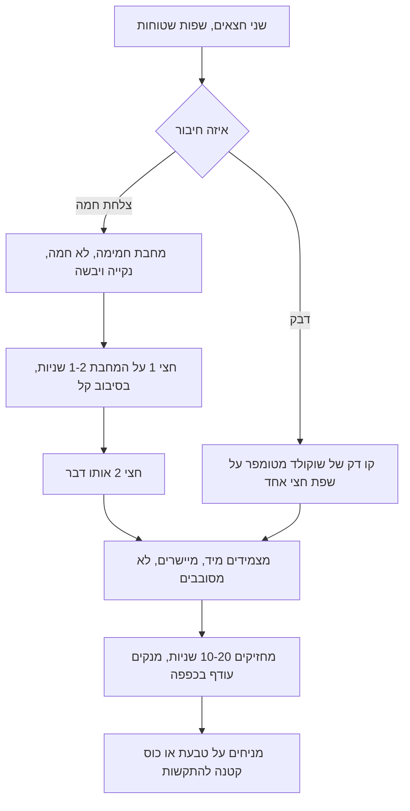

# 08.1 · יציקה חלולה בשני חצאים

כל צורת תלת־ממד בשוקולד, ביצה, לב, כדור או סביבון, היא בעצם שני חצאים חלולים שהודבקו זה לזה. בשיעור הזה יוצקים 4 חצאי כדור בשתי שכבות, מוציאים אותם שלמים, ומחברים אותם לשני כדורים בשתי שיטות: צלחת חמה ודבק של שוקולד מטומפר. בסוף השיעור יש לכם שני כדורים עם תפר נקי, ויודעים בדיוק את מה שהסביבונים בשיעור הבא צריכים.

## מה צריך

| פריט | כמות לתרגול | כמות מלאה | הערה |
|---|---|---|---|
| קוברטורה מריר 50-70% או חלב, כולל שאריות ממודולים קודמים מאותו מוצר | 300 גרם | 500 גרם לתבנית של 6 חצאים | בכל חצי כדור של 6 ס"מ נשארים כ־12-15 גרם; כל השאר חוזר לקערה |
| תבנית חצי כדור (half sphere / dome) בקוטר 5-6 ס"מ, פוליקרבונט, פלסטיק יציקה או סיליקון | 1 (4 שקעים לפחות) | | פוליקרבונט נותן ברק ושחרור לבד; בסיליקון מקלפים |
| שפכטל מתכת רחב וסכין פלטה קטנה | 1 מכל | | לגרד שפות ולהקיש על התבנית |
| רשת צינון (רשת אפייה) ונייר אפייה | 1 + 2 דפים | | התבנית מנקזת הפוכה על הרשת |
| מחבת נון־סטיק שטוחה או מגש מתכת שטוח | 1 | | "הצלחת החמה" לחיבור |
| שקית זילוף חד־פעמית קטנה או קיסם | 1 | | לדבק השוקולד |
| כפפות חד־פעמיות (ניטריל או לטקס) | זוג | | נגיעה בצד המבריק משאירה טביעות |
| מדחום דיגיטלי, משקל, קערה יבשה, מרית סיליקון, מייבש שיער | 1 מכל | | כמו ב־[03.2](../module-03/lesson-02.md) |

**למה דווקא 5-6 ס"מ:** חצי כדור קטן (3 ס"מ) הוא בונבון, ולא מלמד יציקה חלולה. חצי כדור גדול מ־8 ס"מ צריך יותר שוקולד וקליפה עבה מאוד. 5-6 ס"מ הוא גם הגודל של פצצת שוקו ([08.3](lesson-03.md)), אז אותה תבנית משרתת את כל המודול.

**אלרגנים:** קוברטורה מכילה בדרך כלל לציטין **סויה**. מריר רבים מכילים או "עלולים להכיל" **חלב**, ורבים "עלולים להכיל" **אגוזים** ו**בוטנים**. בודקים על האריזה.

### לפני שמתחילים את המודול

צפייה בשיעור היא לא תרגול. צורות חלולות לומדים בידיים: חצי שנשבר בהוצאה, תפר שזז, טביעת אצבע על הצד המבריק. האקדמיה לא יכולה לבדוק צילומים, ולכן בכל שיעור יש בדיקות ברורות (עובי, שחרור, תפר, ברק) שמשווים אליהן את התוצאה. מנהלים [יומן תרגול](../../templates/practice-log.md) ו[יומן טמפרור](../../templates/tempering-log.md) לאורך כל המודול. המודול מניח שאתם מטמפרים בהצלחה ([מודול 3](../module-03/lesson-01.md)) ושיצקתם קליפות בונבון ([05.1](../module-05/lesson-01.md)): יציקה, הקשה, ריקון, גירוד, ניקוז. כאן עושים את אותו דבר בגדול, בשתי שכבות.

## למה זה עובד

### צורה חלולה היא קליפת בונבון גדולה

התהליך זהה ל־[05.1](../module-05/lesson-01.md): יוצקים שוקולד מטומפר, מקישים כדי להוציא בועות, מסובבים כדי לצפות את כל הדופן, מרוקנים את העודף ומגרדים. ההבדל הוא הגודל. לפי Callebaut, ככל שהתבנית גדולה יותר הקליפה צריכה להיות עבה יותר, כי השוקולד מתכווץ בקירור וצריך עובי מינימלי כדי להיות חזק ולהשתחרר בקלות. בטבלת התקלות של Callebaut, "קליפה דקה מדי" היא סיבה מובהקת לחלקים שנשברים ונשארים בתבנית, והפתרון שלהם: לבנות שתיים־שלוש שכבות לפני ההוצאה.

### עובי נבנה בשכבות, או מנזילות

יש שתי דרכים לקליפה עבה יותר, ו־Callebaut מתארים את שתיהן:

| מצב | מה Callebaut ממליצים | מה זה אומר בבית |
|---|---|---|
| תבנית קטנה או בינונית | שוקולד בנזילות של 3 טיפות, וחזרה על היציקה כדי לבנות עובי | הקוברטורה הרגילה שלכם, שתי שכבות |
| תבנית גדולה | שוקולד בנזילות של 2 טיפות, עם כ־3%-4% פחות חמאת קקאו, שבונה שכבה עבה ביציקה אחת | לא חובה בבית; שכבה שלישית עושה את אותה עבודה |

גם Le Cordon Bleu בונים ביצת פסחא גדולה משתי שכבות: שכבה ראשונה, 10 דקות בטמפרטורת החדר עד שהיא מפסיקה לטפטף, גירוד השפה, ושכבה שנייה. לחצי כדור של 5-6 ס"מ מספיקות שתי שכבות. העובי שאליו מכוונים, כ־2-3 מ"מ, הוא הערכה מעשית ולא מספר של יצרן: מספיק כדי שהחצי יחזיק בהוצאה ובחיבור, דק מספיק כדי שיישבר יפה בפה.

### שפה עבה מחזיקה תפר

Callebaut מציינים פרט קטן וחשוב: כשהתבנית מנקזת הפוכה על נייר (ולא על רשת), השפה יוצאת עבה יותר, ו"שפה עבה יותר יוצרת תפר חזק יותר". בבית: מנקזים על רשת כמה דקות, ואז מעבירים לנייר לעוד דקה־שתיים לפני הגירוד האחרון. כך מקבלים שפה רחבה של 3-4 מ"מ שיש עליה מה להדביק.

רוצים כדור או ביצה צבעוניים? הצבע נכנס לתבנית **לפני** הקליפה, בדיוק כמו בבונבונים: חמאת קקאו צבעונית מטומפרת, מגרדים, ורק אז יוצקים את השכבה הראשונה ([05.3](../module-05/lesson-03.md)). בשיעור הזה מתרגלים בלי צבע, כדי לראות את הברק של השוקולד עצמו.

### טמפרטורת התבנית וקירור עם חום שיוצא

לפי Callebaut, מחממים את התבנית ל־26-27°C, ולא מעל טמפרטורת השוקולד המטומפר, כדי למנוע הלם טמפרטורה שמשאיר את השוקולד אפור. בבית, כמו ב־[04.1](../module-04/lesson-01.md#טמפרטורת-התבנית): תבנית בטמפרטורת החדר, וכמה שניות של מייבש שיער אם היא קרה. אחרי הגירוד, Callebaut מקררים 30 דקות ב־14-16°C, **כשהצד הפתוח של התבנית פונה הצידה או למעלה**, כדי שהחום לא יילכד בפנים. חום כלוא משאיר כתמים עמומים על הקליפה. בבית אין מקרר של 15°C, ולכן: 10 דקות בחדר עד שהשכבה מתקשה, ואז עד 20 דקות במקרר הביתי, כשהתבנית עומדת עם הפתחים כלפי מעלה ולא הפוכה על משטח.

### למה הוא נופל לבד

שחרור הוא בדיקת טמפר, כמו שראיתם ב־[04.1](../module-04/lesson-01.md#התכווצות-למה-טבלה-מטומפרת-נופלת-לבד): גבישי V צפופים, השוקולד מתכווץ, ותבנית פוליקרבונט, שלפי Callebaut "מתכווצת לאט יותר מהשוקולד", משאירה מרווח. בתבנית שקופה רואים את החצי מתנתק: כתמים בגוון אחר מופיעים מתחת לקליפה. אם אין התנתקות אחרי הקירור, הבעיה בטמפר או בזמן הקירור, לא בכוח שבו מקישים.

### חיבור: ממיסים רק את השפה

יש שתי שיטות, ושתיהן עובדות על אותו עיקרון: שכבה דקה מאוד של שוקולד נוזלי על השפה, שמתגבשת שוב בתוך שניות ומדביקה.

1. **צלחת חמה** (warm plate): לפי Callebaut, משפשפים בעדינות את שפת החצי הראשון על משטח חם כמה שניות, עד שהשוליים מתחילים להימס, עושים אותו דבר לחצי השני, ומצמידים מהר כדי שיתאימו בדיוק. נותנים לתפר להתקשות כמה שניות. ב־Food Network משתמשים במחבת נון־סטיק על אש נמוכה מאוד ומניחים את החצי "רק לשנייה". היתרון: אין שוקולד נוסף, והתפר דק. החיסרון: כל שנייה מיותרת ממיסה עוד מהשפה, והקוטר קטן.
2. **דבק שוקולד מטומפר**: Le Cordon Bleu מורחים במהירות שכבה דקה של שוקולד מטומפר על שפת חצי אחד, עם קיסם או שקית זילוף, ומצמידים מיד את החצי השני. היתרון: לא ממיסים כלום, והתפר חזק. החיסרון: עודף דבק נדחק החוצה ויוצר "חגורה" שצריך לנקות.

לא משתמשים בשוקולד מומס שלא טומפר כדבק. הוא מתקשה לאט, נשאר רך בתפר, ומלבין עם הזמן.

## שלב אחר שלב

> [!WARNING]
> המחבת לחיבור צריכה להיות חמימה, לא חמה: מחממים על האש הנמוכה ביותר 20-30 שניות, מכבים, ובודקים בגב היד מרחוק. מחבת חמה מדי ממיסה שפה שלמה בשנייה, ומחבת על אש עלולה לגרום לכוויה. מייבש שיער: רק בתנועה, כמה שניות, מרחוק.

**יום 1, יציקה (כ־50 דקות)**

1. **מכינים את התבנית**: שוטפים במים חמימים וסבון עדין, מייבשים לגמרי, ומלטשים כל שקע בצמר גפן (כמו ב־[04.1](../module-04/lesson-01.md)). מהרגע הזה עובדים עם כפפות ולא נוגעים בפנים השקעים.
2. **מכינים עמדה**: מזגן על 20-22°C. רשת צינון על נייר אפייה, ועוד דף נייר נקי בצד.
3. **מטמפרים** 300 גרם בשיטה שלכם: מריר 31-32°C, חלב 29-30°C (או לפי העקומה על האריזה). בדיקת סכין עוברת לפני שממשיכים.
4. **מחממים את התבנית** רק אם היא קרה: 5-10 שניות מייבש שיער, בתנועה.
5. **שכבה ראשונה**: ממלאים 4 שקעים עד השפה בכף או במצקת. מקישים בגב סכין הפלטה על דופן התבנית 10-15 פעמים: בועות עולות.
6. **מסובבים ומרוקנים**: מטים את התבנית בתנועה סיבובית כדי שהשוקולד יעלה עד השפה בכל הדופן, הופכים מעל הקערה ומקישים בצד 20-30 שניות, עד שהזרם הופך לטיפות.
7. **מגרדים ומנקזים**: מגרדים את פני התבנית בשפכטל, מניחים אותה הפוכה על הרשת 3-5 דקות, עד שהטיפות שעל הנייר מתחילות להתקשות.
8. **גירוד שפה**: מגרדים שוב, כך שכל שקע מוקף שפה נקייה. בודקים מול האור: השכבה רציפה, בלי חורים. משאירים 10 דקות בחדר, עד שהשכבה מתקשה ומאבדת ברק בצד הפנימי.
9. **שכבה שנייה**: בודקים שהשוקולד בקערה עדיין בטמפרטורת העבודה (אם ירד, מחממים במעלה־שתיים). ממלאים שוב, מקישים, מסובבים, מרוקנים.
10. **ניקוז לשפה עבה**: 3 דקות הפוך על הרשת, ואז דקה־שתיים הפוך על הנייר הנקי, עד שהשוקולד מתחיל להתקשות. גירוד אחרון בתנועה אחת, שמשאיר שפה חדה ושטוחה.
11. **קירור**: 10 דקות בחדר, ואז 15-20 דקות במקרר, **כשהתבנית עומדת עם הפתחים למעלה**, לא הפוכה על מדף.
12. **הוצאה**: מסתכלים מלמטה: אם רואים כתמי התנתקות בכל השקע, הופכים את התבנית מעל מגבת נקייה ומקישים בעדינות בגב סכין הפלטה. החצאים נופלים. בסיליקון: מקלפים את התבנית מהחצי, לא מושכים את השוקולד.
13. **שוקולד שנשאר**: נשאר בקערה מטומפר. משאירים כ־40 גרם לדבק בשלב הבא, ואת השאר יוצקים לטבלה או לשקית "להמסה".

**חיבור (כ־20 דקות, אפשר מיד או למחרת)**

14. **מיישרים שפות**: אם השפה לא שטוחה, מניחים את החצי על המחבת הקרה, או משפשפים בעדינות על נייר אפייה, עד שהשפה ישרה. שפה ישרה היא תפר ישר.
15. **כדור 1, צלחת חמה**: מחממים מחבת נון־סטיק נקייה ויבשה לפי האזהרה. מניחים חצי אחד עם הפתח כלפי מטה, 1-2 שניות, בסיבוב קל. מרימים, מניחים את החצי השני אותו דבר, ומצמידים את שניהם מיד, תפר מול תפר. לא מסובבים אחרי שנגעו.
16. **כדור 2, דבק**: מחממים מעט את 40 הגרם ששמרתם, בודקים שהם בטמפרטורת העבודה, ומעבירים לשקית קטנה. מזלפים קו דק (1-2 מ"מ) על שפת חצי אחד ומצמידים את השני מיד.
17. **מחזיקים** כל כדור 10-20 שניות, בכפפות, עד שהתפר נתפס. מנקים עודף שנדחק החוצה באצבע עם כפפה, בתנועה אחת לאורך התפר.
18. **מייצבים**: מניחים כל כדור על כוס קטנה או טבעת של נייר, כדי שלא יתגלגל, ל־10 דקות בחדר.
19. **רושמים** ביומן איזו שיטה נתנה תפר נקי יותר אצלכם.

## בדיקה: איך יודעים שהצליח

- **שחרור**: לפחות 3 מתוך 4 חצאים יצאו מתבנית פוליקרבונט בהיפוך והקשה קלה, בלי סדקים. (בסיליקון: יצאו בקילוף בלי להישבר.)
- **ברק**: הצד החיצוני מבריק ואחיד, בלי כתמים עמומים ובלי פסים. כתם עמום בנקודה אחת שחוזרת בכל השקעים מרמז על חום שנלכד בקירור.
- **עובי**: מחזיקים חצי מול מנורה חזקה. אין אזורים שקופים או בהירים מאוד בדופן, והשפה ברוחב 3-4 מ"מ. חצי של 6 ס"מ שוקל כ־12-15 גרם.
- **תפר**: מעבירים אצבע (בכפפה) על התפר. אין "מדרגה" בין החצאים, אין חור, ואין חגורה עבה של שוקולד. כדור שמנערים בעדינות לא נפתח.
- **בדיקת לחיצה**: לוחצים עדינות בשתי אצבעות על הקטבים. כדור טוב לא נסדק בלחיצה קלה. מי שרוצה לבדוק עד הסוף שובר כדור אחד וטועם: סנאפ, ושבר נקי בתפר ולא רק בו.

## כשזה משתבש

| מה רואים | למה זה קורה | מה עושים עכשיו | איך מונעים בפעם הבאה |
|---|---|---|---|
| החצי נשבר בהוצאה, וחלקים נשארים בתבנית | קליפה דקה מדי, שלא מתכווצת מספיק (Callebaut), או קירור קצר מדי | מחממים את התבנית במייבש שיער, ממיסים את השאריות לקערה, ויוצקים מחדש | שכבה שנייה, ואם צריך שלישית; קירור מלא לפני ההוצאה |
| החצי לא יוצא בכלל | טמפר חסר, או שלא חיכיתם מספיק בקירור | עוד 10 דקות במקרר. אם אין התנתקות גם אז, ממיסים ומטמפרים שוב | בדיקת סכין לפני כל שכבה; לא עוברים את טמפרטורת העבודה בחימום |
| כתם עמום באותו מקום בכל השקעים | חום שנלכד בתבנית שעמדה הפוכה בקירור, או הלם מתבנית קרה | זה עניין של מראה. מכסים בקישוט ([08.2](lesson-02.md)) או ממיסים | מקררים עם הפתחים למעלה; תבנית בטמפרטורת החדר |
| שכבה עבה מאוד בתחתית ודקה בשפה | ריקון קצר, או שוקולד שהתגבש יותר מדי והסמיך | ממשיכים; החצי שמיש. לחצי הבא מחממים במעלה ומרוקנים יותר זמן | ריקון של 20-30 שניות עם הקשות; [03.5](../module-03/lesson-05.md#שוקולד-שהתגבש-יותר-מדי) |
| השפה נמסה יותר מדי על המחבת, והחצי התקצר | מחבת חמה מדי, או החזקה ארוכה מדי | מצמידים בכל זאת; אם הקטרים לא תואמים, מחברים בדבק | מחבת חמימה בלבד; 1-2 שניות; מתרגלים קודם על חצי פגום |
| מדרגה בתפר, החצאים לא מיושרים | הצמדה איטית, או שפות לא שטוחות | אם עוד רך: מיישרים מיד. אם התקשה: מסתירים בקו מזולף ([08.2](lesson-02.md)) | מיישרים שפות לפני החיבור; מצמידים בתנועה אחת |
| התפר נפתח אחרי כמה דקות | דבק שלא טומפר, או שכבת דבק עבה שלא נתפסה | פותחים, מגרדים, ומדביקים שוב בדבק מטומפר דק | דבק מטומפר בלבד, בקו דק; מחזיקים 10-20 שניות |
| טביעות אצבע על הצד המבריק | נגיעה בלי כפפה | ממשיכים; זה עניין של מראה | כפפות מההוצאה ועד האריזה; Callebaut ממליצים על כך במפורש |

### מה עושים עם מה שלא הצליח

שום דבר לא הולך לפח. חצאים שבורים נמסים מחדש עם שאר השוקולד ומטמפרים שוב. חצי שנשבר בצורה נקייה מתאים לקערית לגנאש או לפירות. כדור עם תפר מכוער הוא כדור לבית: שוברים אותו לתוך כוס חלב חם ומקבלים שוקו (35 גרם ל־200 מ"ל, כמו ב־[02.4](../module-02/lesson-04.md#הכמות-35-גרם-ל200-מל)). שוקולד שאיבד טמפר הולך לבראוניז, לרוטב או לטבלת bark עם אגוזים. מה שנטף על הנייר נאסף לשקית "להמסה".

## חלופות

### טבעוני / פרווה

מריר בלי חלב ברכיבים הוא טבעוני, ופרווה אם ההכשר אומר פרווה, והוא מתנהג בדיוק כמו בשיעור. שוקולד "חלב" טבעוני מטמפרים לפי עקומת היצרן ([03.2](../module-03/lesson-02.md)). הוא לרוב סמיך יותר: שכבה אחת עבה יכולה להספיק, אבל בודקים בשקע אחד לפני שיוצקים ארבעה. בדבק משתמשים באותו שוקולד, כדי שלא יהיה תפר חלבי בכדור פרווה.

### בריא יותר

צורה חלולה היא כבר "פחות שוקולד": כדור של 6 ס"מ שוקל כ־25-30 גרם, הרבה פחות מכדור מלא באותו גודל. אפשר לצקת במריר 70% ומעלה, שמטמפרים באותן טמפרטורות. מנה קטנה עוד יותר: תבנית חצי כדור של 4 ס"מ. שוקולד ללא תוספת סוכר עם מלטיטול מטמפרים לפי היצרן, ובודקים נזילות על שקע אחד.

> [!CAUTION]
> מלטיטול גורם לגזים ולשלשול כשאוכלים ממנו כמות, והוא לא מתאים לילדים בכמויות. מי שמגיש כדורים כאלה אומר לאורחים מה יש בהם.

### כשרות

הכדור עשוי משוקולד אחד, ולכן הכשרות שלו היא הכשרות של הקוברטורה ושל הדבק. מי שרוצה פרווה בודק שהקוברטורה מסומנת פרווה בהכשר שהוא סומך עליו, ושלא כתוב "חלבי" או "ציוד חלבי". אותו מותג יכול להופיע בכשרות שונה לפי אריזה: [שלושה כללים](../../references/kashrut-guide.md#שלושה-כללים), [קוברטורה מרירה](../../references/kashrut-guide.md#קוברטורה-מרירה), [קוברטורה חלב](../../references/kashrut-guide.md#קוברטורה-חלב). מחבת או תבנית שכבר שימשו לחלבי: את השאלה אם ואיך משתמשים בהן לפרווה שואלים את הרב. אם יש ספק, שואלים את הרב.

## איפה קונים

מה מחפשים: תבנית חצי כדור (half sphere / dome mould) בקוטר 5-6 ס"מ, עם 4 שקעים לפחות. פוליקרבונט קשיח נותן את הברק הטוב ביותר ושחרור בהיפוך; תבנית פלסטיק יציקה דקה זולה יותר ועובדת היטב בהתחלה; סיליקון זול וסלחני, אבל הברק נמוך יותר ומקלפים. אותה תבנית תשמש גם לפצצות שוקו ([08.3](lesson-03.md)) ולגוף של סביבון ([08.2](lesson-02.md)). חנויות, מחירים ומלאי: [תבניות כדור וחצי כדור](../../references/where-to-buy.md#תבניות-כדור-וחצי-כדור), [תבניות ביצה ותלת ממד](../../references/where-to-buy.md#תבניות-ביצה-ותלת-ממד), [שפכטל וקלף](../../references/where-to-buy.md#שפכטל-וקלף), [שקיות זילוף](../../references/where-to-buy.md#שקיות-זילוף), [קוברטורה](../../references/where-to-buy.md#קוברטורה), [מדחום](../../references/where-to-buy.md#מדחום). כשרות לפי מוצר: [קוברטורה מרירה](../../references/kashrut-guide.md#קוברטורה-מרירה).

## תרגול

### משימה

יוצקים 4 חצאי כדור בשתי שכבות, מוציאים אותם, ומחברים שני כדורים: אחד בצלחת חמה ואחד בדבק מטומפר. בודקים כל כדור לפי הבדיקות למעלה, ושוברים חצי אחד או כדור אחד כדי לראות את העובי ואת התפר מבפנים. מי שהחצאים שלו נשברו בהוצאה חוזר על היציקה עם אותו שוקולד, ומשנה דבר אחד בלבד: מוסיף שכבה, או מאריך את הקירור.

### זמן

כ־50 דקות ליציקה כולל טמפרור, 30 דקות קירור (זמן המתנה), ו־20 דקות לחיבור ולבדיקה. סך הכול כשעה ורבע של עבודה.

### יומן

ממלאים שורה ב[יומן הטמפרור](../../templates/tempering-log.md), ושורה ב[יומן התרגול](../../templates/practice-log.md): טמפרטורת החדר והתבנית, כמה זמן בין השכבות, משקל חצי אחד, כמה חצאים יצאו שלמים, איזו שיטת חיבור נתנה תפר נקי יותר, ומה תשנו בפעם הבאה.

### בדיקה עצמית

- [ ] התבנית נוקתה ולוטשה, ועבדתי בכפפות מהליטוש ועד החיבור.
- [ ] יצקתי שתי שכבות בשוקולד מטומפר, אחרי בדיקת סכין, וגירדתי שפה נקייה בכל שכבה.
- [ ] קיררתי עם הפתחים למעלה, ולפחות 3 מתוך 4 חצאים יצאו שלמים.
- [ ] חיברתי כדור אחד בצלחת חמה וכדור אחד בדבק מטומפר, בלי מדרגה ובלי חור בתפר.
- [ ] כל השוקולד שנשאר חזר לקערה, לטבלה או לשקית "להמסה".

## סיכום

- כל צורה חלולה היא שני חצאים: יוצקים, מקישים, מסובבים, מרוקנים, מגרדים, מנקזים, ושוב, עד שהקליפה עבה מספיק (שתי שכבות ל־5-6 ס"מ).
- קליפה דקה מדי נשברת בהוצאה; קירור עם הפתחים למעלה מונע כתמים עמומים מחום כלוא.
- ניקוז על נייר בסוף נותן שפה רחבה, ושפה רחבה ושטוחה נותנת תפר חזק.
- מחברים בצלחת חמימה (שנייה־שתיים לכל חצי) או בקו דק של שוקולד מטומפר, ומצמידים מיד, בלי לסובב.
- פרויקט המודול: [מארז 5 סביבוני שוקולד](../../projects/m08-dreidel-box.md), חלב, מריר ולבן עם סוכריות, בקופסה אחת, עם כרטיס מתכון, עלות ובדיקה עצמית.
