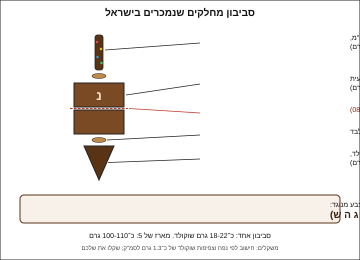
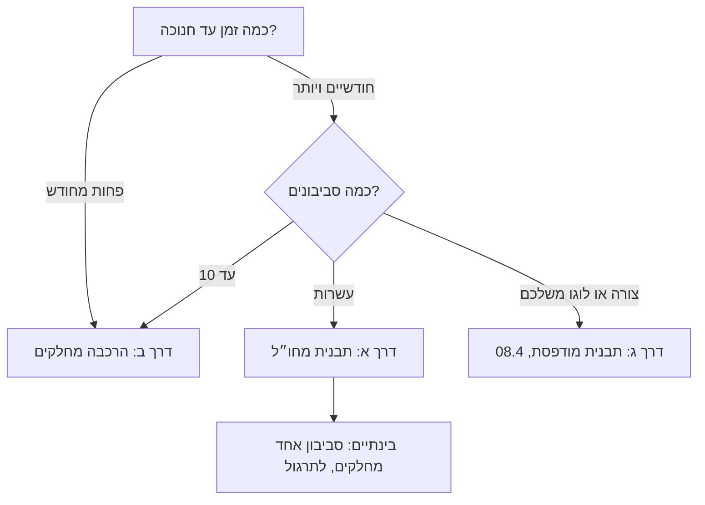

# 08.2 · סביבוני שוקולד

סביבון שוקולד הוא אולי המתנה הכי מזוהה עם חנוכה, וגם הצורה שהכי קשה להשיג לה תבנית בישראל. בשיעור הזה בוחרים איך להשיג את הצורה, ובונים סביבון אחד מחלקים פשוטים: גוף קובייה משתי קליפות, חוד מחרוט, ידית ואות, הכול מודבק בשוקולד מטומפר ומקושט בסוכריות. אחרי שסביבון אחד עובר את כל הבדיקות, מכינים מארז של חמישה בפרויקט המודול.

## מה צריך

| פריט | כמות לתרגול (סביבון אחד) | כמות מלאה (מארז של 5) | הערה |
|---|---|---|---|
| קוברטורה, אותו מוצר כמו בשיעור הקודם, כולל שאריות | 300 גרם (בסביבון נשארים כ־20 גרם) | 300 גרם מכל סוג: חלב, מריר, לבן | הטמפרור צריך כמות; העודף חוזר לקערה |
| קוברטורה בצבע מנוגד לאותיות (לבן על מריר, מריר על לבן) | 20-30 גרם מטומפרים, או כף מהקערה השנייה | 30 גרם | אפשר לוותר ולקשט רק בסוכריות |
| תבנית פרלינים ריבועית, שקעים של כ־3×3 ס"מ ועומק 1.5 ס"מ | 2 שקעים | 10 שקעים | גוף הסביבון; חלופות בהמשך |
| נייר אפייה | 2 דפים | 4 דפים | לקונוסים לחוד ולזילוף הידיות |
| אצטט (דף גיטרה) | רצועה של 10 ס"מ | דף | לאותיות |
| סוכריות קישוט קטנות (nonpareils, סוכריות צבעוניות) | כף | 2-3 כפות | לבדוק רכיבים ואלרגנים |
| כוסות צרות (צ'ייסר, כוס יין) | 2 | 5 | מעמד לקונוסים ולסביבון בזמן ההדבקה |
| שקיות זילוף חד־פעמיות קטנות | 2 | 4 | |
| מחבת נון־סטיק, סכין קטנה, כפפות, מדחום, משקל | 1 מכל | | כמו ב־[08.1](lesson-01.md) |
| שקית צלופן קטנה וסרט, או קופסה עם 5 תאים | 1 | 1 | אריזה |

**אלרגנים:** קוברטורה מכילה בדרך כלל לציטין **סויה**. שוקולד חלב ולבן מכילים **חלב**, ומריר רבים מכילים או "עלולים להכיל" **חלב**. רבים "עלולים להכיל" **אגוזים** ו**בוטנים**. בסוכריות קישוט בודקים את רשימת הרכיבים: חלקן מכילות **חלב**, **גלוטן** (בסוכריות מצופות או פריכות) או צבעים כמו E120. כותבים על המארז את כל מה שמופיע באריזות.

## למה זה עובד

### המארז שהשיעור מכוון אליו

הדוגמה שהובילה את השיעור: בגיפטוש נמכר "מארז סביבונים משוקולד" ב־40 ₪ (נבדק ב־2026-11-10). לפי דף המוצר, המארז מכיל חמישה סביבונים בעבודת יד, משוקולד חלב, מריר ולבן, עם סוכריות צבעוניות, וכתוב ש"מגוון הסביבונים עשוי להשתנות ממארז למארז". גודל ומשקל לא מצוינים בדף. זו דוגמה למבנה (5 יחידות, 3 סוגי שוקולד, קישוט אחד שחוזר) ולטווח מחיר בשוק, לא המלצה ולא מתכון שלהם. בפרויקט של המודול בונים מארז באותו מבנה.

### אנטומיה של סביבון

לסביבון יש ארבעה חלקים: ידית למעלה, גוף בעל ארבע פאות, חוד שעליו הוא מסתובב, ואות על כל פאה: נ, ג, ה, פ בישראל ("נס גדול היה פה"), ונ, ג, ה, ש בחו"ל ("היה שם"). כל אחד מהחלקים אפשר לייצר בנפרד, וזה מה שמאפשר לבנות סביבון בלי תבנית סביבון.

### שלוש דרכים לצורה

בבדיקה של 2026-11-10 **לא נמצאה תבנית סביבון לשוקולד באף חנות ישראלית** (חיפוש ב־14 חנויות, ראו [תבניות סביבון](../../references/where-to-buy.md#תבניות-סביבון)). לכן יש שלוש דרכים:

| דרך | מה עושים | יתרון | חיסרון | מתי לבחור |
|---|---|---|---|---|
| א. תבנית סביבון מחו"ל | מזמינים באתר בינלאומי תבנית פוליקרבונט, פלסטיק יציקה או סיליקון | צורה אחידה ומדויקת, מהירה לייצור כמות | משלוח של שבועות, מכס ודמי משלוח; לא רואים את האיכות לפני | מתכננים מארזים בכמות, ויש חודשיים לפחות עד חנוכה |
| ב. הרכבה מחלקים | גוף מתבנית ריבוע או חצי כדור, חוד מקונוס נייר, ידית מזולפת | הכול נמכר בישראל או נמצא בבית; עכשיו | עבודה ידנית לכל סביבון; כל אחד שונה מעט | סביבון ראשון, כמות קטנה, חנוכה בעוד שבועיים |
| ג. תבנית מודפסת או בוואקום | מדפיסים מודל ומשתמשים בו כמאסטר לתבנית בטוחה למזון | צורה וגודל משלכם, לוגו משלכם | צריך מדפסת או שירות הדפסה, וחומר בטוח למזון | יש גישה למדפסת, ורוצים צורה ייחודית (שיעור [08.4](lesson-04.md)) |

### מה בודקים כשמזמינים תבנית מחו"ל

מחפשים באנגלית: "dreidel chocolate mold", "dreidel chocolate mould", "3D dreidel mold polycarbonate", "Hanukkah chocolate mold", ובחנויות שמוכרות לשוקולטיירים גם "spinning top chocolate mould". בדף המוצר בודקים:

1. **חומר**: פוליקרבונט קשיח נותן ברק ושחרור לבד ([04.1](../module-04/lesson-01.md#שלושה-סוגי-תבניות-בחנויות)). "thermoformed" או "plastic" הוא פלסטיק דק, זול יותר ופחות עמיד. סיליקון סלחני אבל עמום.
2. **תלת־ממד או שטוח**: תבנית "3D" בשני חלקים נותנת סביבון שלם. תבנית שטוחה נותנת חצי סביבון (צד אחד), ואז יוצקים שני חצאים ומחברים אותם כמו ב־[08.1](lesson-01.md), או מגישים סביבון שטוח על מקל.
3. **סגור או פתוח**: בתבנית "closed bottom" שני החצאים נסגרים בקליפסים או במגנטים, ויוצקים דרך פתח. Callebaut מתארים בדיוק את זה בתבניות כפולות (double moulds): שני החצאים מוחזקים במגנטים או בקליפסים, יוצקים, מקישים, מסובבים, מרוקנים, ומקררים כשהפתח פונה הצידה או למעלה. לבדוק אם הקליפסים כלולים או נמכרים בנפרד.
4. **מידות ומספר שקעים**: גובה בס"מ (סביבון במארז של 5 הוא בדרך כלל 4-6 ס"מ), ומשקל שוקולד לשקע אם כתוב.
5. **זמן**: הזמנה כחודשיים לפני חנוכה. חלק מהתבניות מיוצרות לפי הזמנה, ויש גם משלוח ומכס.

### סביבון מחלקים: מה מחזיק את זה ביחד

כל חיבור בסביבון הוא אותו חיבור משיעור [08.1](lesson-01.md): שכבה דקה של שוקולד מטומפר שמתגבשת ונועלת שני חלקים. את שתי קליפות הקובייה מחברים שפה אל שפה על מחבת חמימה, כמו חצאי הכדור. את החוד ואת הידית מדביקים בנקודת דבק מטומפר, כמו ש־Le Cordon Bleu מדביקים ביצה על בסיס: מניחים מעט שוקולד מטומפר, מחכים שיתחיל להתקשות ושהשוליים ייראו עמומים, ולוחצים את החלק פנימה ותומכים בו עד שהוא קשה. דבק שהתחיל להתגבש מחזיק את החלק במקום מהר יותר מדבק נוזלי לגמרי, שמחליק.

למה שוקולד מטומפר ולא שוקולד מומס סתם: הוא מתקשה תוך דקות בחדר, מתכווץ יחד עם החלקים, ולא מלבין בתפר. שוקולד מומס שלא טומפר נשאר רך בחיבור שעות, והסביבון "שוקע" על החוד.

### משקל, עלות ואיזון

| חלק | איך מייצרים | משקל משוער |
|---|---|---|
| גוף: שתי קליפות ריבוע של 3 ס"מ, עובי כ־1.5 מ"מ | יציקה כמו ב־[05.1](../module-05/lesson-01.md) | 10-12 גרם |
| חוד: חרוט מלא, בסיס 2.5 ס"מ, גובה כ־3 ס"מ | קונוס נייר אפייה | 5-6 גרם |
| ידית: מקל באורך 2.5 ס"מ ובעובי 7-8 מ"מ | זילוף על נייר | 1.5-2 גרם |
| דבק, אותיות וסוכריות | | 2-3 גרם |
| **סביבון אחד** | | **כ־18-22 גרם** |

המשקלים הם חישוב לפי נפח (צפיפות שוקולד של כ־1.3 גרם לסמ"ק), לא נתון של יצרן. שוקלים את הסביבון הראשון ורושמים. מארז של חמישה צורך כ־100-110 גרם שוקולד. בקוברטורה במחיר של כ־80-100 ₪ לק"ג (ראו [קוברטורה](../../references/where-to-buy.md#קוברטורה), מחירים מ־2026-11-10), השוקולד במארז עולה כ־8-11 ₪. לזה מוסיפים סוכריות, קופסה, סרט ותווית, ובעיקר שעות עבודה. תמחור מלא של מארז לומדים במסלול העסקי ([מודול 19](../module-19/lesson-01.md)).

הסביבון לא חייב להסתובב: זה מארז מתנה, לא צעצוע. אם החוד במרכז הפאה התחתונה והידית בדיוק מעליו, הוא יסתובב כמה סיבובים על צלחת חלקה, וזה בונוס. סביבון עקום, שהחוד שלו לא במרכז, לא יעמוד על החוד בכלל, ולכן מרכוז החוד הוא גם בדיקת איכות.

### סוכריות: נדבקות רק לשוקולד רך

סוכריות נצמדות לשוקולד מטומפר כשהוא עוד נוזלי או רך, ונופלות משוקולד שהתקשה. לכן מקשטים בשלב האחרון: מזלפים קו דק של שוקולד מטומפר על הידית או על שפת הפאה העליונה, ומפזרים סוכריות מיד. לחות פוגעת בסוכריות צבעוניות: עיבוי (ממקרר לחדר חם) גורם לצבע לזלוג ולשוקולד לפריחת סוכר. אחסון וקירור לפי [03.5](../module-03/lesson-05.md#אחסון-טמפרטורה-קבועה-יבש-סגור): 18-20°C קבוע, יבש וסגור, ומקרר רק בקופסה סגורה שמוציאים סגורה.

## שלב אחר שלב

> [!WARNING]
> מחבת לחיבור ויישור: חמימה בלבד, על האש הנמוכה ביותר וכבויה בזמן העבודה ([08.1](lesson-01.md)). סכין לחיתוך הידיות מחממים במים חמים ומייבשים לגמרי: טיפת מים על השוקולד גורמת לו להיתפס. סוכריות קטנות הן סכנת חנק לפעוטות: מארז עם סוכריות לא נותנים לילדים מתחת לגיל 4 בלי השגחה.

**שלב א: חלקים (כ־45 דקות)**

1. **קונוסים לחוד**: גוזרים 3 משולשים מנייר אפייה (צלע של כ־15 ס"מ), ומגלגלים כל אחד לקונוס הדוק עם פתח קטן בקצה, כמו קונוס זילוף. מקפלים את הקצה העליון פנימה כדי שלא ייפתח. מעמידים כל קונוס בכוס צרה, חוד למטה. שלושה ולא אחד: תמיד אחד יוצא עקום.
2. **מטמפרים** 300 גרם (חלב לתרגול הראשון: 29-30°C, או לפי העקומה על האריזה). בדיקת סכין עוברת.
3. **ממלאים את הקונוסים** בכפית או משקית זילוף, עד גובה של כ־3 ס"מ. מקישים בעדינות על הכוס כדי להוציא בועות. אם שוקולד דולף מהחוד, סוגרים את הקצה בקיפול נוסף.
4. **קליפות לגוף**: יוצקים 4 שקעים בתבנית הריבועית (שניים לגוף ושניים רזרבה), כמו ב־[05.1](../module-05/lesson-01.md): ממלאים, מקישים, מרוקנים, מגרדים, ומנקזים 5 דקות. שכבה אחת מספיקה לשקע של 3 ס"מ; אם הקליפה שקופה מול האור, מוסיפים שכבה שנייה כמו ב־[08.1](lesson-01.md).
5. **ידיות**: מעבירים מעט שוקולד לשקית זילוף, גוזרים פתח של כ־6 מ"מ, ומזלפים על נייר אפייה 3-4 קווים ישרים באורך 8 ס"מ ובעובי 7-8 מ"מ.
6. **אותיות**: מטמפרים מעט שוקולד בצבע מנוגד (או משתמשים בכף מהקערה של הסוג השני), ומזלפים על אצטט אותיות של כ־1.5 ס"מ: נ, ג, ה, פ, ועוד אחת רזרבה מכל אות. הצד שנגע באצטט הוא הצד המבריק, והוא זה שיפנה החוצה, ולכן כותבים כל אות **הפוכה, כמו במראה**. עוזר להניח מתחת לאצטט פתק עם האותיות מודפסות הפוך, ולעבור עליהן.
7. **קירור**: הכול 10 דקות בחדר, ואז 15 דקות במקרר (תבנית הקליפות עם הפתחים למעלה). השוקולד שבקערה נשאר מטומפר: שומרים עליו בטמפרטורת העבודה, הוא הדבק.

**שלב ב: הכנת החלקים (כ־15 דקות)**

8. **מוציאים** את קליפות הקובייה מהתבנית בהיפוך, בכפפות.
9. **קולפים את הקונוסים**: פותחים את הנייר מלמעלה ומקלפים בסיבוב. החוד צריך להיות חד ובמרכז.
10. **מיישרים את בסיס החרוט**: מניחים את הבסיס הרחב 1-2 שניות על המחבת החמימה, עד שהוא שטוח לגמרי. מנגבים את המחבת בנייר.
11. **חותכים ידיות**: בסכין חמימה ויבשה, חתיכות של 2.5 ס"מ בחיתוך ישר אחד. בוחרים את הישרה ביותר.

**שלב ג: הרכבה (כ־20 דקות)**

12. **גוף**: מחברים שתי קליפות ריבוע שפה אל שפה, בשיטה שהצליחה לכם ב־[08.1](lesson-01.md) (מחבת חמימה או קו דבק מטומפר). מחזיקים 20 שניות, מנקים עודף, ומניחים לחמש דקות. עכשיו יש קובייה חלולה.
13. **ידית**: מניחים את הקובייה על נייר אפייה. נקודת דבק מטומפר בגודל עדשה במרכז הפאה העליונה. מחכים 20-40 שניות, עד שהשוליים של הנקודה נעשים עמומים, ומעמידים עליה את הידית, ישרה. מסתכלים משני צדדים שהיא אנכית, ומחזיקים 20 שניות. מניחים ל־5 דקות.
14. **חוד**: הופכים את הקובייה בעדינות ומעמידים אותה, ידית למטה, בתוך כוס צרה שהשפה שלה תומכת בפאות. נקודת דבק במרכז הפאה שפונה עכשיו למעלה (מסמנים את המרכז מראש בקיסם, באלכסונים), מחכים שתתחיל להתקשות, ומעמידים עליה את בסיס החרוט. מחזיקים 20-30 שניות.
15. **מניחים** 15 דקות בחדר בתוך הכוס, בלי לגעת.

**שלב ד: קישוט (כ־10 דקות)**

16. **אותיות**: מקלפים כל אות מהאצטט, ומדביקים אותה במרכז פאה בנקודת דבק קטנה מאוד, הצד המבריק החוצה. סדר: נ, ג, ה, פ, מסביב.
17. **סוכריות**: מזלפים קו דק של שוקולד מטומפר מסביב לבסיס הידית, או על שפת הפאה העליונה, ומפזרים סוכריות מיד מעל צלחת שאוספת את מה שנופל. מנערים בעדינות.
18. **מנוחה**: 30 דקות בחדר של 18-22°C. לא למקרר אחרי הקישוט אם אין צורך: עיבוי פוגע בסוכריות.
19. **אריזה**: שוקלים, רושמים, ומכניסים לשקית צלופן או לתא בקופסה, שוכב על הצד. סוגרים בסרט.

**אם יש לכם תבנית סביבון מחו"ל (דרך א)**

- **תבנית שטוחה (חצי סביבון)**: יוצקים שני חצאים לכל סביבון בשתי שכבות, מוציאים ומחברים על מחבת חמימה, בדיוק כמו ב־[08.1](lesson-01.md).
- **תבנית תלת־ממד סגורה בקליפסים**: מנקים ומלטשים את שני החצאים, סוגרים בקליפסים, ממלאים דרך הפתח עד חצי, סוגרים את הפתח באצבע עם כפפה ומסובבים לכל הכיוונים כדקה, מרוקנים ומקישים. חוזרים לשכבה שנייה אחרי שהראשונה התקשתה. מקררים כשהפתח פונה למעלה, ופותחים את הקליפסים רק כשרואים התנתקות מכל הצדדים. את הפתח סוגרים בנקודת שוקולד ובידית.

## בדיקה: איך יודעים שהצליח

- **הרמה בידית**: מרימים את הסביבון בשתי אצבעות בידית ומחזיקים 10 שניות. שום חלק לא זז ולא נופל.
- **ישר**: מסתכלים מהצד ומלפנים: הידית והחוד על אותו קו אנכי, במרכז הקובייה. סיבוב עדין על צלחת חלקה: אם הוא מסתובב כמה סיבובים, מצוין; אם הוא נופל מיד לצד אחד, החוד לא במרכז.
- **תפרים**: התפר של הקובייה ישר, בלי חור ובלי חגורה עבה. אין עודפי דבק סביב הידית והחוד, חוץ מקו הסוכריות.
- **ברק וצבע**: הפאות מבריקות, בלי כתמים לבנים, אפורים או טביעות אצבע. אחרי יום בקופסה סגורה בחדר, הסוכריות לא זלגו צבע.
- **סוכריות ואותיות**: מנערים בעדינות מעל צלחת: נופלות פחות מ־5 סוכריות, והאותיות קריאות ובמרכז הפאה.
- **משקל**: 18-25 גרם, ורשום ביומן. זה המספר שתכפילו בחמש לתמחור המארז.

## כשזה משתבש

| מה רואים | למה זה קורה | מה עושים עכשיו | איך מונעים בפעם הבאה |
|---|---|---|---|
| הידית נופלת כשמרימים | דבק לא מטומפר, או נקודת דבק קטנה מדי, או שבסיס הידית לא ישר | מגרדים את הדבק הישן, חותכים את הבסיס ישר בסכין חמימה, ומדביקים שוב | נקודת דבק בגודל עדשה, מטומפרת; מחכים שתתחיל להתקשות לפני שמעמידים |
| הסביבון עקום, נופל לצד אחד | החוד לא במרכז, או שבסיס החרוט לא שטוח | אם הדבק עוד רך: מיישרים מיד. אם התקשה: מחממים את החיבור במייבש שיער 2-3 שניות ומיישרים | מסמנים מרכז בקיסם לפני ההדבקה; מיישרים את בסיס החרוט על המחבת |
| החרוט יצא עם חוד שבור או עקום | קונוס נייר רפוי, או קילוף מהר מדי | משתמשים ברזרבה; חרוט פגום חוזר להמסה | מגלגלים קונוס הדוק; קולפים רק אחרי קירור מלא |
| קליפות הקובייה נשברו בהוצאה | קליפה דקה מדי בשקע הריבועי, או קירור קצר | ממיסים את השברים; משתמשים בקליפות הרזרבה | שכבה שנייה; קירור מלא; ראו טבלת התקלות של Callebaut ב־[08.1](lesson-01.md) |
| הסוכריות לא נדבקות | השוקולד שמתחתיהן כבר התקשה | מזלפים שוב קו דק ומפזרים מיד | עובדים על קטע קטן בכל פעם, סוכריות מוכנות בצלחת לפני הזילוף |
| הסוכריות זלגו צבע, כתמים לבנים | עיבוי: הסביבון יצא קר מהמקרר לחדר חם, או אחסון לח | הסביבון לבית, לא למתנה | לא מקררים אחרי הקישוט; אם חייבים, בקופסה סגורה שמוציאים סגורה ([03.5](../module-03/lesson-05.md#אחסון-טמפרטורה-קבועה-יבש-סגור)) |
| האות יצאה הפוכה | נכתבה "רגיל" על האצטט, והצד הקריא נדבק לסביבון | מדביקים בכל זאת על פאה אחורית, או ממיסים | כותבים כמו במראה; מתרגלים על נייר עם הדפסה הפוכה מתחת לאצטט |
| כתמים עמומים על הפאות | טמפר חלקי, או חום שנלכד בקירור | הסביבון שמיש; מסתירים באות ובסוכריות | בדיקת סכין, קירור עם פתחים למעלה ([08.1](lesson-01.md)) |

### מה עושים עם מה שלא הצליח

שום דבר לא הולך לפח. סביבון עקום הוא סביבון לבית, ומי שמשחק בו ושובר אותו מקבל שוקו (35 גרם לכוס של 200 מ"ל, [02.4](../module-02/lesson-04.md); סביבון שלם עם עוד חתיכה). חרוטים, ידיות וקליפות פגומים נמסים מחדש עם שאר השוקולד מאותו סוג. חלקים עם סוכריות לא ממיסים יחד עם השוקולד הנקי: הם הולכים לטבלת bark, לעוגה או לשוקו. שוקולד שאיבד טמפר הולך לבראוניז או לרוטב.

## חלופות

### טבעוני / פרווה

סביבון ממריר בלי חלב ברכיבים הוא טבעוני, ופרווה אם ההכשר אומר פרווה. מארז טבעוני של שלושה צבעים קשה יותר: שוקולד "לבן" ו"חלב" טבעוניים לקונדיטוריה לא נמצאו בחנויות שנבדקו ([שוקולד טבעוני](../../references/where-to-buy.md#שוקולד-טבעוני)), ולכן מארז כזה יכול להיות מריר בשלושה גוונים: מריר 55%, מריר 70%, ומריר עם קישוט בהיר. סוכריות: הרבה סוכריות מבריקות מכילות שלאק (E904), סוכריות אדומות וורודות עשויות להכיל קרמין (E120), וחלקן ג'לטין, ולכן הן לא טבעוניות גם כשכתוב "פרווה" ([לא טבעוני גם כשכתוב פרווה](../../references/kashrut-guide.md#לא-טבעוני-גם-כשכתוב-פרווה)).

### בריא יותר

סביבון של 18-22 גרם הוא מנה קטנה, ומארז של חמישה הוא מנה לחמישה אנשים, לא לאחד. אפשר להקטין: גוף מתבנית ריבוע של 2.5 ס"מ נותן סביבון של כ־12-15 גרם. מריר 70% ומעלה פחות מתוק, ומטמפרים אותו באותן טמפרטורות. סוכריות מוסיפות סוכר וצבעים: אפשר לקשט במקום זה בפסים מזולפים של שוקולד לבן או במעט פיסטוק קצוץ (מוסיף אלרגן: אגוזים). שוקולד ללא תוספת סוכר עם מלטיטול מטמפרים לפי היצרן.

> [!CAUTION]
> מלטיטול גורם לגזים ולשלשול כשאוכלים ממנו כמות, והוא לא מתאים לילדים בכמויות. מארז סביבונים הוא מתנה שילדים אוכלים, ולכן מארז עם מלטיטול מסמנים בבירור.

### כשרות

במארז של חלב, מריר ולבן יש בדרך כלל שוקולד חלבי, ולכן כל המארז חלבי, גם הסביבונים המרירים שנוגעים בהם או שהודבקו בציוד משותף. מי שמכין מארז פרווה צריך שכל הקוברטורות, הסוכריות והצבעים יהיו מסומנים פרווה בהכשר שהוא סומך עליו, ושלא כתוב "חלבי" או "ציוד חלבי". מי שמקפיד על חלב ישראל מחפש את זה על האריזה של שוקולד החלב והלבן ([קוברטורה חלב](../../references/kashrut-guide.md#קוברטורה-חלב), [קוברטורה לבנה](../../references/kashrut-guide.md#קוברטורה-לבנה), [שלושה כללים](../../references/kashrut-guide.md#שלושה-כללים)). סוכריות: [סוכריות וקישוטים](../../references/kashrut-guide.md#סוכריות-וקישוטים). מארז שנותנים במתנה למשפחה ששומרת כשרות: כותבים על הפתק מה ההכשר של כל רכיב, כפי שכתוב על האריזות. אם יש ספק, שואלים את הרב.

## איפה קונים

מה מחפשים: לדרך ב, תבנית פרלינים ריבועית (square praline / bonbon mould) עם שקעים של כ־3×3 ס"מ ועומק של כ־1.5 ס"מ, מפוליקרבונט או מפלסטיק יציקה. אם אין, תבנית חצי כדור של 3 ס"מ נותנת גוף עגול ("סביבון כדור"), ותבנית קוביות קרח מסיליקון של 3 ס"מ נותנת קובייה מלאה (כבדה יותר, כ־35 גרם). לדרך א, תבנית סביבון מחו"ל במונחי החיפוש שלמעלה. צריך גם נייר אפייה, אצטט, שקיות זילוף וסוכריות קישוט. חנויות, מחירים ומלאי: [תבניות סביבון](../../references/where-to-buy.md#תבניות-סביבון) (מה נמצא ומה לא), [תבניות פוליקרבונט](../../references/where-to-buy.md#תבניות-פוליקרבונט), [תבניות סיליקון](../../references/where-to-buy.md#תבניות-סיליקון), [תבניות כדור וחצי כדור](../../references/where-to-buy.md#תבניות-כדור-וחצי-כדור), [אצטט ודפי גיטרה](../../references/where-to-buy.md#אצטט-ודפי-גיטרה), [שקיות זילוף](../../references/where-to-buy.md#שקיות-זילוף), [סוכריות קישוט](../../references/where-to-buy.md#סוכריות-קישוט), [קופסאות פרלינים](../../references/where-to-buy.md#קופסאות-פרלינים), [צלופן וסרטים](../../references/where-to-buy.md#צלופן-וסרטים). כשרות: [קוברטורה מרירה](../../references/kashrut-guide.md#קוברטורה-מרירה), [סוכריות וקישוטים](../../references/kashrut-guide.md#סוכריות-וקישוטים).

## תרגול

### משימה

בונים סביבון אחד משוקולד חלב (או מהשוקולד שיש לכם), לפי שלבים א-ד: גוף משתי קליפות, חוד מקונוס, ידית מזולפת, אות אחת לפחות וקו סוכריות. בודקים אותו בכל הבדיקות, ובמיוחד בהרמה בידית. אם נכשל באחת, מתקנים רק את החלק הזה ומדביקים שוב. רק אחרי שסביבון אחד עובר את כל הבדיקות, עוברים לפרויקט של חמישה.

### זמן

כשעה וחצי, כולל טמפרור והמתנות לקירור. הסביבון השני כבר לוקח בערך חצי מזה, כי הקונוסים והידיות מוכנים בכמות.

### יומן

ממלאים שורה ב[יומן הטמפרור](../../templates/tempering-log.md), ושורה ב[יומן התרגול](../../templates/practice-log.md): הדרך שבחרתם (א, ב או ג), משקל כל חלק ומשקל הסביבון, איזו שיטה חיברה את הקובייה, כמה זמן חיכיתם עם נקודת הדבק, מה נכשל ומה תשנו בסביבון הבא. מצלמים מהצד ומלמעלה.

### בדיקה עצמית

- [ ] בחרתי דרך (תבנית מחו"ל, חלקים או מודפסת) ונימקתי אותה לפי זמן, כמות ותקציב.
- [ ] כל החיבורים בשוקולד מטומפר, והסביבון מחזיק כשמרימים אותו בידית.
- [ ] הידית והחוד על קו אחד, במרכז.
- [ ] הסוכריות והאות מודבקות, והפאות מבריקות בלי טביעות אצבע.
- [ ] שקלתי את הסביבון וחישבתי כמה שוקולד צריך למארז של חמישה.
- [ ] כל החלקים הפגומים חזרו להמסה או לשוקו.

## סיכום

- בישראל לא נמצאה תבנית סביבון (2026-11-10): מזמינים מחו"ל חודשיים מראש, בונים מחלקים, או מדפיסים תבנית ([08.4](lesson-04.md)).
- סביבון מחלקים: קובייה משתי קליפות ריבוע, חרוט מקונוס נייר, ידית מזולפת, ואותיות נ ג ה פ שנכתבות הפוך על אצטט.
- כל חיבור הוא שוקולד מטומפר: שפה על מחבת חמימה לקובייה, ונקודת דבק שהתחילה להתקשות לידית ולחוד.
- סוכריות רק על שוקולד רך, ובלי עיבוי; אחסון ב־18-20°C קבוע, יבש וסגור.
- סביבון אחד שוקל כ־20 גרם; מארז של חמישה, כמו המארז של 40 ₪ שנבדק, צורך כ־100-110 גרם שוקולד.
