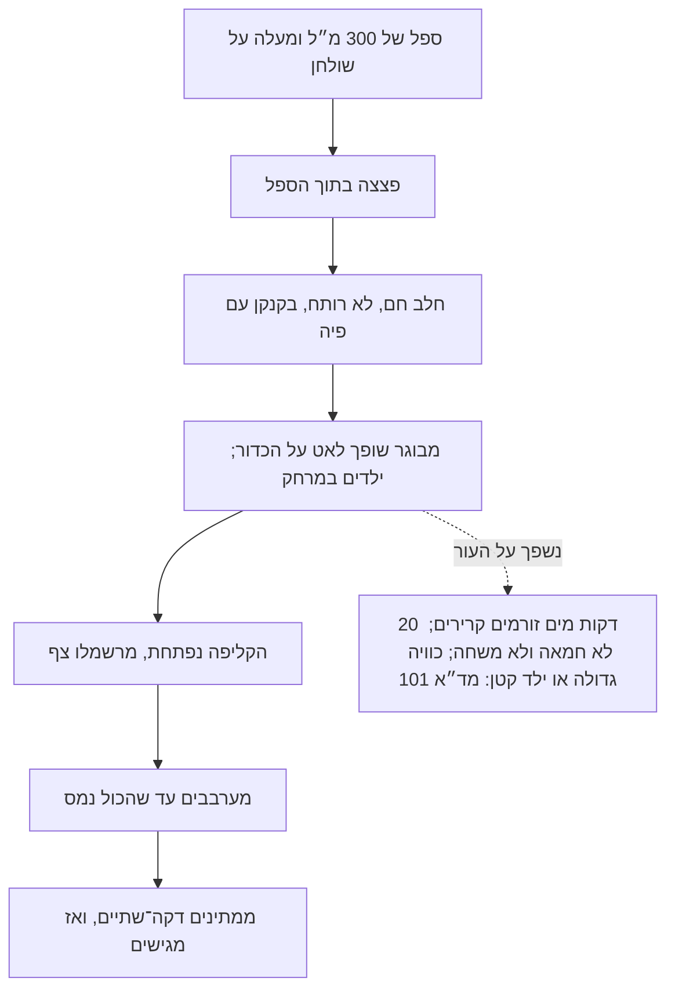

# 08.3 · ביצים, לבבות ופצצות שוקו

אחרי שיודעים לצקת שני חצאים ולחבר אותם, אותה טכניקה נותנת כמעט כל צורה סגורה: ביצה עם הפתעה בפנים, לב שנפתח, וכדור שמתפוצץ בכוס חלב חם. בשיעור הזה מכינים שתי פצצות שוקו (hot chocolate bombs), ממלאים אותן לפני הסגירה, ובודקים אחת בכוס שוקו. בדרך לומדים את מה ששונה בביצה ובלב, ואת הכללים לשפיכה בטוחה של חלב חם, כי זה החלק בשיעור שיכול לפגוע במישהו.

## מה צריך

| פריט | כמות לתרגול (2 פצצות) | כמות מלאה (6 פצצות) | הערה |
|---|---|---|---|
| קוברטורה מריר 50-70% או חלב, כולל שאריות מ־[08.1](lesson-01.md) | 300 גרם (בפצצות נשארים כ־60 גרם) | 500 גרם | כל השאר חוזר לקערה |
| תבנית חצי כדור 6 ס"מ (אותה תבנית מ־[08.1](lesson-01.md)) | 4 שקעים | 12 שקעים | |
| אבקת שוקו (תערובת מוכנה) או אבקת קקאו עם סוכר | 2 כפות (כ־15 גרם) | 6 כפות | |
| שוקולד קצוץ למילוי (אותו שוקולד) | 10 גרם | 30 גרם | משלים את הכמות ל־35 גרם לכוס |
| מרשמלו קטן (מיני) | 8-10 יחידות | 30 יחידות | אופציונלי; לבדוק ג'לטין ואלרגנים |
| סוכריות קישוט או זילוף לבן | כפית | | אופציונלי |
| חלב לבדיקה | 200 מ"ל | | או משקה צמחי |
| ספל של 300 מ"ל לפחות, עם ידית ובסיס רחב | 1 | | |
| כף יציקה או קנקן קטן עם פיה | 1 | | לשפיכה איטית |
| מחבת נון־סטיק, כפפות, מדחום, שקית זילוף | 1 מכל | | כמו ב־[08.1](lesson-01.md) |

**חשבון הכמות:** לפי Callebaut, 35 גרם שוקולד הם מנה ל־200 מ"ל חלב, כמו שראיתם ב־[02.4](../module-02/lesson-04.md#הכמות-35-גרם-ל200-מל). כדור של 6 ס"מ בשתי שכבות שוקל כ־25-30 גרם, ועוד 10 גרם שוקולד קצוץ בפנים משלימים לכ־35-40 גרם. אבקת השוקו מוסיפה טעם ומתיקות. מי שאוהב שוקו מתוק פחות מוותר על האבקה ומכניס 15 גרם שוקולד קצוץ.

**אלרגנים:** קוברטורה מכילה בדרך כלל **סויה**, ושוקולד חלב ותערובות שוקו מכילים **חלב**. חלב הבדיקה הוא **חלב**. במרשמלו יש ג'לטין, ולעתים **ביצים** או צבעים; בסוכריות קישוט לבדוק **חלב** ו**גלוטן**. רבים "עלולים להכיל" **אגוזים** ו**בוטנים**. כותבים את כל זה על הפתק שמצורף לפצצה.

## למה זה עובד

### אותם חצאים, שלוש צורות

ביצה, לב וכדור הם שני חצאים שמחוברים בשפה, בדיוק כמו ב־[08.1](lesson-01.md). ההבדלים:

| צורה | מה שונה | למה לשים לב |
|---|---|---|
| כדור (פצצת שוקו) | ממלאים חצי אחד לפני הסגירה | התפר צריך להחזיק גם כשמזיזים את הכדור, אבל להימס בחלב |
| ביצה | בדרך כלל גדולה יותר (10-15 ס"מ), ולכן קליפה עבה יותר | Le Cordon Bleu בונים ביצה גדולה משתי שכבות, ומעמידים אותה על "כרית" של שוקולד מטומפר בקוטר 7 ס"מ |
| לב | שפה עם פינה חדה למטה ושקע למעלה | בפינות השוקולד נוטה להיות דק; מקישים היטב ומסובבים כדי שיגיע אליהן |

בביצה ובלב אפשר להכניס "הפתעה" לפני הסגירה: בונבונים מעטופים, סוכריות או מטבעות שוקולד ([04.4](../module-04/lesson-04.md)). כל מה שנכנס צריך להיות יבש וקל, כדי שלא ילחץ על התפר.

### למה הפצצה "מתפוצצת"

כשחלב חם נשפך על הכדור, הוא מחמם את הקליפה מבחוץ. חמאת קקאו נמסה מתחת ל־34°C, ולכן הקליפה מתרככת ונפתחת דווקא בנקודה החלשה: התפר או החלק הדק בפסגה. האוויר והמרשמלו שבפנים עולים, והמרשמלו צף. אחרי ערבוב, השוקולד מהקליפה ומהמילוי נמס בחלב, ומקבלים כוס שוקו. ב־Food Network מחממים 180-240 מ"ל חלב לכל פצצה "עד שהוא חם מאוד", בלי טמפרטורה מדויקת. קליפה עבה מדי לא תיפתח, ותצטרכו לשבור אותה בכפית: זו עוד סיבה לשתי שכבות ולא שלוש בכדור של 6 ס"מ.

### טמפרור: כדי שהפצצה תחזיק עד שמגישים

פצצה מטומפרת משתחררת מהתבנית, מבריקה, לא נמרחת על האצבעות ונשמרת ימים וגם שבועות בחדר קריר. Food Network מטמפרים בשיטת ההזרעה (הם מגיעים לכ־32°C במריר), ומוציאים את החצאים בכפפות. בתבנית סיליקון אפשר לקלף גם שוקולד לא מטומפר, אבל הוא יימרח, יתרכך בחום ויאפיר. מתנה מטמפרים.

### הסגירה: התפר צריך להיות סגור לגמרי

באבקת שוקו אין מים, ולכן מילוי יבש לא מקצר את חיי המדף של השוקולד. אבל אבקה שנכנסת לתפר מונעת הדבקה, ותפר עם חור מפזר אבקה בקופסה. לכן ממלאים רק עד שני שליש מהחצי, ומנקים את השפה במכחול יבש לפני הסגירה. Food Network סוגרים בדיוק בשיטת הצלחת החמה: מניחים חצי ריק "רק לשנייה" על מחבת נון־סטיק על אש נמוכה מאוד, ולוחצים אותו מיד על חצי מלא, תפר מול תפר.

### החלק המסוכן: חלב חם בספל

לפי נתוני בטר"ם שמביא משרד החינוך, רוב הכוויות אצל פעוטות עד גיל 4 נגרמות מנוזלים חמים, ו־3 מכל 5 ילדים שמגיעים למיון בגלל כוויה נפגעו מנוזל רותח. עור של ילד דק מעור של מבוגר, וגוף קטן אומר שגם מעט נוזל חם יוצר כוויה נרחבת. פצצת שוקו היא בדיוק מתנה שילדים אוהבים לראות "מתפוצצת", ולכן:

- **מבוגר שופך**, והילד צופה ממרחק, לא מחזיק את הספל.
- **ספל יציב וגדול**: לפחות 300 מ"ל ל־200 מ"ל חלב, כדי שהכדור והמרשמלו לא ידחפו חלב מעבר לשפה. ספל עם בסיס רחב, על שולחן, לא ביד.
- **שופכים לאט**, מקנקן עם פיה או בכף יציקה, על הכדור ולא מגובה.
- **חלב חם, לא רותח**: מחממים עד שעולים אדים וקצוות קטנים מבעבעים, ולא עד רתיחה. במיקרוגל מערבבים באמצע ובסוף, כי יש נקודות חמות ([02.1](../module-02/lesson-01.md)).
- **ממתינים** דקה־שתיים אחרי הערבוב לפני שילד שותה.

עזרה ראשונה, לפי NHS: מחזיקים את הכוויה **מתחת למים זורמים קרירים 20 דקות**, כמה שיותר מהר. מורידים בגדים ותכשיטים שליד הכוויה, אבל לא מה שנדבק לעור. לא מורחים חמאה, שמנים או משחות. אחרי הקירור מניחים ניילון נצמד ברפיון על הכוויה, בלי לעטוף. כוויה גדולה או עמוקה, כוויה בפנים או באזור המפשעה, או כוויה בילד קטן: פונים מיד לטיפול רפואי (בישראל: מד"א 101).

## שלב אחר שלב

> [!WARNING]
> שני מקורות חום בשיעור: מחבת לסגירה (חמימה בלבד, אש נמוכה מאוד) וחלב חם לבדיקה. את החלב מחממים ושופכים רק מבוגרים, בספל על שולחן, כשילדים לא בטווח יד. נשפך על העור: 20 דקות מים זורמים קרירים, בלי חמאה ובלי משחות.

**יציקה (כ־45 דקות)**

1. **מכינים** את תבנית חצי הכדור כמו ב־[08.1](lesson-01.md): ניקוי, ייבוש, ליטוש, כפפות.
2. **מטמפרים** 300 גרם. בדיקת סכין עוברת.
3. **יוצקים 4 חצאים בשתי שכבות**, בדיוק לפי שלבים 5-10 ב־[08.1](lesson-01.md): מילוי, הקשה, סיבוב, ריקון, גירוד, ניקוז, 10 דקות בחדר, שכבה שנייה, ניקוז על נייר לשפה רחבה.
4. **מקררים** 10 דקות בחדר ו־15-20 דקות במקרר, הפתחים למעלה. בינתיים שוקלים 10 גרם שוקולד קצוץ ו־15 גרם אבקת שוקו לכל פצצה, וסופרים מרשמלו.
5. **מוציאים** את החצאים בכפפות, על מגבת נקייה. בוחרים לכל פצצה חצי "תחתון" (השלם והעבה יותר) וחצי "עליון".
6. **שוקולד שנשאר**: שומרים כ־30 גרם מטומפרים לקישוט ולתיקונים, ואת השאר יוצקים לטבלה או לשקית "להמסה".

**מילוי וסגירה (כ־15 דקות)**

7. **מייצבים** כל חצי תחתון בתוך כוס קטנה או טבעת נייר, הפתח למעלה.
8. **ממלאים**: אבקת שוקו, שוקולד קצוץ, ומעל מרשמלו, עד כשני שליש מהגובה. שום דבר לא בולט מעל השפה.
9. **מנקים את השפה** במכחול יבש או בנייר: בלי גרגרי אבקה.
10. **סוגרים**: מחממים מחבת נון־סטיק נקייה ויבשה על האש הנמוכה ביותר וכבים. מניחים חצי עליון ריק, הפתח למטה, 1-2 שניות, ומצמידים מיד על החצי המלא, תפר מול תפר. מחזיקים 20 שניות בכפפות.
11. **בודקים את התפר** מסביב. אם יש פתח, מזלפים קו דק של שוקולד מטומפר על התפר ומחליקים באצבע עם כפפה.
12. **מקשטים** (לא חובה): זילוף פסים של שוקולד בצבע מנוגד, וסוכריות מעל בזמן שהזילוף עוד רך. מניחים 20 דקות בחדר.

**בדיקה בכוס (כ־5 דקות, מבוגר בלבד)**

13. **מחממים** 200 מ"ל חלב עד שעולים אדים, בלי רתיחה. במיקרוגל: מערבבים באמצע ובסוף.
14. **מניחים** פצצה אחת בספל של 300 מ"ל לפחות, על השולחן.
15. **שופכים** לאט מהקנקן על הפסגה של הכדור. תוך 10-30 שניות הקליפה נפתחת והמרשמלו עולה.
16. **מערבבים** עד שאין חתיכות שוקולד בתחתית, ממתינים דקה ושותים. רושמים: תוך כמה שניות נפתחה, ואם השוקו חזק מספיק.

**ביצה או לב (אם יש תבנית)**: אותם שלבים, עם שלושה שינויים: בתבנית גדולה (10 ס"מ ומעלה) יוצקים שתי שכבות ושוקלים שלישית; את ההפתעה מכניסים לפני הסגירה, עטופה; ואת הביצה מעמידים, כמו ב־Le Cordon Bleu, על עיגול של כף שוקולד מטומפר על נייר אפייה, שממתינים עד שהשוליים שלו עמומים, ומחזיקים את הביצה עליו עד שהוא קשה.

## בדיקה: איך יודעים שהצליח

- **תפר אטום**: מנערים את הפצצה בעדינות מעל צלחת לבנה: אין אבקה שיוצאת. מסובבים מול האור: אין סדק לאורך התפר.
- **ברק ושחרור**: החצאים יצאו מהתבנית בהיפוך, הקליפה מבריקה ולא נמרחת על כפפה אחרי 10 שניות בכף היד.
- **משקל**: כל פצצה שוקלת כ־40-55 גרם עם המילוי. כתבו את המספר.
- **בכוס**: הקליפה נפתחת תוך 30 שניות מהשפיכה, ואחרי ערבוב של כדקה אין גושים בתחתית. השוקו בטעם ובסמיכות של כוס עם כ־35 גרם שוקולד.
- **בטיחות**: החלב לא גלש מהספל, אף אחד לא החזיק את הספל ביד בזמן השפיכה, והספל עמד על משטח יציב.
- **ביצה או לב**: עומדים על הבסיס בלי ליפול כשמזיזים את הצלחת.

## כשזה משתבש

| מה רואים | למה זה קורה | מה עושים עכשיו | איך מונעים בפעם הבאה |
|---|---|---|---|
| הפצצה לא נפתחת בכוס | קליפה עבה מדי (שלוש שכבות, או שכבה עבה בתחתית), או חלב פושר | שוברים בכפית ומערבבים; השוקו עדיין טוב | שתי שכבות בכדור של 6 ס"מ, ריקון טוב; חלב חם עד אדים |
| הפצצה נפתחה כבר בקופסה, בתפר | אבקה בתפר, או מחבת חמה מדי שהמיסה את השפה | פותחים, מנקים את השפה ומדביקים בקו שוקולד מטומפר | מילוי עד שני שליש; ניקוי השפה במכחול; מחבת חמימה בלבד |
| המרשמלו בולט ומונע סגירה | מילוי עד השפה | מוציאים מרשמלו אחד או שניים | ממלאים עד שני שליש ובודקים בעין מהצד |
| חלב גלש מהספל | ספל קטן מדי, או שפיכה מהר ומגובה | מנגבים מיד; אם נשפך על העור: 20 דקות מים זורמים קרירים | ספל של 300 מ"ל לפחות; שפיכה איטית מקנקן קרוב לכדור |
| גושי שוקולד בתחתית הכוס | חלב לא חם מספיק, או ערבוב קצר | מחממים את הכוס 15-20 שניות במיקרוגל ומערבבים | חלב עד שעולים אדים; ערבוב של דקה |
| הקליפה נמרחת על האצבעות ומאפירה | השוקולד לא טומפר (או איבד טמפר) | הפצצות לבית, לשתייה השבוע | בדיקת סכין לפני היציקה; לא עוברים את טמפרטורת העבודה |
| הביצה נפלה מהבסיס | עיגול הבסיס היה נוזלי מדי, או קשה מדי, כשהעמידו עליו | מגרדים ומכינים עיגול חדש | מחכים שהשוליים יהיו עמומים, ומחזיקים את הביצה עד שהבסיס קשה |

### מה עושים עם מה שלא הצליח

שום דבר לא הולך לפח, ובשיעור הזה זה במיוחד קל: כל פצצה שלא יצאה יפה היא כוס שוקו. חצאים שבורים נכנסים לכוס יחד עם אבקה ומרשמלו, או נמסים מחדש עם שאר השוקולד. שוקולד שאיבד טמפר הולך לבראוניז, לרוטב או לטבלת bark. אבקה שנשפכה לא חוזרת לשקית הגדולה (אולי נגעה במשטח); משתמשים בה לכוס של היום.

## חלופות

### טבעוני / פרווה

קליפה ממריר בלי חלב ברכיבים, ומילוי של אבקת קקאו, סוכר ושוקולד מריר קצוץ, נותנים פצצה טבעונית, ופרווה אם כל הרכיבים מסומנים פרווה. הבעיה היא המרשמלו: רוב המרשמלו עשוי עם ג'לטין, ולכן הוא לא טבעוני, ולעתים גם לא פרווה ([לא טבעוני גם כשכתוב פרווה](../../references/kashrut-guide.md#לא-טבעוני-גם-כשכתוב-פרווה)). מוותרים עליו או מחפשים מרשמלו שכתוב עליו טבעוני. בכוס: משקה שיבולת שועל או סויה "ברִיסטה" מתנהגים כמו חלב בשפיכה; משקה דליל נותן שוקו דליל יותר, ואז מוסיפים 5 גרם שוקולד.

### בריא יותר

פצצה של 6 ס"מ היא מנה לכוס אחת. כדי להפחית סוכר: מוותרים על תערובת השוקו המוכנה ועל המרשמלו, ומכניסים 15 גרם מריר 70% קצוץ וכפית קקאו טהור. תבנית של 5 ס"מ נותנת פצצה קטנה יותר לכוס של 150 מ"ל. מי שמשתמש בשוקולד עם מלטיטול לקליפה, מטמפר לפי היצרן.

> [!CAUTION]
> מלטיטול גורם לגזים ולשלשול כשאוכלים ממנו כמות, והוא לא מתאים לילדים בכמויות. פצצות שוקו הן מתנה לילדים, ולכן פצצה עם מלטיטול מסמנים בבירור על הפתק.

### כשרות

פצצה עם שוקולד חלב או עם תערובת שוקו שמכילה אבקת חלב היא חלבית, וכך גם הכוס. מי שמכין פרווה (למשל כדי להגיש עם משקה צמחי אחרי ארוחה בשרית) צריך שהקוברטורה, האבקה, הסוכריות והמרשמלו יהיו מסומנים פרווה בהכשר שהוא סומך עליו. מרשמלו וג'לטין הם שאלה של הכשר: יש ג'לטין מבקר, מחזיר או מדגים, ובודקים מה כתוב על האריזה ([סוכריות וקישוטים](../../references/kashrut-guide.md#סוכריות-וקישוטים), [אבקת קקאו](../../references/kashrut-guide.md#אבקת-קקאו), [קוברטורה מרירה](../../references/kashrut-guide.md#קוברטורה-מרירה), [קוברטורה חלב](../../references/kashrut-guide.md#קוברטורה-חלב)). אם יש ספק, שואלים את הרב.

## איפה קונים

מה מחפשים: תבנית חצי כדור (half sphere / dome mould) בקוטר 5-7 ס"מ, אותה תבנית מ־[08.1](lesson-01.md); לביצים וללבבות, תבנית יציקה של ביצה או לב בשני חצאים (3D chocolate mould), בגודל 7-10 ס"מ להתחלה. צריך גם אבקת קקאו או תערובת שוקו, מרשמלו מיני (לבדוק ג'לטין), סוכריות קישוט וקופסה או שקית צלופן לכל פצצה. חנויות, מחירים ומלאי: [תבניות כדור וחצי כדור](../../references/where-to-buy.md#תבניות-כדור-וחצי-כדור), [תבניות ביצה ותלת ממד](../../references/where-to-buy.md#תבניות-ביצה-ותלת-ממד), [אבקת קקאו](../../references/where-to-buy.md#אבקת-קקאו), [סוכריות קישוט](../../references/where-to-buy.md#סוכריות-קישוט), [צלופן וסרטים](../../references/where-to-buy.md#צלופן-וסרטים), [מדבקות ותוויות](../../references/where-to-buy.md#מדבקות-ותוויות). כשרות: [אבקת קקאו](../../references/kashrut-guide.md#אבקת-קקאו), [סוכריות וקישוטים](../../references/kashrut-guide.md#סוכריות-וקישוטים).

## תרגול

### משימה

מכינים 2 פצצות שוקו בקוטר 6 ס"מ: שתי שכבות, מילוי של אבקה, שוקולד קצוץ ומרשמלו, סגירה במחבת חמימה. בודקים אחת בכוס של 200 מ"ל חלב, לפי כללי השפיכה הבטוחה, ורושמים תוך כמה שניות נפתחה. את השנייה אורזים בשקית צלופן עם פתק: "לשים בספל של 300 מ"ל, לשפוך לאט 200 מ"ל חלב חם, לערבב", אלרגנים, חלבי או פרווה, ותאריך.

### זמן

כ־45 דקות ליציקה כולל טמפרור, 30 דקות קירור (המתנה), 15 דקות למילוי ולסגירה, ו־5 דקות לבדיקה בכוס. סך הכול כשעה ורבע של עבודה.

### יומן

ממלאים שורה ב[יומן הטמפרור](../../templates/tempering-log.md) ושורה ב[יומן התרגול](../../templates/practice-log.md): משקל הקליפה ומשקל הפצצה המלאה, מה הכנסתם ובאיזו כמות, איך סגרתם, תוך כמה שניות נפתחה בכוס, אם השוקו היה חזק מספיק, ומה תשנו (עובי, כמות מילוי, חום החלב).

### בדיקה עצמית

- [ ] יצקתי חצאים בשתי שכבות משוקולד מטומפר, והם יצאו שלמים ומבריקים.
- [ ] מילאתי עד שני שליש, ניקיתי את השפה וסגרתי בלי פתח בתפר.
- [ ] שפכתי את החלב לאט, בספל של 300 מ"ל לפחות על שולחן, בלי ילדים בטווח יד.
- [ ] הפצצה נפתחה תוך 30 שניות, והשוקו נמס לגמרי אחרי ערבוב.
- [ ] על הפתק של הפצצה השנייה כתובים הוראות, אלרגנים, חלבי או פרווה, ותאריך.

## סיכום

- ביצה, לב ופצצת שוקו הם אותם שני חצאים מ־[08.1](lesson-01.md); ממלאים חצי אחד לפני הסגירה, עד שני שליש, ומנקים את השפה.
- פצצה של 6 ס"מ: כ־25-30 גרם קליפה ועוד 10 גרם שוקולד בפנים, כ־35 גרם ל־200 מ"ל חלב, לפי Callebaut.
- שתי שכבות: קליפה עבה מדי לא נפתחת בכוס, ודקה מדי נשברת בדרך.
- חלב חם הוא הסיכון הגדול בשיעור: ספל גדול על שולחן, מבוגר שופך לאט, ילדים במרחק; כוויה: 20 דקות מים זורמים קרירים.
- ביצה גדולה עומדת על עיגול שוקולד מטומפר, ולב צריך הקשה טובה כדי שהשוקולד יגיע לפינה.
