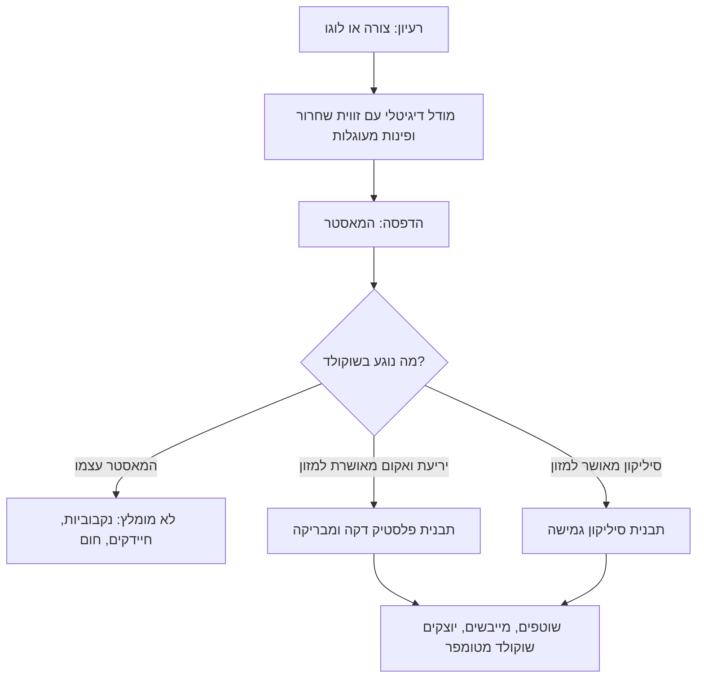

# 08.4 · דמויות קטנות ותבניות מודפסות

דמויות קטנות, כמו חנוכייה, כוכב, דג או פרצוף, הן הקישוט שהופך מארז רגיל למארז אישי, והן גם הדרך הכי מהירה לתרגל פרטים חדים בתבנית. בשיעור הזה יוצקים 6 דמויות קטנות ומלאות, ולומדים איך להפוך מודל מודפס בתלת־ממד לתבנית משלכם: כמאסטר שמעליו יוצקים סיליקון בטוח למזון או שואבים יריעת פלסטיק בוואקום, ולא כתבנית שהשוקולד נוגע בה ישירות. זו הדרך השלישית לסביבון מ־[08.2](lesson-02.md), ולכל צורה שלא נמכרת בחנות.

## מה צריך

| פריט | כמות לתרגול | כמות מלאה | הערה |
|---|---|---|---|
| קוברטורה, כולל שאריות מהמודול, מאותו מוצר | 300 גרם (בדמויות נשארים כ־30-60 גרם) | 300 גרם לכל סוג | העודף חוזר לקערה |
| תבנית דמויות קטנות (3-4 ס"מ), פוליקרבונט, פלסטיק או סיליקון | 6 שקעים | | חנוכייה, כוכב, דג, צורות חג |
| שקית זילוף קטנה, קיסם, מכחול עדין | 1 מכל | | קיסם לפינות ולבועות |
| שפכטל, כפפות, מדחום, משקל | 1 מכל | | |
| **רק למסלול התבנית המותאמת:** מודל מודפס (מאסטר) | 1 | | מדפסת ביתית, ספרייה או מעבדת יצירה, או שירות הדפסה |
| סיליקון ליציקת תבניות שהיצרן מציין שמתאים למזון, או יריעות PETG/HDPE לוואקום שהיצרן מציין שמתאימות למזון | לפי גודל המאסטר | | בודקים בדף הנתונים, לא בתיאור החנות |
| קופסת יציקה (קרטון, לגו, או פלסטיק), כוסות חד־פעמיות ומקלות ערבוב, משקל | 1 | | ליציקת סיליקון |

**אלרגנים:** קוברטורה מכילה בדרך כלל לציטין **סויה**; שוקולד חלב ולבן מכילים **חלב**; רבים "עלולים להכיל" **אגוזים** ו**בוטנים**. בודקים על האריזה.

## למה זה עובד

### דמות קטנה: מלאה, לא חלולה

דמות של 3-4 ס"מ קטנה מכדי לרוקן: הפתח צר, והשוקולד לא יספיק לזרום החוצה לפני שיתקשה. לכן ממלאים אותה עד הסוף, כמו מטבע ב־[04.4](../module-04/lesson-04.md). שני דברים משתנים כשהחתיכה מלאה ועבה:

1. **בועות ופרטים**: בפינות צרות (אצבעות, להבות של חנוכייה, קרניים של כוכב) נלכד אוויר. כמו שראיתם ב־[05.1](../module-05/lesson-01.md), חורים נובעים מבועות אוויר, משוקולד לא נוזלי מספיק ומתבניות עם פינות חדות, והתרופה היא הקשה על השיש. בדמות קטנה מוסיפים עוד צעד: מורחים שכבה דקה במכחול או בקיסם לתוך הפרטים הקטנים לפני שממלאים.
2. **קירור ארוך יותר**: חתיכה עבה מחזיקה יותר חום, וההתכווצות לוקחת יותר זמן. בתבנית שקופה מחכים עד שרואים התנתקות בכל הדמות, ולא מוציאים לפי השעון.

### שלוש דרכים לתבנית מותאמת

| דרך | מה נוגע בשוקולד | יתרונות | מגבלות |
|---|---|---|---|
| הדפסה ישירה מ־PLA או PETG | הפלסטיק המודפס | מהיר וזול | **לא מומלץ בקורס**: נקבוביות ושכבות שאוגרות חיידקים, רגישות לחום |
| יריעת ואקום (vacuum forming) מעל מאסטר מודפס | יריעת פלסטיק חלקה שהיצרן מציין שמתאימה למזון | ברק טוב, תבנית דקה כמו תבניות יציקה מפלסטיק, אפשר להעתיק הרבה | צריך מכונת ואקום; בלי חתכים חוזרים; התבנית דקה ונשחקת |
| סיליקון יצוק מעל מאסטר מודפס | סיליקון שהיצרן מציין שמתאים למזון | גמיש, משחרר צורות מסובכות, עמיד | 24 שעות ייבוש ויותר; גימור סאטן, לא מראה ([04.1](../module-04/lesson-01.md)) |

### למה לא יוצקים שוקולד ישר להדפסה

הדפסת FDM (חוט פלסטיק שנמס ונערם בשכבות) נראית חלקה, אבל היא לא:

- **שכבות ונקבוביות**: Formlabs מסבירים שהחוט עגול בחתך, ולכן בין השכבות נשארים חריצים צרים, ומזהירים ש"חלק מודפס יכול להפוך לצלחת פטרי שורצת חיידקים תוך שבועות". לפי Prusa, החריצים בין השכבות הם "ערוגה לחיידקים" וקשה לנקות אותם, והם גם סופגים סבון וחומרי ניקוי שעלולים לעבור אחר כך למזון.
- **חום**: לפי Formlabs, PLA, PET וניילון מתרככים ומתעוותים בסביבות 60-70°C, ולכן הם לא עוברים מדיח כלים. תבנית שוקולד שוטפים במים חמימים, אבל תבנית מעוותת בפעם אחת היא תבנית שנזרקת.
- **הדיזה (nozzle)**: Prusa כותבים שדיזת פליז רגילה לא נחשבת בטוחה למזון, כי היא נשחקת והחומר שלה נכנס להדפסה; Formlabs מוסיפים שפליז עלול להכיל עופרת, וממליצים על פלדת אל־חלד.
- **שרף (resin)**: לפי Formlabs, אף שרף שלהם אינו בטוח למזון בלי צעדים נוספים, ושרפים ביו־תואמים מאושרים רק לשימוש הרפואי שלהם.
- **חוט "בטוח למזון"**: לפי Prusa, חוט לא צבוע הוא הבחירה הבטוחה יותר, ויש חוטים שהאישור שלהם חל רק על חלק מהצבעים. Formlabs ממליצים לבדוק בדף הנתונים שיש **תעודה** למגע במזון, ולא להסתפק במילה "compliant".

ציפוי אפוקסי שמאושר למזון יכול לאטום הדפסה, אבל לפי Formlabs ציפויים נשחקים עם הזמן ואינם ערובה לבטיחות לאורך זמן. לכן הקורס ממליץ על כלל אחד פשוט: **ההדפסה היא מאסטר. השוקולד נוגע רק בחומר שהיצרן שלו מציין שמתאים למזון.**

### כללי עיצוב למאסטר

| כלל | למה | מקור |
|---|---|---|
| בלי חתכים חוזרים (undercuts): כל דופן "נפתחת" כלפי מעלה | החתך החוזר נועל את המאסטר ביריעה ואת השוקולד בתבנית | Formlabs |
| זווית שחרור (draft) של 5-10° בדפנות אנכיות | השוקולד המתכווץ והמאסטר יוצאים בלי להיתפס | Mayku |
| פינות מעוגלות ב־0.5 מ"מ לפחות | שחרור קל יותר ופחות "קורי" פלסטיק ביריעה | Mayku |
| חורים של 1 מ"מ בנקודה הנמוכה של כל שקע במאסטר (לוואקום) | הוואקום מושך את היריעה גם לפרטים העמוקים | Formlabs |
| שכבה דקה, החלקה או שיוף של פני המאסטר | כל פס של שכבה עובר לתבנית ומשם לשוקולד | Mayku, Formlabs |
| בסיס שטוח שיושב על משטח המכונה או בתחתית קופסת היציקה | יריעה או סיליקון לא זולגים מתחת | Formlabs |

סביבון הוא דוגמה טובה: סביבון שלם הוא צורה עם חתכים חוזרים (הגוף רחב מהחוד ומהידית), ולכן מעצבים **חצי סביבון** שטוח בגב, מכינים ממנו תבנית, יוצקים שני חצאים ומחברים כמו ב־[08.1](lesson-01.md).

### יריעת ואקום

לפי Formlabs, בוואקום מחממים יריעת פלסטיק ומושכים אותה בוואקום על המאסטר; הם משתמשים ביריעת HDPE שמתאימה למזון, דקה מספיק כדי להיות גמישה (בדף מופיעים 0.01 ו־0.015 אינץ', כ־0.25-0.4 מ"מ), שוטפים אותה במים וסבון לפני השימוש, יוצקים שוקולד מטומפר, מקישים ומקררים, ומשחררים בכיפוף. Mayku ממליצים על יריעות שקופות של 1 מ"מ לתבניות עמידות. היריעה המתקבלת היא תבנית פלסטיק דקה, כמו "תבניות יציקה" מפלסטיק שראיתם ב־[04.1](../module-04/lesson-01.md): מבריקה כשהיא חדשה, ונשחקת עם הזמן.

### סיליקון יצוק

יוצקים סיליקון נוזלי לקופסה שבתוכה עומד המאסטר, מחכים שיתקשה, ומוציאים את המאסטר. לדוגמה, Smooth-On מציינים ש־Smooth-Sil 940 "מתאים ליישומים הקשורים במזון", מתערבב ביחס של 100 חלקים A ל־10 חלקים B במשקל, מתקשה 24 שעות, לא מתקשה טוב מתחת ל־18°C, ויש לו חימום אופציונלי אחרי ההתקשות (2 שעות ב־80°C ושעה ב־100°C). מוצרים אחרים, יחסים אחרים: **מה שכתוב בדף הנתונים של המוצר שקניתם קובע**. לפני שימוש ראשון שוטפים בסבון ומייבשים. סיליקון נותן גימור סאטן ולא מראה, ומשחרר בקילוף, כמו כל תבנית סיליקון ([04.1](../module-04/lesson-01.md)).

## שלב אחר שלב

> [!WARNING]
> סיליקון ליציקה, חומרי החלקה ושרפים הם כימיקלים: עובדים לפי דף הבטיחות של היצרן, עם כפפות ובחדר מאוורר, ולא במשטח ההכנה של האוכל. מכונת ואקום ויריעה חמה גורמות לכוויות: עובדים לפי הוראות המכונה. רק חומר שהיצרן מציין במפורש שמתאים למגע במזון נוגע בשוקולד.

**חלק א: 6 דמויות קטנות (כ־40 דקות, לכולם)**

1. **מכינים** את התבנית: ניקוי, ייבוש, ליטוש בצמר גפן (בסיליקון: רק ניקוי וייבוש). כפפות.
2. **מטמפרים** 300 גרם. בדיקת סכין עוברת. אם השוקולד סמיך, מחממים במעלה אחת, בלי לעבור את טמפרטורת העבודה.
3. **שכבת פרטים**: בקיסם או במכחול עדין מורחים שוקולד מטומפר לתוך כל פינה צרה בשקע (להבות, קרניים, אותיות).
4. **ממלאים** משקית זילוף עד השפה, ומיד מקישים על השיש 15-20 פעמים. בועות עולות; מפוצצים אותן בקיסם.
5. **מגרדים** את פני התבנית בשפכטל, בתנועה אחת, כך שהגב של כל דמות שטוח.
6. **מוסיפים מקל** (לא חובה): אם הדמויות נועדו להיות "טופר" למארז או לעוגה, מכניסים מקל סוכריה לגב של שתיים מהן, כמו ב־[04.4](../module-04/lesson-04.md).
7. **מקררים**: 10 דקות בחדר, ואז 20-25 דקות במקרר. בתבנית שקופה, מחכים עד שרואים התנתקות בכל הדמות.
8. **מוציאים** בהיפוך והקשה עדינה (בסיליקון: מקלפים את התבנית מהדמות, מהקצוות פנימה).
9. **שוקולד שנשאר** חוזר לטבלה או לשקית "להמסה".

**חלק ב: תבנית מותאמת (למי שיש גישה להדפסה, כמה ימים)**

10. **מעצבים מאסטר**: חצי סביבון שטוח בגב, דמות או לוגו, בגובה של 3-5 ס"מ. מוסיפים זווית שחרור של 5-10°, מעגלים פינות ב־0.5 מ"מ לפחות, ובודקים שאין חתכים חוזרים.
11. **מדפיסים** בשכבה דקה, ומחליקים את פני המאסטר (שיוף עדין או לפי הוראות היצרן). למסלול ואקום, מוסיפים חורים של 1 מ"מ בנקודות הנמוכות.
12. **ואקום**: יריעה שהיצרן מציין שמתאימה למזון, לפי הוראות המכונה. גוזרים את היריעה סביב השקעים, ומשאירים שוליים שטוחים לגירוד.
13. **או סיליקון**: מדביקים את המאסטר לתחתית קופסת יציקה, במרחק של כ־1 ס"מ מהדפנות. שוקלים ומערבבים לפי דף הנתונים, יוצקים לאט מפינה אחת, ומשאירים להתקשות לפי הזמן שכתוב (למשל 24 שעות) בחדר שאינו קר מהמינימום שהיצרן מציין.
14. **מכינים לשימוש**: שוטפים את התבנית החדשה במים חמימים וסבון, מייבשים לגמרי. המאסטר המודפס נשאר במדף הכלים, לא במטבח.
15. **יציקה ראשונה**: יוצקים 2 שקעים בשוקולד מטומפר (מלא לדמות קטנה, או שתי שכבות לחצי סביבון), ובודקים לפי הטבלה בהמשך.

## בדיקה: איך יודעים שהצליח

- **פרטים**: בכל דמות רואים את הפרטים הקטנים (קצוות הלהבות, הקרניים) חדים ושלמים, בלי פינה חסרה.
- **בלי חורים**: אין בועות או חורים בצד הקדמי. חור אחד בגב שטוח מותר.
- **שחרור וברק**: בפוליקרבונט או ביריעת ואקום, הדמויות יצאו בהיפוך והקשה עדינה, מבריקות. בסיליקון, יצאו בקילוף בלי להישבר, בגימור סאטן אחיד.
- **גב שטוח**: הדמות עומדת או שוכבת יציבה, בלי "שוליים" של שוקולד מסביב.
- **תבנית מותאמת**: המאסטר יצא מהיריעה או מהסיליקון בלי לקרוע אותם; בשוקולד הראשון לא רואים פסי שכבות של ההדפסה; בדף הנתונים של היריעה או הסיליקון כתוב במפורש שמתאים למגע במזון, ושמרתם צילום של הדף.

## כשזה משתבש

| מה רואים | למה זה קורה | מה עושים עכשיו | איך מונעים בפעם הבאה |
|---|---|---|---|
| פינות חסרות בדמות (להבה, קרן) | אוויר נלכד בפינה, או שוקולד סמיך | ממיסים ויוצקים שוב | שכבת פרטים בקיסם לפני המילוי, הקשה ארוכה, שוקולד נוזלי יותר ([05.1](../module-05/lesson-01.md)) |
| הדמות נשברת בהוצאה בחלק דק | הוצאה לפני התכווצות מלאה, או דופן דקה מאוד בעיצוב | מדביקים בנקודת שוקולד מטומפר, או ממיסים | קירור ארוך יותר לחתיכה עבה; בתבנית מותאמת מעבים חלקים דקים מ־3 מ"מ |
| המאסטר לא יוצא מהסיליקון או מהיריעה | חתך חוזר בעיצוב, או דפנות בלי זווית שחרור | חותכים את הסיליקון בצד נסתר, או מתחילים מחדש | בודקים חתכים חוזרים לפני ההדפסה; זווית של 5-10° |
| פסים של שכבות על השוקולד | פני המאסטר לא הוחלקו, והתבנית העתיקה אותם | הדמות שמישה; זה עניין של מראה | שכבת הדפסה דקה, שיוף או החלקה (Mayku, Formlabs) |
| הסיליקון נשאר דביק אחרי הזמן שכתוב | יחס ערבוב לא מדויק, ערבוב חלקי, או חדר קר | לא משתמשים בו למזון; מנסים שוב | שוקלים במשקל, מערבבים טוב כולל הדפנות, חדר חם מהמינימום של היצרן |
| התבנית המודפסת התעוותה אחרי שטיפה | PLA מתרכך בסביבות 60-70°C (Formlabs) | לא משתמשים בה יותר למזון | ההדפסה היא מאסטר בלבד; שוטפים רק את תבנית הסיליקון או היריעה |
| יריעת הוואקום לא הגיעה לפרטים העמוקים | אין חורי אוויר בנקודות הנמוכות, או יריעה עבה | מדפיסים מאסטר עם חורים | חורים של 1 מ"מ (Formlabs), יריעה דקה יותר |

### מה עושים עם מה שלא הצליח

שום דבר לא הולך לפח. דמויות עם פינה חסרה נמסות מחדש, או נשברות לטבלת bark ולשוקו. דמויות שבורות שאפשר לחבר מודבקות בנקודת שוקולד מטומפר, ומשמשות לקישוט עוגה בבית. שוקולד שאיבד טמפר הולך לבראוניז או לרוטב. תבנית סיליקון שלא התקשתה טוב או הדפסה שהתעוותה לא נוגעות במזון: הן לא "נחסכות" בשוקולד. היא יכולה לשמש לתרגול יציקה בשעווה או בגבס, אבל לא לאוכל.

## חלופות

### טבעוני / פרווה

דמויות ממריר בלי חלב ברכיבים הן טבעוניות, ופרווה אם ההכשר אומר פרווה. בתבניות מותאמות, חומרי ההחלקה והשחרור (release agent) שמשמשים ביציקת סיליקון לא נוגעים בשוקולד, אבל אם השתמשתם בהם על המאסטר, שוטפים את התבנית היטב לפני שימוש ראשון. שוקולד "חלב" טבעוני מטמפרים לפי היצרן, ובודקים נזילות לפני שממלאים פרטים קטנים.

### בריא יותר

דמות של 3-4 ס"מ שוקלת 5-10 גרם: מנה קטנה מאוד. תבנית מותאמת מאפשרת לקבוע את הגודל מראש, למשל סביבון מיני של 10 גרם במקום 20. מריר 70% ומעלה מטמפרים באותן טמפרטורות. מלטיטול: מטמפרים לפי היצרן.

> [!CAUTION]
> מלטיטול גורם לגזים ולשלשול כשאוכלים ממנו כמות, והוא לא מתאים לילדים בכמויות. דמויות קטנות הן מתנה לילדים, ולכן מסמנים בבירור כשיש בהן מלטיטול.

### כשרות

הדמויות עצמן הן הכשרות של הקוברטורה שבחרתם ([קוברטורה מרירה](../../references/kashrut-guide.md#קוברטורה-מרירה), [קוברטורה חלב](../../references/kashrut-guide.md#קוברטורה-חלב), [שלושה כללים](../../references/kashrut-guide.md#שלושה-כללים)). תבנית חדשה שהכנתם היא כלי חדש: מי שמקפיד על הפרדה בין חלבי לפרווה מחליט מראש לאיזה סוג היא תשמש ומסמן אותה. אם יש שאלה לגבי כלי מפלסטיק או סיליקון שהכנתם בעצמכם, למשל אם צריך טבילה, שואלים את הרב. אם יש ספק, שואלים את הרב.

## איפה קונים

מה מחפשים: לדמויות, תבנית קטנה של צורות (3D chocolate mould, figure mould) בגובה 3-4 ס"מ, מפוליקרבונט, פלסטיק יציקה או סיליקון. חנויות: [תבניות ביצה ותלת ממד](../../references/where-to-buy.md#תבניות-ביצה-ותלת-ממד), [תבניות פוליקרבונט](../../references/where-to-buy.md#תבניות-פוליקרבונט), [תבניות סיליקון](../../references/where-to-buy.md#תבניות-סיליקון), [מקלות לסוכריה](../../references/where-to-buy.md#מקלות-לסוכריה), [קוברטורה](../../references/where-to-buy.md#קוברטורה). לתבנית מותאמת: הדף [איפה קונים](../../references/where-to-buy.md#פערים) עוד לא כולל חנויות לסיליקון יציקה או ליריעות ואקום. מחפשים "food safe mold making silicone" או "סיליקון ליציקת תבניות למזון", ויריעות "food safe PETG/HDPE vacuum forming sheet", ובכל מקרה פותחים את דף הנתונים (TDS) ובודקים שהיצרן מציין במפורש התאמה למגע במזון. הדפסה: מדפסת ביתית, ספרייה או מעבדת יצירה עירונית, או שירות הדפסה; מבקשים חוט לא צבוע ומאסטר בשכבה דקה.

## תרגול

### משימה

כולם: יוצקים 6 דמויות קטנות מלאות, עם שכבת פרטים בקיסם, ובודקים אותן לפי הטבלה. שתיים מהדמויות שומרים לקישוט מארז הסביבונים בפרויקט. מי שיש לו גישה להדפסה: מעצב חצי סביבון או דמות לפי כללי העיצוב, מכין ממנו תבנית סיליקון או יריעת ואקום בטוחה למזון, ויוצק 2 שקעים. המאסטר עצמו לא נוגע בשוקולד.

### זמן

חלק א: כ־40 דקות עבודה ועוד כ־30 דקות קירור. חלק ב: שעה של עיצוב, הדפסה של כמה שעות, ו־24 שעות ויותר להתקשות הסיליקון.

### יומן

ממלאים שורה ב[יומן הטמפרור](../../templates/tempering-log.md) ושורה ב[יומן התרגול](../../templates/practice-log.md): איזו תבנית, כמה דמויות יצאו שלמות, איפה נשאר אוויר, כמה זמן קירור. למסלול המותאם: שם החומר שנוגע בשוקולד, צילום של השורה בדף הנתונים שמאשרת מגע במזון, יחס הערבוב וזמן ההתקשות.

### בדיקה עצמית

- [ ] מרחתי שכבת פרטים לפני המילוי, והקשתי עד שהבועות עלו.
- [ ] לפחות 5 מתוך 6 דמויות יצאו שלמות, עם פרטים חדים.
- [ ] (מסלול מותאם) העיצוב בלי חתכים חוזרים, עם זווית שחרור ופינות מעוגלות.
- [ ] (מסלול מותאם) רק חומר שהיצרן מאשר למגע במזון נגע בשוקולד, וההדפסה שימשה כמאסטר בלבד.
- [ ] שמרתי שתי דמויות לפרויקט, וכל השאר חזר להמסה או לשוקו.
- [ ] עכשיו מכינים את [מארז 5 סביבוני השוקולד](../../projects/m08-dreidel-box.md), פרויקט המודול.

## סיכום

- דמות קטנה ממלאים עד הסוף: שכבת פרטים בקיסם, הקשה ארוכה, וקירור עד שרואים התנתקות.
- הדפסת PLA לא נוגעת בשוקולד: שכבות ונקבוביות אוגרות חיידקים וסבון, והחומר מתרכך ב־60-70°C.
- ההדפסה היא מאסטר: מעליה יוצקים סיליקון או שואבים יריעה שהיצרן מציין במפורש שמתאימים למזון.
- מאסטר טוב: בלי חתכים חוזרים, זווית שחרור של 5-10°, פינות מעוגלות, פנים חלקות; סביבון מעצבים כחצי.
- דף הנתונים קובע, לא תיאור החנות: יחס ערבוב, זמן התקשות ואישור למגע במזון.
