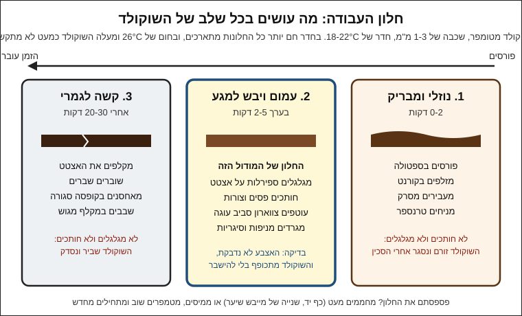

# 09.1 · תלתלים, מניפות ופסים על אצטט

קישוטי שוקולד הם החלק שהופך עוגה רגילה או כוס מוס לקינוח שנראה כמו מחלון של קונדיטוריה, והם עשויים מאותו שוקולד מטומפר שאתם כבר יודעים להכין. בשיעור הזה לומדים שלוש טכניקות מאותה קערה: ספירלות מפוספסות על אצטט, מניפות וסיגריות שמגרדים ממשטח, ותלתלים במקלף ירקות. בסוף השיעור יש לכם קופסה של קישוטים מוכנים, שישמשו אתכם בשיעור 09.3 ובפרויקט המודול.

## מה צריך

| פריט | כמות לתרגול | כמות מלאה | הערה |
|---|---|---|---|
| קוברטורה מריר 55-70%, מטומפרת | 300 גרם | 600 גרם | 200 גרם לאצטט ולמניפות, 100 גרם נשארים בקערה לתיקונים ולמה שחוזר |
| קוברטורה לבנה, מטומפרת | 50 גרם | 100 גרם | לא חובה: לפסים בצבע שני בספירלות |
| גוש או טבלה עבה של שוקולד | 100 גרם | | לתלתלים במקלף; טבלה של 100 גרם מהסופר מספיקה, ולא ממיסים אותה |
| דפי גיטרה (אצטט) | 2 דפים | 4 | חותכים לפסים של 4-5×20 ס"מ |
| מסרק לשוקולד (decorating comb) | 1 | | אם אין: שפכטל פלסטיק שחותכים בו שיניים במספריים, כל 3-4 מ"מ |
| ספטולה מדורגת (offset spatula) | 1 | | מ־04.3 |
| שפכטל מתכת רחב | 1 | | למניפות ולסיגריות |
| משטח קר וחלק | 1 | | שיש, גרניט, או גב של תבנית אפייה ממתכת שעמדה 10 דקות במקרר ונוגבה יבש |
| גליל לגלגול | 1-2 | | מערוך, גליל קרטון של מגבות נייר עטוף בנייר אפייה, או בקבוק |
| מקלף ירקות | 1 | | מקלף עם להב ישר |
| מדחום, משקל, מרית, קערה יבשה, מייבש שיער | 1 מכל | | כמו ב־03.2 |
| קופסה עם מכסה ונייר אפייה | 1 | | לאחסון הקישוטים |

**אלרגנים:** קוברטורה מכילה בדרך כלל לציטין סויה. מריר רבים מכילים או "עלולים להכיל" חלב, ושוקולד לבן מכיל חלב. רבים "עלולים להכיל" אגוזים. בודקים על האריזה.

### לפני שמתחילים את המודול

כל קישוט במודול הזה עשוי משוקולד מטומפר, ולכן הוא מבריק, נשבר בקליק ולא נמס באצבעות. מי שעוד לא מטמפר בביטחון, כדאי שיחזור ל[טמפרור בשיטת ההזרעה](../module-03/lesson-02.md) ול[בדיקת הטמפר](../module-03/lesson-05.md) לפני שממשיכים. צפייה בשיעור היא לא תרגול: הידיים לומדות את החלון שבו השוקולד מתגלגל רק אחרי כמה ניסיונות, והראשונים כמעט תמיד נשברים. האקדמיה לא יכולה לבדוק צילומים, ולכן בכל שיעור יש בדיקות ברורות (ברק, קליק, שוליים, צורה שמחזיקה) שמשווים אליהן את התוצאה. ממשיכים לרשום ב[יומן התרגול](../../templates/practice-log.md) וב[יומן הטמפרור](../../templates/tempering-log.md).

## למה זה עובד

### חלון העבודה: בין נוזלי לשביר

שוקולד מטומפר שנפרס דק עובר שלושה שלבים. בהתחלה הוא נוזלי ומבריק. אחרי כמה דקות הוא נהיה עמום ו"יבש למגע", אבל עוד גמיש. בסוף הוא קשה ושביר. לפי King Arthur, שוקולד מטומפר מתקשה תוך 3-5 דקות, ולכן השלב האמצעי קצר. כמעט כל קישוט בשיעור הזה נעשה בשלב האמצעי:

- Callebaut, בהוראות שלהם לקישוטים עדינים, כותבים לחכות שהשוקולד על האצטט יהיה "יבש למגע" (touch dry), ורק אז לגלגל אותו לספירלה.
- Jacques Torres, בהוראות לסיגריות שוקולד, כותב לגלגל כשהשוקולד "התייצב אבל עוד לא קשה לגמרי".
- America's Test Kitchen כותבים לחתוך שוקולד דק כשהוא "בדיוק נהיה עמום", כי שוקולד שהתקשה לגמרי שביר. זה הכלל שכבר הכרתם ב[דפי טרנספר ודפי גיטרה](../module-04/lesson-03.md).

למה דווקא שם? בשלב האמצעי חלק מחמאת הקקאו כבר התגבש בצורה V (03.1) וחלק עוד נוזלי בין הגבישים. הגבישים נותנים לשכבה מבנה, והשומן הנוזלי מאפשר לה להתכופף בלי להיסדק. כשכל השומן מתגבש, השכבה קשיחה ונשברת. כשהשוקולד עוד נוזלי לגמרי, אין לו מבנה, והוא נמרח או נדבק.

### טמפרטורת החדר קובעת כמה זמן יש לכם

המספרים בשיעור נכונים לחדר של 18-22°C. במטבח של 27-28°C בקיץ הישראלי השוקולד כמעט לא מתגבש, והספירלות לא מחזיקות צורה: עובדים בבוקר או עם מזגן. בחורף, ב־17°C, החלון קצר מאוד, ומי שמחכה דקה יותר מדי מגלה שהשוקולד נשבר.

### שלוש טכניקות, שלושה מקורות לצורה

| טכניקה | מאיפה באה הצורה | באיזה שלב עובדים | מה יוצא |
|---|---|---|---|
| ספירלה על אצטט | האצטט מתגלגל, והשוקולד מתגבש מגולגל | יבש למגע | Callebaut: מגלגלים ומקררים בתוך "חצי צינור" (half pipe) |
| מניפה וסיגריה ממשטח | השפכטל דוחף את השכבה והיא מתקפלת | התייצב ועוד לא קשה | Jacques Torres: שכבה של כ־1.5 מ"מ (1/16 אינץ') על שיש, ושפכטל שדוחפים בקשת |
| תלתל במקלף | הלהב מקלף פס דק, והפס מתעגל מעצמו | גוש מחומם מעט | Williams Sonoma: גוש של 8-10 ס"מ, מרוכך מעט במיקרוגל ב־50% |

### למה טמפר חשוב גם בקישוט

שכבה של 1-2 מ"מ נוגעת באצבעות ובקרם מכל הצדדים. שוקולד שלא טומפר נשאר רך, נמס כשמרימים אותו ומאפיר תוך ימים. שוקולד מטומפר מחזיק צורה, מבריק בצד שנגע באצטט ומשתחרר ממנו כמו טבלה מתבנית (04.1). תלתלים במקלף אפשר לעשות מכל גוש, כי לא ממיסים אותו.

## שלב אחר שלב

> [!WARNING]
> שוקולד מומס במיקרוגל מתחמם בכתמים ועלול לשרוף; מחממים בפולסים קצרים ומערבבים. שפכטל מתכת וסכין חדים: דוחפים הרחק מהגוף, והיד השנייה לא עומדת מול הלהב. כל הכלים, האצטט והמשטח יבשים לגמרי.

**הכנה (10 דקות)**

1. **חותכים אצטט**: 6-8 פסים של 4-5×20 ס"מ (Callebaut משתמשים ב־10×20 ס"מ לרשת; לספירלות צר יותר קל יותר).
2. **מכינים גלילים**: מערוך או גליל קרטון עטוף בנייר אפייה, על מגבת כדי שלא יתגלגל.
3. **מצננים משטח**: גב תבנית ממתכת, 10 דקות במקרר, ומנגבים יבש לגמרי: טיפת עיבוי אחת מספיקה כדי שהשוקולד ייתפס. שיש או גרניט לא צריך לקרר.
4. **מטמפרים** 300 גרם מריר בשיטת ההזרעה, ובודקים בבדיקת סכין. מריר 31-32°C, חלב 29-30°C, לבן 28-29°C. הטווחים על אריזת השוקולד שלכם קובעים.

**ספירלות מפוספסות על אצטט**

5. **פורסים**: מניחים פס אצטט על המשטח, יוצקים עליו כף שוקולד (כ־15 גרם), ופורסים בספטולה לשכבה דקה ואחידה של 1-1.5 מ"מ, מעט מעבר לשוליים.
6. **מסרקים**: מעבירים את המסרק לאורך הפס בתנועה אחת רציפה, לחוץ אל האצטט. נשארים פסים של שוקולד עם רווחים נקיים ביניהם. אם הפסים נסגרים אחרי המסרק, השוקולד חם או עבה מדי: מגרדים חזרה לקערה ומנסים שוב.
7. **מרימים**: מרימים את הפס בקצותיו ומעבירים לנייר נקי, כדי שהשוליים יהיו חדים.
8. **מחכים ליבש למגע**: 1-3 דקות. הברק נעלם, ונגיעה קלה בקצה עם אצבע לא משאירה סימן.
9. **מגלגלים**: מסובבים את הפס סביב הגליל, או מסובבים את שני קצותיו בכיוונים מנוגדים לספירלה, הצד עם השוקולד כלפי פנים. מקבעים את הקצה בפיסת סלוטייפ על האצטט עצמו.
10. **מקררים**: 15 דקות במקרר, כמו ש־Callebaut מקררים את הספירלה בחצי צינור. לא מקלפים לפני כן.

**ספירלה בשני צבעים (לא חובה)**: מסרקים קודם שוקולד לבן מטומפר, מחכים שהפסים יתייצבו (כמו Jacques Torres, שמחכה שהפסים יהיו "יציבים אבל לא קשים"), ופורסים מעליהם שכבה דקה של מריר. מחכים ליבש למגע ומגלגלים.

**מניפות וסיגריות ממשטח**

11. **פורסים על המשטח הקר**: כ־60 גרם שוקולד בשכבה דקה מאוד, כ־1.5 מ"מ, ברצועה ברוחב השפכטל.
12. **מחכים**: 1-3 דקות, עד שהשוקולד עמום ומתייצב, אבל ציפורן נכנסת בו בקלות.
13. **סיגריות**: מניחים את השפכטל בזווית נמוכה, בערך 30 מעלות למשטח, כ־3-4 ס"מ מהקצה, ודוחפים קדימה בתנועה אחת אחידה. השכבה מתגלגלת לגליל.
14. **מניפות**: מניחים אצבע אחת על פינה של השכבה, ודוחפים את השפכטל בקשת סביב האצבע, כמו ש־Jacques Torres מתאר. הצד שמתחת לאצבע נשאר צמוד, והצד השני מתקפל לקפלים.
15. **מרימים** כל קישוט בעזרת קצה של סכין או מלקחיים, ומניחים בקופסה. מגרדים את מה שנשאר על המשטח חזרה לקערה.

**תלתלים במקלף**

16. **מחממים מעט את הגוש**: 5 שניות במיקרוגל ב־50%, או 2-3 דקות בכף היד בתוך נייר. Williams Sonoma כותבים "לרכך מעט" בלבד: הגוש לא נמס, הוא רק לא קר.
17. **מקלפים**: מחזיקים את הגוש בנייר אפייה ומושכים את המקלף לאורך הצד הצר, בלחץ אחיד. הפס מתעגל לתלתל.

**קילוף ואחסון**

18. **מקלפים את הספירלות** כשהן קשות לגמרי: פותחים את הסלוטייפ ומקלפים את האצטט לאט, הרחק מהספירלה.
19. **מסדרים בקופסה** בשכבות עם נייר אפייה ביניהן, במלקחיים או בכפפות כדי לא להשאיר טביעות אצבע. התלתלים נכנסים לאותה קופסה (Williams Sonoma מקררים אותם עד השימוש; בקופסה סגורה הם נשמרים גם ב־18-20°C).

## בדיקה: איך יודעים שהצליח

- **ספירלה**: מחזיקה צורה אחרי הקילוף, הצד שנגע באצטט מבריק, והפסים נפרדים בקווים ישרים.
- **סיגריה**: גליל סגור של 2-3 סיבובים, באורך אחיד, בלי סדק לאורכו.
- **מניפה**: לפחות 5-6 קפלים, וצד אחד צר וסגור.
- **תלתל**: מתעגל לפחות חצי סיבוב ולא מתפורר כשמרימים אותו במלקחיים.
- **טמפר**: כל קישוט נשבר בקליק ולא נמס באצבע תוך שנייה או שתיים. קישוט שנמס מיד בנגיעה מגיע משוקולד שלא היה מטומפר.
- **קופסה**: לפחות 6 ספירלות, 6 מניפות או סיגריות ו־10 תלתלים שלמים, בלי טביעות אצבע.

## כשזה משתבש

| מה רואים | למה זה קורה | מה עושים עכשיו | איך מונעים בפעם הבאה |
|---|---|---|---|
| הספירלה נסדקת כשמגלגלים | חיכיתם יותר מדי והשוקולד התקשה | מחממים את גב האצטט שנייה אחת במייבש שיער, או שוברים לשברים | מגלגלים ברגע שהשוקולד יבש למגע; בחורף מוכנים מיד |
| השוקולד מחליק ונמרח על האצטט כשמגלגלים | עוד נוזלי, או שהחדר חם | מגרדים חזרה לקערה ופורסים פס חדש | מחכים לעמימות; עובדים בחדר של 18-22°C |
| הפסים נסגרים אחרי המסרק | שוקולד עבה מדי או חם מדי | מגרדים, מצננים מעט, פורסים שכבה דקה יותר | שכבה של 1-1.5 מ"מ, מסרק לחוץ אל האצטט |
| הסיגריה נשברת לפתיתים במקום להתגלגל | השוקולד על המשטח קשה מדי, או שהמשטח קר מדי | מחממים את המשטח מעט בכף יד, או אוספים את הפתיתים כשבבים | מתחילים לגרד מוקדם יותר; לא מקררים את המשטח יותר מ־10 דקות |
| התלתל במקלף יוצא אבקה, או להפך רצועה רכה | הגוש קר מדי, או חם מדי | קר: עוד 5 שניות חימום. חם: 5 דקות בחדר. השבבים טובים לפיזור | מחממים בפולסים של 5 שניות ובודקים בין פולס לפולס |
| קישוטים אפורים, רכים, נמסים באצבעות | השוקולד לא היה מטומפר | ממיסים ומטמפרים שוב | בדיקת סכין לפני כל סבב; מטמפרים מחדש כשהקערה מתקררת |

### מה עושים עם מה שלא הצליח

שום דבר לא הולך לפח. שוקולד שנמרח על האצטט או על המשטח מגרדים מיד חזרה לקערה, וממשיכים לעבוד איתו; אם הקערה התקררה, מטמפרים שוב. ספירלות וסיגריות שנשברו הן "שברים", ושבבים מתלתלים שנכשלו הם פיזור מצוין לעוגה, לגלידה או לשוקו חם. שוקולד מטומפר שנשאר בסוף נשפך על נייר אפייה כטבלה דקה, ונשמר בשקית "להמסה" לשיעור הבא או לבראוניז.

## חלופות

### טבעוני / פרווה

כל הטכניקות עובדות עם מריר שאין ברשימת הרכיבים שלו רכיבי חלב ("עלול להכיל חלב" מופיע על מרירים רבים). שוקולד לבן רגיל מכיל אבקת חלב, ולכן בגרסה טבעונית מוותרים על הצבע השני או בודקים שוקולד בהיר טבעוני על סבב קטן. מה לבדוק: [לא טבעוני גם כשכתוב פרווה](../../references/kashrut-guide.md#לא-טבעוני-גם-כשכתוב-פרווה).

### בריא יותר

ספירלה שוקלת 3-4 גרם ותלתל פחות מגרם: עוגה עם כמה קישוטים נראית חגיגית עם פחות שוקולד מציפוי מלא. מריר 70% ומעלה מתאים, אבל מתייצב מהר יותר. שוקולד ממותק במלטיטול מטמפרים לפי היצרן, והטכניקות זהות.

> [!CAUTION]
> מלטיטול גורם לגזים ולשלשול כשאוכלים ממנו כמות, והוא לא מתאים לילדים בכמויות. מי שמגיש עוגה עם שוקולד כזה אומר לאורחים מה יש בה.

### כשרות

הקישוט מקבל את הכשרות של השוקולד שממנו הוא עשוי: חלבי, חלב ישראל, פרווה או "ציוד חלבי", לפי מה שכתוב על האריזה. כשהקישוט מיועד לעוגה פרווה, בודקים שגם השוקולד וגם כל מה שנגע בו פרווה. אצטט, שפכטל ומסרק אינם מאכל. הכללים: [שלושה כללים במדריך הכשרות](../../references/kashrut-guide.md#שלושה-כללים), ולפי סוג השוקולד: [קוברטורה מרירה](../../references/kashrut-guide.md#קוברטורה-מרירה), [קוברטורה לבנה](../../references/kashrut-guide.md#קוברטורה-לבנה). אם יש ספק, שואלים את הרב.

## איפה קונים

מה מחפשים: קוברטורה מריר 55-70% בפולים או בדסקיות (שקל לטמפר), ולבנה לצבע שני. דפי גיטרה (אצטט) או גליל שקף לעוגה, שאותו חותכים לפסים. ספטולה מדורגת ושפכטל מתכת רחב. מסרק לשוקולד נמכר בחנויות אפייה כ"מסרק קישוט" או "מסרק לקרם" (decorating comb); אם אין, חותכים שיניים בשפכטל פלסטיק. מקלף ירקות רגיל מהמטבח מספיק. חנויות ומלאי: [אצטט ודפי גיטרה](../../references/where-to-buy.md#אצטט-ודפי-גיטרה), [שפכטל וקלף](../../references/where-to-buy.md#שפכטל-וקלף), [קוברטורה](../../references/where-to-buy.md#קוברטורה).

## תרגול

### משימה

מטמפרים 300 גרם מריר (שוקולד ממודולים קודמים מאותו מוצר מתאים). מכינים 6 ספירלות על אצטט, 6-8 מניפות או סיגריות, ו־10 תלתלים במקלף מטבלה של 100 גרם. שומרים הכול בקופסה סגורה לשיעור 09.3 ולפרויקט המודול. השוקולד שנשאר בקערה נשפך לטבלה דקה ונשמר להמסה.

### זמן

כ־10 דקות הכנה, 25 דקות טמפרור, 25 דקות לעבודה עם השוקולד, ו־10 דקות לקילוף ולסידור. סך הכול כ־70 דקות.

### יומן

ב[יומן התרגול](../../templates/practice-log.md) רושמים: טמפרטורת החדר, טמפרטורת השוקולד כשנפרס, כמה דקות חיכיתם עד הגלגול או הגירוד, וכמה קישוטים הצליחו מתוך כמה ניסיונות. שורת הטמפרור נכנסת ל[יומן הטמפרור](../../templates/tempering-log.md).

### בדיקה עצמית

- [ ] בדקתי את הטמפר בבדיקת סכין לפני שהתחלתי.
- [ ] זיהיתי את השלב היבש למגע ורשמתי אחרי כמה דקות הגעתי אליו.
- [ ] קילפתי את האצטט רק אחרי שהספירלות התקשו לגמרי.
- [ ] יש לי בקופסה לפחות 6 ספירלות, 6 מניפות או סיגריות ו־10 תלתלים.
- [ ] כל מה שנשבר או נמרח חזר לקערה, לשקית "להמסה" או לקופסת השברים.

## סיכום

- כמעט כל קישוט נעשה בשלב שבו השוקולד עמום ויבש למגע אבל עוד גמיש: מוקדם מדי הוא נמרח, מאוחר מדי הוא נשבר.
- טמפרטורת החדר קובעת את אורך החלון; 18-22°C הוא הטווח הנוח, ובקיץ עובדים בבוקר או עם מזגן.
- ספירלות על אצטט: פורסים דק, מסרקים, מחכים ליבש למגע, מגלגלים ומקררים. סיגריות ומניפות: שכבה של 1.5 מ"מ על משטח קר ושפכטל בזווית נמוכה. תלתלים: מקלף על גוש מחומם מעט.
- כל מה שלא הצליח חוזר לקערה או הופך לשברים ושבבים לפיזור.
- פרויקט המודול: [קינוח מעוצב בקישוטי שוקולד](../../projects/m09-decorated-dessert.md), עוגה קטנה או כוסות קינוח עם צווארון ושלושה סוגי קישוט מהמודול.
