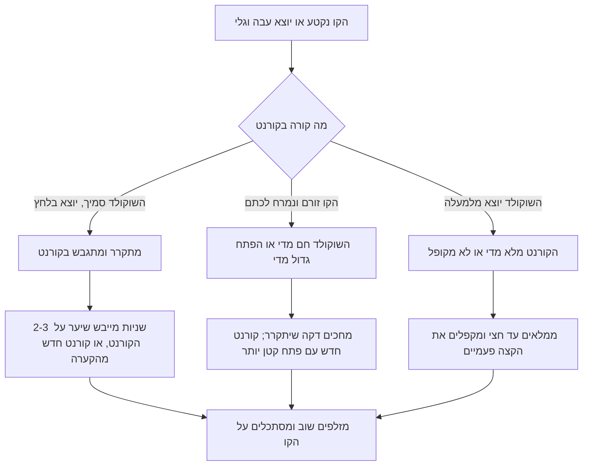

# 09.2 · זילוף שוקולד ותחרה

זילוף הוא הדרך לצייר בשוקולד: לבבות, כוכבים, אותיות, שם על עוגה או רצועת תחרה עדינה שעוטפת קינוח. כל מה שצריך הוא שוקולד מטומפר, קורנט קטן מנייר אפייה ותבנית מצוירת מתחת לנייר. בשיעור הזה מזלפים 10 קישוטי פיליגרן, מילה אחת ורצועת תחרה מעוגלת, מאותה קערה של [09.1](lesson-01.md).

## מה צריך

| פריט | כמות לתרגול | כמות מלאה | הערה |
|---|---|---|---|
| קוברטורה מריר, חלב או לבן, מטומפרת | 300 גרם בקערה, מזלפים כ־100-120 גרם | 300 גרם בקערה | פחות מ־300 גרם בקערה מתקרר מהר מדי; מה שנשאר חוזר לטבלה דקה |
| נייר אפייה | 4-5 משולשים + 2 דפים | | למשולשים: ריבוע של 25-30 ס"מ חתוך באלכסון |
| שקיות זילוף חד־פעמיות | 1-2 | | חלופה לקורנט, אם קשה לקפל |
| דף תבניות מצוירות | 2-3 עותקים | | לבבות, כוכבים, עלים, אותיות בגובה 3-5 ס"מ, בעט שחור עבה |
| פסי אצטט 4×25 ס"מ | 2 | | לתחרה |
| מערוך, בקבוק או גליל עטוף נייר אפייה | 1 | | לתחרה מעוגלת |
| מגש עם 2-3 כפות אבקת קקאו | 1 | | לא חובה: לזילוף "על אבקה" |
| סלוטייפ, מספריים, קיסם, ספטולה דקה | | | |
| מייבש שיער, מדחום, מרית | 1 מכל | | |

**אלרגנים:** קוברטורה מכילה בדרך כלל לציטין סויה. שוקולד חלב ולבן מכילים חלב, ומריר רבים מכילים או "עלולים להכיל" חלב. רבים "עלולים להכיל" אגוזים. בודקים על האריזה.

**התבניות:** מציירים או מדפיסים צורות פשוטות עם קו חיצוני סגור וקווים פנימיים שנוגעים בו. לפי Chelsea Sugar, כדאי להכין כמה עותקים, כדי לא להזיז את התבנית כשהשוקולד עוד רטוב.

## למה זה עובד

### קו דק מתגבש מהר

קו מזולף הוא שוקולד בעובי של 1-2 מ"מ, עם שטח מגע גדול עם האוויר והנייר. לפי King Arthur, שוקולד מטומפר מתקשה תוך 3-5 דקות, וקו דק מתקשה אפילו מהר יותר. זה היתרון: הקישוט מוכן תוך דקות, מבריק, נשבר בקליק ולא נמס באצבעות. וזה גם הקושי: אותו שוקולד מתגבש גם בתוך הקורנט.

### למה הקורנט מסמיך

בקורנט יש 20-30 גרם שוקולד, מסה קטנה מדי כדי לשמור חום. השוקולד בו מתקרר מתחת לטמפרטורת העבודה, הגבישים ממשיכים להיווצר, והוא נהיה סמיך עד שהקו נקטע. זה לא כישלון של הטמפר, אלא התגבשות רגילה. הפתרון: קורנט קטן שמתרוקן מהר, חימום של 2-3 שניות במייבש שיער, ומילוי חדר מהקערה, שנשמרת בטמפרטורת העבודה.

### קווים מחוברים הם השלד

קישוט פיליגרן (filigree) עומד כי הקווים שלו מחזיקים זה את זה. קו שלא נוגע בשום קו אחר נשאר על הנייר כשמרימים את הקישוט, או נשבר. לכן מזלפים קודם את הקו החיצוני, ואחריו קווים פנימיים שכל אחד מתחיל ונגמר על קו קיים. תחרה (lace) היא אותו עיקרון בלי תבנית: לולאות אקראיות שחוצות זו את זו, וכל לולאה נשענת על שכנותיה.

### עובי הקו נקבע בפתח

Chelsea Sugar כותבים למלא את השקית עד חציה לכל היותר, לקפל את החלק העליון כדי שלא ידלוף, ולחתוך פתח קטן "בזהירות", כדי שהקווים יישארו דקים. מתחילים בפתח של כ־1 מ"מ; אם צריך, מגדילים אותו. פתח גדול אי אפשר להקטין.

### מבריק מלמטה, עגול מלמעלה

הצד שנגע בנייר אפייה עמום־סאטן, והצד שנגע באצטט מבריק, כמו ב־[04.3](../module-04/lesson-03.md). הצד העליון של הקו עגול ומבריק מעט. לכן תחרה לעוגה מזלפים על אצטט, ופיליגרן לקינוח בכוס אפשר לזלף על נייר אפייה.

### זילוף על אבקה

Callebaut מזלפים שוקולד מטומפר על מגש מכוסה בפתיתים מצופים באבקה, ומרימים את הצורות אחרי שהתקשו. בבית אפשר לזלף על שכבה דקה של אבקת קקאו: הצד התחתון יוצא מחוספס ומאובק, והצורה לא נדבקת למגש.

## שלב אחר שלב

> [!WARNING]
> קורנט מלא מדי דולף מלמעלה על הידיים; ממלאים עד חצי בלבד. מייבש שיער מחזיקים במרחק של 15-20 ס"מ ולשניות ספורות, כדי לא להמיס את השוקולד ולא לחמם את הנייר. כל הכלים יבשים.

**קורנט מנייר אפייה**

1. **חותכים משולש**: ריבוע נייר אפייה של 25-30 ס"מ, חתוך באלכסון. מחזיקים את המשולש כשהזווית הישרה כלפיכם.
2. **מגלגלים**: מגלגלים את הפינה הימנית פנימה עד הזווית הישרה, כך שנוצר חרוט שקצהו סגור ונמצא באמצע הצלע הארוכה. ממשיכים לגלגל את הפינה השמאלית מסביב, עד ששלוש הפינות נפגשות מאחור.
3. **נועלים**: מקפלים את שלוש הפינות פנימה, פעמיים, כדי שהקורנט לא ייפתח. אם הקצה פתוח, מהדקים את הגלגול עד שהוא סגור לגמרי.
4. **מכינים 4-5 קורנטים** לפני שמטמפרים. אין זמן לקפל כשהשוקולד מוכן.

**טמפרור והכנת המשטח**

5. **מניחים תבנית** על המשטח, מעליה דף נייר אפייה, ומדביקים את הנייר בסלוטייפ בפינות, כמו ש־Chelsea Sugar מציעים.
6. **מטמפרים** 300 גרם בשיטת ההזרעה ובודקים בבדיקת סכין. מריר 31-32°C, חלב 29-30°C, לבן 28-29°C, או לפי האריזה.
7. **ממלאים קורנט** בכף אחת (20-30 גרם), עד חציו לכל היותר. מקפלים את הפתח העליון פעמיים.
8. **חותכים פתח** של כ־1 מ"מ בקצה, במספריים. מזלפים קו ניסיון על נייר ליד. הקו צריך להיות עגול ואחיד.

**פיליגרן מעל תבנית**

9. **מחזיקים נכון**: היד החזקה מחזיקה את החלק העליון ולוחצת, היד השנייה רק מכוונת את הקצה. מחזיקים את הקצה 1 ס"מ מעל הנייר, ונותנים לחוט השוקולד ליפול על הקו, במקום לגרור את הקצה על הנייר.
10. **מזלפים את הקו החיצוני** של הצורה, בלחץ אחיד, ובסוף מפסיקים ללחוץ לפני שמרימים.
11. **מזלפים קווים פנימיים**: כל קו מתחיל ונגמר על הקו החיצוני או על קו אחר. מסלסלים, עושים רשת או נקודות שנוגעות בקווים.
12. **מזיזים את התבנית**: אחרי שורה של צורות, מעבירים את דף התבנית לעותק הבא תחת אזור ריק. לא מזיזים נייר שעליו שוקולד רטוב.
13. **כשהקו מסמיך**: מחממים את הקורנט 2-3 שניות במייבש שיער, או מעבירים את השארית לקערה וממלאים קורנט חדש. מערבבים את הקערה ובודקים טמפרטורה כל 10 דקות.

**מילה על נייר**

14. **כותבים** מילה קצרה (שם, "מזל טוב") מעל תבנית אותיות בגובה 3-4 ס"מ. כל אות בקו אחד רציף ככל האפשר, ואותיות סמוכות נוגעות זו בזו בנקודה אחת, כדי שהמילה תצא כחתיכה אחת. מי שמעדיף אותיות נפרדות מזלף כל אחת עבה מעט יותר.

**תחרה על אצטט**

15. **מזלפים** על פס אצטט לולאות קטנות ואקראיות שחוצות זו את זו, מקצה לקצה ומשוליים לשוליים. שוליים ישרים מקבלים אם מזלפים קו ישר לאורך כל צד.
16. **מעגלים**: אחרי דקה, כשהשוקולד עמום, מרימים את הפס ומניחים אותו על מערוך או בקבוק, הצד עם השוקולד כלפי מעלה, ומקבעים בסלוטייפ. זה ה"חצי צינור" של [09.1](lesson-01.md), מאולתר.

**זילוף על אבקה (לא חובה)**

17. **מזלפים** נקודות, טיפות או ספירלות על מגש שמכוסה בשכבה דקה של אבקת קקאו.

**קירור והרמה**

18. **מחכים**: 15 דקות בחדר של 18-22°C, או 5 דקות במקרר אחרי 5 דקות בחדר.
19. **מרימים**: לפי Chelsea Sugar, מחליקים ספטולה דקה או סכין מתחת לכל קישוט ומרימים בעדינות. דרך עדינה יותר: מושכים את נייר האפייה מעבר לשפת השולחן, והקישוטים משתחררים ממנו. את התחרה מקלפים מהאצטט אחרי שהתקשתה לגמרי.
20. **מאחסנים** בקופסה סגורה, בשכבה אחת או בשכבות עם נייר אפייה ביניהן. America's Test Kitchen שומרים קישוטים עטופים היטב במקרר עד שבוע; בקופסה סגורה ב־18-20°C הם נשמרים גם הם.

## בדיקה: איך יודעים שהצליח

- **קו אחיד**: עובי של 1-2 מ"מ לכל אורך הקישוט, בלי עיבויים בפינות ובלי קטיעות.
- **שלם**: כל קישוט עולה מהנייר כחתיכה אחת, ולא נשארים קווים על הנייר.
- **מילה**: נקראת בבירור ועולה כחתיכה אחת או כאותיות שלמות.
- **תחרה**: רצועה רציפה בלי חורים גדולים, ששומרת על העיגול אחרי הקילוף.
- **טמפר**: הקישוט נשבר בקליק, מבריק בצד שנגע באצטט, ולא נמס כשמחזיקים אותו שנייה בין האצבעות.
- **ספירה**: 10 קישוטי פיליגרן שלמים, מילה אחת ורצועת תחרה אחת.

## כשזה משתבש

| מה רואים | למה זה קורה | מה עושים עכשיו | איך מונעים בפעם הבאה |
|---|---|---|---|
| הקו נקטע והשוקולד יוצא בלחץ חזק | השוקולד התקרר והתגבש בקורנט | 2-3 שניות מייבש שיער, או קורנט חדש מהקערה | קורנט קטן; ממלאים מעט ובתדירות |
| הקו נמרח לכתם רחב | השוקולד חם מדי, או הפתח גדול | מחכים דקה; קורנט חדש עם פתח קטן יותר | מודדים לפני המילוי; חותכים 1 מ"מ |
| קו גלי ולא אחיד | גוררים את הקצה על הנייר, או לחץ משתנה | מרימים את הקצה 1 ס"מ ונותנים לחוט ליפול | מתרגלים קווים ישרים ועיגולים על נייר ניסיון |
| חלק מהקווים נשארים על הנייר | קווים לא מחוברים | מחברים בנקודת שוקולד נוספת לפני ההרמה | מתכננים כל קו כך שיתחיל ויסתיים על קו אחר |
| קישוטים נשברים בהרמה | קווים דקים מדי, או הרמה בכוח | אוספים את השברים לפיזור | פתח של 1.5-2 מ"מ לקישוטים גדולים; מושכים את הנייר מעבר לשפת השולחן |
| הקורנט נפתח או דולף מלמעלה | לא ננעל, או מלא מדי | מעבירים את השוקולד לקורנט חדש | קיפול כפול של הפינות; עד חצי בלבד |
| קישוטים רכים, אפורים, נמסים באצבע | השוקולד בקערה יצא מטמפר | ממיסים ומטמפרים שוב | בדיקת סכין כל 15-20 דקות עבודה |

### מה עושים עם מה שלא הצליח

שום דבר לא הולך לפח. קווי ניסיון, קישוטים שנכשלו ושאריות מהקורנט חוזרים לקערה כל עוד השוקולד נקי, או נאספים לשקית "להמסה". שברי פיליגרן ותחרה הם פיזור יפה על גלידה, על קינוח בכוס או על שוקו חם. קורנט עם שוקולד שהתקשה פותחים, וחתיכת השוקולד שבתוכו נכנסת לשקית "להמסה".

## חלופות

### טבעוני / פרווה

מריר בלי רכיבי חלב מתאים לזילוף בדיוק כמו כל קוברטורה. בתחרה ובפיליגרן אין רכיבים נוספים, אבל אבקות ברק, צבעים וסוכריות שמוסיפים על הקישוט צריך לבדוק: צבע אדום או ורוד יכול להיות קרמין (E120), וסוכריות מבריקות יכולות להכיל שלאק (E904). מה לבדוק: [לא טבעוני גם כשכתוב פרווה](../../references/kashrut-guide.md#לא-טבעוני-גם-כשכתוב-פרווה).

### בריא יותר

קישוט פיליגרן שוקל 1-2 גרם. כמה קישוטים כאלה נותנים לקינוח מראה מושקע עם מעט מאוד שוקולד ובלי סוכר נוסף. מריר 70% ומעלה מתאים לזילוף, אבל סמיך יותר ומתגבש מהר בקורנט, ולכן ממלאים כמויות קטנות יותר.

### כשרות

הקישוט מקבל את הכשרות של השוקולד, לפי מה שכתוב על האריזה. מי שמשתמש בשוקולד ציפוי (קומפאונד) לזילוף, כי הוא לא דורש טמפרור ([01.1](../module-01/lesson-01.md)), בודק גם אותו: [שוקולד ציפוי במדריך הכשרות](../../references/kashrut-guide.md#שוקולד-ציפוי). אבקת קקאו לזילוף על אבקה: [אבקת קקאו](../../references/kashrut-guide.md#אבקת-קקאו). הכללים: [שלושה כללים](../../references/kashrut-guide.md#שלושה-כללים). אם יש ספק, שואלים את הרב.

## איפה קונים

מה מחפשים: נייר אפייה רגיל לקורנטים, או שקיות זילוף חד־פעמיות קטנות (piping bags). פסי אצטט או גליל שקף לעוגה לתחרה. קוברטורה בכל צבע; שוקולד לבן בולט על עוגה כהה, ומריר על קרם בהיר. מי שרוצה להתחיל בלי טמפרור בוחר שוקולד ציפוי, ויודע שהוא פחות מבריק ושונה בטעם. חנויות ומלאי: [שקיות זילוף](../../references/where-to-buy.md#שקיות-זילוף), [אצטט ודפי גיטרה](../../references/where-to-buy.md#אצטט-ודפי-גיטרה), [קוברטורה](../../references/where-to-buy.md#קוברטורה), [שוקולד ציפוי](../../references/where-to-buy.md#שוקולד-ציפוי), [אבקת קקאו](../../references/where-to-buy.md#אבקת-קקאו).

## תרגול

### משימה

מכינים 4-5 קורנטים ושלושה עותקים של דף תבניות. מטמפרים 300 גרם (שוקולד מ־[09.1](lesson-01.md) מאותו מוצר מתאים) ומזלפים: 10 קישוטי פיליגרן, מילה אחת ורצועת תחרה מעוגלת. מה שנשאר בקערה נשפך לטבלה דקה ונשמר להמסה. הקישוטים נכנסים לקופסה של 09.1, ל[שיעור 09.3](lesson-03.md) ולפרויקט.

### זמן

כ־10 דקות לקורנטים ולתבניות, 25 דקות טמפרור, 15 דקות זילוף, ו־10-15 דקות קירור והרמה. סך הכול כ־60 דקות.

### יומן

ב[יומן התרגול](../../templates/practice-log.md) רושמים: גודל הפתח, כמה פעמים חיממתם או החלפתם קורנט, אחרי כמה דקות השוקולד בקורנט התחיל להסמיך, וכמה קישוטים עלו שלמים מתוך כמה שזילפתם. מצלמים את הנייר אחרי ההרמה: קווים שנשארו עליו מראים איפה חסר חיבור.

### בדיקה עצמית

- [ ] קיפלתי קורנט שלא נפתח ולא דלף.
- [ ] כל קישוט פיליגרן תוכנן כך שכל הקווים מחוברים.
- [ ] כשהשוקולד הסמיך בקורנט, חיממתי או החלפתי קורנט ולא לחצתי בכוח.
- [ ] יש לי 10 קישוטים שלמים, מילה אחת ורצועת תחרה מעוגלת.
- [ ] שאריות, קווי ניסיון ושברים חזרו לקערה או לשקית "להמסה".

## סיכום

- קורנט קטן מנייר אפייה, מלא עד חציו, עם פתח של כ־1 מ"מ, נותן קו דק ואחיד.
- שוקולד בקורנט מתקרר ומתגבש: מחממים 2-3 שניות או ממלאים קורנט חדש מהקערה שבטמפרטורת העבודה.
- פיליגרן עומד כי הקווים מחוברים: קודם הקו החיצוני, ואז קווים שמתחילים ונגמרים עליו.
- תחרה מזלפים על אצטט בלולאות שחוצות זו את זו, ומעגלים על מערוך כשהשוקולד עמום.
