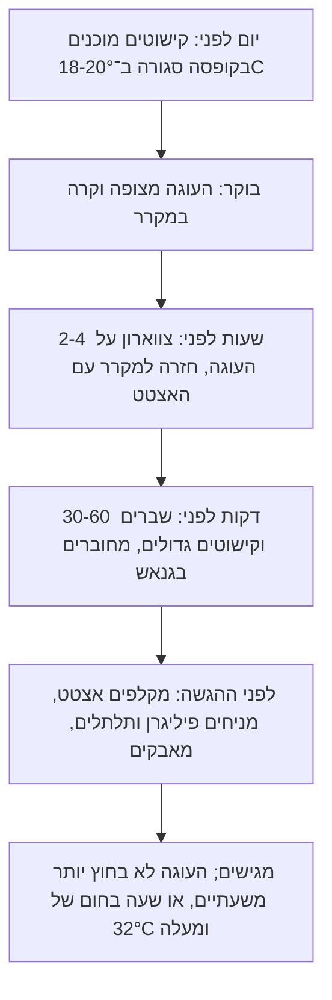

# 09.3 · קישוטים לעוגות וקינוחים

בשיעור הזה כל מה שהכנתם במודול עולה על קינוח אמיתי: עוטפים עוגה קטנה בצווארון שוקולד, מכינים שברים, ומסדרים מעל ספירלות, תלתלים ופיליגרן מ־09.1 ו־09.2. העוגה יכולה להיות עוגה שאפיתם או עוגה קנויה, וגם כוסות מוס או גלידה מתאימות. לומדים גם את מה שקובע אם הקישוט ייראה טוב בזמן ההגשה: מתי מניחים אותו, איך הוא נצמד, ומה המקרר עושה לו.

## מה צריך

| פריט | כמות לתרגול | כמות מלאה | הערה |
|---|---|---|---|
| עוגה עגולה מצופה, קרה מהמקרר | 1, קוטר 14-18 ס"מ | 1, קוטר 20-24 ס"מ | ציפוי חלק של קרם, קצפת, גנאש או באטרקרים; או 4 כוסות קינוח |
| קוברטורה מטומפרת | 300 גרם בקערה, לצווארון כ־100 גרם | 300 גרם | לעוגה של 20 ס"מ Food Heaven משתמשים ב־250 גרם; על אצטט דק מספיק פחות |
| פס אצטט (שקף לעוגה) | 1 | | אורך: היקף העוגה ועוד 2 ס"מ. גובה: גובה העוגה ועוד 2-2.5 ס"מ |
| הקישוטים מ־09.1 ו־09.2 | ספירלות, תלתלים, פיליגרן | | בקופסה, בטמפרטורת החדר |
| גנאש מ־06.1 או שוקולד מומס | 30-50 גרם | | "דבק" לחיבור קישוטים |
| נייר אפייה, ספטולה מדורגת, סרט מדידה או חוט, סרגל | | | |
| מסננת קטנה ואבקת קקאו או אבקת סוכר | 1 כף | | לא חובה: לאבק לפני ההגשה |
| אבקת ברק או עלי זהב **אכילים** | מעט | | לא חובה; רק עם רשימת רכיבים על האריזה |

**אלרגנים:** שוקולד: לציטין סויה, חלב (בחלב ובלבן, ולעתים "עלול להכיל" במריר), "עלול להכיל" אגוזים. העוגה מוסיפה את שלה: בדרך כלל גלוטן (קמח חיטה), ביצים וחלב (שמנת, חמאה), ולעתים אגוזים ושקדים. מי שמגיש לאורחים כותב או אומר את כל הרשימה, של העוגה ושל הקישוט.

## למה זה עובד

### צווארון: אותו חלון, בגודל של עוגה

צווארון שוקולד (chocolate collar) הוא פס של שוקולד מטומפר על אצטט, שעוטפים סביב עוגה. Food Heaven מתארים את הסדר: פורסים את השוקולד בשכבה דקה ואחידה על הפס, מחכים ש"אפשר להרים את הנייר והשוקולד לא מחליק", עוטפים את העוגה כך שהשוקולד נוגע בקרם, ומקררים כ־30 דקות לפני הקילוף. אם מחכים יותר מדי, לדבריהם, השוקולד נסדק, ואז הופכים אותו לשברים. זה החלון העמום של 09.1: לא נוזלי ולא קשה.

שני דברים מחזיקים את הצווארון במקום. הקרם או הגנאש הם דבק: צריך שהציפוי יהיה עוד מעט רך ודביק, ולא קרום יבש. והעוגה הקרה מצננת את השוקולד מבפנים, כך שהוא מתגבש צמוד לצורה שלה. האצטט נותן לצד החיצוני ברק, כמו ב־04.3.

### מדידה: היקף, לא קוטר

ההיקף של עוגה עגולה הוא בערך הקוטר כפול 3.14. עוגה של 16 ס"מ צריכה פס של כ־50 ס"מ, ועוד 2 ס"מ חפיפה כדי שהתפר ייסגר. Food Heaven מודדים בדרך אחרת: עוטפים את העוגה בנייר ומסמנים איפה הקצוות נפגשים. כך גם עוגה שאינה עגולה לגמרי מקבלת פס מדויק. הגובה: Food Heaven מוסיפים כ־2.5 ס"מ (אינץ') מעל גובה העוגה, כך שהצווארון בולט מעל הקרם ויוצר "קערה" לקישוטים.

### המקרר הוא לא בית לקישוטים

לפי Callebaut, פריחת סוכר (sugar bloom) נוצרת כשעיבוי מגיע לשוקולד: הסוכר נמס במים, וכשהמים מתאדים הוא מתגבש מחדש לשכבה לבנה ומגורענת. זה בדיוק מה שקורה לקישוט שעומד על עוגה במקרר: כשמוציאים את העוגה לחדר חם ולח, אדי מים מתעבים על השוקולד הקר. קישוט עבה כמו צווארון סובל את זה טוב יותר, במיוחד כשהאצטט עוד עליו. קישוט דק כמו פיליגרן או תלתל מאבד ברק ומתכסה בכתמים. Callebaut ממליצים לתת למוצרים זמן להתאקלם באריזה סגורה כשעוברים מקר לחם.

מכאן הכלל של השיעור: **הקישוטים העדינים עולים על הקינוח אחרונים, קרוב להגשה.** הצווארון עולה מוקדם, ונשאר עטוף באצטט במקרר עד ההגשה.

### העוגה מתכלה, הקישוט לא

עוגה עם קצפת, שמנת או קרם היא מזון מתכלה. לפי ה־FDA, מקרר צריך להיות ב־4°C או פחות, ומזון מתכלה לא נשאר בחוץ יותר משעתיים, או שעה אחת כשבחוץ יותר מ־32°C. הקישוטים עצמם נשמרים בקופסה סגורה בטמפרטורת החדר (18-20°C), אבל ברגע שהם על העוגה, הם הולכים לפי הכללים שלה. בשמחה בחוץ בקיץ הישראלי, העוגה יוצאת מהמקרר קרוב לחיתוך.

### משקל ונקודת אחיזה

קצפת וקרם רך לא מחזיקים קישוט כבד: ספירלה ארוכה שנשענת על קצה אחד שוקעת או נופלת. מחברים קישוטים בנקודת גנאש או שוקולד מומס, מכניסים קישוט עומד כ־1 ס"מ לתוך הקרם, או משעינים אותו על הצווארון או על קישוט אחר. קישוט על גנאש מוצק נשאר במקום גם בלי דבק.

### מה שאסור לשים על החלק הנאכל

לפי ה־FDA, נצנצים ואבקות ברק מותר לשים על אוכל רק אם יוצרו כאכילים. אכיל מופיע עם רשימת רכיבים ולרוב עם המילה "אכיל". מה שכתוב עליו רק "לא רעיל" או "לקישוט בלבד" לא נוגע באוכל, ואם בכל זאת השתמשתם בו על קישוט, מורידים אותו לפני ההגשה. זה הכלל מ[בטיחות מזון והיגיינה](../module-01/lesson-04.md) ומ[אבקות ברק](../module-05/lesson-04.md).

## שלב אחר שלב

> [!WARNING]
> סכין חמה לחיתוך העוגה מחממים במים חמים מהברז ומנגבים יבש, לא על אש. עוגה עם קצפת או קרם חוזרת למקרר בין שלבים ולא נשארת בחוץ יותר משעתיים. אבקה או נצנצים "לקישוט בלבד" לא נוגעים בחלק הנאכל.

**הכנה (10 דקות)**

1. **מקררים את העוגה** המצופה לפחות שעה, כך שהיא יציבה אבל פני הקרם עוד מעט דביקים. גנאש שהתייבש מחליקים בשכבה דקה של גנאש רך.
2. **מודדים**: עוטפים את העוגה בחוט או בנייר אפייה, מסמנים איפה הקצוות נפגשים, ומוסיפים 2 ס"מ. מודדים את הגובה ומוסיפים 2-2.5 ס"מ.
3. **חותכים אצטט** במידות. מניחים אותו על דף נייר אפייה גדול יותר, ליד העוגה.
4. **מטמפרים** 300 גרם ובודקים בבדיקת סכין. מריר 31-32°C, חלב 29-30°C, לבן 28-29°C; Food Heaven נותנים טווחים דומים (לבן 27-28°C). האריזה קובעת.

**צווארון**

5. **פורסים** כ־100 גרם על האצטט, לאורך המרכז, ומורחים בספטולה לשכבה דקה ואחידה של 1.5-2 מ"מ, מעט מעבר לשוליים.
6. **לא חובה, צווארון תחרה**: במקום שכבה מלאה, מזלפים לולאות כמו ב־09.2 לכל אורך הפס, עם קו ישר בתחתית ובחלק העליון.
7. **מרימים** את הפס בקצותיו לנייר נקי, ובודקים: כשמטים את הפס, השוקולד כבר לא מחליק, אבל עוד גמיש. ברוב המטבחים זה 1-3 דקות.
8. **עוטפים**: מחזיקים את הפס בשני קצותיו, מצמידים את המרכז לעוגה, ועוטפים את שני הצדדים לאחור, השוקולד כלפי הקרם. הקצה העליון של האצטט עכשיו בגובה אחיד מעל העוגה.
9. **סוגרים את התפר**: הקצה השני חופף לראשון. לוחצים בעדינות על האצטט לכל הגובה. מקבעים את האצטט בסלוטייפ, לא את השוקולד.
10. **מקררים** כ־30 דקות, כמו ב־Food Heaven, ומשאירים את האצטט עד ההגשה.

**שברים**

11. **פורסים** את מה שנשאר מהקערה (כ־60 גרם) על נייר אפייה בשכבה דקה. לפי America's Test Kitchen, מחכים שהשוקולד יהיה עמום וחותכים משולשים גבוהים וצרים בקצה סכין. מקררים כ־10 דקות עד שהתקשה, ושוברים את השאר לשברים של כ־2.5 ס"מ.

**הרכבה**

12. **מתכננים על נייר**: מסמנים על עיגול נייר בגודל העוגה איפה כל קישוט, ומחליטים על נקודה מרכזית אחת. קבוצה של 3 או 5 קישוטים נראית מכוונת יותר מפיזור שווה.
13. **שברים וקישוטים גדולים**: 30-60 דקות לפני ההגשה, נועצים שברים ומשולשים כ־1 ס"מ בקרם, ומחברים ספירלות בנקודת גנאש.
14. **מקלפים את האצטט** מהצווארון כשהעוגה יוצאת להגשה: פותחים את הסלוטייפ ומקלפים לאט, לאורך ההיקף.
15. **קישוטים עדינים אחרונים**: פיליגרן, תחרה ותלתלים, במלקחיים, ממש לפני ההגשה. מאבקים קקאו או סוכר דרך מסננת רק על הקרם, לא על הצווארון המבריק.
16. **כוסות קינוח**: אותו סדר בקטן. רצועת תחרה מעוגלת לאורך שפת הכוס, משולש אחד נעוץ, ותלתל אחד.

## בדיקה: איך יודעים שהצליח

- **צווארון**: צמוד לעוגה לכל ההיקף, בגובה אחיד, מבריק, בלי סדקים לאורכו, והתפר סגור.
- **יציבות**: כשמזיזים את הצלחת בעדינות, אף קישוט לא נופל, ושברים עומדים ישר.
- **ברק בזמן ההגשה**: הקישוטים העדינים מבריקים, בלי כתמים לבנים או אפורים.
- **בטיחות**: העוגה הייתה מחוץ למקרר פחות משעתיים, ושום אבקה בלי רשימת רכיבים לא על החלק הנאכל.
- **חיתוך**: סכין חמה ויבשה חותכת דרך הצווארון בלי לנפץ אותו לרסיסים.

## כשזה משתבש

| מה רואים | למה זה קורה | מה עושים עכשיו | איך מונעים בפעם הבאה |
|---|---|---|---|
| הצווארון נסדק כשעוטפים | השוקולד התקשה מדי על האצטט | עוטפים בכל זאת וסוגרים את הסדק בפס זילוף, או הופכים לשברים | עוטפים ברגע שהשוקולד לא מחליק; בחורף מהר יותר |
| השוקולד נמרח וזולג בתחתית כשעוטפים | עוד נוזלי, או עוגה חמה | מקלפים, מגרדים לקערה, מקררים את העוגה ומנסים שוב | מחכים לחלון; עוגה מהמקרר |
| הצווארון לא נצמד ויש רווח | ציפוי יבש או קשה, או פס ארוך מדי | ממלאים את הרווח בגנאש רך מלמעלה, ומקררים | מחליקים שכבת גנאש דקה לפני; מודדים עם חפיפה של 2 ס"מ בלבד |
| רווח בתפר | פס קצר מדי | מכסים את התפר בספירלה או בקבוצת קישוטים | מוסיפים 2 ס"מ להיקף |
| כתמים לבנים על קישוטים אחרי המקרר | עיבוי ופריחת סוכר | הכתמים לא מזיקים; מסתירים באבקת קקאו, או מחליפים בקישוטים מהקופסה | קישוטים עדינים עולים רק לפני ההגשה |
| קישוטים שוקעים בקצפת או נופלים | כבדים מדי לקרם רך | מחברים בנקודת גנאש, או משעינים על הצווארון | קישוטים קלים על קצפת; כבדים על גנאש |
| קישוטים נמסים על העוגה באירוע בחוץ | חום של 28°C ומעלה | מכניסים למקרר או לצל ומגישים מהר | מניחים קישוטים בזמן ההגשה; עוגה חוזרת למקרר |

### מה עושים עם מה שלא הצליח

שום דבר לא הולך לפח. צווארון שנסדק הופך לשברים לעוגה, או נגרד לקערה כל עוד אין עליו קרם. שוקולד שנגע בקרם כבר לא חוזר לקערה: אוכלים אותו עם העוגה, או מחממים אותו עם חלב לשוקו חם. קישוטים עם כתמים לבנים טעימים כמו קודם: הם נכנסים לשוקו, לבראוניז או לפיזור מתחת לאבקת קקאו. שאריות גנאש ששימשו כדבק נשמרות במקרר לשוקו.

## חלופות

### טבעוני / פרווה

עוגה טבעונית או פרווה מצפים בגנאש של קרם קוקוס או שמנת צמחית (ראו [06.1](../module-06/lesson-01.md) לבסיס הגנאש) או בקרם צמחי, וכל הקישוטים ממריר בלי רכיבי חלב. קצפת צמחית רכה מחזיקה קישוטים כבדים פחות טוב, ולכן מעדיפים צווארון ושברים קלים. סוכריות, צבעים ואבקות בודקים: קרמין (E120), שלאק (E904). מה לבדוק: [לא טבעוני גם כשכתוב פרווה](../../references/kashrut-guide.md#לא-טבעוני-גם-כשכתוב-פרווה).

### בריא יותר

צווארון ושברים נותנים לעוגה מראה של עוגת שוקולד עם הרבה פחות שוקולד מציפוי מלא: צווארון לעוגה של 16 ס"מ הוא כ־100 גרם, שמתחלקים ל־8-10 פרוסות. מעל אפשר להניח פירות טריים במקום עוד קרם, ולהגיש פרוסות דקות. אין כאן הבטחה בריאותית, רק מנה קטנה יותר.

### כשרות

הקינוח מקבל את הכשרות של כל מה שבו. קישוט פרווה על עוגה עם שמנת: הקינוח חלבי. מי שמגיש קינוח אחרי ארוחה בשרית צריך שהכול יהיה פרווה, כולל השוקולד, הקרם וכל רכיב בעוגה, לפי מה שכתוב על כל אריזה, ולפי מה שכתוב לגבי "ציוד חלבי". סוכריות קישוט, צבעים, אבקות ברק ועלי זהב צריכים כשרות משלהם: [סוכריות וקישוטים](../../references/kashrut-guide.md#סוכריות-וקישוטים), [צבעים](../../references/kashrut-guide.md#צבעים), [אבקות ברק ועלי זהב](../../references/kashrut-guide.md#אבקות-ברק-ועלי-זהב). הכללים: [שלושה כללים](../../references/kashrut-guide.md#שלושה-כללים). אם יש ספק, שואלים את הרב.

## איפה קונים

מה מחפשים: גליל שקף לעוגה (acetate cake collar) בגובה של 8-10 ס"מ, או דפי גיטרה שחותכים לפסים ומחברים. אבקות ברק, נצנצים ועלי זהב רק כשכתוב עליהם "אכיל" או "מאכל" ויש רשימת רכיבים. סוכריות קישוט לפי הכשרות והרכיבים שאתם צריכים. חנויות ומלאי: [אצטט ודפי גיטרה](../../references/where-to-buy.md#אצטט-ודפי-גיטרה), [שפכטל וקלף](../../references/where-to-buy.md#שפכטל-וקלף), [אבקות ברק](../../references/where-to-buy.md#אבקות-ברק), [עלי זהב](../../references/where-to-buy.md#עלי-זהב), [סוכריות קישוט](../../references/where-to-buy.md#סוכריות-קישוט), [קוברטורה](../../references/where-to-buy.md#קוברטורה).

## תרגול

### משימה

מקשטים עוגה מצופה אחת בקוטר 14-18 ס"מ, או 4 כוסות קינוח: צווארון שוקולד (מלא או תחרה), משולשים ושברים מאותה קערה, ולפחות שני סוגי קישוט מהקופסה של 09.1 ו־09.2. כותבים קודם לוח זמנים קצר לפי התרשים בשיעור. זה גם שלב בדיקה לפני [פרויקט המודול: קינוח מעוצב בקישוטי שוקולד](../../projects/m09-decorated-dessert.md).

### זמן

כ־10 דקות מדידה והכנה, 25 דקות טמפרור, 10 דקות צווארון ושברים, 30 דקות קירור, ו־10 דקות הרכבה לפני ההגשה. סך הכול כ־75 דקות, ועוד העוגה עצמה.

### יומן

ב[יומן התרגול](../../templates/practice-log.md) רושמים: מידות הפס, כמה דקות חיכיתם עד העטיפה, טמפרטורת החדר, מתי עלה כל קישוט ומתי הוגשה העוגה, וכמה זמן הייתה מחוץ למקרר. מצלמים את העוגה מיד אחרי ההרכבה ושוב אחרי 30 דקות על השולחן, ומשווים ברק ויציבות.

### בדיקה עצמית

- [ ] מדדתי היקף וגובה לפני הפריסה, והתפר נסגר.
- [ ] עטפתי כשהשוקולד לא החליק ועוד היה גמיש, והצווארון יצא בלי סדקים.
- [ ] קישוטים עדינים עלו רק לפני ההגשה, והיו מבריקים.
- [ ] העוגה לא הייתה בחוץ יותר משעתיים, ולא השתמשתי באבקה "לקישוט בלבד".
- [ ] שאריות ושברים חזרו לקערה, לשקית "להמסה" או לשוקו.

## סיכום

- צווארון שוקולד עוטפים בחלון שבו השוקולד כבר לא מחליק ועוד גמיש, סביב עוגה קרה עם ציפוי דביק, ומקלפים את האצטט רק בהגשה.
- מודדים היקף (קוטר כפול 3.14) ועוד 2 ס"מ, וגובה העוגה ועוד 2-2.5 ס"מ.
- עיבוי מהמקרר יוצר פריחת סוכר: הקישוטים העדינים עולים אחרונים.
- קישוטים כבדים מחברים בגנאש או נועצים בקרם; עוגה עם קרם הולכת לפי כללי המקרר: 4°C, שעתיים בחוץ לכל היותר.
