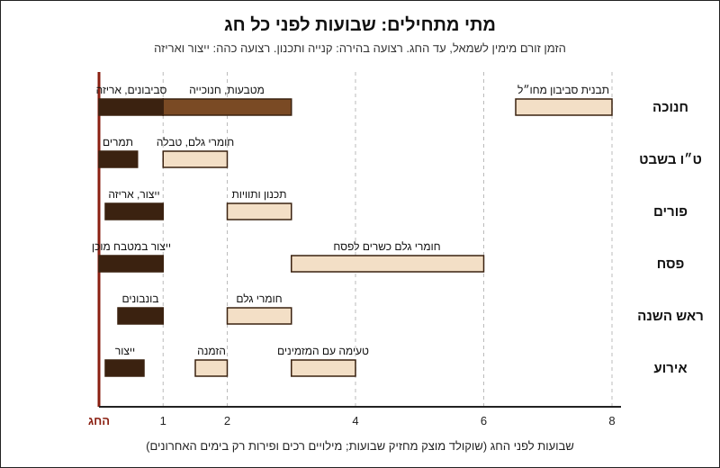

# 10.1 · חנוכה: סביבונים, מטבעות וחנוכיות שוקולד

המודול הזה לא מלמד טכניקה חדשה: הוא לוקח את מה שכבר עובד לכם (טמפרור, תבניות, טבלאות, מילויים, צורות) ומסדר אותו לפי לוח השנה. בשיעור הראשון, חנוכה: מכינים חנוכיית שוקולד אחת מחלקים פשוטים, ומאותו טמפרור יוצקים מטבעות. הסביבונים כבר נלמדו ב־08.2, ולכן כאן רק מתזמנים אותם. בסוף השיעור יש לכם חנוכייה, שש מטבעות, ולוח זמנים לחנוכה הקרוב.

## מה צריך

| פריט | כמות לתרגול | כמות מלאה | הערה |
|---|---|---|---|
| קוברטורה מריר או חלב, כולל שאריות מהמודולים הקודמים מאותו מוצר | 300 גרם לטמפרור (בחנוכייה נכנסים כ־45-55 גרם, במטבעות כ־25 גרם) | 300 גרם לכל 3 חנוכיות | העודף חוזר לקערה |
| קוברטורה לבנה, או מעט לבן מטומפר מהקערה של שיעור קודם | 20 גרם | 40 גרם | ללהבות; אפשר לצבוע בצבע מסיס שומן צהוב או כתום |
| אצטט (דף גיטרה) | דף אחד | 2-3 דפים | לבסיס, כמו ב־04.3 |
| נייר אפייה ושקית זילוף קטנה | 1 + 1 | | לנרות |
| תבנית מטבעות או תבנית חצי כדור שטוחה של 3 ס"מ | 6 שקעים | 12-14 שקעים | כמו ב־04.4 |
| ריבועי נייר כסף צבעוני לעטיפה (לא חובה) | 6 | 14 | לא נאכל |
| סרגל, סכין קטנה, מחבת נון־סטיק, מדחום, משקל | 1 מכל | | |
| קרטון קשיח או צלחת שטוחה | 1 | 1 לכל חנוכייה | מעמד וגם אריזה |

**אלרגנים:** קוברטורה מכילה בדרך כלל לציטין **סויה**; חלב ולבן מכילים **חלב**, ומריר רבים מכילים או "עלולים להכיל" **חלב**; רבים "עלולים להכיל" **אגוזים** ו**בוטנים**. צבעים וסוכריות: לבדוק ברכיבים.

### לפני שמתחילים את המודול

צפייה בשיעור היא לא תרגול: חנוכייה שעומדת ישר לומדים בידיים, אחרי נר אחד שנפל. האקדמיה לא יכולה לבדוק צילומים, ולכן בכל שיעור יש בדיקות ברורות שמשווים אליהן את התוצאה. ממשיכים לרשום ב[יומן התרגול](../../templates/practice-log.md). בכל שיעור במודול מכינים מוצר חג אחד בכמות קטנה, ובונים לו לוח זמנים: כמה זמן לפני החג מתחילים. המודול מניח שאתם מטמפרים ([03.2](../module-03/lesson-02.md)), יוצקים לתבנית ([04.1](../module-04/lesson-01.md)) וחותכים על אצטט ([04.3](../module-04/lesson-03.md)).

## למה זה עובד

### לוח השנה הקרוב

כל השיעורים במודול מדברים במונחים של "כמה שבועות לפני החג". התאריכים הקרובים, לפי Hebcal (נבדק 2026-11-10; החג מתחיל בערב):

| חג | מתחיל בערב | הערה לתכנון |
|---|---|---|
| חנוכה | שישי, 4.12.2026 | נר אחרון: 11.12; החג נגמר במוצאי שבת 12.12 |
| ט"ו בשבט | שישי, 22.1.2027 | היום עצמו שבת: מכינים ומחלקים עד שישי בצהריים |
| פורים | שני, 22.3.2027 | משלוחי המנות ביום שלישי 23.3 |
| פסח | רביעי, 21.4.2027 | חומרי גלם כשרים לפסח קונים שבועות לפני |
| ראש השנה (תשפ"ח) | שישי, 1.10.2027 | נמשך עד מוצאי שבת: שלושה ימים בלי משלוחים |

לכל חג יש מוצרים שמחזיקים שבועות ומוצרים שמחזיקים ימים. שוקולד מוצק ומטומפר (מטבע, חנוכייה, סביבון) מחזיק שבועות אם שומרים אותו בטמפרטורה קבועה של 18-20°C, כמו ש־Callebaut ממליצים למוצרים מוגמרים, ולכן אפשר להכין אותו מוקדם ולפנות את השבוע האחרון לאריזה. מילויים רכים ופירות טריים, לעומת זאת, נכנסים רק בימים האחרונים (שיעורים 10.2 ו־10.5).

### שלושה מוצרים, שלוש טכניקות שכבר יש לכם

| מוצר | טכניקה | איפה נלמד | מתי מכינים |
|---|---|---|---|
| מטבעות | יציקה לתבנית רדודה, עטיפה בנייר כסף | [04.4](../module-04/lesson-04.md) | 2-3 שבועות לפני |
| חנוכייה | חיתוך על אצטט וזילוף, הדבקה בשוקולד מטומפר | [04.3](../module-04/lesson-03.md), [08.2](../module-08/lesson-02.md) | 1-2 שבועות לפני |
| סביבונים | קליפות, חרוט, ידית, אותיות | [08.2](../module-08/lesson-02.md), [פרויקט מודול 8](../../projects/m08-dreidel-box.md) | שבוע לפני, ותבנית מחו"ל כחודשיים לפני |

לפי ויקיפדיה, דמי חנוכה ניתנו במקור כמטבעות אמיתיים, ואת מטבעות השוקולד העטופים בזהב ייצרה לראשונה בשנות ה־20 חברת Loft's האמריקאית. היום, לפי אותו ערך, עלית וכרמית הישראליות מייצאות מטבעות לארצות הברית. המטבע הביתי שלכם מתחרה במוצר זול ונפוץ, ולכן הוא מנצח בטעם ובצורה, לא במחיר: קוברטורה טובה, תבליט חד, ועטיפה או ברק.

### חנוכייה: אותו דבק כמו הסביבון

חנוכיית שוקולד היא שורה של נרות על בסיס. כל חיבור בה הוא אותו חיבור משיעור 08.2: נקודה של שוקולד מטומפר שמחכים שתתחיל להתקשות, ואז מעמידים עליה חלק. הבסיס נחתך מטבלה דקה על אצטט, ברגע שהשוקולד עמום אבל עוד לא קשה, כמו ב־04.3: חיתוך מוקדם נסגר אחרי הסכין, וחיתוך מאוחר נשבר. נרות מזולפים כמו ידיות הסביבון, בעובי 7-8 מ"מ, ונחתכים בסכין חמימה ויבשה.

שני כללים הופכים את הצורה לחנוכייה: שמונה נרות בגובה אחד, בשורה ישרה, ושמש אחד שבולט מהשורה, גבוה יותר או מוצב בנפרד. בסיס עבה יותר (5-6 מ"מ) מחזיק את המשקל של תשעה נרות בלי להתכופף, ובסיס דק מ־4 מ"מ נשבר כשמרימים אותו מקצה אחד.

### משקל ועלות

| חלק | מידות | משקל משוער |
|---|---|---|
| בסיס | 16×4 ס"מ, עובי 5-6 מ"מ | 40-45 גרם |
| 8 נרות + שמש | קוטר 7-8 מ"מ, גובה 3.5 ס"מ; שמש 5 ס"מ | כ־8 גרם יחד |
| להבות ודבק | 9 טיפות | 2-3 גרם |
| **חנוכייה אחת** | | **כ־50-55 גרם** |

המשקלים מחושבים לפי נפח (כ־1.3 גרם לסמ"ק), לא נתון של יצרן; שוקלים את שלכם. בקוברטורה של כ־80-100 ₪ לק"ג (מחירים מ־2026-11-10 ב[קוברטורה](../../references/where-to-buy.md#קוברטורה)), השוקולד בחנוכייה עולה כ־4-5.5 ₪. העבודה היא העלות האמיתית: חנוכייה ראשונה לוקחת שעה, העשירית כרבע שעה, כי חותכים בסיסים ומזלפים נרות בכמות.

## שלב אחר שלב

> [!WARNING]
> חנוכיית שוקולד היא לאכילה ולקישוט, **לא מדליקים עליה נרות**: שוקולד נמס בערך מ־34°C, ולהבה עלולה להפיל נר בוער. מחבת לחיבור: חמימה בלבד, על האש הנמוכה ביותר וכבויה בזמן העבודה. סכין לחיתוך: מחממים במים חמים ומייבשים לגמרי, כי טיפת מים גורמת לשוקולד להיתפס. מטבעות עטופים: מזכירים לילדים להסיר את העטיפה.

**שלב א: יציקה וחיתוך (כ־30 דקות)**

1. **מטמפרים** 300 גרם בשיטה שהצליחה לכם ([03.2](../module-03/lesson-02.md)), ובודקים בסכין.
2. **בסיס**: מניחים אצטט על משטח ישר, ומורחים מלבן של כ־18×6 ס"מ בעובי 5-6 מ"מ (כ־60 גרם). מקישים על השולחן ליישור.
3. **מטבעות**: ממלאים 6 שקעים בתבנית המטבעות מאותה קערה, מקישים, ומגרדים את השפה נקייה, כמו ב־[04.4](../module-04/lesson-04.md).
4. **נרות**: ממלאים שקית זילוף, גוזרים פתח של כ־6 מ"מ, ומזלפים על נייר אפייה 3 קווים ישרים באורך 14 ס"מ. מקווים אחד ייצאו 4 נרות.
5. **חיתוך הבסיס**: כשהשוקולד באצטט עמום ויבש למגע אבל עוד נכנע ללחיצת אצבע (לרוב 5-10 דקות בחדר של 18-22°C), חותכים מלבן של 16×4 ס"מ בסרגל ובסכין, בלי להפריד. מניחים נייר אפייה ומשקל שטוח מעל, כמו ב־04.3, כדי שלא יתעקם.
6. **קירור**: הכול 10 דקות בחדר ו־15 דקות במקרר. הקערה נשארת בטמפרטורת העבודה: היא הדבק.

**שלב ב: הרכבה (כ־20 דקות)**

7. **מוציאים** את המטבעות בהיפוך ומפרידים את הבסיס מהשוליים. השוליים חוזרים לקערה או לטבלה.
8. **חותכים נרות** בסכין חמימה ויבשה: 8 נרות של 3.5 ס"מ ושמש של 5 ס"מ, וכמה רזרבה. מיישרים את תחתית כל נר שנייה על המחבת החמימה.
9. **מסמנים** על הבסיס בקיסם 9 נקודות בשורה: מרווח של כ־1.6 ס"מ, והשמש במרכז או בקצה, לפי הבחירה.
10. **מדביקים**: נקודת דבק מטומפר בגודל עדשה, מחכים 20-40 שניות עד שהשוליים שלה עמומים, ומעמידים נר. מסתכלים מהצד שהוא אנכי ומחזיקים 15 שניות. נר אחר נר, מקצה לקצה.
11. **להבות**: מזלפים טיפה קטנה של לבן מטומפר (צבוע בצבע מסיס שומן, אם יש) על ראש כל נר. טיפה ולא כדור: כבדה מדי היא מטה את הנר.
12. **מנוחה**: 20 דקות בחדר, בלי לגעת.

**שלב ג: אריזה ולוח זמנים (כ־15 דקות)**

13. **עוטפים** 3 מטבעות בנייר כסף: מניחים מטבע במרכז ריבוע, מקפלים ומשפשפים בעדינות באצבע כדי שהתבליט ייראה דרך העטיפה.
14. **מניחים** את החנוכייה על קרטון קשיח בגודל הבסיס, ושוקלים.
15. **כותבים** את לוח הזמנים שלכם לחנוכה הקרוב, אחורה מהערב הראשון: מתי טמפרור למטבעות, מתי חנוכיות, מתי סביבונים, ומתי אריזה. משתמשים בטבלה שבראש השיעור.

## בדיקה: איך יודעים שהצליח

- **עומדת והולכת**: מרימים את החנוכייה בשתי ידיים מתחת לקרטון, ומעבירים לשולחן אחר. שום נר לא זז.
- **שורה ישרה**: מסתכלים מהצד ומלמעלה. שמונה נרות בגובה אחד, שמש בולט, מרווחים שווים בעין.
- **בסיס ישר**: הבסיס לא מתנדנד על השולחן ולא מתעקם. קצוות חתוכים נקיים.
- **ברק**: הצד שנגע באצטט מבריק, בלי כתמים לבנים או אפורים.
- **מטבעות**: 6 מטבעות שלמים, תבליט חד, משתחררים לבד מהתבנית. אם נדבקו, הסיבות לפי Callebaut: טמפר חלקי או קירור קצר ([04.4](../module-04/lesson-04.md)).
- **לוח זמנים**: כתוב, עם תאריכים, אחורה מ־4.12.2026 (או מהחנוכה שלפניכם).

## כשזה משתבש

| מה רואים | למה זה קורה | מה עושים עכשיו | איך מונעים בפעם הבאה |
|---|---|---|---|
| הבסיס נשבר בחיתוך | חותכים מאוחר מדי, השוקולד כבר קשה | מחברים את השברים מלמטה בפס דבק, או ממיסים | חותכים כשהוא עמום ונכנע לאצבע (04.3) |
| קצוות הבסיס "נסגרו" אחרי הסכין | חותכים מוקדם מדי | מחכים עוד 2-3 דקות וחותכים שוב באותו קו | בודקים באצבע בפינה לפני החיתוך |
| נר נופל או נוטה | דבק נוזלי מדי, או תחתית נר לא ישרה | מגרדים, מיישרים את התחתית על המחבת, מדביקים שוב | מחכים שנקודת הדבק תתחיל להתקשות |
| הבסיס התעקם | לא היה משקל מעליו בהתקשות | מניחים על המחבת החמימה לשנייה ומיישרים, או משתמשים כרוב | נייר אפייה ומשקל שטוח, כמו ב־04.3 |
| הלהבה מטה את הנר | טיפה גדולה מדי | מסירים בקיסם ומזלפים קטנה יותר | פתח קטן בשקית, טיפה בגודל עדשה |
| כתמים אפורים על הבסיס | טמפר חלקי, או חום שנלכד בקירור | שמיש לבית | בדיקת סכין לפני היציקה |

### מה עושים עם מה שלא הצליח

שום דבר לא הולך לפח. חנוכייה עקומה היא חנוכייה לשולחן של הבית, וחוגגים בה בשבירת נר כל ערב. בסיס שבור, נרות עקומים ושוליים חוזרים להמסה עם אותו שוקולד. נרות עם להבה צבועה לא ממיסים עם השוקולד הנקי: הם הולכים לשוקו (35 גרם לכוס של 200 מ"ל, [02.4](../module-02/lesson-04.md)) או לטבלת bark. שוקולד שאיבד טמפר הולך לבראוניז או לרוטב.

## חלופות

### טבעוני / פרווה

חנוכייה ומטבעות ממריר בלי חלב ברכיבים הם טבעוניים, ופרווה אם ההכשר אומר פרווה. להבות: במקום שוקולד לבן, טיפת מריר עם פירור קטן של פרי מיובש בהקפאה (פטל או מנגו). צבעים וסוכריות: לבדוק שאין קרמין (E120), שלאק (E904) או ג'לטין ([לא טבעוני גם כשכתוב פרווה](../../references/kashrut-guide.md#לא-טבעוני-גם-כשכתוב-פרווה)).

### בריא יותר

חנוכייה של 50 גרם היא מתנה לשולחן, לא מנה לאדם אחד: שוברים נר לכל ערב. אפשר בסיס דק יותר וקצר (12×3 ס"מ) ולקבל כ־30 גרם. מריר 70% ומעלה פחות מתוק, ומטמפרים אותו באותן טמפרטורות. מטבעות קטנים (3 ס"מ) הם מנה טבעית לילדים. אין כאן טענה בריאותית: רק מנה קטנה ופחות סוכר.

> [!CAUTION]
> מלטיטול (בשוקולד "ללא תוספת סוכר") גורם לגזים ולשלשול כשאוכלים ממנו כמות, והוא לא מתאים לילדים בכמויות. מטבעות לחנוכה הם ממתק של ילדים, ולכן מטבעות עם מלטיטול מסמנים בבירור.

### כשרות

חנוכייה ממריר פרווה, עם להבות לבנות משוקולד חלבי, היא חנוכייה חלבית. אם צריך פרווה, כל החלקים, הצבעים והסוכריות צריכים להיות מסומנים פרווה בהכשר שסומכים עליו ([קוברטורה מרירה](../../references/kashrut-guide.md#קוברטורה-מרירה), [שלושה כללים](../../references/kashrut-guide.md#שלושה-כללים)). מי שמקפיד על חלב ישראל בודק את זה על אריזת החלב והלבן ([קוברטורה חלב](../../references/kashrut-guide.md#קוברטורה-חלב)). מתנה למשפחה ששומרת כשרות: כותבים על הפתק את ההכשר של כל רכיב, כפי שכתוב על האריזה. אם יש ספק, שואלים את הרב.

## איפה קונים

מה מחפשים: קוברטורה מריר או חלב (פסטילים או מטבעות), תבנית מטבעות בקוטר 3-4 ס"מ, אצטט, שקיות זילוף, ריבועי נייר כסף צבעוני (foil) לעטיפת שוקולד, צבע מסיס שומן צהוב או כתום. לחנוכה מזמינים מוקדם: תבנית סביבון לא נמצאה בישראל ומגיעה מחו"ל. חנויות, מחירים ומלאי: [תבניות מטבעות](../../references/where-to-buy.md#תבניות-מטבעות), [תבניות סביבון](../../references/where-to-buy.md#תבניות-סביבון), [אצטט ודפי גיטרה](../../references/where-to-buy.md#אצטט-ודפי-גיטרה), [שקיות זילוף](../../references/where-to-buy.md#שקיות-זילוף), [צבעים מסיסי שומן](../../references/where-to-buy.md#צבעים-מסיסי-שומן), [קוברטורה](../../references/where-to-buy.md#קוברטורה), [קופסאות פרלינים](../../references/where-to-buy.md#קופסאות-פרלינים). כשרות: [קוברטורה מרירה](../../references/kashrut-guide.md#קוברטורה-מרירה), [צבעים](../../references/kashrut-guide.md#צבעים).

## תרגול

### משימה

מטמפרים 300 גרם ומכינים מאותו טמפרור חנוכייה אחת ו־6 מטבעות, לפי שלבים א-ג. עוטפים 3 מטבעות. אחר כך כותבים לוח זמנים לחנוכה הקרוב, אחורה מהערב הראשון, עם תאריך לכל מוצר: מטבעות, חנוכיות, סביבונים (08.2), אריזה. מי שעוד לא הכין סביבון: מכניסים ללוח גם תרגול של סביבון אחד.

### זמן

כשעה וחצי, כולל טמפרור והמתנות. לוח הזמנים: 10 דקות.

### יומן

שורה ב[יומן הטמפרור](../../templates/tempering-log.md) ושורה ב[יומן התרגול](../../templates/practice-log.md): כמה דקות חיכיתם עד שחתכתם את הבסיס, משקל החנוכייה, כמה נרות נפלו ולמה, ומה תשנו. את לוח הזמנים רושמים ב[תכנון ייצור לעונה](../../templates/production-plan.md), בשורות של חנוכה.

### בדיקה עצמית

- [ ] החנוכייה עברה מהשולחן לשולחן בלי שנר זז.
- [ ] שמונה נרות בגובה אחד, ושמש שבולט.
- [ ] 6 מטבעות עם תבליט חד, 3 מהם עטופים.
- [ ] יש לי לוח זמנים לחנוכה עם תאריכים לכל מוצר.
- [ ] כל השוליים והנרות הפגומים חזרו להמסה או לשוקו.

## סיכום

- מודול 10 לא מלמד טכניקות חדשות: הוא מתזמן את מה שכבר יודעים לפי החגים, ובכל שיעור מוצר אחד בכמות קטנה ולוח זמנים.
- שוקולד מוצק ומטומפר (מטבעות, חנוכייה, סביבון) מחזיק שבועות ב־18-20°C קבוע, ולכן מכינים אותו מוקדם ומשאירים את השבוע האחרון לאריזה.
- חנוכייה היא בסיס חתוך על אצטט ונרות מזולפים, מחוברים בנקודות דבק מטומפר. לא מדליקים עליה נרות.
- תבנית סביבון מזמינים מחו"ל כחודשיים לפני; סביבון מחלקים (08.2) אפשר גם שבוע לפני.
- פרויקט המודול: [לוח שנה של חגים](../../projects/m10-holiday-calendar.md), תוכנית שנתית לכל החגים ומארז אחד מלא לחג הקרוב.
