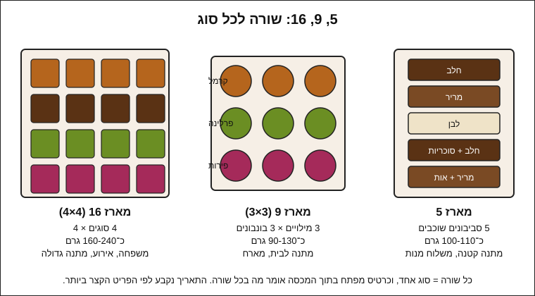

# 11.2 · עיצוב מארז ועלות לכל מארז

מארז טוב הוא לא רק פריטים יפים בקופסה: הוא סידור שאפשר לקרוא, תאריך שמתאים לפריט הכי רגיש, ומחיר עלות שאתם יודעים. בשיעור הזה מתכננים מארזים של 5, 9 ו־16 יחידות, ומחשבים עלות לכל מארז ממחירים אמיתיים, עם דוגמה פתורה של מארז הסביבונים מ־[08.2](../module-08/lesson-02.md). בסוף השיעור יש לכם [תכנון מארז](../../templates/gift-box-plan.md) מלא למארז אחד לפחות, וטבלה שמשווה עלות ליחידה בין שלושת הגדלים.

## מה צריך

| פריט | כמות לתרגול | כמות מלאה | הערה |
|---|---|---|---|
| תבנית [תכנון מארז](../../templates/gift-box-plan.md) | 1 | 1 לכל מארז | מודפסת או כקובץ |
| [גיליון תמחור](../../templates/pricing-sheet.md) | 1 | | רק חלק חומרי הגלם והאריזה |
| קבלות או צילומי מסך של מחירים: קוברטורה, סוכריות, קופסה, מדבקות, סרט | | | המחיר ששילמתם, לא המחיר מהשיעור |
| פריט אחד מכל סוג שייכנס למארז, ומשקל 0.1 גרם או 1 גרם | 1 מכל סוג | | שוקלים, לא מנחשים |
| הקופסה מ־[11.1](lesson-01.md), סרגל, עיפרון | 1 | | לשרטוט הסידור |
| מחשבון או גיליון אלקטרוני | 1 | | |

**אלרגנים:** כל מארז יורש את האלרגנים של כל הפריטים שבו. שוקולד: **סויה** (לציטין), **חלב** בחלב ולבן ובמרירים רבים ("עלול להכיל"); מילויים: **חלב** (שמנת, חמאה), **אגוזים** (פרלינה, ג'יאנדוז'ה), **בוטנים** ו**ביצים** (חטיף ונוגט, [07.4](../module-07/lesson-04.md)), **גלוטן** בחלק מהסוכריות ובפריטים פריכים, **שומשום** (טחינה וחלבה). בתכנון רושמים אלרגנים לכל פריט, ואז לכל המארז.

## למה זה עובד

### מספר היחידות קובע את הצורה

5, 9 ו־16 הם שלושה גדלים שחוזרים בחנויות האריזה, וכל אחד נותן צורה אחרת:

| מארז | סידור | כמה סוגים | משקל משוער | מתאים ל |
|---|---|---|---|---|
| 5 | שורה אחת, או 2-1-2 | עד 3 סוגים, או 5 שונים | 50-110 גרם (5 מטבעות גדולים עד 5 סביבונים) | מתנה קטנה, משלוח מנות, מארז ילדים |
| 9 (3×3) | שורה לכל סוג | 3 סוגים × 3 | 90-130 גרם (בונבון 10-15 גרם, [05.1](../module-05/lesson-01.md)) | מתנה למארחים, טעימות |
| 16 (4×4) | שורה לכל סוג | 4 סוגים × 4 | 160-240 גרם | משפחה, אירוע ([10.6](../module-10/lesson-06.md)), מתנה גדולה |

המשקלים הם חישוב ממשקלי הפריטים בקורס (סביבון כ־20 גרם ב־[08.2](../module-08/lesson-02.md), בונבון 10-15 גרם ב־[05.1](../module-05/lesson-01.md), טראפלס 11-12 גרם ב־[06.2](../module-06/lesson-02.md), מטבע כ־4 גרם ב־[04.4](../module-04/lesson-04.md)), לא נתון של יצרן. שוקלים את שלכם.

### שורה לכל סוג, ומפתח במכסה

מי שפותח מארז רוצה לדעת מה הוא אוכל, בעיקר אם יש אגוזים או אלכוהול. הדרך הפשוטה: כל שורה היא סוג אחד, לכל סוג סימן חיצוני (צבע, פתית מלח, אגוז, אות), וכרטיס מפתח קטן בתוך המכסה עם שרטוט הקופסה. כך בנוי גם מארז ה־9 של [פרויקט מודול 7](../../projects/m07-filled-selection.md): שלושה מילויים, שלושה מכל אחד, סימן לכל מילוי. פריט עם אלרגן חזק (אגוזים, בוטנים) שמים בשורה בקצה, ולא באמצע.

### התאריך נקבע לפי הפריט הקצר ביותר

מארז הוא בדיוק כמו הפריט הכי רגיש בו. סביבון משוקולד מוצק, בלי מילוי, נשמר ב־18-20°C הרבה יותר זמן מכל מילוי עם שמנת; טראפלס של שוקולד ושמנת מחזיק עד כשבועיים במקרר ([06.4](../module-06/lesson-04.md#מה-זה-אומר-בבית)); פרי טרי מטובל מחזיק יום ([02.2](../module-02/lesson-02.md)). מארז שיש בו טראפלס אחד עם שמנת הוא מארז למקרר, עם תאריך של טראפלס, גם אם ארבעת הפריטים האחרים יכלו לחכות חודש. Callebaut כותבים ליצרנים לתת רק תאריך שבטוחים בו אחרי ניסוי מלא, ולהעדיף להבטיח פחות. בבית: אם רוצים מארז שמחזיק, בונים אותו מפריטים עם אותם תנאי אחסון.

### ממה בנויה עלות של מארז

התבנית [תכנון מארז](../../templates/gift-box-plan.md) מחלקת את העלות לשלושה:

1. **חומרי גלם**: גרם של כל פריט כפול המחיר לגרם ששילמתם. קוברטורה עלתה כ־80-100 ₪ לק"ג בבדיקה של 2026-11-10 ([קוברטורה](../../references/where-to-buy.md#קוברטורה)), כלומר 8-10 אגורות לגרם.
2. **אריזה**: קופסה, תחתית או כוסיות, נייר משי, סרט, מדבקה ופתק (מה כותבים בתווית למכירה: [18.1](../module-18/lesson-01.md)).
3. **פחת של 10-15%**: פריט שנשבר, טעימה, שוקולד שנשאר בשקית הזילוף. התבנית מוסיפה אותו על הכול.

מה שלא בטבלה הזאת: שעות עבודה, חשמל, משלוח, עמלות ומע"מ. את זה מוסיפים בתמחור מלא במסלול העסקי ([מודול 19](../module-19/lesson-01.md)). לכן מחיר עלות כאן הוא רצפה, לא מחיר מכירה.

### אריזה במארז קטן היא חלק גדול מהעלות

בדוגמאות שבתרגול, האריזה של מארז 9 עולה כמעט כמו הבונבונים עצמם, והעלות ליחידה יורדת ככל שהמארז גדל, כי קופסה אחת וסרט אחד מתחלקים על יותר יחידות. זה עוזר להחליט: מארז קטן הוא מתנה יקרה יחסית לכל יחידה, ושקית צלופן עם פריט אחד היא האריזה הזולה ביותר.

### דוגמה בשוק

הדוגמה שהובילה את הקורס: בגיפטוש נמכר מארז של 5 סביבונים בחלב, מריר ולבן עם סוכריות ב־40 ₪, בקופסה מעוצבת (נבדק 2026-11-10). זה מחיר מכירה של עסק, שכולל עבודה, משלוח, רישוי ומע"מ, ולכן משווים אליו רק כדי להבין את הפער, לא כדי לקבוע מחיר. דוגמה ניטרלית, לא המלצה.

## שלב אחר שלב

> [!WARNING]
> מארז לילדים: סוכריות קטנות, אגוזים שלמים ופריטים קשים הם סכנת חנק לפעוטות, ולכן מארז כזה לא נותנים לילדים מתחת לגיל 4 בלי השגחה. פריט עם אגוזים או בוטנים באותה קופסה הופך את כל המארז ל"עלול להכיל", וכותבים את זה על הפתק.

1. **למי ולמה**: ממלאים בראש התבנית את השם, למי (בית, מתנה), מועד מסירה, וכשרות (חלבי, פרווה, חלב ישראל) לפי מה שהנמען צריך. שואלים מראש על אלרגיות.
2. **גודל**: לפי הטבלה למעלה. מתנה שתיפתח מחר יכולה להיות 16; משלוח בקיץ עדיף 5 או 9.
3. **בחירת פריטים**: מקסימום סוג אחד שדורש מקרר. אם יש כזה, כל המארז מתוכנן למקרר.
4. **שרטוט**: מציירים את הקופסה מלמעלה, שורה לכל סוג. הכבד במרכז, פריט עם אגוזים בקצה, טראפלס באבקה בכוסית.
5. **שקילה**: שוקלים פריט אחד מכל סוג ורושמים בטבלת הפריטים. מכפילים בכמות: זה המשקל של המארז.
6. **אלרגנים ותאריך**: רושמים אלרגנים לכל פריט, מאחדים לרשימה אחת למארז, וקובעים תאריך לפי הפריט הקצר.
7. **עלות חומרי גלם**: לכל סוג, משקל השוקולד כפול המחיר לגרם, ועוד מילוי וקישוט. סוכמים.
8. **עלות אריזה**: מחיר חבילה חלקי מספר היחידות בה. קופסה אחת, מדבקה אחת, סרט אחד, כוסיות לפי הצורך.
9. **פחת**: מוסיפים 10-15% על הסכום.
10. **בדיקה מול הקופסה**: מסדרים פעם אחת "על יבש" בקופסה האמיתית ([11.1](lesson-01.md)), ומתקנים את השרטוט אם צריך.

## בדיקה: איך יודעים שהצליח

התכנון עובר אם כל השורות האלה מסומנות:

- [ ] יש שרטוט עם שורה לכל סוג וכרטיס מפתח.
- [ ] כל פריט נשקל, ומשקל המארז מחושב.
- [ ] יש רשימת אלרגנים לכל פריט ולמארז כולו, כולל "עלול להכיל".
- [ ] התאריך ותנאי האחסון נקבעו לפי הפריט הקצר ביותר.
- [ ] כשרות כתובה לפי מה שמופיע על האריזות של הרכיבים, בלי המילה "כשר" אם אין תעודה.
- [ ] עלות חומרי גלם, אריזה ופחת מחושבות, ממחירים ששילמתם או שראיתם עם תאריך.
- [ ] יש עלות ליחידה (עלות המארז חלקי מספר היחידות).

## כשזה משתבש

| מה רואים | למה זה קורה | מה עושים עכשיו | איך מונעים בפעם הבאה |
|---|---|---|---|
| העלות יצאה גבוהה מהצפוי | קופסה יקרה, או חבילת אריזה קטנה שמחירה ליחידה גבוה | בודקים קופסה פשוטה יותר או חבילה גדולה יותר | מחשבים אריזה ליחידה לפני שקונים |
| שכחתם את הפחת, ובסוף חסרו פריטים | תכנון בדיוק לפי מספר התאים | מכינים עוד 1-2 פריטים | תמיד 10-15% יותר, גם בייצור |
| במארז יש טראפלס עם שמנת וסביבונים לחודש | פריטים עם תנאי אחסון שונים | המארז הולך למקרר עם תאריך הטראפלס, או מוציאים את הטראפלס | סוג אחד שדורש מקרר, או אף אחד |
| מי שפתח לא ידע איזה בונבון עם אגוזים | אין מפתח, אין סימן חיצוני | שולחים צילום עם הסבר | שורה לכל סוג, סימן לכל סוג, כרטיס במכסה |
| המארז נראה ריק או צפוף | פריטים קטנים בתאים גדולים, או 5 סוגים ב־9 תאים | ממלאים בכוסיות ובנייר משי, או מחליפים קופסה | בוחרים קופסה אחרי ששוקלים ומודדים |
| הפריטים בגבהים שונים, המכסה לוחץ על אחד | פריט גבוה במארז שטוח | מעבירים את הגבוה לשקית צלופן נפרדת | מתכננים לפי הפריט הגבוה ביותר |

### מה עושים עם מה שלא הצליח

שום דבר לא הולך לפח. פריטים שלא נכנסו למארז (רזרבה, פחת, טעימות) נאכלים בבית או הולכים לשוקו ולבראוניז. שוקולד נקי שנשאר בשקיות הזילוף חוזר להמסה, בשקית נפרדת לכל סוג, ונפרדת לחלבי ולפרווה. תכנון שלא עבד לא נמחק: שומרים אותו ליד התכנון החדש, ורושמים מה שיניתם.

## חלופות

### טבעוני / פרווה

מארז טבעוני מתוכנן מראש כולו, ולא "מוציאים את מה שחלבי" ממארז רגיל, בגלל מגע. כיוון ששוקולד חלב ולבן טבעוניים לקונדיטוריה לא נמצאו בחנויות שנבדקו ([שוקולד טבעוני](../../references/where-to-buy.md#שוקולד-טבעוני)), מגוון יכול לבוא מאחוזי קקאו שונים, ממילויים (גנאש קוקוס, פרלינה, ג'לי פירות) ומקישוטים. בעלות: קרם קוקוס ושוקולד טבעוני עולים לרוב יותר, ולכן מחשבים מארז טבעוני בנפרד ולא מעתיקים את העלות מהמארז הרגיל.

### בריא יותר

מארז של 5 פריטים קטנים, או 9 בונבונים "מיני" של 7-8 גרם ([05.1](../module-05/lesson-01.md)), הוא פחות שוקולד במתנה אחת. מריר 70% ומעלה, פירות מיובשים בהקפאה ואגוזים במקום סוכריות. בעלות זה כמעט לא משנה: האריזה נשארת אותה אריזה, ולכן העלות ליחידה עולה כשהיחידה קטנה. אין כאן הבטחה בריאותית.

### כשרות

בשלב התכנון מחליטים: מארז חלבי או מארז פרווה, ולא "חצי־חצי". אם פריט אחד חלבי, מתייחסים למארז כאל חלבי. למארז פרווה בודקים כל רכיב לפי [שלושה כללים](../../references/kashrut-guide.md#שלושה-כללים), כולל סוכריות ([סוכריות וקישוטים](../../references/kashrut-guide.md#סוכריות-וקישוטים)) ואלכוהול בגנאש. מי שמקפיד על חלב ישראל מחפש את זה על שוקולד החלב והלבן ([קוברטורה חלב](../../references/kashrut-guide.md#קוברטורה-חלב)). אם יש ספק, שואלים את הרב.

## איפה קונים

קונים לפי התכנון, לא לפני. מה מחפשים: קופסה מחולקת לפי מספר היחידות (5, 9, 16) או קופסה שקופה; כוסיות נייר; מדבקות עגולות; סרט. מחירים שנבדקו ב־2026-11-10: קופסאות מחולקות 3.90-15.50 ₪ ליחידה (לירון בראשית), קופסה שקופה 14×14 ס"מ ב־15 ₪ ל־10 יחידות (חתום בנשיקה), גיליון מדבקות עגולות 4 ס"מ ב־15 ₪, שקיות צלופן 10×15 ב־14 ₪ ל־50. כל החנויות, הטווחים והמלאי: [קופסאות פרלינים](../../references/where-to-buy.md#קופסאות-פרלינים), [צלופן וסרטים](../../references/where-to-buy.md#צלופן-וסרטים), [מדבקות ותוויות](../../references/where-to-buy.md#מדבקות-ותוויות), [קוברטורה](../../references/where-to-buy.md#קוברטורה), [סוכריות קישוט](../../references/where-to-buy.md#סוכריות-קישוט). מחירים משתנים: בתבנית כותבים את המחיר ששילמתם ואת התאריך.

## תרגול

### משימה

ממלאים [תכנון מארז](../../templates/gift-box-plan.md) לשני מארזים: מארז 5 הסביבונים מפרויקט [מודול 8](../../projects/m08-dreidel-box.md), ומארז 9 או 16 לפי בחירתכם. שוקלים פריט אחד מכל סוג, משתמשים במחירים ששילמתם, ומחשבים עלות למארז ועלות ליחידה. אחר כך משווים בטבלה קטנה את שלושת הגדלים, וכותבים משפט אחד: איזה גודל הייתם נותנים למי, ולמה.

דוגמה פתורה

**מארז 5 סביבונים** ([08.2](../module-08/lesson-02.md): סביבון כ־20-22 גרם, כ־105 גרם שוקולד למארז). מחירים: קוברטורה 90 ₪ לק"ג (באמצע הטווח 80-100), אריזה מחתום בנשיקה ולירון בראשית, נבדק 2026-11-10. כוסיות וסרט לא נבדקו במחיר ליחידה, ולכן מסומנים כהערכה.

| רכיב | חישוב | ₪ |
|---|---|---|
| שוקולד חלב, מריר ולבן | 105 גרם × 0.09 | 9.45 |
| סוכריות קישוט | כף מצנצנת (הערכה) | 1.00 |
| **חומרי גלם** | | **10.45** |
| קופסה שקופה 14×14 | 15 ₪ ÷ 10 | 1.50 |
| כוסיות ונייר משי | הערכה | 0.50 |
| מדבקה עגולה | 15 ₪ לגיליון; אם יש בו 24, ÷ 24 | 0.63 |
| סרט | הערכה | 0.50 |
| **אריזה** | | **3.13** |
| פחת 12% | 13.58 × 0.12 | 1.63 |
| **סה"כ עלות למארז** | | **כ־15.2** |
| עלות ליחידה | 15.2 ÷ 5 | כ־3.0 |

בקופסה מחולקת במקום קופסה שקופה (3.90 ₪, הקצה הזול של הטווח, בלי כוסיות): אריזה 5.03 ₪, וסה"כ כ־17.3 ₪. מול 40 ₪ שנבדקו בשוק, ההפרש צריך לכסות את שעות העבודה שרשמתם, משלוח, רישוי ומע"מ ([מודול 19](../module-19/lesson-01.md)). כאן לא קובעים מחיר.

**מארז 9 ומארז 16 בונבונים** (הנחה: בונבון של כ־12 גרם, כ־7 גרם שוקולד בקליפה ובמכסה וכ־5 גרם מילוי של קרמל או גנאש, כלומר כ־0.63 ₪ שוקולד ועוד כ־0.27 ₪ מילוי, בסך הכול כ־0.90 ₪ לבונבון; מחיר הקופסה המחולקת הוא הנחה בתוך הטווח 3.90-15.50):

| רכיב | מארז 9 | מארז 16 |
|---|---|---|
| בונבונים | 9 × 0.90 = 8.10 | 16 × 0.90 = 14.40 |
| צבע וקישוט (הערכה) | 0.50 | 0.80 |
| קופסה מחולקת (הנחה) | 6.00 | 10.00 |
| מדבקה וסרט | 1.13 | 1.13 |
| פחת 12% | 1.89 | 3.16 |
| **סה"כ** | **כ־17.6** | **כ־29.5** |
| **עלות ליחידה** | **כ־2.0** | **כ־1.8** |

מה רואים: ליחידה, מארז 5 הוא היקר (כ־3.0 ₪), ו־16 הזול (כ־1.8 ₪). במארז 9 האריזה (7.13 ₪) כמעט שווה לבונבונים (8.10 ₪). משפט לדוגמה: "לשכנים מארז 5 בשקית ובקופסה שקופה; למארחים בשבת מארז 9; לסבתא ליום הולדת מארז 16, שנמסר ביד ונשמר במקרר בגלל הגנאש."

### זמן

כשעה: 15 דקות שקילה, 20 דקות לכל תכנון, ו־5 דקות להשוואה.

### יומן

שומרים את שני התכנונים ליד [יומן התרגול](../../templates/practice-log.md), ורושמים ביומן: מה הפתיע אתכם בעלות, ואיזה פריט קבע את התאריך.

### בדיקה עצמית

- [ ] שני תכנונים מלאים, עם שרטוט, משקלים ואלרגנים.
- [ ] תאריך ותנאי אחסון לפי הפריט הקצר ביותר בכל מארז.
- [ ] עלות חומרי גלם, אריזה ופחת, עם מקור ותאריך לכל מחיר.
- [ ] עלות ליחידה לכל גודל, ומשפט שמסביר את הבחירה.
- [ ] אין במסמך מחיר מכירה או "כשר" בלי תעודה.

## סיכום

- 5, 9, 16: שורה לכל סוג, סימן לכל סוג, כרטיס מפתח במכסה; פריט עם אגוזים בקצה.
- התאריך ותנאי האחסון של המארז הם של הפריט הכי רגיש בו. שמנת אחת = מארז למקרר.
- עלות למארז = חומרי גלם + אריזה + 10-15% פחת. עבודה, משלוח ומע"מ באים ב[מודול 19](../module-19/lesson-01.md).
- ליחידה, מארז קטן יקר יותר, כי האריזה מתחלקת על פחות יחידות; במארז 9 האריזה יכולה לעלות כמו הבונבונים.
- מארז 5 סביבונים עולה בחומרים ובאריזה כ־15-17 ₪ (מחירי 2026-11-10); מחיר בשוק הוא נקודת השוואה, לא מחיר שלכם.
