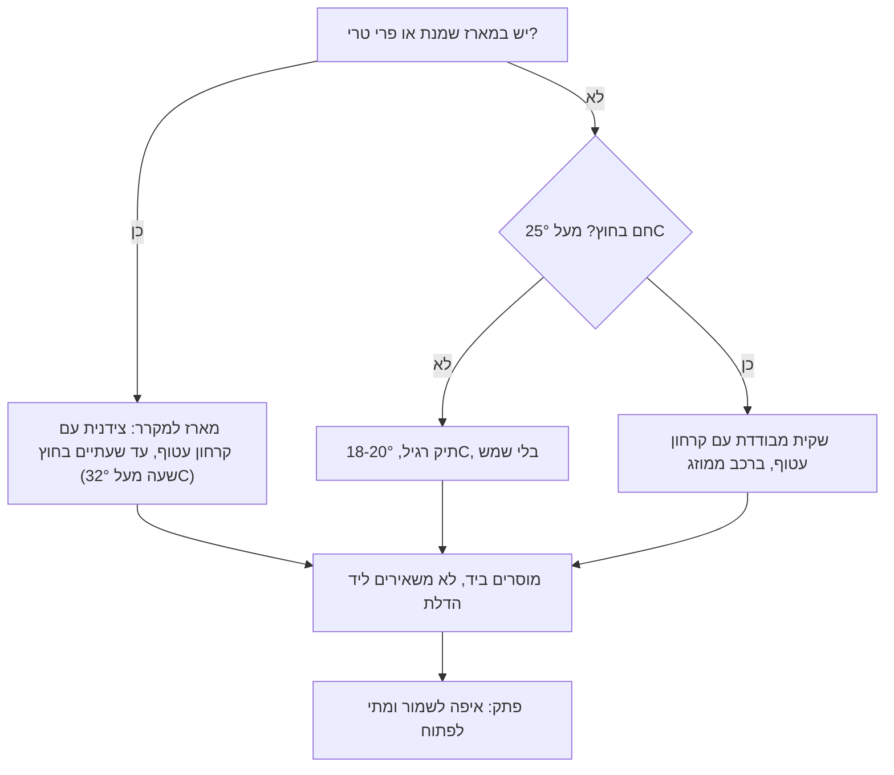

# 11.3 · אחסון ומשלוח ביתי של מתנה

המארז מוכן, ועכשיו הוא צריך לחכות יום או יומיים ולעבור נסיעה. בשיעור הזה מחליטים איפה המארז מחכה (חדר קריר או מקרר), איך מוציאים אותו מהמקרר בלי שהשוקולד "יזיע", ואיך מוסרים אותו בקיץ הישראלי, ולמה לא משאירים אותו באוטו. בסוף השיעור עשיתם ניסוי עיבוי קטן, מדדתם כמה חם ברכב שלכם, וכתבתם תוכנית מסירה למארז של הפרויקט.

## מה צריך

| פריט | כמות לתרגול | כמות מלאה | הערה |
|---|---|---|---|
| 4 חתיכות שוקולד מטומפר מאותו סוג (מטבעות, ריבועים מטבלה) | 4 | | שאריות; חוזרות להמסה בסוף |
| 2 קופסאות קטנות עם מכסה, ומגבת נייר | 2 + 1 | | לניסוי העיבוי |
| מדחום דיגיטלי (גם מדחום הטמפרור) | 1 | | למדידה ברכב ובצידנית |
| שקית או צידנית מבודדת, וקרחון ג'ל | 1 + 1 | | למשלוח מארז למקרר |
| נייר עיתון לבן או קרטון דק, מגבת | 2 דפים + 1 | | חוצץ בין קרחון לקופסה |
| המארז מ־11.1 או מתוכנן ב־11.2 | 1 | | |

**אלרגנים:** כמו בפריטים שבמארז: **סויה** ו**חלב** בשוקולד, **אגוזים**, **בוטנים**, **ביצים**, **גלוטן** ו**שומשום** לפי המילויים. הוראת האחסון לא מחליפה את רשימת האלרגנים בפתק.

## למה זה עובד

### חום: מעל 34°C הטמפר הולך

שוקולד מטומפר מחזיק את הצורה בזכות קריסטלים מצורה V, שנמסים ב־33.8°C ([03.1](../module-03/lesson-01.md)). Callebaut ממליצים לאחסן שוקולד ב־12-18°C (ובקורס, למוצרים מוגמרים, 18-20°C קבוע, [03.5](../module-03/lesson-05.md)), וכותבים שבחום גבוה יותר הוא מתרכך ומאבד ברק. כשהוא נמס ומתקשה שוב בלי טמפרור, נוצרת פריחת שומן: פסים ואפור (Callebaut, [03.5](../module-03/lesson-05.md#שני-סוגי-פריחה)). אפשר לאכול, אבל זו כבר לא מתנה.

### רכב חונה: דקות, לא שעות

במחקר שפורסם ב־Pediatrics ב־2005 (McLaren, Null ו־Quinn, בסיכום של Journalist's Resource), מדדו רכב כהה חונה בשמש ב־16 ימים, כשבחוץ היה בין כ־22°C לכ־36°C. הטמפרטורה בפנים עלתה בממוצע בכ־1.8°C בכל 5 דקות, 80% מהעלייה קרתה ב־30 הדקות הראשונות, וגם ביום הקריר ביותר הרכב הגיע לכ־47°C. חלון פתוח מעט לא מנע את העלייה.

ובישראל: הממוצע של הטמפרטורה המרבית באוגוסט הוא כ־30°C בתל אביב ובירושלים, כ־35°C בבאר שבע וכ־40°C באילת (נתוני השירות המטאורולוגי, דרך ויקיפדיה). כלומר, בקיץ רכב סגור עובר את 33.8°C תוך דקות, ובשמש הרבה יותר מזה. תא המטען לא נמדד במחקר, ואין סיבה להניח שהוא קר. הכלל: המארז נוסע איתכם, בתוך הרכב הממוזג, לא על המושב בשמש, ויוצא איתכם מהרכב בכל עצירה.

### לחות ועיבוי: הצד השני של המקרר

Callebaut ממליצים על לחות יחסית של 70% לכל היותר, וכותבים שמקרר בדרך כלל לא מומלץ למוצרי שוקולד, כי הלחות שבו נספגת במוצרים. הבעיה הגדולה היא היציאה: אוויר חם ולח פוגש שוקולד קר, והמים מתעבים עליו. העיבוי ממיס סוכר על פני השוקולד, וכשהמים מתאדים נשארת שכבה לבנה ויבשה של פריחת סוכר (Callebaut). לחות של קיץ בתל אביב בצהריים היא כ־67-70%, כך שבמטבח בחוף זה קורה בקלות.

הפתרון זהה בכל הקורס: מוציאים את הקופסה **סגורה**, ופותחים רק כשהשוקולד הגיע לטמפרטורת החדר. Callebaut כותבים לוודא שהמוצרים הארוזים חזרו לטמפרטורת החדר לפני שפותחים את האריזה. בקורס: שעה־שעתיים לשוקולד מוצק ([03.5](../module-03/lesson-05.md#אחסון-טמפרטורה-קבועה-יבש-סגור)), 20-30 דקות לטראפלס ([06.2](../module-06/lesson-02.md#למה-טראפלס-מזיעים-כשמוציאים-אותם)). העיבוי נוצר על הקופסה, לא על השוקולד.

### מה במקרר ומה לא

| מה במארז | איפה מחכה | כמה זמן בחוץ | מקור בקורס |
|---|---|---|---|
| שוקולד מוצק: סביבונים, מטבעות, טבלאות, לוליפופ, קישוטים | 18-20°C קבוע, יבש וסגור, לא במקרר | לא מוגבל בבטיחות; מוגבל בחום (מעל 34°C נמס) | [03.5](../module-03/lesson-05.md), [08.2](../module-08/lesson-02.md), [09.1](../module-09/lesson-01.md) |
| בונבונים עם קרמל, פרלינה או ג'לי | מקום קריר 14-18°C | כמו שוקולד מוצק, בתאריך של המילוי | [05.2](../module-05/lesson-02.md), [פרויקט מודול 7](../../projects/m07-filled-selection.md) |
| טראפלס וגנאש של שוקולד ושמנת | מקרר, עד 4°C, קופסה סגורה | עד שעתיים, ושעה אחת מעל 32°C | [06.2](../module-06/lesson-02.md), [06.4](../module-06/lesson-04.md#מה-זה-אומר-בבית) |
| פירות טריים מטובלים | מקרר | אותו יום; שעתיים, שעה מעל 32°C | [02.2](../module-02/lesson-02.md) |

כלל השעתיים (UF/IFAS): מזון רגיש לא נשאר בטמפרטורת החדר יותר משעתיים, ומעל 32°C (90°F), למשל בפיקניק בקיץ, לא יותר משעה. זה כולל את הנסיעה ואת הזמן שהמארז עומד אצל הנמען לפני שהוא מכניס אותו למקרר. לדוגמה ניטרלית: גיפטוש כותבים למארזי השוקולד שלהם לשמור ב־18-20°C, וש־4°C במקרר עלולים לפגוע במראה ובטעם (נבדק 2026-11-10; המארז מ־[08.2](../module-08/lesson-02.md#המארז-שהשיעור-מכוון-אליו)).

### איך בוחרים דרך מסירה

הסף של 25°C הוא כלל אצבע של הקורס, באמצע בין 18-20°C המומלצים לבין 33.8°C שבו הטמפר נשבר; הוא לא נתון של יצרן.

### קרחון לא נוגע בשוקולד

קרחון ג'ל קפוא שנוגע בקופסה יוצר נקודה קרה, ועליה עיבוי. לכן הקרחון עטוף, ובינו לבין המארז יש קרטון, נייר או מגבת ([קופסאות מבודדות וקרחונים](../../references/where-to-buy.md#קופסאות-מבודדות-וקרחונים)). המטרה בשוקולד מוצק היא לא לקרר אלא לא לחמם: להישאר מתחת לכ־25°C. משלוח עסקי בקיץ, עם שליח וזמנים ארוכים, נלמד בשיעור 20.3.

## שלב אחר שלב

> [!WARNING]
> מארז עם שמנת או פרי טרי הוא מזון רגיש: לא יותר משעתיים מחוץ למקרר, ושעה אחת מעל 32°C, כולל הנסיעה. קרחון ג'ל קפוא לא מניחים על העור או ישירות על השוקולד. לא נכנסים לרכב סגור וחם רק כדי למדוד: פותחים דלת, מודדים ויוצאים.

**א. ניסוי עיבוי (כ־15 דקות עבודה, 3 שעות המתנה)**

1. מניחים 2 חתיכות שוקולד בקופסה A וסוגרים. 2 חתיכות בקופסה B, פתוחה.
2. שתי הקופסאות למקרר לשעה.
3. מוציאים את שתיהן למטבח. את A לא פותחים. את B משאירים פתוחה.
4. אחרי 5 דקות מסתכלים על B: יש עליה טיפות או ברק רטוב?
5. אחרי שעה־שעתיים, כשהקופסה A בטמפרטורת החדר למגע, פותחים אותה.
6. אחרי שעה נוספת משווים את A ו־B באור יום: ברק, כתמים לבנים, מגע (פריחת סוכר מחוספסת ולא נעלמת במגע).

**ב. מדידה ברכב (כ־10 דקות)**

7. ביום חם, מניחים את המדחום על המושב האחורי ברכב חונה, דלתות סגורות, ורושמים את השעה ואת הטמפרטורה בחוץ.
8. אחרי 15 ו־30 דקות פותחים דלת, קוראים את המדחום ורושמים. בלי שוקולד: המדחום מספיק.

**ג. תוכנית מסירה למארז (כ־20 דקות)**

9. קובעים לפי הטבלה למעלה איפה המארז מחכה: 18-20°C או מקרר.
10. מכינים את המארז יום לפני ולא באותו בוקר, כדי שיהיה זמן לבדיקה של 24 שעות (11.1).
11. אם המארז במקרר: בבוקר המסירה מכניסים את הקופסה **הסגורה** לשקית מבודדת, עם קרחון עטוף ושכבת קרטון ביניהם. לא פותחים.
12. אם לא במקרר וחם בחוץ: שקית מבודדת עם קרחון עטוף, כדי לא להתחמם בדרך.
13. נוסעים ברכב ממוזג, השקית על הרצפה או בצל, לא על הדשבורד ולא בתא המטען. בכל עצירה השקית יוצאת איתכם.
14. מוסרים ביד. לא משאירים ליד הדלת או אצל השומר בלי לדעת מתי ייקחו.
15. אומרים, וכותבים בפתק, הוראה של שורה אחת: "לשמור ב־18-20°C, לא במקרר ולא בשמש", או "למקרר מיד; להוציא סגור חצי שעה לפני שפותחים".

## בדיקה: איך יודעים שהצליח

- **ניסוי**: בקופסה A השוקולד מבריק ויבש. ב־B יש טיפות מיד, ואחר כך ברק עמום או כתמים לבנים. אם שניהם נראים אותו דבר, המטבח יבש: חוזרים על הניסוי ביום לח.
- **רכב**: רשמתם שלוש קריאות (בחוץ, 15 דקות, 30 דקות). ברוב הימים בקיץ הקריאה ב־30 דקות מעל 34°C.
- **מסירה**: המארז הגיע בלי סימני חום (פסים, פינות רכות, סוכריות שזלגו) ובלי טיפות.
- **זמן**: במארז למקרר, מהמקרר שלכם למקרר של הנמען עברו פחות משעתיים (שעה מעל 32°C), ורשמתם את השעות.
- **פתק**: יש הוראת אחסון של שורה אחת שמתאימה לפריט הרגיש ביותר.

## כשזה משתבש

| מה רואים | למה זה קורה | מה עושים עכשיו | איך מונעים בפעם הבאה |
|---|---|---|---|
| סביבונים רכים, נדבקים לכוסיות | חום ברכב או בשמש מעל 34°C | מקררים סגור 15 דקות כדי שלא יתעוותו; הפריטים לבית | המארז נוסע בתוך הרכב הממוזג, יוצא איתכם |
| פסים אפורים אחרי יום חם | שוקולד נמס חלקית והתקשה בלי טמפר: פריחת שומן | לבית או להמסה וטמפרור מחדש | אחסון 18-20°C קבוע, בלי שמש |
| שכבה לבנה יבשה אחרי שיצא מהמקרר | עיבוי: הקופסה נפתחה קרה | לבית; טעים, רק פחות יפה | מוציאים סגור, פותחים בטמפרטורת החדר |
| טיפות בתוך הצלופן | שקית סגורה סביב שוקולד שחזר מקור, או קרחון שנגע | מוציאים לנייר בחדר, מייבשים | קרחון עטוף וקרטון ביניהם |
| הקופסה רטובה מלמטה | קרחון שהפשיר ונזל, או עיבוי על קרחון לא עטוף | מחליפים קופסה חיצונית אם יש | קרחון ג'ל בשקית סגורה, מגבת מתחת |
| הנמען הכניס מארז של סביבונים למקרר ופתח מיד | אין הוראה בפתק | שולחים הודעה: להחזיר לקופסה סגורה ולחכות | הוראת שורה אחת בפתק, ואומרים אותה בעל פה |
| טראפלס עמד שלוש שעות בחום | מסירה התעכבה | לא אוכלים; זה המקרה שבו זורקים | מכינים מארז שמנת רק כשהמסירה ביד ובטוחה |

### מה עושים עם מה שלא הצליח

כמעט שום דבר לא הולך לפח. שוקולד מוצק עם פריחת שומן או פריחת סוכר בטוח לאכילה: נמס, מטמפרים מחדש ([03.5](../module-03/lesson-05.md)), או הופך לשוקו חם, לרוטב ולבראוניז. סביבון שהתעוות נאכל בבית. היוצא מן הכלל: טראפלס, גנאש עם שמנת או פרי טרי שהיו מחוץ למקרר יותר משעתיים (או שעה מעל 32°C) לא אוכלים, גם אם הם נראים טוב.

## חלופות

### טבעוני / פרווה

גנאש קוקוס הוא עדיין גנאש עם מים, ולכן מתייחסים אליו כמו לגנאש שמנת: מקרר ושעתיים בחוץ ([06.4](../module-06/lesson-04.md#מה-זה-אומר-בבית)). שוקולד טבעוני ופרווה נמס ומלבין בחום בדיוק כמו שוקולד רגיל, כי גם הוא נשען על חמאת קקאו. מארז טבעוני שנמסר יחד עם מארזים אחרים נשאר בשקית נפרדת, כדי שלא יתבלבלו אצל הנמען.

### בריא יותר

מארז קטן נאכל מהר יותר, ולכן פחות זמן מחכה במקרר או בחום. מארז של 5 יחידות שנמסר ביד ונפתח באותו יום הוא הדרך הפשוטה ביותר לשמור על איכות. אין כאן הבטחה בריאותית; זה עניין של כמות וזמן.

### כשרות

האחסון והמשלוח לא משנים את מה שכתוב על הרכיבים, אבל המארז צריך להגיע סגור, עם הפתק במקום, כדי שהנמען ידע מה יש בו (חלבי או פרווה לפי האריזות). בצידנית משותפת, מארז השוקולד נשאר בקופסה הסגורה שלו. אם הנמען שואל שאלה הלכתית על המארז, ההפניה היא לרב שלו ([מדריך הכשרות](../../references/kashrut-guide.md#שלושה-כללים)).

## איפה קונים

מה מחפשים: שקית תרמית או צידנית קטנה, קרחוני ג'ל לשימוש חוזר (200-500 מ"ל), וקופסת קלקר בעובי דופן של 2 ס"מ לפחות אם הנסיעה ארוכה. מדחום דיגיטלי כבר יש לכם מטמפרור. חנויות, מחירים ומלאי: [קופסאות מבודדות וקרחונים](../../references/where-to-buy.md#קופסאות-מבודדות-וקרחונים), [מדחום](../../references/where-to-buy.md#מדחום), [קופסאות פרלינים](../../references/where-to-buy.md#קופסאות-פרלינים).

## תרגול

### משימה

עושים את שלושת החלקים: ניסוי העיבוי (A סגורה מול B פתוחה), מדידה ברכב חונה (בלי שוקולד), ותוכנית מסירה למארז של [פרויקט המודול](../../projects/m11-holiday-gift-box.md): איפה מחכה, איך נוסע, כמה זמן מחוץ למקרר, ומה כתוב בפתק. ארבע החתיכות מהניסוי חוזרות להמסה או לשוקו.

### זמן

כ־45 דקות עבודה: 15 לניסוי, 10 למדידה, 20 לתוכנית. ועוד כ־3 שעות המתנה בניסוי, שבהן עושים דברים אחרים.

### יומן

רושמים ב[יומן התרגול](../../templates/practice-log.md): הטמפרטורה והלחות במטבח אם יש מד, מה ראיתם ב־A וב־B (מצלמים את שתיהן זו ליד זו), שלוש הקריאות מהרכב, ואת הוראת האחסון שכתבתם.

### בדיקה עצמית

- [ ] ראיתי בעיניים את ההבדל בין קופסה סגורה לפתוחה ביציאה מהמקרר.
- [ ] מדדתי כמה חם ברכב חונה אחרי 15 ו־30 דקות.
- [ ] בתוכנית המסירה יש מקום המתנה, דרך נסיעה, זמן מחוץ למקרר והוראה לנמען.
- [ ] אם יש במארז שמנת או פרי טרי: צידנית, קרחון עטוף, ופחות משעתיים בחוץ.
- [ ] החתיכות מהניסוי חזרו להמסה או לשוקו.

## סיכום

- שוקולד מוצק מחכה ב־18-20°C, יבש וסגור, לא במקרר. שמנת או פרי טרי: מקרר עד 4°C, ולא יותר משעתיים בחוץ (שעה מעל 32°C).
- רכב חונה מתחמם בכ־1.8°C כל 5 דקות, ורוב העלייה בחצי השעה הראשונה: המארז נוסע ויוצא איתכם, אף פעם לא נשאר באוטו.
- מהמקרר מוציאים סגור ופותחים בטמפרטורת החדר; אחרת עיבוי ופריחת סוכר.
- קרחון עטוף, וקרטון בינו לבין המארז; המטרה בשוקולד מוצק היא להישאר מתחת לכ־25°C.
- מוסרים ביד, עם הוראת אחסון של שורה אחת שמתאימה לפריט הרגיש ביותר.
