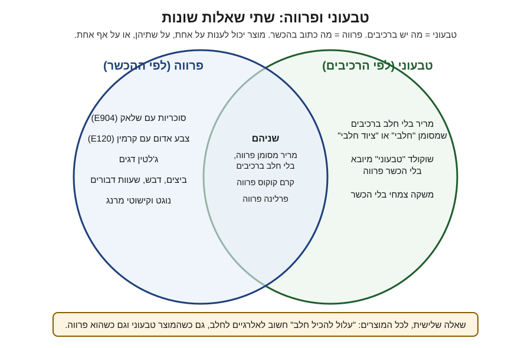

# 12.1 · טבעוני זה לא פרווה

"טבעוני" ו"פרווה" נשמעים כמעט אותו דבר, אבל הם עונים על שתי שאלות שונות: מה יש ברכיבים, ומה כתוב בהכשר. ויש שאלה שלישית, נפרדת משתיהן: האם המוצר בטוח למי שאלרגי לחלב. בשיעור הזה בודקים 6 מוצרים מהמטבח לפי שלוש השאלות, ומכינים טבלת bark שעונה על שתיים מהן.

## מה צריך

| פריט | כמות לתרגול | כמות מלאה | הערה |
|---|---|---|---|
| קוברטורה מריר 55-70%, בלי חלב ברכיבים, מסומנת פרווה | 300 גרם | 1 ק"ג | מטמפרים 300, יוצקים כ־150 גרם, השאר נשמר |
| אגוזים או פיסטוקים קלויים, עם הכשר | 25 גרם | 80 גרם | קלויים ומצופים קונים עם הכשר |
| פירות מיובשים בהקפאה (פטל, תות) או פירות יבשים | 10 גרם | 30 גרם | בודקים שאין ציפוי או סוכריות |
| מלח גס (לא חובה) | קורט | | |
| 6 מוצרים מהמטבח או מהסופר, עם אריזה | 6 | | שוקולד, סוכריות קישוט, משקה צמחי, קרם קוקוס, מרשמלו, ממרח |
| מדחום, מרית, משקל, נייר אפייה או אצטט | 1 מכל | | כמו ב־[03.2](../module-03/lesson-02.md) |
| [יומן תרגול](../../templates/practice-log.md) ועט | | | לטבלת הבדיקה |

**אלרגנים:** אגוזים (או פיסטוקים), לציטין סויה בשוקולד, ו"עלול להכיל" חלב, אגוזים ובוטנים ברוב השוקולד המריר. בודקים על כל אריזה.

### לפני שמתחילים את המודול

צפייה בשיעור היא לא תרגול. במודול הזה מחליפים רכיבים, וכל החלפה משנה משהו: טמפרטורה, מרקם, טעם, זמן אחסון. האקדמיה לא יכולה לבדוק צילומים, ולכן בכל שיעור יש בדיקות ברורות להשוות אליהן. מנהלים [יומן תרגול](../../templates/practice-log.md) ו[יומן טמפרור](../../templates/tempering-log.md), ורושמים בכל ניסוי מה החלפתם ומה זה שינה. השוקולד עובר משיעור לשיעור: מה שנשאר נמס שוב.

## למה זה עובד

### שלוש שאלות, שלושה מקומות על האריזה

| השאלה | איפה בודקים | מי שואל |
|---|---|---|
| **טבעוני?** אין רכיבים מן החי | רשימת הרכיבים | טבעונים |
| **פרווה?** לא חלבי ולא בשרי לפי ההלכה | סמל ההכשר והמילה שלידו (פרווה, חלבי, ציוד חלבי) | מי ששומר כשרות ומגיש אחרי ארוחה בשרית |
| **בלי חלב בכלל?** גם לא עקבות | רכיבים, שורת האלרגנים ו"עלול להכיל" | אלרגיים לחלב |

לפי ה־Vegan Society, טבעונות מבקשת להוציא שימוש בבעלי חיים ככל שאפשר, ובמזון זה אומר בלי בשר, דגים, מוצרי חלב, ביצים ודבש. פרווה היא קטגוריה הלכתית: לא בשר ולא חלב. שתי ההגדרות חופפות בחלקן, ולא יותר.

### פרווה, אבל לא טבעוני

מוצר פרווה יכול להכיל ביצים, דבש, וחומרים מחרקים או מדגים. בשוקולד זה קורה בעיקר בקישוטים: שלאק (E904) על סוכריות מבריקות, קרמין (E120) בצבע אדום וורוד, ג'לטין במרשמלו ובסוכריות גומי, חלבון ביצה בנוגט ובמרנג. ג'לטין דגים יכול להיות כשר פרווה ועדיין לא טבעוני. הרשימה המלאה במדריך: [לא טבעוני גם כשכתוב פרווה](../../references/kashrut-guide.md#לא-טבעוני-גם-כשכתוב-פרווה). [12.5](lesson-05.md) עוסק בזה לעומק.

### טבעוני, אבל לא פרווה

הכיוון ההפוך מפתיע יותר. לפי OK Kosher (16.12.2025), שוקולד מריר שיוצר על קו שמייצר גם שוקולד חלב מוגדר בדרך כלל **חלבי**, ולא "ציוד חלבי" (DE). הסיבה טכנית: בהחלפת ייצור הקו מרוקן ולא נשטף, ונשארות בו שאריות של שוקולד חלב שנכנסות למריר. גם כמות קטנה מדי כדי לחייב סימון חלב על האריזה יכולה לחייב הכשר חלבי. DE ניתן רק כשאין שום שארית חלב.

כך יוצא שמריר שאין בו חלב ברכיבים יכול להיות מסומן "חלבי, לאוכלי אבקת חלב נכרי". זה קורה בדיוק עם Callebaut 811 בשק של 2.5 ק"ג, בעוד שאותו 811 בשק של 5 ק"ג נמכר "פרווה הרב רובין" ([שלושה כללים](../../references/kashrut-guide.md#שלושה-כללים)). לטבעוני זה אותו שוקולד. למי שמגיש קינוח אחרי בשר, אלה שני מוצרים שונים.

מצב שלישי: שוקולד שכתוב עליו "טבעוני" בלי הכשר פרווה. בחנויות שנבדקו בישראל לא נמצא כזה, אבל בחו"ל הוא קיים ([שוקולד טבעוני במדריך הכשרות](../../references/kashrut-guide.md#שוקולד-טבעוני)). למי ששומר כשרות, "טבעוני" על האריזה אינו הכשר.

### והאלרגיים לחלב?

לא "טבעוני" ולא "פרווה" מבטיחים שאין עקבות חלב:

- **ה־Vegan Society** כותבים (11.5.2021) שמוצרים שמתאימים לטבעונים לא תמיד מתאימים לאלרגיים, ושהסימן הטבעוני שלהם לא דורש מפעל נפרד. מוצר עם סימן טבעוני יכול לשאת "עלול להכיל", ואלרגיים מתבקשים לפנות ליצרן.
- **ה־FDA** בדקו מריר שסומן "dairy free" או בטענה דומה, שנאסף ב־2018-2019. ב־4 מתוך 52 מוצרים (12 מתוך 119 דגימות) נמצא חלב ברמות של 600-3,100 חלקים למיליון, רמה שעלולה לסכן אלרגיים. ארבעת המוצרים, כולם טבלאות מריר, נאספו מהשוק.
- **בישראל**: ב־25.2.2025 הודיע משרד הבריאות על מארז 9 פרלינים של "שוקולאב" **המסומן פרווה**, עם חשש לנוכחות חלב שלא מופיע ברכיבים ובאלרגנים, אחרי תלונות צרכנים. עוד דוגמאות: [ריקולים: פרווה שהכיל חלב](../../references/kashrut-guide.md#ריקולים-פרווה-שהכיל-חלב).

המסקנה המעשית: למי שאלרגי לחלב אומרים מה בדקתם ומה לא, ולא מבטיחים. [14.3](../module-14/lesson-03.md) מרחיב על הפרדה במטבח.

### מה זה אומר כשמכינים לאורח

| האורח | מה בודקים | דוגמה למה שמתאים |
|---|---|---|
| טבעוני | רכיבים בלבד | מריר בלי חלב ברכיבים, גם אם מסומן "חלבי" |
| שומר כשרות, ארוחה בשרית | הכשר "פרווה" שהוא סומך עליו, בכל רכיב | מריר פרווה, קרם קוקוס פרווה |
| טבעוני ששומר כשרות | שניהם | מריר פרווה בלי חלב ברכיבים, קישוטים טבעוניים עם הכשר |
| אלרגי לחלב | רכיבים, אלרגנים, "עלול להכיל", ושיחה איתו | רק מה שהוא עצמו אישר; לא מבטיחים |

## שלב אחר שלב

> [!WARNING]
> בשיעור טמפרור (מים מקלקלים שוקולד, מיקרוגל יוצר נקודות חמות) ואגוזים. מי שמכין לאורח אלרגי לא מסתמך על השיעור הזה: מראים לו את האריזות, והוא מחליט.

**חלק א: בדיקת אריזות (15 דקות)**

1. **אוספים 6 מוצרים** עם אריזה: שוקולד אחד לפחות, סוכריות קישוט, משקה צמחי או קרם קוקוס, ועוד שלושה מה שיש (מרשמלו, ממרח, אבקת קקאו, צבע מאכל).
2. **מכינים טבלה ביומן** עם 4 עמודות: מוצר, טבעוני?, פרווה?, אלרגי לחלב?.
3. **טבעוני**: קוראים את רשימת הרכיבים עד הסוף. מחפשים חלב ונגזרותיו (אבקת חלב, חמאה, מי גבינה, קזאין, לקטוז), ביצים, דבש, ג'לטין, שלאק או E904, קרמין, קוכיניל או E120, שעוות דבורים או E901. אם יש רכיב שאתם לא מכירים, כותבים "לא ידוע", לא "כן".
4. **פרווה**: מחפשים את סמל ההכשר ואת המילה לידו. כותבים בדיוק מה כתוב: "פרווה", "חלבי", "חלב נכרי", "ציוד חלבי", או "אין הכשר". לא מסיקים מהרכיבים.
5. **אלרגי לחלב**: מחפשים את שורת האלרגנים ו"עלול להכיל". "עלול להכיל חלב" = לא מתאים בלי שיחה עם האורח.
6. **משווים**: מסמנים מוצר אחד שעונה "כן" בטבעוני ו"לא" בפרווה (או להפך). זה בדרך כלל השוקולד או הקישוט.

**חלק ב: bark טבעוני ופרווה (35 דקות)**

7. **בודקים את הרכיבים לטבלה**: השוקולד (פרווה, בלי חלב ברכיבים), האגוזים (הכשר על אגוזים קלויים, לפי [אגוזים במדריך](../../references/kashrut-guide.md#אגוזים)), הפירות (בלי ציפוי מבריק). רכיב שלא עבר יוצא מהמתכון.
8. **מטמפרים 300 גרם** בשיטת ההזרעה ([03.2](../module-03/lesson-02.md)): 200 גרם מומסים ל־45-50°C, זרעים מאותו שוקולד עד 31-32°C. הזרעים חייבים להיות מאותו מוצר: זרע "חלבי" הופך את כל הקערה לחלבית.
9. **בדיקת סכין**: מתקשה תוך 3-5 דקות, מבריקה ובלי פסים.
10. **יוצקים** כ־150 גרם על נייר אפייה או אצטט, לריבוע של כ־15×15 ס"מ ובעובי 4-5 מ"מ.
11. **מפזרים מיד** אגוזים, פירות ומלח, ולוחצים קלות כדי שייתפסו לפני שהשוקולד מתקשה.
12. **מתקשה** 15 דקות בחדר, ואז עד 15 דקות במקרר. שוברים לחתיכות.
13. **מה שנשאר בקערה** יוצקים לדיסקיות או לשקית "להמסה" עם תווית: "פרווה, טבעוני, [שם המוצר]". זה השוקולד של [12.2](lesson-02.md).
14. **מדבקה**: על קופסת ה־bark כותבים רק מה שבדקתם, למשל: "רכיבים בלי מוצרים מן החי. כל הרכיבים מסומנים פרווה. מכיל פיסטוקים, סויה; עלול להכיל חלב."

## בדיקה: איך יודעים שהצליח

- **טבלת הבדיקה**: 6 מוצרים, 3 עמודות מלאות, ובכל משבצת מה שכתוב על האריזה ולא ניחוש. יש לפחות מוצר אחד שעונה אחרת בטבעוני ובפרווה.
- **מילים מדויקות**: בעמודת הפרווה מועתקת המילה שליד ההכשר. "נראה פרווה" לא נחשב.
- **ה־bark**: ברק אחיד, סנאפ ברור, אין פסים אפורים (בדיקות [03.5](../module-03/lesson-05.md)). התוספות נתפסו ולא נופלות.
- **המדבקה**: אומרת מה בדקתם, בלי "בטוח לאלרגיים" ובלי "כשר" כללי.
- **הסבר בקול**: אתם יכולים להסביר למישהו בשני משפטים למה Callebaut 811 בשק של 2.5 ק"ג מתאים לטבעוני ולא מתאים לשולחן בשרי.

## כשזה משתבש

| מה רואים | למה זה קורה | מה עושים עכשיו | איך מונעים בפעם הבאה |
|---|---|---|---|
| המריר שקניתם מסומן "חלבי" או "חלב נכרי" | הקו מייצר גם שוקולד חלב, וההכשר חלבי (OK) | לטבעוני הוא מתאים. לשולחן בשרי מחליפים במריר פרווה | קונים לפי הכשר, לא לפי רשימת הרכיבים |
| הסוכריות מסומנות פרווה, וברכיבים "confectioner's glaze" או E904 | שלאק הוא הפרשה של חרק, והוא כשר אצל מכשירים רבים | ל־bark טבעוני מחליפים בפיסטוק, פטל מיובש בהקפאה או קוקוס | בודקים ציפוי מבריק בכל סוכרייה ([12.5](lesson-05.md)) |
| על האריזה רק "Vegan", בלי הכשר | מוצר מיובא או מחנות טבע | לטבעוני מתאים. למי ששומר כשרות לא, עד שיש הכשר | מחפשים מוצר עם שני הסימונים |
| ה־bark מפוספס ועמום | הטמפר נשבר, או שזרעים לא היו מאותו שוקולד | ממיסים שוב ומטמפרים | בדיקת סכין לפני יציקה |
| אורח אלרגי לחלב שואל אם "פרווה" מספיק | פרווה לא אומר "בלי עקבות חלב" | מראים לו את האריזות; לא מבטיחים | שואלים מראש על אלרגיות, לא רק על טבעונות |
| שכחתם מאיזה שוקולד הזרעים | השקית לא סומנה | מתייחסים לקערה לפי הזרע ה"חמור" יותר | שקית שאריות עם שם מוצר והכשר |

### מה עושים עם מה שלא הצליח

שום דבר לא הולך לפח. bark מפוספס נמס מחדש ומטמפרים אותו שוב, או שהוא נכנס לבראוניז, לשוקו חם עם משקה צמחי, לרוטב או לטראפלס. שוקולד שהתברר כחלבי לא נזרק: הוא מצוין לטבעונים ולכל קינוח חלבי, רק לא לשולחן הבשרי. סוכריות עם שלאק או קרמין עוברות לקינוח של מי שלא טבעוני, ומסמנים אותן ביומן כדי לא לקנות שוב.

## חלופות

### טבעוני / פרווה

זה כל השיעור. בקצרה: לטבעוני בודקים רכיבים, לשולחן בשרי בודקים הכשר, ולטבעוני ששומר כשרות בודקים את שניהם. מי שרוצה מוצר אחד שמתאים לכולם קונה מריר פרווה בלי חלב ברכיבים, וקישוטים שבדק בעצמו. ב־bark עצמו לא משתנה שום דבר טכני: מריר טבעוני מטמפרים, מאחסנים ושומרים בדיוק כמו כל מריר.

### בריא יותר

"טבעוני" ו"פרווה" לא אומרים "בריא". מריר טבעוני מכיל אותו סוכר ואותו שומן כמו כל מריר באותו אחוז קקאו. אם רוצים פחות סוכר, בוחרים מריר 70% ומעלה ויוצקים חתיכות קטנות יותר (8 ריבועים של כ־15 גרם במקום שוברים גדולים), ומוסיפים יותר אגוזים ופחות פירות מסוכרים. לא כותבים "בריא" על האריזה ([13.5](../module-13/lesson-05.md)).

### כשרות

בשיעור הזה הכשרות היא נושא בפני עצמו: כל רכיב ב־bark צריך הכשר "פרווה" שאתם סומכים עליו, כולל הזרעים, האגוזים הקלויים והפירות. הקורס לא פוסק הלכה. ההגדרות (חלבי, חלב נכרי, ציוד חלבי, פרווה) ב[מונחים](../../references/kashrut-guide.md#מונחים), מה כתוב על כל מריר נפוץ ב[קוברטורה מרירה](../../references/kashrut-guide.md#קוברטורה-מרירה), ודעה הלכתית אחת על מריר מקו חלבי במקורות של המדריך. איך קוראים הכשר על האריזה: [01.3](../module-01/lesson-03.md). אם יש ספק, שואלים את הרב.

## איפה קונים

מה מחפשים: קוברטורה מריר 55-70% שברשימת הרכיבים אין חלב, ושמסומנת פרווה בהכשר שאתם סומכים עליו. שק של 1 ק"ג באריזה מקורית נוח לכל המודול. אגוזים קלויים עם הכשר, ופירות מיובשים בהקפאה בלי ציפוי. חנויות ומלאי: [שוקולד טבעוני](../../references/where-to-buy.md#שוקולד-טבעוני), [קוברטורה](../../references/where-to-buy.md#קוברטורה), [פירות מיובשים בהקפאה](../../references/where-to-buy.md#פירות-מיובשים-בהקפאה). מה כתוב על הכשרות של כל מוצר: [שוקולד טבעוני](../../references/kashrut-guide.md#שוקולד-טבעוני), [קוברטורה מרירה](../../references/kashrut-guide.md#קוברטורה-מרירה), [סוכריות וקישוטים](../../references/kashrut-guide.md#סוכריות-וקישוטים).

## תרגול

### משימה

1. בודקים 6 מוצרים לפי שלוש השאלות, וממלאים את הטבלה ביומן.
2. מטמפרים 300 גרם מריר פרווה בלי חלב ברכיבים, יוצקים כ־150 גרם ל־bark עם תוספות שבדקתם, וכותבים מדבקה מדויקת.

### זמן

כ־15 דקות לבדיקת האריזות, 35 דקות לטמפרור וליציקה, ועוד כ־30 דקות התקשות.

### יומן

ב[יומן התרגול](../../templates/practice-log.md): טבלת 6 המוצרים, ולכל רכיב של ה־bark שם מוצר, הכשר כפי שכתוב, ו"עלול להכיל". ב[יומן הטמפרור](../../templates/tempering-log.md): שוקולד, טמפרטורות, בדיקת סכין. מצלמים את חזית האריזות ואת ה־bark.

### בדיקה עצמית

- [ ] בטבלה 6 מוצרים, ובכל משבצת מה שכתוב על האריזה.
- [ ] מצאתי לפחות מוצר אחד שטבעוני ולא פרווה, או פרווה ולא טבעוני.
- [ ] הזרעים מאותו שוקולד, והבדיקה התקשתה תוך 5 דקות.
- [ ] ה־bark מבריק ונשבר בסנאפ.
- [ ] המדבקה אומרת מה בדקתי, בלי הבטחה לאלרגיים.

## סיכום

- טבעוני = רכיבים. פרווה = הכשר. אלרגיה לחלב = רכיבים, אלרגנים, "עלול להכיל" ושיחה. שלוש בדיקות נפרדות.
- מוצר פרווה יכול להכיל ביצים, דבש, שלאק, קרמין או ג'לטין דגים.
- מריר בלי חלב ברכיבים יכול להיות "חלבי", כי לפי OK קו משותף עם שוקולד חלב משאיר שאריות.
- גם "dairy free" ו"פרווה" נמצאו עם חלב (FDA, ריקול 2025 בישראל): לאלרגיים לא מבטיחים.
- פרויקט המודול: [מארז טבעוני מול המקור](../../projects/m12-vegan-box.md), 5 פריטים מהמודול לצד הגרסה הרגילה שלהם, עם השוואה של טעם, מרקם, חיי מדף, עלות וסימון.
