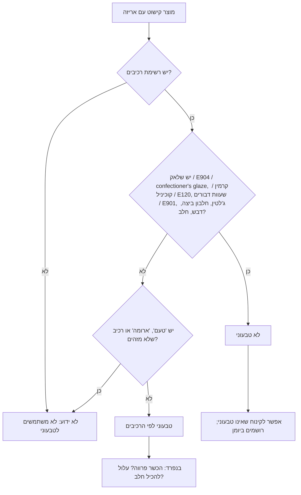

# 12.5 · סוכריות, צבעים וברק: מה לא טבעוני

אפשר להכין בונבון טבעוני מושלם ולהרוס אותו בשנייה אחת, עם סוכריות מבריקות מעליו. רוב הרכיבים הלא טבעוניים בשוקולד מסתתרים דווקא בקישוטים: ציפוי מבריק מחרק, צבע אדום מחרקים, שעוות דבורים וג'לטין. בשיעור הזה לומדים לזהות אותם בשמות ובמספרים, בודקים 5 מוצרי קישוט מהמטבח, ומקשטים 8 דיסקיות שוקולד טבעוני רק במה שעבר את הבדיקה.

## מה צריך

| פריט | כמות לתרגול | כמות מלאה | הערה |
|---|---|---|---|
| שוקולד טבעוני: מריר פרווה או "חלב" טבעוני מ־12.2 (שאריות) | 300 גרם לטמפרור | | יוצקים כ־120 גרם, השאר נשמר |
| 5 מוצרי קישוט עם אריזה | 5 | | סוכריות צבעוניות, פניני קראנץ', צבע אדום או ורוד, אבקת ברק, מרשמלו או סוכריית גומי |
| קישוטים טבעוניים מטבעם | 5-10 גרם מכל אחד | | פטל מיובש בהקפאה, פיסטוק קצוץ, ניבס קקאו, שבבי קוקוס, מלח גס |
| אצטט או נייר אפייה, שקית זילוף או כפית | 1 | | ל־8 דיסקיות של 4-5 ס"מ |
| מדחום, מרית, משקל | 1 מכל | | |
| [יומן תרגול](../../templates/practice-log.md) | | | לטבלת הבדיקה |

**אלרגנים:** פיסטוקים (אגוזים), קוקוס, סויה (לציטין), ו"עלול להכיל" חלב ואגוזים במריר. קרמין (E120) גורם אצל חלק מהאנשים לתגובה אלרגית, לפי ה־FDA. בקישוטים קנויים יש לעתים גם גלוטן (פריכים, ביסקוויט) וחלב (שוקולד חלב, אבקת חלב): בודקים כל אריזה.

## למה זה עובד

### ארבעה רכיבים שכדאי להכיר בשם

| רכיב | מספר E | שמות על האריזה | מה זה | איפה תמצאו אותו |
|---|---|---|---|---|
| **שלאק** | E904 | שלאק, shellac, confectioner's glaze, או רק "חומר הברקה (E904)" | שרף שמפרישה נקבת כנימת הלכה (*Kerria lacca*), שחיה על עצים בהודו ובתאילנד | ציפוי מבריק לסוכריות ולגלולות; עם שעוות דבורים מבריקים בו סוכריות ג'לי |
| **קרמין, קוכיניל** | E120 | carmine, cochineal extract, קרמין, קוכיניל | צבע אדום מחרקים | סוכריות אדומות וורודות, צבעי מאכל, חמאת קקאו צבעונית |
| **שעוות דבורים** | E901 | beeswax, שעוות דבורים | שעווה שמייצרות דבורים | חומר הברקה בכמויות קטנות |
| **ג'לטין** | אין | gelatin, ג'לטין, ג'לטין דגים, ג'לטין בקר | חלבון (קולגן) מעור, עצמות ורקמות של בקר, עופות, חזירים ודגים | רוב סוכריות הגומי והמרשמלו |

המקורות: Wikipedia לשלאק, לשעוות דבורים ולג'לטין, וה־FDA לקרמין.

### קרמין: גם טבעונות וגם אלרגיה

ב־2009 פרסם ה־FDA כלל שמחייב לכתוב "cochineal extract" או "carmine" בשם, ברשימת הרכיבים של כל מזון וקוסמטיקה שמכילים אותם, במקום הכיתוב הכללי "color added". הכלל נכנס לתוקף ב־5.1.2011. הסיבה הייתה דיווחים על תגובות אלרגיות חמורות, כולל אנפילקסיס. ה־FDA ציינו שחלק מהצרכנים ילמדו מהתווית, אולי לראשונה, שהצבעים האלה באים מחרקים. כלומר: צבע אדום או ורוד בקישוט שואלים עליו גם בגלל טבעונות וגם בגלל אלרגיה. ב־05.3 ראינו שגם חמאת קקאו צבעונית יכולה להכיל קרמין.

### "confectioner's glaze" הוא שלאק

השם באנגלית לא אומר "חרק". למשל, ב־Open Food Facts רשימת הרכיבים של סוכריות Wilton כוללת סוכר, קמח אורז, שמן צמחי, לציטין סויה, צבעים סינתטיים ו־"confectioners glaze". האתר עצמו לא הצליח לקבוע אם המוצר טבעוני וסימן אותו "לא ידוע", כי לא זיהה את הרכיב הזה. לפי Wikipedia, confectioner's glaze הוא השם המסחרי של שלאק כחומר הברקה. מכאן כלל עבודה: כל ברק על סוכרייה, פנינה או "מזרה" שואלים ממה הוא עשוי.

### מה כן טבעוני, ומה "לא ידוע"

- **צבעים סינתטיים** (למשל FD&C Red 40, צהוב 6) אינם מן החי, אבל המוצר עדיין יכול להכיל שלאק לצידם, כמו בדוגמה של Wilton.
- **אבקות ברק** מבוססות בדרך כלל מינרלים, אבל בודקים שאין בהן קרמין או שלאק, ושכתוב עליהן "מאכל" ולא "לקישוט בלבד" ([05.4](../module-05/lesson-04.md)).
- **"טעם" או "ארומה"** ברשימת הרכיבים לא אומר ממה הם עשויים. Open Food Facts מסמנים "artificial flavor" כ"אולי". אם זה חשוב, שואלים את היצרן.
- **שוקולד בקישוט**: פתיתי שוקולד, "וורמיצ'לי" ופניני קראנץ' יכולים להיות משוקולד חלב או לבן. יש גם פניני קראנץ' לבן שמסומנות טבעוני ופרווה ([סוכריות וקישוטים](../../references/kashrut-guide.md#סוכריות-וקישוטים)).
- **מרנג, קרם רויאל ונוגט**: חלבון ביצה. **פופקורן או אגוזים מסוכרים**: לפעמים חמאה או דבש.

### איך בודקים קישוט, בשלושה שלבים

הבדיקה הזו עונה רק על השאלה "טבעוני?". פרווה ואלרגיה הן בדיקות נפרדות ([12.1](lesson-01.md)): יש קישוטים עם שלאק או קרמין שמסומנים פרווה, ויש קישוטים טבעוניים לפי הרכיבים בלי הכשר.

### למה דווקא בקישוטים

קישוט צריך להבריק, להיות צבעוני ולא להידבק לקישוטים אחרים בקופסה, גם בחום ובלחות. שלאק ושעווה נותנים שכבה מבריקה שמגינה מלחות, קרמין נותן אדום יציב, וג'לטין נותן לעיסות. אלה בדיוק התכונות שחלופות צמחיות לא תמיד נותנות באותה איכות, ולכן יצרנים עדיין משתמשים בהם.

## שלב אחר שלב

> [!WARNING]
> טמפרור (מים מקלקלים שוקולד, מיקרוגל יוצר נקודות חמות) ואלרגנים. אבקה שכתוב עליה "לקישוט בלבד" או "לא אכיל" לא נכנסת לשוקולד שאוכלים, גם אם היא טבעונית.

**חלק א: בדיקת 5 קישוטים (15 דקות)**

1. **מניחים 5 מוצרי קישוט** על השולחן, עם האריזות.
2. **לכל מוצר עוברים על התרשים**: יש רשימת רכיבים? יש אחד מהרכיבים ברשימה? יש "טעם" או רכיב לא מוכר?
3. **רושמים ביומן** טבלה: מוצר, רכיב בעייתי (בשם ובמספר, כפי שכתוב), טבעוני / לא טבעוני / לא ידוע, הכשר כפי שכתוב, "עלול להכיל".
4. **שקית בלי רכיבים** (קנויה בתפזורת, או שהמדבקה נקרעה) מסומנת "לא ידוע". לא מנחשים לפי המראה.
5. **מפרידים**: מה שעבר נשאר על השולחן. מה שלא עבר הולך למדף אחר, עם פתק "לא טבעוני".

**חלק ב: 8 דיסקיות מקושטות (35 דקות)**

6. **מטמפרים 300 גרם** מהשוקולד הטבעוני: מריר לפי [03.2](../module-03/lesson-02.md) עד 31-32°C, או "חלב" טבעוני לפי [12.2](lesson-02.md) עד 30-31°C. בדיקת סכין.
7. **מכינים את הקישוטים בקערות קטנות** ליד: פטל מיובש בהקפאה מפורר, פיסטוק קצוץ, ניבס, קוקוס, ומה שעבר בבדיקה. כך לא שולחים יד לשקית שלא נבדקה.
8. **יוצקים 8 דיסקיות** בקוטר 4-5 ס"מ (כ־15 גרם כל אחת) על אצטט.
9. **מקשטים מיד**, לפני שהשוקולד מתחיל להתקשות, 2-3 דיסקיות בכל פעם. מפזרים מעט, ולוחצים קלות.
10. **צבע אדום בלי קרמין**: לדיסקית ורודה מפוררים פטל או תות מיובשים בהקפאה לאבקה ומפזרים. זה צבע מפרי, בלי מספר E.
11. **מתקשה** 15 דקות בחדר, ואז 10 דקות במקרר. מוציאים מהאצטט.
12. **מדבקה**: "שוקולד [סוג], קישוטים: [רשימה]. רכיבים בלי מוצרים מן החי לפי האריזות. מכיל: ... עלול להכיל: ...". אם כל רכיב מסומן פרווה, מוסיפים זאת, כפי שכתוב.
13. **שארית השוקולד** חוזרת לשקית "להמסה" עם תווית.

## בדיקה: איך יודעים שהצליח

- **טבלת הבדיקה**: 5 מוצרים, ולכל אחד רכיב בעייתי בשם ובמספר, או "אין", או "לא ידוע". אין משבצת שמולאה לפי המראה.
- **לפחות מוצר אחד** בטבלה לא טבעוני או לא ידוע. אם כל החמישה עברו, בודקים שוב את הסוכריות המבריקות.
- **הדיסקיות**: מבריקות, נשברות בסנאפ, והקישוטים נתפסו ולא נופלים כשהופכים.
- **אין קישוט שלא נבדק** על הדיסקיות. הקערות הקטנות הן ההוכחה.
- **המדבקה**: אומרת מה בדקתם ("לפי האריזות"), את האלרגנים, ואת "עלול להכיל". בלי "100% טבעוני" ובלי "כשר" כללי.

## כשזה משתבש

| מה רואים | למה זה קורה | מה עושים עכשיו | איך מונעים בפעם הבאה |
|---|---|---|---|
| הסוכריות המבריקות עם "confectioner's glaze" | זה שלאק (E904) | מוציאים מהגרסה הטבעונית; מתאימות לקינוח אחר | מחפשים את השם באנגלית ואת המספר |
| צבע ורוד עם E120 | קרמין מחרקים | מחליפים באבקת פטל או תות מיובשים בהקפאה | בודקים כל צבע אדום וורוד |
| סוכריות בשקית תפזורת, בלי רכיבים | נקנו במשקל, בלי מדבקה | "לא ידוע": לא לגרסה הטבעונית | קונים באריזה עם רשימת רכיבים, או שואלים את החנות |
| הקישוטים נופלים מהדיסקיות | פוזרו אחרי שהשוקולד התחיל להתקשות | מדביקים בנקודת שוקולד מטומפר | מקשטים 2-3 דיסקיות בכל פעם |
| הפטל המיובש הכהה ונהיה דביק | ספג לחות מהאוויר או מהמקרר | נאכל מהר; לא למארז | שקית סגורה עד הרגע האחרון, ומקרר קצר בלבד |
| הדיסקיות עמומות ומפוספסות | הטמפר נשבר | ממיסים ומטמפרים שוב (הקישוטים נכנסים לשוקולד, ואז לשוקו או לבראוניז) | בדיקת סכין לפני יציקה |

### מה עושים עם מה שלא הצליח

שום דבר לא הולך לפח. קישוטים שהתבררו כלא טבעוניים מתאימים לקינוחים של מי שאינו טבעוני, ומסמנים אותם על המדף. דיסקיות עם קישוט שנפל מקבלות נקודת שוקולד ותיקון. דיסקיות שהטמפר שלהן נשבר נמסות לשוקו חם עם משקה צמחי, וקישוטים קטנים כמו ניבס ופיסטוק פשוט נשארים בתוך השוקו. שוקולד שנשאר בקערה מתקשה ונמס שוב לפרויקט.

## חלופות

### טבעוני / פרווה

זה השיעור עצמו. חלופות לקישוטים הנפוצים: במקום סוכריות מבריקות, פיסטוק, שקדים קלויים, ניבס, קוקוס או פניני קראנץ' שמסומנות טבעוני; במקום צבע אדום עם קרמין, אבקת פטל, תות או סלק מיובשים בהקפאה; במקום מרשמלו עם ג'לטין ([02.4](../module-02/lesson-04.md), [08.3](../module-08/lesson-03.md)), מרשמלו שכתוב עליו טבעוני, או לוותר; במקום קישוטי מרנג, מרנג אקוופאבה (12.4). בסביבונים ([08.2](../module-08/lesson-02.md)) ובזילוף ותחרה ([09.2](../module-09/lesson-02.md), [09.3](../module-09/lesson-03.md)): אותה בדיקה לכל סוכרייה ואבקה שמוסיפים.

### בריא יותר

קישוטים מפירות מיובשים בהקפאה, אגוזים וניבס מוסיפים טעם בלי הרבה סוכר, לעומת סוכריות שהן כמעט סוכר טהור. פיזור קטן מספיק לעין. דיסקית של 15 גרם היא מנה קטנה. בלי הבטחות בריאות.

### כשרות

הכשרות והטבעונות של קישוט הן שתי בדיקות נפרדות. מוצר עם שלאק או קרמין יכול להיות מסומן כשר ופרווה, ומוצר טבעוני לפי הרכיבים יכול להיות בלי הכשר ([לא טבעוני גם כשכתוב פרווה](../../references/kashrut-guide.md#לא-טבעוני-גם-כשכתוב-פרווה)). ג'לטין: יש ג'לטין דגים שמסומן פרווה, וזה עדיין לא טבעוני. מה כתוב על סוכריות וצבעים בחנויות: [סוכריות וקישוטים](../../references/kashrut-guide.md#סוכריות-וקישוטים), [צבעים](../../references/kashrut-guide.md#צבעים), [אבקות ברק ועלי זהב](../../references/kashrut-guide.md#אבקות-ברק-ועלי-זהב). הקורס לא פוסק הלכה על חומרים מחרקים; אם יש ספק, שואלים את הרב.

## איפה קונים

מה מחפשים: קישוטים באריזה עם רשימת רכיבים מלאה, ולא בתפזורת; פירות מיובשים בהקפאה (פטל, תות); פיסטוקים ושקדים קלויים עם הכשר; ניבס קקאו; שבבי קוקוס; פניני קראנץ' שמסומנות טבעוני. בצבעים: צבעים מסיסי שומן שברכיבים שלהם אין E120. חנויות: [סוכריות קישוט](../../references/where-to-buy.md#סוכריות-קישוט), [פירות מיובשים בהקפאה](../../references/where-to-buy.md#פירות-מיובשים-בהקפאה), [צבעים מסיסי שומן](../../references/where-to-buy.md#צבעים-מסיסי-שומן), [אבקות ברק](../../references/where-to-buy.md#אבקות-ברק), [שוקולד טבעוני](../../references/where-to-buy.md#שוקולד-טבעוני). כשרות: [סוכריות וקישוטים](../../references/kashrut-guide.md#סוכריות-וקישוטים), [צבעים](../../references/kashrut-guide.md#צבעים).

## תרגול

### משימה

1. בודקים 5 מוצרי קישוט לפי התרשים, וממלאים את הטבלה ביומן.
2. מטמפרים 300 גרם שוקולד טבעוני ומקשטים 8 דיסקיות רק בקישוטים שעברו, כולל דיסקית ורודה אחת בצבע מפרי.
3. מכאן ממשיכים ל[פרויקט המודול: מארז טבעוני מול המקור](../../projects/m12-vegan-box.md). הדיסקיות האלה יכולות להיות הפריט המקושט במארז.

### זמן

כ־15 דקות לבדיקת הקישוטים, 35 דקות לטמפרור וקישוט, ועוד 25 דקות התקשות.

### יומן

ב[יומן התרגול](../../templates/practice-log.md): טבלת 5 הקישוטים (מוצר, רכיב בעייתי, טבעוני/לא/לא ידוע, הכשר, עלול להכיל), ואיזה קישוט שמתם על איזו דיסקית. ב[יומן הטמפרור](../../templates/tempering-log.md): סוג השוקולד והטמפרטורות. מצלמים את רשימות הרכיבים ואת הדיסקיות.

### בדיקה עצמית

- [ ] בטבלה 5 מוצרים, ולכל אחד תשובה לפי האריזה ולא לפי המראה.
- [ ] זיהיתי לפחות שם אחד באנגלית (shellac, confectioner's glaze, carmine, cochineal, beeswax, gelatin) או מספר E.
- [ ] על הדיסקיות רק קישוטים שעברו, מקערות נפרדות.
- [ ] דיסקית אחת ורודה בצבע מפרי, בלי E120.
- [ ] המדבקה אומרת "לפי האריזות", עם אלרגנים ו"עלול להכיל".

## סיכום

- בשוקולד טבעוני, רוב הבעיות בקישוטים: שלאק (E904, confectioner's glaze), קרמין (E120), שעוות דבורים (E901), ג'לטין.
- קרמין הוא גם שאלה של אלרגיה: ה־FDA מחייבים לכתוב אותו בשם מאז 2011 בגלל תגובות חמורות.
- שם באנגלית כמו "confectioner's glaze" לא אומר "חרק": מכירים את השמות ואת המספרים.
- "לא ידוע" היא תשובה לגיטימית, ומוצר "לא ידוע" לא נכנס לגרסה הטבעונית.
- טבעוני, פרווה ואלרגיה נבדקים כל אחד בנפרד, גם בקישוטים.
