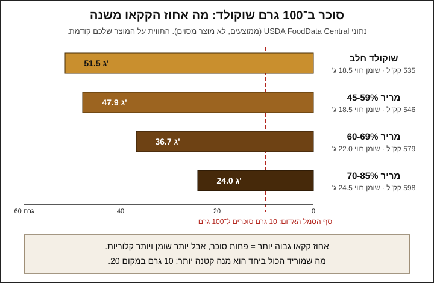

# 13.1 · מה באמת "בריא יותר" בשוקולד

שוקולד הוא ממתק, ושום גרסה שלו לא הופכת אותו לתרופה. אבל יש שלושה דברים שאפשר לשנות בו באמת: אחוז הקקאו, גודל המנה וכמות הסוכר, ולכל אחד מהם יש מחיר. בשיעור הזה בודקים במספרים מה כל שינוי עושה ל־100 גרם ולחתיכה אחת, טועמים שלושה שוקולדים זה מול זה, ובסוף מטמפרים 250 גרם מריר 70% ויוצקים 20 דיסקיות קטנות.

## מה צריך

| פריט | כמות לתרגול | כמות מלאה | הערה |
|---|---|---|---|
| שוקולד חלב, טבלה מהסופר או קוברטורה | 15 גרם | | לטעימה ולקריאת התווית |
| מריר 55-60% | 15 גרם | | לטעימה |
| מריר 70-85% | 15 גרם | | לטעימה |
| קוברטורה מריר 70% (אפשר שאריות מטומפרות ממודולים קודמים) | 250 גרם | 1 ק"ג | ממיסים מחדש ומטמפרים |
| התוויות של שלושת השוקולדים (או צילום של הטבלה התזונתית) | 3 | | |
| מדחום דיגיטלי, משקל מטבח, קערה יבשה, מרית | 1 מכל אחד | | |
| דף אצטט או נייר אפייה, ושקית זילוף | 1 | | ל־20 דיסקיות של כ־10 גרם |
| מחשבון או טלפון | 1 | | |
| [דף הטעימה מ־01.5](../module-01/lesson-05.md) | 1 | | |

**אלרגנים:** שוקולד מכיל בדרך כלל לציטין סויה. שוקולד חלב מכיל חלב, ומריר רבים מכילים או "עלולים להכיל" חלב, אגוזים, בוטנים או שומשום. בודקים על כל אריזה.

### לפני שמתחילים את המודול

צפייה בשיעור היא לא תרגול. במודול הזה מכינים גרסאות עם פחות סוכר ומשווים אותן למקור, ואת ההבדל מרגישים רק בפה ובידיים: טעם, מרקם, איך זה נמס ואיך זה נשמר. האקדמיה לא יכולה לבדוק צילומים, ולכן בכל שיעור יש בדיקות ברורות שמשווים אליהן את התוצאה. מנהלים [יומן תרגול](../../templates/practice-log.md) מהיום הראשון, ורושמים בו גם מה כתוב על התווית ומה חישבתם. ועוד דבר אחד לכל המודול: מלמדים כאן טכניקה וקריאת תוויות, לא תזונה. מי שצריך להגביל סוכר מסיבה רפואית שואל את הרופא או את הדיאטנית שלו.

## למה זה עובד

### "בריא" היא לא מילה של מתכון

במודול הזה לא כותבים "בריא", "מחזק" או "מתאים לסוכרתיים", לא בשיעור ולא על אריזה. הסיבה החוקית מוסברת ב־[13.5](lesson-05.md). הסיבה המעשית פשוטה: כל שינוי בשוקולד מזיז מספר אחד ומשאיר אחרים במקום, ולפעמים גם מעלה אותם. לכן מדברים על מה שאפשר למדוד: גרם סוכר, גרם שומן רווי וקלוריות, ל־100 גרם ולחתיכה.

### מה אומר האחוז על העטיפה

לפי Julie Sharp, שפית פיתוח ב־Barry Callebaut, אחוז הקקאו אומר כמה מסת קקאו יש בטבלה. בדוגמה שלה, מריר 70% הוא 70% מסת קקאו ו־30% סוכר. מסת הקקאו כוללת גם את חמאת הקקאו, כלומר את השומן. במריר מתוצרת רוב היצרנים כמעט כל מה שאינו קקאו הוא סוכר, ולכן כשהאחוז עולה, הסוכר יורד. בשוקולד חלב חלק מהשאר הוא אבקת חלב, ולכן האחוז שלו לא משתווה ישירות למריר.

### המספרים ל־100 גרם

ב־USDA FoodData Central יש ממוצעים לשוקולד חלב ולמריר בשלוש קבוצות אחוזים. אלה לא מוצרים מסוימים, אבל הכיוון ברור:

| סוג (USDA) | סוכרים | שומן | שומן רווי | אנרגיה |
|---|---|---|---|---|
| שוקולד חלב (167587) | 51.5 גרם | 29.7 גרם | 18.5 גרם | 535 קק"ל |
| מריר 45-59% (170271) | 47.9 גרם | 31.3 גרם | 18.5 גרם | 546 קק"ל |
| מריר 60-69% (170272) | 36.7 גרם | 38.3 גרם | 22.0 גרם | 579 קק"ל |
| מריר 70-85% (170273) | 24.0 גרם | 42.6 גרם | 24.5 גרם | 598 קק"ל |

שלושה דברים עולים מהטבלה:

1. **מחלב ל־70-85% הסוכר יורד בערך בחצי** (מ־51.5 ל־24 גרם).
2. **השומן והשומן הרווי עולים**, כי במקום הסוכר נכנסת חמאת קקאו. השומן הרווי עולה בכשליש (מ־18.5 ל־24.5 גרם).
3. **הקלוריות לא יורדות, אלא עולות מעט** (מ־535 ל־598), כי בגרם שומן יש יותר אנרגיה מבגרם סוכר.

כלומר, אחוז קקאו גבוה יותר משנה את **סוג** המתיקות ואת כמות הסוכר, אבל לא את כמות האנרגיה.

### הסמל האדום: גם מריר 85% מקבל אותו

לפי תקנות הסימון התזונתי, מזון מוצק ארוז מראש מקבל סמל אדום כשיש בו יותר מ־10 גרם סוכרים, יותר מ־4 גרם שומן רווי או יותר מ־400 מ"ג נתרן ל־100 גרם. כל ארבע השורות בטבלה עוברות גם את סף הסוכר וגם את סף השומן הרווי, ולכן כל שוקולד רגיל צפוי לקבל שני סמלים אדומים. גם שוקולד "ללא תוספת סוכר" עם מלטיטול צפוי לקבל סמל על השומן הרווי. התקנות פוטרות אריזה שהמשטח הקדמי שלה 25 סמ"ר או פחות (למשל טבלה קטנה של 5×5 ס"מ), ויש פטורים נוספים. זה עניין של גודל האריזה, לא של המתכון, ומפורט ב־[13.5](lesson-05.md) וב[מודול 18](../module-18/lesson-01.md).

### מנה קטנה משנה את כל המספרים ביחד

אחוז הקקאו מזיז את הסוכר מול השומן. גודל המנה מזיז את כולם, באותו יחס. חישוב לחתיכה:

| חתיכה | סוכר | שומן רווי | אנרגיה |
|---|---|---|---|
| 20 גרם חלב | 10.3 גרם | 3.7 גרם | 107 קק"ל |
| 20 גרם מריר 70-85% | 4.8 גרם | 4.9 גרם | 120 קק"ל |
| **10 גרם מריר 70-85%** | **2.4 גרם** | **2.5 גרם** | **60 קק"ל** |

החישוב: ערך ל־100 גרם × משקל החתיכה ÷ 100. למשל 24.0 × 10 ÷ 100 = 2.4 גרם סוכר. דיסקית של 10 גרם מריר נותנת פחות מרבע מהסוכר של חתיכת חלב של 20 גרם, ופחות מהקלוריות שלה. זה השינוי היחיד בטבלה שמוריד הכול ביחד.

### ומה עם "פחות סוכר" בלי לשנות את הקקאו

אפשר להחליף חלק מהסוכר בממתיק ([13.2](lesson-02.md)), במתיקות של פירות ([13.3](lesson-03.md) ו־[13.4](lesson-04.md)), או פשוט לאכול מריר מר יותר. כל דרך משנה משהו אחר: ממתיקים משנים מרקם ועיכול, תמרים מוסיפים מים ומקצרים את חיי המדף, אגוזים מוסיפים שומן ואלרגנים. בהמשך המודול בודקים כל אחת מהן.

### למה מנה קטנה עדיין מרגישה כמו שוקולד

ב־[01.5](../module-01/lesson-05.md) טעמתם לאט: 5 גרם שנמסים על הלשון משחררים את הטעם בהדרגה. מריר 70% נמס לאט יותר ומר יותר, ולכן הוא מרגיש "מלא" גם בכמות קטנה. מנה של 10 גרם שנאכלת לאט היא שינוי שאפשר לחיות איתו. זו העדפת טעם, לא טענה בריאותית.

## שלב אחר שלב

> [!WARNING]
> מים הורסים שוקולד מומס: כלים יבשים לגמרי, בלי אדים מסיר. במיקרוגל ממיסים בפולסים קצרים עם ערבוב, כי נוצרות נקודות חמות שעלולות לשרוף את השוקולד ואת היד.

**חלק א: קריאת תוויות וטעימה (20 דקות)**

1. **מעתיקים מהתוויות** של שלושת השוקולדים ליומן: אחוז קקאו, סוכרים, שומן רווי ואנרגיה ל־100 גרם, ומשקל המנה שהיצרן מציע אם כתוב.
2. **משווים לטבלת USDA**: האם המוצר שלכם קרוב לממוצע של הקבוצה שלו? יצרנים שונים מוסיפים חמאת קקאו או אבקת חלב, ולכן יש הבדלים של כמה גרמים.
3. **מחשבים לחתיכה** של 10 ושל 20 גרם, לכל שוקולד. רושמים בטבלה.
4. **טועמים** 5 גרם מכל אחד לפי הסדר מ־[01.5](../module-01/lesson-05.md): מראה, מגע, צליל, ריח, טעם, מרקם, סיומת. מהחלב למריר הכי גבוה, עם מים ביניהם. ממלאים דף טעימה.
5. **רושמים** משפט אחד: איזה מהם הייתם מסוגלים לאכול 10 גרם ממנו ולהרגיש שזה מספיק?

**חלק ב: 20 דיסקיות קטנות (40 דקות)**

6. **ממיסים** 170 גרם מריר 70% ל־45-50°C במיקרוגל או בבן־מארי, לפי [03.2](../module-03/lesson-02.md). 80 גרם נשארים בצד כזרעים.
7. **מזריעים** ומערבבים עד 31-32°C (או לפי העקומה על השק). זרעים שנמסים מהר אומרים שהשוקולד עדיין חם: מוסיפים עוד.
8. **בודקים טמפר** בבדיקת סכין: בחדר של 18-22°C השכבה מתקשה תוך 3-5 דקות, מבריקה ובלי פסים.
9. **ממלאים שקית זילוף** וגוזרים פתח של 5 מ"מ.
10. **מזלפים 20 דיסקיות** על אצטט, כל אחת בקוטר של כ־4 ס"מ. שוקלים את הראשונה: מכוונים ל־9-11 גרם. אם יצא 15 גרם, הדיסקיות הבאות קטנות יותר.
11. **מקישים** בעדינות על השולחן כדי ליישר, ומשאירים 15 דקות בחדר עד שהדיסקיות מתחילות להתקשות. אפשר עוד 10 דקות במקרר.
12. **שוקלים חמש דיסקיות** ומחשבים ממוצע. רושמים ביומן את המשקל הממוצע ואת הסוכר לדיסקית לפי התווית.

## בדיקה: איך יודעים שהצליח

- **יומן**: לשלושת השוקולדים יש סוכרים, שומן רווי ואנרגיה ל־100 גרם, ולחתיכה של 10 ו־20 גרם, מחושבים נכון (ערך × משקל ÷ 100).
- **הבנה**: אתם יכולים להסביר במשפט אחד למה במריר 70-85% יש פחות סוכר מבחלב, אבל לא פחות קלוריות.
- **טמפר**: בדיקת הסכין התקשתה תוך 5 דקות; הדיסקיות מבריקות, יוצאות מהאצטט בלי להימרח ונשברות בסנאפ.
- **גודל**: ממוצע של 9-11 גרם לדיסקית, וההבדל בין הקטנה לגדולה לא יותר מ־3 גרם.
- **טעימה**: דף הטעימה מלא לשלושת השוקולדים, עם ציון 1-5 לכל קריטריון.

## כשזה משתבש

| מה רואים | למה זה קורה | מה עושים עכשיו | איך מונעים בפעם הבאה |
|---|---|---|---|
| הדיסקיות יצאו 15-20 גרם | פתח גדול בשקית או זילוף ארוך מדי | ממשיכים; את הגדולות שוברים לשתיים אחרי ההתקשות | שוקלים את הדיסקית הראשונה וסופרים שנייה־שתיים לכל דיסקית |
| הדיסקיות מפוספסות ורכות | השוקולד לא היה מטומפר, או התחמם מעל 32°C אחרי הבדיקה | ממיסים מחדש ומטמפרים | בדיקת סכין לפני זילוף, ומדחום אחרי כל חימום |
| החישוב יצא 24 גרם סוכר לדיסקית | נשכח החילוק ב־100 | ערך ל־100 גרם × משקל ÷ 100 | כותבים את הנוסחה בראש העמוד ביומן |
| התווית לא מפרטת "סוכרים" | אריזה קטנה או מוצר מיובא בלי מדבקה בעברית | משתמשים בממוצע USDA ורושמים שזו הערכה | קונים לתרגול מוצרים עם טבלה תזונתית מלאה |
| המריר 85% מר מדי, ואין חשק לאכול ממנו | שינוי חד מדי מטעם שרגילים אליו | מערבבים 1:1 עם 60% ומקבלים בערך 72% | עוברים בהדרגה: 55%, 60%, 70% |
| שוקולד ה"פחות סוכר" שקניתם עם יותר קלוריות | במקום הסוכר נכנס שומן | זה צפוי, לא טעות | משווים את כל השורות בתווית, לא רק את הסוכר |

### מה עושים עם מה שלא הצליח

שום דבר לא הולך לפח. דיסקיות מפוספסות נמסות מחדש ומטמפרים שוב, או נשמרות בשקית "לאפייה" לבראוניז ולשוקו חם. שאריות הטעימה (חלב ו־55%) נכנסות לשוקו או לטבלת bark. הדיסקיות המוצלחות נשמרות בקופסה סגורה ב־18-20°C ומשמשות להשוואה בשיעורים הבאים ובפרויקט המודול.

## חלופות

### טבעוני / פרווה

מריר 70% בלי חלב ברכיבים מתאים לטבעונים, והמספרים בטבלה כמעט זהים. שוקולד "חלב" טבעוני (על בסיס אורז, שיבולת שועל או קוקוס, [12.2](../module-12/lesson-02.md)) צריך לבדוק לפי התווית: לפעמים יש בו יותר סוכר מבשוקולד חלב רגיל, כי אבקת המשקה הצמחי מתוקה פחות מאבקת חלב. מטמפרים לפי עקומת היצרן ([מודול 12](../module-12/lesson-01.md)).

### בריא יותר

השיעור כולו הוא הסעיף הזה. בקצרה: מריר 70% במקום חלב חוסך בערך חצי מהסוכר; דיסקית של 10 גרם במקום 20 חוסכת חצי מהכול; שילוב של השניים מוריד את הסוכר לחתיכה בערך פי ארבעה. אין כאן הבטחה בריאותית: זה רק חשבון של גרמים.

### כשרות

אחוז קקאו גבוה לא אומר פרווה. מריר יכול להיות מסומן פרווה, חלבי, או "לאוכלי אבקת חלב נכרי", ובאותו מותג הכשרות משתנה לפי גודל האריזה. בודקים על האריזה ([קוברטורה מרירה](../../references/kashrut-guide.md#קוברטורה-מרירה), [שלושה כללים](../../references/kashrut-guide.md#שלושה-כללים)). ההכשר גם לא אומר דבר על סוכר: את זה קוראים בטבלה התזונתית. אם יש ספק, שואלים את הרב.

## איפה קונים

מה מחפשים: קוברטורה מריר 70% (בחנויות קונדיטוריה: "מטבעות שוקולד מריר 70%"), שבה ברשימת הרכיבים חמאת קקאו ולא שומן צמחי אחר. לטעימה מספיקות שלוש טבלאות מהסופר, עם טבלה תזונתית בעברית. מי שרוצה לטעום גם שוקולד "ללא תוספת סוכר" יכול להוסיף טבלה של 100 גרם, ולקרוא קודם את [13.2](lesson-02.md). חנויות, מחירים ומלאי: [קוברטורה](../../references/where-to-buy.md#קוברטורה), [שוקולד מסופרמרקט](../../references/where-to-buy.md#שוקולד-מסופרמרקט), [שוקולד ללא סוכר](../../references/where-to-buy.md#שוקולד-ללא-סוכר), [אצטט ודפי גיטרה](../../references/where-to-buy.md#אצטט-ודפי-גיטרה), [שקיות זילוף](../../references/where-to-buy.md#שקיות-זילוף). כשרות לפי מוצר: [קוברטורה מרירה](../../references/kashrut-guide.md#קוברטורה-מרירה), [שוקולד מסופרמרקט](../../references/kashrut-guide.md#שוקולד-מסופרמרקט).

## תרגול

### משימה

קוראים את התוויות של שלושה שוקולדים (חלב, 55-60%, 70-85%), מחשבים סוכר, שומן רווי ואנרגיה לחתיכה של 10 ו־20 גרם, וטועמים 5 גרם מכל אחד לפי [דף הטעימה](../../templates/tasting-sheet.md). אחר כך מטמפרים 250 גרם מריר 70% ומזלפים 20 דיסקיות של כ־10 גרם.

### זמן

כ־20 דקות קריאה, חישוב וטעימה, וכ־40 דקות טמפרור, זילוף והתקשות. סך הכול כשעה.

### יומן

ממלאים [יומן תרגול](../../templates/practice-log.md): טבלה של שלושת השוקולדים (אחוז, סוכרים, שומן רווי, אנרגיה, ל־100 גרם ולחתיכה), טמפרטורות הטמפרור, משקל ממוצע לדיסקית, ומשפט אחד על הטעימה. את הטמפרור עצמו אפשר לרשום ב[יומן הטמפרור](../../templates/tempering-log.md).

### בדיקה עצמית

- [ ] חישבתי סוכר, שומן רווי ואנרגיה לחתיכה של 10 ו־20 גרם לשלושה שוקולדים.
- [ ] אני יודע להסביר למה מריר 70-85% לא חוסך קלוריות לעומת חלב.
- [ ] טמפרתי 250 גרם מריר ובדיקת הסכין התקשתה תוך 5 דקות.
- [ ] יצאו לי 20 דיסקיות של 9-11 גרם, מבריקות ועם סנאפ.
- [ ] השאריות נכנסו לשקית "לאפייה" או לשוקו, ולא לפח.

## סיכום

- "בריא" היא לא מילה למתכון או לאריזה. מודדים גרם סוכר, גרם שומן רווי וקלוריות, ל־100 גרם ולחתיכה.
- אחוז קקאו גבוה מוריד סוכר (בחלב כ־51 גרם ל־100 גרם, ב־70-85% כ־24 גרם), אבל מעלה שומן רווי וקלוריות.
- כל שוקולד רגיל, גם 85%, עובר את ספי הסמל האדום לסוכר ולשומן רווי.
- מנה קטנה היא השינוי היחיד שמוריד הכול ביחד: דיסקית של 10 גרם מריר נותנת כ־2.4 גרם סוכר ו־60 קק"ל.
- פרויקט המודול: [גרסה עם פחות סוכר מול המקור](../../projects/m13-less-sugar-comparison.md), מוצר אחד בשתי גרסאות, עם חישוב, טעימה עיוורת ותווית בלי טענות בריאות.
