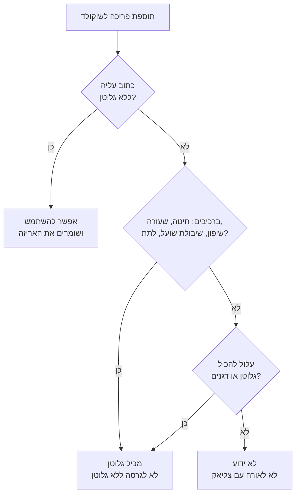

# 14.2 · בלי גלוטן: איפה הוא מסתתר

בשוקולד עצמו אין דגנים: קקאו, סוכר, חמאת קקאו, לציטין, וניל. הגלוטן מגיע עם מה שמוסיפים לו: עוגיות, ופל, פריכיות, אורז תפוח עם לתת, ומהקערה שבה טבלתם עוגייה רגע לפני. בשיעור הזה מוצאים גלוטן ברשימות רכיבים גם כשהוא לא כתוב "חיטה", לומדים מה המספר 20 על "ללא גלוטן", ומכינים שתי גרסאות של אשכולות פריכים מאותו טמפרור, בסדר שלא מערבב ביניהן.

## מה צריך

| פריט | כמות לתרגול | כמות מלאה | הערה |
|---|---|---|---|
| קוברטורה מריר 55-70% (השאריות מ־[14.1](lesson-01.md)) | 300 גרם | 1 ק"ג | 120 גרם לאשכולות, השאר נשמר |
| פתיתי תירס או אורז תפוח **המסומנים "ללא גלוטן"** | 20 גרם | 60 גרם | לא כל אורז תפוח: ראו "למה זה עובד" |
| עוגיות או ופל רגילים | 20 גרם | 60 גרם | לגרסה עם גלוטן; שוברים לפירורים של 3-5 מ"מ |
| 4 מוצרים פריכים לבדיקת אריזה | 4 | | אורז תפוח רגיל, ופל, דגני בוקר, שיבולת שועל |
| 2 תבניות נייר (מנז'טים) או נייר אפייה, 2 כפיות, 2 קערות קטנות | 1 מכל צבע | | צבע או מדבקה שונים לכל גרסה |
| מדחום, מרית, משקל | 1 מכל | | כמו ב־[03.2](../module-03/lesson-02.md) |

**אלרגנים:** גלוטן (חיטה, ולפעמים שעורה או שיבולת שועל) בעוגיות, בוופל ובחלק מהדגנים; חלב בעוגיות רבות; סויה (לציטין) בשוקולד; ו"עלול להכיל" אגוזים, בוטנים וחלב על רוב השוקולדים והעוגיות. בודקים כל אריזה.

## למה זה עובד

### מה זה גלוטן בעיני החוק בישראל

לפי תקנות בריאות הציבור (מזון) (סימון גלוטן), התשנ"ו-1996 (נוסח עם תיקון מ־2011), גלוטן הוא חלבון "הנמצא בגרעינים של חיטה, שיפון, שעורה, שיבולת שועל ומוצריהם, לרבות עמילנים, לתת וסובין". מזון שיש בו יותר מ־20 חלקים למיליון גלוטן חייב לציין ברשימת הרכיבים את הצמח שממנו הגלוטן ואת המילים "מכיל גלוטן". "ללא גלוטן" מותר לכתוב רק אם יש 20 חלקים למיליון או פחות, המזון יוצר בתנאי ייצור נאותים, ונקטו צעדים כדי שגם חומרי הגלם לא יעברו את הרמה הזו.

מינואר 2028 הסימון משתנה: את שם הדגן מדגישים בתוך רשימת הרכיבים, לפי שיטת האיחוד האירופי. פרטים ב־[14.3](lesson-03.md).

### כמה זה 20 חלקים למיליון

20 חלקים למיליון הם 20 מיליגרם גלוטן בקילו מזון, כלומר 0.002%. חשבון גס: בקמח חיטה יש בערך 8-10 גרם גלוטן ב־100 גרם (הערכה כללית, לא נתון מתווית). גרם אחד של קמח שנכנס לקילו שוקולד מוסיף בערך 80-100 מיליגרם גלוטן, פי 4-5 מהסף. גרם אחד זה פירורי עוגייה שנשארו על כף, או אבקה שעפה מקערה. בגלל זה "בלי גלוטן" הוא עניין של סדר עבודה, לא רק של מתכון.

### איפה הוא מסתתר בשוקולד

| מה מוסיפים | איפה הגלוטן | מה בודקים |
|---|---|---|
| עוגיות, בצק פריך, פירורי עוגה | קמח חיטה | תמיד גלוטן, אלא אם כתוב "ללא גלוטן" |
| ופל, פיאיטין (feuilletine), קוני גלידה | קמח חיטה | אותו דבר |
| אורז תפוח (crisped rice) | לפעמים לתת שעורה | ב־Rice Krispies הבריטי: אורז 80%, סוכר, מלח, **לתת שעורה (גלוטן)** |
| פניני קראנץ' מצופות (crispearls) | קמח חיטה, קמח לתת חיטה, עמילן חיטה | ב־Callebaut Crispearls מריר; ו"עלול להכיל" שיפון, שעורה ושיבולת שועל |
| דגני בוקר, פתיתי תירס | תמצית לתת שעורה כטעם | Coeliac UK: "לבדוק"; מתאים רק אם מסומן ללא גלוטן |
| שיבולת שועל, גרנולה | שיבולת שועל, וזיהום מחיטה בגידול ובטחינה | Coeliac UK: רק שיבולת שועל המסומנת "ללא גלוטן" |
| שוקולד "מאלט" או משקה מאלט | לתת שעורה | לפי רשימת הרכיבים |

המילה החשובה בטבלה היא **לתת** (malt): גרעיני שעורה (לפעמים חיטה) שהונבטו ויובשו. היא מופיעה כ"לתת שעורה", "תמצית לתת", "קמח לתת" או "טעם לתת". לפי Coeliac UK, תמצית לתת שעורה היא ברשימת "צריך לבדוק": חלק מדגני הבוקר שמכילים אותה מתאימים, רק אם הם מסומנים "ללא גלוטן". מהרשימה לבד אי אפשר לדעת כמה הכניסו.

אורז, תירס, כוסמת, קינואה, דוחן ותפוחי אדמה הם ללא גלוטן מטבעם לפי Coeliac UK. אבל מוצר מוכן מהם (אורז תפוח, פתיתי תירס) יכול לקבל לתת לטעם, או להיארז על קו של חיטה. לכן הכלל: בודקים את המוצר המדויק, לא את הדגן.

### ציוד משותף: מה המחקר מראה

Weisbrod ועמיתים (Gastroenterology, 2020) מדדו כמה גלוטן עובר במטבח משותף. שלוש תוצאות שרלוונטיות לשוקולד:

| מה עשו | מה נמצא |
|---|---|
| סכין שמרחה זיגוג על קאפקייקס עם גלוטן, ואז בלי שטיפה על קאפקייקס ללא גלוטן | 28 מתוך 30 דגימות עם גלוטן שאפשר למדוד; 2 מעל 20 חלקים למיליון |
| אותה סכין אחרי שטיפה (סבון ומים, מים בלבד, או מגבון) | 28 מתוך 30 בלי גלוטן מדיד, אף אחת מעל 20 |
| פסטה ללא גלוטן שבושלה במים שבישלו בהם פסטה רגילה | כל 12 הדגימות מעל 20 חלקים למיליון |

המסקנה לשוקולד: כלי אפשר לשטוף. **שוקולד שטבלו בו עוגייה הוא כמו מי הפסטה**: הגלוטן נמצא בתוכו, ואין דרך לשטוף אותו. מה שנשאר בקערה אחרי הגרסה עם העוגיות הוא "מכיל גלוטן" מעכשיו. החוקרים עצמם מציינים שהמחקר קטן ושמטבחים שונים יתנו תוצאות שונות, ולכן הוא לא אישור לוותר על זהירות. הוא מראה מה עובד: סדר, שטיפה, וכלים שלא חוזרים מהגרסה עם הגלוטן.

## שלב אחר שלב

> [!WARNING]
> שוקולד ב־45-50°C מחמם קערה ומרית. ואם מכינים לאורח עם צליאק: לפני שמתחילים, סוגרים ומרחיקים כל שקית קמח, עוגיות ופירורים, ומנגבים את השיש במים וסבון. קמח שעף באוויר מתיישב על משטחים.

**חלק א: בדיקת 4 אריזות (12 דקות)**

1. **טבלה ביומן**: מוצר, רכיבים עם דגן או לתת, "מכיל", "עלול להכיל", "ללא גלוטן" כתוב?, ומסקנה.
2. **קוראים כל רשימה** ומסמנים: חיטה, קמח, עמילן חיטה, סובין, שעורה, שיפון, שיבולת שועל, כוסמין, לתת, תמצית לתת, "מכיל גלוטן".
3. **מסקנה** לפי תרשים הזרימה: "ללא גלוטן", "מכיל גלוטן", או "לא ידוע". "לא ידוע" לא נכנס לגרסה ללא גלוטן.
4. **בוחרים** את התוספת לגרסה ללא גלוטן: רק מוצר שכתוב עליו "ללא גלוטן". שומרים את האריזה עד שהאשכולות נגמרים.

**חלק ב: הכנה בסדר (10 דקות)**

5. **שתי עמדות**: על השיש מניחים בצד אחד את הקערה, הכפית והמנז'טים של הגרסה ללא גלוטן (מסומנים), ובצד השני, רחוק ומכוסה, את העוגיות.
6. **שוברים את העוגיות עכשיו**, בתוך שקית סגורה, בעמדה שלהן, ומשאירים את השקית סגורה. שוטפים ידיים במים וסבון.

**חלק ג: טמפרור ושתי גרסאות (30 דקות)**

7. **מטמפרים** 300 גרם בשיטת ההזרעה ([03.2](../module-03/lesson-02.md)): 45-50°C, זרעים עד 31-32°C, בדיקת סכין.
8. **גרסה ללא גלוטן קודם**: יוצקים כ־60 גרם שוקולד מטומפר לקערה הקטנה המסומנת. מערבבים 20 גרם פתיתים ללא גלוטן, ומחלקים ל־6 אשכולות במנז'טים המסומנים.
9. **מכסים** את האשכולות ללא גלוטן ומרחיקים אותם לפני שפותחים את שקית העוגיות.
10. **גרסה עם גלוטן**: יוצקים 60 גרם לקערה השנייה, מערבבים פירורי עוגיות, ומחלקים ל־6 אשכולות.
11. **מה שנשאר בקערה הגדולה** לא נגע בעוגיות, ולכן הוא נשאר ללא תוספת גלוטן: יוצקים ל־bark או לשקית "להמסה" עם תווית. מה שנשאר בקערה של העוגיות, מגרדים לשקית נפרדת עם תווית "מכיל גלוטן".
12. **שוטפים** את כל הכלים במים וסבון. קערת העוגיות נשטפת אחרונה.
13. **תוויות**: על הגרסה ללא גלוטן: "רכיבים ללא גלוטן לפי האריזות; הוכן לפני גרסה עם עוגיות, באותו מטבח". על השנייה: "מכיל גלוטן (חיטה)" ומה שכתוב על אריזת העוגיות.

## בדיקה: איך יודעים שהצליח

- **טבלת האריזות**: 4 מוצרים, ובכל אחד מסקנה לפי התרשים. מצאתם לפחות מוצר אחד שהגלוטן בו לא נקרא "חיטה" (לתת, תמצית לתת, עמילן).
- **האשכולות**: השוקולד מבריק, מתקשה תוך 10 דקות בחדר, ונשבר בסנאפ דק סביב התוספת. אין קצוות אפורים.
- **הסדר**: ביומן רשום שהגרסה ללא גלוטן הוכנה ראשונה וכוסתה לפני שנפתחה שקית העוגיות.
- **השאריות**: שתי שקיות נפרדות עם תוויות, ואף פירור עוגייה באשכולות ללא גלוטן או ב־bark.
- **התוויות**: לא כתוב "ללא גלוטן" כהבטחה על המוצר שלכם. כתוב מה עשיתם.

## כשזה משתבש

| מה רואים | למה זה קורה | מה עושים עכשיו | איך מונעים בפעם הבאה |
|---|---|---|---|
| באורז התפוח שקניתם כתוב "לתת שעורה" | הלתת מוסיף טעם ומתיקות | הוא עובר לגרסה עם גלוטן | קונים רק אורז תפוח שכתוב עליו "ללא גלוטן" |
| טבלתם עוגייה בקערה הגדולה "רק לטעום" | הגלוטן עבר לשוקולד | כל הקערה "מכיל גלוטן"; מטמפרים שקית חדשה לגרסה ללא גלוטן | עוגיות רק בקערה קטנה נפרדת, אחרי הגרסה ללא גלוטן |
| השוקולד התקשה בקערה הקטנה לפני שסיימתם | 60 גרם מתקררים מהר | מחממים בשניות במיקרוגל עד 31-32°C (לא יותר) | מכינים אשכולות במהירות, או קערה מעט חמה |
| האשכולות מתפוררים | מעט שוקולד ביחס לתוספת | ממיסים את האשכולות ללא גלוטן ומוסיפים 20 גרם שוקולד מאותה גרסה | יחס 3:1 שוקולד לתוספת במשקל |
| על פתיתי התירס כתוב "עלול להכיל גלוטן" | נארזו על קו משותף | לא לאורח עם צליאק; לגרסה הרגילה | בודקים גם את "עלול להכיל" |
| אבקת קמח על השיש מאפייה של אתמול | קמח שוקע לאט על משטחים | מנגבים במים וסבון לפני שמתחילים | אפייה עם קמח ביום אחר, או אחרי השוקולד |

### מה עושים עם מה שלא הצליח

שום דבר לא הולך לפח. שוקולד שנגע בעוגיות מקבל תווית "מכיל גלוטן" והופך לבראוניז, לשוקו חם, לרוטב או לטראפלס לכל מי שאין לו צליאק. אשכולות שמתפוררים נמסים מחדש עם עוד שוקולד מאותה גרסה, או מתפזרים על גלידה. bark מפוספס נמס ומטמפרים אותו שוב.

## חלופות

### טבעוני / פרווה

עוגיות "טבעוניות" או "פרווה" יכולות להיות מלאות גלוטן, והרבה עוגיות ללא גלוטן מכילות ביצים או חמאה. לגרסה טבעונית ללא גלוטן מחפשים תוספת שעונה על שתי השאלות (ללא גלוטן, ובלי מוצרים מן החי לפי [12.1](../module-12/lesson-01.md)): פתיתי תירס או אורז תפוח ללא גלוטן, פירות מיובשים בהקפאה, גרעינים. שימו לב: משקאות ושוקולד "חלב" טבעוני על בסיס שיבולת שועל ([12.2](../module-12/lesson-02.md)) מכילים גלוטן, אלא אם כתוב שהשיבולת ללא גלוטן.

### בריא יותר

"ללא גלוטן" לא אומר בריא יותר. למי שאין צליאק או רגישות, אין כאן יתרון. מוצרים ללא גלוטן מכילים לפעמים יותר סוכר או שומן כדי לפצות על המרקם. אם רוצים פחות סוכר, בוחרים מריר 70% ותוספת לא ממותקת (פתיתי תירס בלי סוכר, אגוזים או גרעינים שנבדקו לפי [14.1](lesson-01.md)). לא כותבים "בריא" על התווית ([13.5](../module-13/lesson-05.md)).

### כשרות

מה שכתוב על האריזה בלבד. עוגיות, ופלים ודגני בוקר צריכים הכשר כמו כל מוצר מעובד, והשוקולד לפי [שלושה כללים](../../references/kashrut-guide.md#שלושה-כללים). שימו לב: **"כשר לפסח" זה לא "ללא גלוטן"**. מוצרים לפסח רבים עשויים מקמח מצה, שהוא חיטה. ולהפך: "ללא גלוטן" לא אומר כשר לפסח. אלה שתי בדיקות נפרדות, כמו טבעוני ופרווה. על חומרי גלם לפסח ראו [10.4](../module-10/lesson-04.md). אם יש ספק, שואלים את הרב.

## איפה קונים

מה מחפשים: תוספות פריכות שכתוב עליהן במפורש "ללא גלוטן" (פתיתי תירס, אורז תפוח, פריכיות אורז), באריזה מקורית עם רשימת רכיבים. בסופרמרקט הן נמצאות לרוב במדף ייעודי ללא גלוטן. לא קונים בתפזורת: שם אין רשימת רכיבים ויש כפות משותפות. קוברטורה: [קוברטורה](../../references/where-to-buy.md#קוברטורה) וההכשר שלה ב[קוברטורה מרירה](../../references/kashrut-guide.md#קוברטורה-מרירה). מנז'טים ותוויות: [קופסאות פרלינים](../../references/where-to-buy.md#קופסאות-פרלינים), [מדבקות ותוויות](../../references/where-to-buy.md#מדבקות-ותוויות).

## תרגול

### משימה

1. בודקים 4 מוצרים פריכים לפי התרשים, ומוצאים לפחות אחד עם גלוטן "מוסתר".
2. מטמפרים 300 גרם, ומכינים 6 אשכולות ללא גלוטן ואחריהם 6 אשכולות עוגיות, בסדר ובקערות נפרדות.
3. מתייגים את שתי הגרסאות ואת שתי שקיות השאריות.

### זמן

12 דקות לאריזות, 10 דקות להכנת שתי העמדות, 30 דקות לטמפרור ולאשכולות, ועוד כ־20 דקות התקשות.

### יומן

ב[יומן התרגול](../../templates/practice-log.md): טבלת 4 המוצרים, איזו תוספת בחרתם ולמה, שעה של כל שלב (ללא גלוטן, כיסוי, פתיחת העוגיות), ואיפה כל שקית שאריות. ב[יומן הטמפרור](../../templates/tempering-log.md): טמפרטורות ובדיקת סכין. ב[כרטיס מתכון](../../templates/recipe-card.md): שני מתכונים, עם סימון גלוטן נפרד.

### בדיקה עצמית

- [ ] 4 מוצרים נבדקו, ומצאתי גלוטן בשם שהוא לא "חיטה".
- [ ] התוספת לגרסה ללא גלוטן מסומנת "ללא גלוטן" על האריזה.
- [ ] הגרסה ללא גלוטן הוכנה קודם וכוסתה לפני שנפתחו העוגיות.
- [ ] שתי שקיות שאריות עם תוויות, והשוקולד שנגע בעוגיות מסומן "מכיל גלוטן".
- [ ] האשכולות מבריקים ונשברים בסנאפ.

## סיכום

- בשוקולד עצמו אין גלוטן; הוא מגיע עם עוגיות, ופל, פניני קראנץ', אורז תפוח, דגני בוקר ושיבולת שועל.
- לתת, תמצית לתת שעורה ועמילן חיטה הם גלוטן גם כשלא כתוב "חיטה". בתקנות הישראליות לתת ועמילנים בפירוש בפנים.
- "ללא גלוטן" בישראל: עד 20 חלקים למיליון. גרם קמח בקילו שוקולד כבר חורג.
- כלי אפשר לשטוף, שוקולד שטבלו בו עוגייה לא. מכינים את הגרסה ללא גלוטן קודם, בקערה נפרדת, ומכסים.
