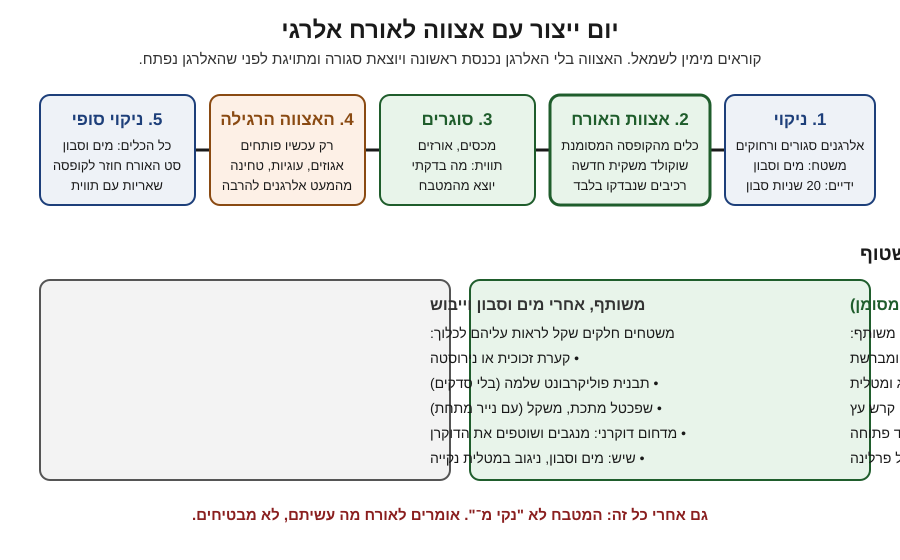

# 14.3 · הפרדה במטבח ומה אפשר להבטיח לאורח

שני השיעורים הקודמים לימדו להוציא אלרגן מהמתכון. השיעור הזה עוסק במה שנשאר: המטבח עצמו. במטבח ביתי שבו יש גם אגוזים, עוגיות וטחינה, אפשר להפחית מאוד את הסיכון, אבל אי אפשר להבטיח "ללא". בשיעור כותבים תוכנית הפרדה ליום ייצור, בודקים בניסוי פשוט כמה ניקוי באמת מוריד, ומנסחים מה אומרים לאורח, בכתב ובעל פה.

## מה צריך

| פריט | כמות לתרגול | כמות מלאה | הערה |
|---|---|---|---|
| אבקת קקאו (רק כ"עקבות" לניסוי) | 5 גרם | | לא אלרגן; משמשת לראות לכלוך |
| מגבת נייר לבנה, מטלית יבשה, ספוג, סבון כלים | 1 מכל | | לניסוי הניקוי |
| קופסה עם מכסה ומדבקה | 1 | | "קופסת האורח" לכלים הנפרדים |
| כל כלי השוקולד שלכם | | | לרשימת הכלים |
| [תכנון ייצור](../../templates/production-plan.md) או דף ביומן | 1 | | לתוכנית ההפרדה |
| [תווית מוצר](../../templates/product-label.md) | 1 | | לכרטיס האורח |
| bark או דיסקיות מ־14.1 / אשכולות מ־14.2 | מה שנשאר | | הכרטיס נכתב עליהם |

**אלרגנים:** בשיעור לא מכינים מתכון חדש. אבקת קקאו טהורה אינה אחד מ־14 האלרגנים, אבל בודקים "עלול להכיל" על האריזה שלה. המוצרים מ־14.1 ו־14.2 נושאים את האלרגנים שכתבתם עליהם.

## למה זה עובד

### "ללא" הוא הבטחה, לא תיאור

סוכנות המזון הבריטית (FSA) כותבת בהנחיה לעסקים (עודכנה 3.11.2026) שטענת "ללא" (free from) היא **"ערובה שהמזון מתאים לכל מי שרגיש לאלרגן הזה"**, ושמותר להשתמש בה רק כשהעסק הפעיל "בקרות מחמירות כדי לבטל כל סיכון של מגע צולב". אותה הנחיה קובעת:

- **"עלול להכיל"** כותבים רק אחרי הערכת סיכון, כשנמצא סיכון שאי אפשר לשלוט בו בהפרדה ובניקוי. הוא "לא תחליף" להיגיינה טובה.
- לא כותבים "עלול להכיל" ו"ללא" על **אותו אלרגן** באותו מוצר.
- "עלול להכיל אגוזים" לא מספיק כדי להזהיר על **בוטנים**: כותבים כל אלרגן בשמו.
- "ללא גלוטן" אינה טענה מוחלטת: היא אומרת עד 20 מ"ג בקילו (כמו בתקנות בישראל, [14.2](lesson-02.md)).
- במזון לא ארוז מותר למסור את המידע בעל פה, ועדיף גם בכתב. הוא צריך לכסות את כל המנה כפי שהיא מוגשת. במכירה מרחוק המידע זמין לפני הקנייה וגם במסירה.

זו הנחיה בריטית, לא החוק בישראל, אבל היא מנסחת את מה שנכון בכל מטבח: "ללא" דורש בקרה שאין בבית. לכן כותבים **מה עשיתם**, לא "ללא".

### מה ניקוי עושה, ומה לא

לפי FARE, חימום לא מוריד אלרגן; סבון ומים או מגבונים מורידים, וג'ל או מים בלבד לא. הם מבחינים בין **מגע ישיר** (הוצאתם אגוז מהמנה) ל**מגע עקיף** (אותה מרית, ידיים, סכין שנוגבה ולא נשטפה).

Perry ועמיתים (2004) מדדו את חלבון הבוטן העיקרי (Ara h 1) אחרי ניקוי. אחרי שטיפת ידיים בסבון נוזלי, בסבון מוצק או במגבונים לא נמצא חלבון. מים בלבד וג'ל אנטיבקטריאלי לא תמיד הורידו אותו. רוב חומרי הניקוי הביתיים הורידו אותו משולחנות, אבל נוזל כלים לבדו השאיר עקבות בחלק מהשולחנות. המסקנה המעשית: שוטפים, ואז מנגבים במטלית נקייה, ולא סומכים על "נראה נקי".

### מה קשה לנקות במטבח של שוקולד

שוקולד הוא שומן, ושומן נדבק. מה שקשה לנקות עד הסוף עובר לקופסת האורח (התרשים). זה שיקול שלנו לפי חומר הכלי, לא נתון ממחקר: עץ, סיליקון, בד וספוג מחזיקים שומן ופירורים, ובמעבד מזון של פרלינה ([07.2](../module-07/lesson-02.md)) נשארת מחית מתחת לסכין ובאטם.

### הסימון בישראל: היום ומינואר 2028

לפי משרד הבריאות, כפי שדווח בוואלה (27.10.2025):

| | היום (עד סוף 2027) | מ־1.1.2028 |
|---|---|---|
| סימון אלרגנים | אין חובה אחידה; רוב היצרנים מוסיפים תיבה אחרי הרכיבים | אלרגן שנמצא במזון בכוונה **מודגש בתוך רשימת הרכיבים**, בשיטה אחידה שהעסק בוחר |
| גלוטן | שם הדגן ואחריו "מכיל גלוטן" | שם הדגן מודגש (חיטה, שעורה, שיפון, שיבולת שועל) |
| פול | | הצהרה שהמוצר לא מיועד לחסרי האנזים G6PD |
| "עלול להכיל" | וולונטרי | **לא משתנה**: הכללים האירופיים לא מסדירים אותו |
| מעבר | | מוצרים בסימון הישן נמכרים עד תום חיי המדף |

14 הקבוצות לפי נספח II של תקנה 1169/2011 של האיחוד האירופי: דגנים עם גלוטן, סרטנאים, ביצים, דגים, בוטנים, סויה, חלב, אגוזים (שקד, לוז, אגוז מלך, קשיו, פקאן, ברזיל, פיסטוק, מקדמיה), סלרי, חרדל, שומשום, סולפיטים, תורמוס ורכיכות. שני פרטים שנוגעים לשוקולד: **שמן סויה מזוקק לגמרי פטור, לציטין סויה לא** ([14.1](lesson-01.md)); וסירופ גלוקוזה מחיטה פטור מסימון גלוטן. קוקוס אינו ברשימת האגוזים האירופית.

זה מידע כללי, לא ייעוץ משפטי, לפי דיווח בעיתונות שמצטט את משרד הבריאות (נבדק 10.11.2026). מה חל על מי שמוכר, ומה אומרים ללקוח, נלמד ב־16.2 וב־18.1.

### מה אפשר להבטיח, ומה לא

| אפשר להגיד, אם עשיתם | לא אומרים במטבח משותף |
|---|---|
| "אין X ברכיבים. הנה האריזות." | "ללא X" / "נקי מ־X" |
| "הכנתי את זה ראשון, אחרי ניקוי במים וסבון, בכלים נפרדים." | "בטוח לאלרגיים" |
| "יש במטבח שלי X, ולכן אני לא יכול להבטיח שאין עקבות." | "יש רק קצת" / "הוצאתי את האגוזים" |
| "על השוקולד כתוב 'עלול להכיל X'." | להשמיט את האזהרה כי "זה תמיד כתוב" |

האורח (או ההורה) מחליט. למי שמגיב גם לעקבות, ההצעה הכי הוגנת היא לפעמים לא להגיש: להציע לו להביא קינוח משלו, או לקנות מוצר ארוז שהיצרן כתב עליו "ללא" ומחזיק בבקרה שאין לכם.

## שלב אחר שלב

> [!CAUTION]
> אם אורח מגיב לשוקולד שלכם (פריחה, נפיחות בשפתיים או בגרון, הקאות, קושי לנשום), לא מחכים לראות: מתקשרים מיד למד"א 101, ואם יש לו מזרק אפינפרין, הוא משתמש בו לפי ההוראות שלו. תגובה קלה בעבר לא אומרת שהפעם תהיה קלה ([01.4](../module-01/lesson-04.md)).

**חלק א: ניסוי ניקוי עם "עקבות" גלויות (15 דקות)**

אבקת קקאו היא לא אלרגן. משתמשים בה כי רואים אותה, כדי להרגיש כמה קשה להוריד שכבה דקה. זה לא מודד אלרגן.

1. **מפזרים** חצי כפית קקאו על שלושה ריבועים של 20×20 ס"מ על השיש, ומורחים באצבע עד שכמעט לא רואים.
2. **ריבוע א**: מנגבים במטלית יבשה.
3. **ריבוע ב**: מנגבים בספוג עם מים בלבד.
4. **ריבוע ג**: מים וסבון, שטיפה, וניגוב במטלית נקייה.
5. **בודקים**: מעבירים מגבת נייר לבנה ולחה על כל ריבוע. רושמים אם יצא צבע.
6. **עוד ניסוי**: מורחים קקאו על מרית סיליקון ועל כף עץ, שוטפים במים וסבון, ומנגבים במגבת לבנה. רושמים איפה נשאר.

**חלק ב: רשימת כלים (15 דקות)**

7. **פורשים** את כל כלי השוקולד. לכל כלי שואלים: חלק וקשיח (זכוכית, נירוסטה, פוליקרבונט שלם)? או רך, נקבובי או עם חריצים (סיליקון, עץ, בד, מברשת, מעבד מזון)?
8. **רשימה ביומן** בשתי עמודות: "משותף אחרי מים וסבון" ו"קופסת האורח".
9. **קופסת האורח**: מכניסים את הכלים מהעמודה השנייה (או קונים כפולים זולים: מרית, מברשת, שקיות זילוף חד־פעמיות), מסמנים "אורח: בלי X", וסוגרים.

**חלק ג: תוכנית הפרדה (15 דקות)**

10. **בוחרים יום ייצור** אמיתי או מדומה: אצווה לאורח בלי אלרגן אחד (למשל בלי אגוזים), ועוד שתי אצוות רגילות.
11. **כותבים סדר** לפי התרשים: ניקוי, אצוות האורח, סגירה ותיוג, אצוות רגילות מהמעט אלרגנים להרבה, ניקוי סופי.
12. **לכל שלב**: איזה כלים (מהקופסה או משותפים), איזה שוקולד (שקית חדשה או שאריות מתויגות), ומה נשאר סגור.
13. **שוקולד**: לאצוות האורח שקית שלא נפתחה, או שאריות שעליהן כתוב בדיוק מאיזה מוצר הן ושלא נגעו באלרגן. שאריות לא מתויגות לא נכנסות.

**חלק ד: הכרטיס והתשובה (5 דקות)**

14. **כרטיס** לפי [תווית מוצר](../../templates/product-label.md) למוצר מ־14.1 או 14.2: שם, רכיבים, **מכיל**, **עלול להכיל** (מכל האריזות), ו**מה עשיתי**.
15. **תשובה בעל פה** בשלושה משפטים, וכותבים אותה ביומן. למשל: "אין אגוזים ובוטנים ברכיבים, והנה האריזות. הכנתי את זה ראשון, אחרי ניקוי, בכלים נפרדים. יש אגוזים במטבח שלי ועל השוקולד כתוב 'עלול להכיל אגוזים', ולכן אני לא יכול להבטיח שאין עקבות."

## בדיקה: איך יודעים שהצליח

- **ניסוי הניקוי**: לכל ריבוע רשום מה יצא על המגבת. ריבוע ג הוא הנקי ביותר, ואתם יודעים להסביר למה מטלית יבשה לא מספיקה.
- **רשימת הכלים**: כל כלי רך או עם חריצים בקופסת האורח, והיא סגורה ומסומנת.
- **התוכנית**: אצוות האורח ראשונה, נסגרת ומתויגת לפני האלרגן הראשון; לכל שלב כתוב איזה כלים ואיזה שוקולד.
- **הכרטיס והתשובה**: שלוש שורות, בלי "ללא", "נקי מ־" או "בטוח", והאזהרה מהאריזה לא הושמטה.

## כשזה משתבש

| מה רואים | למה זה קורה | מה עושים עכשיו | איך מונעים בפעם הבאה |
|---|---|---|---|
| על המגבת הלבנה נשאר קקאו אחרי ניגוב יבש | מטלית יבשה מורחת ולא מרימה | מים וסבון וניגוב במטלית נקייה | ניקוי לפני אצוות האורח תמיד רטוב, עם סבון |
| הכף מעץ נשארה חומה אחרי שטיפה | עץ סופג שומן | עוברת לקופסה של "רגיל"; לאורח כף נירוסטה | עץ, בד וספוג לא משותפים |
| באמצע אצוות האורח גיליתם שהמרית מהמגירה הרגילה | הקופסה לא הייתה פתוחה מראש | מה שנגע במרית יוצא מהאצווה ומסומן "רגיל" | מניחים את הקופסה על השיש לפני ההמסה |
| ביקשו מכם להבטיח "ללא" לילד עם אלרגיה חמורה | ההורים רוצים ודאות | אומרים בכנות שבמטבח משותף אין הבטחה כזו, ומציעים לא להגיש או מוצר ארוז "ללא" | שואלים על חומרת האלרגיה כשמזמינים |
| נשארו שאריות שוקולד בלי תווית | שכחתם לסמן אחרי אצווה רגילה | הן "רגיל" מעכשיו | שקית ותווית מוכנות לפני שמתחילים כל אצווה |

### מה עושים עם מה שלא הצליח

שום דבר לא הולך לפח. מוצר שיצא מגרסת האורח מקבל תווית "רגיל" ונאכל אצל מי שאין לו אלרגיה. שוקולד בלי תווית נמס לבראוניז, לרוטב או לטראפלס של הבית.

## חלופות

### טבעוני / פרווה

לטבעוני או לשולחן בשרי מפרידים לפי רכיבים והכשר ([12.1](../module-12/lesson-01.md)); לאלרגי לחלב מפרידים לפי עקבות: מריר וטבעוני קודם, ורק אחר כך חלב ולבן. אותה תוכנית עובדת לשניהם; שואלים את האורח איזו שאלה חשובה לו.

### בריא יותר

אין קשר בין הפרדה לבריאות. מנות קטנות ארוזות בנפרד (דיסקיות של 5 גרם) הן פחות סוכר למנה, וגם קל לשמור אותן סגורות ומתויגות. בלי טענות בריאות (13.5).

### כשרות

הפרדה לכשרות והפרדה לאלרגנים נשענות על כללים שונים. כלי שנשטף היטב בסבון יכול להיות נקי מאלרגן ועדיין לא מתאים מבחינת כשרות, ולהפך ([01.4](../module-01/lesson-04.md)). מי ששומר כשרות יכול לשלב: סט פרווה מסומן שהוא גם קופסת האורח. "פרווה" על אריזה לא אומר "בלי עקבות חלב" ([ריקולים: פרווה שהכיל חלב](../../references/kashrut-guide.md#ריקולים-פרווה-שהכיל-חלב)). על הכשרות של כל חומר גלם: [שלושה כללים](../../references/kashrut-guide.md#שלושה-כללים). אם יש ספק, שואלים את הרב.

## איפה קונים

לתוכנית ההפרדה צריך מעט: קופסה סגורה, מדבקות, ושכפול זול של הכלים הרכים (מרית סיליקון, מברשת, שקיות זילוף חד־פעמיות). מומלץ צבע אחר לסט האורח, כמו ש־FARE מציעים למשפחות. חנויות: [מדבקות ותוויות](../../references/where-to-buy.md#מדבקות-ותוויות), [שקיות זילוף](../../references/where-to-buy.md#שקיות-זילוף), [שפכטל וקלף](../../references/where-to-buy.md#שפכטל-וקלף), [קופסאות פרלינים](../../references/where-to-buy.md#קופסאות-פרלינים) לאריזה סגורה של אצוות האורח.

## תרגול

### משימה

ניסוי הניקוי, רשימת הכלים וקופסת האורח, תוכנית הפרדה ליום ייצור, וכרטיס ותשובה בעל פה, כמו בחלקים א-ד. אחר כך עוברים ל[פרויקט המודול](../../projects/m14-allergen-safe-batch.md): מכינים בפועל את האצווה לאורח לפי התוכנית שכתבתם, לצד אצווה רגילה.

### זמן

15 דקות לניסוי, 15 לרשימת הכלים, 15 לתוכנית, 5 לכרטיס ולתשובה.

### יומן

ב[יומן התרגול](../../templates/practice-log.md): תוצאות הניסוי (מה יצא על המגבת בכל ריבוע ובכל כלי), רשימת הכלים, תוכנית ההפרדה, והתשובה בעל פה. את הכרטיס שומרים ב[תווית מוצר](../../templates/product-label.md), ואת התוכנית ב[תכנון ייצור](../../templates/production-plan.md).

דוגמה פתורה: תוכנית הפרדה ליום שישי

אורחת: אלרגית לאגוזים ובוטנים, מגיבה גם לעקבות (כך אמרה). מה מכינים: 8 דיסקיות מריר לאורחת; 6 אשכולות עוגיות; 6 טראפלס פרלינה.

| שעה | שלב | כלים | שוקולד |
|---|---|---|---|
| 09:00 | אגוזים, טחינה ועוגיות בקופסה סגורה בארון. שיש במים וסבון, ניגוב במטלית נקייה. ידיים בסבון. | | |
| 09:15 | טמפרור ודיסקיות לאורחת | קופסת האורח: מרית, שקית זילוף חד־פעמית. קערת זכוכית שנשטפה | שקית 1 ק"ג חדשה. על האריזה: "עלול להכיל אגוזים" |
| 09:45 | הדיסקיות בקופסה סגורה, תווית, לחדר אחר | | |
| 10:00 | אשכולות עוגיות | כלים משותפים | ממשיכים מאותו טמפרור |
| 10:30 | טראפלס פרלינה (הכי הרבה אלרגנים, אחרון) | מעבד מזון | השאר |
| 11:30 | כל הכלים במים וסבון; קופסת האורח חוזרת סגורה | | שאריות: "מכיל עוגיות ואגוזים" |

כרטיס: "דיסקיות מריר. רכיבים: שוקולד מריר (פולי קקאו, סוכר, חמאת קקאו, לציטין סויה, וניל). מכיל: סויה. עלול להכיל: אגוזים, חלב (לפי אריזת השוקולד). מה עשיתי: הוכן ראשון ביום, אחרי ניקוי, בכלים נפרדים. במטבח יש אגוזים ובוטנים."

מסקנה כנה: על השוקולד עצמו כתוב "עלול להכיל אגוזים", והאורחת מגיבה לעקבות. מראים לה את הכרטיס מראש, והיא מחליטה; אפשר להציע מוצר ארוז שהיצרן כתב עליו "ללא".

### בדיקה עצמית

- [ ] רשמתי מה יצא על המגבת הלבנה בכל ריבוע ובכל כלי.
- [ ] כל כלי רך או עם חריצים בקופסת האורח, והקופסה סגורה ומסומנת.
- [ ] בתוכנית, אצוות האורח נסגרת ומתויגת לפני שנפתח האלרגן הראשון.
- [ ] בכרטיס שלוש שורות, ואין "ללא", "נקי מ־" או "בטוח".
- [ ] התשובה בעל פה אומרת גם מה אי אפשר להבטיח.

## סיכום

- "ללא" הוא הבטחה שמתאימה רק לבקרה מחמירה, ובמטבח ביתי משותף אין כזו. כותבים "מה עשיתי".
- סבון ומים וניגוב מורידים אלרגן מידיים, משטחים וכלים קשיחים; ג'ל, מים בלבד ומטלית יבשה לא. כלים רכים ונקבוביים לא משותפים.
- סדר יום: ניקוי, אצוות האורח, סגירה ותיוג, ורק אז האלרגנים, מהמעט להרבה.
- מ־2028 בישראל: 14 קבוצות אלרגנים מודגשות ברשימת הרכיבים. "עלול להכיל" נשאר וולונטרי, ומעתיקים אותו מהאריזות לכרטיס.
- האורח מחליט. התפקיד שלכם: לבדוק, לעשות בסדר, ולהגיד בדיוק מה נעשה ומה לא.
