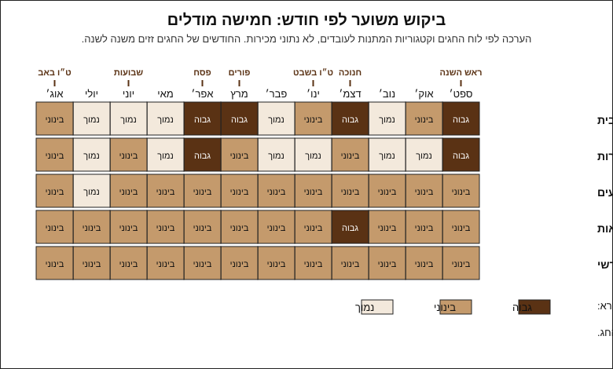

# 15.1 · מודלים עסקיים לחנות שוקולד

"חנות שוקולד" יכולה להיות חמישה עסקים שונים: מארזים לחגים, מתנות לחברות, אירועים, סדנאות ומנוי חודשי. לכל אחד לקוח, עונה ותזרים אחרים. בשיעור משווים את החמישה, מחשבים לכל אחד הזמנה טיפוסית מעלות המארז של [11.2](../module-11/lesson-02.md), ובוחרים מודל ראשי ומשני. בסוף יש לכם טבלת השוואה וטיוטה של סעיף 1 ב[תוכנית העסקית](../../templates/business-plan.md).

## מה צריך

| פריט | כמות לתרגול | כמות מלאה | הערה |
|---|---|---|---|
| [תוכנית עסקית קצרה](../../templates/business-plan.md) | סעיף 1 בלבד | כל התבנית (עד מודול 21) | מודפסת או כקובץ |
| [תכנון מארז](../../templates/gift-box-plan.md) מ־11.2 | 1 | | עלות למארז ועלות ליחידה שחישבתם |
| [לוח השנה של החגים](../../projects/m10-holiday-calendar.md) מפרויקט מודול 10 | 1 | | העונות שלכם |
| יומן התרגול: כמה זמן לקח לכם מארז אחד, מהמסה ועד סרט | 1 | | זמן אמיתי, לא הערכה |
| דף ועיפרון או גיליון אלקטרוני, מחשבון | 1 | | לטבלת ההשוואה |

**אלרגנים:** השיעור לא מכין אוכל, אבל כל מודל מוכר **סויה** (לציטין), **חלב**, ולפי המילויים **אגוזים**, **בוטנים**, **שומשום**, **גלוטן** ו**ביצים**. כשלא מכירים את מי שאוכל (חברות, אירועים, מנוי), הסיכון גדל, ולכן הוא קריטריון בטבלה.

### לפני שמתחילים את המודול

קריאה היא לא תרגול. מודל עסקי לומדים כשממלאים טבלה במספרים שלכם. האקדמיה לא יכולה לבדוק את המסמכים שלכם, ולכן בכל שיעור יש רשימת בדיקה שמשווים אליה. ממשיכים לנהל [יומן תרגול](../../templates/practice-log.md), וכותבים בו גם החלטות ולמה. כל המסלול העסקי (מודולים 15-21) הוא **מידע כללי, לא ייעוץ עסקי, משפטי או מיסויי**. על רישוי, מס וביטוח שואלים את הגורם המוסמך, ומודול 16 מסביר את מי.

## למה זה עובד

### חמישה מודלים, חמישה לקוחות

ההבדל בין המודלים הוא לא המוצר. סביבון משוקולד יכול להימכר בכל החמישה. ההבדל הוא מי משלם, כמה הוא מזמין בבת אחת, ומתי.

| מודל | מי משלם | הזמנה טיפוסית | מתי | מה הכי חשוב ללקוח |
|---|---|---|---|---|
| מארזי חג לבית (B2C) | אדם פרטי, לעצמו או כמתנה | 1-3 מארזים | לפני החגים (שיא קצר) | מראה, משלוח בזמן, כשרות |
| מתנות לחברות (B2B) | חברה, ועד עובדים, משרד | 20-200 מארזים זהים | ראש השנה ופסח בעיקר, וגם חגים ואירועים קטנים | מחיר ליחידה, אספקה במועד, חשבונית, מיתוג |
| אירועים | משפחה או מפיק אירוע | 50-300 יחידות קטנות | כל השנה, לפי תאריך אירוע | התאמה לעיצוב, כשרות, אלרגנים |
| סדנאות | קבוצה, חברה, מסיבה | 6-20 משתתפים | כל השנה, יותר בחופשות | חוויה, מקום, בטיחות |
| מנוי חודשי | אדם פרטי, תשלום חוזר | מארז אחד בחודש לכל מנוי | לאורך השנה | גיוון, אמינות, משלוח בחום |

הטווחים ב"הזמנה טיפוסית" הם דוגמאות, לא נתון שוק. באתר גיפטוש, טופס הפנייה למתנות לעובדים מציע כמויות של 10-20, 20-50, 50-100 ומעל 100 (נבדק 2026-11-10).

### מתנות לחברות: שתי עונות גדולות וחשבונית

מתנות לעובדים הן שוק גדול ומרוכז. לפי הערכה של Swish (ice, 25.3.2026), המתנה הממוצעת לעובד בפסח 2026 היא כ־500 ₪, ובראש השנה 2025 כ־300 ₪; סקר של חברת ועדים מאותו יום מעריך 650-950 ₪ בפסח. שני המקורות מתארים מעבר למתנות דיגיטליות ולמתנות לבחירה, ו־Swish מדווחת שתווי קנייה לרשתות מזון הוכפלו. כלומר: מארז שוקולד מתחרה גם בתו קנייה, ובמתנה של מאות שקלים הוא לרוב חלק ממארז גדול יותר.

גם מחוץ לשני החגים יש הזמנות: בקטגוריית המתנות לעובדים של גיפטוש יש תת־קטגוריות לכל החגים, ליום הולדת, ללידה ולפרידה, וגם "מתנות עד 100 ₪" ו"מיתוג מלא" (נבדק 2026-11-10).

מה זה דורש מכם:

- **הרבה מאותו דבר, במועד אחד.** 40 מארזים זהים ליום חמישי לפני פסח. מארז ממודול 8 או 11 שלקח לכם 25 דקות הופך ל־40 × 25 = 1,000 דקות, כ־17 שעות עבודה, בשבוע שבו גם הלקוחות הפרטיים מזמינים.
- **חשבונית.** לפי כל זכות, עוסק פטור (מחזור שנתי עד 122,833 ₪ ב־2026) אינו גובה מע"מ ואינו רשאי להוציא חשבונית מס. חברה שרוצה לקזז מע"מ צריכה חשבונית מס, ולכן מודל של מתנות לחברות הוא שאלה שכדאי לשאול את רואה החשבון לפני שפותחים תיק. מ־1.6.2026, חשבונית מס על עסקה של יותר מ־5,000 ₪ לפני מע"מ צריכה מספר הקצאה ([מקורות, סעיף 7](../../curriculum/research/sources.md#7-מסים)).
- **מיתוג.** לוגו על מדבקה או שרוול (מודול 18).

### מארזי חג לבית: שיא קצר וחד

זה המודל שהקורס בנה עד עכשיו (מודולים 10 ו־11). הלקוח הפרטי קונה מעט, לרוב בשבועיים שלפני החג, ומשווה מראה, מחיר ומועד משלוח. היתרון: מוצר אחד טוב מספיק כדי להתחיל. החיסרון: רוב ההכנסה בכמה שבועות בשנה, ובקיץ המשלוח הוא אתגר ([11.3](../module-11/lesson-03.md)).

### אירועים: לפי תאריך, לא לפי חג

בר ובת מצווה, חתונות וימי הולדת ([10.6](../module-10/lesson-06.md)) לא מחכים לחג. ההזמנה היא הרבה יחידות קטנות בעיצוב של האירוע, עם תאריך מסירה קשיח. הלקוח אחד, אבל האוכלים הם מאות אנשים שאתם לא מכירים, ולכן כשרות, אלרגנים וחום באולם הם חלק מההצעה.

### סדנאות: מוכרים זמן ומקום, לא רק שוקולד

בסדנה הלקוח משלם על חוויה. חומרי הגלם למשתתף זולים: 6 בונבונים לפי 11.2 הם כ־6 × 0.90 = 5.40 ₪, ועוד קופסה. לפי כתבה שיווקית בכיפה (30.6.2020), סדנה בסטודיו תומחרה אז סביב 200-300 ₪ למשתתף, ובבית או באירוע 100-200 ₪. זה סדר גודל ישן; מחירים עדכניים בודקים ב־15.2. הסדנה דורשת מקום לקבוצה, ציוד כפול, השגחה על שוקולד חם, ותשובות על ביטוח ורישוי (מודול 16).

### מנוי חודשי: הכנסה צפויה, משלוח כל חודש

במנוי הלקוח משלם מראש או בתשלום חוזר על מארז בכל חודש. היתרון: יודעים מראש כמה מארזים להכין. הקושי: מוצר חדש כל חודש, משלוח גם ביולי ובאוגוסט, ומנוי שמבטל מוריד את ההכנסה. צריך תנאים כתובים (חיוב, ביטול, משלוח שנמס); זכות הביטול במכר מרחוק לא חלה על "טובין פסידים", ושוקולד הוא כנראה כזה, אבל זו פרשנות ([מקורות, סעיף 6](../../curriculum/research/sources.md#6-הגנת-הצרכן-במכירה-אונליין)). את התנאים בונים במודול 20.

### עונתיות: מתי כל מודל עובד

התרשים הוא הערכה לפי לוח החגים, לא נתוני מכירות. הוא מראה ששני המודלים שהכי קל להתחיל בהם, מארזי חג ומתנות לחברות, מתנגשים על אותם שבועות. התאריכים הקרובים: [טבלת החגים ב־10.1](../module-10/lesson-01.md#לוח-השנה-הקרוב); תכנון ייצור לעונה: מודול 19.

### מה כל המודלים צריכים לפני שמוכרים

כל מודל מניח שמותר לכם לייצר ולמכור מהמקום שבו אתם מייצרים. לפי חוק המזון, ייצור מזון דורש רישיון ייצור, ולא נמצא בחוק פטור לייצור ביתי ([מקורות, סעיף 1](../../curriculum/research/sources.md#1-רישוי-עסק-לייצור-מזון-שוקולד--ממתקים)). מודול 16 נותן רשימה של מה לשאול ואת מי.

## שלב אחר שלב

> [!WARNING]
> משתמשים בזמנים ובעלויות שמדדתם. מספר מהשיעור או מהשוק במקום מדידה שלכם מוביל להחלטה לא נכונה; כל הנחה מסמנים "הנחה".

1. **עלות וזמן למארז.** עלות מ־11.2, דקות מהיומן. לא מדדתם? מכינים מארז אחד עם שעון.
2. **הזמנה טיפוסית לכל מודל:** כמה יחידות, איזה מוצר, מתי המסירה.
3. **שעות להזמנה:** יחידות × דקות ליחידה ÷ 60, ועוד קנייה, אריזה ומשלוח.
4. **עלות להזמנה:** יחידות × עלות למארז. זה מה שאתם מוציאים לפני שמקבלים תשלום, אם אין מקדמה.
5. **עונה:** מסמנים על לוח השנה (פרויקט מודול 10) את השבועות העמוסים של כל מודל, ובודקים התנגשויות.
6. **ציון 1-3 בחמישה קריטריונים:** יכולת שלכם היום, מטבח וזמן, עונה, תזרים, וסיכון (אלרגנים, חום, תאריך קשיח). 3 הוא הכי טוב.
7. **שאלות פתוחות:** חשבונית, רישוי, ביטוח, מקום. אלה שאלות למודולים 16-20 ולאנשי המקצוע.
8. **בחירה:** מודל ראשי ומודל משני שלא מתנגש איתו, ומשפט נימוק לכל אחד.
9. **סעיף 1 בתוכנית העסקית:** "מה אני מוכר/ת ולמי". את "למה אצלי" משלימים אחרי 15.2 ו־15.3.

## בדיקה: איך יודעים שהצליח

הטבלה עוברת אם כל השורות האלה מסומנות:

- [ ] לכל חמשת המודלים יש הזמנה טיפוסית, שעות ועלות.
- [ ] הזמן והעלות למארז מבוססים על מדידה שלכם או מסומנים "הנחה".
- [ ] על לוח השנה מסומנים השבועות העמוסים של כל מודל, וההתנגשויות.
- [ ] לכל מודל ציון בחמשת הקריטריונים, ושאלות פתוחות.
- [ ] נבחרו מודל ראשי ומודל משני, עם משפט נימוק לכל אחד.
- [ ] אין בטבלה מחיר מכירה: מחיר קובעים במודול 19, אחרי מחקר השוק.

## כשזה משתבש

| מה רואים | למה זה קורה | מה עושים עכשיו | איך מונעים בפעם הבאה |
|---|---|---|---|
| המודל שבחרתם דורש 30 שעות בשבוע אחד | הזמנה של חברה כפול זמן ידני למארז | מקטינים את ההזמנה הטיפוסית, או בוחרים מוצר מהיר יותר (טבלה במקום בונבונים) | מודדים זמן לכל מוצר ובוחרים מוצר לכל מודל |
| מודל ראשי ומשני באותם שבועות | מארזי חג ומתנות לחברות לפני אותם חגים | מחליפים את המשני לאירועים, סדנאות או מנוי | בודקים התנגשות על לוח השנה לפני שבוחרים |
| התזרים שלילי לפני כל הזמנה גדולה | קונים חומרי גלם ואריזה לפני שמקבלים כסף | רושמים "מקדמה?" כשאלה פתוחה למודול 20 | מחשבים עלות להזמנה, לא רק למארז |
| אין לכם מושג כמה זמן לוקח מארז | לא נמדד במודולים 8-11 | מכינים מארז אחד עם שעון | רושמים זמן ביומן בכל הכנה |

### מה עושים עם מה שלא הצליח

שום דבר לא הולך לפח. טבלה שלא עבדה נשמרת ליד החדשה, עם תאריך ומה השתנה. מארז שהכנתם כדי למדוד זמן הוא מתנה, טעימה או דוגמה לצילום (מודול 18); שוקולד שנשאר חוזר להמסה, לשוקו או לבראוניז.

## חלופות

### טבעוני / פרווה

במתנות לחברות ובאירועים, מארז טבעוני ופרווה עונה לעובד טבעוני, לאלרגי לחלב (אחרי בדיקה, [12.1](../module-12/lesson-01.md)) ולמי שאוכל בשרי. אבל ייצור נפרד, עלות גבוהה יותר ([פרויקט מודול 12](../../projects/m12-vegan-box.md)) ובדיקת קישוטים ([12.5](../module-12/lesson-05.md)) הם זמן נוסף בשבוע העמוס. מחליטים מראש: מוצר קבוע או הזמנה מיוחדת.

### בריא יותר

מארז קטן ("מיני", 5 יחידות) או מריר 70% הם מוצר שמתאים למתנות לחברות ולמנוי, אבל לא מוכרים אותם כ"בריא" ולא כותבים טענות בריאות ([13.5](../module-13/lesson-05.md)). קו "ללא סוכר" הוא נישה בפני עצמה, ו־15.3 בודק אותה. בעלות: אריזה קטנה מייקרת את היחידה (11.2).

### כשרות

כשלא מכירים את מי שאוכל, השאלה הראשונה תהיה לרוב "יש הכשר?". אסור לסמן או לפרסם מוצר כ"כשר" בלי תעודת הכשר ([מקורות, סעיף 5](../../curriculum/research/sources.md#5-כשרות)), ולכן בלי תעודה, חברות ואירועים לקהל שומר כשרות הם מודל קשה. 15.3 בודק כשרות כנישה, ומודול 17 את התהליך. חומרי גלם: [שלושת הכללים](../../references/kashrut-guide.md#שלושה-כללים). אם יש ספק, שואלים את הרב.

## איפה קונים

בשיעור הזה לא קונים. לפני שבוחרים מודל, קוראים במקורות שבדקנו (מידע כללי, לא ייעוץ): [רישוי עסק לייצור מזון](../../curriculum/research/sources.md#1-רישוי-עסק-לייצור-מזון-שוקולד--ממתקים), [מסים: עוסק פטור, מע"מ ומספר הקצאה](../../curriculum/research/sources.md#7-מסים), [הגנת הצרכן במכירה אונליין](../../curriculum/research/sources.md#6-הגנת-הצרכן-במכירה-אונליין) ו[כשרות](../../curriculum/research/sources.md#5-כשרות). לכמויות של חברות: [קופסאות פרלינים](../../references/where-to-buy.md#קופסאות-פרלינים) ו[מדבקות ותוויות](../../references/where-to-buy.md#מדבקות-ותוויות) הם מחירי חבילות קטנות; לעסק צריך ספק אריזה.

## תרגול

### משימה

ממלאים טבלת השוואה של חמשת המודלים, עם המספרים שלכם (זמן ועלות למארז מ־11.2), ומסמנים התנגשויות על לוח השנה מפרויקט מודול 10. בוחרים מודל ראשי ומשני, וכותבים טיוטה של סעיף 1 ב[תוכנית העסקית](../../templates/business-plan.md): "מה אני מוכר/ת ולמי".

דוגמה פתורה

**הנתונים של הלומדת בדוגמה** (שלה, לא נתון כללי): מארז 5 סביבונים מ־11.2, כ־15.2 ₪ ו־25 דקות עבודה; מארז 9 בונבונים, כ־17.6 ₪ ו־40 דקות. פנויה כ־12 שעות בשבוע, ובשבועיים לפני חג עד 20.

| מודל | הזמנה טיפוסית (הנחה) | שעות | עלות להזמנה ₪ | יכולת | מטבח וזמן | עונה | תזרים | סיכון | סה"כ |
|---|---|---|---|---|---|---|---|---|---|
| מארזי חג לבית | 30 מארזי סביבונים בשבועיים לפני חנוכה | 30 × 25 = 750 דק' = 12.5 | 30 × 15.2 = 456 | 3 | 3 | 2 | 3 | 2 | **13** |
| מתנות לחברות | 60 מארזי סביבונים למסירה אחת | 25 | 912 | 3 | 1 | 1 | 1 | 2 | **8** |
| אירועים | 120 מטבעות מזכרת לבת מצווה (נניח 2 דק' ליחידה) | 4 + 2 אריזה | כ־150 (הנחה) | 2 | 3 | 3 | 2 | 1 | **11** |
| סדנאות | 8 משתתפים, 6 בונבונים כל אחד | 3 + 2 הכנה | כ־80 (48 בונבונים ו־8 קופסאות, הנחה) | 1 | 2 | 3 | 3 | 1 | **10** |
| מנוי חודשי | 15 מנויים, מארז 9 בונבונים | 15 × 40 = 600 דק' = 10 בחודש | 15 × 17.6 = 264 | 2 | 3 | 3 | 3 | 2 | **13** |

ציון 3 הוא הכי טוב, גם בסיכון (3 = סיכון נמוך).

**שאלות פתוחות:** חברות: חשבונית מס (מתכוונת לעוסק פטור; לשאול רו"ח). סדנאות: מקום, ביטוח. מנוי: קיץ, ביטול. כולם: רישוי (מודול 16).

**התנגשויות:** חנוכה: מארזי חג ומתנות לחברות. 60 מארזים לחברה ועוד 30 ללקוחות פרטיים הם 37.5 שעות בשבועיים, מעל 20 השעות שיש לה.

**בחירה:** ראשי, מארזי חג לבית: "המוצר כבר קיים ומתומחר, וזה נכנס ב־12.5 שעות בשבועיים." משני, מנוי חודשי קטן (עד 15): "עבודה קבועה בחודשים השקטים, בלי התנגשות, אבל רק מספטמבר עד יוני, בגלל החום." מתנות לחברות: לא השנה; אולי הזמנה אחת קטנה (עד 20) לראש השנה.

**סעיף 1, טיוטה:** "אני מוכרת מארזי שוקולד בעבודת יד לחגים, ללקוחות פרטיים באזור המרכז, ומנוי חודשי קטן מספטמבר עד יוני." "למה אצלי": אחרי 15.2 ו־15.3.

### זמן

כשעה: 15 דקות לאסוף זמן ועלות, 25 דקות לטבלה, 10 דקות ללוח השנה, 10 דקות לבחירה ולסעיף 1.

### יומן

ב[יומן התרגול](../../templates/practice-log.md) רושמים: מה בחרתם, איזה מספר הכריע, ואיזו שאלה פתוחה הכי מדאיגה אתכם.

### בדיקה עצמית

- [ ] הטבלה עוברת את כל הבדיקות שלמעלה.
- [ ] רשימת שאלות פתוחות לרישוי, מס, ביטוח ומשלוח.
- [ ] טיוטה של סעיף 1 בתוכנית העסקית.

## סיכום

- חמשת המודלים נבדלים בלקוח, בגודל ההזמנה, בעונה ובתזרים, לא במוצר.
- מתנות לחברות מרוכזות בראש השנה ובפסח, דורשות הרבה מאותו דבר במועד אחד, ולרוב גם חשבונית מס, ועוסק פטור לא מוציא חשבונית כזו.
- מארזי חג ומתנות לחברות מתנגשים על אותם שבועות; אירועים, סדנאות ומנוי מפזרים עבודה על פני השנה.
- בוחרים לפי שעות ועלות להזמנה שמחשבים מהמספרים שלכם, ולא לפי ממוצעי שוק.
- הפרויקט של המודול: [מחקר שוק ובחירת נישה](../../projects/m15-market-research.md). אוספים 5-10 מתחרים, בונים טבלת עונתיות, בוחרים מודל ונישה, וכותבים את סעיף 1 של התוכנית העסקית.
