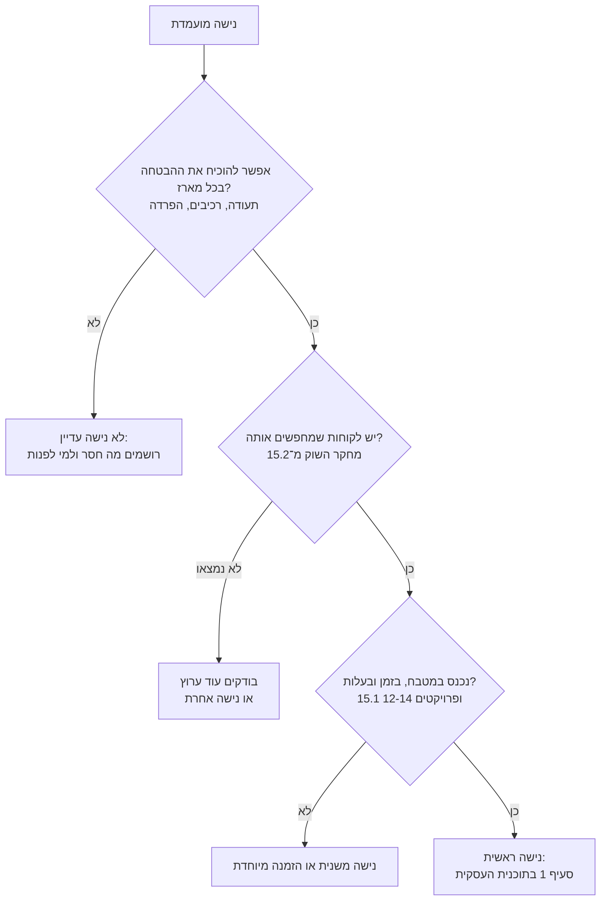

# 15.3 · בחירת נישה

נישה היא הבטחה אחת ברורה ללקוח מסוים: "שוקולד חלב ישראל בהכשר מהדרין", "מארזים טבעוניים", "בלי תוספת סוכר", "מארזים עם הלוגו שלכם לעובדים", "מתנות לחגים". ההבטחה עוזרת ללקוח למצוא אתכם, אבל היא גם התחייבות: מה שכתוב צריך להיות נכון בכל מארז. בשיעור הזה בודקים חמש נישות לפי מה שלמדתם במודולים 10-14, מדרגים שלוש מהן מול מחקר השוק שלכם מ־[15.2](lesson-02.md), ומשלימים את סעיף 1 של [התוכנית העסקית](../../templates/business-plan.md).

## מה צריך

| פריט | כמות לתרגול | כמות מלאה | הערה |
|---|---|---|---|
| [מחקר השוק](../../templates/market-research.md) מ־[15.2](lesson-02.md) | 1 | | 5 שורות לפחות |
| טבלת המודלים מ־[15.1](lesson-01.md) | 1 | | מודל ראשי ומשני |
| [תוכנית עסקית קצרה](../../templates/business-plan.md) | סעיף 1 | | הטיוטה מ־[15.1](lesson-01.md) |
| פרויקטים קודמים, אם הכנתם: [מארז טבעוני](../../projects/m12-vegan-box.md), [השוואת פחות סוכר](../../projects/m13-less-sugar-comparison.md), [אצווה בלי אלרגנים](../../projects/m14-allergen-safe-batch.md) | לפי הנישה | | עלויות ובדיקות שכבר עשיתם |
| [מדריך הכשרות](../../references/kashrut-guide.md) | 1 | | מונחים ושלושה כללים |

**אלרגנים:** כל נישה משנה את רשימת האלרגנים, אבל לא מוחקת אותה. מארז טבעוני עדיין עלול להכיל **אגוזים**, **בוטנים**, **שומשום** (טחינה) ו**סויה**; מארז "ללא סוכר" מכיל את אותו **חלב** ו**סויה**; ושוקולד מריר רבים "עלולים להכיל חלב". נישה של "ללא אלרגן" היא הבטחה מיוחדת, ו־[14.3](../module-14/lesson-03.md) מסביר מה אפשר להבטיח במטבח ביתי.

## למה זה עובד

### נישה היא הבטחה שאפשר לבדוק

לקוח שמחפש "שוקולד טבעוני" או "מתנה כשרה לעובדים" מחפש עסק שעונה בדיוק על זה. לכן נישה עוזרת: פחות מתחרים, לקוח שיודע מה הוא רוצה, ומסר אחד בשיווק. אבל כל נישה בשיעור הזה היא גם טענה על המוצר, ולכל טענה יש דרך לבדוק אותה: תעודה, רשימת רכיבים, תווית, או הלקוח עצמו. השאלה הראשונה לכל נישה היא לא "יש ביקוש?" אלא "אני יכולה להוכיח את זה בכל מארז?".

### כשר למהדרין

**ההבטחה:** מוצר בהכשר מסוים, לרוב ברמה מחמירה, ולעתים חלב ישראל. **מה צריך כדי לעמוד בה:** תעודת הכשר. לפי חוק איסור הונאה בכשרות, יצרן לא יציין על מוצר או על אריזתו שהוא כשר, ולא יציג אותו כך בפרסום, בלי תעודת הכשר (סעיף 4). לאתר ייצור, את התעודה נותן הרב המקומי של המקום או מועצת הרבנות הראשית (סעיף 2). "מהדרין" הוא רמה מחמירה יותר של אותו גוף מכשיר, ומשמעותה שונה בין גופים ([מדריך הכשרות, מונחים](../../references/kashrut-guide.md#מונחים)).

**מה ראינו בשוק:** בדף מארז הסביבונים בגיפטוש יש פירוט של הכשר "מהודר", חלב ישראל, עם שלושה גופים; במקס ברנר, לפי דף השאלות הנפוצות, כל מוצרי השוקולד בהשגחת בד"ץ וחלב ישראל, ומוצרים בלי חלב מוגדרים בכל זאת חלביים (נבדק 2026-11-10). כלומר, ללקוח שמחפש מהדרין יש כבר עסקים עם הכשר מפורט, והוא יחפש אותו גם אצלכם.

**חומרי גלם:** קו Lubeka "סדרת המהדרין" (בד"ץ בית יוסף) הוא הנגיש ביותר עם שוקולד חלב ולבן חלב ישראל, ואותו מותג יכול להופיע בכשרות שונה לפי מק"ט ואריזה ([שלושה כללים](../../references/kashrut-guide.md#שלושה-כללים)). התהליך עצמו (רבנות מול הכשר פרטי, משגיח, עלות) הוא [מודול 17](../module-17/lesson-01.md). הקורס לא פוסק הלכה: על כל שאלה, שואלים את הרב ואת הגוף המכשיר.

### טבעוני

**ההבטחה:** אין רכיבים מן החי, כולל בקישוטים. **מה צריך:** בדיקת כל רכיב, כולל שלאק, קרמין וג'לטין ([12.5](../module-12/lesson-05.md)), ומודעות לכך שטבעוני ופרווה הם לא אותו דבר ושניהם לא מבטיחים לאלרגי לחלב ([12.1](../module-12/lesson-01.md)). **בשוק:** בגיפטוש יש קטגוריה של מארזי מתנה לטבעונים, ובה שני מארזי שוקולד ב־269 ו־279 ₪ (נבדק 2026-11-10). **עלות:** קרם קוקוס ושוקולד טבעוני עולים לרוב יותר, וההשוואה שעשיתם ב[פרויקט מודול 12](../../projects/m12-vegan-box.md) היא הבסיס. שוקולד "חלב" טבעוני לקונדיטוריה לא נמצא בחנויות שנבדקו, ולכן מגוון בא מהמתכון הביתי ([12.2](../module-12/lesson-02.md)) ומהמילויים.

### ללא סוכר

**ההבטחה:** "ללא סוכר" או "ללא תוספת סוכר". **מה צריך:** ממתיק במקום סוכר, לרוב מלטיטול, וסימון נכון. לפי 13.5, לא ברור אם יש כלל ישראלי שמגדיר את הנוסחים האלה, ולכן בודקים את הכלל העדכני לפני שכותבים ([13.5](../module-13/lesson-05.md)). אסור לייחס למזון ריפוי או מניעת מחלה (סעיף 13 לחוק המזון, [מקורות, סעיף 4](../../curriculum/research/sources.md#4-פוליאולים-ממתיקים-וטענות-בריאות)), כך שהנישה היא "בלי תוספת סוכר", לא "בריא" ולא "מתאים לסוכרתיים".

**מלטיטול:** בכמות גדולה הוא גורם לגזים ולשלשול, ולא מתאים לילדים בכמות. במארז שמוכרים זו אזהרה שהלקוח צריך לראות ([13.2](../module-13/lesson-02.md)). **בשוק ובעלות:** שוקולד מריר ללא תוספת סוכר לאפייה נמכר למשל ב־95 ₪ לק"ג ([שוקולד ללא סוכר](../../references/where-to-buy.md#שוקולד-ללא-סוכר)), באזור של קוברטורה רגילה (80-100 ₪ לק"ג). את ההשוואה בטעם ובעלות עשיתם ב[פרויקט מודול 13](../../projects/m13-less-sugar-comparison.md).

### ממותג לחברות

**ההבטחה:** מארז עם הלוגו או השם של החברה, בכמות ובמועד שסוכמו. **מה צריך:** מדבקה, שרוול או טבלה עם לוגו (עיצוב והדפסה, [מודול 18](../module-18/lesson-01.md)), כמויות זהות ([15.1](lesson-01.md): 60 מארזים הם 25 שעות), חשבונית שהחברה יכולה להשתמש בה, ותאריך מסירה קשיח. **בשוק:** גיפטוש מציע לחברות "מיתוג מלא" (15.1). **שאלה פתוחה:** עוסק פטור אינו רשאי להוציא חשבונית מס, ולכן שואלים רואה חשבון לפני שמכוונים לנישה הזו ([מקורות, סעיף 7](../../curriculum/research/sources.md#7-מסים)).

### חגים

**ההבטחה:** המוצר הנכון לחג, בזמן. **מה צריך:** מוצר לכל חג ([מודול 10](../module-10/lesson-01.md)), לוח זמנים (פרויקט [לוח שנה של חגים](../../projects/m10-holiday-calendar.md)), ובפסח חומרי גלם כשרים לפסח ([10.4](../module-10/lesson-04.md)). **מה מיוחד:** זו נישה של זמן, לא של רכיב, ולכן היא משתלבת עם האחרות ("מארזי חנוכה טבעוניים"). הסיכון: כל ההכנסה בכמה שבועות, ובאותם שבועות כל המתחרים מהמחקר פעילים.

### ומה עם "ללא אגוזים"?

נישה של מוצר בלי אלרגן מסוים מבוקשת, אבל היא ההבטחה הקשה ביותר במטבח ביתי: "ללא" הוא הבטחה, לא תיאור, והוא דורש בקרה שאין במטבח ביתי, ולכן כותבים מה עשיתם ולא "ללא" ([14.3](../module-14/lesson-03.md), [14.1](../module-14/lesson-01.md)). אם זו הנישה שלכם, היא מתחילה מההפרדה של מודול 14 ומהשאלות של [מודול 16](../module-16/lesson-01.md), לא מהשיווק.

## שלב אחר שלב

> [!WARNING]
> נישה היא טענה על המוצר. "כשר" בלי תעודה אסור בחוק, ו"ללא אגוזים" שאינו נכון עלול לסכן אדם אלרגי. לא כותבים ולא מפרסמים הבטחה לפני שאפשר להוכיח אותה בכל מארז.

1. **שלוש מועמדות.** בוחרים שלוש נישות מתוך החמש (או נישה משלכם) שמתאימות למודל מ־[15.1](lesson-01.md).
2. **ההבטחה במשפט.** לכל אחת כותבים מה בדיוק מובטח, במילים שהלקוח יראה.
3. **איך מוכיחים.** לכל הבטחה: איזה מסמך, רכיב או תהליך מוכיח אותה, ומה חסר לכם היום (תעודה, ספק, הפרדה).
4. **מתחרים.** מהמחקר של [15.2](lesson-02.md): כמה מהשורות כבר מציעות את ההבטחה הזו, ובאיזה טווח מחיר ליחידה. אם אין אף שורה, מחפשים עוד ערוץ לפני שמסיקים.
5. **הפרש עלות.** מהפרויקטים של מודולים 12-14 או מהמחירים ב[איפה קונים](../../references/where-to-buy.md): האם הנישה מייקרת את המארז, ובכמה.
6. **עונה.** על לוח השנה: האם הנישה מרוכזת בחג אחד או פרוסה על השנה.
7. **ציון.** 1-3 לכל אחד מחמשת הקריטריונים (לקוח, הוכחה, מתחרים, עלות, עונה). נישה שקיבלה 1 ב"הוכחה" לא נבחרת עכשיו, גם אם הציון הכולל גבוה.
8. **בחירה וסעיף 1.** כותבים "מה אני מוכר/ת ולמי" ו"למה אצלי ולא אצל אחרים", בלי מילה שאי אפשר להוכיח.
9. **רשימת שאלות.** מה צריך לברר ועם מי: רבנות או גוף כשרות ([מודול 17](../module-17/lesson-01.md)), לשכת הבריאות והרשות המקומית ([מודול 16](../module-16/lesson-01.md)), רואה חשבון.

## בדיקה: איך יודעים שהצליח

- [ ] שלוש נישות, לכל אחת הבטחה במשפט אחד ודרך הוכחה.
- [ ] לכל נישה נבדקו מתחרים מהמחקר, עם טווח ₪ ליחידה או "לא נמצא".
- [ ] הפרש העלות מחושב או מסומן "הנחה".
- [ ] נבחרה נישה עם ציון 2 לפחות ב"הוכחה".
- [ ] סעיף 1 מלא, בלי "כשר" בלי תעודה, בלי "בריא", בלי "ללא" שלא נבדק.
- [ ] רשימת שאלות פתוחות עם שם הגורם לכל שאלה.

## כשזה משתבש

| מה רואים | למה זה קורה | מה עושים עכשיו | איך מונעים בפעם הבאה |
|---|---|---|---|
| הנישה שבחרתם היא "כולם" | פחד לוותר על לקוחות | בוחרים לקוח אחד שאפשר לתאר במשפט | מתחילים מ"למי", ולא מ"מה" |
| נישה עם ביקוש, אבל אין לכם דרך להוכיח | למשל "כשר" בלי תעודה, "ללא אגוזים" במטבח משותף | מעבירים לנישה משנית ורושמים מה חסר | שואלים "איך מוכיחים?" לפני "יש ביקוש?" |
| כל המתחרים במחקר כבר מציעים את אותה הבטחה | נישה עמוסה | מחפשים צירוף: נישה + חג, נישה + אזור משלוח | ממלאים את מחקר השוק לפני שבוחרים |
| הנישה מייקרת את המארז ב־40% | חומרי גלם מיוחדים, ייצור נפרד | בודקים אם הלקוח בטווח המחירים מהמחקר מוכן לזה | מחשבים הפרש עלות כבר בשלב 5 |
| כתבתם "מתאים לסוכרתיים" | נישת ללא סוכר נשמעת רפואית | מוחקים; כותבים רק מה במוצר ("ממותק במלטיטול") | בודקים כל משפט מול [13.5](../module-13/lesson-05.md) |

### מה עושים עם מה שלא הצליח

שום דבר לא הולך לפח. נישה שלא נבחרה עכשיו נשמרת עם רשימת מה שחסר לה, וחוזרים אליה כשהחסר יתמלא (תעודה, ספק, מטבח נפרד). מוצרים שהכנתם בפרויקטים של מודולים 12-14 הם דוגמאות לצילום ולטעימות; שוקולד שנשאר חוזר להמסה, בשקיות נפרדות לפי חלבי, פרווה וטבעוני.

## חלופות

### טבעוני / פרווה

בשיעור הזה טבעוני הוא נישה בפני עצמה (למעלה). הצד העסקי: קו פרווה בהכשר נותן מענה גם למי שאוכל בשרי, אבל לא כל מה שטבעוני הוא פרווה בהכשר, ולהפך ([12.1](../module-12/lesson-01.md)). מי שרוצה את שניהם צריך חומרי גלם בהכשר פרווה וגם בדיקה טבעונית של כל רכיב.

### בריא יותר

"בריא יותר" הוא לא נישה שאפשר לכתוב על אריזה: אין הגדרה, ויש איסור על טענות ריפוי. מה שאפשר להבטיח הוא עובדה בדוקה: אחוז קקאו, גודל יחידה, "בלי תוספת סוכר" אחרי בדיקת הכלל ([13.5](../module-13/lesson-05.md)).

### כשרות

כשרות היא נישה בפני עצמה (למעלה), וגם תנאי לחלק מהנישות האחרות: חברות ואירועים לקהל שומר כשרות. בלי תעודה, מותר לתאר בכתב את חומרי הגלם ואת הסטנדרטים בלי המילה "כשר" (לפי פסיקה שמתוארת ב[מקורות, סעיף 5](../../curriculum/research/sources.md#5-כשרות)), אבל זה לא תחליף לתעודה עבור לקוח שמחפש הכשר. [מודול 17](../module-17/lesson-01.md) עוסק בתהליך. אם יש ספק, שואלים את הרב.

## איפה קונים

בשיעור הזה לא קונים. לכל נישה, איפה בודקים חומרי גלם ומחירים: [שוקולד טבעוני](../../references/where-to-buy.md#שוקולד-טבעוני), [שוקולד ללא סוכר](../../references/where-to-buy.md#שוקולד-ללא-סוכר), [ממתיקים](../../references/where-to-buy.md#ממתיקים), [קוברטורה](../../references/where-to-buy.md#קוברטורה), [קוברטורה חלב בכשרויות שונות](../../references/kashrut-guide.md#קוברטורה-חלב), [שוקולד טבעוני והכשר](../../references/kashrut-guide.md#שוקולד-טבעוני), ו[מדבקות ותוויות](../../references/where-to-buy.md#מדבקות-ותוויות) למיתוג. מקורות רשמיים (מידע כללי, לא ייעוץ): [כשרות](../../curriculum/research/sources.md#5-כשרות), [טענות בריאות](../../curriculum/research/sources.md#4-פוליאולים-ממתיקים-וטענות-בריאות), [מסים](../../curriculum/research/sources.md#7-מסים).

## תרגול

### משימה

מדרגים שלוש נישות לפי חמשת הקריטריונים, בוחרים אחת, וכותבים את סעיף 1 המלא של [התוכנית העסקית](../../templates/business-plan.md). אחר כך משלימים את [פרויקט המודול](../../projects/m15-market-research.md): מחקר שוק, עונתיות, מודל, נישה וסעיף 1 במסמך אחד.

דוגמה פתורה

**הלומדת מ־[15.1](lesson-01.md) ומ־[15.2](lesson-02.md):** מודל ראשי מארזי חג לבית, משני מנוי קטן. במחקר: פרלין ב־6.25-11.67 ₪, שני עסקים עם פירוט הכשר, קטגוריה טבעונית בגיפטוש. היא הכינה את פרויקטי מודולים 12 ו־13.

| נישה | ההבטחה | איך מוכיחים / מה חסר | מתחרים במחקר | הפרש עלות | עונה | לקוח | הוכחה | מתחרים | עלות | עונה | סה"כ |
|---|---|---|---|---|---|---|---|---|---|---|---|
| כשר למהדרין, חלב ישראל | "בהכשר X, חלב ישראל" | תעודה לאתר הייצור: אין עדיין | 2 מתוך 7 שורות עם פירוט הכשר | Lubeka מהדרין; לבדוק מחיר מול Callebaut | כל השנה | 3 | 1 | 2 | 2 | 3 | 11 |
| טבעוני | "בלי רכיבים מן החי, גם בקישוטים" | רשימת רכיבים לכל פריט (פרויקט 12), ייצור בנפרד | קטגוריה אחת, 2 מארזים ב־269-279 ₪ | לפי פרויקט 12: כ־20% יותר (הנחה שלה) | כל השנה | 2 | 3 | 3 | 2 | 3 | 13 |
| חגים | "המארז לחג, בזמן" | לוח זמנים (פרויקט 10) | כמעט כל השורות | אין | 4-5 שבועות בשנה | 3 | 3 | 1 | 3 | 1 | 11 |

**בחירה:** טבעוני, עם צירוף של חגים ("מארזי חג טבעוניים"). כשר למהדרין קיבל 1 בהוכחה: לא עכשיו. שאלה פתוחה: רבנות מקומית, עלות ומשגיח ([מודול 17](../module-17/lesson-01.md)).

**סעיף 1:**

- מה אני מוכרת ולמי: מארזי שוקולד טבעוניים בעבודת יד לחגים, ללקוחות פרטיים במרכז, ומנוי חודשי קטן מספטמבר עד יוני.
- למה אצלי: כל פריט נבדק רכיב אחר רכיב, כולל קישוטים, ויש לי מתכון בית לשוקולד "חלב" טבעוני. על המארז כתובים הרכיבים, האלרגנים ו"עלול להכיל". "כשר" לא כתוב, כי אין תעודה.

### זמן

כשעה: 30 דקות לטבלת הנישות, 15 דקות לסעיף 1, 15 דקות לרשימת השאלות.

### יומן

ב[יומן התרגול](../../templates/practice-log.md) רושמים את הנישה, את הנישה שנדחתה ומה חסר לה, ותאריך לבדוק אותה שוב.

### בדיקה עצמית

- [ ] שלוש נישות מדורגות, עם הבטחה ודרך הוכחה.
- [ ] נבחרה נישה עם ציון 2 לפחות בהוכחה.
- [ ] סעיף 1 מלא, בלי טענה שאי אפשר להוכיח.
- [ ] רשימת שאלות עם הגורם לכל אחת.
- [ ] הפרויקט של המודול הושלם.

## סיכום

- נישה היא הבטחה אחת ללקוח מסוים, וכל הבטחה צריכה דרך להוכיח אותה בכל מארז.
- "כשר" ו"מהדרין" דורשים תעודה; טבעוני דורש בדיקה של כל רכיב; "ללא סוכר" דורש סימון נכון ואזהרת מלטיטול, בלי טענות בריאות.
- ממותג לחברות הוא נישה של כמות, מועד וחשבונית; חגים היא נישה של זמן שמשתלבת עם האחרות.
- בוחרים לפי לקוח, הוכחה, מתחרים מהמחקר, הפרש עלות ועונה, ונישה בלי הוכחה מחכה.
- סעיף 1 של התוכנית העסקית הוא המסמך שממשיך איתכם למודולים 16-21.
