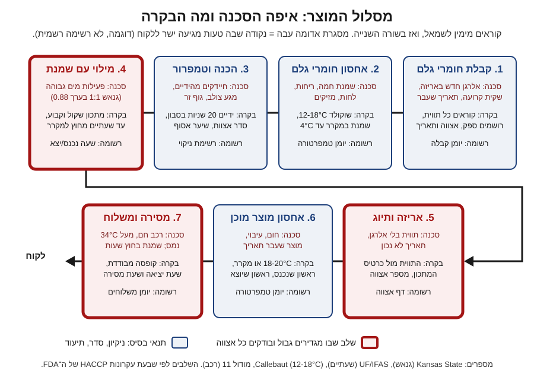

# 16.1 · בטיחות מזון למכירה

עד עכשיו הכנתם שוקולד לעצמכם, למשפחה ולאורחים שאתם מכירים. כשמוכרים, המצב משתנה: הלקוח לא יודע מה קרה במטבח, לא שואל, ושומר את המארז איפה שנוח לו. בשיעור הזה בונים את הבסיס של המודול: ממיינים את המוצרים לפי סיכון, עוברים על המסלול של מוצר אחד מהשקית ועד הלקוח, וממלאים דף סכנות. בסוף השיעור יש לכם העמוד הראשון של תוכנית בטיחות המזון של העסק.

## מה צריך

| פריט | כמות לתרגול | כמות מלאה | הערה |
|---|---|---|---|
| רשימת כל המוצרים שאתם מתכננים למכור | 1 | | גם אם זו רק טיוטה מ־[15.3](../module-15/lesson-03.md) |
| כרטיסי המתכון של המוצרים | 3-4 | כל המוצרים | [כרטיס מתכון](../../templates/recipe-card.md) |
| מדחום מקרר (או מדחום עם דקר) | 1 | | לבדוק שהמקרר ב־4°C או פחות |
| מחברת או קובץ לתוכנית בטיחות המזון | 1 | | ממשיך לכל המודול ול[פרויקט](../../projects/m16-food-safety-plan.md) |
| קוביית שוקולד מריר וטראפלס אחד מהמקרר | 1 מכל | | לניסוי ההשוואה, נאכלים בסוף |

**אלרגנים:** בשיעור לא מכינים מתכון חדש. בשוקולד מריר בדרך כלל יש סויה (לציטין) ו"עלול להכיל" חלב ואגוזים; בטראפלס יש גם חלב (שמנת). רושמים את מה שכתוב על האריזות שלכם.

## למה זה עובד

### ההבדל בין מטבח לאורחים למטבח למכירה

את ארבעת הצעדים (ניקיון, הפרדה, בישול, קירור) למדתם ב־[01.4](../module-01/lesson-04.md). ה־FDA מנסחים אותם כך (התוכן נכון ל־5.3.2024): ידיים 20 שניות לפחות במים חמים וסבון, מקרר ב־4°C (40°F) או פחות, ומזון רגיש נכנס למקרר בתוך שעתיים, או שעה כשבחוץ מעל 32°C (90°F). כל זה נשאר. במכירה נוספים שלושה דברים:

- **אתם לא שם כשאוכלים.** הלקוח לא יודע שהטראפלס צריך מקרר אם לא כתבתם לו.
- **הכמות גדולה יותר.** טעות אחת יוצאת ב־30 מארזים, לא בצלחת אחת.
- **צריך להוכיח.** אם לקוח מתלונן, מה שלא רשמתם לא קרה. החוק בישראל מחייב יצרן לשמור רשומות לכל אצווה ([16.4](lesson-04.md)).

### שלוש קבוצות סיכון

Kansas State University בדקו 49 מתכונים של ציפויים ומילויים מטבחים ביתיים, ומדדו לכל אחד חומציות (pH) ופעילות מים (aw). לפי טבלה מקוד המזון של ה־FDA מ־2017 שהם מביאים, מזון עם pH מעל 5.0 ו־aw של 0.88 ומעלה צריך בדיקת מוצר, ובלעדיה הוא "מזון שדורש בקרת זמן וטמפרטורה" (TCS, time/temperature control for safety): מקרר, או שעון. גנאש שוקולד מבושל שנמדד אצלם יצא pH 5.5 ו־aw של 0.88, ולכן נכנס לקבוצה הזו. הם כותבים שבישול לא הופך מזון לבטוח בטמפרטורת החדר, ושלגבי סטפילוקוקוס זהוב (Staphylococcus aureus) ה־FDA רואים ב־aw מעל 0.85 סימן למזון בסיכון גבוה.

לכן מחלקים את מה שמוכרים כך (ההסבר על פעילות מים ב־[06.4](../module-06/lesson-04.md)):

| קבוצה | דוגמאות | למה | מה זה אומר במכירה |
|---|---|---|---|
| א. שוקולד מוצק | טבלאות, bark, סביבונים, מטבעות, לוליפופ | כמעט בלי מים; aw נמוך | 18-20°C, יבש וסגור. הסכנות: אלרגנים, חום, גוף זר |
| ב. מילוי יבש או מתוק מאוד | פרלינה, ג'יאנדוז'ה, קרמל קשה, ג'לי פירות | aw בערך 0.45-0.85 ([07.1](../module-07/lesson-01.md), [07.3](../module-07/lesson-03.md)) | מקום קריר; תאריך לפי המילוי, אחרי ניסוי |
| ג. שמנת, חמאה רכה או פרי טרי | טראפלס, גנאש, בונבון עם גנאש רך, תותים מטובלים ([02.2](../module-02/lesson-02.md): באותו יום) | aw בערך 0.85-0.92 ומעלה; pH מעל 5 | מקרר עד 4°C, שעתיים בחוץ לכל היותר, תאריך קצר |

קבוצה ג לא "אסורה": היא דורשת שרשרת קירור, תאריך קצר והוראה ברורה ללקוח. אפשר להתחיל בקבוצות א ו־ב ולהוסיף את ג כשיש מקרר ייעודי ומשלוח מתאים ([16.3](lesson-03.md)).

### שלושה סוגי סכנות

ה־FDA מגדירים סכנה (hazard) כגורם ביולוגי, כימי או פיזיקלי שסביר שיגרום מחלה או פגיעה אם לא שולטים בו. בשוקולד:

| סוג | דוגמה במטבח שוקולד | מאיפה ידוע |
|---|---|---|
| ביולוגי | סטפילוקוקוס מהעור והשיער שמתרבה בגנאש שנשאר בחוץ; עובש בטראפלס; סלמונלה באגוזים או בקקאו לא קלוי | Kansas State; [13.3](../module-13/lesson-03.md); [05.5](../module-05/lesson-05.md) לסימני קלקול |
| כימי | אלרגן שלא סומן; שאריות חומר ניקוי; אבקת ברק "לקישוט בלבד" | [14.3](../module-14/lesson-03.md); [01.4](../module-01/lesson-04.md) |
| פיזיקלי | נייר כסף, קליפת אגוז, שבב פלסטיק מתבנית סדוקה, שערה, זכוכית | שיקול שלנו מהעבודה במטבח |

לפי Kansas State, התפרצויות ממילויים נדירות אבל קורות, משלוש סיבות: עובד חולה, קישוט לא אכיל, ומילוי שצריך קירור ונשמר בחוץ. ב־2010 חלו כ־100 איש מסטפילוקוקוס במאפייה באילינוי, בגלל ידיים חשופות בקרם ובמילויים.

### שבעת העקרונות, בגודל של מטבח

HACCP (ניתוח סיכונים ונקודות בקרה קריטיות) הוא השיטה שעליה נשענות רוב תוכניות בטיחות המזון בעולם. גם חוק המזון בישראל מזכיר אותה בהגדרת "תקנים בין־לאומיים מקובלים" ([16.4](lesson-04.md)). שבעת העקרונות, לפי ה־FDA (אומצו ב־1997):

1. **ניתוח סכנות**: לכל שלב, מה יכול להשתבש.
2. **נקודות בקרה קריטיות** (CCP): השלבים שבהם הבקרה חיונית כדי למנוע את הסכנה.
3. **גבול קריטי**: מספר שאסור לעבור, למשל "עד 4°C" או "עד שעתיים מחוץ למקרר".
4. **ניטור**: איך ומתי בודקים שעומדים בגבול.
5. **פעולה מתקנת**: מה עושים כשחורגים.
6. **אימות**: איך יודעים שהתוכנית עובדת.
7. **תיעוד**: מה רושמים ואיפה.

ה־FDA מוסיפים שלפני כל זה צריכות להיות **תוכניות קדם** (prerequisite programs): מבנה, בחירת ספקים, ניקוי, היגיינה אישית, הדרכה, אחסון ומשלוח, עקיבות וריקול, והדברה. במטבח קטן אלה רוב העבודה.

לעסק קטן לא צריך מסמך של מפעל. סוכנות המזון הבריטית (FSA), למשל, מציעה לעסקים קטנים חוברות בשם Safer food, better business, עם פרקים קצרים: מגע צולב, ניקוי, קירור, בישול, ניהול, ויומן. זו הנחיה בריטית, לא החוק בישראל, אבל היא מראה את הגודל הנכון: כמה עמודים שאפשר לעבוד לפיהם, ויומן שממלאים כל יום. מה דורש החוק בישראל, ואיך שואלים על זה, נלמד ב־[16.4](lesson-04.md) וב־[16.5](lesson-05.md). הניקוי עצמו הוא מה שלמדתם ב־[14.3](../module-14/lesson-03.md): מים, סבון וניגוב במטלית נקייה; במכירה מוסיפים רשימה של מה מנקים, מתי ובמה.

## שלב אחר שלב

> [!WARNING]
> עובדים במטבח רק כשאתם בריאים. מי שמשלשל, מקיא או עם פצע פתוח ביד לא מכין מזון למכירה באותו יום: Kansas State מונים עובד חולה בין הסיבות להתפרצויות ממילויים.

**חלק א: מיון המוצרים (10 דקות)**

1. **כותבים** את כל המוצרים שאתם רוצים למכור, כל אחד בשורה.
2. **לכל מוצר** מסמנים קבוצה: א (מוצק), ב (מילוי יבש או מתוק מאוד), ג (שמנת, חמאה רכה, פרי טרי). מוצר עם שני מילויים מקבל את הקבוצה של המילוי המסוכן יותר.
3. **מוצר בקבוצה ג**: כותבים לידו "מקרר עד 4°C, שעתיים בחוץ לכל היותר, שעה מעל 32°C".

**חלק ב: ניסוי השוואה קטן (5 דקות פעילות, שעתיים המתנה)**

4. **מוציאים** קוביית שוקולד וטראפלס אחד מהמקרר, ומניחים על צלחת בטמפרטורת החדר. רושמים שעה וטמפרטורת חדר.
5. **אחרי שעתיים**: בודקים מראה, ריח ומרקם. השוקולד לא השתנה; הטראפלס רך יותר ועלול להזיע. זה לא בודק חיידקים: זה מזכיר שהזמן בחוץ נספר מהרגע שהמגש יצא, לא מהרגע שהלקוח פתח.
6. **מחזירים** את הטראפלס למקרר רק אם עברו פחות משעתיים, ומסמנים "לאכול היום". אם עברו יותר, הוא נאכל עכשיו או נזרק.

**חלק ג: דף סכנות למוצר אחד (30 דקות)**

7. **בוחרים** מוצר אחד מקבוצה ג (למשל טראפלס מ־[06.2](../module-06/lesson-02.md)), או מקבוצה ב אם אינכם מוכרים שמנת.
8. **כותבים** את שבעת השלבים מהתרשים, מותאמים למוצר: קבלה, אחסון חומרי גלם, הכנה, מילוי, אריזה ותיוג, אחסון מוצר מוכן, מסירה.
9. **לכל שלב** ממלאים שש עמודות: סכנה (ב/כ/פ), בקרה, גבול, מי בודק ומתי, מה עושים כשחורגים, איפה רושמים.
10. **מסמנים** את הנקודות הקריטיות: השלבים שבהם אם הבקרה נכשלה, הטעות מגיעה ללקוח ואין שלב אחר שיתפוס אותה.
11. **בודקים את המקרר**: מדחום במרכז המדף האמצעי לשעה. רושמים את המספר בעמוד הראשון של התוכנית.

## בדיקה: איך יודעים שהצליח

- **מיון**: לכל מוצר יש קבוצה, ולכל מוצר בקבוצה ג כתובים מקרר, שעתיים ושעה.
- **דף סכנות**: לכל אחד משבעת השלבים יש לפחות סכנה אחת ובקרה אחת, ובכל שלב מסומן יש גבול במספר (°C, שעות, ימים) ולא "בזהירות".
- **פעולה מתקנת**: לכל גבול כתוב מה עושים כשחורגים, ואחת התשובות לפחות היא "לא נמכר".
- **מקרר**: המדחום הראה 4°C או פחות. אם לא, זה הדבר הראשון שמתקנים לפני שמוכרים משהו מקבוצה ג.

## כשזה משתבש

| מה רואים | למה זה קורה | מה עושים עכשיו | איך מונעים בפעם הבאה |
|---|---|---|---|
| המדחום במקרר מראה 7°C | מקרר עמוס, דלת שנפתחת הרבה, כיוון לא נכון | מכוונים קר יותר; מוצרי קבוצה ג לא נמכרים עד שהמקרר חוזר ל־4°C | מדחום קבוע במקרר ורישום יומי |
| בדף הסכנות כתוב "זהירות" או "לשים לב" בעמודת הגבול | קל לכתוב מילה ולא מספר | מחליפים במספר: מעלות, דקות, ימים | שואלים "איך אדע שעברתי את זה?" |
| מגש טראפלס נשכח בחוץ שלוש שעות | אין שעון ואין רישום | לא מוכרים. נאכל בבית אם עדיין טרי, או נזרק | טיימר בטלפון ברגע שמגש יוצא מהמקרר |
| לקוח מתלונן על "משהו קשה" בבונבון | קליפת אגוז או שבב מתבנית סדוקה | שומרים את המוצר והתלונה, בודקים את האצווה ([16.4](lesson-04.md)) | ניפוי אגוזים, בדיקת תבניות לפני יציקה |
### מה עושים עם מה שלא הצליח

שום דבר טוב לא הולך לפח. שוקולד מוצק שנשאר בחום ואיבד ברק נמס מחדש, מטומפר שוב, או הופך לשוקו, לבראוניז או ל־bark ביתי. מוצר שלא עומד בתנאי המכירה (מדבקה שגויה, קופסה פגומה) נאכל בבית או ניתן במתנה עם הסבר. רק מוצר מקבוצה ג שעבר את גבול הזמן או הטמפרטורה לא נאכל ולא נמכר.

## חלופות

### טבעוני / פרווה

גנאש על קרם קוקוס או משקה צמחי ([12.3](../module-12/lesson-03.md)) עדיין מכיל מים, ולכן הוא בקבוצה ג כמו גנאש שמנת: אין מדידה שאומרת שהוא בטוח יותר בחוץ. במכירה זה אומר אותו מקרר, אותו שעון ואותו תאריך קצר. קו טבעוני של מוצרים מוצקים (טבלאות, bark) נשאר בקבוצה א.

### בריא יותר

סוכר מוריד פעילות מים. מילוי עם פחות סוכר, או עם ממתיק אחר, יכול לעלות בפעילות המים ולעבור קבוצה ([13.2](../module-13/lesson-02.md)). לכן קו "פחות סוכר" עם מילוי צריך מיון משלו ובדיקה משלו, לא את התאריך של הגרסה הרגילה. בלי טענות בריאות על התווית ([13.5](../module-13/lesson-05.md)).

### כשרות

בטיחות מזון וכשרות הן שתי מערכות נפרדות: מטבח יכול להיות כשר ולא נקי, ולהפך. מי שמוכר לציבור שומר כשרות מוסיף לתוכנית את מה שהתעודה דורשת ([מודול 17](../module-17/lesson-01.md)). בתוכנית הבטיחות כותבים איזה ציוד חלבי ואיזה פרווה, כי זה גם שאלה של אלרגן חלב ([14.3](../module-14/lesson-03.md)). על חומרי גלם: [שלושה כללים](../../references/kashrut-guide.md#שלושה-כללים). אם יש ספק, שואלים את הרב.

## איפה קונים

לתוכנית צריך מעט ציוד: מדחום מקרר או מדחום דיגיטלי עם דקר, מדבקות לתאריך ולמספר אצווה, וקופסאות סגורות. חנויות: [מדחום](../../references/where-to-buy.md#מדחום), [מדבקות ותוויות](../../references/where-to-buy.md#מדבקות-ותוויות), [קופסאות פרלינים](../../references/where-to-buy.md#קופסאות-פרלינים). מקורות רשמיים על החובות בישראל מרוכזים ב־[16.4](lesson-04.md) וב־[16.5](lesson-05.md).

## תרגול

### משימה

מיון כל המוצרים לקבוצות א-ג, ניסוי ההשוואה של שעתיים, ודף סכנות מלא למוצר אחד. לקרוא על תוכנית זה לא לכתוב אותה: האקדמיה לא בודקת את הדפים שלכם, ולכן משווים אותם לבדיקה העצמית ושומרים אותם ביומן. הדף הזה הוא חלק 1 של [פרויקט המודול](../../projects/m16-food-safety-plan.md).

### זמן

10 דקות למיון, 5 לניסוי (ועוד שעתיים המתנה), 30 לדף הסכנות, 5 לבדיקת המקרר.

### יומן

ב[יומן התרגול](../../templates/practice-log.md): טמפרטורת החדר, מה ראיתם בטראפלס אחרי שעתיים, וטמפרטורת המקרר. את המיון ואת דף הסכנות שומרים בקובץ התוכנית.

דוגמה פתורה: דף סכנות לטראפלס שוקולד מריר

מוצר: טראפלס מריר, גנאש 2:1 (שוקולד 64%, שמנת 32%), מגולגל בקקאו. קבוצה ג. מארז 9.

| שלב | סכנה | בקרה | גבול | מי ומתי | כשחורגים | רשומה |
|---|---|---|---|---|---|---|
| 1. קבלה | כ: אלרגן חדש בשוקולד; ב: שמנת שהתחממה בדרך | קוראים תווית; שמנת ישר למקרר | שמנת במקרר תוך 30 דקות מהקנייה | אני, בכל קנייה | שקית בלי תווית לא נכנסת; שמנת חמה חוזרת | יומן קבלה |
| 2. אחסון | ב: שמנת חמה; כ: ריחות | מקרר; שוקולד בקופסה | מקרר עד 4°C; שוקולד 12-18°C | בוקר כל יום ייצור | מעל 4°C: שמנת לא בשימוש | יומן טמפרטורה |
| 3. הכנה | ב: ידיים; פ: שיער | סבון 20 שניות, שיער אסוף, אין טבעות | | לפני כל התחלה | | רשימת ניקוי |
| 4. גנאש וגלגול | ב: סטפילוקוקוס, עובש | שקילה מדויקת; כפפות בגלגול; חזרה למקרר | עד שעתיים בחוץ בסך הכול | טיימר | מעל שעתיים: לא נמכר | שעה יצא/נכנס |
| 5. אריזה ותיוג | כ: חלב, סויה לא מסומנים | תווית מול כרטיס המתכון | כל מארז עם אלרגנים, תאריך ומספר אצווה | בדיקה של 1 מכל 10 | עוצרים, מדביקים מחדש | דף אצווה |
| 6. אחסון מוכן | ב: מקרר חם | מקרר | עד 4°C; עד 10 ימים מיום ההכנה (לפי [06.4](../module-06/lesson-04.md), שמרני) | בוקר | יום 11: לא נמכר | יומן טמפרטורה |
| 7. מסירה | ב: חום | צידנית עם קרחון, לא במגע ישיר | עד שעתיים מיציאה ועד מסירה | בכל משלוח | איחור: מתקשרים ללקוח, לא משאירים ליד הדלת | יומן משלוחים |

נקודות קריטיות שסומנו: 4, 5, 7. בקבוצה ג גם 6.

### בדיקה עצמית

- [ ] לכל מוצר שאני רוצה למכור יש קבוצה (א, ב או ג).
- [ ] בדף הסכנות יש שבעה שלבים, ובכל אחד סכנה ובקרה.
- [ ] בכל נקודה קריטית יש גבול במספר ופעולה מתקנת.
- [ ] המקרר נבדק ונמצא ב־4°C או פחות.
- [ ] רשמתי מה ראיתי בטראפלס אחרי שעתיים בחוץ.

## סיכום

- במכירה אתם לא שם כשאוכלים, ולכן כל בקרה צריכה להיות כתובה, וההוראה ללקוח צריכה להיות על המארז.
- שוקולד מוצק בסיכון נמוך; מילוי עם שמנת או פרי טרי הוא מזון שדורש בקרת זמן וטמפרטורה (גנאש מבושל נמדד ב־aw של 0.88).
- שלושה סוגי סכנות: ביולוגית, כימית (כולל אלרגנים) ופיזיקלית. לכל אחת יש בקרה בשלב מסוים במסלול.
- שבעת עקרונות HACCP בגודל של מטבח: שלב, סכנה, בקרה, גבול במספר, ניטור, פעולה מתקנת ורישום.
- פרויקט המודול: [תוכנית בטיחות מזון לעסק שוקולד קטן](../../projects/m16-food-safety-plan.md), שבנויה מהדפים שתמלאו בחמשת השיעורים.
