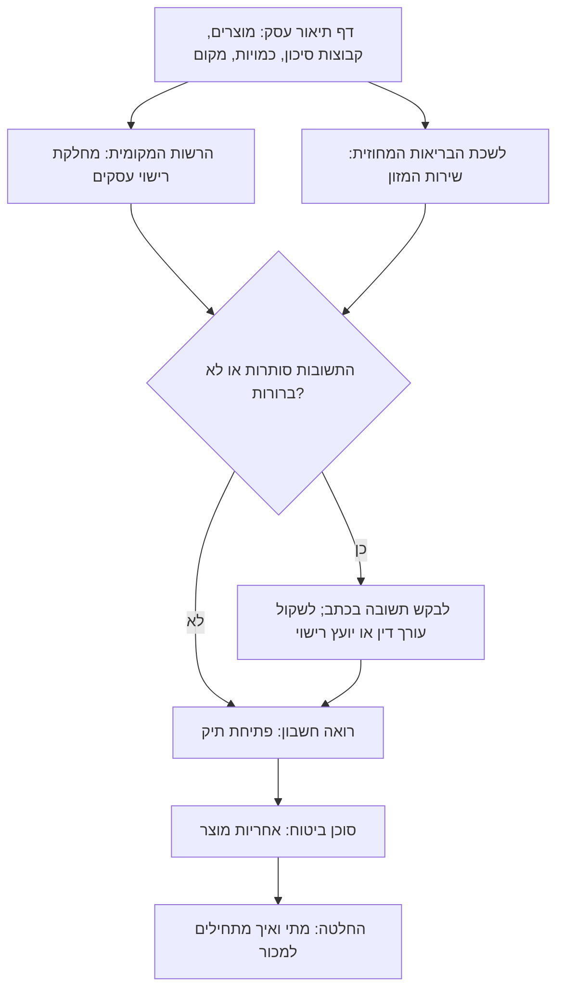

# 16.5 · רישוי העסק: מה לשאול ואת מי

השיעור הזה לא אומר לכם איזה רישיון אתם צריכים. הוא לא יכול: התשובה תלויה במקום, בהיקף, במוצרים ובהחלטות של רשויות שמתעדכנות. מה שהוא כן נותן: מפה של מי אחראי על מה, מה ידוע מהחוק ומה לא אומת, ורשימת שאלות מוכנה לארבעה גורמים. בסוף השיעור יש לכם דף תיאור עסק, שאלות כתובות, ויומן פניות שמתחיל להתמלא. זה מידע כללי, נכון ל־10.11.2026, ולא ייעוץ משפטי.

## מה צריך

| פריט | כמות לתרגול | כמות מלאה | הערה |
|---|---|---|---|
| דף המיון ודף הסכנות מ־[16.1](lesson-01.md) | 1 | | המוצרים וקבוצות הסיכון |
| מפת האחסון מ־[16.3](lesson-03.md) | 1 | | איפה מייצרים ומאחסנים |
| המודל העסקי מ־[15.1](../module-15/lesson-01.md) | 1 | | אונליין, יריד, חברות |
| טלפון, מייל, ומחברת או קובץ ליומן הפניות | 1 | | |
| [תוכנית עסקית קצרה](../../templates/business-plan.md) | 1 | | אם כבר התחלתם אותה |

**אלרגנים:** אין מתכון בשיעור. בדף תיאור העסק כותבים אילו אלרגנים יש במטבח (ממטריצת [16.2](lesson-02.md)), כי זו שאלה שלשכת הבריאות עשויה לשאול.

## למה זה עובד

### שני רישיונות, שתי רשויות

יש שני מסלולים נפרדים, לפי שני חוקים שונים. נבדקו בנוסח שבוויקיטקסט ב־10.11.2026; אתרי gov.il לא נפתחו (חסומים לגישה אוטומטית).

| | רישיון ייצור | רישיון עסק |
|---|---|---|
| חוק | חוק המזון, התשע"ו-2015 | חוק רישוי עסקים, התשכ"ח-1968 |
| מה כתוב | "לא ייצר אדם מזון, אלא אם כן יש בידיו רישיון ייצור תקף לאתר ייצור המזון" (סעיף 21) | "לא יעסוק אדם בעסק טעון רישוי אלא אם יש בידו רישיון", היתר זמני או היתר מזורז (סעיף 4) |
| מי נותן | בקשה ללשכת הבריאות המחוזית (סעיף 28) | ראש הרשות המקומית או מי שהסמיך (סעיף 5); משרד הבריאות ואחרים הם "נותני אישור" (סעיף 6) |
| מה ידוע עוד | ניתן בדרך כלל לשנתיים, חידוש לשלוש עד חמש שנים (31); שינוי במסמכים מדווחים תוך 14 ימי עבודה (33); מזון בתוספת 11 צריך אישור ייצור נאות, ולשאר אפשר התחייבות לתוכנית בטיחות מזון בבקרה עצמית (41) | בצו רישוי עסקים, קבוצה 4 (מזון): פריטים 4.6א ו־4.6ו, ייצור, עיבוד ואריזה של מזון, לפי כושר ייצור ביום; מסלול תצהיר למבנה עד 500 מ"ר, תוקף 10 שנים. בצו אין פריט שמזכיר שוקולד בשמו |

לא בדקנו אם שוקולד מופיע בתוספת 11. גם לא בדקנו איזה פריט בצו חל על כמויות קטנות מאוד: הספים בצו נמדדים בטונות ליום. אלה בדיוק שאלות לרשויות.

### ייצור ביתי: מה ידוע, ומה לא

- **החוק**: ההגדרה של ייצור בחוק המזון חלה "בין אם נעשית למטרות מכירה ובין אם לאו", ולא נמצא בו פטור לייצור ביתי. גם בצו רישוי עסקים לא נמצא פטור לעסק ביתי.
- **משרד הבריאות, 2021**: לפי כיפה (31.1.2021), המשרד מסר ש"הכנת מזון בבית מגורים ומכירתו לצרכנים אינה מוסדרת בחוק", שאין לו אפשרות לפקח בבית מגורים, ושהאכיפה על עסק שפועל בלי רישיון היא באחריות הרשות המקומית. לא נמצא מסלול רשמי לייצור ביתי למכירה.
- **רפורמה מ־2022**: לפי mako (1.5.2022), שרת הפנים הודיעה שכ־1,000 יצרני מזון קטנים, בהם יצרני שוקולד, יצטרכו רק רישיון יצרן ממשרד הבריאות, בלי רישיון עסק. הכתבה תיארה אותה כממתינה לחתימה. **לא אומת אם נחתמה ובאיזה נוסח.**

המסקנה היחידה שאפשר להסיק בלי עורך דין: "כולם מוכרים מהבית" זו לא תשובה. התשובה לעסק שלכם מגיעה מהרשויות, בכתב.

### למה גם רואה חשבון וסוכן ביטוח

- **מס**: עסק נפתח גם ברשויות המס. לפי כל זכות (עודכן 17.8.2026), תקרת המחזור השנתי לעוסק פטור ב־2026 היא 122,833 ₪, והיא נמדדת במחזור, לא ברווח. איזה סוג תיק מתאים לכם, ומה עוד צריך, שואלים רואה חשבון. תמחור ומחיר כולל מע"מ: [מודול 19](../module-19/lesson-01.md).
- **אחריות**: לפי חוק האחריות למוצרים פגומים, התש"ם-1980, "יצרן חייב לפצות את מי שנגרם לו נזק גוף כתוצאה מפגם במוצר שייצר" (סעיף 2), גם בלי אשמה. "יצרן" בחוק הוא מי שעוסק בייצור "למטרות מסחריות". לכן שואלים סוכן ביטוח על ביטוח אחריות מוצר, ומה הוא דורש (רישיונות, תוכנית בטיחות, רשומות).

### סדר הפניות

הסדר הוא שיקול שלנו: לרשות המקומית וללשכת הבריאות פונים במקביל, כי כל אחת עשויה לשאול על השנייה; לרואה החשבון ולביטוח פונים כשיודעים איפה ואיך העסק יפעל. כשרות (אם רוצים): [מודול 17](../module-17/lesson-01.md).

## שלב אחר שלב

> [!CAUTION]
> מה שעונים לכם בטלפון הוא לא אישור. רושמים את שם הפקיד ואת התאריך, ומבקשים כל תשובה שאתם מתכננים לסמוך עליה בכתב (מייל או מכתב). אל תתחילו למכור על סמך "אמרו לי".

**חלק א: דף תיאור עסק (15 דקות)**

1. **עמוד אחד**: מה מייצרים (מוצרים וקבוצות סיכון מ־[16.1](lesson-01.md)); כמה בשבוע ובעונה (מ־[15.1](../module-15/lesson-01.md), והשאלות הפתוחות מ[פרויקט מודול 15](../../projects/m15-market-research.md)); איפה מייצרים ומאחסנים (דירה, מטבח שכור, מטבח של אחר); איך מוכרים (אונליין, ירידים, חנויות, חברות); אם משלחים מוצרים מקבוצה ג; אילו אלרגנים יש במטבח.
2. **מצרפים** את מה שכבר כתבתם: דף הסכנות, מפת האחסון, דף אצווה לדוגמה. זה מראה שאתם רציניים, וזה גם מה שישאלו.

**חלק ב: שאלות לכל גורם (20 דקות)**

3. **לשכת הבריאות המחוזית (שירות המזון)**: האם הפעילות שתיארתי דורשת רישיון ייצור? מה התנאים לאתר הייצור? האם אפשר במטבח בבית, ואם לא, מה כן (מטבח שכור, מטבח משותף)? האם השוקולד שלי ברשימת המזונות שדורשים אישור ייצור נאות, או שמספיקה תוכנית בטיחות מזון בבקרה עצמית? האם מוצרים עם שמנת הם מזון "הטעון הובלה בטמפרטורה מבוקרת", ומה זה אומר על משלוח ([16.3](lesson-03.md))? איזה סימון חל עליי היום, ומה ישתנה ב־2028 ([16.4](lesson-04.md))? מה עושים בריקול ואיך מתאמים?
4. **הרשות המקומית, מחלקת רישוי עסקים**: האם העסק טעון רישוי, ובאיזה פריט בצו? האם יש מסלול תצהיר? האם הפעילות בדירת מגורים דורשת היתר לשימוש חורג או אישור אחר? האם הרפורמה של 2022 ליצרני מזון קטנים חלה, ובאיזה נוסח? מה צריך כדי למכור ביריד או בדוכן בעיר?
5. **רואה חשבון**: איזה תיק לפתוח (עוסק פטור או מורשה), ומתי לעבור? מה מוציאים ללקוח (קבלה, חשבונית)? מה צריך לרשום לגבי הוצאות חומרי גלם ואריזה? האם מכירה לחברות משנה משהו?
6. **סוכן ביטוח**: האם יש ביטוח אחריות מוצר לעסק קטן כמו שלי? מה הוא דורש (רישיונות, תוכנית, רשומות)? האם הוא מכסה תגובה אלרגית? האם ביטוח הדירה מכסה פעילות עסקית בבית?

**חלק ג: יומן פניות (10 דקות, ואז לאורך זמן)**

7. **פותחים** טבלה: תאריך; גורם; איך פניתם (טלפון, מייל, פגישה); שם ותפקיד; מספר פנייה; השאלה; התשובה במילים שלהם; בכתב (כן / לא); מה פתוח.
8. **פונים** לפחות לגורם אחד השבוע, ורושמים.
9. **מסמנים** כל תשובה שסותרת תשובה אחרת, או שנאמרה רק בעל פה: לגביהן חוזרים ומבקשים בכתב.

## בדיקה: איך יודעים שהצליח

- **דף תיאור**: עמוד אחד שמישהו שלא מכיר אתכם מבין ממנו מה תייצרו, כמה, איפה ואיך תמכרו.
- **שאלות**: לכל אחד מארבעת הגורמים לפחות ארבע שאלות, כתובות כך שאפשר לענות עליהן "כן", "לא" או במספר.
- **יומן**: לפחות פנייה אחת רשומה, עם תאריך, שם ומה פתוח.
- **כנות**: בתוכנית שלכם לא כתוב "מותר" או "אין צורך" בלי מקור בכתב לידו.

## כשזה משתבש

| מה רואים | למה זה קורה | מה עושים עכשיו | איך מונעים בפעם הבאה |
|---|---|---|---|
| בלשכת הבריאות הפנו לעירייה, ובעירייה ללשכת הבריאות | שני מסלולים נפרדים, וכל אחד רואה רק את שלו | שולחים לשניהם את אותו דף תיאור במייל, ומבקשים תשובה בכתב | פונים לשניהם במקביל מההתחלה |
| אמרו בטלפון "מהבית זה בסדר" | תשובה כללית, בלי לראות את הפעילות | רושמים ומבקשים בכתב; עד אז זה לא אישור | שואלים שאלות סגורות, עם דף התיאור |
| חברה שמוכרת מהבית אומרת שלא צריך כלום | ניסיון אישי, לא תשובה רשמית | לא מסתמכים; שואלים את הרשות שלכם | המקור לתשובה הוא הרשות, לא קבוצת פייסבוק |
| התשובות מסובכות ולא ברורות | רישוי הוא תחום מקצועי | פונים לעורך דין או ליועץ רישוי עסקים | מתקצבים ייעוץ בתוכנית העסקית |
| סוכן הביטוח מבקש רישיונות שאין לכם | ביטוח נשען על פעילות מוסדרת | רושמים מה דרוש, וחוזרים אליו כשיש | שואלים אותו מוקדם, לפני שמשקיעים בציוד |

### מה עושים עם מה שלא הצליח

שום עבודה כאן לא הולכת לפח. דף תיאור שהרשות ביקשה לשנות הופך לגרסה 2. תשובה שלילית ("לא מהבית") היא מידע: היא מפנה למטבח שכור, למטבח משותף או לייצור אצל יצרן מורשה, והתוכנית שבניתם במודול עוברת איתכם לשם. בינתיים ממשיכים לתרגל ולהכין מתנות למשפחה, שם אין מכירה.

## חלופות

### טבעוני / פרווה

קו טבעוני לא משנה את הרישוי עצמו: אותו מזון, אותו חוק. מה שכן כדאי לשאול את לשכת הבריאות: איך מסמנים "טבעוני" לצד "עלול להכיל חלב", ואם הם מצפים להפרדה כתובה בין הקווים ([16.2](lesson-02.md)).

### בריא יותר

קו "פחות סוכר" עם ממתיקים מעלה שאלות סימון ספציפיות (פוליאולים, אזהרות): מוסיפים אותן לרשימת השאלות ללשכת הבריאות ([13.5](../module-13/lesson-05.md)). מלטיטול: גזים ושלשול בכמות, לא לילדים בכמות; שואלים איזה נוסח אזהרה חל היום.

### כשרות

תעודת כשרות היא מסלול שלישי, נפרד מרישיון הייצור ומרישיון העסק: לפי חוק איסור הונאה בכשרות, את התעודה לאתר ייצור נותן הרב המקומי או מועצת הרבנות הראשית. מה לשאול, כמה עולה, ומה מותר לכתוב בלי תעודה: [מודול 17](../module-17/lesson-01.md). לחומרי הגלם: [שלושה כללים](../../references/kashrut-guide.md#שלושה-כללים). אם יש ספק, שואלים את הרב.

## איפה קונים

בשיעור הזה לא קונים. המקורות הרשמיים לפני שפונים: חוק המזון, חוק רישוי עסקים וצו רישוי עסקים, וחוק האחריות למוצרים פגומים, בנוסח שבוויקיטקסט; תגובת משרד הבריאות מ־2021 והרפורמה מ־2022 בעיתונות (כולם ברשימת המקורות של השיעור). את הנוסח העדכני ואת הטפסים מקבלים מלשכת הבריאות המחוזית ומאתר הרשות המקומית שלכם.

## תרגול

### משימה

דף תיאור עסק, רשימת שאלות לארבעת הגורמים, ויומן פניות עם פנייה אחת לפחות. זה חלק 5, האחרון, של [פרויקט המודול: תוכנית בטיחות מזון לעסק שוקולד קטן](../../projects/m16-food-safety-plan.md). עכשיו מאחדים את חמשת החלקים למסמך אחד לפי הפרויקט.

### זמן

15 דקות לדף התיאור, 20 לשאלות, 10 לפתיחת היומן, ועוד 15 לפנייה הראשונה. התשובות יגיעו בימים ובשבועות הבאים.

### יומן

ב[יומן התרגול](../../templates/practice-log.md): למי פניתם, מה הופתעתם לשמוע, ומה עוד פתוח. את יומן הפניות שומרים יחד עם התוכנית.

דוגמה פתורה: דף תיאור עסק ושורה ביומן

**דף תיאור עסק (עמוד אחד)**

- **מה**: טבלאות ו־bark (קבוצה א), בונבוני פרלינה (קבוצה ב), טראפלס שמנת לפי הזמנה (קבוצה ג).
- **כמה**: כ־40 מארזים בחודש; בחנוכה ובפורים עד 150 בחודש.
- **איפה**: מטבח בדירה, רמת גן; מדף נפרד במקרר, ארון ממוזג לשוקולד.
- **איך מוכרים**: אינסטגרם והזמנות בווטסאפ; איסוף עצמי ומשלוח בשליח בתוך גוש דן; שני ירידים בשנה.
- **משלוח קבוצה ג**: רק מסירה ביד, עד שעתיים מיציאה.
- **אלרגנים במטבח**: חלב, סויה, אגוזים (פיסטוק, לוז), בוטנים, שומשום.
- **מצורף**: דף סכנות לטראפלס, מפת אחסון, דף אצווה לדוגמה.

**יומן פניות (מבנה, שורה לדוגמה)**

| תאריך | גורם | איך | שם ותפקיד | מספר פנייה | שאלה | תשובה | בכתב | פתוח |
|---|---|---|---|---|---|---|---|---|
| 12.11 | לשכת הבריאות המחוזית, שירות המזון | מייל עם דף התיאור | [שם, תפקיד] | [מספר] | האם הפעילות דורשת רישיון ייצור, ומה התנאים לאתר? | [התשובה במילים שלהם] | ממתין | לשאול גם על הובלת טראפלס |

שימו לב: השורה לא ממלאת תשובה, כי את התשובה נותנת הרשות שלכם, לא הקורס.

### בדיקה עצמית

- [ ] יש דף תיאור עסק של עמוד אחד, עם מוצרים, כמויות, מקום, דרכי מכירה ואלרגנים.
- [ ] לכל אחד מארבעת הגורמים יש לפחות ארבע שאלות סגורות.
- [ ] פניתי לגורם אחד לפחות, ורשמתי תאריך, שם ומה פתוח.
- [ ] אין בתוכנית שלי "מותר" או "לא צריך" בלי תשובה בכתב.
- [ ] איחדתי את חמשת החלקים של המודול לפי הפרויקט.

## סיכום

- רישיון ייצור (לשכת הבריאות, חוק המזון) ורישיון עסק (הרשות המקומית, חוק רישוי עסקים) הם שני מסלולים נפרדים.
- לא נמצא בחוק פטור לייצור ביתי; ב־2021 משרד הבריאות אמר שמכירת מזון מבית מגורים "אינה מוסדרת בחוק"; רפורמת 2022 לא אומתה.
- ארבעה גורמים לשאול: לשכת הבריאות, הרשות המקומית, רואה חשבון וסוכן ביטוח. כשרות היא מסלול שלישי ([מודול 17](../module-17/lesson-01.md)).
- כל תשובה נרשמת עם תאריך ושם, ומה שסומכים עליו מבקשים בכתב.
- תוכנית בטיחות המזון שבניתם במודול היא מה שמביאים לכל פגישה, בכל מסלול שתבחרו.
