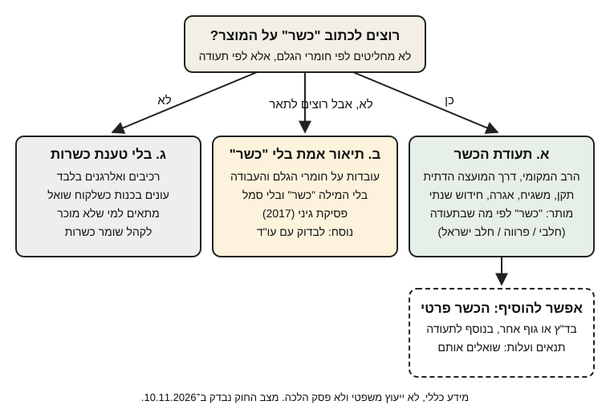

# 17.1 · רבנות מקומית מול הכשר פרטי

לקוחה שומרת כשרות לא שואלת "מאיזה שוקולד הכנת?", אלא "מי ההשגחה?". בשיעור הזה מבינים מי נותן תעודת הכשר לאתר ייצור בישראל, מה מקבלים ממנה ומה עולה, ומה מקומו של הכשר פרטי. בסופו בוחרים אחת משלוש דרכים לעסק שלכם ושולחים רשימת שאלות למועצה הדתית. הקורס לא פוסק הלכה, וזה מידע כללי ולא ייעוץ משפטי.

## מה צריך

### לפני שמתחילים את המודול

מודול 17 הוא מודול של החלטות ומסמכים, לא של מטבח. קריאה של השיעורים היא לא החלטה: ההחלטה נעשית כשממלאים את המסמכים ושואלים את הגורמים האמיתיים בעיר שלכם. האקדמיה לא בודקת את המסמכים שלכם; משווים אותם לרשימות הבדיקה שבכל שיעור, ורושמים ב[יומן התרגול](../../templates/practice-log.md) למי פניתם, מתי, ומה ענו.

| פריט | כמות לתרגול | כמות מלאה | הערה |
|---|---|---|---|
| [תוכנית עסקית קצרה](../../templates/business-plan.md), סעיף 3 | שורת הכשרות | כל הסעיף | "כשרות: יש / אין / בתהליך" |
| סעיף 1 של התוכנית מ־[15.3](../module-15/lesson-03.md) | 1 | | הנישה שבחרתם |
| רשימת המוצרים שלכם | 3 מוצרים | כל הקטלוג | עם חלבי / פרווה לפי המתכון |
| טלפון או מייל של המועצה הדתית בעיר | 1 | | מחלקת כשרות |
| שם של גוף כשרות פרטי אחד, אם רלוונטי | 1 | | לפי הלקוחות שלכם |
| [מדריך הכשרות](../../references/kashrut-guide.md) | 1 | | מונחים |

**אלרגנים:** לא מכינים אוכל, אבל תעודת הכשר אינה הצהרת אלרגנים. המוצרים שלכם עדיין מכילים **חלב**, **סויה** (לציטין), ולפעמים **אגוזים**, **בוטנים**, **שומשום** ו**גלוטן**, והם נשארים על התווית עם תעודה ובלי ([14.3](../module-14/lesson-03.md)).

## למה זה עובד

### מה אומר החוק

כל המידע בסעיף הזה לקוח מנוסח חוק איסור הונאה בכשרות, התשמ"ג-1983, כפי שמופיע בוויקיטקסט (הגרסה נערכה לאחרונה ב־31.7.2026, ונבדקה ב־10.11.2026). ויקיטקסט הוא העתק של נוסח החוק, לא האתר הרשמי.

- **מי נותן תעודה לאתר ייצור:** הרב המקומי של המקום, או מועצת הרבנות הראשית (סעיף 2).
- **מה אסור בלי תעודה:** יצרן לא יציין על מוצר שייצר או על אריזתו שהוא כשר, ולא יציג אותו ככשר בפרסום, בלי תעודת הכשר (סעיף 4). מי שיש לו תעודה למוצר אחד, לא יציג ככשר מוצר אחר שאין לו תעודה. העונש על עבירה: עד שנת מאסר (סעיף 14). על זה בהרחבה ב־[17.4](lesson-04.md).
- **על מה הרב מסתכל:** "בדיני כשרות בלבד" (סעיף 11). לא על הרישוי, הניקיון או המחיר.
- **תוקף:** תעודה ניתנת לכל היותר לשנה עברית אחת, ואפשר לקבוע שאינה תקפה לפסח (סעיף 2ח). כלומר, כשר לפסח הוא שאלה נפרדת ([10.4](../module-10/lesson-04.md)).
- **מה כתוב בתעודה:** בין השאר התקן, התוקף, שם העסק וכתובתו, שם הרב ופרטי המשגיח (סעיף 2ח).
- **הצגה:** בעל תעודה מציג אותה במקום גלוי, ורק כל עוד היא בתוקף (סעיף 10).
- **ביטול:** רב יכול לבטל או להשעות תעודה, למשל על הפרה; העסק יכול להגיב תוך 14 ימי עבודה (סעיף 2ט).

### רשות כשרות מקומית, תקן ומשגיח

בנוסח שבוויקיטקסט, "רשות כשרות מקומית" היא מועצה דתית, או עירייה או מועצה מקומית שאין בה מועצה דתית (סעיף 1). היא נותנת שירותי השגחה לעסק שמבקש (סעיף 2י). מועצת הרבנות הראשית קובעת "תקני כשרות", שמכסים בין השאר קבלת חומרי גלם, ייצור ונוכחות משגיח. שעות ההשגחה נקבעות בתקן לפי הפעילות של העסק, ויש תקן רגיל ותקן עם תוספות מחמירות (סעיף 2א). המשגיח הוא מי שנותן שירותי השגחה מטעם רשות הכשרות המקומית (סעיף 1), וצריך תעודת משגיח מהרבנות הראשית אחרי מבחן (סעיפים 2יב, 2יב1).

**חשוב: לא כל מה שכתוב בנוסח הזה כבר בתוקף.** רפורמת הכשרות עברה בנובמבר 2021, אבל לפי המכון הישראלי לדמוקרטיה (דו-שנתון 2024), רובה עוד לא נכנסה לתוקף ונדחתה שוב ושוב. בנוסח שבוויקיטקסט יש גם תיקון מתשפ"ו, הוראת שעה בסעיף 2ז לתקופה 19.7.2026 עד 18.7.2028, וכללים על שכר המשגיח שחלים מ־19.7.2028 (סעיף 2יד). לא אימתנו אילו חלקים חלים היום. לכן כל פרט מעשי (איזה תקן, כמה שעות, מי מעסיק את המשגיח) הוא שאלה למועצה הדתית שלכם, לא מסקנה מהשיעור.

### כמה זה עולה: מה ידוע ומה לא

מה שמצאנו במקור שנפתח (המכון הישראלי לדמוקרטיה, דו-שנתון 2024):

| מה | מה כתוב | שנה |
|---|---|---|
| אגרה שנתית | נקבעת בתקנות, אחידה בין המועצות הדתיות | 2024 (תיאור) |
| שכר משגיח | משולם בנפרד מהאגרה, והתעריף משתנה בין מועצות | 2024 (תיאור) |
| ממוצע לשעת השגחה | 49 ₪, במדגם של 81 מועצות | 2019 |
| עסקים בהשגחת המועצות הדתיות | 14,423 | 2022 |

לפי החוק, מועצה דתית גובה אגרה לפי חוק שירותי הדת היהודיים, ורשות מקומית שאינה מועצה דתית גובה אגרה שקבע השר (סעיף 2יד).

**מה לא ידוע:** סכום האגרה לשנת 2026 לא אומת (הודעת האגרות נמצאה רק בתקציר חיפוש ולא נקראה), וגם לא מספר השעות שמועצה תדרוש ממטבח שוקולד קטן. 49 ₪ לשעה הוא ממוצע מ־2019, לא מחיר. החשבון האמיתי: אגרה שנתית + (שעות השגחה בחודש × תעריף) + עלות התאמות, אם יידרשו. את המספרים מקבלים רק מהמועצה, בכתב.

### הכשר פרטי (בד"ץ) ופיקוח פרטי

**בד"ץ** (בית דין צדק) הוא גוף כשרות פרטי שקובע סטנדרט משלו ([מונחים](../../references/kashrut-guide.md#מונחים)). על חומרי הגלם שתקנו כבר ראיתם את זה: Callebaut מריר 55.6% בשקית 500 גרם נמכר "בהשגחת בד"ץ העדה החרדית ירושלים, בהשגחת OK, באישור הרבנות הראשית לישראל" ([קוברטורה מרירה](../../references/kashrut-guide.md#קוברטורה-מרירה), נבדק 2026-11-10). כלומר, על אריזות בישראל ההכשר הפרטי מופיע לרוב **לצד** אישור הרבנות.

**פיקוח פרטי בלי תעודת רבנות** הוא מסלול אחר. ב־2018 הוקם "צהר פיקוח מזון", שהתאחד עם "השגחה פרטית", ובספטמבר 2024 פיקח על 334 עסקים (המכון הישראלי לדמוקרטיה). מה מותר לעסק כזה לכתוב:

- **פסיקת גיני (דנג"ץ 5026/16, 2017):** עסק בלי תעודה של הרבנות לא יציג מצג של כשרות, אבל מותר לו להציג "מצג אמת" על הסטנדרטים שהוא מקפיד עליהם ועל אופן הפיקוח, בלי המילה "כשר" (לפי המכון הישראלי לדמוקרטיה; התאריך 12.9.2017 לפי ג'רוזלם פוסט).
- **חוות דעת היועץ המשפטי לממשלה (לפי כיפה, 12.7.2018):** בעל בית אוכל יכול לציין בעצמו שהוא נתון לפיקוח של גורם חיצוני, וחייב לציין שאינו מפוקח על ידי הרבנות הראשית. אסור לו להציג בעסק אישור, תעודה או לוגו של גוף הכשרות.

שתי ההחלטות עוסקות בבתי אוכל. איך הן חלות על מוצר ארוז של יצרן (סעיף 4) לא בדקנו, ויש מחלוקת אם מותר בכלל לציין את שם הגוף הפרטי ([מקורות, סעיף 5](../../curriculum/research/sources.md#5-כשרות)). לכן נוסח כזה בודקים עם עורך דין לפני הדפסה.

### שלוש דרכים לעסק קטן

1. **א. תעודת הכשר.** מאפשרת לכתוב "כשר" לפי הסטטוס שבתעודה, ופותחת את קהל שומרי הכשרות, חברות ומוסדות. דורשת משגיח, אגרה וחידוש שנתי. מי שמכוון ל[נישת מהדרין מ־15.3](../module-15/lesson-03.md#כשר-למהדרין) שואל גם על תקן מחמיר ועל הכשר פרטי בנוסף.
2. **ב. תיאור אמת בלי "כשר".** עובדות על חומרי הגלם ועל העבודה, בלי המילה ובלי סמל. מתאים ללקוח שסומך עליכם אישית, לא ללקוח שמחפש תעודה. הנוסח בשיעור [17.4](lesson-04.md).
3. **ג. בלי טענת כשרות.** רכיבים ואלרגנים בלבד, ותשובה כנה כששואלים. לגיטימי לגמרי לעסק שלא מכוון לקהל שומר כשרות.

## שלב אחר שלב

> [!WARNING]
> עד שיש בידכם תעודה בתוקף, לא כותבים "כשר", לא מציגים סמל כשרות, ולא מעתיקים את סמל ההכשר של הספק לאריזה שלכם (סעיף 4). גם "בתהליך קבלת כשרות" על האריזה הוא סיכון: בודקים נוסח כזה עם עורך דין.

1. **מי הלקוח.** מתוך סעיף 1 של התוכנית העסקית: האם הלקוחות שלכם שומרים כשרות, ואיזו. לפי המכון הישראלי לדמוקרטיה (2024), 68% מהיהודים בישראל שומרים כשרות במידה כלשהי ו־45% תמיד.
2. **איפה המטבח.** כתובת אתר הייצור קובעת את רשות הכשרות המקומית. מוצאים את המועצה הדתית של העיר או המועצה האזורית.
3. **בוחרים דרך זמנית.** א, ב או ג, לפי התרשים. זו טיוטה, עד שיש תשובות.
4. **מכינים שאלות למועצה הדתית.** בתרגול יש רשימה מוכנה; מוסיפים שאלות לפי המוצרים שלכם.
5. **אם הקהל שלכם מחפש בד"ץ מסוים**, מכינים אותה רשימה גם לגוף הזה, ומוסיפים: "האם אתם נותנים הכשר לעסק בלי תעודת רבנות, או רק בנוסף לה?".
6. **שולחים בכתב** (מייל או טופס), ורושמים תאריך. תשובה בטלפון מסכמים במייל חוזר.
7. **מחשבים** את העלות השנתית לפי התשובות: אגרה + שעות × תעריף + התאמות. מכניסים לגיליון התמחור כעלות קבועה (מודול 19).
8. **מעדכנים** את סעיף 3 בתוכנית העסקית: "כשרות: יש / אין / בתהליך", עם הדרך שנבחרה ותאריך בדיקה הבא.

## בדיקה: איך יודעים שהצליח

- [ ] כתוב בסעיף 3 מי רשות הכשרות המקומית של אתר הייצור שלכם, עם פרטי קשר.
- [ ] נבחרה דרך (א, ב או ג) עם נימוק של משפט אחד מתוך הלקוח שלכם.
- [ ] רשימת שאלות של 8 שאלות לפחות נשלחה בכתב, עם תאריך.
- [ ] כל מספר כספי במסמך מסומן "לפי המועצה, תאריך" או "לא ידוע עדיין". אין מספר מנוחש.
- [ ] אין על שום אריזה, דף או פוסט "כשר" או סמל כשרות בלי תעודה בתוקף.

## כשזה משתבש

| מה רואים | למה זה קורה | מה עושים עכשיו | איך מונעים בפעם הבאה |
|---|---|---|---|
| המועצה לא עונה שבועיים | עומס, או כתובת לא נכונה | מתקשרים למחלקת הכשרות ושולחים שוב | שומרים שם איש קשר |
| קיבלתם תעריף בטלפון ואין לו אישור | תשובה בעל פה | שולחים מייל: "לפי שיחתנו מ־... הבנתי ש..." | כל מספר נכנס לתוכנית רק עם מקור בכתב |
| כתבתם "כשר" באתר כי כל חומרי הגלם בהכשר | בלבול בין הכשר של רכיב להכשר של מוצר | מוחקים מיד מכל מקום, כולל פוסטים ישנים | בודקים כל טקסט מול 17.4 לפני פרסום |
| העלות השנתית גבוהה מהרווח הצפוי | מחזור קטן מול עלות קבועה | דרך ב או ג לשנה הראשונה, ויעד מכירות לחזור לשאלה | מחשבים לפני שמבטיחים ללקוחות |
| לקוחה אומרת "אני אוכלת רק בד"ץ X" | ההכשר שבחרתם לא מתאים לה | עונים בכנות מה יש לכם ומה אין | בודקים את הקהל לפני שבוחרים גוף |

### מה עושים עם מה שלא הצליח

שום דבר לא הולך לפח. אריזה שהודפסה עם נוסח אסור מכוסה במדבקה חדשה. מוצרים שהוכנו בזמן הבירור נמכרים עם התווית הנכונה (דרך ב או ג), או נמסים מחדש לטבלה, לשוקו או לרוטב. תשובה שלילית מגוף כשרות היא מידע: רושמים ומתכננים מחדש.

## חלופות

### טבעוני / פרווה

קו טבעוני לא פוטר משאלת הכשרות: טבעוני ששומר כשרות מחפש גם הכשר פרווה ([12.1](../module-12/lesson-01.md)). אם יש חלבי ופרווה באותו מטבח, שואלים את המועצה מה נדרש כדי לסמן פרווה ([17.3](lesson-03.md)).

### בריא יותר

קו פחות סוכר לא משנה את התהליך, אבל כל ממתיק צריך הכשר שהגוף המכשיר מקבל, ולרבים מהם בדפי החנויות לא צוין הכשר ([ממתיקים](../../references/kashrut-guide.md#ממתיקים)). זו עוד שורה ברשימת הספקים של 17.2.

### כשרות

השיעור כולו עוסק בכשרות לעסק. מה שאינו בו: הכרעה הלכתית. הקורס לא פוסק הלכה. שאלה על מנהג, על חומרה או על מוצר מסוים שואלים את הרב ואת הגוף המכשיר.

## איפה קונים

בשיעור הזה לא קונים. מקורות רשמיים ומשניים, מידע כללי בלבד: [נוסח חוק איסור הונאה בכשרות](https://he.wikisource.org/wiki/חוק_איסור_הונאה_בכשרות) (ויקיטקסט, נבדק 2026-11-10), [מקורות, סעיף 5: כשרות](../../curriculum/research/sources.md#5-כשרות), ו[המכון הישראלי לדמוקרטיה, פרק הכשרות](https://www.idi.org.il/religion-and-state/2024/?chapter=58140). למונחים: [מדריך הכשרות](../../references/kashrut-guide.md#מונחים).

## תרגול

### משימה

ממלאים את שורת הכשרות בסעיף 3 של [התוכנית העסקית](../../templates/business-plan.md), ושולחים למועצה הדתית רשימת שאלות. בסיס לרשימה:

1. האם אתם נותנים תעודת הכשר למטבח ייצור קטן בבית או במטבח שכור? מה התנאים?
2. איזה תקן מתאים לייצור שוקולד ופרלינים, ויש תקן מחמיר (מהדרין)?
3. כמה שעות השגחה בחודש תדרשו בהיקף של כ־X ק"ג בחודש? משגיח קבוע או ביקורים?
4. מה האגרה השנתית, ומה התעריף לשעת השגחה בשנת 2026? מי משלם למשגיח ואיך?
5. אילו הכשרים של חומרי גלם אתם מקבלים? יש רשימה כתובה?
6. מה נדרש כדי שמוצר יסומן פרווה כשבאותו מטבח מכינים גם גנאש עם שמנת?
7. האם התעודה כוללת פסח? מה נדרש לייצור כשר לפסח?
8. כמה זמן לוקח התהליך מהפנייה ועד תעודה? אילו מסמכים צריך (רישיון, תוכנית מטבח)?
9. איך נראה הסימון על התווית (נוסח, סמל), ומי מאשר אותו?

דוגמה פתורה

**הלומדת מ־15.3:** מארזי חג טבעוניים, לקוחות פרטיים במרכז, ומטבח שכור במודיעין. היא שואלת אם להוסיף בעתיד מארזים לחברות.

**סעיף 3, שורת הכשרות (טיוטה, 10.11.2026):**

| שאלה | תשובה |
|---|---|
| רשות כשרות מקומית | המועצה הדתית של העיר שבה המטבח השכור (פרטי קשר במסמך) |
| הדרך שנבחרה | ג לשנה הראשונה, עם בדיקה של א לקראת ראש השנה |
| למה | הלקוחות הפרטיים שלה מהמחקר לא שאלו על הכשר; חברות כן ישאלו |
| עלות שנתית | לא ידוע עדיין. ממוצע ציבורי: 49 ₪ לשעת השגחה (מדגם 2019, לא מחיר) |
| נשלח | מייל עם 9 שאלות, 10.11.2026; תזכורת ב־24.11 |
| מה כתוב על המארז היום | רכיבים, אלרגנים, "עלול להכיל". בלי "כשר" ובלי סמל |

**כשיגיעו מספרים:** אגרה + 4 שעות בחודש × 12 × התעריף. אם הסכום גבוה מהרווח של 40 מארזים, היא נשארת בדרך ג לשנה.

### זמן

כשעה: 15 דקות להחלטה על הדרך, 20 דקות לרשימת השאלות ולשליחה, 25 דקות למילוי סעיף 3 ולחישוב שיחכה למספרים.

### יומן

ב[יומן התרגול](../../templates/practice-log.md) רושמים למי פניתם, בתאריך, באיזה ערוץ, ומה ענו. כל תשובה עם תאריך.

### בדיקה עצמית

- [ ] רשות הכשרות המקומית מזוהה, עם פרטי קשר.
- [ ] נבחרה דרך זמנית, עם נימוק מהלקוח.
- [ ] 8 שאלות לפחות נשלחו בכתב.
- [ ] אין מספר כספי בלי מקור ותאריך.
- [ ] שום מקום לא כתוב "כשר" בלי תעודה.

## סיכום

- את תעודת ההכשר לאתר ייצור נותן הרב המקומי או מועצת הרבנות הראשית, לכל היותר לשנה עברית, ובלעדיה יצרן לא כותב "כשר" (סעיפים 2, 2ח, 4).
- תקן, שעות השגחה ועלות נקבעים מול רשות הכשרות המקומית. הנתון הציבורי היחיד שמצאנו הוא ממוצע של 49 ₪ לשעה (2019); את השאר שואלים בכתב.
- הכשר פרטי מופיע בדרך כלל בנוסף לרבנות. פיקוח פרטי בלי תעודה מאפשר לכל היותר תיאור אמת, בלי "כשר" ובלי סמל.
- רפורמת 2021 ותיקונים מאוחרים יותר לא כולם בתוקף: מה שקובע הוא מה שהמועצה הדתית אומרת היום.
- הפרויקט של המודול: [תוכנית כשרות לעסק](../../projects/m17-kashrut-plan.md), מסמך אחד עם הדרך שבחרתם, הספקים, נוסחי התווית ומה לא כותבים.
