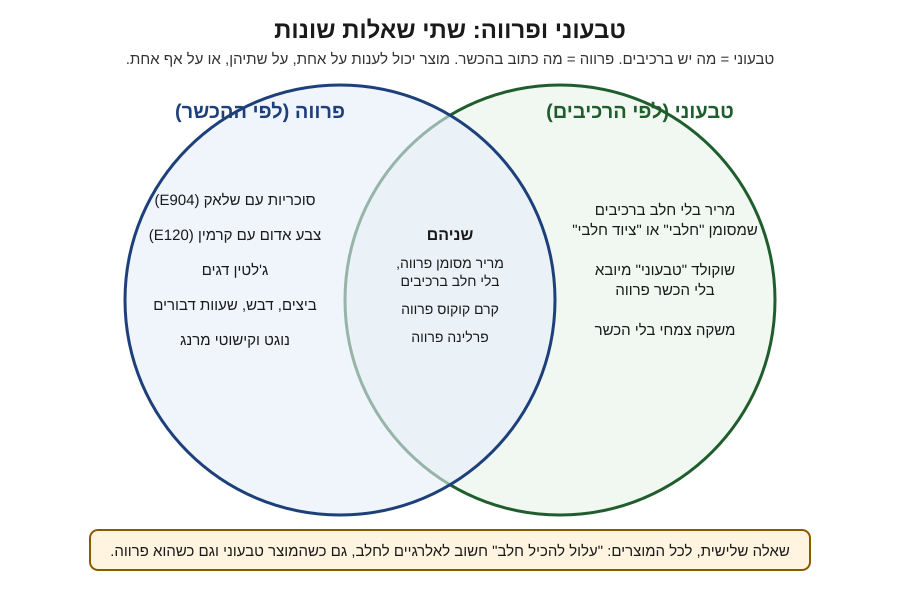

# 17.3 · חלבי, פרווה וציוד חלבי על התווית

לקוח שומר כשרות קורא את פינת הכשרות בתווית לפני שהוא קורא את שם הפרלין: מי מכשיר, חלבי או פרווה, איזה חלב. בשיעור הזה מבינים מה כל מילה אומרת לו, למה המילה על המוצר שלכם נקבעת בתעודה ולא במטבח, ולמה בלוק הכשרות ובלוק האלרגנים הם שני דברים נפרדים. בסוף כותבים את שניהם לשלושה מוצרים. הקורס לא פוסק הלכה; על מנהג שואלים את הרב.

## מה צריך

| פריט | כמות לתרגול | כמות מלאה | הערה |
|---|---|---|---|
| [תווית מוצר](../../templates/product-label.md) | 3 מוצרים | כל הקטלוג | שורת "כשרות (רק עם תעודה)" |
| טבלת הספקים מ־[17.2](lesson-02.md) | 1 | | הסטטוס של כל רכיב |
| הדרך שבחרתם ב־[17.1](lesson-01.md) | 1 | | א, ב או ג |
| אריזה של מוצר מהסופר עם הכשר מלא | 1 | | דוגמה לפינת כשרות |

**אלרגנים:** בשיעור הזה כותבים את בלוק האלרגנים לכל מוצר: **חלב**, **סויה**, **אגוזים**, **בוטנים**, **שומשום**, **גלוטן** ו**ביצים** לפי הרכיבים, ו"עלול להכיל" לפי האריזות של חומרי הגלם ולפי המטבח ([14.3](../module-14/lesson-03.md)). הבלוק הזה לא תלוי בתעודת כשרות.

## למה זה עובד

### מה כל מילה אומרת ללקוח

ההגדרות המלאות ב[מדריך הכשרות](../../references/kashrut-guide.md#מונחים). בקצרה, מה הלקוח מבין כשהוא קורא:

| על התווית | מה הלקוח מבין | מה זה דורש מכם |
|---|---|---|
| **פרווה** | אפשר לאכול עם בשר ועם חלב | כל רכיב פרווה, וציוד שהגוף המכשיר אישר לפרווה |
| **חלבי** | יש חלב או רכיב חלב, או ייצור שהמכשיר מגדיר חלבי | אין דרישה נוספת; זה הסטטוס הנפוץ בשוקולד |
| **חלבי, חלב ישראל** | החלב בהשגחה, למי שמקפיד | כל רכיב חלב בחלב ישראל ([17.2](lesson-02.md)) |
| **חלב נכרי / לאוכלי אבקת חלב נכרי** | למי שמקל באבקת חלב | הודעה על אבקת החלב בלבד |
| **ציוד חלבי (DE)** | בלי רכיבי חלב, אבל יוצר על ציוד חלבי | נדיר בשוקולד: לפי OK רק כשאין שום שארית חלב |
| **כשר לפסח** | גם בפסח | סימון ותעודה נפרדים ([10.4](../module-10/lesson-04.md)) |

**ציוד חלבי בשוקולד.** לפי OK Kosher (16.12.2025), מריר שיוצר על קו חלבי מוגדר אצלם בדרך כלל "חלבי" ולא DE, כי בהחלפת ייצור הקו מרוקן ולא נשטף. מה מותר לאכול אחרי בשר או עם בשר, יש בזה דעות. למשל, הרב מיכאל סגרון (ישיבת כסא רחמים, שאלה 6914) עונה על מריר "שיוצר בקו ייצור חלבי שהוכשר לפרווה" שעקבות החלב בטלים בשישים, ושיש מתירים אף לאכול עם בשר. זו דעה אחת. הקורס לא מכריע: הלקוח שואל את הרב שלו, ואתם כותבים רק את מה שבתעודה.

### מי קובע איזו מילה תופיע

אתם לא בוחרים את המילה, הגוף המכשיר קובע אותה. שתי סיבות:

1. **הסטטוס תלוי בציוד, לא רק ברכיבים.** אם באותו מטבח מכינים גנאש עם שמנת ופרלין פרווה, באותם קערות, ספטולות ותבניות, ייתכן שהגוף המכשיר יגדיר את הפרלין חלבי או ידרוש הפרדה. מה נדרש, שואלים אותו (שאלה 6 ב־17.1). זה דומה להפרדה שלמדתם לאלרגנים ב־[14.3](../module-14/lesson-03.md), אבל הכללים של הגוף המכשיר הם שקובעים.
2. **בלי תעודה אין סטטוס כשרות.** "פרווה" ו"חלבי" הם מונחי כשרות. בלי תעודה, מה שאפשר לכתוב על חלב הוא בבלוק האלרגנים ("מכיל: חלב"), ומה שמותר לתאר נמצא ב־[17.4](lesson-04.md).

### הכשר ואלרגנים: שתי שאלות נפרדות

התרשים מ־[12.1](../module-12/lesson-01.md) מראה שטבעוני ופרווה הם שני עיגולים. גם אלרגיה לחלב היא עיגול שלישי. שתי דוגמאות אמיתיות:

- **25.2.2025:** מארז 9 פרלינים של שוקולאב (יצרן: דה קרינה), **שסומן פרווה**, נאסף כי ייתכן שהכיל חלב שלא הופיע ברכיבים ובאלרגנים. זה התגלה אחרי תלונות צרכנים (ice).
- **30.10.2026:** ארבעה שוקולדים מרירים של פובדה, 100 גרם, נאספו כי נמצאו בהם עקבות חלב שלא סומנו על האריזה, אחרי תלונת לקוח. האיסוף תואם עם שירות המזון, מחוז אשקלון (ice). הכתבה לא אומרת אם הם סומנו פרווה.

המסקנה לתווית שלכם: בלוק כשרות (מי, איזה סטטוס, איזה חלב, פסח) ובלוק אלרגנים (מכיל, עלול להכיל) כותבים בנפרד, ושניהם צריכים להיות נכונים. "עלול להכיל חלב" הוא הערת אלרגנים, והוא לא הופך מוצר פרווה לחלבי מבחינת כשרות ([מדריך הכשרות](../../references/kashrut-guide.md#לא-טבעוני-גם-כשכתוב-פרווה)). "פרווה" לא מבטיח לאלרגי.

### מה הלקוח השומר מצפה לראות

לפי המכון הישראלי לדמוקרטיה (דו-שנתון 2024), 45% מהיהודים בישראל שומרים כשרות תמיד. הם לא קהל אחד: רק 27% משומרי הכשרות אומרים שהם סומכים על הכשר צהר, והציבור החרדי לא סומך עליו כלל. כלומר, הלקוח מחפש שם של גוף שהוא סומך עליו, לא רק את המילה "כשר". זה המשך של מה שלמדתם ב־[01.3](../module-01/lesson-03.md) על חמשת הדברים שקוראים בכל הכשר:

1. **מי מכשיר** (שם הגוף).
2. **סטטוס** (פרווה / חלבי / ציוד חלבי).
3. **איזה חלב** (חלב ישראל / נכרי).
4. **פסח** (כן / לא).
5. **ובעסק קטן:** שהתעודה בתוקף ושייכת לעסק ולאתר הייצור. שווה להחזיק עותק שאפשר לשלוח ללקוח ששואל. לפי החוק, בעל תעודה מציג אותה במקום גלוי ורק בזמן שהיא בתוקף (סעיף 10).

## שלב אחר שלב

> [!WARNING]
> לא מסיקים סטטוס כשרות מרשימת הרכיבים. מוצר בלי חלב ברכיבים יכול להיות "חלבי", ומוצר "פרווה" יכול להכיל עקבות חלב. כותבים את מה שהגוף המכשיר אישר, ואת האלרגנים לפי הרכיבים והמטבח.

1. **לכל מוצר, סטטוס יעד** מטבלת הספקים: פרווה, חלבי, או חלבי חלב ישראל.
2. **בודקים את המטבח.** האם המוצר הפרווה נעשה בציוד שמשמש גם לחלבי? רושמים בדיוק, כי זו השאלה לגוף המכשיר.
3. **בלוק אלרגנים.** "מכיל:" לפי הרכיבים, "עלול להכיל:" לפי האריזות של חומרי הגלם והמטבח. זהה בשתי הגרסאות.
4. **גרסה בלי תעודה (דרך ב או ג).** שורת הכשרות בתבנית נשארת ריקה. אין "פרווה", "חלבי" או סמל. אם בחרתם דרך ב, הנוסח מ־17.4.
5. **גרסה עם תעודה (דרך א).** כותבים בדיוק לפי התעודה: הגוף, הסטטוס, החלב, ופסח רק אם התעודה כוללת. מקום לתוקף התעודה או למספר שלה, אם הגוף דורש.
6. **בודקים מול הלקוח.** קוראים את הבלוק כמו לקוח שומר כשרות: יש שם גוף? סטטוס? חלב? ואז כמו אלרגי לחלב: מה כתוב לו?
7. **שולחים לגוף המכשיר** את נוסח הבלוק לאישור, לפני הדפסה.

## בדיקה: איך יודעים שהצליח

- [ ] לכל מוצר יש בלוק אלרגנים מלא, זהה בשתי הגרסאות.
- [ ] בגרסה בלי תעודה אין "כשר", "פרווה", "חלבי", "ציוד חלבי" או סמל.
- [ ] בגרסה עם תעודה, כל מילה בבלוק הכשרות מופיעה בתעודה (או מסומנת "ממתין לאישור").
- [ ] מוצר פרווה שנעשה בציוד משותף מסומן "לשאול את הגוף המכשיר".
- [ ] אין "פרווה" במקום אזהרת חלב, ואין "עלול להכיל חלב" במקום סטטוס.

## כשזה משתבש

| מה רואים | למה זה קורה | מה עושים עכשיו | איך מונעים בפעם הבאה |
|---|---|---|---|
| כתבתם "פרווה" כי אין חלב במתכון | הסקה מהרכיבים | מוחקים; בלי תעודה אין סטטוס | הסטטוס בא מהתעודה בלבד |
| לקוחה אלרגית שואלת אם "פרווה" בטוח לה | בלבול בין כשרות לאלרגיה | מפנים לבלוק האלרגנים ול"עלול להכיל" | שני הבלוקים בנפרד, ברורים |
| הגוף המכשיר הגדיר את הפרלין הפרווה כחלבי | ציוד משותף עם גנאש שמנת | מתקנים את התווית; מחליטים אם להפריד ציוד | שואלים לפני הדפסה |
| לקוח מבקש חלב ישראל ויש לכם חלב נכרי | ספק לא מתאים לקהל | עונים בכנות; מציעים מוצר פרווה, אם יש | בוחרים ספק לפי הקהל (17.2) |
| כתבתם "כשר לפסח" כי חומרי הגלם לפסח | התעודה לא כוללת פסח | מוחקים מכל מקום | פסח רק עם תעודה לפסח |

### מה עושים עם מה שלא הצליח

שום דבר לא הולך לפח. מדבקות עם נוסח שגוי מכוסות במדבקה מתוקנת, או משמשות לשקיות טעימה פנימיות בלי טקסט כשרות. מוצרים שכבר הוכנו נמכרים עם התווית הנכונה, או נמסים מחדש לטבלאות, לשוקו או לרוטב. טעות שנתפסה לפני הדפסה היא הצלחה של הבדיקה.

## חלופות

### טבעוני / פרווה

"טבעוני" הוא תיאור רכיבים שאתם אחראים לו, ו"פרווה" הוא סטטוס שהגוף המכשיר נותן. מארז טבעוני בלי תעודה כותב "טבעוני" ואת רשימת הרכיבים, לא "פרווה" ([12.1](../module-12/lesson-01.md)).

### בריא יותר

קו פחות סוכר לא משנה את בלוק הכשרות, אבל מוסיף שורה לבלוק האזהרות: מלטיטול בכמות גדולה גורם לגזים ולשלשול, ולא מתאים לילדים בכמות ([13.2](../module-13/lesson-02.md)). את הנוסח המדויק בודקים מול [13.5](../module-13/lesson-05.md).

### כשרות

השיעור כולו עוסק בבלוק הכשרות. אם הלקוח שואל אם מותר לו לאכול את המוצר אחרי בשר, לא עונים במקום הרב: אומרים מה כתוב בתעודה ומפנים לרב שלו.

## איפה קונים

בשיעור הזה לא קונים. מדבקות ותוויות להדפסה: [מדבקות ותוויות](../../references/where-to-buy.md#מדבקות-ותוויות). מונחים ודוגמאות לפינות כשרות של ספקים: [מונחים](../../references/kashrut-guide.md#מונחים), [ריקולים: פרווה שהכיל חלב](../../references/kashrut-guide.md#ריקולים-פרווה-שהכיל-חלב). מקורות, מידע כללי בלבד: [מקורות, סעיף 5: כשרות](../../curriculum/research/sources.md#5-כשרות), [סעיף 9: דוגמאות ריקול](../../curriculum/research/sources.md#9-דוגמאות-ריקול-שוקולד-פרווה-או-מריר-עם-חלב). כללי התווית המלאים במודול 18.

## תרגול

### משימה

ממלאים ב[תבנית התווית](../../templates/product-label.md) לשלושה מוצרים את שורת הכשרות ואת האלרגנים, בשתי גרסאות: היום (בלי תעודה) ואחרי תעודה (עם מקום לפרטים שיגיעו).

דוגמה פתורה

**הלומדת מ־17.2:** דרך ג היום. מטבח שכור אחד; גנאש שמנת וטראפלס קוקוס באותו ציוד, בימים שונים.

| מוצר | אלרגנים (שתי הגרסאות) | שורת כשרות היום | שורת כשרות אחרי תעודה |
|---|---|---|---|
| טראפלס קוקוס (טבעוני) | מכיל: סויה. עלול להכיל: חלב, אגוזים (לפי אריזת השוקולד והמטבח) | ריקה. על המארז: "טבעוני", רשימת רכיבים | "כשר [סטטוס לפי התעודה], בהשגחת [רשות הכשרות המקומית]". ממתין לתשובה: ציוד משותף עם גנאש שמנת |
| פרלין לוז | מכיל: אגוזי לוז, סויה. עלול להכיל: חלב, בוטנים | ריקה | "כשר [סטטוס], בהשגחת [...]"; אריזה מחדש של הפרלינה — ממתין לתשובה (17.2) |
| סביבון לבן | מכיל: חלב, סויה. עלול להכיל: אגוזים | ריקה | "כשר חלבי, חלב נכרי, בהשגחת [...]" — חלב נכרי, כי זה מה שעל שק השוקולד הלבן |

**בדיקה כלקוח:** בגרסה של היום אין מילת כשרות, והאלרגנים מלאים. בגרסה העתידית אין "פרווה" בטראפלס עד שהגוף יענה על הציוד המשותף, ואין "כשר לפסח" באף מוצר.

### זמן

כ־50 דקות: 20 דקות לבלוקי האלרגנים, 20 דקות לשתי הגרסאות של שורת הכשרות, 10 דקות לבדיקה "כמו לקוח".

### יומן

ב[יומן התרגול](../../templates/practice-log.md) רושמים איזה נוסח נשלח לגוף המכשיר, מתי, ומה אושר או תוקן.

### בדיקה עצמית

- [ ] 3 מוצרים, בלוק אלרגנים לכל אחד.
- [ ] גרסה בלי תעודה: אין מילת כשרות.
- [ ] גרסה עם תעודה: כל מילה לפי התעודה, או "ממתין".
- [ ] ציוד משותף מסומן כשאלה פתוחה.

## סיכום

- פרווה, חלבי, חלב ישראל וציוד חלבי הם סטטוסים שהגוף המכשיר נותן, לא מסקנה מרשימת הרכיבים.
- בשוקולד, מריר מקו חלבי הוא לרוב חלבי ו־DE נדיר (OK); על אכילה אחרי בשר יש דעות, והקורס לא מכריע.
- בלוק הכשרות ובלוק האלרגנים נפרדים: מוצר "פרווה" נאסף ב־2025 כי ייתכן שהכיל חלב.
- הלקוח השומר מחפש גוף שהוא סומך עליו, סטטוס, חלב ופסח, ותעודה בתוקף; בלי תעודה, שורת הכשרות ריקה.
