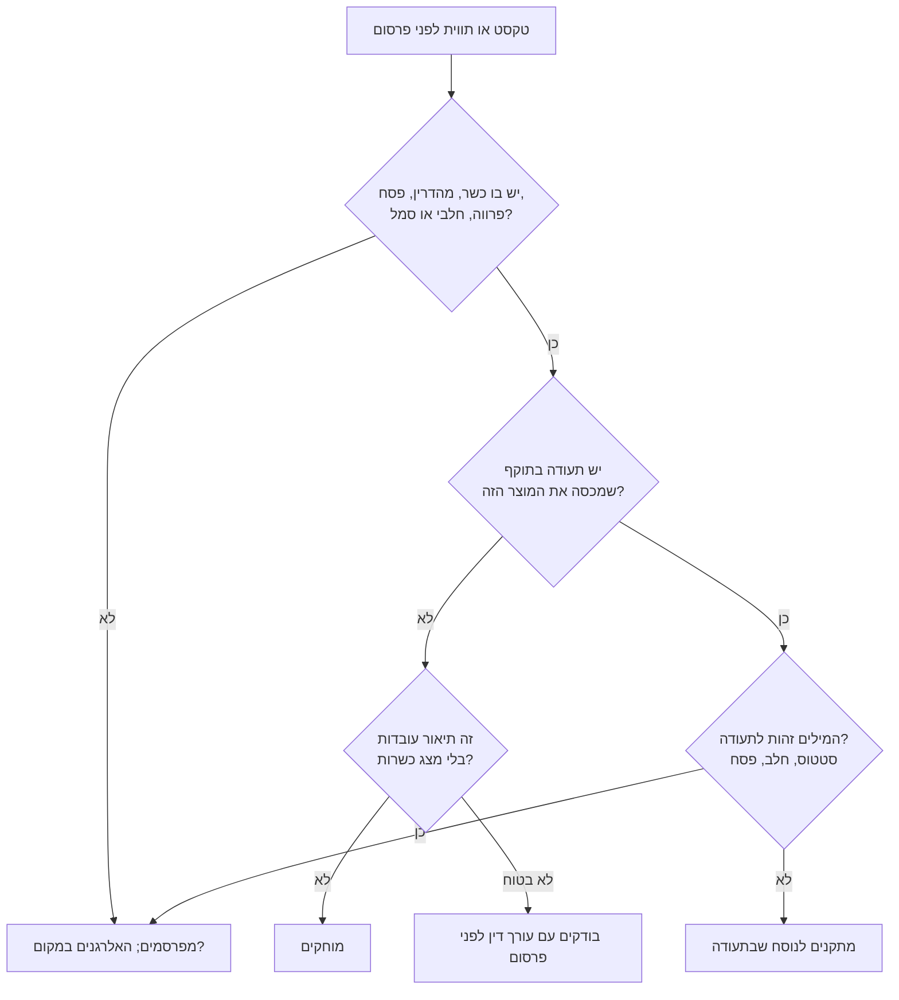

# 17.4 · מה אסור לכתוב בלי תעודה

"כל חומרי הגלם כשרים" נשמע כמו משפט תמים על מארז שוקולד, אבל אם אין לכם תעודת הכשר, זו בדיוק הטענה שהחוק אוסר. בשיעור הזה עוברים על מה אסור, מה מותר ומה באזור האפור, ובסוף עושים ביקורת על כל הטקסטים של העסק: התווית, האתר, האינסטגרם וקטלוג הוואטסאפ. זה מידע כללי, לא ייעוץ משפטי, והקורס לא פוסק הלכה.

## מה צריך

| פריט | כמות לתרגול | כמות מלאה | הערה |
|---|---|---|---|
| כל הטקסטים של העסק: תווית, דף מוצר, ביו ופוסטים, קטלוג | 10 טקסטים | הכול | צילומי מסך עם תאריך |
| [תווית מוצר](../../templates/product-label.md) מ־[17.3](lesson-03.md) | 3 | | שתי הגרסאות |
| הדרך שבחרתם ב־[17.1](lesson-01.md) | 1 | | א, ב או ג |
| רשימת הטענות מ־[13.5](../module-13/lesson-05.md) | 1 | | אותה ביקורת, לטענות בריאות |

**אלרגנים:** בזמן שמוחקים מילות כשרות, לא מוחקים אזהרות. "מכיל" ו"עלול להכיל" (**חלב**, **סויה**, **אגוזים**, **בוטנים**, **שומשום**, **גלוטן**) נשארים בכל טקסט שמתאר מוצר, כולל פוסטים ([14.3](../module-14/lesson-03.md)).

## למה זה עובד

### מה החוק אוסר

לפי נוסח חוק איסור הונאה בכשרות, התשמ"ג-1983, בוויקיטקסט (נבדק 2026-11-10):

- **יצרן (סעיף 4):** לא יציין על מוצר שייצר או על אריזתו שהוא כשר, ולא יציג אותו ככשר בפרסום, בלי תעודת הכשר. מי שיש לו תעודה למוצר אחד, לא יציג ככשר מוצר אחר שאין לו תעודה.
- **מוכר (סעיף 5):** לא ימכור ולא יציע למכירה מוצר שהוצג בכתב ככשר, בלי תעודה עבורו. זה חשוב אם חנות או אפליקציה מוכרת בשבילכם.
- **בית אוכל (סעיף 3):** לא יציג את עצמו בכתב ככשר בלי תעודה. רלוונטי לסדנאות ולאירועים עם אוכל במקום.
- **הצגת תעודה (סעיף 10):** רק תעודה בתוקף, במקום גלוי. תעודה שפגה, לא מציגים.
- **נטל ההוכחה (סעיף 8):** על מי שטוען שיש לו תעודה.
- **עונש (סעיף 14):** עד שנת מאסר.

החוק מדבר על הצגה "ככשר", בתווית ובפרסום. אתר, אינסטגרם, וואטסאפ ודף באפליקציית משלוחים הם פרסום. גם בפלטפורמות עצמן כתוב לפעמים שהכשרות באחריות העסק בלבד (ראו את דוגמת Wolt ב־[15.2](../module-15/lesson-02.md)).

### מה מותר: "מצג אמת"

לפי המכון הישראלי לדמוקרטיה (דו-שנתון 2024), בדנג"ץ 5026/16 גיני נ' הרבנות הראשית, שניתן ב־2017 (12.9.2017 לפי ג'רוזלם פוסט), נקבע שעסק בלי תעודה של הרבנות לא יציג מצג של כשרות, אבל מותר לו להציג "מצג אמת" על הסטנדרטים שהוא מקפיד עליהם ועל אופן הפיקוח, בלי המילה "כשר".

אחרי הפסיקה, לפי הדיווחים בכיפה ובסרוגים (12.7.2018), חוות דעת של היועץ המשפטי לממשלה קבעה בין השאר:

- בעל בית אוכל יכול לציין בעצמו שהוא בפיקוח של גורם כשרות חיצוני, ועליו לציין שאינו בפיקוח הרבנות הראשית.
- אסור להציג בעסק אישור, תעודה או לוגו של גוף הכשרות.
- גוף כשרות חיצוני לא ישתמש במילה "כשר" בשום צורה, ולא בלוגו שדומה לסמל כשרות.

**שתי הסתייגויות.** ההחלטות עסקו בבתי אוכל, לא במוצר ארוז של יצרן, ולא בדקנו איך הן חלות על תווית. ויש מחלוקת אם מותר לציין את שם הגוף המפקח ([מקורות, סעיף 5](../../curriculum/research/sources.md#5-כשרות)). לכן כל נוסח של "מצג אמת" על אריזה בודקים עם עורך דין לפני הדפסה.

### שלוש קבוצות

| קבוצה | דוגמאות | למה |
|---|---|---|
| **מותר** (עובדות בלי מצג כשרות) | רשימת רכיבים; אלרגנים; "טבעוני" כשהוא נכון ([12.1](../module-12/lesson-01.md)); "לעסק אין תעודת כשרות" | עובדות על המוצר, ואמירה כנה שאין תעודה |
| **אזור אפור** (בודקים עם עורך דין) | "השוקולד שלנו בהכשר בד"ץ בית יוסף לפי האריזה של הספק"; "אנחנו בפיקוח של גוף X, לא של הרבנות"; "ללא רכיבי בשר" | תיאור סטנדרט שעלול להיקרא כמצג כשרות; שם גוף פרטי שנוי במחלוקת |
| **אסור בלי תעודה** | "כשר", "כשר למהדרין", "בהכשר", "כשר לפסח", "100% כשר", "כל הרכיבים כשרים"; סמל כשרות; לוגו ההכשר של הספק; תעודה שפגה או של עסק אחר | הצגה ככשר (סעיף 4) או הצגת תעודה לא תקפה (סעיף 10) |

**"פרווה" ו"חלבי".** אלה מונחי כשרות. הקורס לא קובע אם הן לבדן "מצג של כשרות", ולכן הכלל כאן כמו ב־[13.5](../module-13/lesson-05.md#כשרות): כותבים אותן רק לפי תעודה. את מה שהלקוח צריך לדעת על חלב, כותבים באלרגנים.

### עם תעודה: מה עדיין אסור

תעודה לא מכסה הכול. לפי סעיף 4, תעודה למוצר אחד לא מכסה מוצר אחר. לכן:

- **מוצר חדש** שלא נכלל בתעודה, או שנעשה במקום אחר, לא נכתב עליו "כשר" עד שהגוף המכשיר מאשר.
- **פסח:** תעודה יכולה לא לחול על פסח (סעיף 2ח). "כשר לפסח" רק עם אישור לפסח.
- **מטבח שכור:** אם למטבח יש תעודה, שואלים את המועצה בכתב אם היא מכסה את העסק שלכם ואת המוצרים שלכם. לא מניחים.
- **תוקף:** תעודה ניתנת עד שנה עברית. ביום שהיא פגה, מורידים את הסמל מהאתר ומהמדבקות החדשות.

## שלב אחר שלב

> [!WARNING]
> משפט שנמחק מהתווית אבל נשאר בפוסט ישן, בהאשטאג (#כשר) או בתמונה של שק השוקולד עם הסמל של הספק, עדיין מפורסם. הביקורת עוברת על הכול, כולל ארכיון.

1. **אוספים את כל הטקסטים.** תווית, דף מוצר, ביו, פוסטים והיילייטס, קטלוג וואטסאפ, דף באפליקציה, כרטיס ביקור. צילום מסך עם תאריך לכל אחד.
2. **מסמנים מילים.** כשר, מהדרין, בהכשר, השגחה, פסח, פרווה, חלבי, חלב ישראל, וגם סמלים ותמונות של אריזות עם הכשר.
3. **ממיינים לשלוש קבוצות** לפי הטבלה. "לא בטוח" הולך לאזור האפור.
4. **מוחקים את האסור** בכל מקום. מדבקות שכבר הודפסו מכסים.
5. **כותבים תחליף אמת.** במקום "כשר": רשימת רכיבים, אלרגנים, ואם רוצים, "לעסק אין תעודת כשרות".
6. **אזור אפור:** מרכזים את כל הנוסחים למסמך אחד ושולחים לעורך דין, או מוותרים עליהם.
7. **עם תעודה:** משווים כל מילה לתעודה. מוצר שלא בתעודה, בלי "כשר".
8. **קובעים בדיקה חוזרת:** לפני כל חג, ובכל חידוש תעודה.

## בדיקה: איך יודעים שהצליח

- [ ] כל הטקסטים נאספו, עם צילום ותאריך, כולל פוסטים ישנים.
- [ ] אין בשום מקום "כשר", סמל או תמונת הכשר של ספק בלי תעודה בתוקף.
- [ ] כל משפט באזור האפור מסומן "לבדיקה" או נמחק.
- [ ] אזהרות האלרגנים לא נפגעו בזמן העריכה.
- [ ] יש תאריך לבדיקה החוזרת.

## כשזה משתבש

| מה רואים | למה זה קורה | מה עושים עכשיו | איך מונעים בפעם הבאה |
|---|---|---|---|
| "חומרי גלם כשרים בלבד" בדף המוצר | רצון להרגיע לקוחות | מוחקים; כותבים רכיבים ו"לעסק אין תעודת כשרות" | כל טקסט עובר את התרשים |
| תמונה של שק השוקולד עם הסמל של הספק | "מראים איכות" | מצלמים מחדש בלי הסמל | בודקים גם תמונות |
| לקוח בוואטסאפ: "זה כשר?" | שאלה ישירה | עונים באמת: אין תעודה, אלה הרכיבים | תשובה מוכנה וכנה |
| התעודה פגה והסמל עוד באתר | אין תזכורת | מורידים מיד, ופונים לחידוש | תזכורת חודש לפני סוף התוקף |
| מוצר חדש נכנס לקטלוג עם "כשר" | העתקה מתבנית של מוצר אחר | מוחקים עד אישור הגוף המכשיר | כל מוצר חדש נבדק מול התעודה |

### מה עושים עם מה שלא הצליח

שום דבר לא הולך לפח. מדבקות ושרוולים עם נוסח אסור מכסים במדבקה מתוקנת, או משתמשים בהם לאריזה פנימית. פוסט ישן לא חייב להימחק: עורכים את הטקסט ומחליפים תמונה. מוצרים שבמלאי נמכרים עם התווית הנכונה, או נמסים מחדש לטבלאות ולשוקו.

## חלופות

### טבעוני / פרווה

"טבעוני" מותר כשהוא נכון, והוא תיאור רכיבים. "פרווה" הוא מונח כשרות. מארז טבעוני בלי תעודה כותב "טבעוני", לא "פרווה" ולא "טבעוני ולכן כשר" ([12.1](../module-12/lesson-01.md)).

### בריא יותר

אותה ביקורת בדיוק עושים לטענות בריאות: "בריא", "מתאים לסוכרתיים" ו"מרפא" אסורים, ו"ללא סוכר" בודקים מול הכלל העדכני ([13.5](../module-13/lesson-05.md)). כדאי לעשות את שתי הביקורות באותו מעבר על הטקסטים.

### כשרות

השיעור כולו הוא הצד העסקי של כשרות בלי תעודה. ללקוח ששואל אם מותר לו לאכול, לא עונים במקום הרב: אומרים מה יש ומה אין, ומפנים לרב שלו.

## איפה קונים

בשיעור הזה לא קונים. מדבקות לכיסוי נוסח שגוי: [מדבקות ותוויות](../../references/where-to-buy.md#מדבקות-ותוויות). מקורות, מידע כללי בלבד: [נוסח חוק איסור הונאה בכשרות](https://he.wikisource.org/wiki/חוק_איסור_הונאה_בכשרות) (ויקיטקסט, נבדק 2026-11-10), [מקורות, סעיף 5: כשרות](../../curriculum/research/sources.md#5-כשרות), [המכון הישראלי לדמוקרטיה, פרק הכשרות](https://www.idi.org.il/religion-and-state/2024/?chapter=58140).

## תרגול

### משימה

ביקורת טקסטים: טבלה עם עמודות טקסט | איפה | המשפט | קבוצה (מותר / אפור / אסור) | תיקון | תאריך תיקון. 10 טקסטים לפחות. אחר כך משלימים את [פרויקט המודול: תוכנית כשרות לעסק](../../projects/m17-kashrut-plan.md).

דוגמה פתורה

**הלומדת:** דרך ג (אין תעודה), מארזים טבעוניים לחגים. ביקורת ב־10.11.2026:

| איפה | המשפט | קבוצה | תיקון |
|---|---|---|---|
| ביו באינסטגרם | "שוקולד בוטיק כשר" וסמל מגן דוד | אסור | "שוקולד טבעוני בעבודת יד · רכיבים ואלרגנים בכל מוצר" |
| דף מארז חנוכה | "כל חומרי הגלם בהכשר מהדרין" | אסור | "שוקולד מריר Lubeka 55%, קרם קוקוס, פרלינת לוז. לעסק אין תעודת כשרות" |
| פוסט מ־2025 | תמונה של שק השוקולד עם סמל ההכשר | אסור | תמונה חדשה של הפרלינים בלבד |
| תווית טראפלס | "טבעוני" | מותר | בלי שינוי (נבדק מול 12.1) |
| תווית טראפלס | "פרווה" | אסור (כלל הקורס) | נמחק; באלרגנים: "עלול להכיל: חלב" |
| קטלוג וואטסאפ | "#כשר #מהדרין" | אסור | האשטאגים נמחקו |
| שאלות נפוצות | "השוקולד שלנו בהכשר בד"ץ לפי אריזת הספק" | אפור | הועבר לעורך דין; עד אז נמחק |
| דף מארז פסח | "מתאים לפסח" | אסור (מצג של כשרות לפסח) | נמחק; המארז לא מוצע בפסח |
| תשובה מוכנה לוואטסאפ | — | מותר | "אין לנו תעודת כשרות. אלה הרכיבים והאלרגנים: ..." |
| כרטיס ביקור | "טעים, טבעוני, בעבודת יד" | מותר | בלי שינוי |

**סיכום:** 6 אסורים תוקנו, 1 אפור הוסר עד בדיקה, 3 מותרים. בדיקה חוזרת: שבועיים לפני חנוכה.

### זמן

כשעה: 20 דקות לאיסוף הטקסטים, 25 דקות למיון ולתיקון, 15 דקות לפוסטים ישנים ולתשובה המוכנה.

### יומן

ב[יומן התרגול](../../templates/practice-log.md) רושמים את תאריך הביקורת, מה תוקן, ומה ממתין לעורך דין.

### בדיקה עצמית

- [ ] 10 טקסטים לפחות, ממוינים לשלוש קבוצות.
- [ ] כל האסור נמחק או כוסה, גם בפוסטים ישנים ובתמונות.
- [ ] האפור ממתין לעורך דין או נמחק.
- [ ] יש תשובה מוכנה וכנה לשאלה "זה כשר?".
- [ ] פרויקט המודול הושלם.

## סיכום

- בלי תעודה בתוקף לא כותבים "כשר", "מהדרין", "כשר לפסח" או "בהכשר", ולא מציגים סמל, בתווית ובכל פרסום (סעיפים 4, 10).
- מותר להציג עובדות: רכיבים, אלרגנים, "טבעוני" כשנכון, ו"לעסק אין תעודת כשרות".
- "מצג אמת" על סטנדרטים (פסיקת גיני, 2017) נקבע לבתי אוכל; על אריזה בודקים עם עורך דין.
- גם עם תעודה: רק המוצרים, המקום והתקופה שהיא מכסה, ופסח בנפרד.
