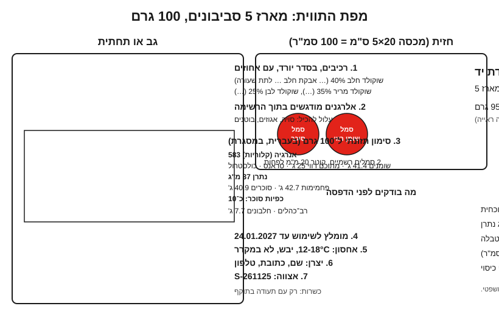

# 18.1 · סימון מזון בישראל

בשיעור הזה כותבים תווית אמיתית, שורה אחר שורה, למארז החנוכה של הקורס: חמישה סביבוני שוקולד מחלב, מריר ולבן ([פרויקט מודול 8](../../projects/m08-dreidel-box.md)). לומדים מה חל היום ומה צפוי מ־2028, איך מחשבים סימון תזונתי ממפרטי הספקים, ולמה על מארז שוקולד יופיעו כמעט תמיד שני סמלים אדומים. זה מידע כללי, נכון ל־10.11.2026, ולא ייעוץ משפטי.

## מה צריך

### לפני שמתחילים את המודול

מודול 18 הופך מוצר שאתם יודעים להכין למוצר שאפשר למכור: תווית (18.1), תאריך שאפשר לעמוד מאחוריו ([18.2](lesson-02.md)), קופסה ותוויות מודפסות ([18.3](lesson-03.md)), ותמונות לחנות ([18.4](lesson-04.md)). האקדמיה לא בודקת תוויות ולא נותנת אישור משפטי: משווים לבדיקות שבכל שיעור, ושואלים את לשכת הבריאות המחוזית לפני שמדפיסים כמות. כל גרסה של התווית נרשמת ב[יומן התרגול](../../templates/practice-log.md), עם תאריך.

| פריט | כמות לתרגול | כמות מלאה | הערה |
|---|---|---|---|
| מארז 5 סביבונים, או סביבון אחד ותכנון המארז | 1 | מארז אחד | [08.2](../module-08/lesson-02.md) |
| מפרט טכני (specification sheet) או אריזה של כל שוקולד וקישוט | 1 לכל רכיב | | רכיבים, אלרגנים, ערכים ל־100 גרם |
| מטריצת האלרגנים מ־[16.2](../module-16/lesson-02.md) | 1 | | |
| [תווית מוצר](../../templates/product-label.md) | 1 | | |
| משקל (דיוק 1 גרם), סרגל, מחשבון | | | |

**אלרגנים:** אין מתכון. במארז יש **חלב**, ובחלק משוקולדי החלב גם **שעורה** (גלוטן). סויה, אגוזים ובוטנים מופיעים לרוב ב"עלול להכיל" של הספק.

## למה זה עובד

### שתי מערכות כללים: היום, ומ־2028

| | היום (נבדק 10.11.2026) | מ־1.1.2028, אם הטיוטה תאושר |
|---|---|---|
| הכלל הבסיסי | צו הסימון (התשנ"ט-1998): מזון ארוז מראש מסומן לפי ת"י 1145, חוץ מסעיף הסימון התזונתי שבו | טיוטת צו מחליפה את ההפניות לת"י 1145 בתקנה האירופית 1169/2011 (Freyr, 22.7.2026) |
| שוקולד | בטבלת הצו, שורה 7: שוקולד, שוקולד חלב ו"מוצרי שוקולד אחרים" עומדים גם בת"י 650 חלק 4 (מאי 2023), סעיפי התיאור והסימון | לא ידוע אם משתנה |
| סימון תזונתי וסמלים אדומים | תקנות הסימון התזונתי (התשע"ח-2017), בתוקף מ־1.1.2020 | לא נבדק אם הטיוטה משנה אותן |
| מעבר | | וולונטרי מ־1.1.2025; מה שיוצר לפני 2028 נמכר עד תום חיי המדף |

נוסח ת"י 1145 ות"י 650 חלק 4 לא נקרא. מה שנקרא הוא 12 פרטי החובה של תקנה 1169/2011 (טבלה ב־[16.4](../module-16/lesson-04.md)). לכן הדרך המעשית היא תווית אחת שעונה לשתי המערכות: 12 הפרטים האירופיים, ועליהם הסימון התזונתי הישראלי והסמלים. מה שחסר נשאל בלשכת הבריאות.

### מה מיוחד בשוקולד בכל פרט

- **שם**: "שוקולד חלב" הוא שם מוגדר בת"י 650 חלק 4. סביבונים מקוברטורה קנויה הם "סביבוני שוקולד", והשוקולדים מפורטים ברכיבים.
- **רכיבים**: בסדר יורד לפי משקל. כל שוקולד הוא רכיב מורכב: אחריו, בסוגריים, הרכיבים שלו מהמפרט. כש"שוקולד" מודגש בשם, נותנים את האחוז של כל שוקולד. אבקת ברק "לקישוט בלבד" לא נכנסת למוצר אכיל בכלל ([05.4](../module-05/lesson-04.md)).
- **אלרגנים**: מודגשים בתוך הרשימה, בשיטה של 2028 ([14.3](../module-14/lesson-03.md#הסימון-בישראל-היום-ומינואר-2028)). בדגנים מדגישים את שם הדגן: **שעורה**, לא "גלוטן". "עלול להכיל" הוא איחוד של כל הספקים ושל המטבח שלכם ([16.2](../module-16/lesson-02.md)).
- **משקל נטו**: הצו מפנה לת"י 1118 חלק 1, "תכולה אחידה מראש" (לא נקרא). בעבודת יד שוקלים כל מארז.
- **תאריך**: "כפי שקבע היצרן" (חוק המזון, סעיף 12; [16.4](../module-16/lesson-04.md)). לפי נספח X: עד 3 חודשים מסמנים יום וחודש, 3-18 חודשים חודש ושנה; "לשימוש עד" תמיד יום, חודש ושנה. לשוקולד מוצק מתאים "מומלץ לשימוש עד"; לטראפלס עם שמנת, "לשימוש עד". במארז מעורב, התאריך לפי הפריט הקצר ביותר והאלרגנים הם איחוד של כל הפריטים ([11.2](../module-11/lesson-02.md#התאריך-נקבע-לפי-הפריט-הקצר-ביותר)). איך קובעים: [18.2](lesson-02.md).

### הרכיבים של הרכיבים: המפרט מנצח את הזיכרון

שלוש קוברטורות של Valrhona, לפי המפרטים שלהן (נבדק 10.11.2026):

| קוברטורה | רכיבים | עלול להכיל |
|---|---|---|
| Jivara חלב 40% | חמאת קקאו, אבקת **חלב** מלא, סוכר, פולי קקאו, סוכר חום, תמצית וניל טבעית, מתחלב (לציטין חמניות), תמצית לתת **שעורה** | סויה, שקדים, לוז, פקאן, פיסטוק |
| Guanaja מריר 70% | פולי קקאו, סוכר, חמאת קקאו, מתחלב (לציטין חמניות), תמצית וניל טבעית | סויה, שקדים, לוז, פקאן, פיסטוק, חלב |
| Ivoire לבן 35% | סוכר, חמאת קקאו, אבקת **חלב** מלא, מתחלב (לציטין חמניות), תמצית וניל טבעית | אגוזים, סויה (לפי דף החנות) |

שלוש הפתעות: בשוקולד החלב יש **שעורה**, 0.3% לפי המפרט ([14.2](../module-14/lesson-02.md)); הלציטין מחמניות, ולכן סויה רק ב"עלול להכיל"; והמריר "עלול להכיל" חלב. מותג אחר, או אותו מותג בשנה אחרת, יכול להיות שונה: כותבים מהמפרט של השקית שפתחתם, ושומרים צילום שלו עם האצווה.

### הסימון התזונתי הישראלי

לפי תקנות הסימון התזונתי:

- הטבלה **בעברית, במסגרת**, בסדר קבוע, **ל־100 גרם** במזון מוצק.
- השורות: אנרגיה (קלוריות), שומנים, מתוכם שומן רווי, שומן טראנס, כולסטרול, נתרן (מ"ג), פחמימות, מתוכן סוכרים, **כפיות סוכר**, רב־כהלים, חלבונים. עמילן וסיבים הם רשות.
- **כפיות סוכר**: מ־2 גרם סוכרים ל־100 גרם, כפית לכל 4 גרם, לפי כללי העיגול שבתקנה.
- אנרגיה, שומן רווי, נתרן, סוכרים וכפיות **מודגשים**. האות בטבלה: 120% מהגודל המזערי לרכיבים לפי ת"י 1145.
- פוליאולים לא נספרים כסוכרים, ומופיעים מ־0.5 גרם ל־100 גרם ([13.5](../module-13/lesson-05.md)).

מפרטים אירופיים נותנים **מלח** ולא נתרן: נתרן = מלח ÷ 2.5.

### שני סמלים אדומים, ובאיזה גודל

סמל אדום מופיע בחזית של מזון מוצק ארוז מראש כשיש בו ל־100 גרם יותר מ־**10 גרם סוכרים**, **4 גרם שומן רווי** או **400 מ"ג נתרן**. בשלוש הקוברטורות יש 25 גרם שומן רווי ו־30-51 גרם סוכרים. לכן כמעט כל מוצר שוקולד, גם מריר, צפוי לקבל **שני סמלים**, סוכר ושומן רווי. זו מסקנה שלנו מהספים ([13.4](../module-13/lesson-04.md)).

| שטח החזית | עד 40 סמ"ר | 40-60 | 60-100 | 100-200 | 200-300 | מעל 300 |
|---|---|---|---|---|---|---|
| קוטר מזערי | 15 מ"מ | 18 | 20 | 25 | 30 | 35 |

הצבע קבוע (CMYK 0/100/95/0 או Pantone 485, אותיות לבנות). **פטור**: חזית של 25 סמ"ר או פחות פטורה מהסמלים, לא מהטבלה. קופסת טראפלס 4×4 ס"מ היא 16 סמ"ר; מכסה מארז סביבונים 20×5 ס"מ הוא 100 סמ"ר, עם סמלים של 20 מ"מ לפחות.

**ארוז מראש?** לפי תקנה 2, מזון שהוכן "לפי הזמנת הלקוח בעת המכירה" אינו ארוז מראש. מארז שמוכן מראש לחנות אונליין הוא כן. באירופה יש פטור מהטבלה ל"מזון בעבודת יד" שהיצרן מספק בכמויות קטנות ישירות לצרכן (נספח V, סעיף 19), אבל בתקנות הישראליות לא מצאנו פטור ליצרן קטן. עד תשובה בכתב, מניחים שהטבלה והסמלים חלים.

## שלב אחר שלב

> [!WARNING]
> טעות באלרגן על תווית היא סכנה לבריאות, לא טעות כתיב. כל אלרגן נכתב מהמפרט של השקית שבאמת נכנסה למוצר, וכל שקית חדשה נבדקת מחדש ([16.2](../module-16/lesson-02.md)).

1. **מפרטים**: לכל שוקולד וקישוט, מפרט מהספק או מאתר היצרן, או צילום האריזה. רושמים מותג, מוצר, אצווה ותאריך.
2. **הרכב**: שוקלים את המארז ומחשבים כמה גרם מכל שוקולד, בעיגול לגרם.
3. **רכיבים**: השוקולדים מהכבד לקל, כל אחד עם הרכיבים שלו בסוגריים ועם אחוז.
4. **אלרגנים**: מדגישים כל אלרגן בתוך הרשימה. אחר כך "עלול להכיל": כל הספקים, ועוד מה שנכנס למטבח לפי המטריצה.
5. **טבלה**: לכל שורה, ממוצע משוקלל: ערך ל־100 גרם של כל שוקולד × החלק שלו במארז, ומחברים. כפיות = סוכרים ÷ 4.
6. **סמלים**: משווים לשלושת הספים, מודדים את המכסה, ובוחרים קוטר.
7. **תאריך ואחסון**: תאריך שמרני ([18.2](lesson-02.md)), לא אחרי התאריך של אף רכיב; תנאי אחסון שאתם יכולים לעמוד בהם.
8. **יצרן, אצווה ומשקל**: שם, כתובת, טלפון, אצווה ([16.4](../module-16/lesson-04.md)). שוקלים 5 מארזים וכותבים משקל שכל אחד מגיע אליו.
9. **כשרות**: רק עם תעודת הכשר לעסק. בלי תעודה אין "כשר" ואין סמל (חוק איסור הונאה בכשרות, סעיף 4).
10. **בדיקה ושאלות**: עוברים על [התבנית](../../templates/product-label.md), ורושמים כל פרט לא ודאי (שם לפי ת"י 650, משקל לפי ת"י 1118) לרשימה ללשכת הבריאות ([16.5](../module-16/lesson-05.md)).

## בדיקה: איך יודעים שהצליח

- כל שוקולד מופיע עם הרכיבים שלו, בסדר יורד, עם אחוז.
- כל אלרגן מהמפרטים מודגש, ובדגנים מופיע שם הדגן.
- הטבלה בעברית, ל־100 גרם, עם נתרן במ"ג וכפיות סוכר; בשוקולד האנרגיה כ־550-600 קלוריות.
- מספר הסמלים נכון לפי הספים, והקוטר לפי שטח המכסה שנמדד.
- התאריך מלא ולא מאוחר מאף רכיב; אין "כשר", "בריא" או "ללא" בלי כיסוי.
- יש רשימת שאלות פתוחות, ולמי הן הולכות.

## כשזה משתבש

| מה רואים | למה זה קורה | מה עושים עכשיו | איך מונעים בפעם הבאה |
|---|---|---|---|
| בתווית "לציטין סויה", במפרט "לציטין חמניות" | העתקה מתווית ישנה | מתקנים, ובודקים אם סויה עוברת ל"עלול להכיל" | כל תווית מהמפרט של השקית הנוכחית |
| שעורה לא מסומנת בשוקולד החלב | "בשוקולד אין גלוטן" | עוצרים מכירה, מדביקים תווית מתוקנת על כל המלאי | קוראים כל רכיב של כל רכיב, גם 0.3% |
| סמל אחד בלבד, לסוכר | שכחו שומן רווי | מוסיפים סמל | שלושה ספים בכל מוצר |
| טבלה באנגלית מהספק | העתקת מפרט | מתרגמים ומוסיפים נתרן, כולסטרול, טראנס וכפיות | עובדים מהתבנית הישראלית |

### מה עושים עם מה שלא הצליח

שום מוצר לא נזרק בגלל תווית. אם המוצר תקין, מדביקים תווית מתוקנת שמכסה לגמרי את הישנה, או שהמארז הולך הביתה ונאכל, נמס לשוקו או נשבר לטבלת bark. אלרגן לא מסומן במוצר שכבר נמכר הוא כבר ריקול ([16.4](../module-16/lesson-04.md)).

## חלופות

### טבעוני / פרווה

"טבעוני" הוא תיאור, וחוק המזון (סעיף 17) אוסר תיאור שלא תואם את המוצר, ולכן כותבים אותו רק כשכל רכיב נבדק ([12.1](../module-12/lesson-01.md)). "עלול להכיל חלב" נשאר אם הוא על אריזת השוקולד: זה מידע לאלרגיים, לא תיאור. קישוטים צבעוניים נבדקים לקרמין (E120), שהוא לא טבעוני וגם אלרגן מוכר ([12.5](../module-12/lesson-05.md#קרמין-גם-טבעונות-וגם-אלרגיה)).

### בריא יותר

"פחות סוכר" נראה במספרים: מריר 70% מוריד את כפיות הסוכר, אבל הסמל האדום כנראה נשאר (Guanaja: 30 גרם סוכרים ל־100 גרם). טענות כמו "בריא" או "טוב ללב" אסורות בלי היתר (סעיף 13, [13.5](../module-13/lesson-05.md)). עם מלטיטול: הפוליאולים מופיעים בטבלה, ומ־2028, אם הטיוטה תאושר, מעל 10% פוליאולים מוספים מחייבים אזהרה. מלטיטול בכמות גורם לגזים ולשלשול, ולא מתאים לילדים בכמות.

### כשרות

כשרות לא ברשימת פרטי החובה, אבל יצרן לא מסמן "כשר" בלי תעודת הכשר (חוק איסור הונאה בכשרות, סעיף 4). מה מותר לכתוב בלי תעודה: [מודול 17](../module-17/lesson-01.md); בלוק הכשרות נפרד מהאלרגנים ([17.3](../module-17/lesson-03.md)). "חלבי" או "פרווה" על הרכיבים רק לפי האריזות ([שלושה כללים](../../references/kashrut-guide.md#שלושה-כללים), [ריקולים: פרווה שהכיל חלב](../../references/kashrut-guide.md#ריקולים-פרווה-שהכיל-חלב)). אם יש ספק, שואלים את הרב.

## איפה קונים

מדבקות להדפסה: [מדבקות ותוויות](../../references/where-to-buy.md#מדבקות-ותוויות) (איך מדפיסים: [18.3](lesson-03.md)). מפרטים מבקשים מהספק או מורידים מאתר היצרן. המקורות הרשמיים: צו הסימון ותקנות הסימון התזונתי (ויקיטקסט), והטיוטה של 2028 (ברשימת המקורות). לפני הדפסה בכמות בודקים את הנוסח העדכני באתר משרד הבריאות או בלשכת הבריאות ([16.5](../module-16/lesson-05.md)).

## תרגול

### משימה

תווית מלאה למארז 5 סביבונים, או למוצר אחר שלכם, ב[תבנית התווית](../../templates/product-label.md), עם טבלה מחושבת, סמלים, ורשימת שאלות פתוחות.

### זמן

20 דקות לאיסוף מפרטים ושקילה, 25 לרכיבים ולטבלה, 15 לבדיקה.

### יומן

ב[יומן התרגול](../../templates/practice-log.md): אילו מפרטים חסרו, איזה אלרגן הפתיע, ומה נכנס לרשימת השאלות.

דוגמה פתורה

**המוצר**: מארז 5 סביבונים: שני חלב (40 גרם), שניים מריר עם אותיות (35 גרם), לבן אחד ואותיות (25 גרם). בלי סוכריות, כדי שלא יהיה רכיב בלי מפרט.

**שם**: סביבוני שוקולד בעבודת יד: חלב, מריר ולבן. מארז 5.

**רכיבים**: שוקולד חלב 40% (חמאת קקאו, אבקת **חלב** מלא, סוכר, פולי קקאו, סוכר חום, תמצית וניל טבעית, מתחלב (לציטין חמניות), תמצית לתת **שעורה**), שוקולד מריר 35% (פולי קקאו, סוכר, חמאת קקאו, מתחלב (לציטין חמניות), תמצית וניל טבעית), שוקולד לבן 25% (סוכר, חמאת קקאו, אבקת **חלב** מלא, מתחלב (לציטין חמניות), תמצית וניל טבעית).

**עלול להכיל**: סויה, אגוזים (שקדים, לוז, פקאן, פיסטוק) ובוטנים (הבוטנים מהמטבח שלנו).

| ל־100 גרם (0.40 / 0.35 / 0.25) | ערך |
|---|---|
| **אנרגיה (קלוריות)** | **583** (586, 569, 598) |
| שומנים (גרם) | 41.4 |
| **מתוכם שומן רווי (גרם)** | **25** |
| שומן טראנס, כולסטרול | לשאול את הספק: ב־Ivoire לא מופיעים |
| **נתרן (מ"ג)** | **37** (Jivara: מלח 0.23 גרם, כ־92 מ"ג נתרן × 0.40) |
| פחמימות (גרם) | 42.7 |
| **מתוכן סוכרים (גרם)** | **40.9** (44, 30, 51) |
| **כפיות סוכר** | **כ־10** (40.9 ÷ 4, לפי כללי העיגול) |
| חלבונים (גרם) | 7.7 |

**סמלים**: סוכרים ושומן רווי מעל הסף: שניים. מכסה 100 סמ"ר: קוטר 20 מ"מ לפחות.

**תאריך**: יוצר 25.11.2026; "מומלץ לשימוש עד 24.01.2027" (60 יום, שמרני: אין עדיין ניסוי חיי מדף). **אחסון**: "במקום קריר ויבש, 12-18°C, הרחק מאור ומריחות. לא במקרר." **יצרן**: [שם, כתובת, טלפון]. **אצווה**: 261125-S. **משקל נטו**: 95 גרם (הקל ביותר שנשקל: 97).

**כשרות**: אין תעודה, אין "כשר". **שאלות ללשכת הבריאות**: האם השם עומד בת"י 650 חלק 4; איך מציינים משקל בעבודת יד; האם הטבלה חלה עליי.

### בדיקה עצמית

- [ ] כל שוקולד מופיע עם רכיבי המשנה מהמפרט, בסדר יורד, עם אחוז.
- [ ] כל אלרגן מודגש, ו"עלול להכיל" כולל את כל הספקים ואת המטבח שלי.
- [ ] הטבלה בעברית, ל־100 גרם, עם נתרן במ"ג וכפיות סוכר.
- [ ] יש תאריך מלא, אחסון, יצרן, אצווה ומשקל נטו, ורשימת שאלות פתוחות.

## סיכום

- היום: צו הסימון (ת"י 1145, ולשוקולד גם ת"י 650 חלק 4) ותקנות הסימון התזונתי. מ־2028, אם הטיוטה תאושר: תקנה 1169/2011. תווית טובה עונה לשתיהן, ובודקים שוב לפני כל הדפסה.
- רכיב מורכב נכתב עם הרכיבים שלו, מהמפרט של השקית שנכנסה למוצר: שוקולד חלב יכול להכיל שעורה.
- הטבלה הישראלית: ל־100 גרם, בעברית, עם נתרן וכפיות סוכר, בממוצע משוקלל.
- שוקולד צפוי לקבל שני סמלים אדומים; הקוטר לפי שטח החזית, ועד 25 סמ"ר פטור מהסמלים.
- פרויקט המודול: [תווית מוצר מלאה](../../projects/m18-product-label.md) למוצר אחד, מוכנה להדפסה, עם תאריך שנבדק ותמונה לחנות.
