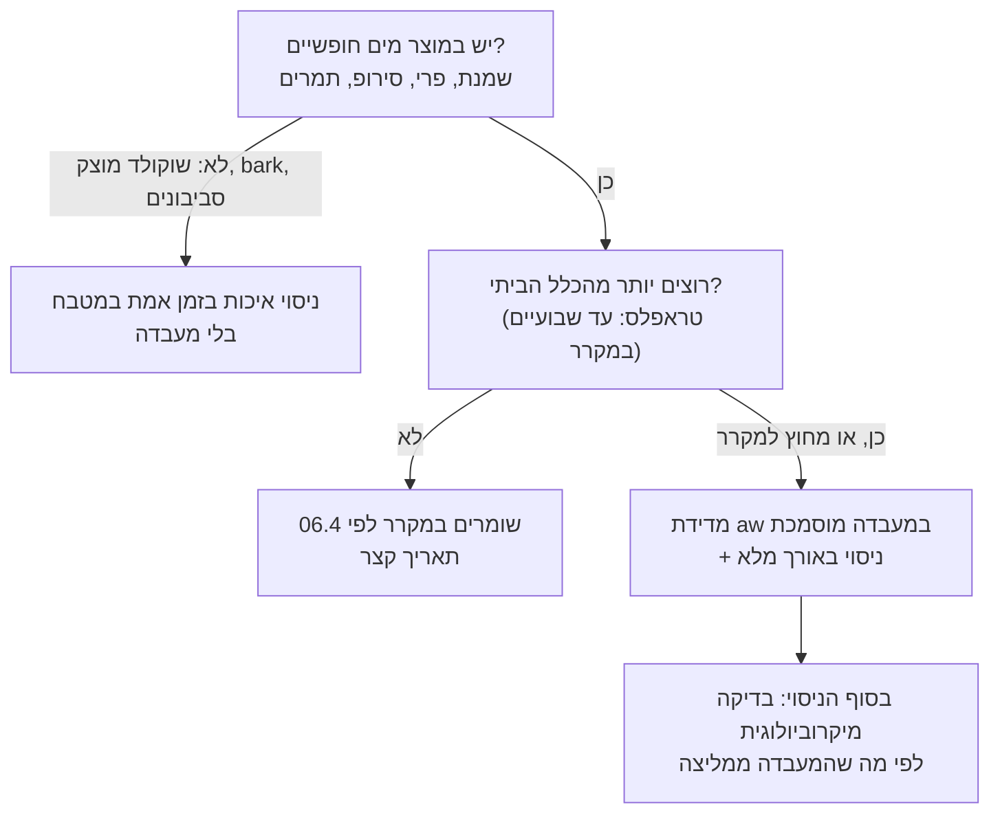

# 18.2 · מבחני חיי מדף ואחסון

התאריך שכתבתם על התווית ב־18.1 הוא הבטחה, ולפי חוק המזון אתם אלה שקובעים אותו ועומדים מאחוריו (16.4). בשיעור הזה לומדים מה בדיוק נגמר בכל סוג של מוצר שוקולד, מתי מספיק ניסוי במטבח ומתי צריך מדידה במעבדה, ואיך מתכננים ניסוי חיי מדף שנותן תאריך שאפשר להדפיס. בסוף השיעור יש לכם תוכנית ניסוי, והניסוי עצמו כבר רץ על מארז אחד.

## מה צריך

| פריט | כמות לתרגול | כמות מלאה | הערה |
|---|---|---|---|
| מארז אחד מהמוצר שתבדקו (למשל 5 סביבונים) | 2 מארזים, או 10-12 יחידות בודדות | 6 יחידות לכל נקודת בדיקה ולכל תנאי | מאותה אצווה, עם תווית אצווה |
| קופסאות אטומות לאור ולריח | 2 | | אחת לכל תנאי אחסון |
| מדחום ומד לחות (היגרומטר) דיגיטלי פשוט | 1 לכל מקום אחסון | | רושם מינימום ומקסימום |
| מדבקות ועט | 12 | | מספר אצווה, תאריך, נקודת בדיקה |
| דף ציון (בשיעור) ו[יומן התרגול](../../templates/practice-log.md) | 1 | | |

**אלרגנים:** אין מתכון חדש. המוצר שבודקים שומר על האלרגנים שבתווית שלו (18.1): בסביבונים **חלב** ו**שעורה** (גלוטן), ו"עלול להכיל" סויה, אגוזים ובוטנים.

## למה זה עובד

### מה נגמר קודם: ארבע דרכים להזדקן

חיי מדף נגמרים ברגע שהמוצר כבר לא כמו שהבטחתם, או שהוא כבר לא בטוח. בשוקולד יש ארבע דרכים לזה:

| מוצר | מה מסיים אותו | בטיחות או איכות | איפה למדתם |
|---|---|---|---|
| שוקולד מוצק: טבלה, bark, סביבונים, מטבעות | פריחת שומן וסוכר, ספיגת ריחות, איבוד ברק | איכות | [03.5](../module-03/lesson-05.md) |
| מוצר עם אגוזים, פרלינה, טחינה | טעם מעופש (חמצון השומן), פריחה מהירה יותר | איכות | [13.4](../module-13/lesson-04.md) |
| גנאש, טראפלס, קרמל רך, מילויי פירות | חיידקים, שמרים ועובש; התייבשות; נדידת לחות | בטיחות ואיכות | [06.4](../module-06/lesson-04.md), [07.1](../module-07/lesson-01.md), [07.3](../module-07/lesson-03.md) |
| כדורי תמרים ושוקולד גולמי | חיידקים ועובש; מים מהתמרים | בטיחות | [13.3](../module-13/lesson-03.md#חיי-מדף-איפה-הכדורים-יושבים) |

בשוקולד מוצק אין כמעט מים חופשיים, ולכן מה שבודקים בו הוא איכות: ברק, סנאפ, ריח וטעם. במוצר עם שמנת, פרי או סירופ, השאלה הראשונה היא בטיחות, והכלי שעונה עליה הוא פעילות מים.

### פעילות מים: המספר שמפריד בין מקרר למדף

פעילות מים (water activity, aw) מודדת כמה מהמים במוצר "חופשיים" לתגובות ולמיקרואורגניזמים. Callebaut מסבירים שהיא מדד טוב יותר לסיכון קלקול מכמות המים עצמה: שני גנאשים עם אותה כמות מים נמדדו אצלם ב־0.750 וב־0.900, והשני יכול לתמוך בהרבה יותר פעילות מיקרוביאלית. לפי Kansas State (MF3674):

| טווח aw | מה כבר לא גדל בתחתית הטווח | מזונות לדוגמה |
|---|---|---|
| 0.95-0.91 | סלמונלה ועוד חיידקים רבים | גבינות מסוימות |
| 0.91-0.87 | שמרים רבים | עוגות ספוג |
| 0.87-0.80 | רוב העובשים, Staphylococcus aureus | חלב מרוכז ממותק |
| 0.80-0.75 | רוב החיידקים שאוהבים מלח | ריבה |
| 0.75-0.65 | עובשים שאוהבים יובש (xerophilic) | פאדג', מרשמלו |
| 0.65-0.60 | שמרים שאוהבים סוכר (osmophilic) | פירות מיובשים, דבש |

שני מספרים חשובים במיוחד. **0.85**: לפי Kansas State, מעל 0.85 (עם pH מעל 4.6) מזון נחשב מזון שצריך בקרת זמן וטמפרטורה, כלומר מקרר. גנאש שמנת מבושל נמדד ב־0.88 בפרסום אחר של Kansas State ([16.1](../module-16/lesson-01.md)). **0.60**: מתחתיו כמעט שום דבר לא גדל, וזה המקום שבו נמצא שוקולד מוצק.

מדידה של aw נעשית במכשיר ייעודי (מד פעילות מים), שמודד את הלחות היחסית של האוויר מעל הדגימה בשיווי משקל. FDA מזכירים שזה לוקח לפעמים כמה שעות, ושהמספר עולה עם הטמפרטורה: הפרש של מעלה אחת בין הדגימה לאוויר יכול להזיז את התוצאה בכ־0.05. לכן Callebaut מודדים ב־20°C, הטמפרטורה שבה המוצר נמכר. מכשיר כזה יקר לרוב למטבח קטן, ולכן מדידה של מוצר חדש נעשית במעבדה.

### מתי צריך מעבדה

אין בחקיקה שקראנו כלל שאומר "מוצר X חייב בדיקת מעבדה". מה שיש הוא חובה לעמוד מאחורי התאריך (סעיף 12) ולשמור רשומות (סעיף 32). זה הכלל המעשי שלנו, לא הנחיה רשמית:

Callebaut מוסיפים שני כללים: אף מדידה אחת, לא תכולת מים ולא aw, לא מנבאת לבד איך המוצר יזדקן; ומבטיחים חיי מדף רק כשבטוחים בהם ב־100%, אחרי ניסוי באורך מלא. הם גם מציעים קיצור דרך הוגן: גנאשים עם אותו aw (0.800) החזיקו אצלם 60 יום, ולכן הרבה שוקולטיירים עובדים עם שניים-שלושה מתכוני בסיס בלבד, ומשנים רק טעמים. מתכון בסיס שנמדד ונבדק פעם אחת מכסה כמה מוצרים, כל עוד שוקלים אותו בדיוק.

מה שואלים מעבדה: אם היא מוסמכת לבדיקות מזון, באיזו טמפרטורה היא מודדת aw, כמה דגימה צריך, תוך כמה זמן התשובה ובכמה, ואילו בדיקות מיקרוביולוגיות היא ממליצה למוצר שלכם. את לשכת הבריאות המחוזית שואלים אילו מעבדות מוכרות (16.5).

### איפה שומרים: מספרים ולא "מקום קריר"

| מה | המספר | המקור |
|---|---|---|
| טמפרטורה לשוקולד | 12-18°C | Callebaut, good storage practices |
| טמפרטורה למוצרים מוגמרים | קבועה, 18-20°C | Callebaut, fat bloom |
| לחות יחסית | עד 70% | Callebaut |
| אור, ריחות, אוויר | אריזה אטומה, רצוי גם לאור; בלי ריחות חזקים ובלי רוח | Callebaut |
| מקרר | בדרך כלל לא מומלץ לממתקים: לח, ומוצרים סופגים לחות | Callebaut |
| אחרי קירור | פותחים רק אחרי שהאריזה חזרה לטמפרטורת החדר, אחרת עיבוי ופריחת סוכר | Callebaut |

שני הטווחים של Callebaut נפגשים ב־18°C, ומה שחשוב לא פחות הוא שהטמפרטורה **קבועה**. בדירה ישראלית בקיץ יש 26-30°C, ולכן מחסן לשוקולד הוא ארון בחדר ממוזג או מקרר יין מבוקר טמפרטורה, עם מדחום שרושם מינימום ומקסימום ([16.3](../module-16/lesson-03.md)). מוצרים עם שמנת הם יוצאי הדופן: הם במקרר עד 4°C, בקופסה סגורה, ומחממים אותם סגורים לפני פתיחה.

## שלב אחר שלב

> [!CAUTION]
> בניסוי טועמים רק מוצר שאין בו סימן קלקול. מוצר עם עובש, ריח חמוץ, תסיסה או בועות לא טועמים בכלל: רושמים "נכשל" וזורקים. בגנאש ובמוצרים עם שמנת לא ממשיכים ניסוי מעבר לתאריך שהמעבדה או הכלל הביתי נותנים, בלי ייעוץ.

1. **מגדירים יעד**: כמה זמן אתם רוצים (Callebaut מציעים לחשוב על 60 או 90 יום), איפה המוצר יישמר אצלכם ואצל הלקוח, ואם הוא נשלח. היעד קובע את אורך הניסוי.
2. **מסווגים** כל מוצר במארז לפי טבלת ארבע הדרכים. אם יש במוצר מים חופשיים ורוצים יותר מהכלל הביתי, מזמינים מדידת aw לפני שמתחילים.
3. **אצווה אחת, מתכון אחד**: מכינים את המוצר בדיוק לפי המתכון והשקילה שתשתמשו בהם במכירה, ואורזים באריזה הסופית. רושמים אצווה (16.4).
4. **שני תנאים**: (א) תנאי התווית, למשל 18°C ביובש; (ב) תנאי "יום רע", למשל מדף בחדר לא ממוזג בקיץ, 24-26°C. התנאי השני מראה מה קורה אצל לקוח שלא קרא את התווית.
5. **חמש נקודות בדיקה**: יום 0, ואחר כך 25%, 50%, 75% ו־100% מהיעד, ועוד אחת ב־125% אם יש מספיק דגימות. בכל נקודה פותחים יחידה חדשה מכל תנאי, לא אותה יחידה שוב.
6. **דף ציון**: לכל יחידה ציון 1-5 בחמישה דברים: מראה (ברק, פריחה, כתמים), סנאפ ומרקם, ריח, טעם, ובמוצרים עם מילוי גם סימני קלקול (עובש, תסיסה, הפרדת שומן). משווים תמיד ליחידה ביום 0 בתמונה, וטועמים לצד מוצר טרי אם יש.
7. **כלל הכשלון**: מראש מחליטים מה זה "נכשל": למשל ציון 3 ומטה בפריט אחד, או כל סימן קלקול.
8. **רושמים** טמפרטורה ולחות מינימום-מקסימום בכל נקודת בדיקה.
9. **התאריך**: נקודת הבדיקה האחרונה שבה הכול עבר, בתנאי התווית, פחות מרווח ביטחון. התאריך שעל התווית לא מאריך את עצמו עד שהניסוי הוכיח את זה.
10. **חוזרים על הניסוי** כשמשנים מתכון, ספק שוקולד, אריזה או מקום אחסון.

## בדיקה: איך יודעים שהצליח

- לכל מוצר במארז יש סיווג, והחלטה כתובה אם צריך מעבדה.
- יש תוכנית: יעד, שני תנאים, חמש נקודות עם תאריכים, וכמה דגימות נשמרו לכל אחת.
- יום 0 תועד: תמונה, ציון, טמפרטורה ולחות.
- כלל הכשלון כתוב לפני שהתחלתם, לא אחרי.
- תנאי האחסון על התווית (18.1) זהים לתנאי (א) בניסוי.

## כשזה משתבש

| מה רואים | למה זה קורה | מה עושים עכשיו | איך מונעים בפעם הבאה |
|---|---|---|---|
| ביום 30 שכבה אפורה על הסביבונים בתנאי "יום רע" | פריחת שומן מחום ומתנודות | רושמים; זה המידע שהניסוי נועד לתת | הוראת אחסון ברורה, ומשלוח קיץ לפי 20.3 |
| כתמים לבנים מחוספסים אחרי הוצאה מהמקרר | עיבוי: פריחת סוכר | בבדיקה הבאה מחממים סגור לפני פתיחה | מקרר רק כשחייבים, ופתיחה אחרי חימום |
| אין יחידה לנקודה האחרונה | נפתחו יחידות "רק לטעום" | מסיימים בנקודה שיש, והתאריך לפיה | סופרים דגימות מראש, ומסמנים "לא לאכול" |
| טעם קרטון או צבע בשוקולד לבן | אור או ריחות במחסן | מעבירים לקופסה אטומה לאור | אריזה אטומה, ומחסן בלי ריחות |
| הטמפרטורה במחסן "18°C" אבל המדחום רשם 27°C מקסימום | חלון, שמש אחר הצהריים, מזגן שכבה | מתייחסים לניסוי כאילו נעשה בחום | מדחום מינימום-מקסימום, ומקום אחר |
| גנאש נמדד aw 0.88 | הרבה שמנת, מעט סוכר | נשאר מוצר מקרר עם תאריך קצר | מתכון בסיס עם פחות מים, סוכר אינוורטי או גלוקוזה (06.4) |

### מה עושים עם מה שלא הצליח

דגימה שעברה את הבדיקה ולא נאכלה בה לא נזרקת: שוקולד מוצק עם פריחה נמס מחדש ומטומפר, או הולך לשוקו, בראוניז ו־bark. מה שנזרק הוא רק מוצר עם סימן קלקול (עובש, תסיסה, ריח חמוץ), ומוצר עם שמנת שעבר את התאריך הבטוח שלו.

## חלופות

### טבעוני / פרווה

גנאש עם קרם קוקוס או שמנת צמחית במקום שמנת הוא מוצר חדש לעניין חיי מדף: כמות המים, השומן והסוכר שונה, ולכן גם ה־aw. לא מעתיקים תאריך מהגרסה החלבית; מודדים ומנסים מחדש ([12.3](../module-12/lesson-03.md)). קו פרווה ממריר בלבד, בלי מילוי, הוא הכי פשוט לניסוי: הוא מתנהג כמו שוקולד מוצק.

### בריא יותר

סוכר הוא לא רק טעם: הוא קושר מים ומוריד aw. מילוי עם פחות סוכר, או עם תמרים במקום סוכר, הוא מילוי עם יותר מים חופשיים וחיי מדף קצרים יותר ([13.3](../module-13/lesson-03.md)). מלטיטול ואריתריטול משנים את ה־aw אחרת מסוכר ([13.2](../module-13/lesson-02.md)), ולכן גרסה מופחתת סוכר צריכה מדידה וניסוי משלה. מלטיטול בכמות גורם לגזים ולשלשול, ולא מתאים לילדים בכמות.

### כשרות

חיי מדף לא משנים כשרות, אבל ניסוי מחייב לשמור דגימות חודשים: שומרים בנפרד מוצרים חלביים ופרווה, ומסמנים כל קופסה, כדי שבסוף הניסוי לא יתערבבו. כשרות חומרי הגלם: [שלושה כללים](../../references/kashrut-guide.md#שלושה-כללים). אם יש ספק, שואלים את הרב.

## איפה קונים

קופסאות אטומות ומדבקות: [קופסאות פרלינים](../../references/where-to-buy.md#קופסאות-פרלינים), [מדבקות ותוויות](../../references/where-to-buy.md#מדבקות-ותוויות). מדחום: [מדחום](../../references/where-to-buy.md#מדחום). מה מחפשים: מדחום-מד לחות דיגיטלי שרושם מינימום ומקסימום (נמכר בחנויות כלי בית ואלקטרוניקה), וקופסאות שלא עוברות דרכן אור. מעבדה: שואלים את לשכת הבריאות המחוזית אילו מעבדות מוכרות לבדיקות מזון (16.5). מקורות: Callebaut על חיי מדף, פעילות מים ואחסון; Kansas State ו־FDA על פעילות מים (ברשימת המקורות).

## תרגול

### משימה

תוכנית ניסוי חיי מדף למוצר אחד, והתחלת הניסוי: יום 0 מתועד, ודגימות לכל נקודה ארוזות ומסומנות. זה החלק של התאריך ב[פרויקט המודול](../../projects/m18-product-label.md).

### זמן

20 דקות לתוכנית, 30 לאריזת דגימות ולתיעוד יום 0, ועוד 10 דקות בכל נקודת בדיקה.

### יומן

ב[יומן התרגול](../../templates/practice-log.md): היעד, שני התנאים, תאריכי הבדיקות, וכלל הכשלון. בכל נקודה: ציונים, תמונה, טמפרטורה ולחות.

דוגמה פתורה

**מוצר**: מארז 5 סביבונים, אצווה 261125-S (18.1). שוקולד מוצק, בלי מילוי ובלי אגוזים: בלי מעבדה.

**יעד**: 120 יום. על התווית עד סוף הניסוי: 60 יום.

**דגימות**: 12 סביבונים. 6 בתנאי (א), 6 בתנאי (ב), כל אחד בשקית צלופן סגורה ומסומן "ניסוי, לא לאכול".

| נקודה | תאריך | (א) ארון בחדר ממוזג, 18°C ביובש | (ב) מדף במטבח, 24-26°C |
|---|---|---|---|
| יום 0 | 25.11.2026 | 5/5 בכול; תמונה | 5/5 בכול; תמונה |
| 25% | 25.12.2026 | | |
| 50% | 24.01.2027 | | |
| 75% | 25.02.2027 | | |
| 100% | 25.03.2027 | | |
| 125% | 24.04.2027 | | |

**דף ציון** (1-5): מראה, סנאפ, ריח, טעם, "קלקול: אין/יש". **נכשל**: 3 ומטה בפריט אחד.

**החלטה מראש**: אם (א) עובר ב־100%, התאריך בתווית הבאה יהיה 90 יום (מרווח של 30). אם (ב) נכשל ב־25%, התווית תכתוב גם "לא לחשוף לשמש ולחום", והמשלוחים בקיץ ייצאו בקופסה מבודדת.

**לשם השוואה, טראפלס שמנת**: מים חופשיים, aw כ־0.88 (16.1). יעד של 3 שבועות מחוץ למקרר דורש מדידת aw במעבדה ומתכון אחר; בלי זה נשאר הכלל הביתי: מקרר, עד כשבועיים ([06.4](../module-06/lesson-04.md#מה-זה-אומר-בבית)).

### בדיקה עצמית

- [ ] כל מוצר מסווג, וכתבתי אם צריך מעבדה ולמה.
- [ ] יש יעד, שני תנאים, חמש נקודות עם תאריכים, ומספיק דגימות.
- [ ] יום 0 מתועד בתמונה ובציונים.
- [ ] כלל הכשלון נכתב לפני שהתחלתי.
- [ ] תנאי האחסון בתווית זהים לתנאי (א).

## סיכום

- שוקולד מוצק מזדקן באיכות (פריחה, ריחות, חמצון); מוצר עם שמנת, פרי או תמרים מזדקן גם בבטיחות.
- פעילות מים מפרידה בין מקרר למדף: מעל 0.85 מוצר מקרר, מתחת ל־0.60 כמעט שום דבר לא גדל. מודדים במעבדה ב־20°C.
- מעבדה צריך כשיש מים חופשיים ורוצים יותר מהכלל הביתי. אף מדידה לא מחליפה ניסוי באורך מלא.
- ניסוי בזמן אמת: אצווה אחת, שני תנאים, חמש נקודות, דף ציון וכלל כשלון שנכתב מראש. התאריך על התווית לפי הנקודה האחרונה שעברה, פחות מרווח.
- אחסון: 12-18°C ולחות עד 70%, קבוע, אטום לאור ולריחות; לא במקרר, חוץ ממוצרים עם שמנת.
