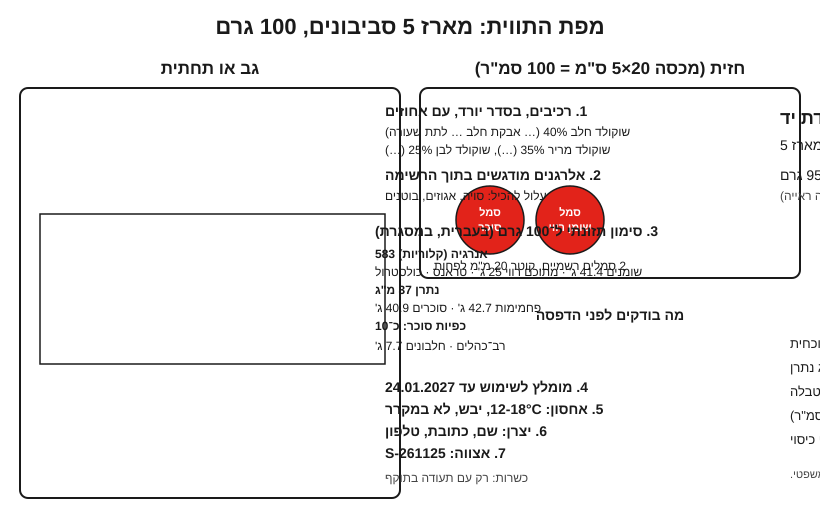

# 18.3 · עיצוב מארז, מיתוג ותוויות

יש לכם תווית מלאה (18.1) ותאריך בדרך (18.2). עכשיו צריך להכניס את כל זה על קופסה של 20×5 ס"מ, כך שהלקוח יבין מה הוא קונה, המידע המחייב יהיה קריא, והמארז ייראה כמו של עסק אחד ולא של שלושה. בשיעור מתכננים את הפריסה, בוחרים איך מדפיסים כל חלק, ומדפיסים הדפסת ניסיון שנמדדת בסרגל. אין כאן המלצה על בית דפוס או על מוצר מסוים: אפשרויות ההדפסה מתוארות באופן כללי, כדי שתוכלו לבקש הצעות מכל מקום.

## מה צריך

| פריט | כמות לתרגול | כמות מלאה | הערה |
|---|---|---|---|
| הקופסה שבה תמכרו (או זו של מודול 8 או 11) | 1 | | מודדים אותה |
| התווית מ־18.1 | 1 | | הטקסט המלא |
| דף מדבקות A4 ומדפסת ביתית | 2-3 דפים | | להדפסת ניסיון |
| סרגל מתכת עם מילימטרים, זכוכית מגדלת | 1 | | למדידת גובה אות וקוטר |
| מחשב או טלפון עם תוכנת עיצוב פשוטה | 1 | | כל תוכנה שמאפשרת לקבוע גודל במילימטרים |
| מארז מוכן עם שוקולד | 1 | | לבדיקת ההדבקה ולצילום ב־18.4 |

**אלרגנים:** אין מתכון. המארז שעליו מדביקים את התווית נושא את האלרגנים שבה: בסביבונים **חלב** ו**שעורה** (גלוטן), ו"עלול להכיל" סויה, אגוזים ובוטנים.

## למה זה עובד

### למארז שלוש עבודות

1. **להגן**: Callebaut ממליצים על אריזה אטומה, רצוי גם לאור, מחומר יציב ובלי ריח. אור ואוויר פוגעים בטעם, ריחות נספגים בשומן ([11.1](../module-11/lesson-01.md)).
2. **להודיע**: כל פרטי התווית, קריאים ובמקום שרואים אותם.
3. **למכור**: הלקוח מזהה את העסק שלכם, ומבין מה בפנים, לפני שהוא פותח.

כשיש התנגשות, קודם הגנה ומידע, אחר כך עיצוב.

### מה הולך לחזית, ומה לגב

תקנה 1169/2011 (סעיף 13(5)) דורשת ששם המזון והכמות נטו יופיעו **באותו שדה ראייה**, כלומר במקום שרואים בבת אחת בלי לסובב את הקופסה. ותקנות הסימון התזונתי שמות את הסמלים האדומים **בחזית**. מכאן הפריסה:

| חזית (מכסה) | גב, תחתית או צד |
|---|---|
| שם העסק או הלוגו | רשימת רכיבים עם אלרגנים מודגשים |
| שם המוצר ("סביבוני שוקולד: חלב, מריר ולבן") | "עלול להכיל" |
| משקל נטו, באותו שדה ראייה עם השם | טבלה תזונתית במסגרת |
| שני סמלים אדומים, בקוטר לפי שטח החזית | תאריך ותנאי אחסון |
| | יצרן, כתובת, טלפון, אצווה |

**שטח החזית** לפי תקנות הסימון התזונתי: בקופסה מלבנית, כל החזית בלי השוליים האטומים. בגליל, 40% מהגובה כפול ההיקף. בצורה אחרת, 40% מהשטח הכולל בלי מכסה, בסיס וצוואר, אלא אם הצורה מראה בבירור מה החזית. את הקוטר בוחרים מטבלת 18.1: מכסה של 100 סמ"ר מקבל סמלים של 20 מ"מ לפחות; של 101 סמ"ר כבר 25 מ"מ. מודדים לפני שמעצבים.

### גודל אות: מספר שמודדים בסרגל

| מה | המספר | המקור |
|---|---|---|
| פרטי החובה, אריזה רגילה | גובה x (x-height) של 1.2 מ"מ לפחות | 1169/2011, סעיף 13(2) |
| פרטי החובה, כשהמשטח הגדול של האריזה קטן מ־80 סמ"ר | 0.9 מ"מ לפחות | סעיף 13(3) |
| הטבלה התזונתית (ישראל) | 120% מהגודל המזערי לרכיבים לפי ת"י 1145 | תקנות הסימון התזונתי |
| סמל אדום | 15-35 מ"מ קוטר לפי שטח החזית; אדום CMYK 0/100/95/0 או Pantone 485, אותיות לבנות | תקנות הסימון התזונתי |

גובה x הוא הגובה של אות לטינית קטנה כמו x, והתקנה מגדירה אותו לאותיות לטיניות. לא מצאנו כלל שאומר איך מודדים אותו בעברית. ההחלטה השמרנית שלנו: אות עברית בלי עוקץ, כמו נ או ס, בגובה 1.2 מ"מ לפחות בהדפסה. בתוכנות עיצוב זה בדרך כלל גופן של 8 נקודות ומעלה, אבל זה תלוי בגופן, ולכן **מודדים את ההדפסה**, לא את המספר בתוכנה. גם הטבלה התזונתית צריכה להיות גדולה יותר מהרכיבים. את הגודל המדויק לפי ת"י 1145 לא קראנו; שואלים את לשכת הבריאות (16.5).

קריאות היא לא רק גודל. סעיף 13(1) דורש מידע "קריא בבירור" שלא מוסתר ולא נקטע על ידי טקסט, תמונה או חומר אחר: לא מדפיסים רכיבים על רקע של תמונת שוקולד, ולא מדביקים סרט מעל הטבלה.

### מה קבוע, ומה משתנה

| סוג מידע | דוגמה | כמה פעמים משתנה | איך מדפיסים |
|---|---|---|---|
| קבוע לכל העסק | לוגו, שם העסק, כתובת, צבעים | כמעט אף פעם | קופסה ממותגת, חותמת או מדבקת לוגו |
| קבוע לכל מוצר | שם, רכיבים, אלרגנים, טבלה, סמלים, אחסון | כשמשתנה מתכון או ספק | מדבקת מוצר |
| משתנה לכל אצווה | תאריך, מספר אצווה, לפעמים משקל | כל יום ייצור | מדבקה קטנה, מדפסת תוויות או חותמת תאריך |

ההיגיון: כל דבר שמודפס ישירות על הקופסה ננעל עד שהמלאי נגמר. אם הרכיבים מודפסים על 500 קופסאות והספק החליף שוקולד (18.1), יש לכם 500 קופסאות עם תווית שגויה. לכן במטבח קטן עובדים בדרך כלל עם קופסה כללית (ריקה או ממותגת), מדבקת מוצר, ומדבקת תאריך ואצווה.

### אפשרויות הדפסה, באופן כללי

| שיטה | מה זה | מתאים ל | שימו לב |
|---|---|---|---|
| מדפסת ביתית על דפי מדבקות A4 | הזרקת דיו או לייזר | כמויות קטנות, ניסיונות | דיו יכולה להימרח מלחות; מודדים צבע אדום של הסמל |
| מדפסת תוויות תרמית ישירה (direct thermal) | נייר רגיש לחום, בלי דיו | תאריך ואצווה | הדפוס דוהה בחום ובאור; לפי Barcodes Australia, 6-9 חודשים לפי הסביבה. בשחור בלבד |
| מדפסת תוויות בהעברה תרמית (thermal transfer) | ראש חם מעביר צבע מסרט | תוויות שצריכות להחזיק מעל חצי שנה | עמיד יותר, ויקר יותר (סרטי צבע) |
| דפוס דיגיטלי (בית דפוס או שירות מקוון) | מדבקות בגליל או בגיליון, בצבע, בכמויות קטנות-בינוניות | מדבקות מוצר | מבקשים הוכחה (proof) מודפסת, לא רק קובץ |
| קופסה מודפסת (אופסט, דפוס משי, הטבעה) | ההדפסה על הקרטון עצמו | לוגו ומיתוג קבוע | כמות מינימום גבוהה; לא מדפיסים עליה מידע שמשתנה |

בהצעת מחיר שואלים כל ספק: כמות מינימום, גודל וחיתוך, סוג נייר, התאמה לצבע הסמל, הוכחה מודפסת וזמן אספקה. מחירים משתנים ולא מובאים כאן.

### מה שנוגע בשוקולד

הקופסה החיצונית לא נוגעת בשוקולד, אבל התחתית, הנייר או הצלופן כן. באיחוד האירופי (תקנה 1935/2004, סעיף 15) חומר שמיועד למגע במזון ונמכר ריק מסומן "for food contact" או בסמל של כוס ומזלג, אלא אם ברור מטבעו שהוא למזון. את הכלל הישראלי המקביל לא בדקנו. מה שעושים: קונים שכבה פנימית שמוצהרת כמתאימה למגע במזון, ושומרים את ההצהרה של הספק עם רשומות האצווה ([11.1](../module-11/lesson-01.md#מה-מותר-לגעת-בשוקולד)). מדבקה לא נוגעת בשוקולד: מדביקים אותה על הקופסה או על שקית סגורה.

### מיתוג: מעט החלטות, תמיד אותו דבר

מיתוג במטבח קטן הוא חמש החלטות, ואחריהן עקביות: שם, לוגו פשוט שקריא גם בגודל 2 ס"מ, שניים-שלושה צבעים, גופן אחד או שניים, וסגנון צילום אחד (18.4). אותו דבר על הקופסה, על המדבקה, באתר ובאינסטגרם. שני גבולות: חוק המזון (סעיף 17) אוסר הטעיה, גם "בהצגה אחרת", ולכן העיצוב לא מרמז על מה שאין ("בלגי", "בעבודת יד" על מוצר קנוי, תמונה של פרלין שלא במארז). ושם ולוגו לא מעתיקים מותג קיים; לפני שמדפיסים, בודקים במאגר סימני המסחר של רשות הפטנטים שהשם לא תפוס.

## שלב אחר שלב

> [!WARNING]
> עובדים עם סכין חיתוך וסרגל מתכת: חותכים על משטח חיתוך, הרחק מהשוקולד, ומרחיקים את היד מקו החיתוך. מדבקות ניסיון לא מדביקים על מארז שנמכר.

1. **מודדים** את הקופסה: אורך, רוחב וגובה של כל פאה. מחשבים את שטח החזית לפי התקנות, ובוחרים קוטר לסמלים.
2. **ממיינים** את התווית מ־18.1 לשלוש קבוצות: קבוע לעסק, קבוע למוצר, משתנה לאצווה.
3. **מחליטים** לכל קבוצה איך מדפיסים (הטבלה למעלה), ואיפה היא יושבת על הקופסה.
4. **מסקיצים** בעיפרון, בגודל אמיתי, את החזית ואת מדבקת הגב. שם ומשקל נטו באותו שדה ראייה.
5. **מעצבים** בתוכנה, ביחידות של מילימטרים. סמלים אדומים בצבע הרשמי, בקוטר שבחרתם. רכיבים על רקע לבן או בהיר אחיד.
6. **מדפיסים** הדפסת ניסיון ב־100%, בלי "התאמה לעמוד".
7. **מודדים** בסרגל ובזכוכית מגדלת: גובה אות בעברית בטקסט הקטן ביותר, גובה האות בטבלה, וקוטר הסמל.
8. **מדביקים** על קופסה ריקה, ובודקים: שם ומשקל נראים יחד; הסרט, המכסה או הקיפול לא מסתירים כלום; המדבקה לא מתקלפת בפינה.
9. **נותנים לקרוא** למישהו אחר, בלי הסבר: מה המוצר, כמה הוא שוקל, מה האלרגנים, עד מתי. כל מקום שבו הוא היסס, מתקנים.
10. **שומרים** את הקובץ הסופי עם תאריך וגרסה, ואת הדפסת הניסיון המדודה עם רשומות המוצר.

## בדיקה: איך יודעים שהצליח

- שם המוצר ומשקל נטו באותו שדה ראייה בחזית.
- הסמלים בקוטר שמתאים לשטח החזית שנמדד, באדום הנכון, ולא מוסתרים בסרט.
- הטקסט הקטן ביותר בהדפסה בגובה 1.2 מ"מ לפחות (0.9 באריזה שהמשטח הגדול שלה קטן מ־80 סמ"ר), והטבלה גדולה ממנו.
- תאריך ואצווה במדבקה נפרדת או בשדה ריק, לא מודפסים מראש.
- אדם אחר מצא את האלרגנים ואת התאריך תוך פחות מ־10 שניות.
- אין בעיצוב מילה, סמל או תמונה שמרמזים על משהו שאין במוצר.

## כשזה משתבש

| מה רואים | למה זה קורה | מה עושים עכשיו | איך מונעים בפעם הבאה |
|---|---|---|---|
| הסמל יצא 17 מ"מ במקום 20 | הדפסה עם "התאמה לעמוד" | מדפיסים שוב ב־100% | בודקים קנה מידה בכל הדפסה, עם קו של 100 מ"מ בשוליים |
| האדום של הסמל יצא כתום או ורוד | מדפסת ביתית, או קובץ ב־RGB | מבקשים הוכחה מבית דפוס, בקובץ CMYK | מגדירים את הצבע לפי התקנות בקובץ המקור |
| תאריך במדבקה תרמית דהה במשלוח בקיץ | נייר תרמי ישיר רגיש לחום | מדבקה חדשה; לא משאירים תאריך לא קריא | העברה תרמית או מדבקה מודפסת לתאריך במוצר ארוך |
| הסרט מסתיר את המשקל | עיצוב בלי הקופסה ביד | מזיזים את הסרט או את הטקסט | מדביקים ניסיון על קופסה אמיתית, עם הסרט |
| 300 קופסאות מודפסות עם "לציטין סויה" שהשתנה | מידע משתנה הודפס על הקופסה | מדבקה מתוקנת שמכסה לגמרי | על הקופסה רק מה שלא משתנה |

### מה עושים עם מה שלא הצליח

מדבקות ניסיון וקופסאות עם הדפסה שגויה לא נזרקות: הן משמשות לעוד ניסיון הדבקה, לקופסאות של הבית ולתרגול צילום (18.4). קופסה שהמידע עליה שגוי נמכרת רק עם מדבקה מתוקנת שמכסה את הטעות לגמרי. והשוקולד שבתוך מארז הניסיון חוזר לשולחן, לשוקו או ל־bark.

## חלופות

### טבעוני / פרווה

קו טבעוני צריך להיראות שונה מספיק כדי שלא יתבלבלו בו, למשל צבע מדבקה אחר, אבל הסימן הזה הוא עזר, לא הצהרה: המילה "טבעוני" נכתבת רק אחרי בדיקה של כל רכיב ([12.1](../module-12/lesson-01.md)), ו"עלול להכיל חלב" נשאר אם הוא על אריזת השוקולד. לא מעצבים סמל טבעוני שנראה כמו סמל כשרות או כמו סמל של גוף מאשר.

### בריא יותר

העיצוב יכול להטעות גם בלי מילים: עלה ירוק, לב או "טבעי" גדול על מארז עם שני סמלים אדומים הם רמז שהמוצר בריא. אם יש קו עם פחות סוכר, מראים את זה במספרים בטבלה ובאחוז הקקאו, לא בסמל ([13.5](../module-13/lesson-05.md)). מארז קטן יותר, למשל 3 סביבונים במקום 5, הוא מנה קטנה יותר; הוא צריך תווית משלו עם משקל נטו נכון. מוצר עם מלטיטול: האזהרה, אם תחול, צריכה מקום על התווית מההתחלה. מלטיטול בכמות גורם לגזים ולשלשול, ולא מתאים לילדים בכמות.

### כשרות

בלי תעודת הכשר לעסק אין "כשר" ואין סמל כשרות על המארז, וגם לא עיצוב שנראה כמו סמל כזה (חוק איסור הונאה בכשרות, סעיף 4; [17.4](../module-17/lesson-04.md)). עם תעודה, מקום הסמל והנוסח נקבעים לפי מה שהגוף המשגיח מאשר, ולכן משאירים לו מקום בעיצוב ושואלים לפני הדפסה. כשרות חומרי הגלם: [שלושה כללים](../../references/kashrut-guide.md#שלושה-כללים). אם יש ספק, שואלים את הרב.

## איפה קונים

קופסאות: [קופסאות פרלינים](../../references/where-to-buy.md#קופסאות-פרלינים). מדבקות, דפי מדבקות ותוויות: [מדבקות ותוויות](../../references/where-to-buy.md#מדבקות-ותוויות). סרטים ועטיפות: [צלופן וסרטים](../../references/where-to-buy.md#צלופן-וסרטים). מה מחפשים: קופסה עם מכסה שטוח להדבקה; דפי מדבקות A4 מט שמתאימים למדפסת; לכמויות, בית דפוס דיגיטלי או שירות מדבקות מקוון שמקבל PDF ונותן הוכחה מודפסת. מקורות: תקנה 1169/2011 סעיף 13, תקנות הסימון התזונתי, תקנה 1935/2004 סעיף 15 (ברשימת המקורות).

## תרגול

### משימה

פריסה של המארז שלכם (חזית ומדבקת גב), הדפסת ניסיון אחת שנמדדה, ומדבקה מודבקת על קופסה ריקה. זה חלק העיצוב ב[פרויקט המודול](../../projects/m18-product-label.md).

### זמן

15 דקות למדידה ולמיון, 25 לסקיצה ולעיצוב, 20 להדפסה, מדידה והדבקה.

### יומן

ב[יומן התרגול](../../templates/practice-log.md): מידות הקופסה, שטח החזית, קוטר הסמל, גובה האות שנמדד, ומה תוקן אחרי הקריאה של אדם אחר.

דוגמה פתורה

**קופסה**: מארז סביבונים, מכסה 20×5 ס"מ, גובה 4 ס"מ. שטח החזית 100 סמ"ר: סמלים של 20 מ"מ לפחות. המשטח הגדול 100 סמ"ר, מעל 80, ולכן גובה אות 1.2 מ"מ לפחות.

**מיון**:

| קבוע לעסק | קבוע למוצר | משתנה לאצווה |
|---|---|---|
| לוגו, שם העסק, כתובת, טלפון | שם, רכיבים, "עלול להכיל", טבלה, סמלים, אחסון | "מומלץ לשימוש עד", אצווה |
| חותמת לוגו על קופסה לבנה | מדבקה בדפוס דיגיטלי | מדבקה תרמית קטנה (60 יום, בארון ממוזג); בקיץ, במשלוח, מדבקה מודפסת |

**חזית**: חותמת לוגו משמאל; בימין "סביבוני שוקולד בעבודת יד", מתחתיו "חלב, מריר ולבן · מארז 5 · 95 גרם", באותה שורת מבט. שני סמלים בקוטר 21 מ"מ (מרווח ביטחון של 1 מ"מ), מסודרים בשורה בפינה. הסרט עובר בצד הקצר ולא מסתיר כלום.

**מדבקת גב**: 9×4.5 ס"מ, רקע לבן. רכיבים בגופן שנמדד 1.3 מ"מ לאות נ; טבלה במסגרת ב־1.6 מ"מ; שדה ריק של 3×1 ס"מ למדבקת התאריך.

**הדפסת ניסיון**: הסמל יצא 19 מ"מ (התאמה לעמוד). הודפס שוב ב־100%: 21 מ"מ. האדום בהדפסה הביתית נוטה לכתום, ולכן לבית הדפוס הולך קובץ CMYK 0/100/95/0 עם בקשה להוכחה מודפסת.

**קריאה של אדם אחר**: מצא את האלרגנים מיד; את התאריך חיפש, כי המדבקה הייתה מתחת לסרט. התאריך עבר לפינה העליונה של הגב.

### בדיקה עצמית

- [ ] מדדתי את החזית, חישבתי שטח ובחרתי קוטר לסמלים.
- [ ] כל פרט בתווית ממוין לקבוע לעסק, קבוע למוצר או משתנה לאצווה, עם שיטת הדפסה.
- [ ] הדפסת ניסיון ב־100% נמדדה: אות, טבלה, סמל.
- [ ] שם ומשקל נטו באותו שדה ראייה, ושום דבר לא מוסתר.

## סיכום

- למארז שלוש עבודות: להגן, להודיע ולמכור, בסדר הזה.
- בחזית: שם ומשקל נטו באותו שדה ראייה, וסמלים אדומים בקוטר לפי שטח החזית. בגב: כל השאר.
- גובה אות של 1.2 מ"מ לפחות (0.9 מתחת ל־80 סמ"ר), טבלה גדולה יותר, ומודדים את ההדפסה עצמה.
- מה שמשתנה לא מודפס על הקופסה: מדבקת מוצר, ומדבקה נפרדת לתאריך ולאצווה. נייר תרמי ישיר דוהה בחום.
- מיתוג הוא כמה החלטות קבועות ועקביות, בלי הטעיה ובלי סמלים שנראים כמו כשרות.
