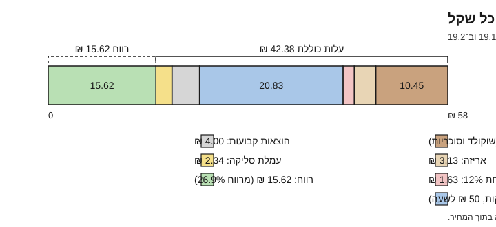

# 19.1 · תמחור מוצר

ב־[11.2](../module-11/lesson-02.md) חישבתם כמה עולים החומרים והאריזה של מארז, וקיבלתם רצפה: כ־15.2 ₪ למארז 5 סביבונים. בשיעור הזה משלימים את כל מה שהשארנו בחוץ: שעות העבודה שלכם, עלויות קבועות של העסק, עמלת סליקה ומשלוח. בסוף השיעור יש לכם חלקים 1-4 של [גיליון התמחור](../../templates/pricing-sheet.md) מלאים למוצר אחד, ואתם יודעים כמה באמת עולה לכם מארז, עוד לפני שקובעים מחיר.

## מה צריך

| פריט | כמות לתרגול | כמות מלאה | הערה |
|---|---|---|---|
| [גיליון תמחור](../../templates/pricing-sheet.md) | חלקים 1-4 | כל הגיליון (עד 19.4) | מודפס או כקובץ |
| [תכנון מארז](../../templates/gift-box-plan.md) מ־11.2 | 1 | | חומרי גלם, אריזה ופחת שכבר חישבתם |
| קבלות או צילומי מסך של מחירים, עם תאריך | לכל חומר גלם ואריזה | | המחיר ששילמתם, לא המחיר מהשיעור |
| יומן התרגול: כמה דקות לקח מארז אחד, מהמסה ועד סרט | 1 | | אם לא מדדתם, מכינים מארז אחד עם שעון |
| רשימת הוצאות קבועות לשנה (ביטוח, רו"ח, אתר, צילום, כשרות) | הערכה | | מה שידוע; השאר מסומן "הנחה" |
| מחשבון או גיליון אלקטרוני | 1 | | |

**אלרגנים:** השיעור לא מכין אוכל, אבל רשימת חומרי הגלם בגיליון היא גם רשימת האלרגנים: **סויה** (לציטין בשוקולד), **חלב** (חלב ולבן, ו"עלול להכיל" במרירים רבים), ולפי המוצר **אגוזים**, **בוטנים**, **שומשום**, **גלוטן** (בחלק מהסוכריות) ו**ביצים**. כשמחליפים ספק כדי לחסוך, בודקים שוב את האלרגנים על האריזה החדשה.

### לפני שמתחילים את המודול

קריאה היא לא תרגול: תמחור לומדים כשממלאים גיליון במספרים שלכם. האקדמיה לא יכולה לבדוק את הגיליון, ולכן בכל שיעור יש רשימת בדיקה שמשווים אליה. ממשיכים לנהל [יומן תרגול](../../templates/practice-log.md), גם להחלטות מחיר. המודול הוא **מידע כללי, לא ייעוץ מס או עסקי**: כל עובדה על מס או עמלה מופיעה עם תאריך, ובודקים אותה שוב עם רואה חשבון.

## למה זה עובד

### עלות ליחידה ועלות להזמנה

**עלות ליחידה** חוזרת בכל מארז: שוקולד, קופסה, פחת, הדקות שלכם וחלק מההוצאות הקבועות. **עלות להזמנה** חוזרת בכל הזמנה: עמלת סליקה ומשלוח; מי שקונה שלושה מארזים משלם משלוח אחד. לכן הגיליון מחשב קודם עלות ליחידה (חלקים 1-4), ובנפרד עמלה ומשלוח להזמנה. ב־19.2 מחברים את שניהם למחיר.

### חומרי גלם: ₪ לגרם מהמחיר ששילמתם

החשבון הוא תמיד אותו חשבון: מחיר הקנייה חלקי הגרמים שבאריזה נותן ₪ לגרם, וזה כפול הגרמים במוצר. האריזה שבה קונים משנה הרבה. מחירים שנבדקו ב־2026-11-10 ([קוברטורה](../../references/where-to-buy.md#קוברטורה), [מדריך הכשרות](../../references/kashrut-guide.md#קוברטורה-מרירה), ו־[17.2](../module-17/lesson-02.md) שחישב ₪ לק"ג לפי כשרות):

| מוצר וחנות | מחיר | ₪ לק"ג | ₪ לגרם | 35 גרם (שליש מ־105 גרם במארז) |
|---|---|---|---|---|
| Lubeka מריר 55%, 1 ק"ג (Bake & Make) | 65 | 65.00 | 0.065 | 2.28 |
| Lubeka חלב 35%, 1 ק"ג (Bake & Make) | 65 | 65.00 | 0.065 | 2.28 |
| Callebaut לבן 28%, 2.5 ק"ג (17.2) | 179 | 71.60 | 0.0716 | 2.51 |
| Callebaut 811 מריר, 5 ק"ג (מר־קייק) | 259 | 51.80 | 0.0518 | 1.81 |
| טווח בחנויות, שקיות קטנות ועד 1 ק"ג | | 80-100 | 0.08-0.10 | 2.80-3.50 |

ב־11.2 השתמשנו ב־90 ₪ לק"ג, באמצע הטווח של השקיות הקטנות, כי ככה קונים כשמתרגלים. בעסק קונים לפי העונה, ושקית של 1 ק"ג או יותר מורידה את השוקולד במארז מ־9.45 ₪ לכ־7.06 ₪ (35 גרם מכל אחד משלושת הראשונים בטבלה; חשבון מלא ב־[19.4](lesson-04.md)). בדוגמה של השיעור הזה נשארים עם 90 ₪, כדי שהמספרים יהיו בדיוק המספרים של 11.2.

### פחת: מה שקניתם ולא מכרתם

סביבון שנשבר, שוקולד שנשאר בשקית הזילוף, מארז שנפתח לצילום. ב־11.2 הוספנו 12% על החומרים ועל האריזה. בגיליון זו שורה בחלק 4, ומשאירים אותה גם כשנדמה שאין פחת: בעונה עמוסה יש יותר.

### עבודה: דקות כפול שכר שעתי

זו השורה שהכי קל לשכוח, וברוב המוצרים בעבודת יד היא הגדולה ביותר. החשבון: דקות למארז ÷ 60 × השכר השעתי שאתם רוצים לעצמכם.

- **דקות** מודדים. ב־[08.2](../module-08/lesson-02.md) הסביבון הראשון לקח כשעה וחצי והשני כחצי מזה; בייצור סדרתי זה יורד עוד. בדוגמה של 15.1 הלומדת מדדה 25 דקות למארז, כולל אריזה.
- **שכר שעתי** אתם בוחרים. נקודת ייחוס: שכר המינימום לשכיר הוא 35.40 ₪ לשעה מ־1.4.2026 ([כל זכות](https://www.kolzchut.org.il/he/שכר_מינימום), נבדק 2026-11-10), בלי ביטוח לאומי, פנסיה וחופשה שעצמאי משלם לעצמו. בדוגמה: 50 ₪ לשעה, "הנחה".

25 דקות כפול 50 ₪ לשעה הן 20.83 ₪: יותר מכל החומרים והאריזה יחד. זה המבנה של מוצר בעבודת יד.

המחיר 58 ₪ בתרשים נקבע ב־[19.2](lesson-02.md); כאן מסתכלים רק על העלויות.

### הוצאות קבועות: חלק יחסי לכל מארז

יש הוצאות שלא תלויות בכמה מארזים מכינים: ביטוח, הנהלת חשבונות, אתר, צילום מוצרים, חלק מהחשמל, ואם בוחרים בכך, כשרות ([17.1](../module-17/lesson-01.md): ממוצע ציבורי של 49 ₪ לשעת השגחה, מדגם 2019, לא מחיר). מחלקים את הסכום השנתי במספר המארזים שאתם מצפים למכור באותה שנה. בדוגמה: 3,600 ₪ בשנה (300 ₪ בחודש, הנחה) חלקי 900 מארזים (הנחה) = 4.00 ₪ למארז. אם מוכרים רק 450 מארזים, אותן הוצאות הן 8.00 ₪ למארז. לכן המספר הזה נבדק שוב בסוף כל עונה.

### מע"מ על מה שקניתם

המחירים בחנויות כוללים מע"מ. לפי כל זכות (נבדק 2026-11-10), עוסק פטור (מחזור שנתי עד 122,833 ₪ ב־2026) לא גובה מע"מ, וגם לא מקזז את המע"מ ששילם על קניות: הוא חלק מהעלות שלו. לכן עוסק פטור רושם בגיליון את המחיר ששילם, כולל מע"מ. עוסק מורשה מקזז את המע"מ על הקניות, ולכן העלות שלו נמוכה יותר. את ההבדל מחשבים ב־19.2.

### עמלת סליקה: אחוז ועוד סכום קבוע, לכל עסקה

כשלקוח משלם בכרטיס אשראי, בביט או ב־Apple Pay דרך האתר, ספק הסליקה לוקח עמלה. דוגמה אחת שנבדקה: לפי דף העזרה של Wix על חיבור Grow by Meshulam, מסלול "לפי שימוש" עולה 1.7% ועוד 1 ₪ לכל עסקה, **לא כולל מע"מ**, ובמחזור של 5,000 ₪ בחודש יורד ל־1.5% ועוד 1 ₪ (נבדק 2026-11-10; הדף לא מציג תאריך עדכון). זו דוגמה, לא המלצה; הספקים והמסלולים מושווים במודול 20.

שני דברים נובעים מהמבנה:

1. **הסכום הקבוע מכביד על הזמנה קטנה.** 1 ₪ על הזמנה של 58 ₪ הוא כמעט 2%; על הזמנה של 580 ₪ הוא פחות מ־0.2%.
2. **עוסק פטור משלם גם את המע"מ על העמלה**, ולא מקזז אותו: (58 × 1.7% + 1) × 1.18 = 2.34 ₪ להזמנה של מארז אחד ב־58 ₪.

### משלוח: מחיר נפרד, לא בתוך המארז

משלוח עולה לפי הזמנה ויעד. סדר גודל: בבדיקה של ice (19.11.2025), משלוח מדלת לדלת של חבילה עד 5 ק"ג עלה כ־70 ₪. זה יותר מהמארז, ולכן משלוח הוא שורה נפרדת שהלקוח רואה, או איסוף עצמי. ב־60 מארזים לכתובת אחת הוא מתחלק ל־1.17 ₪ למארז (19.2). מחיר עדכני מבקשים מהשליח; חום וקירור ב־20.3.

## שלב אחר שלב

> [!WARNING]
> משתמשים במחירים ששילמתם ובדקות שמדדתם. מספר מהשיעור במקום מדידה שלכם מוביל למחיר לא נכון, וכל הנחה מסמנים "הנחה". זה מידע כללי, לא ייעוץ מס: את מעמד המע"מ שלכם ואת ההוצאות המוכרות בודקים עם רואה חשבון.

1. **מוצר אחד.** בוחרים מוצר שכבר הכנתם לפחות פעמיים, למשל מארז 5 הסביבונים מ־[פרויקט מודול 8](../../projects/m08-dreidel-box.md) או מארז 9 הבונבונים מ־[פרויקט מודול 7](../../projects/m07-filled-selection.md).
2. **חלק 1, חומרי גלם.** לכל רכיב: מחיר קנייה, גרמים באריזה, ₪ לגרם (מחיר ÷ גרמים), גרמים ביחידה, ₪ ליחידה. גרמים ביחידה לוקחים מהשקילה ב־11.2.
3. **חלק 2, אריזה.** מחיר חבילה ÷ מספר היחידות בחבילה, לכל פריט: קופסה, כוסיות, מדבקה, סרט.
4. **חלק 3, עבודה.** רושמים דקות למארז מהיומן, מפוצלות לייצור, קישוט ואריזה. בוחרים שכר שעתי וכותבים למה. מחשבים: דקות ÷ 60 × שכר.
5. **חלק 4, פחת.** 10-15% מחומרי הגלם (ובדוגמה, כמו ב־11.2, גם מהאריזה).
6. **חלק 4, הוצאות קבועות.** רשימה שנתית ÷ מספר המארזים שאתם מצפים למכור. כל מספר לא ידוע מסומן "הנחה".
7. **עלות ליחידה.** סוכמים חלקים 1-4, בלי עמלה ובלי משלוח.
8. **עמלה להזמנה.** כותבים את מסלול הסליקה (אחוז, סכום קבוע, מע"מ, תאריך). הסכום המדויק מחושב כשיש מחיר (19.2).
9. **משלוח להזמנה.** הצעת מחיר אחת לפחות, והחלטה: הלקוח משלם בנפרד, איסוף עצמי, או חלוקה שלכם באזור מוגדר.
10. **השוואה אחת.** כותבים ליד העלות מחיר מתחרה אחד עם תאריך מ־[15.2](../module-15/lesson-02.md), ומשפט אחד: איפה ההבדל.

## בדיקה: איך יודעים שהצליח

הגיליון עובר אם כל השורות האלה מסומנות:

- [ ] לכל רכיב יש מחיר קנייה, תאריך וחשבון ₪ לגרם.
- [ ] האריזה מחושבת ליחידה, מתוך מחיר חבילה.
- [ ] יש שורת עבודה עם דקות מדודות ושכר שעתי כתוב.
- [ ] יש פחת והוצאות קבועות, וכל הנחה מסומנת.
- [ ] עלות ליחידה מחושבת בלי עמלה ובלי משלוח, ועמלה ומשלוח רשומים לכל הזמנה.
- [ ] עוסק פטור: המחירים בגיליון כוללים מע"מ, כי הוא לא מקזז אותו.
- [ ] יש מחיר מתחרה אחד עם תאריך, ומשפט על ההבדל, בלי ביקורת.

## כשזה משתבש

| מה רואים | למה זה קורה | מה עושים עכשיו | איך מונעים בפעם הבאה |
|---|---|---|---|
| העלות יצאה גבוהה ממחיר בשוק | עבודה של 25 דקות ויותר למארז, או שקיות שוקולד קטנות | בודקים איזו שורה הכי גדולה: לרוב עבודה. מחפשים שלב שאפשר להאיץ (חלקים בכמות, תבנית) | מודדים זמן אחרי 3-4 מארזים, לא אחרי הראשון |
| אין שורת עבודה בכלל | "הזמן שלי לא עולה כסף" | מוסיפים עכשיו, גם בשכר נמוך, ומסמנים | עבודה היא שורה קבועה בכל גיליון |
| העמלה "אוכלת" הזמנות קטנות | הסכום הקבוע לעסקה | מינימום להזמנה, או מארז קטן רק באיסוף | מחשבים עמלה גם להזמנה הקטנה ביותר |
| המשלוח עולה יותר מהמארז | חבילה אחת ליעד רחוק | משלוח כשורה נפרדת, או איסוף | מחליטים על מדיניות משלוח לפני המחיר |

### מה עושים עם מה שלא הצליח

שום דבר לא הולך לפח, גם לא גיליון: גיליון ישן נשמר ליד החדש עם תאריך ומה השתנה. מארז שהוכן למדידת זמן הוא דוגמה לצילום (מודול 18), טעימה או מתנה. שוקולד שנשאר בשקיות חוזר להמסה לפי סוג (חלבי ופרווה בנפרד), או הולך לשוקו ולבראוניז.

## חלופות

### טבעוני / פרווה

קו טבעוני מתומחר בגיליון נפרד, לא כאחוז תוספת: שוקולד טבעוני וקרם קוקוס עולים לרוב יותר, ייצור נפרד לוקח זמן (ניקוי, סדר יום), והכמויות קטנות. את השוואת החומרים עשיתם ב־[פרויקט מודול 12](../../projects/m12-vegan-box.md); כאן מוסיפים עבודה ועמלה.

### בריא יותר

גרסה עם פחות סוכר או מריר 70% ומעלה היא גיליון נפרד: שוקולד ללא תוספת סוכר וממתיקים עולים אחרת, ומארז "מיני" חוסך שוקולד אבל לא אריזה ועבודה, ולכן העלות ליחידה עולה. את שתי הגרסאות השוויתם ב־[פרויקט מודול 13](../../projects/m13-less-sugar-comparison.md). אין כאן טענה בריאותית, וגם לא בשם המוצר ([13.5](../module-13/lesson-05.md)).

### כשרות

כשרות נכנסת לגיליון בשני מקומות. בחלק 1: חומר גלם עם הכשר אחר יכול לעלות אחרת לק"ג, ולא תמיד יותר; ב־[17.2](../module-17/lesson-02.md) ה־811 הפרווה באריזת 5 ק"ג יצא זול לק"ג מהחלבי באריזת 2.5 ק"ג. בחלק 4: תעודת כשרות היא הוצאה קבועה (אגרה ושעות השגחה), שאת הסכום שלה מקבלים רק מרשות הכשרות, בכתב ([17.1](../module-17/lesson-01.md)). חומרי הגלם לפי [שלושת הכללים](../../references/kashrut-guide.md#שלושה-כללים). אם יש ספק, שואלים את הרב.

## איפה קונים

בשיעור הזה לא קונים; אוספים מחירים. מחירי חומרי גלם ואריזה עם תאריך: [קוברטורה](../../references/where-to-buy.md#קוברטורה), [סוכריות קישוט](../../references/where-to-buy.md#סוכריות-קישוט), [קופסאות פרלינים](../../references/where-to-buy.md#קופסאות-פרלינים), [צלופן וסרטים](../../references/where-to-buy.md#צלופן-וסרטים), [מדבקות ותוויות](../../references/where-to-buy.md#מדבקות-ותוויות); לפי כשרות: [מדריך הכשרות](../../references/kashrut-guide.md#קוברטורה-מרירה). מה מחפשים: אותו מוצר באריזה גדולה יותר (1 ק"ג, 2.5 ק"ג, 5 ק"ג), ואריזות בחבילות של 10 ומעלה. למס: [מסים: עוסק פטור, מע"מ ומספר הקצאה](../../curriculum/research/sources.md#7-מסים) (מידע כללי, לא ייעוץ).

## תרגול

### משימה

ממלאים חלקים 1-4 של [גיליון התמחור](../../templates/pricing-sheet.md) למוצר אחד, מהמחירים ששילמתם ומהדקות שמדדתם. מוסיפים מתחת לגיליון שתי שורות: עמלת סליקה להזמנה (המסלול שלכם, או הדוגמה מהשיעור) ומדיניות משלוח. מסיימים במשפט אחד: מה השורה הכי גדולה, ומה אפשר לעשות איתה.

דוגמה פתורה

**מארז 5 סביבונים**, אותם נתונים כמו ב־11.2 (קוברטורה 90 ₪ לק"ג, אריזה מחתום בנשיקה, נבדק 2026-11-10), ו־25 דקות עבודה מ־15.1. הלומדת בדוגמה היא עוסקת פטורה, ולכן כל המחירים כוללים מע"מ.

**חלק 1: חומרי גלם**

| רכיב | מחיר קנייה ₪ | כמות שנקנתה | ₪ לגרם | גרם ליחידה | ₪ ליחידה |
|---|---|---|---|---|---|
| קוברטורה חלב, מריר ולבן (ממוצע) | 90 | 1,000 גרם | 0.09 | 105 | 9.45 |
| סוכריות קישוט | | | | כף (הערכה) | 1.00 |
| **סה"כ חומרי גלם** | | | | | **10.45** |

**חלק 2: אריזה** (כמו ב־11.2): קופסה שקופה 15 ₪ ÷ 10 = 1.50; כוסיות ונייר משי 0.50 (הערכה); מדבקה 15 ₪ ÷ 24 = 0.63; סרט 0.50 (הערכה). **סה"כ 3.13 ₪.**

**חלק 3: עבודה:** ייצור 15 דקות (טמפרור, קליפות, חרוטים, ידיות, הרכבה), קישוט 5, אריזה 5. **סה"כ 25 דקות**, שכר שעתי 50 ₪ (הנחה): 25 ÷ 60 × 50 = **20.83 ₪**.

**חלק 4: עלויות נוספות**

| פריט | חישוב | ₪ ליחידה |
|---|---|---|
| פחת 12% (כמו ב־11.2) | (10.45 + 3.13) × 0.12 | 1.63 |
| הוצאות קבועות (הנחה) | 3,600 ₪ לשנה ÷ 900 מארזים | 4.00 |

**עלות ליחידה:** 10.45 + 3.13 + 20.83 + 1.63 + 4.00 = **40.04 ₪**.

**להזמנה, בנפרד:** עמלת סליקה לפי Grow, מסלול לפי שימוש: (מחיר × 1.7% + 1 ₪) × 1.18. אם המחיר יהיה כ־58 ₪, העמלה כ־2.34 ₪ (19.2). משלוח: איסוף עצמי חינם; משלוח בשליח לפי הצעת מחיר, בשורה נפרדת.

**השוואה:** בגיפטוש 5 סביבונים ב־40 ₪ (נבדק 2026-11-10). העלות שלי לפני עמלה כבר 40.04 ₪. ההבדל אצלי הוא העבודה: 20.83 ₪, כי אני בונה כל סביבון מחלקים, בלי תבנית סביבון.

**משפט:** "השורה הכי גדולה היא העבודה (52% מהעלות). אנסה תבנית סביבון מחו"ל לעונה הבאה, ואמדוד שוב דקות למארז."

בדיקה של ה־52%: 20.83 ÷ 40.04 = 0.52.

### זמן

כשעה: 15 דקות לאסוף קבלות ודקות, 25 דקות לחלקים 1-4, 10 דקות לעמלה ולמשלוח, 10 דקות להשוואה ולמשפט.

### יומן

ב[יומן התרגול](../../templates/practice-log.md) רושמים: איזה מוצר, עלות ליחידה, איזו שורה הפתיעה אתכם, ואיזה מספר הוא עדיין "הנחה".

### בדיקה עצמית

- [ ] חלקים 1-4 מלאים, עם מחירים ותאריכים.
- [ ] שורת עבודה עם דקות מדודות ושכר כתוב.
- [ ] עלות ליחידה, ובנפרד עמלה ומשלוח להזמנה.
- [ ] כל הנחה מסומנת.
- [ ] משפט על השורה הכי גדולה.

## סיכום

- עלות מלאה = חומרי גלם + אריזה + עבודה + פחת + חלק מההוצאות הקבועות. עמלה ומשלוח הם עלות להזמנה, ונרשמים בנפרד.
- במוצר בעבודת יד העבודה היא לרוב השורה הכי גדולה: במארז 5 הסביבונים 20.83 ₪ מתוך 40.04 ₪.
- עוסק פטור לא מקזז מע"מ, ולכן רושם מחירים כולל מע"מ, וגם משלם את המע"מ על עמלת הסליקה.
- אריזה גדולה של שוקולד מורידה את חומרי הגלם, אבל לא נוגעת בשורה הכי גדולה.
- הפרויקט של המודול: [גיליון תמחור מלא](../../projects/m19-pricing-sheet.md). ממלאים את הגיליון לשני מוצרים, עם מחיר לצרכן, מחיר לחברות ותוכנית ייצור לחנוכה.
