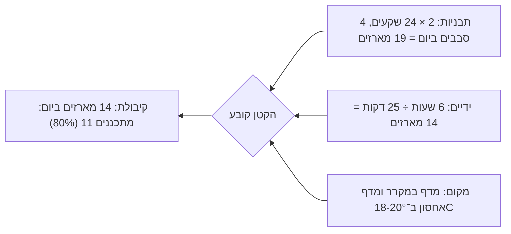

# 19.3 · תכנון ייצור לעונה

מחיר טוב לא עוזר אם אי אפשר להכין את המארזים בזמן. בחנוכה העבודה נדחסת לשלושה שבועות, ומטבח ביתי אחד מוגבל בתבניות, בידיים ובמקום במקרר. בשיעור הזה מחשבים כמה מארזי סביבונים ([08.2](../module-08/lesson-02.md)) אפשר להכין ביום, מוצאים את צוואר הבקבוק, ובונים לוח זמנים והזמנת חומרי גלם לחנוכה 2026. בסוף יש לכם [תכנון ייצור לעונה](../../templates/production-plan.md) מלא.

## מה צריך

| פריט | כמות לתרגול | כמות מלאה | הערה |
|---|---|---|---|
| [תכנון ייצור לעונה](../../templates/production-plan.md) | 1 | 1 לכל חג | |
| [לוח השנה של החגים](../../projects/m10-holiday-calendar.md) מפרויקט מודול 10 | 1 | | התאריכים והשבועות שסימנתם |
| גיליון התמחור מ־19.1-19.2 | 1 | | דקות למארז, עלות, מדרגות לחברות |
| ספירה של הציוד: תבניות, שקעים בכל תבנית, מדפים במקרר, מקום אחסון קריר | 1 | | סופרים, לא זוכרים |
| שעון ויומן תרגול: זמן סבב יציקה אחד מהמילוי ועד ההוצאה | 1 | | אם לא מדדתם, מודדים בטמפרור הבא |

**אלרגנים:** תוכנית ייצור קובעת גם את סדר העבודה ביום. שוקולד: **סויה** (לציטין), **חלב** בחלב ולבן ו"עלול להכיל" במרירים רבים; סוכריות: לפעמים **גלוטן**. אם באותה עונה יש מוצר עם **אגוזים**, **בוטנים** או **שומשום**, הוא מקבל יום או סוף יום נפרד ([14.3](../module-14/lesson-03.md)).

## למה זה עובד

### שלושה מגבלים, והקטן קובע

קיבולת של מטבח היא המספר הקטן מבין שלושה:

1. **תבניות:** כמה שקעים יש, כמה סבבים אפשר ביום, וכמה זמן כל סבב תקוע בהתגבשות.
2. **ידיים:** כמה דקות עבודה כל מארז דורש (19.1), וכמה שעות ביום אתם באמת עובדים.
3. **מקום:** מדף במקרר להתגבשות, ומקום קריר ויציב לאחסן מארזים מוכנים עד המסירה.

הגדלה של מגבל שאינו הקטן לא מוסיפה אף מארז. תבנית שלישית לא תעזור אם הידיים הן צוואר הבקבוק.

### תבניות: שקעים × סבבים

בסביבון מחלקים, הגוף הוא שתי קליפות ריבוע מתבנית פרלינים ([08.2](../module-08/lesson-02.md)), כלומר 10 קליפות למארז של 5. בדוגמה יש שתי תבניות של 24 שקעים: 48 קליפות בסבב, 24 גופים, 4.8 מארזים.

כמה זמן סבב? Callebaut מתארים יציקה שבה מניחים לשוקולד להתגבש כ־5 דקות כשהתבנית הפוכה על נייר, ואחר כך כמה דקות במקרר ב־14-16°C, בלי זמן כולל מדויק (נבדק 2026-11-10). ב־08.2 הקליפות נחו 10 דקות בחדר ו־15 דקות במקרר. עם מילוי, גירוד, ניקוז, הוצאה וניקוי, סבב לוקח בדוגמה כשעה. ארבעה סבבים בבוקר עבודה: 4 × 4.8 = 19.2 מארזים. חרוטים וידיות מזלפים על נייר, ולכן הם לא תלויים בתבניות.

### ידיים: דקות למארז

ב־19.1 מארז לקח 25 דקות, מהטמפרור ועד הסרט, ובהזמנה לחברה 20 דקות (סדרה של מארזים זהים, הנחה שמודדים). שש שעות עבודה נטו ביום הן 360 דקות, ו־360 ÷ 25 = 14.4 מארזים. זה פחות מ־19.2 של התבניות, ולכן כאן הידיים הן צוואר הבקבוק.

"שש שעות נטו" זה לא יום עבודה של שש שעות: יש גם קניות, שיחות עם לקוחות, ניקוי, משלוחים וחשבונות. בדוגמה זו שעה ביום שלא מייצרת מארזים.

### מקום: התגבשות ואחסון

התבנית צריכה מדף במקרר לכ־15 דקות בכל סבב. מארזים מוכנים צריכים מקום קבוע: Callebaut ממליצים לאחסן מוצרים מוגמרים בטמפרטורה קבועה של 18-20°C (נבדק 2026-11-10). סביבון מוצק מחזיק שבועות בתנאים כאלה ([10.1](../module-10/lesson-01.md#לוח-השנה-הקרוב)), ולכן אפשר לייצר מוקדם ולפנות את הימים האחרונים לאריזה ולמסירות. מה שמגביל הוא המקום: 140 מארזים של 14×14 ס"מ בשכבה אחת דורשים כ־2.7 מ"ר מדפים. סופרים מדפים לפני שמקבלים הזמנות.

### למה מתכננים 80%

14.4 מארזים ביום הוא מספר של יום שבו הכול עובד. בעונה יש טמפרור שנכשל, תבנית שצריך לנקות שוב, יום חם, ילד חולה. תכנון ב־80% (כ־11 מארזים ביום) משאיר מרווח, והוא ההבדל בין עונה עמוסה לעונה שבה מאחרים ללקוחות.

### חנוכה 2026: שלושה שבועות

לפי Hebcal (נבדק 2026-11-10), חנוכה מתחיל בערב שישי 4.12.2026. המסירה האחרונה היא ביום חמישי 3.12, ושלושת השבועות העמוסים הם ראשון 15.11 עד חמישי 3.12: 15 ימי עבודה, ראשון עד חמישי. בקיבולת של 14.4 מארזים ביום זה לכל היותר 216 מארזים; בתכנון של 80%, כ־165.

## שלב אחר שלב

> [!WARNING]
> בעונה עובדים שעות ארוכות ליד שוקולד חם, מקרר ותנור. לא מתכננים יותר מהשעות שבאמת יש לכם, משאירים יום פנוי בכל שבוע, ולא מוותרים על ניקוי וסדר בין חלבי לפרווה בגלל לחץ. כל הזמנה גדולה מתועדת בדף אצווה ([פרויקט מודול 16](../../projects/m16-food-safety-plan.md)).

1. **סופרים ציוד:** תבניות ושקעים, מדפים במקרר, מקום אחסון ב־18-20°C. ממלאים את טבלת הקיבולת בתבנית.
2. **מודדים סבב:** מהמילוי ועד הוצאה וניקוי. זה זמן הסבב שלכם, לא של השיעור.
3. **מחשבים שלושה מספרים:** מארזים ביום לפי תבניות, לפי ידיים, ולפי מקום. הקטן הוא הקיבולת; מתכננים 80% ממנו.
4. **רושמים הזמנות ותאריכים:** כל הזמנה עם כמות ומועד מסירה, מהמוקדם למאוחר. הזמנות של חברות לרוב מוקדמות יותר.
5. **שעות לכל שבוע:** מארזים × דקות ÷ 60, ועוד שעת ניהול ביום. משווים לשעות שיש לכם. אם חורג: מסגרים הזמנות, מקדימים ייצור, או מוותרים על מוצר איטי.
6. **סדר יום:** מוצר בלי אלרגן או פרווה בבוקר, אחר כך חלבי ([פרויקט מודול 14](../../projects/m14-allergen-safe-batch.md), [תוכנית ההפרדה](../../assets/m14-separation-plan.svg)). מריר, חלב ולבן: מהבהיר לכהה או להפך, לפי מה שקל לנקות, אבל תמיד באותו סדר.
7. **הזמנת חומרי גלם:** מארזים × גרמים, ועוד פחת, ועוד מלאי עבודה לטמפרור. מזמינים שבועיים לפני השבוע הראשון, מספק ראשי, ורושמים ספק גיבוי ([איפה קונים](../../references/where-to-buy.md#קוברטורה): כמה חנויות לכל פריט).
8. **אריזה:** מספר מארזים ועוד 10%, מעוגל לחבילות שלמות.
9. **מועד סגירת הזמנות:** תאריך שאחריו לא מקבלים, לפי הקיבולת.
10. **תאריך חוזר:** אחרי חנוכה כותבים כמה מארזים יצאו בפועל וכמה שעות. זה הבסיס לפורים ולפסח.

## בדיקה: איך יודעים שהצליח

- [ ] טבלת קיבולת מלאה, עם שלושה מספרים וצוואר בקבוק מסומן.
- [ ] זמן סבב מדוד שלכם, לא מהשיעור.
- [ ] כל ההזמנות עם תאריך מסירה, ושעות לכל שבוע שלא עוברות את מה שיש לכם.
- [ ] תכנון ב־80% מהקיבולת או פחות, ויום פנוי בשבוע.
- [ ] הזמנת חומרי גלם עם פחת, מלאי עבודה, ספק ראשי וגיבוי.
- [ ] סדר יום לפי אלרגנים וכשרות, ומועד סגירת הזמנות.

## כשזה משתבש

| מה רואים | למה זה קורה | מה עושים עכשיו | איך מונעים בפעם הבאה |
|---|---|---|---|
| קניתם תבנית שלישית, ולא יצאו יותר מארזים | צוואר הבקבוק הוא הידיים, לא התבניות | מקצרים שלב ידני (חלקים בכמות, אריזה בסוף היום) | מחשבים שלושה מגבלים לפני שקונים |
| בשבוע האחרון חסרו 20 שעות | הזמנות התקבלו בלי לבדוק קיבולת | מקדימים ייצור של מה שמחזיק, ומבקשים מלקוחות איסוף | מועד סגירת הזמנות לפי הקיבולת |
| אין איפה לשים מארזים מוכנים | ייצור מוקדם בלי מקום אחסון | מפנים מדף בחדר קריר, לא ליד חלון או תנור | סופרים מדפים בשלב 1 |
| הקוברטורה אזלה בחנות שבוע לפני החג | הזמנה מאוחרת, ספק אחד | ספק הגיבוי; אותו אחוז קקאו, ובודקים כשרות על האריזה | מזמינים שבועיים מראש, משני ספקים |
| ברק נעלם במארזים שיוצרו מוקדם | אחסון בטמפרטורה משתנה או במקרר | מוכרים אותם ראשונים או לבית | 18-20°C קבוע, בקופסה סגורה |
| טמפרור נכשל באמצע יום עמוס | עייפות, חדר חם | מטמפרים מחדש; לא אורזים קליפות שלא עברו בדיקה | 80% קיבולת, ויום פנוי בשבוע |

### מה עושים עם מה שלא הצליח

שום דבר לא הולך לפח. קליפות שנסדקו, חרוטים עקומים ושוקולד מהשקיות חוזרים להמסה לפי סוג, כל אחד בשקית משלו. סביבונים בלי ברק נמכרים או ניתנים כ"מארז לבית", או הולכים לשוקו ולבראוניז. מה שנשאר אחרי החג נשמר ב־18-20°C ומתאים לט"ו בשבט ולפורים ([10.3](../module-10/lesson-03.md)), ומארזים עודפים הם טעימות ללקוחות עסקיים לעונה הבאה.

## חלופות

### טבעוני / פרווה

מארזים טבעוניים מייצרים ביום נפרד או ראשונים בבוקר, אחרי ניקוי, ולכן הם תופסים בוקר שלם גם בכמות קטנה. בתוכנית רושמים אותם כבלוק משלהם, עם הזמנת חומרי גלם נפרדת ([פרויקט מודול 12](../../projects/m12-vegan-box.md)).

### בריא יותר

מארז "מיני" או מריר 70% לא חוסך הרבה זמן: האריזה והקישוט לוקחים אותו זמן. אם הוא נמכר טוב, הוא מוצר שני שמתוכנן בנפרד, עם דקות משלו. שוקולד ללא תוספת סוכר מטמפרים לפי היצרן ([13.2](../module-13/lesson-02.md)), ולכן נותנים לו סבב נפרד.

### כשרות

סדר היום חשוב גם לכשרות: מוצר שמשווקים כפרווה מייצרים לפני חלבי, בכלים נקיים, ורק אם כל הרכיבים פרווה לפי האריזה ([17.3](../module-17/lesson-03.md)). אם יש תעודת כשרות, ייתכן שימי ייצור ושעות השגחה צריכים תיאום מראש עם רשות הכשרות ([17.1](../module-17/lesson-01.md)): שאלה לשאול לפני העונה, בכתב. אם יש ספק, שואלים את הרב.

## איפה קונים

קונים לפי התוכנית, שבועיים לפני השבוע הראשון. מה מחפשים: קוברטורה באריזות של 1-5 ק"ג באחוזי הקקאו שבחרתם, תבניות פרלינים ריבועיות 3×3 ס"מ (סביבון מחלקים), קופסאות וסרטים בחבילות. חנויות, מחירים ומלאי (2026-11-10): [קוברטורה](../../references/where-to-buy.md#קוברטורה), [תבניות פוליקרבונט](../../references/where-to-buy.md#תבניות-פוליקרבונט), [תבניות סביבון](../../references/where-to-buy.md#תבניות-סביבון) (לא נמצאה בישראל; מחו"ל חודשיים מראש), [קופסאות פרלינים](../../references/where-to-buy.md#קופסאות-פרלינים), [צלופן וסרטים](../../references/where-to-buy.md#צלופן-וסרטים), [מדבקות ותוויות](../../references/where-to-buy.md#מדבקות-ותוויות). כשרות לפי מוצר: [מדריך הכשרות](../../references/kashrut-guide.md#קוברטורה-מרירה). לפני הזמנה גדולה מתקשרים לחנות: מלאי באתר לא תמיד אמיתי.

## תרגול

### משימה

ממלאים [תכנון ייצור לעונה](../../templates/production-plan.md) לחנוכה (או לחג הקרוב שלכם): טבלת קיבולת עם שלושה מגבלים, לוח זמנים לשלושת השבועות עם כל ההזמנות, שעות לכל שבוע, והזמנת חומרי גלם ואריזה. מכינים את זה על הזמנות אמיתיות, או על הזמנות דמיוניות שמתאימות למודל שבחרתם ב־15.1.

דוגמה פתורה

**קיבולת** (מטבח ביתי אחד, מארז 5 סביבונים):

| שאלה | תשובה |
|---|---|
| תבניות | 2 תבניות פרלינים ריבועיות |
| יחידות בתבנית | 24 שקעים; 48 קליפות בסבב = 24 גופים = 4.8 מארזים |
| סבבי יציקה ביום | 4 (סבב כשעה, נמדד) → 19.2 מארזים |
| שעות עבודה ביום | 6 נטו ייצור, ועוד שעה ניהול → 360 ÷ 25 = 14.4 מארזים |
| מקרר ואחסון | מדף אחד במקרר לתבניות; מדפים ב־18-20°C לכ־140 מארזים (כ־2.7 מ"ר) |
| **מקסימום מארזים ביום** | **14 (ידיים); מתכננת 11** |

**הזמנות:** חברה, 60 מארזים (20 דקות כל אחד), מסירה ביום שלישי 24.11. לקוחות פרטיים, 80 מארזים (25 דקות), איסוף ומשלוחים עד חמישי 3.12. סגירת הזמנות פרטיות: שני 30.11.

**לוח זמנים** (חנוכה בערב 4.12.2026):

| שבוע | ייצור | אריזה ומשלוח | שעות |
|---|---|---|---|
| 15-19.11 | 60 מארזי החברה: 60 × 20 = 1,200 דקות | אריזה תוך כדי; מדבקות לוגו | 20 + 5 ניהול = 25 |
| 22-26.11 | 40 מארזים פרטיים: 40 × 25 = 1,000 דקות | מסירה לחברה 24.11 | 16.7 + 5 = 21.7 |
| 29.11-3.12 | 40 מארזים פרטיים | איסופים ומשלוחים עד 3.12; שישי 4.12 איסוף עד הצהריים | 16.7 + 5 = 21.7 |
| **סה"כ** | **140 מארזים** | | **20 + 33.3 + 15 = 68.3 שעות, כ־4.6 ביום** |

140 מארזים ב־15 ימים הם 9.3 ביום, מתחת ל־11 המתוכננים. השעות (4.6 ביום) מתחת ל־7 שיש (6 ייצור ועוד שעה). נשאר מרווח להזמנות מאוחרות: עד 165 מארזים לפי 80%.

**הזמנת חומרי גלם** (עד חמישי 12.11):

| חומר | חשבון | כמות | ספק ראשי | ספק גיבוי |
|---|---|---|---|---|
| קוברטורה, 3 סוגים | 140 × 105 גרם = 14.7 ק"ג; עם 12% פחת 16.5 ק"ג; כ־5.5 ק"ג מכל סוג, ועוד כ־1 ק"ג מכל סוג מלאי עבודה לטמפרור | כ־6.5 ק"ג מכל סוג | חנות עם אריזות 5 ק"ג | חנות שנייה מהרשימה, אותו אחוז קקאו |
| קופסה שקופה 14×14 | 140 + 10% = 154, בחבילות של 10 | 16 חבילות (160), 240 ₪ | חתום בנשיקה | לירון בראשית |
| מדבקות עגולות | 160 ÷ 24 = 6.7 | 7 גיליונות, 105 ₪ | חתום בנשיקה | Bake & Make |
| מדבקות לוגו לחברה | 60 + 10% | 66 | בית דפוס | |

**כסף לפני תשלום:** 140 × 15.21 = 2,129.40 ₪ חומרים ואריזה (מחירי 11.2). המקדמה של החברה (936 ₪, 19.2) מכסה חלק.

**סדר יום:** מריר (פרווה לפי האריזה) בבוקר, אחר כך חלב, ובסוף לבן; ניקוי בין מריר לחלב. דף אצווה לכל יום ייצור.

### זמן

כשעה ורבע: 15 דקות ספירה ומדידת סבב (אם לא מדדתם, עוד טמפרור), 20 דקות קיבולת, 25 דקות לוח זמנים, 15 דקות הזמנת חומרים.

### יומן

ב[יומן התרגול](../../templates/practice-log.md) רושמים: צוואר הבקבוק שלכם, הקיבולת שתכננתם, ואחרי החג, כמה יצא בפועל.

### בדיקה עצמית

- [ ] שלושה מגבלים ומספר קיבולת אחד, ב־80%.
- [ ] לוח זמנים עם כל ההזמנות ושעות לכל שבוע.
- [ ] הזמנת חומרי גלם ואריזה עם פחת, ספק ראשי וגיבוי, ותאריך הזמנה.
- [ ] סדר יום לפי אלרגנים וכשרות.
- [ ] מועד סגירת הזמנות.

## סיכום

- קיבולת = המספר הקטן מבין תבניות (שקעים × סבבים), ידיים (שעות ÷ דקות למארז) ומקום (מקרר ואחסון ב־18-20°C).
- במארז הסביבונים הידיים הן צוואר הבקבוק: 14 מארזים ביום, ותבנית נוספת לא תעזור.
- מתכננים 80% מהקיבולת, ושעת ניהול ביום שלא מייצרת מארזים.
- חנוכה 2026 מתחיל בערב 4.12: שלושה שבועות מ־15.11 עד 3.12, וחומרי גלם מזמינים עד 12.11 משני ספקים.
- מוצר מוצק מחזיק שבועות ב־18-20°C, ולכן מייצרים מוקדם ומשאירים את הסוף לאריזה ולמסירות.
