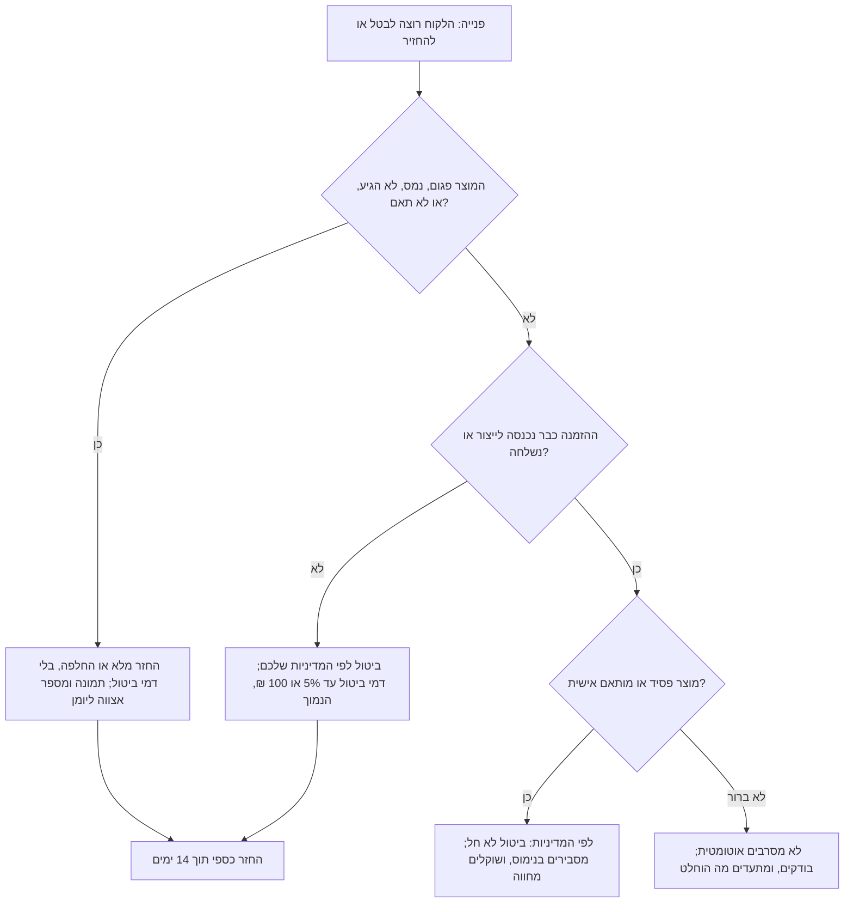

# 20.4 · מדיניות החזרות ושירות לקוחות

מארז שנמס בדרך, לקוח שהזמין ושינה את דעתו, הורה שכותבת שהילד קיבל פריחה: כל אלה יגיעו, ועדיף שהתשובה תהיה כתובה לפני כן. בשיעור הזה קוראים מה חוק הגנת הצרכן אומר על ביטול קנייה באינטרנט, מבינים למה שוקולד הוא מקרה מיוחד, וכותבים מדיניות ביטול והחזרות, יומן פניות ותבניות תשובה. כל מה שכאן הוא מידע כללי לפי נוסח החוק שנבדק ב־10.11.2026, לא ייעוץ משפטי.

## מה צריך

| פריט | כמות לתרגול | כמות מלאה | הערה |
|---|---|---|---|
| דף המוצר מ־20.1 ואישור ההזמנה מ־20.2 | 1 מכל | | המדיניות צריכה להתאים להם |
| מדיניות המשלוח וכלל הקיץ מ־20.3 | 1 | | מה קורה במארז שנמס |
| יומן התלונות ונוהל הריקול מ־[16.4](../module-16/lesson-04.md#מזון-מזיק-ריקול-ותלונות) | 1 | | הבסיס ליומן הפניות |
| מטריצת האלרגנים מ־[16.2](../module-16/lesson-02.md) | 1 | | לתשובה על שאלת אלרגנים |
| גיליון או מחברת ליומן פניות | 1 | | עמודות בשלב 6 |

**אלרגנים:** הפנייה הכי רצינית שתקבלו היא תגובה אלרגית. התשובה מתחילה בבריאות, וממשיכה במטריצת האלרגנים ובמספר האצווה. במארז הדוגמה: **סויה**, **חלב**, ו"עלול להכיל" **אגוזים**.

## למה זה עובד

### מה החוק אומר על קנייה מרחוק

עסקת מכר מרחוק היא קנייה באתר, בטלפון או בהודעה, בלי שהלקוח והעסק נפגשים. לפי חוק הגנת הצרכן (נוסח בוויקיטקסט, נבדק 10.11.2026):

| נושא | מה כתוב | סעיף |
|---|---|---|
| גילוי לפני העסקה | שם העסק, מספר זהות או ח"פ, כתובת, תכונות עיקריות, מחיר ותנאי תשלום, מועד ודרך אספקה, תנאי ביטול ועוד | 14ג(א) |
| מסמך | עד מועד האספקה, מסמך בכתב בעברית עם הפרטים, כולל שם היצרן וארץ הייצור | 14ג(ב) |
| זכות ביטול | מיום העסקה ועד 14 ימים מקבלת המוצר או המסמך, לפי המאוחר | 14ג(ג) |
| חריגים | לא חל על "טובין פסידים", ועל "טובין שיוצרו במיוחד בעבור הצרכן בעקבות העסקה" | 14ג(ד) |
| ביטול בגלל פגם, אי־התאמה או אי־אספקה | מחזירים את הכסף תוך 14 ימים מההודעה, בלי דמי ביטול | 14ה(א) |
| ביטול מסיבה אחרת | מותר לגבות דמי ביטול עד 5% מהמחיר או 100 ₪, לפי הנמוך | 14ה(ב) |
| מחיר | מוצג רק "המחיר הכולל", כולל מע"מ, והוא מחייב | 17 |

כל זכות (נבדק 10.11.2026) מוסיפים כמה פרטים מעשיים: הודעת ביטול יכולה להיות "בעל־פה או בכתב"; באתר צריך להיות קישור לביטול בעמוד הבית; בדרך כלל הלקוח מחזיר את המוצר על חשבונו, אבל כשהביטול הוא בגלל הפרה של העסק (פגם, איחור, אי־התאמה), העסק אוסף את המוצר מהמקום שבו מסר אותו. אזרח ותיק (65+), אדם עם מוגבלות או עולה חדש יכולים לבטל עד 4 חודשים אם בעסקה הייתה שיחה עם נציג, בטלפון או בצ'אט. ועסק שמציע תנאים טובים מהחוק, מחויב לתנאים שלו.

### למה שוקולד הוא מקרה מיוחד

בעסקת מכר מרחוק החוק לא מזכיר מזון בשמו. החריג הוא "טובין פסידים", כלומר מוצרים שמתקלקלים; כל זכות נותנים פרחים כדוגמה. מארז טראפלס עם שמנת, שנשמר במקרר עשרה ימים, הוא כנראה טובין פסידים. מארז שוקולד מוצק שנשמר חודשים הוא פחות ברור. מארז עם שם או לוגו של חברה הוא כנראה "טובין שיוצרו במיוחד בעבור הצרכן". אלה פרשנויות שלנו, לא פסיקה.

לשם השוואה: בתקנות הגנת הצרכן (ביטול עסקה), שחלות על קנייה רגילה בחנות מעל 50 ₪, יש רשימה מפורשת של מה שלא מחזירים, ובה "מוצרי מזון" ו"טובין פסידים" כשני סעיפים נפרדים (תקנה 6(א)(4) ו־(6)). התקנות האלה לא חלות על עסקת מכר מרחוק, אבל הן מראות שהמחוקק מתייחס למזון כמשהו שלא מחזירים אחרי שנמסר.

מה זה אומר לעסק קטן:

1. **החריג לא חל על פגם.** מארז שנמס, נשבר, הגיע באיחור או לא תאם את התיאור הוא עניין של 14ה(א): החזר מלא בלי דמי ביטול, ובדרך כלל החלפה או החזר הם גם הפתרון הפשוט ביותר.
2. **מה שלא ברור, כותבים.** מדיניות שאומרת מראש "ביטול מרצון אפשרי עד שההזמנה נכנסת לייצור; אחרי זה לא, כי מדובר במזון" ברורה ללקוח. אם היא נדיבה מהחוק, אתם מחויבים לה. אם היא מגבילה יותר מהחוק, היא לא תעמוד. כשיש ספק, שואלים עורך דין לפני שמפרסמים.
3. **קישור לביטול** בעמוד הבית, ודרך לבטל גם בטלפון או בהודעה.

### מדיניות כתובה: שלוש קבוצות

### שירות לקוחות: יומן ותבניות

ב־16.4 פתחתם יומן תלונות. לפי חוק המזון (סעיף 164(ז)), תלונות על נזק או חשש לנזק לבריאות מתועדות **לפחות שלוש שנים**. יומן פניות הוא אותו יומן, מורחב לכל פנייה: תאריך, ערוץ, לקוח, הזמנה, אצווה, מה נטען, מה עשיתם, מתי נסגר. שתי סיבות לנהל אותו: הוא מראה דפוסים (שלוש פניות על "נמס" באותו שבוע הן בעיה באריזה, לא מזל רע), והוא מה שתציגו אם פנייה תהפוך לתלונה רשמית.

תבנית תשובה חוסכת זמן ומונעת הבטחות שלא תעמדו בהן. זמן תגובה הוא החלטה שלכם; כותבים אותו במדיניות ועומדים בו.

## שלב אחר שלב

> [!WARNING]
> פנייה על אדם שנפגע (תגובה אלרגית, קושי לנשום, הקאות, גוף זר בפה): קודם מפנים לטיפול רפואי, ובמקרה דחוף למד"א 101. רק אחר כך מבקשים פרטים, שומרים את המוצר ואת מספר האצווה, ופותחים את נוהל הריקול מ־16.4. לא מתווכחים ולא מאבחנים.

1. **קוראים את החוק** בטבלה למעלה, ומסמנים מה מהדברים כבר מופיע בדף המוצר ובאישור ההזמנה (20.1, 20.2), ומה חסר.
2. **ממיינים את המוצרים**: מה פסיד (שמנת, פרי טרי, תאריך קצר), מה מותאם אישית (שם, לוגו, הרכב לבקשת הלקוח), ומה לא ברור (שוקולד מוצק במארז רגיל).
3. **כותבים מדיניות ביטול** בשלושה חלקים: (א) מוצר פגום, נמס, שגוי או שלא הגיע: מה הלקוח שולח (תמונה, מספר הזמנה) ומה מקבל (החלפה או החזר מלא), ועד מתי לפנות. (ב) ביטול מרצון לפני ייצור או משלוח: עד מתי, ודמי ביטול אם בכלל (לא יותר מ־5% או 100 ₪, לפי הנמוך). (ג) אחרי ייצור או משלוח: מה חל על מוצר פסיד ומותאם, ומה על השאר.
4. **הדרך לבטל**: קישור בעמוד הבית, טלפון והודעה, וההבטחה להחזיר כסף תוך 14 ימים.
5. **בודקים** שהמדיניות לא מבטיחה פחות מהחוק (למשל "אין החזרים בשום מקרה" סותר את 14ה(א) במוצר פגום).
6. **פותחים יומן פניות**: תאריך, ערוץ, שם, מספר הזמנה, אצווה, נושא, מה עשיתי, סכום שהוחזר, נסגר בתאריך, האם נוגע לבריאות (אם כן: שומרים שלוש שנים לפחות).
7. **כותבים חמש תבניות**: מארז נמס או נשבר; איחור; ביטול מרצון; שאלה על אלרגנים לפני קנייה; תגובה אלרגית אחרי אכילה.
8. **מתרגלים**: נותנים לחבר לשלוח לכם שלוש פניות בלי לספר אילו, ועונים מהתבניות. רושמים ביומן.

## בדיקה: איך יודעים שהצליח

- המדיניות מבחינה בין פגם או אי־התאמה (החזר מלא, בלי דמי ביטול) לבין ביטול מרצון.
- דמי הביטול, אם יש, לא עולים על 5% או 100 ₪, לפי הנמוך. במארז של 58 ₪: עד 2.90 ₪.
- יש דרך לבטל בטלפון או בהודעה, וקישור לביטול שנגיש מעמוד הבית.
- אין במדיניות משפט שמבטל זכות שהחוק נותן.
- ביומן יש עמודת אצווה ועמודת "נוגע לבריאות", ושלוש פניות תרגול רשומות בו.
- תבנית התגובה האלרגית מתחילה ב"פנו לטיפול רפואי", לא בהתנצלות או בהסבר.

## כשזה משתבש

| מה רואים | למה זה קורה | מה עושים עכשיו | איך מונעים בפעם הבאה |
|---|---|---|---|
| לקוח כועס שכתבתם "אין החזרים" על מארז שהגיע נמס | המדיניות לא הבחינה בין פגם לחרטה | מחזירים או מחליפים מיד; מתקנים את הנוסח | שלוש קבוצות במדיניות, כמו בשלב 3 |
| לקוחה בת 70 הזמינה בטלפון ומבקשת לבטל אחרי חודש | לא ידעתם על 4 החודשים | בודקים אם המוצר בחריג (פסיד, מותאם); אם לא, מבטלים לפי החוק | שורה במדיניות ובתסריט הטלפון |
| שלוש פניות על "נמס" באותו שבוע | כלל הקיץ לא נשמר, או קופסה שלא מחזיקה | עוצרים חבילות; בודקים את האריזה | יומן פניות שמסתכלים בו כל שבוע |
| לקוח מבקש החזר, אבל התמונה מראה מארז שנשמר במקרר ופריחת סוכר | הוראת אחסון לא נקראה | מסבירים בנימוס; מחליטים לפי המדיניות אם מחווה | הוראת אחסון גם בפתק וגם בהודעת המשלוח |
| החזר כספי התעכב שלושה שבועות | אין תהליך, ספק הסליקה איטי | מזרזים ומעדכנים את הלקוח | בודקים איך מחזירים כסף אצל הספק לפני שצריך (20.2) |
| ענו לתלונה על תגובה אלרגית ב"אצלנו אין אגוזים" | לא בדקו מטריצה ואצווה | מתנצלים, מפנים לטיפול, בודקים את האצווה ומעדכנים | תבנית שמתחילה בבריאות, ואחר כך בדיקה |

### מה עושים עם מה שלא הצליח

מארז שהלקוח החזיר או שנפגם במשלוח לא חוזר למכירה. אם הוא שוקולד מוצק שרק התרכך או הלבין, הוא בטוח לאכילה: נמס מחדש ומטמפרים, או הופך לשוקו, רוטב, בראוניז או bark לשימוש ביתי. מוצר שקשור לפנייה על בריאות לא נאכל ולא נזרק: נשמר, סגור ומסומן, עם האצווה, לפי נוהל 16.4.

## חלופות

### טבעוני / פרווה

לקוח שקנה מארז טבעוני וקיבל את הגרסה החלבית קיבל מוצר לא תואם, ואולי גם מוצר שהוא לא יכול לאכול. זו לא חרטה: החזר מלא או החלפה, ושאלה אם מישהו כבר אכל. במדיניות כותבים במפורש שטעות בגרסה (טבעוני, פרווה, בלי אגוזים) מטופלת כמו פגם.

### בריא יותר

מארז "פחות סוכר" שהלקוח מצפה ממנו לתוצאה בריאותית יוצר פניות שלא תוכלו לענות עליהן. לכן לא מבטיחים מראש ([16.4](../module-16/lesson-04.md), [13.5](../module-13/lesson-05.md)), ובתבנית התשובה מפנים לתווית התזונתית ולגרמים, לא לבריאות.

### כשרות

פנייה בנוסח "האם זה כשר?" עונים רק לפי מה שיש: תעודה לעסק, או מה שכתוב על אריזות חומרי הגלם. בלי תעודה לא כותבים "כשר", גם לא בהודעה פרטית ([מודול 17](../module-17/lesson-01.md)). שאלה הלכתית מפנים לרב של הלקוח ([מדריך הכשרות](../../references/kashrut-guide.md#שלושה-כללים)).

## איפה קונים

לא קונים כאן כלום. מה צריך: נוסח מדיניות במקום גלוי בחנות, קישור לביטול בעמוד הבית, יומן פניות, ותבניות תשובה בטלפון. המקורות לשיעור: חוק הגנת הצרכן סעיפים 14ג, 14ה ו־17, וכל זכות על ביטול עסקת מכר מרחוק (רשימת המקורות של הקורס, פרק 6), ותקנות הגנת הצרכן (ביטול עסקה), תקנה 6. לפני פרסום מדיניות, ואם יש ספק בחריג, שואלים עורך דין. את הדף הרשמי של הרשות להגנת הצרכן לא הצלחנו לפתוח (gov.il חסם גישה אוטומטית); כדאי לקרוא אותו בעצמכם.

## תרגול

### משימה

כותבים מדיניות ביטול והחזרות בשלושה חלקים, פותחים יומן פניות, כותבים חמש תבניות תשובה, ומתרגלים שלוש פניות עם חבר. מוסיפים את המדיניות כפרק ב[תוכנית העסקית](../../templates/business-plan.md). זה חלק 4 של [פרויקט המודול](../../projects/m20-shop-setup.md), ואחריו מגיע שלב הסיום של הפרויקט: הזמנת ניסיון מקצה לקצה.

### זמן

כ־20 דקות למדיניות, 10 ליומן, 15 לתבניות, וכ־5 דקות לכל פניית תרגול.

### יומן

ב[יומן התרגול](../../templates/practice-log.md): מה היה קשה לנסח, אילו פניות התרגול לא התאימו לאף תבנית, ומה שאלתם או תשאלו עורך דין.

דוגמה פתורה: מדיניות ותבניות, חנות שוקולד בחולון

**מדיניות ביטול והחזרות (עודכנה 10.11.2026)**

1. **הגיע פגום, נמס, שבור, שגוי, או לא הגיע:** שלחו תמונה ומספר הזמנה תוך 48 שעות מהמסירה, בהודעה או בטלפון. נחליף או נחזיר את מלוא הסכום, כולל משלוח, תוך 14 ימים, בלי דמי ביטול. אם צריך לאסוף את המארז, נאסוף אנחנו.
2. **ביטול לפני ייצור:** אפשר לבטל עד 48 שעות לפני מועד המסירה, בלי דמי ביטול, בקישור "ביטול עסקה" שבעמוד הבית, בהודעה או בטלפון. החזר תוך 14 ימים.
3. **אחרי ייצור:** המארזים שלנו הם מוצרי מזון שמתקלקלים, ומארזים עם שם או לוגו מיוצרים במיוחד עבורכם; לכן אחרי שנכנסו לייצור לא ניתן לבטל, אלא אם יש פגם (סעיף 1). אם אתם אזרחים ותיקים, אנשים עם מוגבלות או עולים חדשים והזמנתם בשיחה איתנו, פנו אלינו ונבדוק יחד.
4. **זמן תגובה:** עד סוף יום העסקים הבא.

(הערה לעצמי: סעיף 2 נדיב מהחוק, ולכן אני מחויבת לו. את סעיף 3 בדקתי עם עורכת דין לפני הפרסום.)

**יומן פניות (שורה לדוגמה):** 14.9 | וואטסאפ | ד. לוי | 1057 | 260912-S | "הסביבונים נמסו" | תמונה התקבלה; מארז חדש ביום ב', בקופסה מבודדת | 0 ₪ | נסגר 16.9 | בריאות: לא.

**תבניות (קיצור):**

- **נמס או נשבר:** "מצטערת מאוד! אפשר תמונה ומספר הזמנה? נשלח מארז חדש או נחזיר את מלוא הסכום, מה שתעדיפו."
- **איחור:** "ההזמנה שלכם מתעכבת כי [סיבה]. היא תגיע ב[מועד]. אם זה כבר לא מתאים, נבטל ונחזיר את מלוא הסכום."
- **ביטול מרצון:** "בוטל. ההחזר, [סכום] ₪, יגיע לאמצעי התשלום תוך 14 ימים."
- **אלרגנים לפני קנייה:** "המארז מכיל סויה וחלב, ועלול להכיל אגוזים. אנחנו לא יכולים להבטיח מוצר בלי עקבות אגוזים."
- **תגובה אלרגית:** "קודם כול: אם יש קושי לנשום, נפיחות או הקאות, פנו מיד לטיפול רפואי או למד"א 101. כשאפשר, נשמח למספר ההזמנה ולתמונה של המארז, ובבקשה לשמור את מה שנשאר. נבדוק את האצווה מיד ונחזור אליכם היום."

### בדיקה עצמית

- [ ] המדיניות מבחינה בין פגם לבין ביטול מרצון, ובפגם יש החזר מלא בלי דמי ביטול.
- [ ] דמי ביטול, אם יש, לא עולים על 5% או 100 ₪, לפי הנמוך.
- [ ] יש קישור לביטול מעמוד הבית ודרך לבטל בטלפון או בהודעה.
- [ ] יומן הפניות כולל אצווה ועמודת "נוגע לבריאות".
- [ ] יש לי חמש תבניות, ותבנית התגובה האלרגית מתחילה בטיפול רפואי.
- [ ] עברתי ל[פרויקט המודול](../../projects/m20-shop-setup.md) ולהזמנת הניסיון.

## סיכום

- בקנייה מרחוק: גילוי לפני העסקה, מסמך עד האספקה, וזכות ביטול של 14 ימים מקבלת המוצר או המסמך, לפי המאוחר.
- החריגים: טובין פסידים ומוצרים שיוצרו במיוחד (14ג(ד)). שוקולד, ובוודאי שמנת או מארז עם שם, כנראה בפנים; זו פרשנות, לא פסיקה.
- החריג לא חל על פגם: מארז שנמס, נשבר או לא תאם מקבל החזר מלא בלי דמי ביטול, תוך 14 ימים.
- ביטול מרצון: דמי ביטול עד 5% או 100 ₪, הנמוך; ומדיניות נדיבה מהחוק מחייבת אתכם.
- יומן פניות לכל פנייה, ותלונות על בריאות נשמרות לפחות שלוש שנים; בתגובה אלרגית, הבריאות קודמת לכל דבר.
