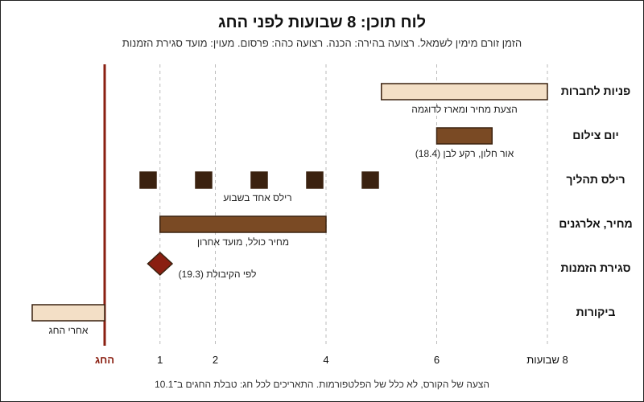

# 21.1 · אינסטגרם וטיקטוק: צילום, רילס ולוח תוכן לחגים

יש לכם מוצר מתומחר ומתויג, ותמונות טובות מ־[18.4](../module-18/lesson-04.md). עכשיו צריך שאנשים יראו אותו בזמן, כלומר לפני מועד סגירת ההזמנות ולא אחריו. בשיעור בונים לוח תוכן ל־8 השבועות שלפני חג, מצלמים רילס תהליך אחד של מוצר שאתם כבר יודעים להכין, ובודקים כל פוסט מול ארבעה כללים שחלים על פרסום מזון בישראל. בסוף יש לכם לוח תוכן מלא לחג הקרוב, רילס אחד מוכן, ורשימת בדיקה שתשמש אתכם לפני כל פרסום.

## מה צריך

| פריט | כמות לתרגול | כמות מלאה | הערה |
|---|---|---|---|
| מוצר מוכן מהקורס (מארז 5 סביבונים מ[פרויקט מודול 8](../../projects/m08-dreidel-box.md) או מארז אחר) | 1 מארז | מארז לצילום מכל אצווה | מאצווה רגילה, לא הכי יפה |
| שוקולד מטומפר לרילס תהליך | 250-300 גרם | | חוזר להמסה אחרי הצילום |
| פינת הצילום מ־[18.4](../module-18/lesson-04.md): חלון, קרטון לבן, חצובה לטלפון | 1 | | אותה פינה, אותה זווית |
| [תוכנית עסקית קצרה](../../templates/business-plan.md), סעיף 5 | 1 | | כאן נכנס לוח התוכן |
| טבלת החגים מ־[10.1](../module-10/lesson-01.md#לוח-השנה-הקרוב) ומועד סגירת ההזמנות מ־[19.3](../module-19/lesson-03.md) | 1 | | |
| [גיליון התמחור](../../templates/pricing-sheet.md) ו[התווית](../../templates/product-label.md) של המוצר | 1 | | המחיר והאלרגנים בפוסט באים מהם |

**אלרגנים:** במארז הסביבונים: **חלב** (חלב ולבן), **סויה** ברוב הקוברטורות, ולפי הספק "עלול להכיל" **אגוזים** ו**בוטנים**; בסוכריות בודקים **חלב** ו**גלוטן**. מה שכתוב בתווית נכתב גם בפוסט ובדף המוצר, באותן מילים ([16.2](../module-16/lesson-02.md)).

### לפני שמתחילים את המודול

זה המודול האחרון בקורס. לראות סרטון על רילס זה לא לצלם רילס: מצלמים בעצמכם. האקדמיה לא יכולה לבדוק את הפוסטים שלכם, ולכן משווים לבדיקות בשיעור, ומנהלים [יומן תרגול](../../templates/practice-log.md): מה פרסמתם, מתי, ומה קרה אחרי. המידע המשפטי במודול כללי, נכון ל־10.11.2026, ולא ייעוץ משפטי.

## למה זה עובד

### לוח תוכן נבנה אחורה, מהיום האחרון להזמנה

הטעות הנפוצה היא להתחיל לפרסם בשבוע של החג. אבל ב־[19.3](../module-19/lesson-03.md) כבר קבעתם מועד סגירת הזמנות לפי הקיבולת: לחנוכה 2026 (מתחיל בערב שישי 4.12.2026, לפי Hebcal) בדוגמה זה שני 30.11. כל פוסט אחרי היום הזה לא מביא הזמנות לחג, רק שאלות שתצטרכו לענות עליהן "לא". לכן מתחילים מהתאריך הזה והולכים אחורה:

הלוח הוא הצעה של הקורס, לא כלל של הפלטפורמות: חברות מזמינות מוקדם ובכמות ([15.1](../module-15/lesson-01.md), [21.2](lesson-02.md)), לקוחות פרטיים קונים בשבועות האחרונים, ומוצר מטומפר מחזיק שבועות ב־18-20°C ([10.1](../module-10/lesson-01.md)), ולכן מצלמים אותו מוקדם.

התאריכים הקרובים לפי Hebcal (נבדק 2026-11-10; החג מתחיל בערב):

| חג | מתחיל בערב | 8 שבועות לפני | הערה לתוכן |
|---|---|---|---|
| חנוכה | שישי 4.12.2026 | 9.10.2026 | כבר בתוך החלון: לוח מקוצר לשלושה שבועות |
| ט"ו בשבט | שישי 22.1.2027 | 27.11.2026 | מתחיל באמצע עונת חנוכה; מצלמים מראש |
| יום המשפחה | שבת 6.2.2027 (תאריך היום) | 12.12.2026 | מארז קטן, לא חג דתי; בלי משלוחים בשבת |
| פורים | שני 22.3.2027 | 25.1.2027 | משלוחי מנות ([10.3](../module-10/lesson-03.md)) |
| פסח | רביעי 21.4.2027 | 24.2.2027 | "כשר לפסח" רק עם תעודה לפסח ([17.4](../module-17/lesson-04.md)) |
| שבועות | חמישי 10.6.2027 | 15.4.2027 | חום: שאלת משלוח בפוסט ([11.3](../module-11/lesson-03.md)) |
| ראש השנה | שישי 1.10.2027 (לפי [10.1](../module-10/lesson-01.md)) | 6.8.2027 | עונת החברות הגדולה; קיץ מלא |

### שלושה סוגי תוכן, שלוש משימות

| סוג | מה הוא עושה | מאיפה החומר |
|---|---|---|
| **צילום מוצר** | מראה בדיוק מה מקבלים ובכמה | יום צילום אחד בפינה של [18.4](../module-18/lesson-04.md): תמונה ראשית על לבן, תמונה עם יד לקנה מידה, תמונת תווית קריאה |
| **רילס תהליך** | מראה שזה בעבודת יד, ובונה אמון | מה שאתם עושים בכל מקרה: יציקה בשני חצאים ([08.1](../module-08/lesson-01.md)), הרכבת סביבון ([08.2](../module-08/lesson-02.md)), סנאפ של טמפר טוב, אריזה |
| **פוסט מידע** | עונה מראש על שאלות שיגיעו בכל מקרה | מחיר, מה במארז, אלרגנים, אחסון, מועד אחרון, איסוף ומשלוח |

רילס תהליך מראה מה שקשה להסביר במילים (ברק, שבירה נקייה, שחרור מהתבנית), והוא זול להפקה כי מצלמים עבודה שממילא עושים. ההצעה שלנו: אנכי, מהחצובה של [18.4](../module-18/lesson-04.md), פעולה אחת, ומוזיקה רק מספריית האפליקציה או הצליל הטבעי של העבודה.

### ארבעה כללים שחלים על כל פוסט

פוסט באינסטגרם או בטיקטוק הוא פרסום. לפי חוק הגנה על בריאות הציבור (מזון), "מכירה" כוללת גם "פרסום והצגה" (סעיף 2), ולכן מה שחל על האריזה חל גם על הפוסט ([13.5](../module-13/lesson-05.md), [16.4](../module-16/lesson-04.md)). הקנייה עצמה לא קורה באפליקציה, אלא באתר או בקישור תשלום ([20.1](../module-20/lesson-01.md)).

1. **בלי טענות בריאות.** סעיף 13 אוסר לייחס למזון סגולה של חיזוק או ריפוי, מניעה או הקלה של מחלה, "בדרך של סימון, או פרסום", אלא אם הותר. "בריא", "מתאים לסוכרתיים", "מחזק חיסון" לא נכתבים, גם לא בהאשטאג או בכתובית של רילס. סעיף 17 אוסר להטעות לגבי מהות המזון: תמונה של מארז אחר, או "שוקולד בלגי" כשהוא לא, הם אותה בעיה ([18.4](../module-18/lesson-04.md): "תמונה היא הבטחה").
2. **בלי "כשר" בלי תעודה.** לפי חוק איסור הונאה בכשרות, אסור לסמן או לפרסם מוצר ככשר בלי תעודת הכשר. זה כולל כיתוב בפוסט, האשטאג וסמל בתמונה; "פרווה" ו"חלבי" רק לפי תעודה. לפני ההשקה עוברים על כל הטקסטים לפי תרשים הבדיקה ב־[17.4](../module-17/lesson-04.md).
3. **מחיר כולל, בשקלים.** לפי סעיפים 17א-17ב לחוק הגנת הצרכן מציגים לצרכן את "המחיר הכולל", כולל מע"מ, והמחיר שמוצג מחייב. אם המשלוח בתשלום, כותבים את זה ליד המחיר ([מקורות, סעיף 6](../../curriculum/research/sources.md#6-הגנת-הצרכן-במכירה-אונליין)).
4. **תוכן ממומן מסומן בפתח.** לפי סעיף 7(ג)(1) לחוק הגנת הצרכן, פרסומת שעלולה להביא אדם סביר להניח שאינה פרסומת נחשבת פרסומת מטעה, גם אם התוכן שלה נכון. לפי וואלה (21.1.2021), היועץ המשפטי לממשלה הגיש עמדה בתובענות ייצוגיות שלפיה צריך הבהרה **בפתח** הפוסט שמדובר בפרסומת או בפרסום ממומן, גלויה בלי לחיצה נוספת, ושהאשטאג או ציון שם המממן לבד לא מספיקים. זו עמדה בהליך, לא פסק דין ולא הנחיה רשמית שפתחנו.

### משפיענים: מה זה אומר לעסק קטן

פוסט של משפיען על המארז שלכם הוא פרסומת של העסק. ההצעה שלנו, מעשית ולא משפטית: מסכמים מראש בכתב שהפוסט ייפתח במילה "פרסומת" או "שיתוף פעולה בתשלום", ושהטקסט יעמוד בארבעת הכללים. גם מארז "במתנה" הוא תמורה; כשלא ברור, מבקשים גילוי.

לפי דף העזרה של TikTok (עודכן אפריל 2026), מי שמפרסם תוכן שמקדם מותג, מוצר או שירות חייב להפעיל את הגדרת הגילוי לתוכן מסחרי (Paid partnership או Commercial content). באינסטגרם יש תווית "שותפות בתשלום" (Paid partnership); את דף העזרה שלה לא הצלחנו לפתוח. כלי הפלטפורמה לא מחליף הבהרה בפתח הטקסט.

## שלב אחר שלב

> [!WARNING]
> מידע כללי, לא ייעוץ משפטי, נכון ל־10.11.2026. בהזמנת פרסום ממשפיען או בטקסט שאתם לא בטוחים בו (בריאות, כשרות), שואלים עורך דין לפני פרסום.

1. **מועד סגירת הזמנות.** מעתיקים מ־[19.3](../module-19/lesson-03.md) את התאריך שאחריו לא מקבלים הזמנות לחג הקרוב, ואת תאריך המסירה האחרונה.
2. **שמונה שבועות אחורה.** כותבים טבלה: שבוע, תאריכים, מה מפרסמים, איפה (פיד, רילס, סטורי), ומה צריך להכין לפני (צילום, מחיר, תווית).
3. **יום צילום אחד.** מארז מאצווה רגילה, בפינה של [18.4](../module-18/lesson-04.md): תמונה ראשית, תמונה עם יד, תמונת תווית קריאה. כל התמונות של העונה מהיום הזה.
4. **רילס תהליך.** בוחרים פעולה אחת (יציקה, הרכבה, שבירה, אריזה), מצלמים לאורך מהחצובה, 3-4 טייקים, ובוחרים אחד.

   > [!WARNING]
   > בצילום ליד שוקולד חם או אקדח חום: הטלפון והחצובה רחוק מהקערה, וכבל החשמל לא עובר מעל השיש. מתרכזים בעבודה, לא במסך.

5. **טקסט לכל פוסט:** שם כמו בתווית, משקל, מחיר כולל, אלרגנים, אחסון, מועד אחרון ואיך מזמינים.
6. **בדיקת ארבעת הכללים**, כולל האשטאגים והכיתוב על הווידאו.
7. **פוסט סגירה:** "ההזמנות לחג נסגרו", ומתי נפתח החג הבא.
8. **אחרי החג:** תודה ובקשה לביקורת ([21.3](lesson-03.md)).

## בדיקה: איך יודעים שהצליח

- [ ] בלוח יש 8 שבועות עם תאריכים, והפוסט האחרון למכירה יוצא לפני מועד סגירת ההזמנות.
- [ ] כל התמונות מאותו יום צילום, מאצווה רגילה, ויש תמונת תווית קריאה.
- [ ] הרילס אנכי, יציב, מראה פעולה אחת ברורה, והמוזיקה מותרת לשימוש.
- [ ] בכל טקסט: המחיר הכולל, האלרגנים כמו בתווית, ומועד אחרון.
- [ ] אין בשום מקום "בריא", "מתאים לסוכרתיים", "כשר", "פרווה" או "חלבי" בלי תעודה.
- [ ] בכל שיתוף פעולה עם משפיען יש הסכמה כתובה על "פרסומת" בפתח הפוסט.

## כשזה משתבש

| מה רואים | למה זה קורה | מה עושים עכשיו | איך מונעים בפעם הבאה |
|---|---|---|---|
| הזמנות מגיעות אחרי שסגרתם | הפרסום התחיל מאוחר, או שמועד הסגירה לא היה בפוסט | עונים בנימוס, מציעים את החג הבא או מארז שכבר מוכן | מועד אחרון בכל פוסט ובביו, מהשבוע הראשון |
| הרילס כהה או קופץ | חשיפה לא נעולה, טלפון ביד | נועלים חשיפה ומצלמים מהחצובה | ההגדרות של [18.4](../module-18/lesson-04.md) |
| מגיב שואל "זה בריא? זה כשר?" | הלקוח מחפש מידע, לא הבטחה | עונים בעובדות: אחוז קקאו, רכיבים; "אין לנו תעודת כשרות" | פוסט מידע קבוע עם רכיבים, אלרגנים ומצב כשרות |
| משפיען פרסם בלי "פרסומת" | לא סוכם מראש | מבקשים לתקן את הפוסט | הסכמה כתובה לפני שליחת המארז |
| המחיר בפוסט ישן | המחיר עלה והפוסט לא עודכן | מתקנים את הפוסט; מכבדים את המחיר שהוצג | מחיר בפוסט רק מהגיליון של העונה, עם תאריך |

### מה עושים עם מה שלא הצליח

שום דבר לא הולך לפח. מארז הצילום נאכל, ניתן או נשלח כדוגמה לחברה ([21.2](lesson-02.md)), אבל לא נמכר אחרי שעות ליד החלון. השוקולד מהרילס חוזר להמסה ולטמפרור; סביבון שנשבר הולך לשוקו חם או לבראוניז. טייק שלא יצא טוב נכנס לסטורי.

## חלופות

### טבעוני / פרווה

קו טבעוני מצולם בנפרד, עם הרכיבים שלו, שלא יתבלבל עם המארז החלבי. "טבעוני" רק כשהוא נכון לכל רכיב, כולל קישוטים ([12.1](../module-12/lesson-01.md), [12.5](../module-12/lesson-05.md)); "פרווה" רק לפי תעודה.

### בריא יותר

מארז מיני או מריר 70% מפרסמים בעובדות: "70% קקאו", "5 יחידות של 10 גרם", הממתיק בשמו. לא "בריא", לא "בלי רגשות אשם" ולא "מתאים לסוכרתיים" ([13.5](../module-13/lesson-05.md#מה-כן-אפשר-לכתוב)). אם יש מלטיטול, האזהרה שמופיעה בתווית מופיעה גם בפוסט: צריכה מופרזת עלולה לגרום לאפקט משלשל (גזים ושלשול), ולא מתאים לילדים בכמות.

### כשרות

לפני ההשקה עוברים על כל הביו, הפוסטים, האשטאגים והתמונות לפי [17.4](../module-17/lesson-04.md): בלי תעודה, אין "כשר", אין סמל ואין לוגו של ההכשר של הספק, גם לא על השקית שמופיעה ברקע. עם תעודה, כותבים בדיוק את הנוסח שבתעודה, ובפסח רק עם אישור לפסח. אם יש ספק, שואלים את הרב ואת הגוף המכשיר.

## איפה קונים

לא קונים, חוץ מקרטון לבן וחצובה לטלפון אם אין. מקורות לכללים (מידע כללי, לא ייעוץ): [טענות בריאות](../../curriculum/research/sources.md#4-פוליאולים-ממתיקים-וטענות-בריאות), [כשרות](../../curriculum/research/sources.md#5-כשרות), [הגנת הצרכן: מחיר כולל](../../curriculum/research/sources.md#6-הגנת-הצרכן-במכירה-אונליין). מארזים לצילום: [קופסאות פרלינים](../../references/where-to-buy.md#קופסאות-פרלינים) ו[מדבקות ותוויות](../../references/where-to-buy.md#מדבקות-ותוויות), כמו במארז שאתם מוכרים.

## תרגול

### משימה

ממלאים את סעיף 5 ב[תוכנית העסקית](../../templates/business-plan.md), "תוכנית השקה", ללוח תוכן של החג הקרוב: שבוע, תאריכים, סוג תוכן, טקסט קצר ובדיקת ארבעת הכללים (אפשר ב[לוח התוכן לחג](../../templates/content-calendar.md)). מצלמים רילס תהליך אחד עם 250-300 גרם שוקולד מטומפר, ותמונת מוצר ראשית אחת אם עוד אין.

דוגמה פתורה

**מוצר:** מארז 5 סביבונים, 58 ₪ (מחיר כולל; עוסקת פטורה), איסוף חינם או שליח בתוספת. **מועד סגירה:** שני 30.11.2026. **מסירה אחרונה:** חמישי 3.12. **הזמנת חברה:** 60 מארזים, מסירה ביום שלישי 24.11 ([19.3](../module-19/lesson-03.md)).

| שבוע | מה מפרסמים | בדיקה |
|---|---|---|
| 10-14.11 | יום צילום. פוסט: תמונה ראשית, "מארז 5 סביבוני שוקולד בעבודת יד, 95 גרם, 58 ₪. הזמנות עד שני 30.11" | מחיר כולל, מועד אחרון |
| 15-21.11 | רילס: יציקת חצאים בתבנית. פוסט: תמונת תווית, "מכיל חלב, סויה; עלול להכיל אגוזים ובוטנים". סטורי: "שומרים בין 12 ל־18 מעלות, לא במקרר" | אלרגנים כמו בתווית |
| 22-28.11 | רילס: הרכבת סביבון וחיבור הידית. פוסט לחברות: "מארזים ממותגים מ־20 יחידות, הצעת מחיר בהודעה" | בלי "כשר"; "אין לנו תעודת כשרות" בתשובות |
| 29.11-3.12 | רילס: אריזה וסרט. פוסט בראשון 29.11: "נשארו יומיים להזמנות". שני 30.11 בערב: "ההזמנות נסגרו; ט"ו בשבט נפתח ב־13.12" | אין פוסט מכירה אחרי הסגירה |
| 13.12 | תודה, ובקשה לביקורת ([21.3](lesson-03.md)) | |

**טקסט שנפסל ותוקן:** "סביבונים כשרים ובריאים יותר, ממריר איכותי #כשר" → "סביבונים ממריר 70%, חלב ולבן. אין לנו תעודת כשרות; הרכיבים והאלרגנים בתמונה השנייה." **משפיענית:** מקבלת מארז אחד; סוכם בהודעה כתובה שהפוסט ייפתח במילה "פרסומת".

### זמן

כשעה ורבע: 20 דקות ללוח, 30 דקות לרילס (כולל טמפרור), 10 דקות לתמונה, 15 דקות לטקסטים ולבדיקה.

### יומן

ב[יומן התרגול](../../templates/practice-log.md) רושמים: מה פרסמתם ומתי, כמה פניות והזמנות הגיעו בשבוע שאחרי, ואיזה טקסט נפסל בבדיקה ולמה.

### בדיקה עצמית

- [ ] סעיף 5 בתוכנית העסקית מלא, עם תאריכים אמיתיים ומועד סגירה.
- [ ] רילס אחד מוכן, אנכי ויציב.
- [ ] כל טקסט עבר את ארבעת הכללים.
- [ ] יש פוסט סגירה ופוסט אחרי החג בלוח.

## סיכום

- לוח תוכן נבנה אחורה ממועד סגירת ההזמנות ([19.3](../module-19/lesson-03.md)), לא קדימה מהיום.
- יום צילום אחד בפינה של [18.4](../module-18/lesson-04.md), רילס תהליך אחד בשבוע, ופוסטים שעונים מראש על מחיר, אלרגנים ומועד.
- פוסט הוא פרסום: בלי טענות בריאות (סעיף 13), בלי "כשר" בלי תעודה, ומחיר כולל.
- תוכן ממומן מסומן "פרסומת" בפתח הפוסט; האשטאג לבד לא מספיק לפי עמדת היועמ"ש (2021).
- הפרויקט של המודול, ושל הקורס: [תוכנית השקה עסקית](../../projects/m21-launch-plan.md), תוכנית עסקית קצרה ומארז חג אחד מוכן למכירה.
