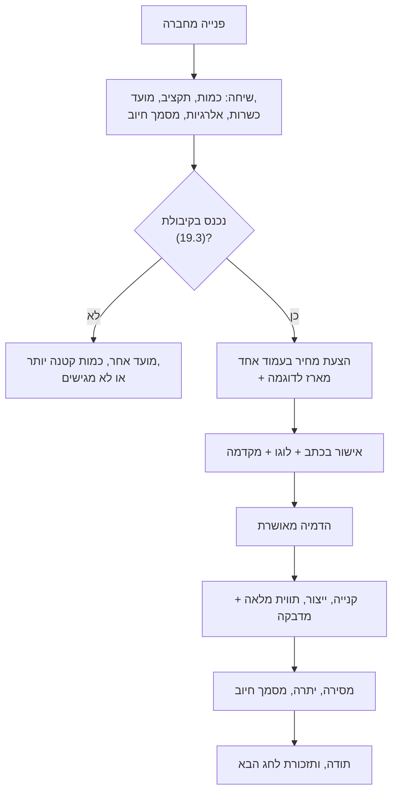

# 21.2 · מתנות לחברות: הצעת מחיר, מיתוג והזמנות גדולות

ב־[19.2](../module-19/lesson-02.md) חישבתם מדרגות מחיר לחברות, וב־[19.3](../module-19/lesson-03.md) בדקתם כמה מארזים נכנסים בשבועות שלפני החג. עכשיו הופכים את המספרים למסמך שחברה יכולה לאשר: הצעת מחיר בעמוד אחד, הדמיה של המארז הממותג, תנאי מקדמה ומסמך חיוב שמתאים למעמד שלכם. בסוף השיעור יש לכם הצעת מחיר מלאה, רשימת שאלות לשיחה הראשונה עם חברה, ותבנית שתשמש אתכם בכל עונה.

## מה צריך

| פריט | כמות לתרגול | כמות מלאה | הערה |
|---|---|---|---|
| [גיליון התמחור](../../templates/pricing-sheet.md) עם המדרגות מ־[19.2](../module-19/lesson-02.md) ו־[19.4](../module-19/lesson-04.md) | 1 | | מחיר לכל מדרגה ובדיקה מול מחיר הרצפה |
| [תכנון הייצור](../../templates/production-plan.md) מ־[19.3](../module-19/lesson-03.md) | 1 | | קיבולת, 80%, מועד סגירה |
| [תווית המוצר](../../templates/product-label.md) מ־[18.1](../module-18/lesson-01.md) | 1 | | נשארת על כל מארז, גם ממותג |
| מארז לדוגמה מאצווה רגילה | 1 | 1 לכל חברה רצינית | אותו מארז ששולחים בהזמנה |
| מדבקה עגולה ריקה וקובץ לוגו לדוגמה | 1 | לפי הכמות | להדמיה; מוצר ממותג וביטול עסקה: [20.4](../module-20/lesson-04.md) |
| [תוכנית כשרות](../../projects/m17-kashrut-plan.md) מ־17 | 1 | | מה מותר לכתוב בהצעה |

**אלרגנים:** בהצעה ובכל מארז כותבים את כל האלרגנים ואת "עלול להכיל", כי מי שאוכל הוא עובד שלא פגשתם ([16.2](../module-16/lesson-02.md)): במארז הסביבונים **חלב**, **סויה**, ו"עלול להכיל" **אגוזים** ו**בוטנים**; לפי המילוי גם **שומשום**, **גלוטן** ו**ביצים**. שואלים את החברה אם יש עובדים עם אלרגיה, ומציעים מארז נפרד ([פרויקט מודול 14](../../projects/m14-allergen-safe-batch.md)).

## למה זה עובד

### חברה קונה אחרת מלקוח פרטי

לפי הערכת Swish (ice, 25.3.2026), המתנה הממוצעת לעובד בפסח 2026 היא כ־500 ₪, ובראש השנה 2025 הייתה כ־300 ₪. לפי אותה כתבה, חברות עוברות למתנות דיגיטליות ולמתנות לבחירה, ותווי קנייה לרשתות מזון הוכפלו. כלומר: מארז שוקולד של 50-60 ₪ הוא לרוב **חלק** ממתנה, או מתנה קטנה לחג משני, ללקוחות או לצוות ([15.1](../module-15/lesson-01.md)). מי שמזמין הוא לרוב אדם אחד (משאבי אנוש, מנהלת משרד, ועד), שצריך לענות לארבע שאלות: כמה זה עולה, מה בדיוק מקבלים, מתי זה מגיע, ואיזה מסמך הוא מקבל להנהלת החשבונות. הצעת מחיר טובה עונה על ארבעתן בעמוד אחד, כדי שיוכל להעביר אותה הלאה בלי לחזור אליכם.

### הצעת מחיר: מה חייב להיות בה

| שורה | למה | מאיפה |
|---|---|---|
| המוצר, תמונה ומשקל נטו | שיידעו מה מאשרים | התווית ([18.1](../module-18/lesson-01.md)), התמונה הראשית ([18.4](../module-18/lesson-04.md)) |
| מחיר למארז לפי מדרגה, וסה"כ | מחיר שאפשר להשוות | המדרגות מ־[19.2](../module-19/lesson-02.md), מעל מחיר הרצפה ([19.4](../module-19/lesson-04.md)) |
| מה כלול: מיתוג, משלוח לכתובת אחת, פתק | בלי הפתעות בחשבון | [19.2](../module-19/lesson-02.md) |
| מעמד מע"מ, ואיזה מסמך יוצא | חברה רוצה לדעת אם תקזז מע"מ | למטה |
| אלרגנים ו"עלול להכיל" | העובדים לא קוראים את ההצעה, אבל מי שמזמין כן | [16.2](../module-16/lesson-02.md) |
| כשרות: הנוסח המדויק | השאלה הראשונה של הרבה חברות | [17.1](../module-17/lesson-01.md), [17.4](../module-17/lesson-04.md) |
| מועדים: אישור, לוגו, מסירה | הקיבולת שלכם סופית | [19.3](../module-19/lesson-03.md) |
| מקדמה ויתרה | אתם קונים חומרים לפני שמשלמים לכם | [19.2](../module-19/lesson-02.md) |
| תוקף ההצעה | מחירי שוקולד משתנים | [19.4](../module-19/lesson-04.md) |

### מקדמה: למה 30% בדוגמה

את חומרי הגלם והאריזה קונים לפני הייצור. בדוגמה של [19.2](../module-19/lesson-02.md), 60 מארזים ב־52 ₪ הם 3,120 ₪, וחומרים, אריזה ופחת הם 60 × 15.21 = 912.60 ₪. מקדמה של 30% היא 936 ₪, ולכן היא מכסה את מה שתוציאו לפני שהחברה משלמת. האחוז הוא הנחה של הקורס, לא כלל: הכלל הוא שהמקדמה גדולה ממה שתקנו בשביל ההזמנה. חברות רגילות לשלם "שוטף ועוד 30" או יותר; אם מסכימים, היתרה מגיעה שבועות אחרי החג, וזה כסף שלכם שתקוע אצל הלקוח. מחליטים מראש אם מקבלים את זה ובאיזה סכום.

### מסמך חיוב: עוסק פטור ועוסק מורשה

לפי כל זכות (נבדק 2026-11-10; ראו גם [20.2](../module-20/lesson-02.md)), עוסק פטור (מחזור עד 122,833 ₪ ב־2026) אינו רשאי להוציא חשבונית מס. הוא מוציא דרישת תשלום, "חשבון עסקה", וכשהתשלום מתקבל, קבלה בלבד. לכן החברה לא תקזז מע"מ על ההזמנה, וזה משהו שאומרים **לפני** ההצעה, לא אחרי המסירה ([15.1](../module-15/lesson-01.md)).

עוסק מורשה גובה מע"מ של 18% (מ־1.1.2025) ומוציא חשבונית מס. לפי ynetnews, מ־1.6.2026 חשבונית מס על יותר מ־5,000 ₪ **לפני מע"מ** צריכה מספר הקצאה מרשות המסים; בלעדיו הלקוח עלול לא לקזז מע"מ, ופיצול מלאכותי של עסקה כדי לעקוף את הסף נחשב פסול. מבקשים את המספר דרך האזור האישי באתר רשות המסים או דרך תוכנת חשבוניות. בדוגמה: 100 מארזים ב־52 ₪ לפני מע"מ הם 5,200 ₪, מעל הסף.

### מיתוג: מדבקה, לא תווית חדשה

הדרך הזולה למתג היא מדבקת לוגו עגולה על המכסה או על הסרט (בדוגמה של [19.2](../module-19/lesson-02.md), 1.00 ₪ למארז, הנחה). שני כללים, מעשיים: הלוגו מגיע מהחברה, בקובץ, והיא מאשרת בכתב הדמיה לפני הדפסה; והמדבקה **מצטרפת** לתווית המלאה, לא מחליפה אותה. רכיבים, אלרגנים, תאריך, אחסון ויצרן נשארים על כל מארז ([18.1](../module-18/lesson-01.md), [פרויקט מודול 18](../../projects/m18-product-label.md)). מיתוג שנוגע בשוקולד עצמו (טרנספר עם לוגו, [04.3](../module-04/lesson-03.md)) עולה יותר זמן ודורש בדיקה מראש.

### הזמנה גדולה היא שאלה של קיבולת

60 מארזים של 20 דקות הם 20 שעות עבודה. ב־[19.3](../module-19/lesson-03.md) ראיתם שבתכנון של 80% נכנסים כ־11 מארזים ביום, ושההזמנה הזאת לוקחת כמעט שבוע עבודה שלם באמצע העונה. לכן כל הצעה עוברת קודם מול תכנון הייצור: אם אין מקום, מציעים מועד מסירה מוקדם יותר (מוצר מוצק מחזיק שבועות), כמות קטנה יותר, או לא מגישים הצעה.

## שלב אחר שלב

> [!WARNING]
> מידע כללי, לא ייעוץ מס או משפטי, נכון ל־10.11.2026. אחוז המע"מ, תקרת עוסק פטור והסף למספר הקצאה משתנים; את מסמך החיוב ואת תנאי התשלום בודקים עם רואה חשבון לפני העונה.

1. **שיחה ראשונה, שש שאלות:** כמה מארזים, תקציב למארז, תאריך ומקום מסירה (כתובת אחת או הרבה), דרישת כשרות, אלרגיות בצוות, ואיזה מסמך חיוב הם צריכים.
2. **בדיקת קיבולת** מול [19.3](../module-19/lesson-03.md): שעות להזמנה, באיזה שבוע, מה זה דוחק.
3. **מחיר מהמדרגה** ב־[19.2](../module-19/lesson-02.md), ובדיקה שהוא מעל מחיר הרצפה של אותה מדרגה ([19.4](../module-19/lesson-04.md)). בלי "10% הנחה" באוויר.
4. **הצעת מחיר בעמוד אחד** לפי הטבלה למעלה, עם תאריך ותוקף (למשל 14 יום).
5. **כשרות בנוסח מדויק:** עם תעודה, הנוסח שבתעודה; בלי תעודה, "לעסק אין תעודת כשרות" ולא שום רמז ([17.4](../module-17/lesson-04.md)).
6. **מארז לדוגמה** מאצווה רגילה, עם התווית המלאה.
7. **אישור בכתב** (גם מייל או הודעה): כמות, מחיר, מועד, כתובת, ונוסח הפתק.
8. **מקדמה** לפני קניית החומרים, ומועד ליתרה.
9. **הדמיה** של המדבקה על המארז, ואישור כתוב שלה.
10. **מסירה** עם רשימת אלרגנים לאחראי, ומסמך חיוב לפי המעמד שלכם.
11. **אחרי החג:** תודה, ושאלה אם לרשום תזכורת לחג הבא ([21.3](lesson-03.md)).

## בדיקה: איך יודעים שהצליח

- [ ] ההצעה בעמוד אחד ועונה על ארבע השאלות: כמה, מה, מתי, איזה מסמך.
- [ ] המחיר מהמדרגה, מעל מחיר הרצפה, וכתוב אם הוא כולל מע"מ.
- [ ] כתובים אלרגנים, "עלול להכיל" ונוסח כשרות שעבר את בדיקת [17.4](../module-17/lesson-04.md).
- [ ] המקדמה גדולה מעלות החומרים והאריזה של ההזמנה.
- [ ] ההזמנה נבדקה מול תכנון הייצור, ויש מועד אחרון לאישור ולוגו.
- [ ] עוסק מורשה: נבדק אם הסכום עובר 5,000 ₪ לפני מע"מ.

## כשזה משתבש

| מה רואים | למה זה קורה | מה עושים עכשיו | איך מונעים בפעם הבאה |
|---|---|---|---|
| החברה מבקשת חשבונית מס, ואתם עוסק פטור | לא נשאל בשיחה הראשונה | אומרים בכנות מה אפשר להוציא; החברה מחליטה | שאלת המסמך היא שאלה 6 בשיחה |
| הלוגו הגיע יום לפני המסירה | אין מועד אחרון ללוגו | מוסרים בלי מדבקה, או עם פתק, בהסכמה | מועד ללוגו בהצעה, ולפניו לא מדפיסים |
| ביקשו 120 במקום 60, שבוע לפני | הצעה בלי בדיקת קיבולת | מציעים את מה שנכנס, או מועד מאוחר | כל הצעה עוברת דרך [19.3](../module-19/lesson-03.md) |
| "הנחה של 15% כי זו כמות גדולה" | לחץ במשא ומתן | בודקים מול הרצפה של המדרגה; עונים במספר | מדרגות מוכנות מראש |
| עובד אלרגי קיבל מארז רגיל | אין רשימה ואין שאלה | מפסיקים, מבררים, מתעדים תלונה ([16.4](../module-16/lesson-04.md)) | שאלה על אלרגיות ומארז נפרד |
| ההזמנה בוטלה אחרי קניית חומרים | אין מקדמה | מוכרים כמארזים רגילים לפני החג | מקדמה לפני קנייה |

### מה עושים עם מה שלא הצליח

שום דבר לא הולך לפח. מארזים מהזמנה שבוטלה נמכרים כמארזים רגילים (בלי המדבקה) לפני החג, נשלחים כדוגמאות לחברות אחרות, או מתפרקים: סביבונים שלמים למארזים אחרים, ושבורים לשוקו ולבראוניז. מדבקות לוגו שנשארו נשמרות לחג הבא של אותה חברה. הצעה שלא התקבלה נשמרת עם הסיבה (מחיר, מועד, כשרות), כדי לדעת מה לשנות.

## חלופות

### טבעוני / פרווה

בהזמנה גדולה מציעים מראש כמה מארזים טבעוניים או בלי חלב לעובדים שצריכים, כשורה נפרדת בהצעה ובמחיר מהגיליון שלהם, לא "אותו מחיר" ([פרויקט מודול 12](../../projects/m12-vegan-box.md)). מייצרים אותם בתחילת היום, לפני החלבי, ואורזים ומסמנים בנפרד. "פרווה" כותבים רק לפי תעודה; "טבעוני" רק כשהוא נכון לכל רכיב ([12.1](../module-12/lesson-01.md)).

### בריא יותר

מארז מיני או מריר 70% מתאים לתקציב קטן או למתנה ללקוחות, אבל בהצעה כותבים עובדות ("5 יחידות, מריר 70%"), לא "בריא" ולא "מתאים לסוכרתיים" ([13.5](../module-13/lesson-05.md)). אם יש מלטיטול, מוסיפים את האזהרה: צריכה מופרזת עלולה לגרום לאפקט משלשל (גזים ושלשול), ולא מתאים לילדים בכמות.

### כשרות

בחברות רבות, ובכל מוסד או אירוע לקהל שומר כשרות, בלי תעודה אין הזמנה. אם חברות הן ערוץ ראשי אצלכם, זו הסיבה הכי חזקה לדרך א ב־[17.1](../module-17/lesson-01.md#שלוש-דרכים-לעסק-קטן): תעודת הכשר מהרב המקומי דרך המועצה הדתית. בלי תעודה, אומרים את זה בשיחה הראשונה, לא בהצעה. חומר גלם לפי ההכשר הנדרש: [17.2](../module-17/lesson-02.md). אם יש ספק, שואלים את הרב.

## איפה קונים

להזמנה גדולה מבקשים הצעת מחיר מספק אריזה ומדפוס מדבקות; המחירים ב[קופסאות פרלינים](../../references/where-to-buy.md#קופסאות-פרלינים), [מדבקות ותוויות](../../references/where-to-buy.md#מדבקות-ותוויות) ו[צלופן וסרטים](../../references/where-to-buy.md#צלופן-וסרטים) הם של חבילות קטנות. קוברטורה בכמות: [קוברטורה](../../references/where-to-buy.md#קוברטורה) ו[מדריך הכשרות](../../references/kashrut-guide.md#שלושה-כללים). עובדות המס (מידע כללי, לא ייעוץ): [מסים: עוסק פטור, מע"מ ומספר הקצאה](../../curriculum/research/sources.md#7-מסים).

## תרגול

### משימה

כותבים הצעת מחיר בעמוד אחד לחברה דמיונית: 60 מארזים מהמוצר הראשי שלכם, עם מדבקת לוגו ומסירה לכתובת אחת לפני החג הקרוב. משתמשים במדרגות מ[גיליון התמחור](../../templates/pricing-sheet.md) ובקיבולת מ[תכנון הייצור](../../templates/production-plan.md). אפשר לעבוד על [תבנית הצעת המחיר](../../templates/corporate-quote.md). מוסיפים את שש שאלות השיחה הראשונה עם תשובות דמיוניות, והדמיה של מדבקה על מארז אחד (מצולמת).

דוגמה פתורה

**הצעת מחיר מס' 1, 10.11.2026, בתוקף עד 11.11.2026 (המועד האחרון לאישור לפי תכנון הייצור)**

**ללקוח:** חברה, 60 מארזים לחנוכה. **מאת:** [שם העסק], עוסקת פטורה, [כתובת, טלפון].

| | |
|---|---|
| מוצר | מארז 5 סביבוני שוקולד בעבודת יד: חלב, מריר ולבן. 95 גרם נטו |
| מחיר | 52 ₪ למארז (מדרגה 50 ומעלה); 20-49 מארזים: 55 ₪ |
| סה"כ ל־60 מארזים | 3,120 ₪. עוסקת פטורה: לא נגבה מע"מ |
| כלול | מדבקת לוגו על המכסה, פתק ברכה אחיד, משלוח לכתובת אחת |
| מסמך | חשבון עסקה, וקבלה בתשלום. לא חשבונית מס |
| אלרגנים | מכיל חלב, סויה. עלול להכיל אגוזים ובוטנים. רשימה מלאה על כל מארז |
| כשרות | לעסק אין תעודת כשרות |
| מועדים | אישור עד 11.11; לוגו (קובץ וקטורי) עד 12.11; הדמיה לאישור 13.11; ייצור 15-19.11; מסירה שלישי 24.11 |
| תשלום | מקדמה 936 ₪ (30%) באישור; יתרה 2,184 ₪ במסירה |
| ביטול | אחרי קניית חומרים (12.11) המקדמה לא מוחזרת |

**בדיקות:** 52 ₪ מעל מחיר הרצפה של המדרגה ([19.4](../module-19/lesson-04.md)). חומרים, אריזה ופחת: 912.60 ₪, פחות מהמקדמה. 60 × 20 דקות = 20 שעות; ב־[19.3](../module-19/lesson-03.md) ההזמנה תוכננה לשבוע 15-19.11, לפני השבוע העמוס של הלקוחות הפרטיים. **שאלות שיחה:** 60; עד 60 ₪; 24.11, כתובת אחת; "לא חייב כשרות" (נרשם); עובדת אחת אלרגית לבוטנים (הוצע מארז נפרד, תמחור בנפרד); "מספיק לנו קבלה".

**אילו הייתי עוסקת מורשית:** 52 ₪ + 18% מע"מ = 61.36 ₪ למארז; 3,120 ₪ לפני מע"מ, מתחת לסף 5,000 ₪, ולכן בלי מספר הקצאה. ב־100 מארזים, 5,200 ₪, צריך מספר הקצאה.

### זמן

כשעה: 10 דקות לשאלות, 15 דקות לבדיקת קיבולת ומחיר, 20 דקות להצעה, 15 דקות להדמיה.

### יומן

ב[יומן התרגול](../../templates/practice-log.md) רושמים: המחיר שהצעתם ולמה, המקדמה מול עלות החומרים, ומה הייתם עונים לחברה שמבקשת 15% הנחה.

### בדיקה עצמית

- [ ] הצעת מחיר בעמוד אחד עם כל השורות בטבלה.
- [ ] מחיר מהמדרגה, מעל הרצפה; מעמד מע"מ ומסמך חיוב כתובים.
- [ ] מקדמה שמכסה חומרים ואריזה, ומועדים ללוגו ולהדמיה.
- [ ] הדמיה מצולמת: מדבקה על המכסה, התווית המלאה במקומה.

## סיכום

- חברה צריכה ארבע תשובות בעמוד אחד: כמה, מה, מתי, ואיזה מסמך חיוב.
- המחיר מהמדרגות של [19.2](../module-19/lesson-02.md), מעל מחיר הרצפה; המקדמה גדולה מעלות החומרים והאריזה.
- עוסק פטור לא מוציא חשבונית מס, ואומרים את זה לפני ההצעה; עוסק מורשה צריך מספר הקצאה מעל 5,000 ₪ לפני מע"מ (מ־1.6.2026).
- מדבקת לוגו מצטרפת לתווית המלאה; אלרגנים וכשרות בנוסח מדויק, וכל הזמנה עוברת קודם דרך תכנון הייצור.
