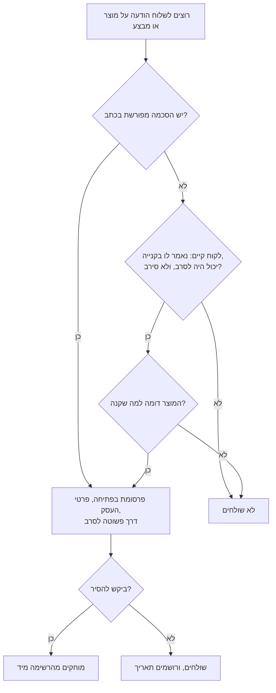

# 21.3 · ביקורות, לקוחות חוזרים ומנויים

לקוח שכבר קנה, טעם ואהב הוא הלקוח הכי זול שיש: לא צריך לשכנע אותו מההתחלה. בשיעור בונים את שלושת הדברים שהופכים קנייה אחת לקשר: ביקורות שמבקשים בדרך הוגנת, רשימת לקוחות שמותר לשלוח אליה הודעות, ומנוי חודשי קטן לחודשים השקטים. בסוף יש לכם הודעת בקשת ביקורת, טופס הסכמה, הודעת תזכורת לחג הבא שעומדת בחוק, ודף תנאים למנוי.

## מה צריך

| פריט | כמות לתרגול | כמות מלאה | הערה |
|---|---|---|---|
| רשימת הלקוחות מהחג האחרון (או 5 לקוחות דמיוניים) | 5 | כל הלקוחות | שם, טלפון או מייל, מה קנו, מתי |
| לוח התוכן מ־[21.1](lesson-01.md) | 1 | | תאריכי החג הבא |
| יומן תלונות ומכתב ריקול מ־[16.4](../module-16/lesson-04.md) | 1 | | התהליך לביקורת שלילית |
| [גיליון התמחור](../../templates/pricing-sheet.md) של מוצר המנוי | 1 | | מחיר ודקות למארז |
| [תכנון הייצור](../../templates/production-plan.md) מ־19.3 | 1 | | כמה מנויים נכנסים |
| [תוכנית עסקית קצרה](../../templates/business-plan.md), סעיפים 4 ו־6 | 1 | | ערוצים ומספרים |

**אלרגנים:** במנוי מחליפים מוצר כל חודש, ולכן כל מארז מקבל תווית משלו עם האלרגנים של אותו חודש: **חלב**, **סויה**, ולפי המילוי **אגוזים**, **בוטנים**, **שומשום**, **גלוטן**, **ביצים**. מנוי שהלקוח שלו אלרגי לאחד מהם מקבל הודעה מראש על כל חודש שבו האלרגן במוצר ([16.2](../module-16/lesson-02.md)).

## למה זה עובד

### ביקורת שמבקשים, לא קונים

ביקורות עובדות כי לקוח חדש סומך על לקוח אחר יותר מאשר עליכם. מכאן גם המגבלות: ביקורת שנקנתה או סוננה כבר לא אומרת מה שהיא נראית.

לפי מדיניות התוכן של Google Maps (נבדק 2026-11-10), ביקורות בתמורה אסורות ויוסרו: אסור להציע "payment, discounts, free goods and/or services" בתמורה לביקורת. אסור גם להרתיע מביקורות שליליות או לבקש ביקורות "selectively", רק מלקוחות מרוצים, ואסור תוכן מתוך ניגוד עניינים (עובדים, קשר מקצועי או אישי). מותר לבקש ביקורות, כל עוד לא מציעים תמריץ ולא מנסים להשפיע על הדירוג. ביקורת מזויפת או "של חברה" היא גם מצג על העסק, ו־[18.4](../module-18/lesson-04.md) הראה שחוק הגנת הצרכן אוסר הטעיה במצג ובפרסומת. ההצעה שלנו: אותה הודעה לכל הלקוחות, פעם אחת, כמה ימים אחרי המסירה, בלי הנחה ובלי מתנה.

### ביקורת שלילית היא תלונה

ביקורת על "שוקולד לבן ומאובק" היא כנראה פריחה ([03.5](../module-03/lesson-05.md)); "הגיע נמס" היא שאלת משלוח ([11.3](../module-11/lesson-03.md)); "הילד קיבל פריחה בפה" היא תלונה על נזק אפשרי לבריאות. את כולן רושמים ביומן התלונות של [16.4](../module-16/lesson-04.md). לפי חוק המזון, תלונות על נזק לבריאות שומרים לפחות שלוש שנים, ועוסק שנודע לו שמזון שלו מזיק פועל "בהקדם האפשרי" ([מקורות, סעיף 2](../../curriculum/research/sources.md#2-חוק-המזון--נקודות-ליצרן-קטן)). התשובה הפומבית קצרה ועניינית: תודה, מה תבדקו, ובקשה להמשיך בהודעה פרטית. לא מתווכחים, לא מאשימים את הלקוח, ולא כותבים בתגובה פרטים רפואיים שלו.

### רשימת לקוחות: "חוק הספאם"

הודעה שמזמינה לקנות היא "דבר פרסומת". לפי סעיף 30א לחוק התקשורת (בזק ושידורים) (ויקיטקסט, נבדק 2026-11-10):

- **מה אסור:** לשלוח דבר פרסומת בפקס, במערכת חיוג אוטומטי, ב"הודעה אלקטרונית" (הודעה שנשלחת ברשת האינטרנט) או ב"הודעת מסר קצר" (SMS ודומיו), בלי **הסכמה מפורשת מראש** של הנמען, בכתב (30א(ב)). החוק לא מזכיר וואטסאפ בשמו; לפי ההגדרות, הודעת וואטסאפ היא כנראה "הודעה אלקטרונית". זו פרשנות שלנו, ולכן מתייחסים אליה באותם כללים.
- **החריג ללקוח קיים** (30א(ג)): מותר בלי הסכמה רק כשמתקיימים שלושה תנאים יחד: הלקוח מסר את הפרטים בזמן קנייה או משא ומתן, ונאמר לו שהם ישמשו לפרסומת; ניתנה לו הזדמנות לסרב והוא לא סירב; והפרסומת על מוצר דומה למה שקנה.
- **מה חייב להיות בהודעה** (30א(ה)): המילה "פרסומת" בתחילת ההודעה, או בשורת הנושא במייל; שם העסק, כתובת ודרכי קשר; והודעה שאפשר לסרב בכל עת, עם דרך פשוטה לעשות זאת (במייל, כתובת אינטרנט תקפה לסירוב). ב־SMS מספיקים שם העסק ופרטי קשר לסירוב.
- **סירוב** (30א(ד)): הנמען יכול לסרב בכל עת, בכתב או באותה דרך שבה נשלחה ההודעה, ובחינם.
- **פיצוי** (30א(י)): על הודעה ששלחו ביודעין בניגוד לסעיף, בית המשפט רשאי לפסוק פיצויים לדוגמה **בלי הוכחת נזק, עד 1,000 ₪ לכל הודעה**. רשימה של 200 לקוחות היא סיכון של סכום גדול.

הודעה שאינה פרסומת, כמו "ההזמנה שלך מוכנה לאיסוף", אינה דבר פרסומת. אבל "ההזמנה מוכנה, ואגב, יש מבצע" כבר כן.

### מנוי חודשי: הכנסה צפויה, וחוזה מתמשך

במנוי (15.1) הלקוח משלם כל חודש על מארז. בחישוב, הכוח של מנוי הוא שהוא ממלא את החודשים השקטים בלי להתנגש עם העונות. מנוי כזה הוא כנראה "עסקה מתמשכת" לפי חוק הגנת הצרכן (פרשנות שלנו; את ההגדרה המלאה לא בדקנו), ואז חלים עליו כללי ביטול (ויקיטקסט, נבדק 2026-11-10):

- **סעיף 13ד(ג):** החוזה מסתיים בתוך שלושה ימי עסקים מיום הודעת הביטול (שישה, אם נשלחה בדואר רשום); אחרי זה לא מחייבים.
- **סעיף 14ט:** העסק מאפשר לבטל בטלפון או פנים אל פנים, בדואר רשום, בדואר אלקטרוני, ובאינטרנט כשהמכירה באינטרנט. במכירה באתר, קישור ביטול בולט בעמוד הבית. דרכי הביטול נמסרות ללקוח בכתב.
- **סעיף 13א:** בעסקה לתקופה קצובה שמשולמת בהוראת חיוב, מודיעים ללקוח על סיום התקופה 60 עד 30 ימים לפני; תנאי שמאריך את ההתקשרות אוטומטית אחרי תום התקופה בטל.

בפועל: מנוי פשוט, חודש בחודש, עם ביטול במייל או בהודעה, ובלי חידוש אוטומטי מוסתר. ובקיץ: [11.3](../module-11/lesson-03.md) ו־15.1 הראו שמשלוח שוקולד ביולי-אוגוסט הוא סיכון; מנוי "ספטמבר עד יוני" עם הפסקה כתובה מראש פשוט יותר מהתמודדות עם מארזים נמסים. תנאי משלוח ותנאי שירות מלאים: מודול 20.

## שלב אחר שלב

> [!WARNING]
> מידע כללי, לא ייעוץ משפטי, נכון ל־10.11.2026. לפני שליחה לרשימה גדולה או לפני השקת מנוי בהוראת קבע, מראים את הנוסחים לעורך דין.

1. **הודעת בקשת ביקורת:** אותה הודעה לכל הלקוחות, 3-5 ימים אחרי המסירה, עם קישור, בלי תמריץ.
2. **תשובה לביקורת שלילית:** רושמים ביומן התלונות, עונים בפומבי בשלוש שורות, ממשיכים בפרטי. תלונה על בריאות: לפי תהליך 16.4.
3. **טופס הסכמה:** בטופס ההזמנה, תיבה **לא מסומנת מראש**: "אשמח לקבל הודעות על מארזים חדשים וחגים (פרסומת). אפשר להסיר בכל עת." ושומרים מתי ואיך ניתנה ההסכמה.
4. **רשימה מינימלית:** שם, דרך קשר, מה קנו ומתי, וסטטוס הסכמה. לא שומרים מה שלא צריך.
5. **הודעת תזכורת לחג הבא:** "פרסומת:" בפתיחה, מה ומתי, מחיר כולל, מועד אחרון, שם העסק ופרטי קשר, ודרך להסרה.
6. **הסרה:** מי שביקש, נמחק באותו יום, ולא נשלחת לו עוד הודעה.
7. **מנוי:** בוחרים מוצר לכל חודש (מ־[10.x](../module-10/lesson-01.md) ומהקורס), מחשבים כמה מנויים נכנסים בקיבולת, וכותבים דף תנאים: מחיר, יום משלוח, הפסקת קיץ, איך מבטלים.

## בדיקה: איך יודעים שהצליח

- [ ] בקשת הביקורת זהה לכולם, בלי הנחה, מתנה או סינון.
- [ ] יש תשובה מוכנה לביקורת שלילית, והתלונה רשומה ביומן.
- [ ] תיבת ההסכמה לא מסומנת מראש, וכתוב בה שמדובר בפרסומת.
- [ ] בהודעת השיווק: "פרסומת" בפתיחה, שם ופרטי קשר, ודרך פשוטה להסרה.
- [ ] בתנאי המנוי: ביטול במייל או בהודעה, בלי חידוש אוטומטי מוסתר, והפסקת קיץ כתובה.

## כשזה משתבש

| מה רואים | למה זה קורה | מה עושים עכשיו | איך מונעים בפעם הבאה |
|---|---|---|---|
| ביקורת של כוכב אחד: "הגיע נמס" | משלוח ביום חם | עונים ענייני, מציעים פתרון בפרטי, רושמים | בדיקת חום לפני משלוח (11.3) |
| לקוחה כותבת "מי נתן לכם את המספר שלי?" | שליחה בלי הסכמה ובלי חריג תקף | מתנצלים, מוחקים מיד | תיבת הסכמה ורישום מתי ניתנה |
| ביקשו להסיר וקיבלו שוב הודעה | רשימה בכמה מקומות | מוחקים בכל המקומות, ומתנצלים | רשימה אחת בלבד |
| קבוצת וואטסאפ "לקוחות" עם 150 איש | נוח, אבל כל הודעה היא פרסומת לכולם | מעבירים לרשימה עם הסכמה, או לערוץ שמצטרפים אליו ביוזמתם | הסכמה לפני הצירוף |
| מנויים מבטלים בקיץ | משלוח נמס, או אותו מוצר כל חודש | הפסקת קיץ; לוח מוצרים לשנה | תנאי הפסקה כתובים מראש |
| מנוי ביטל ונשלח לו מארז | ביטול לא נרשם בזמן | מחזירים את החיוב | ביטול נרשם ונכנס לתוקף בתוך 3 ימי עסקים |

### מה עושים עם מה שלא הצליח

שום דבר לא הולך לפח. מארז שחזר מלקוח שהתלונן נבדק: אם יש פגם בטיחותי, הוא מתועד לפי 16.4 ולא נאכל; אם זו פריחה או שבר, השוקולד חוזר להמסה, לשוקו או לבראוניז, ולא נמכר. מארזי מנוי שנשארו אחרי ביטול נמכרים כמארזים רגילים או נשלחים כדוגמה לחברה ([21.2](lesson-02.md)). ביקורת שלילית נשמרת ביומן עם מה ששיניתם בעקבותיה.

## חלופות

### טבעוני / פרווה

מנוי טבעוני הוא מוצר נפרד עם לוח מוצרים משלו, ולא "המנוי הרגיל בלי חלב". ברשימת הלקוחות מסמנים מי ביקש טבעוני, כדי שהתזכורת לחג תציע לו את המוצר הנכון. "טבעוני" רק כשהוא נכון לכל רכיב; "פרווה" רק לפי תעודה ([12.1](../module-12/lesson-01.md)).

### בריא יותר

מנוי "מיני" (מארז קטן, מריר גבוה) מתאים ללקוח שרוצה מעט כל חודש. בהודעות ובביקורות שאתם משתפים לא כותבים "בריא" ולא "מתאים לסוכרתיים"; גם ציטוט של לקוח שכתב "בריא ומושלם" בסטורי שלכם הוא פרסום שלכם ([13.5](../module-13/lesson-05.md)). אם יש מלטיטול: צריכה מופרזת עלולה לגרום לאפקט משלשל (גזים ושלשול), ולא מתאים לילדים בכמות.

### כשרות

ברשימת הלקוחות אפשר לסמן מי שאל על כשרות, ולעדכן אותם אם קיבלתם תעודה. במנוי, תעודה לפסח מכסה רק את מה שאושר לפסח ([17.4](../module-17/lesson-04.md)). בהודעות ובביקורות שמשתפים, אותו כלל: בלי תעודה, אין "כשר". אם יש ספק, שואלים את הרב.

## איפה קונים

בשיעור הזה לא קונים. לחומרים ולאריזה של מוצר המנוי: [קופסאות פרלינים](../../references/where-to-buy.md#קופסאות-פרלינים), [מדבקות ותוויות](../../references/where-to-buy.md#מדבקות-ותוויות), ולקיץ [קופסאות מבודדות וקרחונים](../../references/where-to-buy.md#קופסאות-מבודדות-וקרחונים). מקורות לכללים (מידע כללי, לא ייעוץ): [הגנת הצרכן במכירה אונליין](../../curriculum/research/sources.md#6-הגנת-הצרכן-במכירה-אונליין), [חוק המזון: תלונות וריקול](../../curriculum/research/sources.md#2-חוק-המזון--נקודות-ליצרן-קטן).

## תרגול

### משימה

כותבים ארבעה מסמכים קצרים: הודעת בקשת ביקורת, תשובה לביקורת שלילית אחת (דמיונית), טופס הסכמה והודעת תזכורת לחג הבא, ודף תנאים למנוי חודשי עם לוח מוצרים לשנה. ממלאים את סעיפים 4 ו־6 ב[תוכנית העסקית](../../templates/business-plan.md) עם המנוי. זה התרגול האחרון לפני [פרויקט הגמר](../../projects/m21-launch-plan.md).

דוגמה פתורה

**בקשת ביקורת** (לכל הלקוחות, 7.12.2026): "תודה שהזמנתם סביבונים לחנוכה! אם יש לכם דקה, נשמח לביקורת כנה, טובה או לא, כאן: [קישור]. [שם העסק]." בלי הנחה, בלי הגרלה.

**תשובה לביקורת "הסביבונים הגיעו עם כתמים לבנים":** "תודה שכתבת. נשמע כמו פריחה, כנראה מקפיצת טמפרטורה; נבדוק את האצווה. נשמח שתכתבי לנו בהודעה פרטית כדי שנסדר." ביומן: תאריך, אצווה 261125-S, תמונה, מה נבדק.

**טופס הסכמה** (תיבה ריקה): "☐ אשמח לקבל הודעות פרסומת על מארזים חדשים וחגים, בוואטסאפ או במייל. אפשר להסיר בכל עת בהודעה 'הסר'."

**תזכורת** (רק למי שסימן): "פרסומת: מארזי ט"ו בשבט של [שם העסק] פתוחים להזמנה. מארז 5 טבלאות פירות יבשים, 52 ₪ (מחיר כולל; מחיר לדוגמה). הזמנות עד 17.1.2027. [שם העסק], [טלפון, כתובת]. להסרה: השיבו 'הסר'."

**מנוי** (הנחות): 12 מנויים, מארז 5 יחידות, 58 ₪ לחודש, איסוף או משלוח בתוספת. 12 × 25 דקות = 5 שעות בחודש, בשבוע הראשון של כל חודש. ספטמבר עד יוני; יולי-אוגוסט הפסקה. **לוח מוצרים:** ספטמבר תפוח ודבש, אוקטובר קרמל מלוח, נובמבר טראפלס, דצמבר סביבונים, ינואר טבלאות פירות יבשים, פברואר לבבות, מרץ משלוח מנות, אפריל (פסח, רק עם חומרי גלם מסומנים) מריר, מאי ג'יאנדוז'ה, יוני טבלאות לימון. **תנאים:** חיוב ב־1 לחודש; ביטול במייל או בהודעה, נכנס לתוקף בתוך 3 ימי עסקים; בלי חידוש אחרי יוני, הרשמה מחדש בספטמבר; אלרגנים בתווית של כל חודש, והודעה מראש למנוי אלרגי.

### זמן

כשעה: 10 דקות לביקורות, 10 דקות לתשובה, 15 דקות להסכמה ולתזכורת, 25 דקות למנוי.

### יומן

ב[יומן התרגול](../../templates/practice-log.md) רושמים: כמה לקוחות ביקשו לקבל הודעות, כמה ביקורות הגיעו, וכמה מנויים נכנסים בלי להתנגש עם העונות.

### בדיקה עצמית

- [ ] ארבעת המסמכים כתובים.
- [ ] הודעת התזכורת נפתחת ב"פרסומת", ויש בה פרטי העסק ודרך להסרה.
- [ ] לוח מוצרים למנוי לעשרה חודשים, עם הפסקת קיץ.
- [ ] סעיפים 4 ו־6 בתוכנית העסקית מעודכנים.

## סיכום

- מבקשים ביקורת מכל הלקוחות באותה הודעה, בלי תמריץ ובלי סינון; ביקורת שלילית היא תלונה ונרשמת ביומן (16.4).
- הודעת שיווק דורשת הסכמה מפורשת בכתב, או את שלושת תנאי הלקוח הקיים; היא נפתחת ב"פרסומת" וכוללת דרך פשוטה להסרה. פיצוי של עד 1,000 ₪ להודעה, בלי הוכחת נזק.
- מנוי הוא כנראה עסקה מתמשכת: ביטול בתוך 3 ימי עסקים, בדרכים פשוטות, ובלי חידוש אוטומטי מוסתר.
- מנוי קטן ממלא את החודשים השקטים; בקיץ עדיף להפסיק מאשר לשלוח מארזים נמסים.
